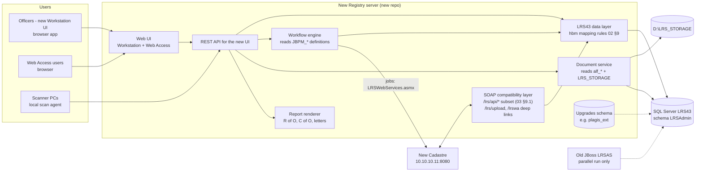

# 01 — Overview and target design

## 1. Goal

The aim is to replace Aumentum Registry on **10.10.10.5** with a new application, built in its own repository. The replacement covers two parts:

- the browser **Web Access**;
- the Windows **Workstation**, meaning the Registry Desktop and the Cashier.

The new application runs on the **same SQL Server database, LRS43**, with schema `LRSAdmin` unchanged. It must keep every structure that the old server, the Cadastre and Metabase read. Upgrades may be added, but they go in their own schema, linked to `LRSAdmin` by id; they never alter it (rule D2).

This document is requirements and design only. Nothing has been built.

## 2. What is on .5 today (summary of 02–07)

| Layer | What it is | Detail in |
|---|---|---|
| Host | Windows Server 2012 R2, Dell R910, 64 CPU, 128 GB. D: holds the database (755 GB) and `D:\LRS_STORAGE` (scans and documents) | 06 §1 |
| Database | SQL Server 2012 instance `REGISTRY`, database **LRS43**, schema `LRSAdmin`, 168 tables. There are 78 `lr_*` registry tables, 28 `JBPM_*` workflow tables, 46 `alf_*` and 10 `avm_*` document-repository tables, and 5 `JMS_*` tables. The server accepts **TLS 1.0 only** | 02 |
| Server | JBoss 4.2.3 + Java 7, Windows service `LRSAS`. It runs `lrs.war` (ILS LRS on Alfresco 3.4.9 Enterprise + jBPM 3 + Hibernate + BIRT reports + Axis SOAP) and `lrswa.war` (Web Access, Spring MVC). HTTP on port 8080 only | 06 |
| API | 19 SOAP services under `/lrs/api/*`, 145 operations. Sign-in uses a ticket sent in a WS-Security UsernameToken. Files are uploaded with `PUT /lrs/upload` | 03 |
| Workstation | WinForms .NET client (`ThomsonReuters.Aumentum.Registry.PLAGIS.RegistryDesktop.exe`). Its screens are driven by config: `WorkflowConfig/*.config` chooses the pages for each stage, and `lr_formfield` (170 forms, 1,725 fields) defines every field. One PLAGIS worker, `CustomAssessWorker`, handles all stages, and its business rules run on the client | 05, 11 |
| Web Access | Spring MVC + Spring Security on the same database through Hibernate. Search and detail screens come from the `*LWA` rows in `lr_formfield`. Guest access is off. The Desktop deep-links into it | 06, 12 |
| Workflow | jBPM 3. There are 64 process definitions in the database: one per process, up to 4 versions each. One "Subsequent Registration" process serves 26 dealing types | 04 |
| Documents | Alfresco content store on `D:\LRS_STORAGE`. Letters and certificates are BIRT templates rendered on the server | 10, 06 §2.6 |
| Integrations | The Cadastre is reached in two directions. The Registry creates jobs through `LRSWebServices.asmx`; the Cadastre reads through `DomainModelService` and writes through `IntegrationService.SaveEntity`. Other integrations: the Cashier (fee calculation via `ILSCash4LRS.asmx`), the map (GISViewer `MapWorker.aspx`), and Metabase "PLAGIS Analytics". There is no e-mail, SMS or payment gateway | 07 |

Volumes (04 §4): 115,570 transactions. APRO (First Registration) has 41,563, INSC (Indexing & Scanning) 27,564, GRPM (Ground Rent Payment) 14,585, APCO (C of O) 10,831 and APCA 5,846. Those five types make up **87 %** of all files, and that sets the build order.

## 3. Target architecture

## 4. Design decisions (recommendations; PLAGIS/you to confirm)

| # | Decision | Recommendation | Why |
|---|---|---|---|
| D1 | **Database writes** | Write `LRSAdmin` exactly as Hibernate does, following 02 §9. Take ids and numbers from `lr_simplecounter`, using one `UPDATE … OUTPUT`. Write the full class name in `Hjtype` and keep joined subclass rows and `*_ext` rows with the same id. Store dictionary **ids**; keep `*_index` lists dense; use lifespan versioning, never delete | The old server and the Cadastre read the same rows, and the old server can run alongside |
| D2 | **Upgrades** | All new tables go in a **separate schema** (e.g. `plagis_ext`) in LRS43, keyed to `LRSAdmin` ids. Never add columns to `LRSAdmin` tables | Both old wars run `hbm2ddl=update`, and Metabase reads `LRSAdmin`. Keeping new tables apart makes upgrades removable and invisible to the old code |
| D3 | **Workflow engine** | A new engine that **reads the jBPM definitions** (`JBPM_PROCESSDEFINITION/NODE/TRANSITION/TASK/SWIMLANE`) and **writes jBPM-compatible state**: `JBPM_PROCESSINSTANCE/TOKEN/TASKINSTANCE` and `lr_process_history`. Cut over **one transaction type at a time** | The same file must look the same in both systems while they run side by side. Process history and the old inbox stay valid. Needs capture item A1 |
| D3-alt | (if D3 proves too costly) | Use the new engine's own tables in `plagis_ext`, still writing `lr_process_history`, and move in-flight files at cut-over per type | Simpler engine, but files cannot be worked in both systems |
| D4 | **Old Desktop during parallel run** | Keep the old Desktop on the **old JBoss**. The new server only implements the replica contract (03 §9.1) that other systems call | Serving the old Desktop would mean re-implementing all of Alfresco and jBPM's SOAP (03 §9.2) |
| D5 | **Documents** | **Read** existing documents directly (`alf_node` → `alf_content_url` → file on `D:\LRS_STORAGE`, see 10). For **new** documents, either store them through a narrow writer that creates Alfresco-compatible rows, or use an upgrade store in `plagis_ext` with the file path on the same disk. Decide after capture A5 | Every existing scan and certificate stays viewable without migration |
| D6 | **Workstation technology** | One **browser app** for both Workstation and Web Access, with role-based views (like the Cadastre's VIEWS). Scanning goes through a small local scan agent on scanner PCs (TWAIN/WIA → upload) | Removes the WinForms/WSE3/DevExpress/LeadTools dependencies; officers keep the same pages and order (11 style guide) |
| D7 | **Database driver** | The driver must speak **TLS 1.0** to SQL Server 2012, or the SQL Server must be patched for TLS 1.2 (PLAGIS ICT). On the Cadastre side this already needed `OPENSSL_CONF` with `MinProtocol=TLSv1` | Otherwise connections fail |
| D8 | **Stack** | Your choice. Rust + Axum (like `cadastre-server`) suits the SOAP layer and re-use of `src/lrs.rs`; any stack works if it meets D1/D7 | Consistency with the Cadastre repo |

## 5. Non-negotiable rules

1. **Never** change, renumber or delete `LRSAdmin` rows outside the business actions the old system performs. History is closed with `end_lifespan_version`, never deleted.
2. **Share the counters.** The old JBoss and the new server take numbers from the same `lr_simplecounter` rows. Read them again just before go-live (capture A7).
3. **UPIN rule:** a UPIN is never renumbered, moved or reused, in any status. Linking happens at Raise Title Deed Plan / Review Title Deed Plan only (04 §3).
4. Keep the **replica contract**, so the Cadastre, MCServer and GISViewer keep working once the JBoss is switched off. It covers `AuthenticationService`, the WS-Security receiver, `DomainModelService` HQL reads, `IntegrationService.SaveEntity`, `PUT /lrs/upload`, `?wsdl` with a `Date` header, and the `welcome.do` deep links (03 §9.1, 07 §10).
5. **Keep the outbound job service:** call the Cadastre's `LRSWebServices.asmx` exactly as `lrs-mc-integration.jar` does (03 §8.1), and keep `lr_mc_job` the same.
6. Work against a **copy** first. `LRS43_COPY` already exists in the test SQL Server (`tools/import/load-lrs-copy.sh`). Do not write to live LRS43 before the parallel-run phase.
7. Fees must give the **same amount** as today (`lr_fee_structure` + `lr_fee_rate` + Cashier `CalculateFee`). Test against old receipts before go-live.

## 6. Known data issues to carry, not fix

- UPIN quality in `lr_spatial_unit.upin`: some are lowercase, some have wrong lengths. 192 UPINs sit on several properties (02 §2.5, registry-linkage).
- Mis-categorised dictionary rows (02 §9.3 item 11).
- No indexes on `transaction_number`, `upin` or `refnum`. Adding them is an ICT decision (an index is not a structure change, but agree it with PLAGIS first).
- Security findings for PLAGIS ICT:
  - the JBoss consoles still have the stock sample accounts;
  - tickets never expire;
  - the last full backup was 2026-10-06, and the Cashier database was last backed up in 2017.

## 7. What a "replica" means here — scope

| In scope (parity) | Upgrades (linked, later) |
|---|---|
| Every transaction type in 04, with its stages, rules, fees, documents and printouts | Online payment and Remita/bank reconciliation (no payment gateway today) |
| Every Workstation page (05, 11) and Web Access screen (06, 12) | E-mail/SMS notifications (SMTP is unconfigured) |
| Admin: users, groups, permissions, dictionaries, settings, fees, calendar, form fields, reports (06 §2.4) | Applicant status portal (guest access is off today) |
| Cadastre integration and UPIN linking (07) | Charting & reporting hand-off (docs/charting-and-reporting.docx) |
| Reports (8 bootstrap reports) and certificate templates | Dashboards replacing or feeding Metabase |
| | Faster search: new indexes / a search index in `plagis_ext` |
