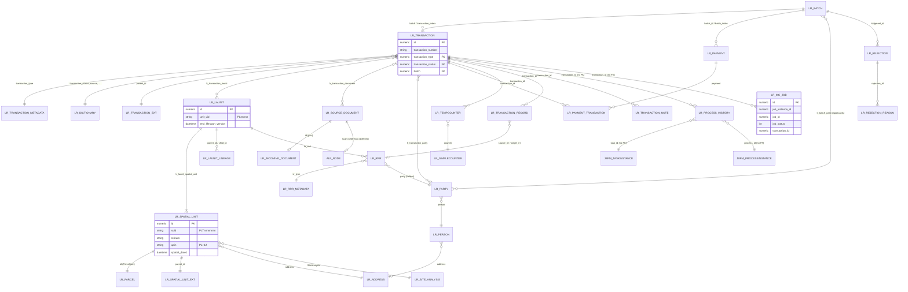

# 02 - The Registry database (LRS43, schema LRSAdmin)

Reference for the replica build. It describes the SQL Server database that Aumentum Registry ("LRS43")
on 10.10.10.5 reads and writes, so that a new Web Access / Workstation can work against the **same live
database** without breaking the old application, the Cadastre link (10.10.10.6) or the Cashier.

Sources (all read-only captures; paths relative to `$R = tools/aumentum-inventory`):

| short name | file | what it is |
|---|---|---|
| DDL | `$R/lrs-export/registry/schema/lrs-tables.sql` | `CREATE TABLE` for all 168 LRSAdmin tables (exported 2026-11-02) |
| IDX | `$R/lrs-export/registry/schema/lrs-indexes.sql` | 265 index / unique statements |
| FKS | `$R/lrs-export/registry/schema/lrs-fks.sql` | 379 foreign keys |
| OBJ | `$R/lrs-export/registry/schema/lrs-objects.sql` | 6 functions + 1 view |
| HBM | `$R/lrs-export/registry/hbm/com/landsystems/lrs/model/**.hbm.xml` | 73 Hibernate mappings (same files as inside `lrs-domain-model-data.jar`) |
| DATA | `$R/lrs-export/registry/data/<table>.psv.gz` | 29 tables exported as data (some with personal columns left out) |
| SUM | `$R/lrs-export/registry/lrs-export-summary.txt` | rows exported vs rows in database (2026-11-02) |
| INV | `$R/lrs-inventory-REGISTRY-20261101-1701.txt`, section `DATABASE LRS43` | row counts of **all** 168 tables, columns, FKs, small code tables (TOP 100, masked), link-column stats (2026-11-01) |
| JAR | `$D/../in/*.jar` inspected with `javap` only | `lrs-domain-model.jar`, `ils-core.jar` (id generation, defaults) |
| NET | `$D/net/**.cs` | decompiled .NET Registry Desktop / Cashier (HQL strings used by the client) |

Row counts: for the 29 exported tables the number is "rows in database" from SUM (2026-11-02); for every
other table it is INV (2026-11-01). The two snapshots differ by a few rows for the busy tables.

Conventions in this file: "NN" = NOT NULL. "(inferred)" = my reading, not proven by a capture.
Dictionary references are written `lr_dictionary.Id` + `category`.

---

## 1. Overview

* Server: SQL Server 2012 (11.0.2100.60, INV) on 10.10.10.5; database **LRS43**, every application table in schema
  **LRSAdmin** (DDL line 2: `CREATE SCHEMA [LRSAdmin]`). Total database size ~755 GB (earlier work; most of it is the
  Alfresco/JBPM tables, see below).
* One schema holds four products that share one JDBC connection and one transaction manager (inferred from
  `HibernateDomainModelDAO` taking an Alfresco `NodeService` and `RetryingTransactionHelper`, JAR):
  1. the **Registry domain model** (`lr_*`), mapped by Hibernate 3 (HyperJAXB3-generated mappings);
  2. **jBPM 3** (`JBPM_*`), the workflow engine embedded in Alfresco 3.4, which runs every Registry transaction's
     tasks;
  3. **Alfresco 3.4** (`alf_*`, `avm_*`), the content repository that stores scans / outgoing documents / reports
     metadata (binary files live on disk under `D:/LRS_STORAGE/`);
  4. **JBoss Messaging** (`JMS_*`) persistence, and `sdms_bootstrap` (ILS bootstrap/patch log).

### 1.1 Table families

| family | tables | rows (all tables in family) | biggest tables | exported as data? |
|---|---:|---:|---|---|
| `lr_*` Registry domain | 78 | 5,088,266 | lr_process_history 976,928; lr_payment_transaction 457,538; lr_transaction_document 409,376; lr_source_document 364,663 | 29 of 78 |
| `JBPM_*` jBPM 3 workflow | 28 | 22,129,430 | JBPM_TASKACTORPOOL 12,576,151; JBPM_POOLEDACTOR 7,060,442; JBPM_VARIABLEINSTANCE 943,768; JBPM_TASKINSTANCE 674,828; JBPM_PROCESSINSTANCE 99,808 | no (only small definition tables in INV) |
| `alf_*` Alfresco repository | 46 | 59,344,538 | alf_node_properties 41,420,196; alf_node_aspects 4,340,783; alf_child_assoc 3,867,209; alf_node 3,768,763; alf_content_url 2,104,102 | no (only small code tables in INV) |
| `avm_*` Alfresco AVM (web content) | 10 | 10 | unused | no |
| `JMS_*` JBoss Messaging | 5 | 49,077 | JMS_MESSAGES 49,048 | no |
| `sdms_bootstrap` | 1 | 192 | ILS bootstrap / patch resources applied | INV only |
| **total** | **168** | | | |

Of the 78 `lr_*` tables, **30 are empty** in production (INV): lr_admin_document_party, lr_admin_document_rrr,
lr_admin_source_document, lr_batch_related, lr_billing, lr_billing_dist_line, lr_billing_line, lr_building,
lr_building_unit, lr_condition, lr_contact, lr_mortgage, lr_party_contact, lr_party_group, lr_party_launit,
lr_party_member, lr_process_event, lr_replicationcontent, lr_replicationlog, lr_replicationpackage, lr_rrr_billing,
lr_rrr_condition, lr_rrr_deleted, lr_rrr_patched, lr_simplecounter_pool, lr_spatial_unit_member, lr_survey_plan,
lr_taxation, lr_usage, lr_valuation. The replica must still keep them (Hibernate validates the mapping, and some
are referenced by FKs), but it does not need screens for them.

### 1.2 Storage conventions used by every lr_ table

* **Ids** are `numeric(19,0)`. Two kinds (HBM `<generator>`):
  * `assigned` (30 classes - every business entity): the application computes the id from a counter row in
    `lr_simplecounter` (see 5.4 and 9.1). Production ids look like `10000000143224` = office digital code `10` +
    12-digit zero-padded counter value.
  * `native` (24 classes - configuration / log tables): SQL Server `IDENTITY(1,1)`.
* **`Hjtype`** `nvarchar(255) NOT NULL` on almost every table = Hibernate discriminator column. The value is the
  **full Java class name**, e.g. `com.landsystems.lrs.model.Transaction`, `com.landsystems.lrs.model.Parcel`,
  `com.landsystems.lrs.model.ext.TransactionExt` (DATA: every exported row). Subclass tables (joined via `<join>`)
  have no Hjtype; the parent row carries it.
* **Versioning / soft delete** ("lifespan"): `version numeric(19,0)`, `begin_lifespan_version datetime`,
  `end_lifespan_version datetime`. A row is current when `begin_lifespan_version IS NOT NULL AND
  end_lifespan_version IS NULL` (NET: HQL `... where BeginLifespanVersion is not null and EndLifespanVersion is null`
  on Transaction, Right, Restriction, Dictionary). Superseded LAUnit / SpatialUnit / Party rows are kept with
  `end_lifespan_version` set (e.g. 5,379 of 50,950 lr_launit rows and 5,538 lr_spatial_unit rows are ended, DATA).
  `version` is an ordinary column (1, 2, 3 ...), **not** a Hibernate `<version>` optimistic lock - no hbm file has a
  `<version>` or `<timestamp>` element.
* **Dictionary foreign keys are NOT NULL** on most columns, so "no value" is stored as **`lr_dictionary.Id = 1`**
  (category `null`, code and label a single space). Example: all 115,570 transactions have `tenure_type`,
  `filetype`, `deed_case`, `lease_extension`, `lease_duration`, `district` = 1 (DATA).
* **Spare "flex" columns** on each entity: `<prefix>1/2` (nvarchar 50), `<prefix>_dict1/2` (dictionary, NN),
  `<prefix>_date1/2`, `<prefix>_cost1/2`, `<prefix>_count1/2` (e.g. `tran1`, `tran_dict1`, `parc_count2`).
  Most are unused; `lr_transaction.tran_dict1` holds `property_reg` (Original / Mutated property) on 27,564 rows.
* **Ordered collections** are stored with an `*_index int` column (list position): `transaction_index`,
  `launit_index`, `document_index`, `unit_index`, `batch_index`, `payment_index`, `rejection_index` ...
  Hibernate rewrites these when it saves a list.
* **Dates** are SQL `datetime`, local server time (Lagos, WAT; the server clock is ~19 min ahead - earlier work). Data
  exports show `YYYY-MM-DD HH:MM:SS.mmm`. The Java service formats dates as `yyyy-MM-dd'T'HH:mm:ss` and parses
  `yyyy-MM-dd HH:mm:ss` (JAR: `DomainModelService` constants).
* **Booleans** are `tinyint` 0/1 (`org.hibernate.type.BooleanType` in HBM).
* **Money / areas** are `float` (`DoubleType`), not decimal. Fee tables use `numeric(19,2)`.

---

## 2. The lr_* tables

### 2.1 Catalogue of all 78 lr_ tables

PK = primary key. "class" = Hibernate class in `com.landsystems.lrs.model` (HBM). Rows: SUM for exported tables, INV for the others.

| table | purpose | PK | class (mapping) | rows | data export |
|---|---|---|---|---:|---|
| lr_address | addresses of spatial units and persons | id (assigned, `address_id`) | Address | 232,796 (232,841 SUM) | 50,961 property addresses only |
| lr_admin_document_party | M:N admin document <-> party | (document, party_index) | AdminSourceDocument.Parties | 0 | - |
| lr_admin_document_rrr | M:N admin document <-> RRR | (document, rrr_index) | AdminSourceDocument.Rights | 0 | - |
| lr_admin_source_document | join table for AdminSourceDocument | id -> lr_source_document | AdminSourceDocument | 0 | - |
| lr_applicant | join table: applicant party (application_type, delivery_type) | id -> lr_party | Applicant (subclass of Party) | 34,246 | - |
| lr_batch | the **lodgement / application** ("batch") that groups transactions and payments | id (assigned, `batch_id`) | Batch | 65,051 | yes |
| lr_batch_party | M:N batch <-> party (applicants) | (batch, party_index) | Batch.Parties | 64,777 | - |
| lr_batch_related | parent/child batch links with a process_id | id identity | RelatedBatch | 0 | - |
| lr_billing / lr_billing_line / lr_billing_dist_line | invoicing to an external billing system ("wires") | id | Billing / BillingLine / BillingDistLine | 0 | - |
| lr_building / lr_building_unit | join tables: building / strata unit spatial units | id -> lr_spatial_unit | Building / BuildingUnit (subclasses of SpatialUnit) | 0 | - |
| lr_business_calendar | working days and holidays | Id identity | BusinessDay, subclasses LrWorkingDay / LrHoliDay | 8 | yes |
| lr_condition | conditions / recommendations / decisions on a transaction | id (assigned, `condition_id`) | Condition | 0 | - |
| lr_contact | join table: contact person | id -> lr_person | PartyContact (subclass of Individual) | 0 | - |
| lr_corporation | join table: organisation details | id -> lr_person | Corporation (subclass of Person) | 70,326 | - |
| lr_dictionary | **all code lists** (65 categories) | Id (assigned, `dictionary_id`) | Dictionary | 3,703 | yes |
| lr_document_ext | extension of IncomingDocument (comments, params) | parent_id | ext.DocumentExt | 347,460 | - |
| lr_extension_link | which `ext.*` class extends which entity | id identity | LrExtensionLink | 4 | yes |
| lr_fee_rate | fee rates per fee/transaction type/area/location/land use/size range | Id identity | FeeRate | 29,003 | **no** |
| lr_fee_structure | which property attributes a fee depends on | Id identity | FeeStructure | 55 | yes |
| lr_formfield | client form definitions (fields, captions, mandatory, validation) | Id identity | FormField | 1,725 | yes |
| lr_ground_rent | ground-rent paid per property number and year | Id identity | GroundRent | 32,918 | **no** |
| lr_incoming_document | join table: supporting (scanned) document | id -> lr_source_document | IncomingDocument (subclass of SourceDocument) | 364,663 | - |
| lr_individual | join table: natural person details | id -> lr_person | Individual (subclass of Person) | 111,525 | - |
| lr_launit | **the property** (LA unit = registered land administration unit) | id (assigned, `unit_id`) | LAUnit | 50,961 | yes |
| lr_launit_lineage | parent -> child property history (subdivision, merger, re-grant) | id (assigned, `launit_lineage_id`) | LAUnitLineage | 17,248 | yes |
| lr_launit_spatial_unit | M:N property <-> spatial unit (always 1:1 here) | (launit, unit_index) | LAUnit.SpatialUnits | 50,961 | yes |
| lr_mc_job | jobs the Registry created in the Cadastre (MC = Multi-Cadastre) | Id identity | McJob | 16,947 | yes |
| lr_mortgage | mortgage details on a Right | id | Mortgage | 0 | - |
| lr_parcel | join table: land parcel attributes | id -> lr_spatial_unit | Parcel (subclass of SpatialUnit) | 50,961 | yes |
| lr_party | a party **in a role** (owner, grantee, applicant...) on a transaction / RRR | id (assigned, `party_id`) | Party (+ Applicant, GroupParty, LAUnitParty) | 179,667 | **no** (personal) |
| lr_party_contact | M:N party <-> contact person | (contact, contact_index) | Party.Contacts | 0 | - |
| lr_party_ext | extension of Party | parent_id | ext.PartyExt | 141,431 | - |
| lr_party_group / lr_party_member | group parties and their members | id | GroupParty / PartyMember | 0 | - |
| lr_party_launit | join table for LAUnitParty | id -> lr_party | LAUnitParty | 0 | - |
| lr_payment | a cashier **receipt** (payment) | id (assigned, `payment_id`) | Payment | 32,141 | yes (no bank columns) |
| lr_payment_transaction | a **fee line** (demand-notice line or receipt line) | id (assigned, `payment_transaction_id`) | PaymentTransaction | 457,747 | yes (no bank columns) |
| lr_person | the person / organisation identity (address, ids, phones) | id (assigned, `person_id`) | Person (+ Individual, Corporation, PartyContact, StaffMember) | 181,852 | **no** (personal) |
| lr_process_event | events under a process history row | id identity | ProcessEvent | 0 | - |
| lr_process_history | **one row per workflow task** of a transaction (links to jBPM) | id (assigned, `history_id`) | ProcessHistory | 976,928 | **no** |
| lr_registry | registry definition (one row: `registration`) | Id identity | Registry | 1 | yes |
| lr_registry_office | registry office (one row: PLT / 10) | id identity | RegistryOffice | 1 | yes |
| lr_rejection | a rejection / return of a lodgement | id identity | Rejection | 3,540 | yes |
| lr_rejection_reason | reasons under a rejection | id identity | RejectionReason | 3,549 | yes |
| lr_rental_amount_revision | ground-rent revision per property number | id (assigned) | RentalAmountRevision | 2 | - |
| lr_replicationcontent / log / package | replication to a replica server (IntegrationWithReplica = 0) | id identity | LrReplication* | 0 | - |
| lr_rrr | **rights, restrictions, responsibilities** on a property | id (assigned, `rrr_id`) | RRR, subclasses Right / Restriction / Responsibility | 76,532 | **no** |
| lr_rrr_billing / lr_rrr_condition | M:N RRR <-> billing / condition | (rrr, rrr_index) | RRR.Billings / RRR.Conditions | 0 | - |
| lr_rrr_deleted / lr_rrr_patched | copies of lr_rrr (no PK, not mapped) - backup/patch tables (inferred) | none | none | 0 | - |
| lr_rrr_metadata | RRR types (12) | Id identity | RrrMetaData | 12 | yes |
| lr_setting | **all configuration** (363 rows, 13 categories) | Id identity | Setting | 363 | yes |
| lr_simplecounter | **all number and id counters** (42) | Id identity | LrSimpleCounter | 42 | yes |
| lr_simplecounter_pool | numbers returned for re-use by rollback counters | Id identity | LrSimpleCounterPool | 0 | - |
| lr_site_analysis | site analysis report data per spatial unit | Id (assigned, `site_analysis_id`) | SiteAnalysis | 50,944 | **no** |
| lr_source_document | **every document** (supporting scans, outgoing documents) | id (assigned, `document_id`) | SourceDocument (+ Incoming, Outgoing, Internal, Admin) | 364,663 | **no** |
| lr_spatial_unit | the **spatial unit / parcel** (UPIN, plot, block, plan, area) | id (assigned, `parcel_id`) | SpatialUnit (+ Parcel, Building, BuildingUnit) | 50,961 | yes |
| lr_spatial_unit_ext | extension of Parcel | parent_id | ext.PropertyExt | 50,961 | yes |
| lr_spatial_unit_member | M:N spatial unit hierarchy | (parent_unit, unit_index) | SpatialUnit.Members | 0 | - |
| lr_survey_plan | survey plan register (SPC transactions) | Id (assigned, `surveyplan_id`) | SurveyPlan | 0 | - |
| lr_taxation / lr_usage / lr_valuation | tax, usage, valuation records | id | Taxation / Usage / Valuation | 0 | - |
| lr_tempcounter | numbers issued to a transaction (instrument, page, volume, property no.) | Id (assigned, `tempcounter_id`) | TempCounter | 46,963 | yes |
| lr_transaction | **the Registry transaction** (application / instrument) | id (assigned, `transaction_id`) | Transaction | 115,570 | yes |
| lr_transaction_document | M:N transaction <-> document | (transaction_id, document_index) | Transaction.Documents | 409,471 | yes |
| lr_transaction_ext | extension of Transaction | parent_id | ext.TransactionExt | 115,570 | yes |
| lr_transaction_launit | M:N transaction <-> property | (transaction_id, launit_index) | Transaction.Properties | 101,122 | yes |
| lr_transaction_metadata | **transaction types** (42) and their rules | Id (assigned, `metainfo_id`) | TransactionMetaData | 42 | yes |
| lr_transaction_note | notes/comments per transaction and task | id (assigned, `note_id`) | TransactionNote | 3,282 | **no** |
| lr_transaction_party | M:N transaction <-> party | (transaction_id, party_index) | Transaction.Parties | 135,980 | **no** |
| lr_transaction_record | RRR operations done by a transaction (create/modify/discharge) | id (assigned, `transaction_record_id`) | TransactionRecord | 44,074 | **no** |

### 2.2 Foreign keys (lr_ to lr_)

FKS has 379 constraints in total, all created `WITH NOCHECK` by the export script; 218 are on lr_ tables and **150 of
those point at lr_dictionary**. The 68 non-dictionary ones:

```
lr_transaction(transaction_type)              -> lr_transaction_metadata(Id)
lr_transaction(data_corrected_transaction_type)-> lr_transaction_metadata(Id)
lr_transaction(batch)                         -> lr_batch(id)
lr_transaction(SurveyPlan)                    -> lr_survey_plan(Id)
lr_transaction_launit(transaction_id)         -> lr_transaction(id)
lr_transaction_launit(launit_id)              -> lr_launit(id)
lr_transaction_document(transaction_id)       -> lr_transaction(id)
lr_transaction_document(document_id)          -> lr_source_document(id)
lr_transaction_party(transaction_id / party_id)-> lr_transaction(id) / lr_party(id)
lr_transaction_note(transaction_id)           -> lr_transaction(id)
lr_transaction_record(transaction_id)         -> lr_transaction(id)
lr_condition(transaction_)                    -> lr_transaction(id)
lr_tempcounter(transaction_id)                -> lr_transaction(id)
lr_tempcounter(counter)                       -> lr_simplecounter(Id)
lr_payment_transaction(transaction_id)        -> lr_transaction(id)
lr_payment_transaction(payment)               -> lr_payment(id)
lr_payment(batch_id)                          -> lr_batch(id)
lr_batch(office)                              -> lr_registry_office(id)
lr_batch_party(batch / party)                 -> lr_batch(id) / lr_party(id)
lr_launit_spatial_unit(launit / spatial_unit) -> lr_launit(id) / lr_spatial_unit(id)
lr_parcel(id), lr_building(id), lr_building_unit(id) -> lr_spatial_unit(id)
lr_spatial_unit(address)                      -> lr_address(id)
lr_spatial_unit(SiteAnalysis)                 -> lr_site_analysis(Id)
lr_spatial_unit_member(parent_unit / child_unit) -> lr_spatial_unit(id)
lr_rrr(la_unit) -> lr_launit(id);  lr_rrr(party) -> lr_party(id);  lr_rrr(rrr_type) -> lr_rrr_metadata(Id)
lr_rrr_billing(rrr / billing), lr_rrr_condition(rrr / condition)
lr_mortgage(party) -> lr_party(id);  lr_mortgage(right_id) -> lr_rrr(id)
lr_party(person)                              -> lr_person(id)
lr_applicant(id), lr_party_group(id), lr_party_launit(id) -> lr_party(id)
lr_party_launit(launit)                       -> lr_launit(id)
lr_party_member(group_ref / party_ref)        -> lr_party(id)
lr_party_contact(contact) -> lr_party(id);  lr_party_contact(party) -> lr_person(id)   (column names swapped vs meaning; HBM Party.Contacts uses key=contact, element=party)
lr_party_group(address), lr_person(address)   -> lr_address(id)
lr_individual(id), lr_corporation(id), lr_contact(id) -> lr_person(id)
lr_source_document children: lr_incoming_document(id), lr_admin_source_document(id) -> lr_source_document(id)
lr_admin_document_party / _rrr                -> lr_source_document, lr_party, lr_rrr
lr_billing(party) -> lr_party; lr_billing(party_contact) -> lr_person; lr_billing_line(bill_id) -> lr_billing; lr_billing_dist_line(line_id) -> lr_billing_line
lr_fee_rate(transaction_type)                 -> lr_transaction_metadata(Id)
lr_process_event(history)                     -> lr_process_history(id)
lr_rejection_reason(rejection_id)             -> lr_rejection(id)
lr_replicationcontent(package), lr_replicationlog(package) -> lr_replicationpackage(id)
```

**Links that have no FK** (enforced only by the application - the replica must keep them consistent itself):

| column | points at | evidence |
|---|---|---|
| lr_mc_job.transaction_id | lr_transaction.id | values are transaction ids (INV link stats: 12,042 distinct, 10000000012483..10000000143011) |
| lr_mc_job.job_instance_id | Cadastre job instance id on 10.10.10.6 | earlier work |
| lr_process_history.transaction_id | lr_transaction.id | INV: 116,883 distinct values in transaction id range |
| lr_process_history.process_id / task_id | JBPM_PROCESSINSTANCE.ID_ / JBPM_TASKINSTANCE.ID_ | lr_setting `queryTransactionByUser` joins `ph.TaskId = task.id` |
| lr_transaction_note.task_id | JBPM_TASKINSTANCE.ID_ (inferred) | column name; NET `LrWorkflowLog where task_id=?` |
| lr_batch_related.process_id | JBPM_PROCESSINSTANCE.ID_ (inferred) | column name |
| lr_rejection.lodgment_id | lr_batch.id | NET: `from Rejection where LodgmentId={(Lodgement as Batch).id}` |
| lr_launit_lineage.parent_id / child_id | lr_launit.id; parent_uid / child_uid = lr_launit.unit_uid | DATA |
| lr_launit_lineage.transaction_number, lr_payment.transaction_number, lr_valuation.transaction_number | lr_transaction.transaction_number (text) | DATA |
| lr_rrr.transaction_source / transaction_cancel | lr_transaction.transaction_number of the creating / cancelling transaction (inferred, nvarchar 50) | column names |
| lr_launit.transaction_cancel, lr_spatial_unit.transaction_cancel | transaction number that archived the unit (inferred) | column names |
| lr_payment_transaction.property_number, lr_ground_rent.propertyNumber, lr_rental_amount_revision.property_number | lr_launit.unit_uid / lr_spatial_unit.refnum (e.g. `PL57665`) | DATA formats |
| lr_payment_transaction.demandnotice_number, lr_transaction.demandnotice_number | demand notice number `INV` + 9 digits (counter `demandnotice_number`) | DATA |
| lr_spatial_unit_ext.parent_id, lr_transaction_ext.parent_id, lr_party_ext.parent_id, lr_document_ext.parent_id | id of the extended entity (same id) | HBM ext.* use `parent_id` assigned |
| lr_spatial_unit.property_area | lr_dictionary.Id (category property_area) | DATA; not in FKS |

### 2.3 Indexes that matter (IDX)

Only these non-PK indexes exist on lr_ tables:

| table | indexed columns |
|---|---|
| lr_transaction | transaction_type; transaction_status; transaction_source; batch; registration_date; start_date; old_property_id; (volume, folio) |
| lr_transaction_launit / _document / _party | (transaction_id, launit_id) / (transaction_id, document_id) / (transaction_id, party_id) |
| lr_launit | unit_uid; old_property_id; version |
| lr_launit_spatial_unit | (launit, spatial_unit) |
| lr_spatial_unit | suid; plan_number; old_property_id; address |
| lr_parcel | actual_use_type |
| lr_party | name; party_type; party_role_type; person |
| lr_person | person_id_number; person_type; address |
| lr_individual | last_name; gender |
| lr_corporation | name |
| lr_rrr | (party, la_unit); rrr_type |
| lr_source_document | document_number; document_type |
| lr_payment | transaction_number; payment_type |
| lr_payment_transaction | payment; transaction_id; payment_type |
| lr_batch | application_status; office |
| lr_transaction_record | transaction_id; operation_type |
| lr_address | city; district; region; street_name |
| lr_batch_party, lr_party_contact, lr_party_member, lr_spatial_unit_member | (pair) |
| unique constraints | lr_simplecounter(counter); lr_rrr_metadata(code); lr_registry(code), (description); lr_extension_link(parent_class), (child_class) |

Notable **missing** indexes: `lr_transaction.transaction_number`, `lr_spatial_unit.upin`, `lr_spatial_unit.refnum`,
`lr_process_history.transaction_id`, `lr_mc_job.transaction_id`. Searches by transaction number or UPIN scan the
table. The replica may add indexes (they do not change behaviour), but should coordinate with whoever owns the
live DB (inferred recommendation).

### 2.4 Core tables, column by column

Columns are from DDL. "references" from FKS. "observed" is computed from DATA: for dictionary columns the
`lr_dictionary.category` actually used (with counts if mixed; "Id 1 blank" = the placeholder row), for other columns
how many rows are non-null when not all; "(not in export)" = column exists but was left out of the data export
(personal/bank/comment columns).

#### lr_transaction  (PK: id)

| column | type | null | references | observed |
|---|---|---|---|---|
| `id` | numeric(19,0) | NN |  |  |
| `Hjtype` | nvarchar(255) | NN |  |  |
| `transaction_number` | nvarchar(50) |  |  |  |
| `transaction_type` | numeric(19,0) |  | lr_transaction_metadata(Id) |  |
| `transaction_status` | numeric(19,0) | NN | lr_dictionary(Id) | transaction_status |
| `transaction_source` | numeric(19,0) | NN | lr_dictionary(Id) | record_source |
| `source_property_ids` | nvarchar(500) |  |  | 114989 non-null |
| `target_property_ids` | nvarchar(500) |  |  | 101460 non-null |
| `old_property_id` | nvarchar(50) |  |  | 0 non-null |
| `parent_property_ids` | nvarchar(500) |  |  | 0 non-null |
| `tenure_type` | numeric(19,0) | NN | lr_dictionary(Id) | Id 1 blank |
| `is_search_oldfile` | tinyint |  |  |  |
| `registration_fee` | float |  |  | 0 non-null |
| `consideration` | float |  |  | 81175 non-null |
| `interest_money` | float |  |  | 0 non-null |
| `create_date` | datetime |  |  |  |
| `complete_date` | datetime |  |  | 25979 non-null |
| `start_date` | datetime |  |  | 68445 non-null |
| `expiration_date` | datetime |  |  | 64684 non-null |
| `sign_date` | datetime |  |  | 59523 non-null |
| `registration_date` | datetime |  |  | 60979 non-null |
| `application_date` | datetime |  |  | 76348 non-null |
| `firstpay_date` | datetime |  |  | 0 non-null |
| `balance_date` | datetime |  |  | 0 non-null |
| `balance_sum` | float |  |  | 61291 non-null |
| `partial` | tinyint |  |  |  |
| `pageNumber` | nvarchar(16) |  |  | 0 non-null |
| `cert_nos` | nvarchar(255) |  |  | 0 non-null |
| `term_year` | int |  |  | 58881 non-null |
| `term_month` | int |  |  | 5915 non-null |
| `term_year_ext` | int |  |  | 0 non-null |
| `term_month_ext` | int |  |  | 0 non-null |
| `lease_extension` | numeric(19,0) | NN | lr_dictionary(Id) | Id 1 blank |
| `lease_duration` | numeric(19,0) | NN | lr_dictionary(Id) | Id 1 blank |
| `duration` | int |  |  | 0 non-null |
| `build_term` | int |  |  | 45370 non-null |
| `build_value` | float |  |  | 57341 non-null |
| `pay_period_year` | int |  |  | 58406 non-null |
| `pay_period_month` | int |  |  | 0 non-null |
| `volume` | nvarchar(20) |  |  | 25929 non-null |
| `folio` | nvarchar(20) |  |  | 26136 non-null |
| `volume_linked` | nvarchar(20) |  |  | 0 non-null |
| `folio_linked` | nvarchar(20) |  |  | 0 non-null |
| `recordingno` | nvarchar(30) |  |  | 25944 non-null |
| `internal_receipt_no` | nvarchar(30) |  |  | 22275 non-null |
| `serial_number` | nvarchar(30) |  |  | 0 non-null |
| `general_number` | nvarchar(50) |  |  | 0 non-null |
| `related_number` | nvarchar(50) |  |  | 36443 non-null |
| `related_page_number` | nvarchar(50) |  |  | 11971 non-null |
| `related_volume` | nvarchar(50) |  |  | 11969 non-null |
| `deed_case` | numeric(19,0) | NN | lr_dictionary(Id) | Id 1 blank |
| `related_instr_number` | nvarchar(50) |  |  | 11967 non-null |
| `lodgment_number` | nvarchar(50) |  |  | 0 non-null |
| `boxno` | nvarchar(20) |  |  | 0 non-null |
| `special_condition` | nvarchar(50) |  |  | (not in export) |
| `inscription` | nvarchar(800) |  |  | (not in export) |
| `inscription2` | nvarchar(800) |  |  | (not in export) |
| `reg_initials` | nvarchar(20) |  |  | (not in export) |
| `blockplot` | nvarchar(200) |  |  | 0 non-null |
| `volumefolio` | nvarchar(150) |  |  | 0 non-null |
| `filetype` | numeric(19,0) | NN | lr_dictionary(Id) | Id 1 blank |
| `region` | numeric(19,0) | NN | lr_dictionary(Id) | region |
| `district` | numeric(19,0) | NN | lr_dictionary(Id) | Id 1 blank |
| `is_delivered` | tinyint |  |  |  |
| `is_right_required` | tinyint |  |  |  |
| `is_inactive` | tinyint |  |  |  |
| `is_mem_transaction` | tinyint |  |  |  |
| `comments` | nvarchar(800) |  |  | (not in export) |
| `site_analysis` | nvarchar(800) |  |  | 0 non-null |
| `inspection_officer` | nvarchar(50) |  |  | (not in export) |
| `gis_params` | nvarchar(800) |  |  | 0 non-null |
| `tran1` | nvarchar(50) |  |  | 0 non-null |
| `tran2` | nvarchar(50) |  |  | 0 non-null |
| `tran_date1` | datetime |  |  | 0 non-null |
| `tran_date2` | datetime |  |  | 0 non-null |
| `tran_dict1` | numeric(19,0) | NN | lr_dictionary(Id) | Id 1 blank (88006), property_reg (27564) |
| `tran_dict2` | numeric(19,0) | NN | lr_dictionary(Id) | Id 1 blank |
| `tran_cost1` | float |  |  | 0 non-null |
| `tran_cost2` | float |  |  | 0 non-null |
| `tran_count1` | int |  |  | 0 non-null |
| `tran_count2` | int |  |  | 0 non-null |
| `version` | numeric(19,0) |  |  |  |
| `begin_lifespan_version` | datetime |  |  |  |
| `end_lifespan_version` | datetime |  |  | 0 non-null |
| `demandnotice_number` | nvarchar(12) |  |  | 37487 non-null |
| `batch` | numeric(19,0) |  | lr_batch(id) | 115564 non-null |
| `transaction_index` | int |  |  | 115564 non-null |
| `term_day` | int |  |  | 112 non-null |
| `consideration_currency` | numeric(19,0) |  | lr_dictionary(Id) | Id 1 blank (92910), currency (22660) |
| `temp_consideration` | nvarchar(30) |  |  | 233 non-null |
| `improvement_amount_currency` | numeric(19,0) |  | lr_dictionary(Id) | Id 1 blank (81673), currency (33897) |
| `data_corrected_transaction_number` | nvarchar(50) |  |  | 0 non-null |
| `data_corrected_transaction_type` | numeric(19,0) |  | lr_transaction_metadata(Id) | 0 non-null |
| `data_corrected_comments` | nvarchar(800) |  |  | (not in export) |
| `data_corrected_create_date` | datetime |  |  | 0 non-null |
| `data_corrected_complete_date` | datetime |  |  | 0 non-null |
| `recommendation_memorandum` | nvarchar(800) |  |  | (not in export) |
| `SurveyPlan` | numeric(19,0) |  | lr_survey_plan(Id) | 0 non-null |

#### lr_transaction_ext  (PK: parent_id)

| column | type | null | references | observed |
|---|---|---|---|---|
| `parent_id` | numeric(19,0) | NN |  |  |
| `Hjtype` | nvarchar(255) | NN |  |  |
| `extended_comments` | nvarchar(2000) |  |  | (not in export) |
| `extended_params` | nvarchar(1000) |  |  | 0 non-null |
| `NonExistingPropertiesSearch` | nvarchar(1000) |  |  | 480 non-null |
| `CountPropertiesSearch` | numeric(19,0) |  |  | 988 non-null |

#### lr_transaction_launit  (PK: transaction_id, launit_index)

| column | type | null | references | observed |
|---|---|---|---|---|
| `transaction_id` | numeric(19,0) | NN | lr_transaction(id) |  |
| `launit_id` | numeric(19,0) | NN | lr_launit(id) |  |
| `launit_index` | int | NN |  |  |

#### lr_transaction_document  (PK: transaction_id, document_index)

| column | type | null | references | observed |
|---|---|---|---|---|
| `transaction_id` | numeric(19,0) | NN | lr_transaction(id) |  |
| `document_id` | numeric(19,0) | NN | lr_source_document(id) |  |
| `document_index` | int | NN |  |  |

#### lr_launit  (PK: id)

| column | type | null | references | observed |
|---|---|---|---|---|
| `id` | numeric(19,0) | NN |  |  |
| `Hjtype` | nvarchar(255) | NN |  |  |
| `unit_uid` | nvarchar(50) |  |  |  |
| `old_property_id` | nvarchar(50) |  |  | 0 non-null |
| `tenure_type` | numeric(19,0) | NN | lr_dictionary(Id) | Id 1 blank |
| `name` | nvarchar(250) |  |  | 0 non-null |
| `rental_amount` | float |  |  | 4882 non-null |
| `build_value` | float |  |  | 4653 non-null |
| `build_term` | int |  |  | 4249 non-null |
| `register_type` | nvarchar(100) |  |  | 0 non-null |
| `purpose_clause` | nvarchar(50) |  |  | 0 non-null |
| `reg_date` | datetime |  |  | 27002 non-null |
| `volumefolio` | nvarchar(50) |  |  | 0 non-null |
| `cert_numbers` | nvarchar(1500) |  |  | 0 non-null |
| `is_exists` | tinyint |  |  |  |
| `legal_description` | nvarchar(2000) |  |  | 0 non-null |
| `note` | nvarchar(2000) |  |  | (not in export) |
| `transaction_cancel` | nvarchar(50) |  |  | 0 non-null |
| `archive_date` | datetime |  |  | 0 non-null |
| `lau_date1` | datetime |  |  | 0 non-null |
| `lau_date2` | datetime |  |  | 0 non-null |
| `version` | numeric(19,0) |  |  |  |
| `begin_lifespan_version` | datetime |  |  | 22435 non-null |
| `end_lifespan_version` | datetime |  |  | 5379 non-null |
| `source_id` | numeric(19,0) |  |  | 8206 non-null |

#### lr_spatial_unit  (PK: id)

| column | type | null | references | observed |
|---|---|---|---|---|
| `id` | numeric(19,0) | NN |  |  |
| `Hjtype` | nvarchar(255) | NN |  |  |
| `suid` | nvarchar(50) |  |  |  |
| `old_property_id` | nvarchar(50) |  |  | 0 non-null |
| `tenure_type` | numeric(19,0) | NN | lr_dictionary(Id) | Id 1 blank |
| `label` | nvarchar(250) |  |  | 8696 non-null |
| `note` | nvarchar(500) |  |  | (not in export) |
| `comments` | nvarchar(800) |  |  | (not in export) |
| `spatial_unit_type` | numeric(19,0) | NN | lr_dictionary(Id) | spatial_unit_type |
| `status` | numeric(19,0) | NN | lr_dictionary(Id) | unit_status |
| `property_kind` | numeric(19,0) |  | lr_dictionary(Id) | Id 1 blank |
| `purpose` | numeric(19,0) | NN | lr_dictionary(Id) | Id 1 blank |
| `zone` | numeric(19,0) | NN | lr_dictionary(Id) | location |
| `layout` | numeric(19,0) | NN | lr_dictionary(Id) | Id 1 blank (44922), layout_type (6028) |
| `block_name` | nvarchar(50) |  |  | 0 non-null |
| `refnum` | nvarchar(60) |  |  |  |
| `upin` | nvarchar(30) |  |  | 17855 non-null |
| `su_number` | nvarchar(30) |  |  | 5 non-null |
| `local_number` | nvarchar(30) |  |  | 0 non-null |
| `block_number` | nvarchar(50) |  |  | 742 non-null |
| `lot_number` | nvarchar(50) |  |  | 4010 non-null |
| `plan_number` | nvarchar(40) |  |  | 47258 non-null |
| `tracing_number` | nvarchar(32) |  |  | 124 non-null |
| `specific` | nvarchar(50) |  |  | 0 non-null |
| `volume` | nvarchar(20) |  |  | 9371 non-null |
| `folio` | nvarchar(20) |  |  | 9371 non-null |
| `volumefolio` | nvarchar(150) |  |  | 9371 non-null |
| `is_exists` | tinyint |  |  |  |
| `area` | float |  |  | 50947 non-null |
| `area_unit_type` | numeric(19,0) | NN | lr_dictionary(Id) | area_measurement_unit (50929), Id 1 blank (21) |
| `area_planned` | float |  |  |  |
| `areapl_unit_type` | numeric(19,0) | NN | lr_dictionary(Id) | area_measurement_unit |
| `area_buildings` | float |  |  | 0 non-null |
| `areabld_unit_type` | numeric(19,0) | NN | lr_dictionary(Id) | Id 1 blank |
| `percent_covered` | float |  |  | 0 non-null |
| `balance_date` | datetime |  |  | 0 non-null |
| `balance_sum` | float |  |  | 3397 non-null |
| `spatial_value1` | float |  |  | 0 non-null |
| `spatial_date1` | datetime |  |  | 7864 non-null |
| `spatial_value2` | float |  |  | 0 non-null |
| `spatial_date2` | datetime |  |  | 0 non-null |
| `rec1` | nvarchar(50) |  |  | 0 non-null |
| `rec2` | nvarchar(50) |  |  | 0 non-null |
| `rec_dict1` | numeric(19,0) | NN | lr_dictionary(Id) | Id 1 blank |
| `rec_dict2` | numeric(19,0) | NN | lr_dictionary(Id) | Id 1 blank |
| `cost1` | float |  |  | 0 non-null |
| `cost2` | float |  |  | 0 non-null |
| `count1` | int |  |  | 0 non-null |
| `count2` | int |  |  | 0 non-null |
| `spu_date` | datetime |  |  | 0 non-null |
| `subdivision` | nvarchar(128) |  |  | 0 non-null |
| `transaction_cancel` | nvarchar(50) |  |  | 0 non-null |
| `archive_date` | datetime |  |  | 0 non-null |
| `address` | numeric(19,0) |  | lr_address(id) |  |
| `restrictions` | nvarchar(1500) |  |  | 0 non-null |
| `version` | numeric(19,0) |  |  |  |
| `begin_lifespan_version` | datetime |  |  |  |
| `end_lifespan_version` | datetime |  |  | 5538 non-null |
| `source_id` | numeric(19,0) |  |  | 8205 non-null |
| `SiteAnalysis` | numeric(19,0) |  | lr_site_analysis(Id) | 50949 non-null |
| `property_area` | numeric(19,0) |  | lr_dictionary(Id) | property_area |

#### lr_spatial_unit_ext  (PK: parent_id)

| column | type | null | references | observed |
|---|---|---|---|---|
| `parent_id` | numeric(19,0) | NN |  |  |
| `Hjtype` | nvarchar(255) | NN |  |  |
| `extended_comments` | nvarchar(2000) |  |  | (not in export) |
| `extended_params` | nvarchar(1000) |  |  | 0 non-null |

#### lr_parcel  (PK: id)

| column | type | null | references | observed |
|---|---|---|---|---|
| `id` | numeric(19,0) | NN | lr_spatial_unit(id) |  |
| `actual_use_type` | numeric(19,0) | NN | lr_dictionary(Id) | actual_use_type |
| `land_type` | numeric(19,0) |  | lr_dictionary(Id) | Id 1 blank |
| `land_category` | numeric(19,0) | NN | lr_dictionary(Id) | Id 1 blank |
| `land_purpose` | numeric(19,0) | NN | lr_dictionary(Id) | use_specific |
| `survey_plan_no` | nvarchar(50) |  |  | 44982 non-null |
| `survey_type` | numeric(19,0) | NN | lr_dictionary(Id) | Id 1 blank |
| `survey_date` | datetime |  |  | 42024 non-null |
| `parcel_number` | nvarchar(4) |  |  | 0 non-null |
| `survey_name` | nvarchar(32) |  |  | 43715 non-null |
| `boundaries_description` | nvarchar(800) |  |  | 0 non-null |
| `adjacents` | nvarchar(500) |  |  | 0 non-null |
| `use_typespecific` | nvarchar(50) |  |  | 0 non-null |
| `parc1` | nvarchar(50) |  |  | 0 non-null |
| `parc2` | nvarchar(50) |  |  | 0 non-null |
| `parc_dict1` | numeric(19,0) | NN | lr_dictionary(Id) | Id 1 blank |
| `parc_dict2` | numeric(19,0) | NN | lr_dictionary(Id) | Id 1 blank |
| `parc_date1` | datetime |  |  | 0 non-null |
| `parc_date2` | datetime |  |  | 0 non-null |
| `parc_count1` | int |  |  | 0 non-null |
| `parc_count2` | int |  |  | 0 non-null |

#### lr_rrr  (PK: id)

| column | type | null | references | observed |
|---|---|---|---|---|
| `id` | numeric(19,0) | NN |  |  |
| `Hjtype` | nvarchar(255) | NN |  |  |
| `rrr_type` | numeric(19,0) | NN | lr_rrr_metadata(Id) |  |
| `transaction_source` | nvarchar(50) |  |  |  |
| `transaction_cancel` | nvarchar(50) |  |  |  |
| `share_nominator` | int |  |  |  |
| `share_denominator` | int |  |  |  |
| `description` | nvarchar(1500) |  |  |  |
| `time_spec` | datetime |  |  |  |
| `start_date` | datetime |  |  |  |
| `expiration_date` | datetime |  |  |  |
| `end_date` | datetime |  |  |  |
| `term_year` | int |  |  |  |
| `term_month` | int |  |  |  |
| `condition_approved_by` | nvarchar(100) |  |  |  |
| `condition_approved_on` | datetime |  |  |  |
| `right1` | nvarchar(50) |  |  |  |
| `right2` | nvarchar(50) |  |  |  |
| `party` | numeric(19,0) |  | lr_party(id) |  |
| `la_unit` | numeric(19,0) |  | lr_launit(id) |  |
| `create_date` | datetime |  |  |  |
| `version` | numeric(19,0) |  |  |  |
| `begin_lifespan_version` | datetime |  |  |  |
| `end_lifespan_version` | datetime |  |  |  |
| `source_id` | numeric(19,0) |  |  |  |
| `pay_period_year` | int |  |  |  |
| `term_day` | int |  |  |  |
| `consideration` | float |  |  |  |
| `consideration_currency` | numeric(19,0) |  | lr_dictionary(Id) |  |
| `rental_amount` | float |  |  |  |
| `build_value` | float |  |  |  |
| `improvement_amount_currency` | numeric(19,0) |  | lr_dictionary(Id) |  |
| `build_term` | int |  |  |  |
| `security_number_1` | nvarchar(255) |  |  |  |
| `security_number_2` | nvarchar(255) |  |  |  |

#### lr_party  (PK: id)

| column | type | null | references | observed |
|---|---|---|---|---|
| `id` | numeric(19,0) | NN |  |  |
| `Hjtype` | nvarchar(255) | NN |  |  |
| `party_type` | numeric(19,0) | NN | lr_dictionary(Id) |  |
| `party_role_type` | numeric(19,0) | NN | lr_dictionary(Id) |  |
| `name` | nvarchar(250) |  |  |  |
| `name2` | nvarchar(250) |  |  |  |
| `person` | numeric(19,0) |  | lr_person(id) |  |
| `share_nominator` | int |  |  |  |
| `share_denominator` | int |  |  |  |
| `share_description` | nvarchar(250) |  |  |  |
| `shares` | nvarchar(255) |  |  |  |
| `share_type` | numeric(19,0) | NN | lr_dictionary(Id) |  |
| `tax_exempt` | tinyint |  |  |  |
| `title_holder` | tinyint |  |  |  |
| `cert_no` | nvarchar(100) |  |  |  |
| `unit_uid` | nvarchar(500) |  |  |  |
| `ruid` | numeric(19,0) |  |  |  |
| `part1` | nvarchar(50) |  |  |  |
| `part2` | nvarchar(50) |  |  |  |
| `part_dict1` | numeric(19,0) | NN | lr_dictionary(Id) |  |
| `part_dict2` | numeric(19,0) | NN | lr_dictionary(Id) |  |
| `comments` | nvarchar(800) |  |  |  |
| `version` | numeric(19,0) |  |  |  |
| `begin_lifespan_version` | datetime |  |  |  |
| `end_lifespan_version` | datetime |  |  |  |
| `source_id` | numeric(19,0) |  |  |  |
| `previous_id` | numeric(19,0) |  |  |  |

#### lr_person  (PK: id)

| column | type | null | references | observed |
|---|---|---|---|---|
| `id` | numeric(19,0) | NN |  |  |
| `Hjtype` | nvarchar(255) | NN |  |  |
| `address` | numeric(19,0) |  | lr_address(id) |  |
| `person_type` | numeric(19,0) | NN | lr_dictionary(Id) |  |
| `person_id_type` | numeric(19,0) | NN | lr_dictionary(Id) |  |
| `person_id_number` | nvarchar(64) |  |  |  |
| `person_id_date` | datetime |  |  |  |
| `person_id_issue` | nvarchar(255) |  |  |  |
| `tin` | nvarchar(50) |  |  |  |
| `fax` | nvarchar(64) |  |  |  |
| `email` | nvarchar(64) |  |  |  |
| `phone1_number` | nvarchar(20) |  |  |  |
| `phone1_extension` | nvarchar(5) |  |  |  |
| `phone1_type` | numeric(19,0) | NN | lr_dictionary(Id) |  |
| `phone2_number` | nvarchar(20) |  |  |  |
| `phone2_extension` | nvarchar(5) |  |  |  |
| `phone2_type` | numeric(19,0) | NN | lr_dictionary(Id) |  |
| `phone3_number` | nvarchar(20) |  |  |  |
| `phone3_extension` | nvarchar(5) |  |  |  |
| `phone3_type` | numeric(19,0) | NN | lr_dictionary(Id) |  |
| `birth_date` | datetime |  |  |  |
| `pers1` | nvarchar(50) |  |  |  |
| `pers2` | nvarchar(50) |  |  |  |
| `pers_dict1` | numeric(19,0) | NN | lr_dictionary(Id) |  |
| `pers_dict2` | numeric(19,0) | NN | lr_dictionary(Id) |  |
| `pers_cost1` | float |  |  |  |
| `pers_cost2` | float |  |  |  |
| `pers_count1` | int |  |  |  |
| `pers_count2` | int |  |  |  |
| `pers_date1` | datetime |  |  |  |
| `pers_date2` | datetime |  |  |  |
| `is_submiter` | tinyint |  |  |  |
| `submiter` | nvarchar(800) |  |  |  |
| `version` | numeric(19,0) |  |  |  |
| `begin_lifespan_version` | datetime |  |  |  |
| `end_lifespan_version` | datetime |  |  |  |
| `source_id` | numeric(19,0) |  |  |  |

#### lr_individual  (PK: id)

| column | type | null | references | observed |
|---|---|---|---|---|
| `id` | numeric(19,0) | NN | lr_person(id) |  |
| `first_name` | nvarchar(150) |  |  |  |
| `second_name` | nvarchar(150) |  |  |  |
| `last_name` | nvarchar(150) |  |  |  |
| `last_name2` | nvarchar(150) |  |  |  |
| `gender` | numeric(19,0) | NN | lr_dictionary(Id) |  |
| `salutation` | numeric(19,0) | NN | lr_dictionary(Id) |  |
| `civil_state` | numeric(19,0) | NN | lr_dictionary(Id) |  |
| `profession` | numeric(19,0) | NN | lr_dictionary(Id) |  |
| `occupation` | nvarchar(50) |  |  |  |
| `clan_name` | nvarchar(30) |  |  |  |
| `father_name` | nvarchar(50) |  |  |  |
| `grandfather_name` | nvarchar(50) |  |  |  |
| `paye_number` | nvarchar(50) |  |  |  |
| `indiv1` | nvarchar(50) |  |  |  |
| `indiv2` | nvarchar(50) |  |  |  |
| `indiv_dict1` | numeric(19,0) | NN | lr_dictionary(Id) |  |
| `indiv_dict2` | numeric(19,0) | NN | lr_dictionary(Id) |  |
| `driver_licence_region` | numeric(19,0) | NN | lr_dictionary(Id) |  |
| `driver_licence_number` | nvarchar(20) |  |  |  |

#### lr_corporation  (PK: id)

| column | type | null | references | observed |
|---|---|---|---|---|
| `id` | numeric(19,0) | NN | lr_person(id) |  |
| `name` | nvarchar(150) |  |  |  |
| `represent_name` | nvarchar(50) |  |  |  |
| `gsm_number` | nvarchar(50) |  |  |  |
| `cac_number` | nvarchar(50) |  |  |  |
| `corp1` | nvarchar(50) |  |  |  |
| `corp2` | nvarchar(50) |  |  |  |
| `corp_dict1` | numeric(19,0) | NN | lr_dictionary(Id) |  |
| `corp_dict2` | numeric(19,0) | NN | lr_dictionary(Id) |  |

#### lr_address  (PK: id)

| column | type | null | references | observed |
|---|---|---|---|---|
| `id` | numeric(19,0) | NN |  |  |
| `Hjtype` | nvarchar(255) | NN |  |  |
| `address_area_name` | nvarchar(250) |  |  | 0 non-null |
| `street_number` | nvarchar(50) |  |  | 616 non-null |
| `street_name` | nvarchar(100) |  |  | 2687 non-null |
| `building_name` | nvarchar(50) |  |  | 0 non-null |
| `building_number` | int |  |  | 0 non-null |
| `layout_name` | numeric(19,0) |  | lr_dictionary(Id) | Id 1 blank |
| `postal_code` | nvarchar(10) |  |  | 0 non-null |
| `city` | nvarchar(100) |  |  | 39404 non-null |
| `ward` | nvarchar(100) |  |  | 14 non-null |
| `cell` | nvarchar(100) |  |  | 1034 non-null |
| `local_government_area` | numeric(19,0) |  | lr_dictionary(Id) | region_lga (50675), Id 1 blank (286) |
| `country` | numeric(19,0) | NN | lr_dictionary(Id) | country |
| `region` | numeric(19,0) | NN | lr_dictionary(Id) | region |
| `origin_region` | numeric(19,0) |  | lr_dictionary(Id) | Id 1 blank |
| `district` | numeric(19,0) | NN | lr_dictionary(Id) | Id 1 blank |
| `cadregion` | numeric(19,0) | NN | lr_dictionary(Id) | Id 1 blank |
| `subdistrict` | numeric(19,0) | NN | lr_dictionary(Id) | Id 1 blank |
| `subcounty` | nvarchar(30) |  |  | 0 non-null |
| `address_line1` | nvarchar(50) |  |  | 0 non-null |
| `address_line2` | nvarchar(100) |  |  | 0 non-null |
| `address_line3` | nvarchar(100) |  |  | 0 non-null |
| `district_text` | nvarchar(100) |  |  | 408 non-null |
| `version` | numeric(19,0) |  |  |  |
| `begin_lifespan_version` | datetime |  |  |  |
| `end_lifespan_version` | datetime |  |  | 0 non-null |

#### lr_payment  (PK: id)

| column | type | null | references | observed |
|---|---|---|---|---|
| `id` | numeric(19,0) | NN |  |  |
| `Hjtype` | nvarchar(255) | NN |  |  |
| `transaction_number` | nvarchar(50) |  |  |  |
| `is_paid` | tinyint |  |  |  |
| `invoice_number` | nvarchar(50) |  |  | 0 non-null |
| `receipt_number` | numeric(19,0) |  |  | 0 non-null |
| `payment_type` | numeric(19,0) | NN | lr_dictionary(Id) | fee_type (32131), Id 1 blank (3) |
| `payment_date` | datetime |  |  | 31758 non-null |
| `payment_status` | numeric(19,0) | NN | lr_dictionary(Id) | Id 1 blank |
| `receipt_no` | nvarchar(30) |  |  | 31758 non-null |
| `internal_receipt_no` | nvarchar(30) |  |  | 31752 non-null |
| `bank_type` | numeric(19,0) | NN | lr_dictionary(Id) | (not in export) |
| `bank_name` | nvarchar(50) |  |  | (not in export) |
| `account_name` | nvarchar(50) |  |  | (not in export) |
| `account_number` | nvarchar(30) |  |  | (not in export) |
| `paid_sum` | float |  |  |  |
| `balance_owed` | float |  |  | 377 non-null |
| `penalty` | float |  |  | 0 non-null |
| `paid_year` | int |  |  | 376 non-null |
| `create_date` | datetime |  |  | 0 non-null |
| `begin_date` | datetime |  |  | 0 non-null |
| `end_date` | datetime |  |  | 0 non-null |
| `pay_period_year` | int |  |  | 0 non-null |
| `pay_period_month` | int |  |  | 0 non-null |
| `comments` | nvarchar(800) |  |  | (not in export) |
| `pm1` | nvarchar(50) |  |  | (not in export) |
| `pm2` | nvarchar(50) |  |  | (not in export) |
| `pm_dict1` | numeric(19,0) | NN | lr_dictionary(Id) | Id 1 blank |
| `pm_dict2` | numeric(19,0) | NN | lr_dictionary(Id) | Id 1 blank |
| `pm_date1` | datetime |  |  | 0 non-null |
| `pm_date2` | datetime |  |  | 0 non-null |
| `pm_count1` | int |  |  | 0 non-null |
| `pm_count2` | int |  |  | 0 non-null |
| `version` | numeric(19,0) |  |  | 0 non-null |
| `begin_lifespan_version` | datetime |  |  | 0 non-null |
| `end_lifespan_version` | datetime |  |  | 0 non-null |
| `batch_id` | numeric(19,0) |  | lr_batch(id) | 32121 non-null |
| `batch_index` | int |  |  | 32121 non-null |

#### lr_payment_transaction  (PK: id)

| column | type | null | references | observed |
|---|---|---|---|---|
| `id` | numeric(19,0) | NN |  |  |
| `Hjtype` | nvarchar(255) | NN |  |  |
| `calculated_fee` | float |  |  | 384086 non-null |
| `manual_fee` | float |  |  | 384086 non-null |
| `transaction_params` | nvarchar(2000) |  |  | 382834 non-null |
| `receipt_no` | nvarchar(30) |  |  | 0 non-null |
| `payment_type` | numeric(19,0) | NN | lr_dictionary(Id) | fee_type (439967), Id 1 blank (17780) |
| `payment_date` | datetime |  |  | 384086 non-null |
| `bank_type` | numeric(19,0) | NN | lr_dictionary(Id) | (not in export) |
| `bank_name` | nvarchar(50) |  |  | (not in export) |
| `account_name` | nvarchar(50) |  |  | (not in export) |
| `account_number` | nvarchar(30) |  |  | (not in export) |
| `paid_sum` | float |  |  |  |
| `penalty` | float |  |  | 0 non-null |
| `paid_year` | int |  |  | 207049 non-null |
| `pay_transaction_id` | float |  |  | 0 non-null |
| `transaction_code` | nvarchar(50) |  |  | 0 non-null |
| `create_date` | datetime |  |  | 0 non-null |
| `begin_date` | datetime |  |  | 0 non-null |
| `end_date` | datetime |  |  | 0 non-null |
| `pay_period_year` | int |  |  | 0 non-null |
| `pay_period_month` | int |  |  | 0 non-null |
| `comments` | nvarchar(800) |  |  | (not in export) |
| `pmt1` | nvarchar(50) |  |  | (not in export) |
| `pmt2` | nvarchar(50) |  |  | (not in export) |
| `pmt_dict1` | numeric(19,0) | NN | lr_dictionary(Id) | Id 1 blank |
| `pmt_dict2` | numeric(19,0) | NN | lr_dictionary(Id) | Id 1 blank |
| `pmt_date1` | datetime |  |  | 0 non-null |
| `pmt_date2` | datetime |  |  | 0 non-null |
| `pmt_count1` | int |  |  | 0 non-null |
| `pmt_count2` | int |  |  | 0 non-null |
| `version` | numeric(19,0) |  |  | 0 non-null |
| `begin_lifespan_version` | datetime |  |  | 0 non-null |
| `end_lifespan_version` | datetime |  |  | 0 non-null |
| `demandnotice_number` | nvarchar(12) |  |  | 387272 non-null |
| `property_number` | nvarchar(255) |  |  | 216717 non-null |
| `payment` | numeric(19,0) |  | lr_payment(id) | 195693 non-null |
| `payment_index` | int |  |  | 195693 non-null |
| `transaction_id` | numeric(19,0) |  | lr_transaction(id) | 187292 non-null |
| `transaction_index` | int |  |  | 187292 non-null |

#### lr_batch  (PK: id)

| column | type | null | references | observed |
|---|---|---|---|---|
| `id` | numeric(19,0) | NN |  |  |
| `Hjtype` | nvarchar(255) | NN |  |  |
| `batch_number` | nvarchar(50) |  |  | 0 non-null |
| `application_status` | numeric(19,0) | NN | lr_dictionary(Id) | application_status |
| `invoice_number` | nvarchar(150) |  |  | 0 non-null |
| `create_date` | datetime |  |  |  |
| `delivery_date` | datetime |  |  | 0 non-null |
| `office` | numeric(19,0) |  | lr_registry_office(id) | 65050 non-null |
| `comments` | nvarchar(800) |  |  | (not in export) |
| `decision` | nvarchar(100) |  |  | (not in export) |
| `decision_date` | datetime |  |  | 0 non-null |
| `decision_number` | nvarchar(50) |  |  | 0 non-null |
| `attachments` | nvarchar(255) |  |  | (not in export) |
| `registrar` | nvarchar(50) |  |  | (not in export) |
| `registration_date` | datetime |  |  | 0 non-null |
| `version` | numeric(19,0) |  |  |  |
| `begin_lifespan_version` | datetime |  |  |  |
| `end_lifespan_version` | datetime |  |  | 0 non-null |

#### lr_mc_job  (PK: Id)

| column | type | null | references | observed |
|---|---|---|---|---|
| `Id` | numeric(19,0) identity | NN |  |  |
| `Hjtype` | nvarchar(255) | NN |  |  |
| `job_instance_id` | numeric(19,0) | NN |  |  |
| `job_id` | numeric(19,0) | NN |  |  |
| `job_priority` | numeric(19,0) | NN |  |  |
| `job_name` | nvarchar(250) |  |  |  |
| `job_status` | int |  |  |  |
| `job_started` | datetime |  |  | 16481 non-null |
| `job_updated` | datetime |  |  | 0 non-null |
| `job_ended` | datetime |  |  | 16308 non-null |
| `job_comments` | nvarchar(800) |  |  |  |
| `job_parameters` | nvarchar(2000) |  |  |  |
| `transaction_id` | numeric(19,0) | NN |  |  |

#### lr_dictionary  (PK: Id)

| column | type | null | references | observed |
|---|---|---|---|---|
| `Id` | numeric(19,0) | NN |  |  |
| `Hjtype` | nvarchar(255) | NN |  |  |
| `code` | nvarchar(64) | NN |  |  |
| `label` | nvarchar(254) | NN |  |  |
| `descr` | nvarchar(1000) |  |  | 24 non-null |
| `category` | nvarchar(64) | NN |  |  |
| `general_term` | tinyint |  |  |  |
| `sort_order` | int |  |  |  |
| `hidden` | tinyint |  |  |  |
| `version` | numeric(19,0) |  |  |  |
| `begin_lifespan_version` | datetime |  |  |  |
| `end_lifespan_version` | datetime |  |  | 0 non-null |
| `label_lang` | nvarchar(254) |  |  | 0 non-null |
| `descr_lang` | nvarchar(1000) |  |  | 0 non-null |
| `parentcode` | nvarchar(64) |  |  | 0 non-null |

#### lr_setting  (PK: Id)

| column | type | null | references | observed |
|---|---|---|---|---|
| `Id` | numeric(19,0) identity | NN |  |  |
| `Hjtype` | nvarchar(255) | NN |  |  |
| `category` | nvarchar(64) | NN |  |  |
| `name` | nvarchar(150) | NN |  |  |
| `value` | nvarchar(1000) | NN |  | 356 non-null |
| `description` | nvarchar(1000) |  |  | 253 non-null |

#### lr_simplecounter  (PK: Id)

| column | type | null | references | observed |
|---|---|---|---|---|
| `Id` | numeric(19,0) identity | NN |  |  |
| `Hjtype` | nvarchar(255) | NN |  |  |
| `counter` | nvarchar(255) | NN |  |  |
| `value` | numeric(19,0) | NN |  |  |
| `office_prefix` | tinyint |  |  |  |
| `digital_prefix` | tinyint |  |  |  |
| `digital_length` | int | NN |  |  |
| `modify_date` | datetime |  |  |  |
| `with_rollback` | tinyint |  |  |  |
| `own_prefix` | nvarchar(5) |  |  | 10 non-null |
| `reset_new_year` | tinyint |  |  | 41 non-null |
| `advance_config` | nvarchar(255) |  |  | 3 non-null |

#### lr_tempcounter  (PK: Id)

| column | type | null | references | observed |
|---|---|---|---|---|
| `Id` | numeric(19,0) | NN |  |  |
| `Hjtype` | nvarchar(255) | NN |  |  |
| `counter` | numeric(19,0) | NN | lr_simplecounter(Id) |  |
| `value_text` | nvarchar(255) | NN |  |  |
| `ref_number` | nvarchar(255) |  |  | 31518 non-null |
| `transaction_id` | numeric(19,0) |  | lr_transaction(id) | 46904 non-null |
| `transaction_index` | int |  |  | 46904 non-null |

#### lr_formfield  (PK: Id)

| column | type | null | references | observed |
|---|---|---|---|---|
| `Id` | numeric(19,0) identity | NN |  |  |
| `Hjtype` | nvarchar(255) | NN |  |  |
| `form_name` | nvarchar(64) | NN |  |  |
| `class_name` | nvarchar(64) | NN |  |  |
| `attribute_name` | nvarchar(64) | NN |  |  |
| `xsd_type` | nvarchar(64) | NN |  |  |
| `data_length` | int |  |  | 759 non-null |
| `caption` | nvarchar(128) |  |  |  |
| `mandatory` | tinyint |  |  | 1709 non-null |
| `category` | nvarchar(64) |  |  | 449 non-null |
| `mru` | tinyint |  |  | 1708 non-null |
| `format` | nvarchar(255) |  |  | 407 non-null |
| `format_sample` | nvarchar(64) |  |  | 0 non-null |
| `attribute_precision` | int |  |  | 1708 non-null |
| `enabled_for` | nvarchar(255) |  |  | 16 non-null |
| `readonly_for` | nvarchar(255) |  |  | 579 non-null |
| `validation_rule` | nvarchar(255) |  |  | 180 non-null |
| `condition_rule` | nvarchar(1500) |  |  | 31 non-null |
| `multiline` | tinyint |  |  | 92 non-null |
| `language` | nvarchar(5) |  |  | 0 non-null |
| `monolingual` | tinyint |  |  |  |
| `group_name` | nvarchar(255) |  |  | 0 non-null |
| `ins_position` | nvarchar(1) |  |  | 145 non-null |
| `description` | nvarchar(512) |  |  | 0 non-null |

#### lr_transaction_metadata  (PK: Id)

| column | type | null | references | observed |
|---|---|---|---|---|
| `Id` | numeric(19,0) | NN |  |  |
| `Hjtype` | nvarchar(255) | NN |  |  |
| `code` | nvarchar(64) | NN |  |  |
| `label` | nvarchar(128) | NN |  |  |
| `descr` | nvarchar(1000) |  |  |  |
| `category` | nvarchar(64) | NN |  |  |
| `general_term` | tinyint |  |  |  |
| `sort_order` | int |  |  |  |
| `hidden` | tinyint |  |  |  |
| `group_name` | nvarchar(255) |  |  |  |
| `workflow` | nvarchar(255) |  |  |  |
| `group_code` | nvarchar(3) |  |  |  |
| `normal_duration` | numeric(19,0) |  |  |  |
| `lapsed_duration` | numeric(19,0) |  |  |  |
| `max_duration` | numeric(19,0) |  |  |  |
| `right_type` | nvarchar(64) |  |  | 39 non-null |
| `meta_type` | int | NN |  |  |
| `action_type` | int | NN |  |  |
| `source_party_type` | nvarchar(255) |  |  | 23 non-null |
| `target_party_type` | nvarchar(255) |  |  | 26 non-null |
| `related_transaction_code` | nvarchar(64) |  |  | 1 non-null |
| `blocking_transaction_code` | nvarchar(2000) |  |  | 41 non-null |
| `non_withdrawable_tasks` | nvarchar(500) |  |  | 34 non-null |
| `cashier_transaction_code` | nvarchar(500) |  |  | 36 non-null |
| `mandatory_docs_codes` | nvarchar(255) |  |  | 0 non-null |
| `complete_reports_codes` | nvarchar(1000) |  |  | 24 non-null |
| `reject_reports_codes` | nvarchar(1000) |  |  | 34 non-null |
| `report_templates` | nvarchar(1000) |  |  | 0 non-null |
| `detachable` | tinyint |  |  |  |
| `related_active_rrrs` | nvarchar(500) |  |  | 33 non-null |
| `blocked_by_active_rrrs` | nvarchar(500) |  |  | 19 non-null |
| `discharge_active_rrrs` | nvarchar(500) |  |  | 16 non-null |
| `modify_active_rrrs` | nvarchar(500) |  |  | 8 non-null |
| `create_new_rrrs` | nvarchar(500) |  |  | 17 non-null |
| `retrieve_source_parties` | nvarchar(255) |  |  | 41 non-null |
| `retrieve_target_parties` | nvarchar(255) |  |  | 41 non-null |
| `version` | numeric(19,0) |  |  |  |
| `begin_lifespan_version` | datetime |  |  |  |
| `end_lifespan_version` | datetime |  |  | 0 non-null |
| `stamp_duty` | nvarchar(255) |  |  | 0 non-null |
| `cashier_code_based_on_source` | nvarchar(500) |  |  | 7 non-null |
| `mandatory_scan_outgoing_document_codes` | varchar(500) |  |  | 38 non-null |

#### lr_rrr_metadata  (PK: Id)

| column | type | null | references | observed |
|---|---|---|---|---|
| `Id` | numeric(19,0) identity | NN |  |  |
| `Hjtype` | nvarchar(255) | NN |  |  |
| `code` | nvarchar(64) | NN |  |  |
| `label` | nvarchar(254) | NN |  |  |
| `descr` | nvarchar(1000) |  |  |  |
| `category` | nvarchar(64) | NN |  |  |
| `general_term` | tinyint |  |  |  |
| `sort_order` | int |  |  |  |
| `hidden` | tinyint |  |  |  |
| `rrr_type` | int | NN |  |  |
| `action_type` | int | NN |  |  |
| `can_expire` | tinyint | NN |  |  |
| `version` | numeric(19,0) |  |  |  |
| `begin_lifespan_version` | datetime |  |  |  |
| `end_lifespan_version` | datetime |  |  | 0 non-null |

#### lr_fee_structure  (PK: Id)

| column | type | null | references | observed |
|---|---|---|---|---|
| `Id` | numeric(19,0) identity | NN |  |  |
| `Hjtype` | nvarchar(255) | NN |  |  |
| `fee_name` | numeric(19,0) | NN | lr_dictionary(Id) | fee_type |
| `is_transaction_type` | tinyint |  |  |  |
| `is_property_area` | tinyint |  |  |  |
| `is_property_size` | tinyint |  |  |  |
| `is_property_location` | tinyint |  |  |  |
| `is_property_land_use_type_category` | tinyint |  |  |  |
| `is_property_land_use_type` | tinyint |  |  |  |
| `is_size_range` | tinyint |  |  |  |

#### lr_fee_rate  (PK: Id)

| column | type | null | references | observed |
|---|---|---|---|---|
| `Id` | numeric(19,0) identity | NN |  |  |
| `Hjtype` | nvarchar(255) | NN |  |  |
| `fee_name` | numeric(19,0) | NN | lr_dictionary(Id) |  |
| `transaction_type` | numeric(19,0) |  | lr_transaction_metadata(Id) |  |
| `area` | numeric(19,0) |  | lr_dictionary(Id) |  |
| `size` | numeric(19,2) |  |  |  |
| `measuremente_unit_type` | numeric(19,0) |  | lr_dictionary(Id) |  |
| `location` | numeric(19,0) |  | lr_dictionary(Id) |  |
| `land_use_type_category` | numeric(19,0) |  | lr_dictionary(Id) |  |
| `land_use_type` | numeric(19,0) |  | lr_dictionary(Id) |  |
| `size_range_upper_bound` | numeric(19,2) |  |  |  |
| `size_range_lower_bound` | numeric(19,2) |  |  |  |
| `size_range_type` | numeric(19,0) |  | lr_dictionary(Id) |  |
| `rate_type` | numeric(19,0) |  | lr_dictionary(Id) |  |
| `rate` | numeric(19,2) |  |  |  |
| `id_fee_structure` | numeric(19,0) |  |  |  |

#### lr_rejection  (PK: id)

| column | type | null | references | observed |
|---|---|---|---|---|
| `id` | numeric(19,0) identity | NN |  |  |
| `Hjtype` | nvarchar(255) | NN |  |  |
| `rejection_date` | datetime |  |  |  |
| `comments` | datetime |  |  | (not in export) |
| `lodgment_id` | numeric(19,0) |  |  |  |

#### lr_rejection_reason  (PK: id)

| column | type | null | references | observed |
|---|---|---|---|---|
| `id` | numeric(19,0) identity | NN |  |  |
| `Hjtype` | nvarchar(255) | NN |  |  |
| `reason_type` | numeric(19,0) | NN | lr_dictionary(Id) | returned_reason |
| `comments` | nvarchar(2000) |  |  | (not in export) |
| `rejection_id` | numeric(19,0) |  | lr_rejection(id) | 3547 non-null |
| `rejection_index` | int |  |  | 3547 non-null |

#### lr_launit_lineage  (PK: id)

| column | type | null | references | observed |
|---|---|---|---|---|
| `id` | numeric(19,0) | NN |  |  |
| `Hjtype` | nvarchar(255) | NN |  |  |
| `child_id` | numeric(19,0) |  |  |  |
| `parent_id` | numeric(19,0) |  |  | 351 non-null |
| `child_uid` | nvarchar(50) |  |  |  |
| `parent_uid` | nvarchar(50) | NN |  |  |
| `transaction_number` | nvarchar(50) |  |  |  |
| `transaction_cancel` | nvarchar(50) |  |  | 1 non-null |
| `archive_date` | datetime |  |  | 1 non-null |

#### lr_source_document  (PK: id)

| column | type | null | references | observed |
|---|---|---|---|---|
| `id` | numeric(19,0) | NN |  |  |
| `Hjtype` | nvarchar(255) | NN |  |  |
| `document_number` | nvarchar(50) |  |  |  |
| `ref_number` | nvarchar(50) |  |  |  |
| `minute_number` | nvarchar(50) |  |  |  |
| `document_type` | numeric(19,0) | NN | lr_dictionary(Id) |  |
| `duplicate` | tinyint |  |  |  |
| `access_type` | numeric(19,0) | NN | lr_dictionary(Id) |  |
| `acceptance` | datetime |  |  |  |
| `recordation` | datetime |  |  |  |
| `submission` | datetime |  |  |  |
| `issued_by` | nvarchar(500) |  |  |  |
| `page_count` | int |  |  |  |
| `comments` | nvarchar(800) |  |  |  |
| `create_date` | datetime |  |  |  |
| `modified_at` | datetime |  |  |  |
| `modified_by` | nvarchar(255) |  |  |  |
| `property_file_page` | nvarchar(50) |  |  |  |
| `sdoc1` | nvarchar(50) |  |  |  |
| `sdoc2` | nvarchar(50) |  |  |  |
| `sdoc_dict1` | numeric(19,0) | NN | lr_dictionary(Id) |  |
| `sdoc_dict2` | numeric(19,0) | NN | lr_dictionary(Id) |  |
| `sdoc_count1` | int |  |  |  |
| `sdoc_count2` | int |  |  |  |
| `version` | numeric(19,0) |  |  |  |
| `begin_lifespan_version` | datetime |  |  |  |
| `end_lifespan_version` | datetime |  |  |  |

#### lr_process_history  (PK: id)

| column | type | null | references | observed |
|---|---|---|---|---|
| `id` | numeric(19,0) | NN |  |  |
| `Hjtype` | nvarchar(255) | NN |  |  |
| `process_id` | numeric(19,0) |  |  |  |
| `process_name` | nvarchar(255) |  |  |  |
| `task_id` | numeric(19,0) |  |  |  |
| `task_name` | nvarchar(255) |  |  |  |
| `task_description` | nvarchar(255) |  |  |  |
| `task_create` | datetime |  |  |  |
| `task_complete` | datetime |  |  |  |
| `task_transition` | nvarchar(255) |  |  |  |
| `actor` | nvarchar(255) |  |  |  |
| `duration` | numeric(19,0) |  |  |  |
| `transaction_id` | numeric(19,0) |  |  |  |

#### lr_transaction_note  (PK: id)

| column | type | null | references | observed |
|---|---|---|---|---|
| `id` | numeric(19,0) | NN |  |  |
| `Hjtype` | nvarchar(255) | NN |  |  |
| `note_type` | numeric(19,0) | NN | lr_dictionary(Id) |  |
| `comments` | nvarchar(800) |  |  |  |
| `user_name` | nvarchar(150) |  |  |  |
| `task_id` | numeric(19,0) |  |  |  |
| `task_name` | nvarchar(250) |  |  |  |
| `comment_ref` | nvarchar(250) |  |  |  |
| `create_date` | datetime |  |  |  |
| `transaction_id` | numeric(19,0) |  | lr_transaction(id) |  |
| `note_index` | int |  |  |  |

#### lr_transaction_party  (PK: transaction_id, party_index)

| column | type | null | references | observed |
|---|---|---|---|---|
| `transaction_id` | numeric(19,0) | NN | lr_transaction(id) |  |
| `party_id` | numeric(19,0) | NN | lr_party(id) |  |
| `party_index` | int | NN |  |  |

#### lr_transaction_record  (PK: id)

| column | type | null | references | observed |
|---|---|---|---|---|
| `id` | numeric(19,0) | NN |  |  |
| `Hjtype` | nvarchar(255) | NN |  |  |
| `operation_type` | numeric(19,0) | NN | lr_dictionary(Id) |  |
| `source_rrr` | numeric(19,0) |  |  |  |
| `target_rrr` | numeric(19,0) |  |  |  |
| `transaction_id` | numeric(19,0) |  | lr_transaction(id) |  |
| `record_index` | int |  |  |  |

#### lr_site_analysis  (PK: Id)

| column | type | null | references | observed |
|---|---|---|---|---|
| `Id` | numeric(19,0) | NN |  |  |
| `Hjtype` | nvarchar(255) | NN |  |  |
| `neighbourhood` | nvarchar(50) |  |  |  |
| `max_high_allow` | numeric(19,0) |  | lr_dictionary(Id) |  |
| `devlopment_status` | numeric(19,0) |  | lr_dictionary(Id) |  |
| `density` | numeric(19,0) |  | lr_dictionary(Id) |  |
| `with_planning_schema` | tinyint |  |  |  |
| `tps_nopta_number` | nvarchar(50) |  |  |  |
| `max_area_development` | float |  |  |  |
| `topography` | numeric(19,0) |  | lr_dictionary(Id) |  |
| `soli_condition` | numeric(19,0) |  | lr_dictionary(Id) |  |
| `access_road_status` | numeric(19,0) |  | lr_dictionary(Id) |  |
| `hierachy_road` | nvarchar(50) |  |  |  |
| `federal_road_access` | tinyint |  |  |  |
| `access_road_width` | float |  |  |  |
| `access_road_terminate` | tinyint |  |  |  |
| `development_hinder_future_development` | tinyint |  |  |  |
| `proximity_to_school` | float |  |  |  |
| `proximity_to_hospital` | float |  |  |  |
| `proximity_to_shop` | float |  |  |  |
| `proximity_to_worship` | float |  |  |  |
| `proximity_to_sportarena` | float |  |  |  |
| `proximity_to_office` | float |  |  |  |
| `proximity_to_industry` | float |  |  |  |
| `proximity_to_other` | float |  |  |  |
| `proximity_comment` | nvarchar(800) |  |  |  |
| `proximity_to_utility` | float |  |  |  |
| `proximity_to_electricity` | float |  |  |  |
| `capacity` | float |  |  |  |
| `proximity_to_Water` | float |  |  |  |
| `proximity_to_nnpc` | float |  |  |  |
| `proximity_to_telephone` | float |  |  |  |
| `proximity_further_comment` | nvarchar(800) |  |  |  |
| `distance_to_lake` | float |  |  |  |
| `distance_to_mountain` | float |  |  |  |
| `distance_to_quarry` | float |  |  |  |
| `distance_to_river` | float |  |  |  |
| `distance_to_gully` | float |  |  |  |
| `distance_to_railway` | float |  |  |  |
| `distance_to_expressway` | float |  |  |  |
| `distance_to_others` | float |  |  |  |
| `distance_to_feature_comment` | nvarchar(800) |  |  |  |
| `setback_building1` | float |  |  |  |
| `setback_building1_land_use` | numeric(19,0) |  | lr_dictionary(Id) |  |
| `setback_building2` | float |  |  |  |
| `setback_building2_land_use` | numeric(19,0) |  | lr_dictionary(Id) |  |
| `setback_building3` | float |  |  |  |
| `setback_building3_land_use` | numeric(19,0) |  | lr_dictionary(Id) |  |
| `setback_building4` | float |  |  |  |
| `setback_building4_land_use` | numeric(19,0) |  | lr_dictionary(Id) |  |
| `setback_access_road` | float |  |  |  |
| `setback_other_comment` | nvarchar(800) |  |  |  |
| `household_utility_access` | tinyint |  |  |  |
| `conformity_of_development` | nvarchar(50) |  |  |  |
| `fencing_encourage` | tinyint |  |  |  |
| `fencing_type` | nvarchar(50) |  |  |  |


### 2.5 Notes on the core tables

* **lr_transaction** - one row per transaction (application, instrument or back-log record). Key columns:
  `transaction_number` (`PLS` + 9 digits from counter `transaction_number`, or `P-PLS` + 9 digits for "past" records
  from counter `past_number`; e.g. `PLS000138850`), `transaction_type` -> lr_transaction_metadata (NOT the dictionary),
  `transaction_status` -> dictionary `transaction_status` (24 Active/lodged, 25 Completed, 26 Postponed, 27 Rejected,
  28 Suspended (unused), 29 Withdrawn), `transaction_source` -> `record_source` (30 normal "Created as LRS Registration",
  31 past "Created as Past"), `batch` -> lr_batch (the lodgement; set on 115,564 rows), `transaction_index` = position
  in the batch. `is_delivered` = 1 exactly on the 50,515 past records. `source_property_ids` / `target_property_ids` /
  `parent_property_ids` are comma-separated property numbers (inferred from names; widths 500). `gis_params` (800) holds
  GIS linkage parameters (inferred). `region` is always Plateau (557). `SurveyPlan` -> lr_survey_plan (SPC only;
  0 rows set). `data_corrected_*` columns are filled by DCT (Data Correction) transactions.
* **lr_transaction_ext** (`ext.TransactionExt`, registered in lr_extension_link) - 1:1 with lr_transaction by
  `parent_id = lr_transaction.id`; one row exists for every transaction. Extra columns
  `NonExistingPropertiesSearch` (480 rows) and `CountPropertiesSearch` (978 rows) are used by Search (SEAR).
  `extended_params` is null on all rows; `extended_comments` not exported.
* **lr_transaction_launit** - the properties of a transaction (Hibernate list `Transaction.Properties`).
  101,096 transactions have properties; all but 2 have exactly **one** (one has 2, one has 18).
* **lr_transaction_document** - documents of a transaction (`Transaction.Documents`, many-to-many to SourceDocument).
  101,677 transactions have documents (1 to 15+ each); 355,173 distinct documents; a document can be shared by
  several transactions (409k links for 355k documents).
* **lr_launit** (`LAUnit`, "property") - `unit_uid` = **property / file number** `PL` + number (e.g. `PL57665`;
  2,248 legacy `BP...`) from counter `property_number` (with rollback). Same value as `lr_spatial_unit.refnum`.
  `is_exists` = 1 on 8,206 rows (inferred: property captured from an existing file). `legal_description`, `note`,
  `cert_numbers`, `volumefolio` free text. Rows are versioned: 3,737 at version 2, 1,109 at version 3, 5,379 ended.
* **lr_launit_spatial_unit** - always exactly one spatial unit per LAUnit (`unit_index` 0) in this database.
* **lr_spatial_unit** (`SpatialUnit`; every row is `Hjtype = ...Parcel`) - `suid` = `PLT` + 8 digits from counter
  `suid_number` with office prefix (e.g. `PLT00042705`); `refnum` = property number (= launit.unit_uid);
  **`upin`** = Cadastre UPIN (`PL` + 12 digits, set on 17,855 rows, 7,864 with `spatial_date1` = linkage date);
  `zone` stores the **`location`** dictionary (Jos-Bukuru Metropolis / Outside / LGC HQ / Rural - this is what fees
  depend on); `layout` stores `layout_type` (6,028 rows) else Id 1; `property_area` stores `property_area`;
  `area` + `area_unit_type` (`area_measurement_unit`); `plan_number`, `block_number`, `lot_number` (plot),
  `volume`/`folio`; `address` -> lr_address (always set); `SiteAnalysis` -> lr_site_analysis (always set).
  UPIN quality: 101 lowercase `pl...`, a few with 11/13 digits or trailing `.`; one row holds a transaction number.
* **lr_spatial_unit_ext** (`ext.PropertyExt`) - 1:1 by parent_id; `extended_params` empty in all rows.
* **lr_parcel** (`Parcel`) - joined subclass row of lr_spatial_unit: `actual_use_type` (Residential 42,140, Commercial
  3,948, Mixed 1,374 ...), `land_purpose` (holds `use_specific` values), `survey_*`, `parcel_number`.
* **lr_rrr** (`RRR`, subclasses `Right` / `Restriction` / `Responsibility` by Hjtype; not exported) - one row per
  right/restriction on a property: `rrr_type` -> lr_rrr_metadata, `la_unit` -> lr_launit, `party` -> lr_party (holder),
  `transaction_source` / `transaction_cancel` = transaction numbers that created / ended it, term, dates,
  `consideration`, `rental_amount` (ground rent), `build_value`, `build_term`, `share_nominator/denominator`.
* **lr_party / lr_person** - lr_person is the identity (Individual 111,525 / Corporation 70,326 join rows),
  lr_party is that person in a **role** (`party_role_type`: grantee, assignor, mortgagee ...; `party_type`:
  individual / organisation / governor ...) with share. A person can have many party rows.
  Applicants are `Applicant` parties (34,246) linked to the batch via lr_batch_party.
* **lr_batch** (`Batch`, the lodgement) - `application_status` -> dictionary `application_status`
  (18 Issued 14,322 / 19 Lodged 24,745 / 20 Completed 22,555 / 21 Rejected 3 / 22 Withdrawn 3,366 / 23 Postponed 60),
  `office` -> lr_registry_office (1), `create_date`, `registration_date`, `decision_*`. `batch_number` and
  `invoice_number` are null on every row. Lists: `Transactions` (lr_transaction.batch + transaction_index),
  `Payments` (lr_payment.batch_id + batch_index), `Parties` (lr_batch_party).
* **lr_payment** (`Payment`, a receipt) - `transaction_number` (text), `payment_type` -> dictionary **fee_type**
  (despite the name; 22,837 `Multiple Fees`, 8,750 `Outstanding Ground Rent` ...), `payment_status` always Id 1,
  `is_paid` always 0, `receipt_no` (mostly 9 digits), `paid_sum`, `balance_owed`, `penalty`, `paid_year`,
  `batch_id` -> lr_batch. Bank columns (`bank_type`, `bank_name`, account) were not exported.
* **lr_payment_transaction** (`PaymentTransaction`, a fee line) - `payment_type` -> `fee_type`, `calculated_fee`,
  `manual_fee`, `paid_sum`, `penalty`, `paid_year`, `demandnotice_number` (`INV` + 9 digits),
  `property_number`, `transaction_params` (calculation inputs as `Name=value;type;..` lines, e.g.
  `Area=2558.08;6;0;0;Area`, `Rate=100;...`), `payment` -> lr_payment (195,693 lines on a receipt),
  `transaction_id` -> lr_transaction (187,292 lines on a transaction).
  `transaction_code` is null on all rows.
* **lr_mc_job** (`McJob`, native id) - a Cadastre job created by the Registry: `job_instance_id` (Cadastre side id,
  574..17518), `job_id` (9 = `Deed Plan Creationv2` 16,935 rows, 5 = `Parcel Creation` 10 rows - the job type name
  is in `job_comments`), `job_name` = `Job-` + property number, `job_status` (3 = 16,302, 2 = 637, 7 = 5, 5 = 3; meaning
  on the Cadastre side), `job_priority` always 2, `job_parameters` = `@LRS:[Transaction]:[TransactionNumber]=PLS...|
  @MC:[JobInstanceAddFile]:[FilePath]=<client temp path of an attached scan>`, `transaction_id`. 8,353 transactions
  have 1 job, 2,819 have 2, up to 5+.
* **lr_tempcounter** (`TempCounter`) - numbers issued to a transaction when it is registered: counter 10
  `instrument_number` (`INS` n), 11 `page_number` (`P` n), 12 `volume_number` (`V` n), 4 `property_number` (`PL` n);
  `value_text`, `ref_number` (the instrument number it belongs to), `transaction_id` + `transaction_index`.
* **lr_launit_lineage** (`LAUnitLineage`) - `parent_id/parent_uid` -> `child_id/child_uid` with the
  `transaction_number` (always a `PLS` number) that made the change. 17,248 rows.
* **lr_rejection / lr_rejection_reason** - `lr_rejection.lodgment_id` = lr_batch.id, `rejection_date`;
  reasons list (`rejection_id`, `rejection_index`, `reason_type` -> `returned_reason`). Note `lr_rejection.comments`
  is typed `datetime` (a schema bug - do not write text there); the reason text is in
  `lr_rejection_reason.comments` (nvarchar 2000, not exported).
* **lr_process_history** (`ProcessHistory`, id from counter `history_id`, not exported) - one row per jBPM task of a
  transaction: `process_id`, `process_name` (workflow name), `task_id`, `task_name`, `task_description`,
  `task_create`, `task_complete`, `task_transition` (72 distinct transition names, e.g. `Approve Certificate of
  Occupancy`, `Withdraw`), `actor` (user), `duration`, `transaction_id`. This is the Registry's own task history and
  the join between the domain model and jBPM (section 6).
* **lr_source_document** (`SourceDocument`, not exported) - every document: `document_number`, `ref_number`,
  `document_type` -> dictionary `document_type` (supporting docs, `sd_*`) or `outdoc_type` (outgoing), `access_type`,
  `acceptance` / `recordation` / `submission` dates, `page_count`, `issued_by`, `property_file_page`, `modified_by`.
  All 364,663 rows have an lr_incoming_document join row (INV counts are equal), so in practice every document is an
  `IncomingDocument` (inferred). The scanned file itself is in Alfresco (section 6.3).
* **lr_dictionary**, **lr_setting**, **lr_simplecounter**, **lr_transaction_metadata**, **lr_rrr_metadata**,
  **lr_fee_structure**, **lr_formfield** - see section 5.

---

## 3. Hibernate mapping (HBM)

### 3.1 How the mappings are built

* 73 `*.hbm.xml` files, package `com.landsystems.lrs.model` (4 in `...model.ext`), generated by HyperJAXB3
  (property accessor `org.jvnet.hyperjaxb3.hibernate.accessor.CheckingPropertyAccessor`, lists via `ListAccessor`).
  The same files ship inside `lrs-domain-model-data.jar` (built 2019-10-21, JAR listing).
* `<hibernate-mapping auto-import="false" default-cascade="all-delete-orphan" default-lazy="false">` - **every**
  association without an explicit `cascade` saves/deletes its children with the parent, and nothing is lazy.
  Many-to-one references to Dictionary / metadata / Party / LAUnit say `cascade="none"`; lists do not, so saving a
  Transaction saves its Documents, Properties, Parties, Payments, Counters, Records, Notes (inferred from HBM
  defaults - this is what makes `IntegrationService.SaveEntity` of a Transaction write several tables).
* Inheritance = **single table per root + `<join>` tables** ("table per subclass using a discriminator"): each root
  `<class>` has `<discriminator column="Hjtype" type="string">`, and the discriminator value is always the full
  class name. Subclasses (`<subclass extends=...>`) optionally `<join table="...">` keyed on `id`.
* Property names are the PascalCase of the column (`transaction_number` -> `TransactionNumber`,
  `spatial_date1` -> `SpatialDate1`), which is what HQL in `DomainModelService.loadObjects` uses. Exceptions:
  `LAUnit.Uid` = `unit_uid`, `Batch.BatchStatus` = `application_status`, `Transaction.Recommendation` =
  `recommendation_memorandum`, `TransactionMetaData.CashierTransactionCodeBasedOnSourceProperty` =
  `cashier_code_based_on_source`, `FeeRate.MeasurementUnitType` = `measuremente_unit_type` (sic),
  `SiteAnalysis.DevelopmentStatus` = `devlopment_status` (sic), `Taxation.Amount` = `tax_amount`,
  `Mortgage.Right` = `right_id`, `PartyMember.Party` = `party_ref`, `FormField.Precision` = `attribute_precision`.
* `id` property is `Id` (LongType) on all classes.

### 3.2 Class -> table map

| class (`com.landsystems.lrs.model.`) | table | extends | join table | id generator | id counter (lr_setting `defaults`) |
|---|---|---|---|---|---|
| Transaction | lr_transaction | - | - | assigned | `id.transaction_id` |
| ext.TransactionExt | lr_transaction_ext | - | - | assigned (parent_id) | = Transaction id |
| TransactionMetaData | lr_transaction_metadata | - | - | assigned | `metainfo_id` (inferred) |
| TransactionNote | lr_transaction_note | - | - | assigned | `id.note_id` |
| TransactionRecord | lr_transaction_record | - | - | assigned | `id.transaction_record_id` |
| TempCounter | lr_tempcounter | - | - | assigned | `id.tempcounter_id` |
| Batch | lr_batch | - | - | assigned | `id.batch_id` |
| RelatedBatch | lr_batch_related | - | - | native | |
| LAUnit | lr_launit | - | - | assigned | `id.unit_id` |
| LAUnitLineage | lr_launit_lineage | - | - | assigned | `id.launit_lineage_id` |
| SpatialUnit | lr_spatial_unit | - | - | assigned | `id.parcel_id` |
| Parcel | lr_spatial_unit | SpatialUnit | lr_parcel | (inherited) | `id.parcel_id` |
| Building | lr_spatial_unit | SpatialUnit | lr_building | (inherited) | `id.parcel_id` |
| BuildingUnit | lr_spatial_unit | SpatialUnit | lr_building_unit | (inherited) | `id.parcel_id` |
| ext.PropertyExt | lr_spatial_unit_ext | - | - | assigned (parent_id) | = Parcel id |
| SiteAnalysis | lr_site_analysis | - | - | assigned | `id.site_analysis_id` |
| SurveyPlan | lr_survey_plan | - | - | assigned | `id.surveyplan_id` |
| Address | lr_address | - | - | assigned | `id.address_id` |
| RRR | lr_rrr | - | - | assigned | `id.rrr_id` |
| Right / Restriction / Responsibility | lr_rrr | RRR | - | (inherited) | `id.rrr_id` |
| RrrMetaData | lr_rrr_metadata | - | - | native | |
| Mortgage | lr_mortgage | - | - | assigned | `id.mortgage_id` |
| Condition | lr_condition | - | - | assigned | `id.condition_id` |
| Party | lr_party | - | - | assigned | `id.party_id` |
| Applicant | lr_party | Party | lr_applicant | (inherited) | `id.party_id` |
| GroupParty | lr_party | Party | lr_party_group | (inherited) | |
| LAUnitParty | lr_party | Party | lr_party_launit | (inherited) | |
| ext.PartyExt | lr_party_ext | - | - | assigned (parent_id) | = Party id |
| PartyMember | lr_party_member | - | - | assigned | `id.party_member_id` |
| Person | lr_person | - | - | assigned | `id.person_id` |
| Individual | lr_person | Person | lr_individual | (inherited) | `id.person_id` |
| Corporation | lr_person | Person | lr_corporation | (inherited) | `id.person_id` |
| PartyContact | lr_person | Individual | lr_contact (plus lr_individual) | (inherited) | `id.person_id` |
| StaffMember | lr_person | Person | - | (inherited) | |
| SourceDocument | lr_source_document | - | - | assigned | `id.document_id` (via subclasses) |
| IncomingDocument | lr_source_document | SourceDocument | lr_incoming_document | (inherited) | `id.document_id` |
| OutgoingDocument | lr_source_document | SourceDocument | - | (inherited) | `id.document_id` |
| InternalDocument | lr_source_document | SourceDocument | - | (inherited) | |
| AdminSourceDocument | lr_source_document | SourceDocument | lr_admin_source_document | (inherited) | |
| ext.DocumentExt | lr_document_ext | - | - | assigned (parent_id) | = IncomingDocument id |
| Payment | lr_payment | - | - | assigned | `id.payment_id` |
| PaymentTransaction | lr_payment_transaction | - | - | assigned | `id.payment_transaction_id` |
| Billing / BillingLine / BillingDistLine | lr_billing / lr_billing_line / lr_billing_dist_line | - | - | assigned / native / native | `id.billing_id` |
| GroundRent | lr_ground_rent | - | - | native | |
| RentalAmountRevision | lr_rental_amount_revision | - | - | assigned | `id.rental_amount_revision_id` |
| Valuation | lr_valuation | - | - | assigned | `id.valuation_id` |
| Taxation / Usage | lr_taxation / lr_usage | - | - | native | |
| ProcessHistory | lr_process_history | - | - | assigned | counter `history_id` (inferred) |
| ProcessEvent | lr_process_event | - | - | native | |
| Rejection / RejectionReason | lr_rejection / lr_rejection_reason | - | - | native | |
| McJob | lr_mc_job | - | - | native | (counter `mcjob_id` exists but is unused: value 1) |
| Dictionary | lr_dictionary | - | - | assigned | counter `dictionary_id` (inferred) |
| Setting | lr_setting | - | - | native | |
| LrSimpleCounter / LrSimpleCounterPool | lr_simplecounter / lr_simplecounter_pool | - | - | native | |
| FormField | lr_formfield | - | - | native | |
| FeeStructure / FeeRate | lr_fee_structure / lr_fee_rate | - | - | native | |
| BusinessDay | lr_business_calendar | - | - | native | |
| LrWorkingDay / LrHoliDay | lr_business_calendar | BusinessDay | - | (inherited) | |
| Registry | lr_registry | - | - | native | |
| RegistryOffice | lr_registry_office | - | - | native | |
| LrExtensionLink | lr_extension_link | - | - | native | |
| LrReplicationPackage / Content / Log | lr_replication* | - | - | native | |

Not mapped by any hbm: `lr_rrr_deleted`, `lr_rrr_patched`. The .NET client also names classes that are not in these
hbm files - `LrWorkflowLog`, `LrQueue`, `Queue`, `TaskFilter`, `LrProperty`, `LrLodgform` (NET HQL / lr_formfield
class_name); they are view/DTO classes or come from another mapping not captured (see Gaps).

### 3.3 Discriminator values in use (DATA, all rows)

`com.landsystems.lrs.model.Transaction`, `...ext.TransactionExt`, `...LAUnit`, `...Parcel` (every lr_spatial_unit
row), `...ext.PropertyExt`, `...LAUnitLineage`, `...Batch`, `...Payment`, `...PaymentTransaction`, `...McJob`,
`...TempCounter`, `...Rejection`, `...RejectionReason`, `...Address`, `...Dictionary`, `...Setting`,
`...LrSimpleCounter`, `...FormField`, `...FeeStructure`, `...TransactionMetaData`, `...RrrMetaData`,
`...Registry`, `...RegistryOffice`, `...LrExtensionLink`, `...LrWorkingDay`, `...LrHoliDay`.
Not exported but implied by the hbm and row counts: `...Right` / `...Restriction` / `...Responsibility` on lr_rrr,
`...Party` / `...Applicant` on lr_party, `...Individual` / `...Corporation` on lr_person, `...IncomingDocument` on
lr_source_document, `...ext.PartyExt`, `...ext.DocumentExt`, `...ProcessHistory`, `...TransactionNote`,
`...TransactionRecord`, `...SiteAnalysis`.

### 3.4 Associations (HBM)

| owner.property | kind | stored in | target |
|---|---|---|---|
| Transaction.TransactionType / DataCorrectedTransactionType | many-to-one | lr_transaction.transaction_type / data_corrected_transaction_type | TransactionMetaData |
| Transaction.TransactionStatus, TransactionSource, TenureType, LeaseExtension, LeaseDuration, DeedCase, Filetype, Region, District, ConsiderationCurrency, ImprovementAmountCurrency, TranDict1/2 | many-to-one | lr_transaction.* | Dictionary |
| Transaction.SurveyPlan | many-to-one | lr_transaction.SurveyPlan | SurveyPlan |
| Transaction.Properties | list M:N | lr_transaction_launit(transaction_id, launit_index, launit_id) | LAUnit |
| Transaction.Documents | list M:N | lr_transaction_document(transaction_id, document_index, document_id) | SourceDocument |
| Transaction.Parties | list M:N | lr_transaction_party(transaction_id, party_index, party_id) | Party |
| Transaction.Payments | list 1:N | lr_payment_transaction(transaction_id, transaction_index) | PaymentTransaction |
| Transaction.Counters | list 1:N | lr_tempcounter(transaction_id, transaction_index) | TempCounter |
| Transaction.Records | list 1:N | lr_transaction_record(transaction_id, record_index) | TransactionRecord |
| Transaction.Notes | list 1:N, cascade all-delete-orphan | lr_transaction_note(transaction_id, note_index) | TransactionNote |
| Transaction.Conditions | list 1:N | lr_condition(transaction_, condition_index) | Condition |
| Batch.Transactions | list 1:N | lr_transaction(batch, transaction_index) | Transaction |
| Batch.Payments | list 1:N | lr_payment(batch_id, batch_index) | Payment |
| Batch.Parties | list M:N | lr_batch_party(batch, party_index, party) | Party |
| Batch.Office | many-to-one | lr_batch.office | RegistryOffice |
| Payment.Transactions | list 1:N | lr_payment_transaction(payment, payment_index) | PaymentTransaction |
| LAUnit.SpatialUnits | list M:N | lr_launit_spatial_unit(launit, unit_index, spatial_unit) | SpatialUnit |
| SpatialUnit.Address / SiteAnalysis | many-to-one | lr_spatial_unit.address / SiteAnalysis | Address / SiteAnalysis |
| SpatialUnit.Members | list M:N | lr_spatial_unit_member(parent_unit, unit_index, child_unit) | SpatialUnit |
| RRR.RrrType / Party / LaUnit | many-to-one | lr_rrr.rrr_type / party / la_unit | RrrMetaData / Party / LAUnit |
| RRR.Billings / Conditions | list M:N | lr_rrr_billing / lr_rrr_condition | Billing / Condition |
| Party.Person | many-to-one | lr_party.person | Person |
| Party.Contacts | list M:N | lr_party_contact(contact, contact_index, party) | PartyContact |
| Person.Address, GroupParty.Address | many-to-one | address | Address |
| GroupParty.Members | list 1:N | lr_party_member(group_ref, member_index) | PartyMember |
| LAUnitParty.LaUnit | many-to-one | lr_party_launit.launit | LAUnit |
| Mortgage.Party / Right | many-to-one | lr_mortgage.party / right_id | Party / Right |
| AdminSourceDocument.Rights / Parties | list M:N | lr_admin_document_rrr / lr_admin_document_party | RRR / Party |
| Rejection.RejectionReasons | list 1:N | lr_rejection_reason(rejection_id, rejection_index) | RejectionReason |
| ProcessHistory.Events | list 1:N | lr_process_event(history, event_index) | ProcessEvent |
| Billing.Lines, BillingLine.Lines | list 1:N | lr_billing_line(bill_id, bill_index), lr_billing_dist_line(line_id, line_index) | |
| TempCounter.Counter | many-to-one | lr_tempcounter.counter | LrSimpleCounter |
| FeeRate.TransactionType | many-to-one | lr_fee_rate.transaction_type | TransactionMetaData |
| LrReplicationContent/Log.Package | many-to-one | package | LrReplicationPackage |

### 3.5 What `loadObjects` / `SaveEntity` touch

* `DomainModelService.loadObjects(IQuery[])` runs HQL on these classes (JAR method list). Examples the .NET client
  sends (NET): `from com.landsystems.lrs.model.TransactionMetaData where hidden=0 order by sort_order,label`;
  `from com.landsystems.lrs.model.Dictionary where category=? and hidden=0 and begin_lifespan_version is not null and
  end_lifespan_version is null order by sort_order,label`; `from com.landsystems.lrs.model.Setting where category=?
  and name=?`; `from com.landsystems.lrs.model.FormField where form_name=? order by id`;
  `from com.landsystems.lrs.model.ProcessHistory where ProcessId=<n> and actor=null`;
  `from com.landsystems.lrs.model.Rejection where lodgment_id=?`; `from com.landsystems.lrs.model.Transaction where
  batch=? and isDelivered=?`; `from com.landsystems.lrs.model.Transaction tr where tr.TransactionStatus.Code=
  'transaction_completed' and tr.TransactionType.RightType='right_type_ownership' ...`.
* `DomainModelService.createInstance(className, ...)` builds a new object and applies lr_setting `defaults`
  (JAR: strings `now`, `counter.`, `id.`; calls `IMetaDataService.GetUniqueID` and `genNumber`). That is how a
  new Transaction gets its id, `transactionNumber`, status `transaction_lodged`, source `normal`, region `plateau`,
  `version` 1 and `createDate`/`beginLifespanVersion` = now.
* `DomainModelService.saveOrUpdate(ResultCollection) -> long[]` and `deleteObjects(className, long[])` write through
  `HibernateDomainModelDAO.storeEntity`, which turns id 0 into null (new) and walks collections
  (`checkIdentifiers`, ils-core.jar). Class names a write uses in practice: `Transaction`, `Parcel` (not
  `SpatialUnit`), `LAUnit`, `IncomingDocument`, `OutgoingDocument`, `Individual`, `Corporation`, `Applicant`, `Party`,
  `Right`/`Restriction`, `Payment`, `PaymentTransaction`, `Batch`, `TransactionNote`, `McJob`, `TempCounter`
  (from lr_setting `gisintegration` - `lrsParcelClass`, `lrsDocumentClass`, `lrsMcJobClass` - and the defaults list).
* `HibernateDomainModelInterceptor` (lrs-domain-model.jar) logs inserted/updated entities of the classes listed for
  replication (`setClassNames4Replication`) and sends a JMS `property_message` with a `nap_nac_list` of new property
  ids (`LrProperty.getRid`) after flush - the replication tables are empty and `IntegrationWithReplica = 0`, so this
  is dormant at PLAGIS (inferred).

---

## 4. Domain model

### 4.1 In words

A **lodgement** (`lr_batch`, "application" in the clients) is opened when an applicant comes to the Registry. It
holds one or more **transactions** (`lr_transaction`, numbered `PLS000xxxxxx`), each of a **transaction type**
(`lr_transaction_metadata`, e.g. APRO, APCO, ASSI, MORT) which names the jBPM **workflow** to run, the fees to
charge, the documents needed and what it does to rights. A transaction concerns one **property**
(`lr_launit`, number `PLxxxxx`), which has one **spatial unit** (`lr_spatial_unit` + `lr_parcel`, number
`PLTxxxxxxxx`, Cadastre key **UPIN** `PL` + 12 digits) with an **address** and a **site analysis**. Rights on the
property are **RRRs** (`lr_rrr`: ownership / occupancy, mortgage, caveat, lease, consent, representation...),
each held by a **party** (`lr_party`, a role) that points to a **person** (`lr_person` + individual / corporation).
The transaction lists the parties acting in it (`lr_transaction_party`), its **documents** (`lr_source_document`
via `lr_transaction_document`; files in Alfresco), its **fee lines** (`lr_payment_transaction`), the **numbers**
issued to it (`lr_tempcounter`), the RRR **operations** it performed (`lr_transaction_record`), **notes**
(`lr_transaction_note`) and its **task history** (`lr_process_history` -> jBPM). Fee lines are paid on **receipts**
(`lr_payment`) that belong to the lodgement. When a transaction changes the property's geometry the Registry opens a
**Cadastre job** (`lr_mc_job`) on 10.10.10.6; on commit the Cadastre writes back the UPIN and linkage date into
`lr_spatial_unit`. Subdivisions / mergers record **lineage** (`lr_launit_lineage`). A rejected or returned
lodgement gets an `lr_rejection` with reasons.

### 4.2 ER diagram (core)



---

## 5. Reference data (from DATA)

### 5.1 `lr_dictionary` groups (column `category`) - 65 groups, 3,703 rows

| category | rows | Id range | listed below |
|---|---:|---|---|
| `access_road_status` | 2 | 524-525 | full list |
| `access_type` | 2 | 16-17 | full list |
| `actual_use_type` | 14 | 209-2381 | full list |
| `applicant_role_type` | 2 | 1740-1741 | full list |
| `application_status` | 6 | 18-23 | full list |
| `area_measurement_unit` | 4 | 192-195 | full list |
| `bank_list` | 17 | 2280-2935 | full list |
| `basis_for_valuation` | 2 | 434-435 | full list |
| `civil_status` | 4 | 436-439 | full list |
| `component_type` | 16 | 450-465 | full list |
| `condition_status` | 9 | 227-235 | full list |
| `condition_type` | 9 | 218-226 | full list |
| `country` | 246 | 580-825 | summary only |
| `ct_status` | 2 | 466-467 | full list |
| `currency` | 2 | 2222-2223 | full list |
| `delivery_type` | 2 | 34-35 | full list |
| `density` | 3 | 440-442 | full list |
| `development_status` | 3 | 522-2016 | full list |
| `document_type` | 90 | 89-3502 | full list |
| `event_type` | 5 | 11-15 | full list |
| `fee_type` | 81 | 236-2424 | full list |
| `floor_type` | 37 | 468-504 | full list |
| `gender` | 2 | 39-40 | full list |
| `id_document_type` | 5 | 62-2871 | full list |
| `issued_by` | 73 | 1742-3135 | summary only |
| `layout` | 90 | 826-2792 | summary only |
| `layout_type` | 469 | 249-3577 | summary only |
| `lease_extension` | 6 | 505-510 | full list |
| `location` | 4 | 915-918 | full list |
| `maximum_height_allowable` | 4 | 199-202 | full list |
| `maximum_height_measurement_unit` | 3 | 196-198 | full list |
| `null` | 1 | 1-1 | full list |
| `operation_type` | 3 | 947-949 | full list |
| `outdoc_type` | 25 | 65-953 | full list |
| `party_retrieve_type` | 3 | 950-952 | full list |
| `party_role_type` | 18 | 48-2611 | full list |
| `party_type` | 6 | 43-1760 | full list |
| `payment_type` | 5 | 511-515 | full list |
| `process_status` | 4 | 36-2630 | full list |
| `property_area` | 1118 | 2279-3744 | summary only |
| `property_identification` | 2 | 516-517 | full list |
| `property_reg` | 2 | 1761-1762 | full list |
| `rate_type` | 3 | 2600-2602 | full list |
| `record_source` | 4 | 30-3003 | full list |
| `region` | 37 | 526-562 | full list |
| `region_lga` | 778 | 954-3058 | summary only |
| `replica_status` | 4 | 2-5 | full list |
| `returned_reason` | 27 | 161-2209 | full list |
| `salutation` | 97 | 203-3738 | summary only |
| `scanned_objects` | 2 | 32-33 | full list |
| `share_type` | 5 | 186-190 | full list |
| `soil_condition` | 3 | 447-449 | full list |
| `spatial_unit_type` | 1 | 191-191 | full list |
| `survey_plan_type` | 3 | 2214-2216 | full list |
| `survey_type` | 2 | 518-519 | full list |
| `surveyor_type` | 2 | 2220-2221 | full list |
| `task_event` | 3 | 6-8 | full list |
| `task_event_access` | 2 | 9-10 | full list |
| `tenure_type` | 2 | 41-42 | full list |
| `terrain_type` | 3 | 2217-2219 | full list |
| `topography` | 4 | 443-446 | full list |
| `transaction_status` | 6 | 24-29 | full list |
| `unit_status` | 2 | 520-521 | full list |
| `use_specific` | 307 | 375-3762 | summary only |
| `zone_type` | 5 | 244-248 | full list |

#### 5.1.1 Full value lists (all groups except the eight large geographic/name groups)

Format: `Id` `code` - label. Ids are what the lr_* tables store; code is what settings, metadata and the clients use to look values up.

**access_road_status** (2)

| Id | code | label |
|---:|---|---|
| 524 | `existing` | Existing |
| 525 | `proposed` | Proposed |

**access_type** (2)

| Id | code | label |
|---:|---|---|
| 16 | `access_type_authorized_only` | Authorized Only |
| 17 | `access_type_public_access` | Public Access |

**actual_use_type** (14)

| Id | code | label |
|---:|---|---|
| 209 | `ause_agr` | Agricultural |
| 210 | `ause_resid` | Residential |
| 211 | `ause_commer` | Commercial |
| 212 | `ause_pubins` | Public Buildings or Institutional |
| 213 | `ause_indust` | Industrial |
| 214 | `ause_recreat` | Recreational Area |
| 215 | `ause_mining` | Mining |
| 216 | `ause_voluntary` | Voluntary Organization |
| 217 | `ause_otherurban` | Other Urban Uses |
| 1731 | `ause_privateins` | Private Institutions |
| 2327 | `ause_indust_heavy` | Industrial Heavy |
| 2331 | `ause_indust_light` | Industrial Light |
| 2376 | `ause_mixed` | Mixed Use |
| 2381 | `ause_transportation` | Transportation |

**applicant_role_type** (2)

| Id | code | label |
|---:|---|---|
| 1740 | `applicant_role_type_applicant` | Applicant |
| 1741 | `applicant_role_type_agent` | Agent |

**application_status** (6)

| Id | code | label |
|---:|---|---|
| 18 | `application_issued` | Issued |
| 19 | `application_lodged` | Lodged |
| 20 | `application_completed` | Completed |
| 21 | `application_rejected` | Rejected |
| 22 | `application_withdrawn` | Withdrawn |
| 23 | `application_postponed` | Postponed |

**area_measurement_unit** (4)

| Id | code | label |
|---:|---|---|
| 192 | `acre` | Acres |
| 193 | `hectar` | Hectares |
| 194 | `sqm` | Square Meters |
| 195 | `sqyrd` | Square Yards |

**bank_list** (17)

| Id | code | label |
|---:|---|---|
| 2280 | `Access Bank` | Access Bank |
| 2281 | `First Bank` | First Bank |
| 2282 | `Fidelity Bank` | Fidelity Bank |
| 2283 | `Stanbic IBTC` | Stanbic IBTC |
| 2284 | `Sterling Bank` | Sterling Bank |
| 2285 | `EcoBank` | EcoBank |
| 2286 | `United Bank for Africa` | United Bank for Africa |
| 2287 | `Diamond Bank` | Diamond Bank |
| 2288 | `Enterprise Bank` | Enterprise Bank |
| 2290 | `Union Bank` | Union Bank |
| 2612 | `Zenith Bank` | Zenith Bank |
| 2613 | `Guarantee Trust Bank` | Guarantee Trust Bank |
| 2616 | `First City Monument Bank` | First City Monument Bank |
| 2715 | `Unity Bank` | Unity Bank |
| 2804 | `Skye Bank` | Skye Bank |
| 2827 | `PSIRS` | PSIRS |
| 2935 | `Heritage Bank Ltd.` | Heritage Bank Ltd. |

**basis_for_valuation** (2)

| Id | code | label |
|---:|---|---|
| 434 | `spec_market` | Speculative Market |
| 435 | `fair_market` | Fair Market |

**civil_status** (4)

| Id | code | label |
|---:|---|---|
| 436 | `single` | Single |
| 437 | `married` | Married |
| 438 | `divorced` | Divorced |
| 439 | `widowed` | Widowed |

**component_type** (16)

| Id | code | label |
|---:|---|---|
| 450 | `cmp_apart` | Apartment |
| 451 | `cmp_balcon` | Balcony |
| 452 | `cmp_cnfroom` | Conference Room |
| 453 | `cmp_garage` | Garage |
| 454 | `cmp_garden` | Garden |
| 455 | `cmp_kitchen` | Kitchen |
| 456 | `cmp_outbuild` | Out building |
| 457 | `cmp_parking` | Parking |
| 458 | `cmp_praroom` | Prayer room |
| 459 | `cmp_rest` | Restaurant |
| 460 | `cmp_restrooms` | Restrooms |
| 461 | `cmp_shop` | Shop |
| 462 | `cmp_storage` | Storage |
| 463 | `cmp_studio` | Studio |
| 464 | `cmp_dinroom` | Sitting/Dining Room |
| 465 | `cmp_servant` | Servant’s quarter |

**condition_status** (9)

| Id | code | label |
|---:|---|---|
| 227 | `cond_status_1` | Approved |
| 228 | `cond_status_2` | Approved upon the Terms and Conditions |
| 229 | `cond_status_3` | Deferred |
| 230 | `cond_status_4` | Not Approved |
| 231 | `cond_status_5` | Confirmed |
| 232 | `cond_status_6` | Not Confirmed |
| 233 | `cond_status_7` | Not Available |
| 234 | `cond_status_surv_1` | Available |
| 235 | `cond_status_surv_2` | Requested |

**condition_type** (9)

| Id | code | label |
|---:|---|---|
| 218 | `cond_inscription` | Inscription |
| 219 | `cond_recommend` | Recommendation |
| 220 | `cond_decision_1` | Lands Department Decision |
| 221 | `cond_decision_2` | Survey Department Decision |
| 222 | `cond_decision_3` | Senior Land Officer Decision |
| 223 | `cond_decision_7` | Registrar Decision |
| 224 | `cond_decision_8` | Final Registrar Decision |
| 225 | `cond_decision_9` | Results of Survey Preparation |
| 226 | `cond_note_1` | Conformance to Layout Plan |

**ct_status** (2)

| Id | code | label |
|---:|---|---|
| 466 | `ct_status_current` | Current |
| 467 | `ct_status_over6` | Over 6 years |

**currency** (2)

| Id | code | label |
|---:|---|---|
| 2222 | `naira` | ₦ |
| 2223 | `pound` | £ |

**delivery_type** (2)

| Id | code | label |
|---:|---|---|
| 34 | `delivery_type_in_person` | In person |
| 35 | `delivery_type_mail_out` | Mail Out |

**density** (3)

| Id | code | label |
|---:|---|---|
| 440 | `high` | High Density |
| 441 | `medium` | Medium Density |
| 442 | `low` | Low Density |

**development_status** (3)

| Id | code | label |
|---:|---|---|
| 522 | `existing` | Existing |
| 523 | `proposed` | Proposed |
| 2016 | `jos_270$` | Apata |

**document_type** (90)

| Id | code | label |
|---:|---|---|
| 89 | `sd_titledeedplan` | Title Deed Plan |
| 90 | `sd_ASG` | Deed of Assignment |
| 91 | `sd_DSR` | Deed of Surrender |
| 92 | `sd_LOA` | Letter of Administration |
| 93 | `sd_LEAS` | Deed of Lease |
| 94 | `sd_POA` | Power of Attorney |
| 95 | `sd_DR` | Deed of Revocation |
| 96 | `sd_publication` | Publication |
| 97 | `sd_GRreceipt` | Ground Rent Receipt |
| 98 | `sd_deathcert` | Death Certificate |
| 99 | `sd_incorpcert` | Certificate of Incorporation |
| 100 | `sd_evidGRpayment` | Evidence of Last Ground Rent Payment |
| 101 | `sd_recappfee` | Bank Deposit Slip |
| 102 | `sd_memoassoc` | Memorandum and Articles of Association |
| 103 | `sd_PropertyFile` | Property File |
| 104 | `sd_APRF` | Application for Recertification |
| 105 | `sd_ADE` | Addendum Document |
| 106 | `sd_CRO` | Customary Right of Occupancy Certificate |
| 107 | `sd_DG` | Deed of Gift |
| 108 | `sd_DWI` | Deed of Will and Testament |
| 109 | `sd_MORO` | Deed of Mortgage |
| 110 | `sd_IPOA` | Irrevocable Power of Attorney |
| 111 | `sd_histcard` | History Card |
| 112 | `sd_receiptnonref` | Receipt of Non-Refundable Deposit for Allocation |
| 113 | `sd_reject_letter` | Rejection Letter |
| 114 | `sd_landform_5` | Land Form 5 (Right of Occupancy Recommendation Form) |
| 115 | `sd_landform_1A` | Land Form 1A (Application Form RofO for Private Individuals) |
| 116 | `sd_landform_1B` | Land Form 1B (Application Form RofO for Organisations) |
| 117 | `sd_sales_agreement` | Sales Agreement |
| 118 | `sd_lease_agreement` | Lease Agreement |
| 119 | `sd_localGovChOwn` | Local Govt Change of Ownership |
| 120 | `sd_demandnotice` | Demand Notice |
| 121 | `sd_recMemo_Com` | Recommendation Memo for Commissioner's Approval |
| 122 | `sd_recMemo_Gov` | Recommendation Memo For Governor's Approval |
| 123 | `sd_COrecom_Gov` | Certificate of Occupancy Recommendation Form For Governor Approval |
| 124 | `sd_CM` | Conveyance Memorandum |
| 125 | `sd_rightOcc_accept` | Right of Occupancy Acceptance Form |
| 126 | `sd_Co_title` | Certificate of Occupancy Title |
| 127 | `sd_landfoem_7` | Land Form 7 (Right of Occupancy Title) |
| 128 | `sd_caveatEmptor` | Caveat Emptor |
| 129 | `sd_valuatReport` | Valuation Report |
| 130 | `sd_EIA_report` | EIA - Environment Impact Assessment Report |
| 131 | `sd_SAR` | Site Analysis Report |
| 132 | `sd_policeReport` | Police Report |
| 133 | `sd_surveyPlan` | Survey Plan |
| 134 | `sd_survey_67` | Survey 67 - Schedule for Preparation of Title Deed Plan and CofO |
| 135 | `sd_surbReport_RightOcc` | Survey Report on Right of Occupancy |
| 136 | `sd_traverse_compute` | Traverse Computation |
| 137 | `sd_finSurvey_report` | Final Survey Report |
| 138 | `sd_courtAff` | Court Affidavit |
| 139 | `sd_originRofO` | Photocopy of Original RofO |
| 140 | `sd_originCofO` | Photocopy of Original CofO |
| 141 | `sd_honourCommission` | Cover Letter to the Honourable Commissioner |
| 142 | `sd_deedRelease` | Deed of Release |
| 143 | `sd_grantProbate` | Grant of Probate |
| 144 | `sd_nasrilIslam` | Religious Document |
| 145 | `sd_devolte_order` | Devolution Order |
| 146 | `sd_court_judgement` | Court Judgement |
| 147 | `sd_RecerForm` | Recertification Form |
| 148 | `sd_revokeOrder_attorney` | Revocation Order for Power of Attorney |
| 149 | `sd_DLegal_mortage` | Deed of Legal Mortgage |
| 150 | `sd_passportPic` | Passport Photograph |
| 151 | `sd_incomeTaxClearance` | Income Tax Clearance |
| 152 | `sd_teller` | Teller Printout |
| 153 | `sd_originRight_occu` | Original Right of Occupancy |
| 154 | `sd_originCert_occu` | Original Certificate of Occupancy |
| 155 | `sd_allocate_letter` | Allocation Letter |
| 156 | `sd_certRecog` | Certificate of Recognition |
| 157 | `sd_payment_receipt` | Fee Payment Verification Receipt |
| 158 | `sd_regist_memoMem` | Registration Memorandum Memo |
| 159 | `sd_lodgement_letter` | Confirmation of Lodgement Letter |
| 160 | `sd_delivery_letter` | Delivery of Documents Letter |
| 919 | `sd_certified_document` | Certified Document |
| 934 | `sd_search_report` | Search Letter |
| 2211 | `sd_review_groundrent_memo` | Review Ground Rent Review Memorandum |
| 2212 | `sd_groundrent_conveyance` | Ground Rent Review Conveyance |
| 2213 | `sd_field_notes` | Field Notes |
| 2292 | `sd_identification` | Identification Document |
| 2293 | `sd_evidence_payment` | Evidence of Payment |
| 2294 | `sd_sublease_agreement` | Sublease Agreement |
| 2295 | `sd_customary` | Customary Document |
| 2296 | `sd_evidence_relation_party` | Evidence of Relationship Between Parties |
| 2297 | `sd_upstamped_mortgage` | Upstamped Deed of Mortgage |
| 2298 | `sd_application_form` | Application Form |
| 2622 | `sd_Signed_TDP` | Signed Title Deed Plan |
| 2899 | `plateau_5_197` | Dogon Agogo |
| 2938 | `sd_conveyance_pt surrender` | Part Surrender Conveyance |
| 3093 | `sd_aulet` | Authority Letter |
| 3229 | `sd_TOINT` | Transfer of Interest |
| 3502 | `sd_CERTPUR` | Certificate of Purchase |

**event_type** (5)

| Id | code | label |
|---:|---|---|
| 11 | `overdue` | Overdue Notice |
| 12 | `expired` | Expired Transaction |
| 13 | `lapsed` | Lapsed Transaction |
| 14 | `canceled` | Canceled Transaction |
| 15 | `assignment` | Assignment Alert |

**fee_type** (81)

| Id | code | label |
|---:|---|---|
| 236 | `feetype_app_C_APF` | Application Fee |
| 237 | `feetype_groundrent_C_GR` | Outstanding Ground Rent |
| 238 | `feetype_premiumCofO_C_PCOFO` | Premium of CofO Fee |
| 239 | `feetype_survey_C_SVF` | Survey Fee |
| 240 | `feetype_tdp_C_TDPF` | TDP Fee |
| 241 | `feetype_planlodgement_C_PLF` | Plan Lodgement Fee |
| 242 | `feetype_groundrentpenalty_C_GRP` | Ground Rent Penalty |
| 243 | `feetype_multiplefees` | Multiple Fees |
| 920 | `feetype_CETC_C_CETC` | Certified True Copies Fee |
| 921 | `feetype_SEAR_C_SEAR` | Search Fee |
| 922 | `feetype_apff_C_APFF` | Application Form Fee |
| 923 | `feetype_PFROFO_C_PFROFO` | Processing Fee |
| 924 | `feetype_LAF_C_LAF` | Layout Approval Fee |
| 925 | `feetype_BPAF_C_BPAF` | Building Plan Approval Fee |
| 926 | `feetype_IPL_C_IPL` | Infrastructure Provision Levy |
| 927 | `feetype_CF_C_CF` | Contravention Fee |
| 928 | `feetype_ALF_C_ALF` | Allocation Fee |
| 929 | `feetype_RF_C_RF` | Registration Fee |
| 935 | `feetype_groundrentpublicland_C_GRPL` | Ground Rent |
| 936 | `feetype_CPCF_C_CPCF` | Change of Purpose Clause Fee |
| 937 | `feetype_CSF_C_CSF` | Consent Fee |
| 938 | `feetype_LCOO_C_LCOO` | Lost of C of O |
| 939 | `feetype_PSF_C_PSF` | Part Surrender Fee |
| 940 | `feetype_ROOF_C_ROOF` | R of O Fee |
| 941 | `feetype_SIF_C_SIF` | Site Inspection Fee |
| 2224 | `feetype_PTM05M_C_PTM05M` | Production of Topographic Map (at 5m) |
| 2225 | `feetype_PTM10M_C_PTM10M` | Production of Topographic Map (at 10m) |
| 2226 | `feetype_LFCOFD_C_LFCOFD` | Lodgement fee for certificate of deposit |
| 2227 | `feetype_PTDPA4_C_PTDPA4` | Printing a set of TDP (A4) |
| 2228 | `feetype_PTDPA3_C_PTDPA3` | Printing a set of large of TDP (A3) |
| 2229 | `feetype_PTDPA0_C_PTDPA0` | Printing a set of large of TDP (A0) |
| 2230 | `feetype_MAPST_C_MAPST` | Map sales (Topographical Map scale:1:50.000) |
| 2231 | `feetype_MAPSA_C_MAPSA` | Map sales (Administrative) |
| 2232 | `feetype_MAPS_C_MAPS` | Map sales (1:2000) |
| 2233 | `feetype_CFPSV_C_CFPSV` | Checking fee for Private Surveys |
| 2234 | `feetype_FREB_C_FREB` | Fees for re-establishment of beacon |
| 2235 | `feetype_CTF_C_CTF` | Conversion of Titles Fee |
| 2236 | `feetype_EIARF_C_EIARF` | Environmental Impact Analysis Report (EIA) Fee |
| 2237 | `feetype_IFCO_C_IFCO` | Issuance Fee For C of O |
| 2238 | `feetype_PLCOF_C_PLCOF` | Penalty for loss of C of O Fee |
| 2239 | `feetype_LCEF_C_LCEF` | Lifting of Caveat Emptor Fee |
| 2240 | `feetype_LCJF_C_LCJF` | Lodgement of Court Judgement Fee |
| 2241 | `feetype_PSPF_C_PSPF` | Part Surrender Plan Fee |
| 2242 | `feetype_PLSDRF_C_PLSDRF` | Penalty for Late Submission of Documents for RF |
| 2243 | `feetype_PFET_C_PFET` | Processing Fee for Extension of Title |
| 2244 | `feetype_PFAWG_C_PFAWG` | Processing Fee for Assignment by Way of Gift |
| 2245 | `feetype_PFCTC_C_PFCTC` | PF for Certified True Copy (CTC) / Page |
| 2246 | `feetype_PFCNT_C_PFCNT` | Processing Fee for Change of Name on Title |
| 2247 | `feetype_PFCPC_C_PFCPC` | Processing Fee for Change of Purpose Clause |
| 2248 | `feetype_PFC_C_PFC` | Processing Fee for Complaints |
| 2249 | `feetype_PFACA_C_PFACA` | PF for Application for Consent (Assignment) |
| 2250 | `feetype_PFACM_C_PFACM` | PF for Application for Consent (Mortgage) |
| 2251 | `feetype_PFA_C_PFA` | Processing Fee for Assignment |
| 2252 | `feetype_PFM_C_PFM` | Processing Fee for Mortgage |
| 2253 | `feetype_PFRM_C_PFRM` | Processing Fee for Release (Mortgage) |
| 2254 | `feetype_PFRS_C_PFRS` | Processing Fee for Release (Sub-Lease) |
| 2255 | `feetype_PFPS_C_PFPS` | Processing Fee for Part Surrender |
| 2256 | `feetype_PFV_C_PFV` | Processing Fee for Variation |
| 2257 | `feetype_PFD_C_PFD` | Processing Fee for Devolution |
| 2258 | `feetype_PFMT_C_PFMT` | Processing Fee for Merger of titles |
| 2259 | `feetype_PFRT_C_PFRT` | Processing Fee for Replacement of Title |
| 2260 | `feetype_PFSL_C_PFSL` | Processing Fee for Sub Lease |
| 2261 | `feetype_PFS_C_PFS` | Processing Fee for Subdivision |
| 2262 | `feetype_RALF_C_RALF` | Re-Allocation of Land Fee |
| 2263 | `feetype_RFCE_C_RFCE` | Registration Fee of Caveat Emptor |
| 2264 | `feetype_RFA_C_RFA` | Registration Fee of Assignment |
| 2265 | `feetype_RFM_C_RFM` | Registration Fee of Mortgage |
| 2266 | `feetype_RFPA_C_RFPA` | Registration Fee of Power of Attorney |
| 2267 | `feetype_RFSRO_C_RFSRO` | Registration Fee Surrender of Right of Occupancy |
| 2268 | `feetype_RCOF_C_RCOF` | Registration of C of O Fee |
| 2269 | `feetype_SFM_C_SFM` | Search Fee (Manual) |
| 2270 | `feetype_SFPP_C_SFPP` | Search Fee (PLAGIS Portal) |
| 2271 | `feetype_SDP_C_SDP` | Site Development Plan (SDP) Fee |
| 2272 | `feetype_SICF_C_SICF` | Site Inspection (Complaints) Fee |
| 2273 | `feetype_UEMF_C_UEMF` | Upstamping of Existing Mortgage Fee |
| 2274 | `feetype_PFLCO_C_PFLCO` | Processing fee for Loss of C of O |
| 2275 | `feetype_PFETPD_C_PFETPD` | PF for Extension of Time to Perfect Document |
| 2276 | `feetype_SIFS_C_SIFS` | Site Inspection Fee (Subdivision) |
| 2422 | `feetype_COPF_C_COPF` | C-of-O Processing Fee |
| 2423 | `feetype_CORSF_C_CORSF` | C-of-O Reissuance Fee |
| 2424 | `feetype_CORTF_C_CORTF` | C-of-O Recertification Fee |

**floor_type** (37)

| Id | code | label |
|---:|---|---|
| 468 | `floor_bsmt1` | Basement 1 |
| 469 | `floor_bsmt2` | Basement 2 |
| 470 | `floor_bsmt3` | Basement 3 |
| 471 | `floor_bsmt4` | Basement 4 |
| 472 | `floor_ground` | Ground |
| 473 | `floor_mezz` | Mezzanine |
| 474 | `floor_1` | 1 |
| 475 | `floor_2` | 2 |
| 476 | `floor_3` | 3 |
| 477 | `floor_4` | 4 |
| 478 | `floor_5` | 5 |
| 479 | `floor_6` | 6 |
| 480 | `floor_7` | 7 |
| 481 | `floor_8` | 8 |
| 482 | `floor_9` | 9 |
| 483 | `floor_10` | 10 |
| 484 | `floor_11` | 11 |
| 485 | `floor_12` | 12 |
| 486 | `floor_13` | 13 |
| 487 | `floor_14` | 14 |
| 488 | `floor_15` | 15 |
| 489 | `floor_16` | 16 |
| 490 | `floor_17` | 17 |
| 491 | `floor_18` | 18 |
| 492 | `floor_19` | 19 |
| 493 | `floor_20` | 20 |
| 494 | `floor_21` | 21 |
| 495 | `floor_22` | 22 |
| 496 | `floor_23` | 23 |
| 497 | `floor_24` | 24 |
| 498 | `floor_25` | 25 |
| 499 | `floor_26` | 26 |
| 500 | `floor_27` | 27 |
| 501 | `floor_28` | 28 |
| 502 | `floor_29` | 29 |
| 503 | `floor_30` | 30 |
| 504 | `floor_penthouse` | Penthouse |

**gender** (2)

| Id | code | label |
|---:|---|---|
| 39 | `male` | Male |
| 40 | `female` | Female |

**id_document_type** (5)

| Id | code | label |
|---:|---|---|
| 62 | `passport` | Passport |
| 63 | `nat_id` | National ID Card |
| 64 | `driver_license` | Driver's License |
| 2614 | `v_card` | Voters Card |
| 2871 | `others` | Others |

**lease_extension** (6)

| Id | code | label |
|---:|---|---|
| 505 | `lex_10` | Additional 10 years and below |
| 506 | `lex_20` | Additional 20 years and below |
| 507 | `lex_30` | Additional 30 years and below |
| 508 | `lex_40` | Additional 40 years and below |
| 509 | `lex_50b` | Additional 50 years and below |
| 510 | `lex_50m` | More than 50 years |

**location** (4)

| Id | code | label |
|---:|---|---|
| 915 | `jos` | Jos - Bukuru Metropolis |
| 916 | `outsidejos` | Outside Jos - Bukuru Metropolis |
| 917 | `lgc` | LGC Headquarters |
| 918 | `rural` | Rural Areas |

**maximum_height_allowable** (4)

| Id | code | label |
|---:|---|---|
| 199 | `bungalow` | Bungalow |
| 200 | `flat` | Flat |
| 201 | `1_2_storey` | 1-2 Storey Building |
| 202 | `over_2_storey` | Over 2 Storey Building |

**maximum_height_measurement_unit** (3)

| Id | code | label |
|---:|---|---|
| 196 | `inches` | Inches |
| 197 | `feet` | Feet |
| 198 | `metres` | Metres |

**null** (1)

| Id | code | label |
|---:|---|---|
| 1 | ` ` |   |

**operation_type** (3)

| Id | code | label |
|---:|---|---|
| 947 | `create` | Create |
| 948 | `modify` | Modify |
| 949 | `discharge` | Discharge |

**outdoc_type** (25)

| Id | code | label |
|---:|---|---|
| 65 | `outd_conf_lodgment` | Confirmation of Lodgment |
| 66 | `outd_delivery_receipt` | Delivery Letter |
| 67 | `outd_reject_letter` | Rejection Letter |
| 68 | `outd_postponed_letter` | Postponed Letter |
| 69 | `outd_withdrawal_letter` | Withdrawal Letter |
| 70 | `outd_state_act` | Certificate of Occupancy |
| 71 | `outd_land_register` | Land Register |
| 72 | `outd_survey_diagram` | Survey Diagram |
| 73 | `outd_deed_plan` | Title Deed Plan |
| 74 | `outd_AcceptanceReceipt` | Acceptance Receipt |
| 75 | `outd_sched_letter` | Demand for Recertification Fees |
| 76 | `outd_ASG` | Assignment |
| 77 | `outd_BL` | Building Lease |
| 78 | `outd_DC` | Deed of Conveyance |
| 79 | `outd_IPOA` | Irrevocable Power of Attorney |
| 80 | `outd_demandfees` | Demand of Fees |
| 81 | `outd_allocplotletter` | Allocation of Plot Letter |
| 82 | `outd_landform12` | Land Form No. 12 |
| 83 | `outd_consent_certificate` | Consent Certificatet |
| 84 | `outd_registrationmemorandum` | Memorandum of Certificate |
| 85 | `outd_demandforregistrationfees` | Demand of Registration Fees |
| 86 | `outd_demandnoticestate` | Demand Notice |
| 87 | `outd_receiptpayment` | Payment Receipt |
| 88 | `outd_lodgmentletter` | Lodgment Letter |
| 953 | `sd_cert_copy` | Certified Copy of Requested Document |

**party_retrieve_type** (3)

| Id | code | label |
|---:|---|---|
| 950 | `no_retrieve` | not retrieve |
| 951 | `retrieve_source` | retrieving from source party of related RRR |
| 952 | `retrieve_target` | retrieving from target party of related RRR |

**party_role_type** (18)

| Id | code | label |
|---:|---|---|
| 48 | `party_role_type_allotter` | Allotter |
| 49 | `party_role_type_allottee` | Allottee |
| 50 | `party_role_type_grantor` | Grantor |
| 51 | `party_role_type_grantee` | Grantee |
| 52 | `party_role_type_mortgagor` | Mortgagor |
| 53 | `party_role_type_mortgagee` | Mortgagee |
| 54 | `party_role_type_caveator` | Caveator |
| 55 | `party_role_type_lessor` | Lessor |
| 56 | `party_role_type_lessee` | Lessee |
| 57 | `party_role_type_complainant` | Complainant |
| 58 | `party_role_type_assignor` | Assignor |
| 59 | `party_role_type_assignee` | Assignee |
| 60 | `party_role_type_power_of_attorney` | Power of Attorney |
| 61 | `party_role_type_deceased` | Deceased |
| 1758 | `party_role_type_donor` | Donor |
| 1759 | `party_role_type_donee` | Donee |
| 2610 | `party_role_type_consentee` | Consentee |
| 2611 | `party_role_type_beneficiary` | Beneficiary |

**party_type** (6)

| Id | code | label |
|---:|---|---|
| 43 | `natural` | Individual |
| 44 | `juridical` | Organization |
| 45 | `party_state` | Governor |
| 46 | `party_scan` | Data Processing Unit |
| 47 | `representative` | Representative |
| 1760 | `party_mlstp` | MLSTP |

**payment_type** (5)

| Id | code | label |
|---:|---|---|
| 511 | `payment_application` | Payment for Application |
| 512 | `payment_registration` | Payment for Registration |
| 513 | `payment_groundrent` | Payment for Ground Rent |
| 514 | `payment_stamp` | Payment for Stamp Duty |
| 515 | `payment_penalty` | Penalty |

**process_status** (4)

| Id | code | label |
|---:|---|---|
| 36 | `process_started` | Workflow Process Started |
| 37 | `process_canceled` | Workflow Process Canceled |
| 38 | `process_finished` | Workflow Process Finished |
| 2630 | `plateau_6_100` | Mamman Borno |

**property_identification** (2)

| Id | code | label |
|---:|---|---|
| 516 | `block_plot` | By Block/Plot |
| 517 | `road_plot` | By Road/Plot |

**property_reg** (2)

| Id | code | label |
|---:|---|---|
| 1761 | `property_reg_org` | Original property |
| 1762 | `property_reg_mut` | Mutated property |

**rate_type** (3)

| Id | code | label |
|---:|---|---|
| 2600 | `rate_type_1` | ₦/sqm |
| 2601 | `rate_type_2` | ₦ |
| 2602 | `rate_type_3` | % |

**record_source** (4)

| Id | code | label |
|---:|---|---|
| 30 | `normal` | Created as LRS Registration |
| 31 | `past` | Created as Past |
| 3002 | `plateau_6_227` | Roh-Gut Rayfield |
| 3003 | `plateau_6_228` | Roh-Gut |

**region** (37)

| Id | code | label |
|---:|---|---|
| 526 | `abuja` | Abuja |
| 527 | `anambra` | Anambra |
| 528 | `enugu` | Enugu |
| 529 | `akwaibom` | Akwa Ibom |
| 530 | `adamawa` | Adamawa |
| 531 | `abia` | Abia |
| 532 | `bauchi` | Bauchi |
| 533 | `bayelsa` | Bayelsa |
| 534 | `benue` | Benue |
| 535 | `borno` | Borno |
| 536 | `crossriver` | Cross River |
| 537 | `delta` | Delta |
| 538 | `ebonyi` | Ebonyi |
| 539 | `edo` | Edo |
| 540 | `ekiti` | Ekiti |
| 541 | `gombe` | Gombe |
| 542 | `imo` | Imo |
| 543 | `jigawa` | Jigawa |
| 544 | `kaduna` | Kaduna |
| 545 | `kano` | Kano |
| 546 | `katsina` | Katsina |
| 547 | `kebbi` | Kebbi |
| 548 | `kogi` | Kogi |
| 549 | `kwara` | Kwara |
| 550 | `lagos` | Lagos |
| 551 | `nasarawa` | Nasarawa |
| 552 | `niger` | Niger |
| 553 | `ogun` | Ogun |
| 554 | `ondo` | Ondo |
| 555 | `osun` | Osun |
| 556 | `oyo` | Oyo |
| 557 | `plateau` | Plateau |
| 558 | `rivers` | Rivers |
| 559 | `sokoto` | Sokoto |
| 560 | `taraba` | Taraba |
| 561 | `yobe` | Yobe |
| 562 | `zamfara` | Zamfara |

**replica_status** (4)

| Id | code | label |
|---:|---|---|
| 2 | `rep_created` | Replica Package Created |
| 3 | `rep_delivered` | Replica Package Delivered |
| 4 | `rep_replicated` | Replica Package Replicated |
| 5 | `rep_processed` | Replica Package Processed |

**returned_reason** (27)

| Id | code | label |
|---:|---|---|
| 161 | `r1` | Variation of signature |
| 162 | `r2` | Failure to pay or underpayment of fees |
| 163 | `r3` | Non-payment of proposed fees |
| 164 | `r4` | Incorrect parcel identification |
| 165 | `r5` | Statutory forms incorrectly completed |
| 166 | `r6` | Initial all amendments |
| 167 | `r7` | State the tenancy of the transferees |
| 168 | `r8` | State date of birth or age of |
| 169 | `r9` | Reconcile the words and figures in |
| 170 | `r10` | Submit original or certified copy of |
| 171 | `r11` | Submit release of restrictive covenant |
| 172 | `r12` | State the capacity of the person(s) signing on behalf of |
| 173 | `r13` | Submit original of Agreement |
| 174 | `r14` | Submit original certificate of good standing from the Registrar of Companies |
| 175 | `r15` | The following name(s) is(are) inconsistent |
| 176 | `r16` | Outstanding mortgage/caveat(s) |
| 177 | `r17` | Address incorrectly completed |
| 178 | `r18` | Reconcile following name(s) with those on the Certificate of Occupancy |
| 179 | `r19` | Reconcile the following description(s) of land with those on the Certificate of Occupancy |
| 180 | `r20` | Perfom the Payment of Fees or Stamp Duties |
| 181 | `r21` | Returned for Regeneration by the MLH: |
| 182 | `r22` | Provide on demand of MLH: |
| 183 | `r23` | Fraudulent Documents: |
| 184 | `r24` | Duplicated Documents: |
| 185 | `r25` | Irregularities in application form, property details or caveats on the land so applied |
| 1765 | `r26` | Incorrect Property File Number Entry |
| 2209 | `r27` | Irregular Transaction Sequence in Property File |

**scanned_objects** (2)

| Id | code | label |
|---:|---|---|
| 32 | `supporting_scanned_document` | Supporting Document |
| 33 | `outgoing_scanned_document` | Outgoing Document |

**share_type** (5)

| Id | code | label |
|---:|---|---|
| 186 | `single_tenancy` | Single Tenancy |
| 187 | `join_tenancy` | Joint Tenancy |
| 188 | `tenancy_common` | Tenancy in Common |
| 189 | `tenancy_common_equal` | Tenancy in Common in Equal Shares |
| 190 | `tenancy_common_spec` | Tenancy in Common in Specific Shares |

**soil_condition** (3)

| Id | code | label |
|---:|---|---|
| 447 | `clay` | Clay |
| 448 | `loamy` | Loamy |
| 449 | `sandy` | Sandy |

**spatial_unit_type** (1)

| Id | code | label |
|---:|---|---|
| 191 | `spatial_unit_plot` | Land Parcel |

**survey_plan_type** (3)

| Id | code | label |
|---:|---|---|
| 2214 | `perimeter_survey` | Perimeter Survey |
| 2215 | `layout_survey` | Layout Survey |
| 2216 | `topographic_survey` | Topographic Survey |

**survey_type** (2)

| Id | code | label |
|---:|---|---|
| 518 | `st_gov` | Government Survey |
| 519 | `st_private` | Private Survey |

**surveyor_type** (2)

| Id | code | label |
|---:|---|---|
| 2220 | `private` | Private |
| 2221 | `state` | State |

**task_event** (3)

| Id | code | label |
|---:|---|---|
| 6 | `task-suspend` | Workflow Task Suspended |
| 7 | `task-resume` | Workflow Task Resumed |
| 8 | `task-comment` | Workflow Task Commented |

**task_event_access** (2)

| Id | code | label |
|---:|---|---|
| 9 | `task_event_public` | Public |
| 10 | `task_event_private` | Private |

**tenure_type** (2)

| Id | code | label |
|---:|---|---|
| 41 | `tenure_type_state` | State |
| 42 | `tenure_type_private` | Private |

**terrain_type** (3)

| Id | code | label |
|---:|---|---|
| 2217 | `open_terrain` | Open Terrain |
| 2218 | `deciduous_terrain` | Deciduous Terrain |
| 2219 | `swampy_terrain` | Swampy Terrain |

**topography** (4)

| Id | code | label |
|---:|---|---|
| 443 | `undulating` | Undulating |
| 444 | `rocky` | Rocky |
| 445 | `flat` | Flat |
| 446 | `sloping` | Sloping |

**transaction_status** (6)

| Id | code | label |
|---:|---|---|
| 24 | `transaction_lodged` | Active |
| 25 | `transaction_completed` | Completed |
| 26 | `transaction_postponed` | Postponed |
| 27 | `transaction_rejected` | Rejected |
| 28 | `transaction_suspended` | Suspended |
| 29 | `transaction_withdrawn` | Withdrawn |

**unit_status** (2)

| Id | code | label |
|---:|---|---|
| 520 | `active` | Active |
| 521 | `archived` | Archived |

**zone_type** (5)

| Id | code | label |
|---:|---|---|
| 244 | `zone_A` | Zone A |
| 245 | `zone_B` | Zone B |
| 246 | `zone_C` | Zone C |
| 247 | `zone_rural` | Rural |
| 248 | `zone_urban` | Urban |

#### 5.1.2 Large groups (summary)

| category | rows | code pattern / hierarchy | first entries |
|---|---:|---|---|
| `country` | 246 | ISO-3166 alpha-2 code (`ng` = Nigeria); flat | 580 `af` Afghanistan; 581 `ax` Aland Islands; 582 `al` Albania |
| `issued_by` | 73 | `issued_by_<x>`; issuing authority for documents | 1742 `issued_by_mlstp` Ministry of Lands, Survey and Town Planning (MLSTP); 1743 `issued_by_federal` Federal Republic of Nigeria; 1744 `issued_by_commissioner` Commissioner For Lands, Survey and Town Planning |
| `layout` | 90 | `layout<n>`; legacy (non-Plateau) layout list | 826 `layout1` ABONNEMA/DEGEMA; 827 `layout2` ABULOMA GRA ANNEX LAYOUT; 828 `layout3` ABULOMA HOUSING ESTATE |
| `layout_type` | 469 | `jos_<n>` / `<lga>_<n>`, some with `$` suffix; flat; this is what lr_spatial_unit.layout points at | 249 `jos_1` (Gwafan) Lamingo Residential Layout; 250 `jos_2$` Rock Haven Layout Phase III ; 251 `jos_3$` Miango Road Layout Behind Customs Sabo Gari extension |
| `property_area` | 1118 | `<lga code>_<n>` e.g. `plateau_6_89` (Jos South area 89); prefix = LGA; many hand-typed prefix variants (`pateau_6`, `plareau_6`, `bassa_1` ...) | 2279 `plateau_7_1` Outside Greater Jos; 2425 `plateau_6_5` Abbatoir Gigirin; 2426 `plateau_2_7` Agingi |
| `region_lga` | 778 | `<state>_<n>`; parent is the `region` code by prefix (no parentcode filled). Plateau LGAs are `plateau_1`..`plateau_17` | 954 `abuja_1` Abaji; 955 `abuja_2` Bwari; 956 `abuja_3` Gwagwalada |
| `salutation` | 97 | `salut<n>` | 203 `salut1` Mr.; 204 `salut2` Miss; 205 `salut3` Mrs. |
| `use_specific` | 307 | `<actual_use_type code>_<n>` e.g. `ause_agr_1`; child of actual_use_type by prefix; lr_parcel.land_purpose points here | 375 `ause_agr_1` Agricultural-Large Scale; 376 `ause_agr_2` Agricultural-Small Scale; 377 `ause_agr_3` Arable |

Plateau LGAs (`region_lga`, parent `plateau` Id 557): 1621 `plateau_1` Barkin Ladi, 1622 `plateau_2` Bassa, 1623 `plateau_3` Bokkos, 1624 `plateau_4` Jos East, 1625 `plateau_5` Jos North, 1626 `plateau_6` Jos South, 1627 `plateau_7` Kanam, 1628 `plateau_8` Kanke, 1629 `plateau_9` Langtang North, 1630 `plateau_10` Langtang South, 1631 `plateau_11` Mangu, 1632 `plateau_12` Mikang, 1633 `plateau_13` Pankshin, 1634 `plateau_14` Qua'an Pan, 1635 `plateau_15` Riyom, 1636 `plateau_16` Shendam, 1637 `plateau_17` Wase

`property_area` by code prefix (top): `plateau_6` 409, `plateau_5` 400, `bassa_1` 51, `mangu_1` 36, `pankshin_1` 33, `shendam_1` 28, `plateau_1` 22, `barkin ladi_1` 18, `bokkos_1` 18, `riyom_1` 12, `plateau_2` 8, `jos east_1` 7, and 37 more prefixes.

`use_specific` by parent actual-use code: `ause_commer` 84, `ause_pubins` 64, `ause_transportation` 25, `ause_recreat` 23, `ause_mixed` 20, `ause_otherurban` 18, `ause_resid` 17, `ause_agr` 15, `ause_indust_light` 12, `ause_voluntary` 9, `ause_indust` 7, `ause_indust_heavy` 6, `ause_mining` 4, `ause_privateins` 3


### 5.2 `lr_transaction_metadata` - all 42 transaction types

Columns not shown are constant: `category` = `transaction_type`, `sort_order` = 0, `hidden` = 0, `report_templates`
and `stamp_duty` empty, `general_term` 1. `workflow` matches `JBPM_PROCESSDEFINITION.NAME_` (INV) - the process that
is started for the transaction. Group codes: FRG First Registration, SSG Subsequent Registration, MCG Miscellaneous,
GRT Ground Rent, SVG Survey, BLT BackLogs. `meta_type` 7 = types that create or re-shape properties (INSC, APSL,
APRO, CONT, MERT, PSUR, RAOL, SUBD), 3 = SEAR/DCT, 0 = others (inferred grouping). `action_type` follows
lr_rrr_metadata `action_type` (0 create, 1 discharge, 2 modify, 99 none - inferred from the RRR rows below).

| Id | code | label | group_code / group_name | workflow (= JBPM process name) | durations n/l/max (days) | meta_type / action_type | right_type | source / target party role | detachable |
|---:|---|---|---|---|---|---|---|---|---|
| 1 | `INSC` | Indexing and Scanning | BLT / BackLogs | Indexing and Scanning | 10/0/10 | 7 / 99 |  |  /  | 0 |
| 2 | `APRF` | Recertification | SSG / Subsequent Registration | Recertification Registration | 20/0/20 | 0 / 0 | right_type_occupancy | grantor / grantee | 0 |
| 3 | `APCO` | Application for Certificate of Occupancy | SSG / Subsequent Registration | Application for Certificate of Occupancy | 20/0/20 | 0 / 99 | right_type_occupancy | grantor / grantee | 0 |
| 4 | `APSL` | Application for State Land | FRG / First Registration | First Registration | 20/0/20 | 7 / 0 | right_type_none | grantor / grantee | 0 |
| 5 | `APRO` | Application for Statutory Right of Occupancy | FRG / First Registration | First Registration | 20/0/20 | 7 / 0 | right_type_none | grantor / grantee | 0 |
| 6 | `ASSI` | Assignment | SSG / Subsequent Registration | Subsequent Registration | 20/0/20 | 0 / 0 | right_type_consent_assign | assignor / assignee | 0 |
| 7 | `ABWG` | Assignment By Way of Gift | SSG / Subsequent Registration | Subsequent Registration | 20/0/20 | 0 / 0 | right_type_consent_assign | assignor / assignee | 0 |
| 8 | `CEMP` | Caveat Emptor | SSG / Subsequent Registration | Subsequent Registration | 20/0/20 | 0 / 0 | right_type_occupancy |  / caveator | 0 |
| 9 | `CHNT` | Change of Name on Title | SSG / Subsequent Registration | Subsequent Registration | 20/0/20 | 0 / 99 | right_type_occupancy |  / grantee | 0 |
| 10 | `CHPC` | Change of Purpose Clause | SSG / Subsequent Registration | Subsequent Registration | 20/0/20 | 0 / 99 | right_type_occupancy | assignor / assignee | 0 |
| 11 | `CONT` | Conversion of Titles | FRG / First Registration | First Registration | 20/0/20 | 7 / 0 | right_type_none | grantor / grantee | 0 |
| 12 | `DEVO` | Devolution | SSG / Subsequent Registration | Subsequent Registration | 20/0/20 | 0 / 0 | right_type_occupancy | deceased / assignee | 0 |
| 13 | `EXTT` | Extension of Title | SSG / Subsequent Registration | Subsequent Registration | 20/0/20 | 0 / 99 | right_type_occupancy | grantor / grantee | 0 |
| 14 | `LEAS` | Lease | SSG / Subsequent Registration | Subsequent Registration | 20/0/20 | 0 / 0 | right_type_occupancy | lessor / lessee | 0 |
| 15 | `LOCE` | Lifting of Caveat Emptor | SSG / Subsequent Registration | Subsequent Registration | 20/0/20 | 0 / 1 | right_type_caveat |  /  | 0 |
| 16 | `MERT` | Merger of Titles | SSG / Subsequent Registration | Subsequent Registration | 20/0/20 | 7 / 0 | right_type_occupancy | grantor / grantee | 0 |
| 17 | `MORT` | Mortgage | SSG / Subsequent Registration | Subsequent Registration | 20/0/20 | 0 / 0 | right_type_consent_mortgage | mortgagor / mortgagee | 0 |
| 18 | `PSUR` | Part Surrender | SSG / Subsequent Registration | Subsequent Registration | 20/0/20 | 7 / 0 | right_type_occupancy | grantor / grantee | 0 |
| 19 | `RAOL` | Re-Allocation of Land | FRG / First Registration | First Registration | 20/0/20 | 7 / 0 | right_type_none | grantor / grantee | 0 |
| 20 | `REGR` | Re-Grant | SSG / Subsequent Registration | First Registration | 20/0/20 | 0 / 0 | right_type_occupancy | grantor / grantee | 0 |
| 21 | `RLEA` | Release (Lease) | SSG / Subsequent Registration | Subsequent Registration | 20/0/20 | 0 / 1 | right_type_lease |  /  | 0 |
| 22 | `RMOR` | Release (Mortgage) | SSG / Subsequent Registration | Subsequent Registration | 20/0/20 | 0 / 1 | right_type_mortgage |  /  | 0 |
| 23 | `RSUB` | Release (Sublease) | SSG / Subsequent Registration | Subsequent Registration | 20/0/20 | 0 / 1 | right_type_sublease |  /  | 0 |
| 24 | `REPT` | Replacement of Title | SSG / Subsequent Registration | Replacement Of Title | 20/0/20 | 0 / 99 | right_type_occupancy | grantor / grantee | 0 |
| 25 | `SUBD` | Subdivision | SSG / Subsequent Registration | Subsequent Registration | 20/0/20 | 7 / 1 | right_type_occupancy | grantor / grantee | 0 |
| 26 | `SUBL` | Sublease | SSG / Subsequent Registration | Subsequent Registration | 20/0/20 | 0 / 0 | right_type_occupancy | lessor / lessee | 0 |
| 27 | `SURO` | Surrender of Right of Occupancy | SSG / Subsequent Registration | Subsequent Registration | 20/0/20 | 0 / 1 | right_type_occupancy |  /  | 0 |
| 28 | `UPMO` | Upstamping of Existing Mortgage | SSG / Subsequent Registration | Subsequent Registration | 20/0/20 | 0 / 2 | right_type_mortgage | mortgagor / mortgagee | 0 |
| 29 | `RROC` | Revocation of Right of Occupancy | SSG / Subsequent Registration | Subsequent Registration | 20/0/20 | 0 / 0 | right_type_occupancy |  /  | 0 |
| 30 | `COMP` | Complaint | SSG / Subsequent Registration | Subsequent Registration | 20/0/20 | 0 / 99 | right_type_occupancy |  / complainant | 0 |
| 31 | `RCOO` | Revocation of Certificate of Occupancy | SSG / Subsequent Registration | Subsequent Registration | 20/0/20 | 0 / 1 | right_type_occupancy |  /  | 0 |
| 32 | `GRPM` | Ground Rent Payment | GRT / Ground Rent | Ground Rent Payment | 20/0/20 | 0 / 99 | right_type_occupancy |  /  | 0 |
| 33 | `APCM` | Application for Consent (Mortgage) | SSG / Subsequent Registration | Subsequent Registration | 20/0/20 | 0 / 0 | right_type_occupancy | beneficiary / consentee | 0 |
| 34 | `APCA` | Application for Consent (Assignment) | SSG / Subsequent Registration | Subsequent Registration | 20/0/20 | 0 / 0 | right_type_occupancy | beneficiary / consentee | 0 |
| 35 | `SEAR` | Search | MCG / Miscellaneous Registration | Search | 20/0/20 | 3 / 99 | right_type_occupancy |  /  | 0 |
| 36 | `CETC` | Certified True Copies | MCG / Miscellaneous Registration | Search | 20/0/20 | 0 / 99 | right_type_occupancy |  /  | 0 |
| 37 | `SROE` | Set Right Of Occupancy As Expired | SSG / Subsequent Registration | Set Right Of Occupancy As Expired | 20/0/20 | 0 / 2 | right_type_occupancy |  /  | 0 |
| 38 | `PWOA` | Power of Attorney | SSG / Subsequent Registration | Subsequent Registration | 20/0/20 | 0 / 0 | right_type_occupancy | donor / donee | 0 |
| 39 | `RPOA` | Revocation of Power of Attorney | SSG / Subsequent Registration | Subsequent Registration | 20/0/20 | 0 / 1 | right_type_representation |  /  | 0 |
| 40 | `GRR` | Ground Rent Review | GRT / Ground Rent | Ground Rent Review | 20/0/20 | 0 / 99 | right_type_occupancy |  /  | 0 |
| 41 | `SPC` | Survey Plan Checking | SVG / Survey | Survey Plan Checking | 20/0/20 | 0 / 99 |  |  /  | 0 |
| 42 | `DCT` | Data Correction | MCG / Miscellaneous Registration | Data Correction | 20/0/20 | 3 / 99 |  |  /  | 0 |

RRR rules and fees per type (codes are lr_rrr_metadata / lr_dictionary codes; `&&` = all, `||` = any):

| code | create_new_rrrs | modify_active_rrrs | discharge_active_rrrs | related_active_rrrs | blocked_by_active_rrrs | cashier_transaction_code (fee codes) | cashier_code_based_on_source | complete_reports_codes | reject_reports_codes | non_withdrawable_tasks | related_transaction_code | retrieve source/target parties | # blocking_transaction_code entries |
|---|---|---|---|---|---|---|---|---|---|---|---|---|---:|
| `INSC` |  |  |  |  |  |  |  |  |  |  |  | / | 39 |
| `APRF` |  | rt_occupancy |  | rt_occupancy | rt_mortgage\|\|rt_caveat\|\|rt_lease\|\|rt_sublease | apff_C_APFF;RCOF_C_RCOF;IFCO_C_IFCO; | premiumCofO_C_PCOFO | sd_CM | sd_reject_letter | RegisterCofO,DeliveryOfDocuments,ScanOutgoingDocuments |  | retrieve_source/retrieve_target | 60 |
| `APCO` |  | rt_occupancy |  | rt_occupancy | rt_caveat | apff_C_APFF;premiumCofO_C_PCOFO;IPL_C_IPL; COPF_C_COPF;IFCO_C_IFCO;RCOF_C_RCOF; tdp_C_TDPF;survey_C_SVF |  | sd_Co_title | sd_reject_letter |  |  | no_retrieve/no_retrieve | 68 |
| `APSL` | rt_occupancy |  |  |  |  | ALF_C_ALF;apff_C_APFF;premiumCofO_C_PCOFO;IPL_C_IPL; COPF_C_COPF;IFCO_C_IFCO;RCOF_C_RCOF; tdp_C_TDPF;groundrent_C_GR; |  | sd_Co_title | sd_reject_letter | RegisterCofO,DeliveryOfDocuments,ScanOutgoingDocuments |  | no_retrieve/no_retrieve | 68 |
| `APRO` | rt_occupancy |  |  |  |  | apff_C_APFF;premiumCofO_C_PCOFO;IPL_C_IPL;COPF_C_COPF;IFCO_C_IFCO;RCOF_C_RCOF;tdp_C_TDPF;survey_C_SVF;BPAF_C_BPAF;planlodgement_C_PLF;LAF_C_LAF; |  | sd_Co_title | sd_reject_letter | RegisterCofO,DeliveryOfDocuments,ScanOutgoingDocuments |  | no_retrieve/no_retrieve | 68 |
| `ASSI` | rt_occupancy |  | rt_consent_assign,rt_occupancy | rt_occupancy&&rt_consent_assign | rt_mortgage\|\|rt_caveat\|\|rt_lease\|\|rt_sublease | app_C_APF;RFA_C_RFA;tdp_C_TDPF;premiumCofO_C_PCOFO;IFCO_C_IFCO;PFA_C_PFA | premiumCofO_C_PCOFO | sd_Co_title;sd_ASG | sd_reject_letter | RegisterInstrument,DeliveryOfDocuments,ScanOutgoingDocuments |  | retrieve_source/retrieve_target | 62 |
| `ABWG` | rt_occupancy |  | rt_consent_assign,rt_occupancy | rt_occupancy&&rt_consent_assign | rt_mortgage\|\|rt_caveat\|\|rt_lease\|\|rt_sublease | apff_C_APFF;premiumCofO_C_PCOFO;PFROFO_C_PFROFO; IFCO_C_IFCO;RCOF_C_RCOF;survey_C_SVF; tdp_C_TDPF;groundrent_C_GR;groundrentpenalty_C_GRP; | tdp_C_TDPF;premiumCofO_C_PCOFO;IFCO_C_IFCO | sd_Co_title;sd_ASG | sd_reject_letter | RegisterInstrument,DeliveryOfDocuments,ScanOutgoingDocuments |  | retrieve_source/retrieve_target | 68 |
| `CEMP` | rt_caveat |  |  | rt_occupancy |  | apff_C_APFF;RFCE_C_RFCE |  |  | sd_reject_letter | RegisterInstrument,DeliveryOfDocuments,ScanOutgoingDocuments |  | no_retrieve/no_retrieve | 20 |
| `CHNT` |  | rt_occupancy |  | rt_occupancy | rt_mortgage\|\|rt_caveat\|\|rt_lease\|\|rt_sublease | apff_C_APFF;PFCNT_C_PFCNT;tdp_C_TDPF;IFCO_C_IFCO; groundrent_C_GR;groundrentpenalty_C_GRP;RCOF_C_RCOF; |  | sd_Co_title | sd_reject_letter | RegisterInstrument,DeliveryOfDocuments,ScanOutgoingDocuments |  | no_retrieve/retrieve_target | 28 |
| `CHPC` |  | rt_occupancy |  | rt_occupancy |  | apff_C_APFF;PFCPC_C_PFCPC;CPCF_C_CPCF;IFCO_C_IFCO;RCOF_C_RCOF; | CPCF_C_CPCF | sd_Co_title | sd_reject_letter | RegisterInstrument,DeliveryOfDocuments,ScanOutgoingDocuments |  | retrieve_source/retrieve_target | 64 |
| `CONT` | rt_occupancy |  |  |  |  | app_C_APF;tdp_C_TDPF;premiumCofO_C_PCOFO;IFCO_C_IFCO;RF_C_RF;planlodgement_C_PLF;survey_C_SVF |  | sd_Co_title | sd_reject_letter | RegisterCofO,DeliveryOfDocuments,ScanOutgoingDocuments |  | no_retrieve/no_retrieve | 60 |
| `DEVO` |  | rt_occupancy |  | rt_occupancy | rt_mortgage\|\|rt_caveat\|\|rt_lease\|\|rt_sublease | app_C_APF;tdp_C_TDPF;PFD_C_PFD;premiumCofO_C_PCOFO;IFCO_C_IFCO | premiumCofO_C_PCOFO | sd_Co_title | sd_reject_letter | RegisterInstrument,DeliveryOfDocuments,ScanOutgoingDocuments |  | retrieve_target/no_retrieve | 60 |
| `EXTT` |  | rt_occupancy |  | rt_occupancy | rt_mortgage\|\|rt_caveat\|\|rt_lease\|\|rt_sublease | apff_C_APFF;planlodgement_C_PLF;SIF_C_SIF;tdp_C_TDPF;PFET_C_PFET;IFCO_C_IFCO;survey_C_SVF;RCOF_C_RCOF; |  | sd_Co_title | sd_reject_letter | RegisterInstrument,DeliveryOfDocuments,ScanOutgoingDocuments |  | retrieve_target/retrieve_target | 60 |
| `LEAS` | rt_lease |  |  | rt_occupancy | rt_mortgage\|\|rt_caveat\|\|rt_lease\|\|rt_sublease | CSF_C_CSF;RF_C_RF |  |  | sd_reject_letter | RegisterInstrument,DeliveryOfDocuments,ScanOutgoingDocuments |  | retrieve_target/no_retrieve | 58 |
| `LOCE` |  |  | rt_caveat | rt_caveat |  | app_C_APF |  |  |  | RegisterInstrument,DeliveryOfDocuments,ScanOutgoingDocuments |  | no_retrieve/no_retrieve | 58 |
| `MERT` | rt_occupancy |  | rt_occupancy | rt_occupancy | rt_mortgage\|\|rt_caveat\|\|rt_lease\|\|rt_sublease | tdp_C_TDPF;planlodgement_C_PLF;app_C_APF;IFCO_C_IFCO;premiumCofO_C_PCOFO;PFMT_C_PFMT;survey_C_SVF | premiumCofO_C_PCOFO | sd_Co_title | sd_reject_letter | RegisterInstrument,DeliveryOfDocuments,ScanOutgoingDocuments |  | no_retrieve/no_retrieve | 58 |
| `MORT` | rt_mortgage |  | rt_consent_mortgage | rt_occupancy&&rt_consent_mortgage | rt_mortgage\|\|rt_caveat\|\|rt_lease | app_C_APF;RFM_C_RFM |  | sd_DLegal_mortage | sd_reject_letter | RegisterInstrument,DeliveryOfDocuments,ScanOutgoingDocuments |  | retrieve_target/retrieve_source | 60 |
| `PSUR` | rt_occupancy |  | rt_occupancy | rt_occupancy | rt_mortgage\|\|rt_caveat\|\|rt_lease\|\|rt_sublease | app_C_APF;PFPS_C_PFPS;tdp_C_TDPF;premiumCofO_C_PCOFO;IFCO_C_IFCO;survey_C_SVF;planlodgement_C_PLF;PSF_C_PSF |  | sd_Co_title | sd_reject_letter | RegisterInstrument,DeliveryOfDocuments,ScanOutgoingDocuments |  | retrieve_target/retrieve_target | 60 |
| `RAOL` | rt_occupancy |  |  |  |  | app_C_APF;RALF_C_RALF;planlodgement_C_PLF;tdp_C_TDPF;survey_C_SVF;RF_C_RF |  | sd_Co_title | sd_reject_letter | RegisterCofO,DeliveryOfDocuments,ScanOutgoingDocuments |  | no_retrieve/no_retrieve | 58 |
| `REGR` | rt_occupancy |  | rt_occupancy |  | rt_mortgage\|\|rt_caveat\|\|rt_lease\|\|rt_sublease | survey_C_SVF;tdp_C_TDPF;planlodgement_C_PLF;premiumCofO_C_PCOFO;app_C_APF;IFCO_C_IFCO;RF_C_RF | IFCO_C_IFCO;premiumCofO_C_PCOFO | sd_Co_title | sd_reject_letter | RegisterCofO,DeliveryOfDocuments,ScanOutgoingDocuments |  | retrieve_source/retrieve_target | 60 |
| `RLEA` |  |  | rt_lease | rt_lease |  | PFROFO_C_PFROFO |  |  | sd_reject_letter | RegisterInstrument,DeliveryOfDocuments,ScanOutgoingDocuments |  | no_retrieve/no_retrieve | 60 |
| `RMOR` |  |  | rt_mortgage | rt_mortgage |  | app_C_APF;PFRM_C_PFRM |  |  | sd_reject_letter | RegisterInstrument,DeliveryOfDocuments,ScanOutgoingDocuments |  | no_retrieve/no_retrieve | 60 |
| `RSUB` |  |  | rt_sublease | rt_sublease |  | app_C_APF;PFRS_C_PFRS |  |  | sd_reject_letter | RegisterInstrument,DeliveryOfDocuments,ScanOutgoingDocuments |  | no_retrieve/no_retrieve | 60 |
| `REPT` |  | rt_occupancy |  | rt_occupancy |  | app_C_APF;IFCO_C_IFCO;tdp_C_TDPF;PLCOF_C_PLCOF;PFRT_C_PFRT |  | sd_Co_title | sd_reject_letter | RegisterCofO,DeliveryOfDocuments,ScanOutgoingDocuments |  | retrieve_source/retrieve_target | 56 |
| `SUBD` | rt_occupancy |  | rt_occupancy | rt_occupancy | rt_mortgage\|\|rt_lease\|\|rt_sublease | app_C_APF;IFCO_C_IFCO;premiumCofO_C_PCOFO;tdp_C_TDPF;PFS_C_PFS;SIFS_C_SIFS |  | sd_Co_title | sd_reject_letter | RegisterInstrument,DeliveryOfDocuments,ScanOutgoingDocuments |  | retrieve_target/no_retrieve | 60 |
| `SUBL` | rt_sublease |  |  | rt_occupancy | rt_caveat | app_C_APF;PFSL_C_PFSL |  |  | sd_reject_letter | RegisterInstrument,DeliveryOfDocuments,ScanOutgoingDocuments |  | retrieve_target/no_retrieve | 58 |
| `SURO` |  |  | rt_occupancy | rt_occupancy | rt_mortgage\|\|rt_caveat\|\|rt_lease\|\|rt_sublease | RF_C_RF |  |  | sd_reject_letter | RegisterInstrument,DeliveryOfDocuments,ScanOutgoingDocuments |  | no_retrieve/no_retrieve | 60 |
| `UPMO` |  | rt_mortgage |  | rt_occupancy&&rt_mortgage | rt_caveat\|\|rt_lease | app_C_APF;UEMF_C_UEMF |  | sd_DLegal_mortage | sd_reject_letter | RegisterInstrument,DeliveryOfDocuments,ScanOutgoingDocuments |  | retrieve_source/retrieve_target | 58 |
| `RROC` |  |  | rt_occupancy,rt_consent_assign,rt_consent_mortgage,rt_caveat,rt_lease,rt_sublease,rt_mortgage | rt_occupancy |  |  |  |  | sd_reject_letter | RegisterInstrument,DeliveryOfDocuments,ScanOutgoingDocuments |  | no_retrieve/no_retrieve | 2 |
| `COMP` |  |  |  | rt_occupancy |  | apff_C_APFF;SIF_C_SIF;PFC_C_PFC |  |  | sd_reject_letter | RegisterInstrument,DeliveryOfDocuments,ScanOutgoingDocuments |  | no_retrieve/no_retrieve | 8 |
| `RCOO` |  |  | rt_occupancy,rt_consent_assign,rt_consent_mortgage,rt_caveat,rt_lease,rt_sublease,rt_mortgage | rt_occupancy |  | PFROFO_C_PFROFO |  |  | sd_reject_letter | RegisterInstrument,DeliveryOfDocuments,ScanOutgoingDocuments |  | no_retrieve/no_retrieve | 58 |
| `GRPM` |  |  |  | rt_occupancy |  |  |  |  |  |  |  | no_retrieve/no_retrieve | 2 |
| `APCM` | rt_consent_mortgage |  |  | rt_occupancy | rt_mortgage\|\|rt_consent_mortgage | apff_C_APFF;PFROFO_C_PFROFO;groundrent_C_GR; groundrentpenalty_C_GRP; |  |  | sd_reject_letter | RegisterInstrument,DeliveryOfDocuments,ScanOutgoingDocuments |  | retrieve_target/no_retrieve | 68 |
| `APCA` | rt_consent_assign |  |  | rt_occupancy | rt_consent_assign | apff_C_APFF;PFROFO_C_PFROFO;groundrent_C_GR; groundrentpenalty_C_GRP; |  |  | sd_reject_letter | RegisterInstrument,DeliveryOfDocuments,ScanOutgoingDocuments |  | retrieve_target/no_retrieve | 68 |
| `SEAR` |  |  |  |  |  | app_C_APF |  | sd_search_report | sd_reject_letter |  |  | no_retrieve/no_retrieve | 6 |
| `CETC` |  |  |  | rt_occupancy |  | apff_C_APFF;PFCTC_C_PFCTC;groundrent_C_GR;groundrentpenalty_C_GRP; |  | sd_certified_document | sd_reject_letter |  | APRO;DEVO;CHNT;ABWG;CHPC;ASSI;PSUR;EXTT;CONT;MERT;RAOL;REGR | no_retrieve/no_retrieve | 6 |
| `SROE` |  |  | rt_occupancy,rt_consent_assign,rt_consent_mortgage,rt_caveat,rt_lease,rt_sublease,rt_mortgage | rt_occupancy |  |  |  |  |  |  |  | no_retrieve/no_retrieve | 2 |
| `PWOA` | rt_representation |  |  | rt_occupancy | rt_representation | app_C_APF |  | sd_POA |  | RegisterInstrument,DeliveryOfDocuments,ScanOutgoingDocuments |  | retrieve_target/no_retrieve | 10 |
| `RPOA` |  |  | rt_representation | rt_representation |  | app_C_APF |  |  |  | RegisterInstrument,DeliveryOfDocuments,ScanOutgoingDocuments |  | no_retrieve/no_retrieve | 10 |
| `GRR` |  |  |  | rt_occupancy |  |  |  | sd_groundrent_conveyance |  |  |  | no_retrieve/no_retrieve | 6 |
| `SPC` |  |  |  |  |  | planlodgement_C_PLF;survey_C_SVF |  | sd_surveyPlan | sd_reject_letter | RegisterSurveyPlan,DeliveryOfDocuments,ScanOutgoingDocuments |  | no_retrieve/no_retrieve | 0 |
| `DCT` |  |  |  |  |  |  |  |  |  |  |  | no_retrieve/no_retrieve | 60 |

`mandatory_scan_outgoing_document_codes` per type:

- `APRF`: sd_lodgement_letter;sd_demandnotice;sd_payment_receipt;sd_COrecom_Gov;sd_Co_title;sd_regist_memoMem;sd_delivery_letter
- `APCO`: sd_lodgement_letter;sd_demandnotice;sd_payment_receipt;sd_COrecom_Gov;sd_Co_title;sd_regist_memoMem;sd_delivery_letter
- `APSL`: sd_payment_receipt;sd_demandnotice;sd_landform_5;sd_rightOcc_accept;sd_landfoem_7
- `APRO`: sd_landform_5;sd_demandnotice;sd_rightOcc_accept;sd_SAR;sd_traverse_compute;sd_finSurvey_report;sd_surbReport_RightOcc;sd_payment_receipt;sd_landfoem_7
- `ASSI`: sd_demandnotice;sd_Co_title;sd_payment_receipt;sd_regist_memoMem
- `ABWG`: sd_demandnotice;sd_recMemo_Com;sd_Co_title;sd_valuatReport;sd_payment_receipt;sd_regist_memoMem
- `CEMP`: sd_regist_memoMem
- `CHNT`: sd_demandnotice;sd_Co_title;sd_payment_receipt;sd_regist_memoMem
- `CHPC`: sd_demandnotice;sd_recMemo_Com;sd_Co_title;sd_SAR;sd_payment_receipt
- `CONT`: sd_demandnotice;sd_landform_5;sd_CM;sd_landfoem_7;sd_rightOcc_accept;sd_SAR;sd_payment_receipt
- `DEVO`: sd_demandnotice;sd_recMemo_Gov;sd_Co_title;sd_devolte_order;sd_payment_receipt;sd_regist_memoMem
- `EXTT`: sd_demandnotice;sd_recMemo_Com;sd_Co_title;sd_SAR;sd_traverse_compute;sd_finSurvey_report;sd_payment_receipt;sd_regist_memoMem
- `LEAS`: sd_demandnotice;sd_recMemo_Com;sd_payment_receipt;sd_regist_memoMem
- `LOCE`: sd_demandnotice;sd_payment_receipt;sd_regist_memoMem
- `MERT`: sd_demandnotice;sd_Co_title;sd_SAR;sd_survey_67;sd_surbReport_RightOcc;sd_traverse_compute;sd_finSurvey_report;sd_payment_receipt
- `MORT`: sd_demandnotice;sd_payment_receipt;sd_regist_memoMem
- `PSUR`: sd_demandnotice;sd_recMemo_Com;sd_Co_title;sd_valuatReport;sd_payment_receipt
- `RAOL`: sd_landform_5;sd_demandnotice;sd_rightOcc_accept;sd_SAR;sd_traverse_compute;sd_finSurvey_report;sd_surbReport_RightOcc;sd_payment_receipt;sd_regist_memoMem;sd_Co_title
- `REGR`: sd_landform_5;sd_demandnotice;sd_rightOcc_accept;sd_SAR;sd_traverse_compute;sd_finSurvey_report;sd_surbReport_RightOcc;sd_payment_receipt;sd_Co_title
- `RLEA`: sd_demandnotice;sd_payment_receipt
- `RMOR`: sd_demandnotice;sd_payment_receipt
- `RSUB`: sd_demandnotice;sd_payment_receipt
- `REPT`: sd_demandnotice;sd_payment_receipt;sd_landform_5;sd_COrecom_Gov;sd_Co_title;sd_landfoem_7;outd_reject_letter
- `SUBD`: sd_demandnotice;sd_Co_title;sd_valuatReport;sd_payment_receipt;sd_regist_memoMem
- `SUBL`: sd_demandnotice;sd_recMemo_Com;sd_payment_receipt;sd_regist_memoMem
- `SURO`: sd_recMemo_Gov;sd_regist_memoMem
- `UPMO`: sd_demandnotice;sd_payment_receipt;sd_regist_memoMem
- `COMP`: sd_recMemo_Com
- `RCOO`: sd_recMemo_Gov;sd_regist_memoMem
- `GRPM`: sd_demandnotice;sd_payment_receipt
- `APCM`: sd_demandnotice;sd_recMemo_Com;sd_payment_receipt
- `APCA`: sd_demandnotice;sd_recMemo_Com;sd_payment_receipt
- `SEAR`: sd_demandnotice;sd_payment_receipt
- `CETC`: sd_demandnotice;sd_payment_receipt
- `PWOA`: sd_demandnotice;sd_payment_receipt
- `RPOA`: sd_demandnotice;sd_payment_receipt;sd_CM
- `GRR`: sd_groundrent_conveyance
- `SPC`: sd_surveyPlan

`blocking_transaction_code` format (example, INSC, first 5 of 39): `APRF:lodged;postponed;completed,APCO:lodged;postponed;completed,APSL:lodged;postponed;completed,APRO:lodged;postponed;completed,ASSI:lodged;postponed;completed` - i.e. `<code>:<status;status...>`: this type cannot be lodged on a property that has a transaction of `<code>` in one of those statuses (inferred from name and format).


### 5.3 `lr_rrr_metadata` - all 12 RRR types

| Id | code | label | rrr_type | action_type | can_expire | sort_order |
|---:|---|---|---:|---:|---:|---:|
| 1 | `right_type_ownership` | Ownership | 0 | 0 | 0 | 0 |
| 2 | `right_type_occupancy` | Occupancy | 0 | 0 | 0 | 0 |
| 3 | `right_type_encumbrance` | Encumbrance | 1 | 1 | 1 | 0 |
| 4 | `right_type_caveat` | Caveat | 1 | 1 | 1 | 0 |
| 5 | `right_type_mortgage` | Mortgage | 1 | 1 | 1 | 3 |
| 6 | `right_type_sublease` | Sublease | 1 | 1 | 1 | 3 |
| 7 | `right_type_misc` | Miscellaneous | 1 | 1 | 1 | 0 |
| 8 | `right_type_none` | None | 99 | 99 | 0 | 0 |
| 9 | `right_type_lease` | Lease | 1 | 1 | 1 | 0 |
| 10 | `right_type_consent_assign` | Consent for Assignment | 0 | 0 | 1 | 0 |
| 11 | `right_type_consent_mortgage` | Consent for Mortgage | 0 | 0 | 1 | 0 |
| 12 | `right_type_representation` | Representation | 2 | 2 | 1 | 0 |

`rrr_type` 0 = Right, 1 = Restriction, 2 = Responsibility (inferred: matches the three RRR subclasses). All rows
category `right_type`, version 1, created 2014-11-25/12-05.

### 5.4 `lr_simplecounter` - all 42 counters

| Id | counter | value (2026-11-02) | own_prefix | office_prefix | digital_prefix | digital_length | with_rollback | reset_new_year | advance_config | last modified | example output (inferred from data) |
|---:|---|---:|---|---|---|---:|---|---|---|---|---|
| 1 | `transaction_number` | 143222 | PLS | 0 | 0 | 9 | 0 | 0 |  | 2026-11-02 | PLS000143222 |
| 2 | `past_number` | 60013 | P-PLS | 0 | 0 | 9 | 0 | 0 |  | 2026-11-02 | P-PLS000060013 |
| 3 | `document_number` | 1 |  | 1 | 0 | 7 | 0 | 0 |  | 2011-06-24 |  |
| 4 | `property_number` | 69043 | PL | 0 | 0 | 1 | 1 | 0 |  | 2026-11-02 | PL69043 |
| 5 | `suid_number` | 44613 |  | 1 | 0 | 8 | 0 | 0 |  | 2026-11-02 | PLT00044613 |
| 6 | `lodgment_number` | 1 |  | 1 | 0 | 7 | 0 | 1 |  | 2011-06-24 |  |
| 7 | `deed_number` | 1 |  | 1 | 0 | 7 | 0 | 0 |  | 2011-06-12 |  |
| 8 | `rid_number` | 1 |  | 1 | 0 | 10 | 0 | 0 |  | 2011-06-30 |  |
| 9 | `state_act` | 1 | PLTS | 0 | 0 | 10 | 1 | 0 |  | 2011-08-30 |  |
| 10 | `instrument_number` | 470 | INS | 0 | 0 | 1 | 1 | 0 | reset:instrument_number:500 | 2026-10-19 | INS470 |
| 11 | `page_number` | 470 | P | 0 | 0 | 1 | 1 | 0 | reset:page_number:500 | 2026-10-19 | P470 |
| 12 | `volume_number` | 21 | V | 0 | 0 | 1 | 1 | 0 | increase:page_number:1 | 2026-10-19 | V21 |
| 13 | `receipt_number` | 33121 | RCT | 0 | 0 | 9 | 0 | 0 |  | 2026-11-02 | RCT... (receipt_no in data is 9 bare digits) |
| 14 | `dictionary_id` | 3763 |  | 0 | 0 | 9 | 0 | 0 |  | 2026-09-30 | 3763 |
| 15 | `metainfo_id` | 43 |  | 0 | 0 | 9 | 0 | 0 |  | 2015-05-24 | 43 |
| 16 | `history_id` | 977534 |  | 0 | 1 | 12 | 0 | 0 |  | 2026-11-02 | 10000000977534 (entity id) |
| 17 | `demandnotice_number` | 51186 | INV | 0 | 0 | 9 | 0 | 0 |  | 2026-11-02 | INV000051186 |
| 18 | `batch_id` | 83099 |  | 0 | 1 | 12 | 0 | 0 |  | 2026-11-02 | 10000000083099 (entity id) |
| 19 | `transaction_id` | 143222 |  | 0 | 1 | 12 | 0 | 0 |  | 2026-11-02 | 10000000143222 (entity id) |
| 20 | `document_id` | 400495 |  | 0 | 1 | 12 | 0 | 0 |  | 2026-11-02 | 10000000400495 (entity id) |
| 21 | `party_id` | 227756 |  | 0 | 1 | 12 | 0 | 0 |  | 2026-11-02 | 10000000227756 (entity id) |
| 22 | `person_id` | 288670 |  | 0 | 1 | 12 | 0 | 0 |  | 2026-11-02 | 10000000288670 (entity id) |
| 23 | `unit_id` | 53370 |  | 0 | 1 | 12 | 0 | 0 |  | 2026-11-02 | 10000000053370 (entity id) |
| 24 | `parcel_id` | 97972 |  | 0 | 1 | 12 | 0 | 0 |  | 2026-11-02 | 10000000097972 (entity id) |
| 25 | `address_id` | 342010 |  | 0 | 1 | 12 | 0 | 0 |  | 2026-11-02 | 10000000342010 (entity id) |
| 26 | `rrr_id` | 77216 |  | 0 | 1 | 12 | 0 | 0 |  | 2026-11-02 | 10000000077216 (entity id) |
| 27 | `transaction_record_id` | 44080 |  | 0 | 1 | 12 | 0 | 0 |  | 2026-10-30 | 10000000044080 (entity id) |
| 28 | `party_member_id` | 1 |  | 0 | 1 | 12 | 0 | 0 |  | 2011-07-24 | 10000000000001 (entity id) |
| 29 | `launit_lineage_id` | 17254 |  | 0 | 1 | 12 | 0 | 0 |  | 2026-10-30 | 10000000017254 (entity id) |
| 30 | `mortgage_id` | 1 |  | 0 | 1 | 12 | 0 | 0 |  | 2011-07-24 | 10000000000001 (entity id) |
| 31 | `payment_id` | 35034 |  | 0 | 1 | 12 | 0 | 0 |  | 2026-11-02 | 10000000035034 (entity id) |
| 32 | `payment_transaction_id` | 511720 |  | 0 | 1 | 12 | 0 | 0 |  | 2026-11-02 | 10000000511720 (entity id) |
| 33 | `condition_id` | 1 |  | 0 | 1 | 12 | 0 | 0 |  | 2011-07-24 | 10000000000001 (entity id) |
| 34 | `billing_id` | 1 |  | 0 | 1 | 12 | 0 | 0 |  | 2011-07-24 | 10000000000001 (entity id) |
| 35 | `valuation_id` | 1000001 |  | 0 | 1 | 12 | 0 | 0 |  | 2011-10-12 | 10000001000001 (entity id) |
| 36 | `tempcounter_id` | 47351 |  | 0 | 0 | 12 | 0 | 0 |  | 2026-11-02 | 47351 |
| 37 | `site_analysis_id` | 53358 |  | 0 | 1 | 12 | 0 | 0 |  | 2026-11-02 | 10000000053358 (entity id) |
| 38 | `note_id` | 3755 |  | 0 | 1 | 12 | 0 | 0 |  | 2026-10-26 | 10000000003755 (entity id) |
| 39 | `mcjob_id` | 1 |  | 0 | 1 | 12 | 0 | 0 |  | 2013-02-26 | 10000000000001 (entity id) |
| 40 | `plan_number` | 1 | DP | 0 | 0 | 1 | 1 |  |  | 2015-02-24 |  |
| 41 | `surveyplan_id` | 6 |  | 0 | 1 | 12 | 0 | 0 |  | 2025-03-13 | 10000000000006 (entity id) |
| 42 | `rental_amount_revision_id` | 22 |  | 0 | 1 | 12 | 0 | 0 |  | 2025-02-19 | 10000000000022 (entity id) |


How a counter becomes a number (JAR `MetaDataService.genNumber` / `GetUniqueID`, checked against DATA):

* number = [`own_prefix`] + [office `string_code` `PLT` if `office_prefix` = 1] + [office `digital_code` `10` if
  `digital_prefix` = 1] + value left-padded with zeros to `digital_length`. Examples: transaction_number -> `PLS` +
  9 digits; suid_number -> `PLT` + 8 digits; property_number (length 1, i.e. no padding) -> `PL69043`; entity ids
  (digital_prefix 1, length 12) -> `10` + 12 digits = `10000000143222`.
* Ids: `GetUniqueID(counter)` = `Long.parseLong(genNumber(counter))`. Dictionary ids (`dictionary_id`, no prefix) are
  plain (`3763`).
* `with_rollback` = 1 counters (property_number, state_act, instrument/page/volume_number, plan_number) can return
  unused numbers to `lr_simplecounter_pool` and re-issue the lowest one first (`select MIN(c.Value) from ...`). The
  pool is empty today.
* `advance_config`: `reset:instrument_number:500` / `reset:page_number:500` and `increase:page_number:1` on
  volume_number = a register volume holds 500 instruments/pages; when page reaches 500 it resets and the volume
  number increases (inferred from the strings; current values INS470 / P470 / V21).
* `reset_new_year` = 1 only on lodgment_number (unused).
* The update is done in its own retrying transaction inside `MetaDataService` (Alfresco `RetryingTransactionHelper`,
  `synchronized`) - i.e. the Java server is the **only** safe writer of these counters today.
* Values on 2026-11-02 vs data: transaction_id counter 143,222 while the highest exported transaction id is
  10000000143224 (export taken ~1 h later) - counters are "last issued", so next = value + 1 (inferred).

### 5.5 Other small tables

**lr_registry** (1 row): Id 1, code `registration`, description `Registration`, lodgment_class `RegLodgment`,
transaction_class `RegTransaction`.

**lr_registry_office** (1 row): id 1, `string_code` **PLT**, `digital_code` **10**, office_name `Plateau State`,
office_type `registration`, main 1, active 1, comments "Plateau State Ministry of Lands Survey and Town Planning".
These two codes are baked into every suid and every entity id.

**lr_extension_link** (4 rows): Transaction -> ext.TransactionExt; Parcel -> ext.PropertyExt; Party -> ext.PartyExt;
IncomingDocument -> ext.DocumentExt. (parent_class and child_class are unique.)

**lr_business_calendar** (8 rows): Id 1 `LrHoliDay` `holiday.1` New Year's Day `01/01/2015`; Ids 2-6 `LrWorkingDay`
`weekday.monday`..`weekday.friday` day_part `9:00-12:00 & 12:30-18:00`; Ids 7-8 Saturday, Sunday with empty
day_part (non-working). Used by the SQL functions in section 7 and by `lr_setting` businesscalendar
(`WorkingDaysPerWeek` 5, `WorkingHoursPerDay` 8).

**lr_fee_structure** (55 rows) - one row per fee (`fee_name` -> dictionary `fee_type` Id) saying which inputs the rate
lookup in `lr_fee_rate` uses:

| flags set (transaction_type / area / size / location / land-use category / land-use type / size range) | rows | fees |
|---|---:|---|
| location only | 44 | most processing / registration fees (CF, CTF, EIARF, IFCO, PLCOF, LCEF, LCJF ... TDPF Id 240) |
| transaction type + location | 1 | `feetype_app_C_APF` Application Fee |
| transaction type only | 1 | `feetype_CETC_C_CETC` Certified True Copies |
| location + land-use category + land-use type | 2 | `feetype_CPCF_C_CPCF`, `feetype_BPAF_C_BPAF` |
| area + location + land-use category + type | 1 | `feetype_groundrentpublicland_C_GRPL` Ground Rent |
| area + land-use category | 2 | `feetype_IPL_C_IPL`, `feetype_premiumCofO_C_PCOFO` |
| land-use category only | 1 | `feetype_LAF_C_LAF` |
| area + size range | 3 | `feetype_COPF_C_COPF`, `feetype_CORSF_C_CORSF`, `feetype_CORTF_C_CORTF` |

"location" is the `location` dictionary held in `lr_spatial_unit.zone`; "land-use category" is `actual_use_type`
(lr_parcel); "area" uses `lr_spatial_unit.area` + unit; rate types are `rate_type` 2600 `₦/sqm`, 2601 `₦`, 2602 `%`
(inferred mapping from column names of lr_fee_rate). The rates themselves (lr_fee_rate, 29,003 rows) were **not
exported**.

### 5.6 `lr_setting` - 363 rows, grouped by `category`

**defaults** (144)

Object-creation defaults read by `DomainModelService.createInstance` (`lrs-domain-model.jar`): `<class>.<property>` = value; `now` = current time, `id.<counter>` = next id from that lr_simplecounter, `counter.<counter>` = next formatted number, other values = dictionary **code** or literal.

| class | defaults |
|---|---|
| Address | beginLifespanVersion=now; country=ng; createDate=now; district=; id=id.address_id; region=plateau; version=1 |
| AdminSourceDocument | createDate=now |
| Applicant | applicationType=application_type_in_person; createDate=now; id=id.party_id; partyRoleType=party_role_type_applicant; partyType=natural; version=1 |
| Batch | batchStatus=application_issued; beginLifespanVersion=now; createDate=now; id=id.batch_id; version=1 |
| Billing | id=id.billing_id |
| Building | area=0; areaGis=0; areaPlanned=0; areaUnitType=sqm; areagisUnitType=sqm; areaplUnitType=sqm; beginLifespanVersion=now; createDate=now; floorArea=0; floorAreaUnitType=sqm; id=id.parcel_id; internalArea=0; internalAreaUnitType=sqm; shareDenominatorCommon=100; shareDenominatorLand=100; spatialUnitType=spatial_unit_unit; version=1 |
| BuildingUnit | area=0; areaGis=0; areaPlanned=0; areaUnitType=sqm; areagisUnitType=sqm; areaplUnitType=sqm; beginLifespanVersion=now; createDate=now; floorArea=0; floorAreaUnitType=sqm; id=id.parcel_id; internalArea=0; internalAreaUnitType=sqm; shareDenominatorCommon=100; shareDenominatorLand=100; spatialUnitType=spatial_unit_unit; unitStatus=active; version=1 |
| Condition | id=id.condition_id |
| Corporation | beginLifespanVersion=now; createDate=now; id=id.person_id; personType=juridical; version=1 |
| IncomingDocument | accessType=access_type_public_access; createDate=now; id=id.document_id; version=1 |
| Individual | beginLifespanVersion=now; createDate=now; id=id.person_id; personIdType=nat_id; personType=natural; version=1 |
| LAUnit | createDate=now; id=id.unit_id; version=1 |
| LAUnitLineage | id=id.launit_lineage_id |
| Mortgage | id=id.mortgage_id |
| OutgoingDocument | accessType=access_type_public_access; beginLifespanVersion=now; createDate=now; id=id.document_id; version=1 |
| Parcel | area=0; areaGis=0; areaPlanned=0; areaUnitType=sqm; areagisUnitType=hectar; areaplUnitType=hectar; beginLifespanVersion=now; createDate=now; id=id.parcel_id; spatialUnitType=spatial_unit_plot; unitStatus=active; version=1 |
| Party | beginLifespanVersion=now; createDate=now; id=id.party_id; partyType=natural; shareDenominator=100; version=1 |
| PartyContact | beginLifespanVersion=now; createDate=now; id=id.person_id; personIdType=passport; personType=natural; version=1 |
| PartyMember | id=id.party_member_id |
| Payment | id=id.payment_id; paidSum=0 |
| PaymentTransaction | id=id.payment_transaction_id; paidSum=0 |
| RentalAmountRevision | id=id.rental_amount_revision_id |
| Responsibility | id=id.rrr_id |
| Restriction | id=id.rrr_id |
| Right | id=id.rrr_id |
| SiteAnalysis | id=id.site_analysis_id |
| SourceDocument | accessType=access_type_public_access |
| SpatialUnit | balanceDate=now; balanceSum=0; unitStatus=active |
| SurveyPlan | area=0; areaUnitType=sqm; country=ng; id=id.surveyplan_id; region=plateau; surveyorType=private |
| TempCounter | id=id.tempcounter_id |
| Transaction | balanceSum=0; beginLifespanVersion=now; buildValue=0; consideration=0; createDate=now; district=; id=id.transaction_id; region=plateau; submissionDate=now; transactionNumber=counter.transaction_number; transactionSource=normal; transactionStatus=transaction_lodged; version=1 |
| TransactionNote | createDate=now; id=id.note_id; noteType=task_event_private |
| TransactionRecord | id=id.transaction_record_id |
| Valuation | id=id.valuation_id |

**multicadastre** (104)

| Id | name | value |
|---:|---|---|
| 235 | `job_creation` | 1 |
| 234 | `job_deedplan_creation` | Deed Plan Creationv2 |
| 233 | `job_parcel_creation` | Parcel Creation |
| 232 | `job_plot_parcels` | Plot Parcels |
| 345 | `job_plot_survey_plan` | Plot Parcels |
| 347 | `mcJob_multipleTargetProperties` | Deed Plan Creationv2 |
| 203 | `mcPassword` | <redacted, in lr_setting> |
| 204 | `mcServiceAddress` | http://10.10.10.6/ApplicationServerAdmin/WebServices/LRSWebServices.asmx |
| 202 | `mcUserName` | <redacted, in lr_setting> |

Plus 95 `job_stage_description(n)` rows, format `<tx code>:<workflow task>:<job setting>:Warning` - the task at which the Registry creates a Cadastre (MC) job:

- `CreateParcel -> job_parcel_creation`: INSC
- `PlotParcelInCadastre -> job_plot_parcels`: ABWG, APCA, APCM, APRO, APSL, ASSI, CEMP, CHNT, CHPC, COMP, CONT, DEVO, EXTT, LEAS, LOCE, MERT, MORT, PSUR, RAOL, RCOO, REGR, RLEA, RMOR, RROC, RSUB, SUBD, SUBL, SURO, UPMO
- `PlotSurveyPlanlInCadastre -> job_plot_survey_plan`: SPC
- `PrepareTitleDeedPlan -> job_deedplan_creation`: ABWG, APCA, APCM, APCO, APRF, APRO, APSL, ASSI, CEMP, CHNT, CHPC, COMP, CONT, DEVO, EXTT, LEAS, LOCE, MERT, MORT, PSUR, RAOL, RCOO, REGR, REPT, RLEA, RMOR, RROC, RSUB, SUBD, SUBL, SURO, UPMO
- `ReviewTitleDeedPlanSQCO -> job_deedplan_creation`: ABWG, APCA, APCM, APRF, APRO, APSL, ASSI, CEMP, CHNT, CHPC, COMP, CONT, DEVO, EXTT, LEAS, LOCE, MERT, MORT, PSUR, RAOL, RCOO, REGR, REPT, REPT, RLEA, RMOR, RROC, RSUB, SUBD, SUBL, SURO, UPMO

**config** (42)

| Id | name | value |
|---:|---|---|
| 348 | `AllowDuplicatedPendingINSC` | 0 |
| 22 | `BilingualReportMode` | 0 |
| 21 | `BilingualUI` | 0 |
| 9 | `CashierServiceAddress` | http://localhost/ILSCashSrv/ILSCash4LRS.asmx |
| 30 | `ChangeRegoffice` | 0 |
| 17 | `CheckPIDFormat` | 0 |
| 18 | `CheckPrintReceipt` | 0 |
| 14 | `CodeInAutoNumber` | 1 |
| 15 | `DashInAutoNumber` | 0 |
| 358 | `DeactiveCofOFRTransactionCodes` | APRO,APSL,CONT,RAOL,REGR |
| 351 | `DeactiveCofOHideTransitionNames` | none |
| 350 | `DeactiveCofOShowTransitionNames` | none |
| 349 | `DeactiveCofOTransactionCodes` | EXTT,DEVO,CHNT,CHPC,MERT,ASSI,APRF,REPT,APCO,CEMP,COMP,LEAS,LOCE,MORT,PWOA,RCOO,RLEA,RMOR,RPOA,RROC,RSUB,SUBL,SURO,UPMO |
| 20 | `DeniedStages` | Denied |
| 25 | `DisableBatchForTransactions` | FRG |
| 353 | `DisablePropertiesAddButtonOnStageName` | APCA:ReviewSubmission,APCM:ReviewSubmission,ASSI:ReviewSubmission,ABWG:ReviewSubmission,CEMP:ReviewSubmission,CHNT:ReviewSubmission,CHPC:ReviewSubmission,COMP:ReviewSubmission,DEVO:ReviewSubmission,EXTT:ReviewSubmission,LOCE:ReviewSubmission,MORT:ReviewSubmission,PWOA:ReviewSubmission,APRF:ReviewSub ... |
| 354 | `DisablePropertiesAddToTargetButtonOnStageName` | MERT:LodgmentApplication,SUBD:LodgmentApplication,SUBD:ReviewSubmission,APCA:ReviewSubmission,APCM:ReviewSubmission,ASSI:ReviewSubmission,ABWG:ReviewSubmission,CEMP:ReviewSubmission,CHNT:ReviewSubmission,CHPC:ReviewSubmission,COMP:ReviewSubmission,DEVO:ReviewSubmission,EXTT:ReviewSubmission,LOCE:Rev ... |
| 355 | `DisablePropertiesDeleteButtonOnStageName` | APCA:ReviewSubmission,APCM:ReviewSubmission,ASSI:ReviewSubmission,ABWG:ReviewSubmission,CEMP:ReviewSubmission,CHNT:ReviewSubmission,CHPC:ReviewSubmission,COMP:ReviewSubmission,DEVO:ReviewSubmission,EXTT:ReviewSubmission,LOCE:ReviewSubmission,MORT:ReviewSubmission,PWOA:ReviewSubmission,APRF:ReviewSub ... |
| 356 | `HideFeeComputation` | RCOO,RROC,SURO |
| 357 | `HideFeeComputationTransition` | Awaiting Fee Payment,Awaiting for Payment,Register Processing Fee Payment and Generate Receipt |
| 343 | `HideNormalTransactionCode` | LEAS,RLEA |
| 344 | `HidePastTransactionCode` | LEAS,RLEA,DCT,GRR,SPC,SEAR |
| 13 | `IgnoreSchedulingDates` | 1 |
| 27 | `IntakeTransactions` | INSC,APRF |
| 8 | `IntegrationWithCashier` | 1 |
| 11 | `IntegrationWithReplica` | 0 |
| 23 | `Languages` | en-US |
| 10 | `LwaUrl` | http://{0}/lrswa/welcome.do |
| 24 | `OnlyMandatoryDocs` | 0 |
| 19 | `RejectedStages` | Reject Registration,Rejected,Generate Rejection Letter |
| 223 | `RestrictChangePswd` | 0 |
| 28 | `ScanCompanyName` | Supreme Court |
| 335 | `ScanHideUnknownDocuments` | 1 |
| 41 | `ScanShowFileNames` | 1 |
| 40 | `ScanVersioningSupported` | 0 |
| 29 | `ShowDescriptionTooltip` | 1 |
| 12 | `ShowTransactionCodes` | 0 |
| 7 | `SoapClientTimeout` | 350000 |
| 31 | `TransactionCodeMultipleProperties` | INSC,CEMP,APCM,LOCE,MERT,MORT,RLEA,RMOR,RSUB,SUBD,UPMO,SEAR |
| 10348 | `ValidTransactionCodesForCaveatTransaction` | GRPM,GRR,SEAR,LOCE |
| 16 | `VerifyPID` | 0 |
| 26 | `WFShowGroups` | all |

**mcintegration** (25)

| Id | name | value |
|---:|---|---|
| 230 | `AreaUnitMatch` | 1:sqft;2:acre;3:sqm;4:sqkm;5sqyrd |
| 231 | `DeedPlanQueries` | R_PROPINFO;[R_HOLDERS] |
| 48 | `GISLinkageConfig` | MapName=property-select;MapLayer=Plateau_State_Parcels;SDELayer=sde.SDE.Plateau_State_Parcels->ParcelID->ParcelID->sde.SDE.ParcelAttributeTable |
| 184 | `GISLinkageConfigUnit` | MapName=property-select;MapLayer=WGS84_Parcels;SDELayer=sde.SDE.WGS84_Parcels->ParcelID->ParcelID->sde.SDE.ParcelAttributeTable |
| 44 | `GISPropertyParam` | upin:UPIN |
| 181 | `GISPropertyParamUnit` | upin:UPIN |
| 46 | `GISRetrievedFields` | upin:UPIN |
| 183 | `GISRetrievedFieldsUnit` | upin:UPIN |
| 45 | `GISSearchFields` | uid::false:Property UID,upin:UPIN:false:Upin:true,district::false:Country |
| 182 | `GISSearchFieldsUnit` | uid::false:Property UID,upin:UPIN:false:Upin:true,district::false:Country |
| 43 | `GISServer` | http://10.10.10.6/GISViewer/MapWorker.aspx |
| 47 | `GISUpdatedFields` | suID:LRSID,1:LinkageStatus,spatialDate1:LinkageDate,refnum:PropertyNumber,plotNumber:Plot,blockNumber:Block |
| 42 | `IntegrationWithMC` | 1 |
| 52 | `LRSNonUpdatableKeyFields` |  |
| 51 | `LRSTransAllowUpdateKeyFields` |  |
| 49 | `LWAMapURL` | http://10.10.10.6/GISViewer/MapWorker.aspx |
| 185 | `LWASearchSpatialUnit` | Plateau_State_Parcels;upin:UPIN |
| 227 | `LinkStatusAttributeName` | LinkageStatus |
| 226 | `LinkageFields` | upin:UPIN;LRSID:suid,PropertyNumber:refnum,Plot:plotNumber,Block:blockNumber |
| 224 | `MCParcelFabricConfig` | SDE=true;FileGDBPath=;ServerName=10.10.10.6 |
| 225 | `SearchValues` | UPIN:upin:upin |
| 50 | `ShowMapInLWA` | 1 |
| 186 | `TOCSearchCriteria` | Region:Province;District:District;Plot Number:Lot |
| 228 | `UniquenessValues` | District:Address.District.Code;Region:Address.Region.Code |
| 229 | `UpdatePropertyValues` | UPIN:upin;REFNUM:PropertyNumber |

**gisintegration** (9)

| Id | name | value |
|---:|---|---|
| 212 | `extensionTasks` | Manage Spatial Data,Review Spatial Data |
| 213 | `extensionTasksCanComplete` | Manage Spatial Data,Review Spatial Data |
| 207 | `lrsDocumentClass` | com.landsystems.lrs.model.IncomingDocument |
| 205 | `lrsMcJobClass` | com.landsystems.lrs.model.McJob |
| 206 | `lrsParcelClass` | com.landsystems.lrs.model.Parcel |
| 211 | `queryDocumentsByTransaction` | select {0} from com.landsystems.lrs.model.Transaction t join t.Documents d where t.Id = ? |
| 210 | `queryPartyByTransaction` | select {0} from com.landsystems.lrs.model.Transaction t join t.Parties pp join pp.Person p where t.Id = ? |
| 209 | `queryPropertyByTransaction` | select distinct {0} from com.landsystems.lrs.model.Transaction t join t.Properties l join l.SpatialUnits s join s.County county where t.Id = ? |
| 208 | `queryTransactionByUser` | select {0} from com.landsystems.lrs.model.ProcessHistory ph,com.landsystems.lrs.model.Transaction t,org.jbpm.taskmgmt.exe.TaskInstance task where ph.TaskComplete is null and task.end is null and {{1}} and ph.TaskId = task.id and (task.actorId = ? or (task.actorId = null and task.swimlaneInstance.nam ... |

**drafter** (8)

| Id | name | value |
|---:|---|---|
| 33 | `ChangeRID` | 1 |
| 32 | `CheckLegalSupDoc` | 1 |
| 35 | `EditProperty` | 1 |
| 34 | `EditSupportedDoc` | 1 |
| 37 | `HideNotaryRegistry` | 1 |
| 36 | `HideTransactionCard` | 1 |
| 38 | `MiscButRequireProperty` | POA |
| 39 | `PrintOnReject` | 1 |

**governor_default** (8)

| Id | name | value |
|---:|---|---|
| 218 | `Address` |  |
| 219 | `City` |  |
| 220 | `Country` |  |
| 215 | `FirstName` | <person name, not copied> |
| 217 | `LastName` | <person name, not copied> |
| 216 | `MiddleName` | <person name, not copied> |
| 214 | `Prefix` | Barr. |
| 352 | `Salutation` | <person name, not copied> |

**webaccess** (7)

| Id | name | value |
|---:|---|---|
| 174 | `DefaultLanguage` | en_US |
| 180 | `EnableGuestUser` | 0 |
| 176 | `EnableSearchByBlankFields` | 1 |
| 177 | `EnableWildcards` | 1 |
| 178 | `NumberOfRecordsInSearchResultsList` | 25 |
| 175 | `ShowLanguageSelection` | 0 |
| 179 | `personNameFormat` | {firstName} {secondName} {lastName}, {lastName2} |

**bounds** (6)

| Id | name | value |
|---:|---|---|
| 2 | `AutoFoundParcelsAmount` | 500 |
| 3 | `ManualFoundParcelsAmount` | 500 |
| 1 | `MaxManualTransactNumber` | 10000 |
| 6 | `NotifyLastExecutionDate` | 1/27/07 4:00 AM |
| 5 | `QueueLimit` | 40000 |
| 4 | `SearchLimit` | 100 |

**deedregistrar_default** (4)

| Id | name | value |
|---:|---|---|
| 360 | `FirstName` | <person name, not copied> |
| 361 | `LastName` | <person name, not copied> |
| 362 | `MiddleName` | <person name, not copied> |
| 359 | `Salutation` | <person name, not copied> |

**businesscalendar** (2)

| Id | name | value |
|---:|---|---|
| 201 | `WorkingDaysPerWeek` | 5 |
| 200 | `WorkingHoursPerDay` | 8 |

**header_default** (2)

| Id | name | value |
|---:|---|---|
| 221 | `Phone` | <office phone, not copied> |
| 222 | `Web` | plagis.gov.ng |

**scan** (2)

| Id | name | value |
|---:|---|---|
| 334 | `MaxAttachmentSize` | 100 |
| 333 | `MaxImageSize` | 1024 |


### 5.7 `lr_formfield` - 1,725 rows = 170 client forms/grids

| form_name | fields | class(es) | mandatory | with validation_rule | with condition_rule |
|---|---:|---|---:|---:|---:|
| ApplicantCorporationForm | 18 | Corporation | 6 | 0 | 0 |
| ApplicantCorporationStateForm | 14 | Corporation | 3 | 0 | 0 |
| ApplicantIndividualForm | 27 | Individual | 6 | 1 | 1 |
| ApplicantPartyForm | 2 | Applicant | 2 | 0 | 1 |
| ApplicantRegistrationOfficeForm | 3 | Corporation | 1 | 0 | 0 |
| ApplicantScanCorporationForm | 3 | Corporation | 1 | 0 | 0 |
| AvailableFeeGrid | 1 | Dictionary | 0 | 0 | 0 |
| BuildingForm | 3 | Building | 1 | 0 | 0 |
| BuildingFormNonMandatory | 3 | Building | 0 | 0 | 0 |
| CalculatedFeeGrid | 4 | PaymentTransaction | 0 | 1 | 0 |
| CalculatedGroundRentGrid | 4 | PaymentTransaction | 3 | 0 | 0 |
| CalculatedPaymentGrid | 4 | PaymentTransaction | 2 | 1 | 0 |
| CorporationEditableForm | 17 | Corporation | 5 | 0 | 0 |
| CorporationForm | 17 | Corporation | 6 | 0 | 0 |
| CorporationMunicipalityForm | 6 | Corporation | 3 | 0 | 0 |
| CorporationStateEditableForm | 13 | Corporation | 3 | 0 | 0 |
| CorporationStateForeignForm | 3 | Corporation | 2 | 0 | 0 |
| CorporationStateForm | 13 | Corporation | 3 | 0 | 0 |
| DeedForm | 6 | Transaction | 4 | 1 | 0 |
| GroundRentGridLWA | 4 | GroundRent | 0 | 0 | 0 |
| GroundRentReviewAttributeForm | 2 | RentalAmountRevision | 1 | 1 | 0 |
| HistoryViewForm | 6 | LrQueue | 0 | 0 | 0 |
| HistoryViewFormEvent | 4 | LrQueue | 0 | 0 | 0 |
| IndividualEditableForm | 26 | Individual | 4 | 1 | 1 |
| IndividualForm | 26 | Individual | 5 | 1 | 1 |
| InstrumCertificateFormAPRF | 12 | Transaction | 5 | 4 | 0 |
| InstrumFormReg | 13 | Transaction | 4 | 4 | 0 |
| InstrumFullFormAPRF | 11 | Transaction | 5 | 4 | 0 |
| InstrumFullFormAPRF_Publ | 12 | Transaction | 3 | 4 | 0 |
| McDocumentForm | 7 | SourceDocument | 0 | 0 | 0 |
| McParcelForm | 20 | SpatialUnit | 0 | 0 | 0 |
| McPartyForm | 6 | Person, Party | 0 | 0 | 0 |
| McTransactionForm | 6 | Transaction | 0 | 0 | 0 |
| MultiApplicantForm | 2 | Applicant | 2 | 0 | 1 |
| OutstandingForm | 4 | PaymentTransaction | 4 | 0 | 0 |
| OutstandingGrid | 4 | PaymentTransaction | 4 | 0 | 0 |
| OutstandingGridMultiProp | 5 | PaymentTransaction | 5 | 0 | 0 |
| PartiesGrid | 7 | Party | 3 | 0 | 1 |
| PartiesRrrPageGrid | 8 | Party | 3 | 0 | 1 |
| PartiesSearchForm | 9 | Party | 0 | 0 | 1 |
| PartiesSearchGrid | 7 | Party | 3 | 0 | 1 |
| PartyCommentForm | 1 | Party | 0 | 0 | 0 |
| PartyCommentROForm | 1 | Party | 0 | 0 | 0 |
| PartyContactEditableForm | 27 | PartyContact | 5 | 1 | 2 |
| PartyContactForm | 27 | PartyContact | 6 | 1 | 2 |
| PartyContactsGrid | 7 | PartyContact | 3 | 0 | 0 |
| PartyContactsSearchForm | 9 | Individual | 0 | 0 | 0 |
| PartyContactsSearchGrid | 7 | Individual | 3 | 0 | 0 |
| PartyForm | 2 | Party | 2 | 0 | 1 |
| PartyROForm | 2 | Party | 2 | 0 | 1 |
| PartyShortForm | 2 | Party | 2 | 0 | 1 |
| PastCorporationForm | 17 | Corporation | 5 | 0 | 0 |
| PastIndividualForm | 26 | Individual | 4 | 1 | 1 |
| PastInstrumGrid | 6 | Transaction | 1 | 1 | 0 |
| PastPartyContactForm | 27 | PartyContact | 4 | 1 | 2 |
| PastPaymentForm | 6 | Payment | 5 | 1 | 0 |
| PastPaymentGrid | 4 | Payment | 3 | 2 | 0 |
| PastTransactionForm | 25 | Transaction | 3 | 11 | 1 |
| PaymentForm | 5 | Payment | 4 | 1 | 0 |
| PaymentGrid | 5 | Payment | 0 | 1 | 0 |
| PaymentTransactionForm | 7 | PaymentTransaction | 1 | 0 | 0 |
| PenaltyGrid | 3 | PaymentTransaction | 3 | 0 | 0 |
| PenaltyGridMultiProp | 4 | PaymentTransaction | 4 | 0 | 0 |
| PlotAPCAForm | 6 | Parcel | 5 | 0 | 0 |
| PlotForm | 6 | Parcel | 5 | 0 | 0 |
| PlotFormCHPC | 6 | Parcel | 5 | 0 | 0 |
| PlotFormForLodgment | 6 | Parcel | 2 | 0 | 0 |
| PlotFormForMERT | 6 | Parcel | 5 | 0 | 0 |
| PlotFormForPSUR | 6 | Parcel | 5 | 0 | 0 |
| PlotFormNonMandatoryLWA | 9 | SpatialUnit, Parcel | 0 | 0 | 0 |
| PlotFormRO | 6 | Parcel | 5 | 0 | 0 |
| PlotINSCForm | 6 | Parcel | 2 | 0 | 0 |
| PostponeForm | 1 | RejectionReason | 1 | 0 | 0 |
| PropertyAPCAForm | 21 | SpatialUnit | 8 | 1 | 0 |
| PropertyCofOGrid | 4 | SpatialUnit | 3 | 0 | 0 |
| PropertyForm | 21 | SpatialUnit | 8 | 2 | 0 |
| PropertyFormCHPC | 21 | SpatialUnit | 8 | 2 | 0 |
| PropertyFormDCT | 21 | SpatialUnit | 7 | 2 | 0 |
| PropertyFormForEXTTandPSUR | 21 | SpatialUnit | 8 | 2 | 0 |
| PropertyFormForLodgment | 21 | SpatialUnit | 3 | 2 | 0 |
| PropertyFormForMERT | 21 | SpatialUnit | 8 | 2 | 0 |
| PropertyFormINSC | 21 | SpatialUnit | 7 | 1 | 0 |
| PropertyFormNonMandatory | 18 | SpatialUnit | 2 | 1 | 1 |
| PropertyGrid | 13 | SpatialUnit | 6 | 1 | 0 |
| PropertyGridShort | 10 | SpatialUnit | 4 | 0 | 1 |
| PropertyGridWithSourcePropertyLWA | 14 | SpatialUnit | 6 | 1 | 0 |
| PropertySearchForm | 11 | SpatialUnit | 4 | 0 | 0 |
| PropertyTransactionsGrid | 5 | Transaction | 1 | 1 | 0 |
| PropertyUnitForm | 17 | SpatialUnit | 6 | 0 | 0 |
| RRRAttributeDisableForFRTrForm | 14 | RRR | 0 | 9 | 0 |
| RRRAttributeForm | 14 | RRR | 0 | 9 | 0 |
| RRRAttributeLWA | 14 | RRR | 0 | 2 | 0 |
| RRRAttributeUPMOForm | 14 | RRR | 2 | 9 | 0 |
| RecommendationForm | 6 | Condition | 2 | 1 | 0 |
| RecommendationGrid | 5 | Condition | 3 | 0 | 0 |
| RegUnitForm | 3 | LAUnit | 1 | 1 | 0 |
| RegisterInstrumentForm | 4 | Transaction | 4 | 1 | 0 |
| RegisterPlanNumberForm | 2 | SurveyPlan | 2 | 1 | 0 |
| RejectForm | 2 | RejectionReason | 1 | 0 | 0 |
| RejectFormGrid | 2 | RejectionReason | 0 | 0 | 0 |
| RelatedTransactionGrid | 5 | Transaction | 0 | 0 | 0 |
| RelatedTransactionHistoryForm | 4 | Transaction | 4 | 0 | 0 |
| RepresentativeGridLWA | 7 | Party | 1 | 0 | 1 |
| ReturnForm | 2 | RejectionReason | 1 | 0 | 0 |
| SearchApplicantGrid | 4 | Applicant | 0 | 0 | 1 |
| SearchApplicantGridLWA | 5 | Applicant | 0 | 0 | 1 |
| SearchCorpApplicantForm | 9 | Applicant | 0 | 0 | 1 |
| SearchIndApplicantForm | 11 | Applicant | 0 | 0 | 1 |
| ShellFormQueue | 12 | Queue | 5 | 0 | 0 |
| ShellFormQueueDetails | 12 | Queue | 3 | 0 | 0 |
| SimpleTransactionGrid | 3 | Transaction | 0 | 0 | 0 |
| SiteAnaFormNonMandatoryLWA | 54 | SiteAnalysis | 0 | 0 | 0 |
| SiteAnalysisForm | 55 | SiteAnalysis | 0 | 0 | 0 |
| SiteAnalysisReadOnlyForm | 53 | SiteAnalysis | 0 | 0 | 0 |
| SupportedDocForm | 7 | IncomingDocument | 1 | 0 | 0 |
| SupportedDocFormOut | 7 | IncomingDocument | 1 | 0 | 0 |
| SupportedDocGrid | 4 | IncomingDocument | 0 | 0 | 0 |
| SurveyPlanForm | 25 | SurveyPlan | 14 | 7 | 0 |
| SurveyPlanGrid | 10 | SurveyPlan | 6 | 0 | 0 |
| SurveyPlanGridLWA | 12 | SurveyPlan | 8 | 0 | 0 |
| TaskFilterForm | 8 | TaskFilter | 0 | 0 | 2 |
| TransactionConsiderationForm | 8 | Transaction | 5 | 1 | 0 |
| TransactionConsiderationROForm | 8 | Transaction | 3 | 1 | 0 |
| TransactionDCTForm | 4 | Transaction | 1 | 0 | 0 |
| TransactionFRGForm | 5 | Transaction | 2 | 1 | 0 |
| TransactionForm | 8 | Transaction | 4 | 0 | 0 |
| TransactionFormAPRF | 6 | Transaction | 3 | 1 | 0 |
| TransactionFormINSC | 7 | Transaction | 4 | 0 | 0 |
| TransactionFormINSCA | 8 | Transaction | 5 | 0 | 0 |
| TransactionFormLWA | 16 | Transaction | 4 | 2 | 0 |
| TransactionFormSearchLWA | 21 | Transaction | 11 | 2 | 0 |
| TransactionFormSmall | 6 | Transaction | 3 | 0 | 0 |
| TransactionGRPMForm | 6 | Transaction | 3 | 1 | 0 |
| TransactionGridLWA | 13 | Transaction | 2 | 2 | 0 |
| TransactionGridWithPropertySourceTargetLWA | 14 | Transaction | 2 | 2 | 0 |
| TransactionGuestLWA | 2 | Transaction | 2 | 0 | 0 |
| TransactionIndexForm | 8 | Transaction | 3 | 1 | 0 |
| TransactionIndexFormAPRF | 8 | Transaction | 4 | 1 | 0 |
| TransactionIndexFormINSC | 5 | Transaction | 2 | 0 | 0 |
| TransactionIndexFormWithReadOnlyRegisDate | 13 | Transaction | 7 | 3 | 0 |
| TransactionIndexFormWithoutRegistrationDate | 11 | Transaction | 6 | 1 | 0 |
| TransactionInfoForm | 16 | Transaction | 0 | 5 | 1 |
| TransactionListGrid | 3 | Transaction | 0 | 0 | 0 |
| TransactionNoteForm | 4 | TransactionNote | 2 | 0 | 0 |
| TransactionNoteGrid | 5 | TransactionNote | 0 | 0 | 0 |
| TransactionNoteSimpleForm | 4 | TransactionNote | 1 | 0 | 0 |
| TransactionREGRForm | 6 | Transaction | 3 | 1 | 0 |
| TransactionRegisterInstrumentForm | 4 | Transaction | 0 | 0 | 0 |
| TransactionSPCForm | 6 | Transaction | 2 | 1 | 0 |
| TransactionSSGForm | 6 | Transaction | 3 | 1 | 0 |
| TransactionSearchForm | 6 | Transaction | 0 | 0 | 1 |
| TransactionSearchGrid | 8 | Transaction | 1 | 2 | 0 |
| TransactionShortForm | 7 | Transaction | 3 | 0 | 0 |
| TransactionShortFormINSC | 8 | Transaction | 3 | 1 | 0 |
| TransactionStatusGrid | 3 | Transaction | 0 | 0 | 0 |
| TransactionUPMOForm | 8 | Transaction | 5 | 1 | 0 |
| TransactionWithDocDCTForm | 15 | Transaction | 0 | 5 | 0 |
| TransactionWithDocDCTModifyForm | 15 | Transaction | 0 | 5 | 0 |
| TransactionWithDocFRGForm | 15 | Transaction | 5 | 4 | 0 |
| TransactionWithDocFormAPRF | 15 | Transaction | 5 | 4 | 0 |
| TransactionWithDocFormREPT | 16 | Transaction | 1 | 6 | 0 |
| TransactionWithDocFormSROE | 15 | Transaction | 4 | 5 | 0 |
| TransactionWithDocFormWithRelatedTransTypeAPRF | 16 | Transaction | 6 | 4 | 0 |
| TransactionWithDocGRPMForm | 15 | Transaction | 5 | 4 | 0 |
| TransactionWithDocSPCForm | 6 | Transaction | 0 | 2 | 0 |
| TransactionWithDocSSGForm | 15 | Transaction | 5 | 4 | 0 |
| TransactionWithDocSSGRecomForm | 16 | Transaction | 5 | 4 | 0 |
| TransactionWithoutPropertyListGrid | 2 | Transaction | 0 | 0 | 0 |
| UnitForm | 2 | BuildingUnit | 1 | 0 | 0 |
| UnitFormNonMandatory | 2 | BuildingUnit | 0 | 0 | 0 |

xsd_type counts: `xsd:string` 838, `lrs:Dictionary` 374, `xsd:double` 154, `xsd:dateTime` 110, `xsd:date` 88, `lrs:TransactionMetaData` 55, `xsd:integer` 41, `xsd:boolean` 26, `xsd:long` 10, `lrs:LAUnit` 10, `xsd:int` 9, `lrs:Authority` 8, `lrs:TransMetaInfo` 1, `lrs:RrrMetaData` 1

validation_rule values seen: `LE today` (106), `GE 0` (34), `LE 99` (13), `OE 21` (7), `LE 11` (5), `LE 31` (5), `GT 0` (4), `GT 0&LE 999` (3), `LE today&LE surveyEndDate` (1), `LE today&GE surveyStartDate` (1), `GE today` (1)

format values seen: `dd/MM/yyyy` (121), `n3` (98), `dd/MM/yyyy hh:mm tt` (71), `c2` (38), `\d{1,2}` (29), `n2` (16), `([\w-\.]+)@((\[[0-9]{1,3}\.[0-9]{1,3}\.[0-9]{1,3}\.)|(([\w-]+\.)+))([a-zA-Z]{2,4}|[0-9]{1,3})(\]?)` (15), `\d{1,9}` (6), `g` (3), `[0-9]{1,3}` (3), `[0-9]+` (2), `d` (2), `[0-9A-Za-z]{0,50}` (1), `[0-9A-Za-z:]{0,50}` (1), `n4` (1)

condition_rule values seen: `!=incorp_reg_doc` (7), `!=party_scan,!=representative,!=party_mlstp` (5), `!=party_scan` (4), `!=representative` (4), `!=natural,!=juridical,!=party_state,!=party_scan,!=party_mlstp` (3), `!=INSC` (2), `Settings.config.HideNormalTransactionCode` (1), `!=ALFRESCO_ADMINISTRATORS,!=EMAIL_CONTRIBUTORS,!=guest,!=webclient` (1), `==representative` (1), `!=zone_urban` (1), `!=spatial_unit_building` (1), `!=SPC,!=GRR` (1)

category (dictionary group bound to a lrs:Dictionary field) top: `transaction_type` (57), `region` (54), `region_lga` (41), `layout_type` (28), `country` (23), `actual_use_type` (22), `party_type` (18), `area_measurement_unit` (15), `spatial_unit_type` (14), `property_area` (14), `location` (14), `currency` (13), `id_document_type` (11), `launit` (10), `use_specific` (9), `authority` (8), `transaction_status` (8), `tenure_type` (8), `salutation` (7), `gender` (7), `applicant_role_type` (5), `party_role_type` (5), `task_event_access` (4), `local_government_area` (4), `returned_reason` (3), `lease_extension` (3), `maximum_height_allowable` (3), `development_status` (3), `density` (3), `topography` (3)


---

## 6. Workflow (JBPM_*) and content (alf_*) tables

### 6.1 jBPM 3 tables (28)

jBPM 3.x as embedded in Alfresco 3.4 (`JBPM_TASKINSTANCE.JBPM_ENGINE_NAME` column is the Alfresco addition). Row
counts INV.

| table | rows | role |
|---|---:|---|
| JBPM_PROCESSDEFINITION | 64 | process definitions (name, version, start state) |
| JBPM_MODULEDEFINITION | 182 | per-definition context and task-management modules |
| JBPM_NODE | 807 | nodes (states, task nodes, decisions, forks...) of all definitions |
| JBPM_TRANSITION | 1,081 | transitions FROM_ -> TO_ node, NAME_ = button text shown to users (e.g. "Approve Certificate of Occupancy") |
| JBPM_TASK | 582 | task definitions in task nodes; swimlane, actor expressions |
| JBPM_SWIMLANE | 351 | swimlanes (roles/groups that can take tasks) |
| JBPM_EVENT / JBPM_ACTION / JBPM_DELEGATION | 4,219 / 5,424 / 5,664 | event hooks and the Java handler classes they call |
| JBPM_DECISIONCONDITIONS, JBPM_EXCEPTIONHANDLER, JBPM_VARIABLEACCESS | 0 / 2 / 54 | |
| JBPM_BYTEARRAY / JBPM_BYTEBLOCK | 171 / 6,293 | stored files of each definition: `processdefinition.xml`, `gpd.xml`, `processimage.jpg` |
| JBPM_PROCESSINSTANCE | 99,808 | one per running/ended workflow: KEY_, START_, END_, PROCESSDEFINITION_, ROOTTOKEN_ |
| JBPM_TOKEN | 99,808 | execution pointer (current NODE_) per instance |
| JBPM_TOKENVARIABLEMAP | 99,808 | variable scope per token |
| JBPM_MODULEINSTANCE | 199,616 | context + task-mgmt instance per process instance |
| JBPM_TASKINSTANCE | 674,828 | one per task given to a user/group: NAME_, ACTORID_, CREATE_, START_, END_, ISOPEN_, PROCINST_, TOKEN_, SWIMLANINSTANCE_ |
| JBPM_SWIMLANEINSTANCE | 350,307 | swimlane assignment per instance |
| JBPM_POOLEDACTOR / JBPM_TASKACTORPOOL | 7,060,442 / 12,576,151 | the groups/users a pooled task is offered to (largest tables) |
| JBPM_VARIABLEINSTANCE | 943,768 | process variables (string/long/date/bytearray values) |
| JBPM_COMMENT, JBPM_JOB, JBPM_LOG, JBPM_RUNTIMEACTION, JBPM_TASKCONTROLLER | 0 | unused (no timers, no logging) |

Process definitions in production (INV `JBPM_PROCESSDEFINITION`): Alfresco's own `wfa:adhoc`, `wfa:review`,
`wfa:reviewpooled`, `wfa:parallelreview`, `wfa:parallelgroupreview`, `wcmwf:*`, `inwf/imwf:invitation-*` (Ids 1-10),
then the Registry workflows, redeployed as new versions: **Raise Title Deed Plan, Survey Plan Checking and Approval,
Raise Site Analysis Report, Indexing and Scanning, Recertification Registration, Ground Rent Payment, First
Registration, Subsequent Registration, Application for Certificate of Occupancy, Search, Replacement Of Title, Set
Right Of Occupancy As Expired** (versions 1-4, latest Ids 50-61), **Data Correction, Ground Rent Review, Survey Plan
Checking** (versions 1-2, latest 62-64). These names are exactly the `workflow` values in lr_transaction_metadata.
`JBPM_VARIABLEACCESS` shows the variable `isRejected` (read/write) mapped on 36 nodes.

How a Registry transaction is tied to jBPM:

1. `lr_transaction_metadata.workflow` names the process definition (latest version of that `NAME_`).
2. When the transaction is lodged the server starts a process instance (JBPM_PROCESSINSTANCE). No lr_ column
   stores the process instance id on lr_transaction itself (DDL: lr_transaction has no process column).
3. The link is **`lr_process_history`**: each task created for the transaction gets a row with
   `process_id` (JBPM_PROCESSINSTANCE.ID_), `task_id` (JBPM_TASKINSTANCE.ID_), `task_name`, `actor`,
   `task_create` / `task_complete`, `task_transition` and `transaction_id`. The user inbox query is lr_setting
   `gisintegration.queryTransactionByUser`:
   `select {0} from ProcessHistory ph, Transaction t, org.jbpm.taskmgmt.exe.TaskInstance task where ph.TaskComplete
   is null and task.end is null and {{1}} and ph.TaskId = task.id and (task.actorId = ? or (task.actorId = null and
   task.swimlaneInstance.name in ({{0}}))) and ph.TransactionId = t.Id order by ph.Id`.
   The .NET client also reads `from ProcessHistory where ProcessId=<id> and actor=null` (NET
   `BusinessLogicServiceAgent`).
4. Most likely the transaction id is also stored as a process variable in JBPM_VARIABLEINSTANCE (inferred; not
   captured). Alfresco workflow ids seen by clients are of the form `jbpm$<processInstanceId>` (Alfresco convention,
   inferred).
5. Counts: 99,808 process instances vs 116,883 distinct transaction ids in lr_process_history and 115,556
   transactions - so past/back-log records and some types share or have no process instance (inferred; needs a
   query on the live DB).

### 6.2 Task timing

`lr_process_history` task creation per month runs 6k-55k (INV "activity by month", peak 2024-12 55,032);
`JBPM_TASKINSTANCE.CREATE_` 6k-26k per month in the last 24 months. `lr_transaction_metadata.normal_duration` /
`max_duration` (20 days for most types, 10 for INSC) + `lr_business_calendar` + the SQL functions in section 7 compute
working time spent and overdue status (inferred from names; dictionary `event_type` has Overdue / Expired / Lapsed /
Canceled / Assignment notices).

### 6.3 Alfresco tables (alf_*, avm_*)

Alfresco 3.4 repository (46 alf_ + 10 avm_ tables). Roles:

| table(s) | rows | role |
|---|---:|---|
| alf_store | 10 | stores: `user://alfrescoUserStore`, `system://system`, `workspace://lightWeightVersionStore`, `workspace://version2Store`, `archive://SpacesStore`, `workspace://SpacesStore`, **`lrs://rootStore`** (Id 8), **`reports://reportsStore`**, `reports://scheduledReportsStore`, **`workflow://rootStore`** (INV) |
| alf_node | 3,768,763 | every repository node (folder, document, user, workflow package...): `store_id`, `uuid`, `type_qname_id`, `acl_id`, audit columns |
| alf_node_properties | 41,420,196 | property values per node (`qname_id` -> alf_qname; typed value columns) - e.g. name, content, LRS links |
| alf_node_aspects | 4,340,783 | aspects per node |
| alf_child_assoc / alf_node_assoc | 3,867,209 / 300,089 | folder tree / peer associations |
| alf_content_data -> alf_content_url | 2,115,723 / 2,104,102 | `content_url` like `store://yyyy/m/d/h/m/<uuid>.bin` -> a file under `dir.contentstore` |
| alf_mimetype | 11 | text/xml, text/plain, text/html, javascript, application/png, octet-stream, **image/jpeg, image/tiff, image/png, application/pdf**, docx |
| alf_qname / alf_namespace | 278 / 19 | type and property names; namespaces include `http://www.landsystems.com/lrs/model/core/1.0`, `.../sdms/model/multifs/1.0` (multi file-store), `.../sdms/model/workflow/1.0`, `.../sdms/model/reports/1.0`, `.../permission/model/1.0` |
| alf_authority / alf_acl_* / alf_access_control_* / alf_permission | 188 / ... | users, groups (Registry roles) and permissions |
| alf_transaction | 1,423,378 | Alfresco internal transaction log (not Registry transactions) |
| alf_applied_patch | 174 | Alfresco patches applied |
| avm_* | ~10 | AVM web-content store, unused |

The content store root is `dir.root=D:/LRS_STORAGE/` with `dir.contentstore=${dir.root}/contentstore`
(`$R/lrs-export/registry/app/LRSAS/server/default/deploy/lrs.war/WEB-INF/classes/alfresco/repository.properties`);
ILS adds a multi-file-store model (`mtfs`, `bootstrap-filestores.properties`: filestore, shareunc, freethreshold,
activestatus), so files may be spread over several disk stores (inferred). The 2.1 million content URLs against
364,663 lr_source_document rows suggest several content items per document (pages, versions, renditions) plus
reports and workflow packages (inferred).

> **Correction (see 10-alfresco-model.md):** scanned documents live in `workspace://SpacesStore` under `/app:company_home/cm:dss_content/cm:scan_documents`, not in `lrs://rootStore` (which holds lodgments, queue nodes and permission nodes). A document node is matched to its row by value (`lrs:entityid` = `lr_source_document.id`); no column points to the node. Document 10 is authoritative where it differs from the paragraph below.

How an LRS document reaches its file (inferred, to be confirmed by a query): `PUT /lrs/upload/{guid.ext}` writes the
file into the content store and creates an alf_node in `lrs://rootStore`; the IncomingDocument row
(`lr_source_document` + `lr_incoming_document`) is linked to that node via node properties in the
`lrs/model/core` namespace (`HibernateDomainModelDAO.loadPersistentObject(HibernateRef, NodeRef)` in ils-core.jar
shows that Alfresco nodes carry a "HibernateRef" to a domain entity). **The replica must not touch alf_* tables
directly**; it should keep using the Alfresco/LRS upload and content services, or read files through them.

### 6.4 JMS_* and sdms_bootstrap

* JMS_MESSAGES 49,048 rows, JMS_SUBSCRIPTIONS 25, JMS_USERS 1 - persisted JBoss Messaging queues (workflow
  notifications / replication messages; `com.ils.lrs.scheduler.WorkflowMessageListener` in lrs-web.jar). Leave alone.
* `sdms_bootstrap` (192 rows) - every ILS bootstrap resource applied, with type: `domainModelDDL` (e.g.
  `lrs_proc_r5..r12-mssql.xml`, `lrs_increase_transaction_number_length_r7.xml`, `lrs-data-model-indexes.xml`,
  `jbpml-indexes.xml`), `domainModel` (seed data: `lr_dictionary-*.xml`, `lr_setting*.xml`,
  `lr_transact_metainfo-r5/r7/r9/r11.xml`, `lr_simple_counter*.xml`, `lr_holiday.xml`...), `workflowBootstrap`
  (`lrs-workflow-bootstrap-1.xml` v4), `reportBootstrap` (`lrs-report-bootstrap-1..4, r11, r12`). It is the upgrade
  history of the schema; first applied 2014-11-25 (INV).

---

## 7. Views, functions, procedures, triggers (OBJ)

No stored procedures and no triggers exist in LRSAdmin (OBJ; INV "views, procedures, functions, triggers" lists
the same 7 objects). Business logic is entirely in the Java server.

| object | type | what it does |
|---|---|---|
| `LRSAdmin.tqb_transaction_type` | view | `SELECT id, label FROM lr_transaction_metadata WHERE category = 'transaction_type'` - list of transaction types for reports ("tqb" = report query builder, inferred) |
| `lr_getbusinessdays(@date_begin, @date_end)` | scalar function, int | counts working days between two dates; a weekday is working when its `lr_business_calendar` row (`weekday.monday`..`sunday`) has a non-empty `day_part` |
| `lr_GetWorkingMS(@date_begin, @date_end, @truncate_level=2)` | scalar, bigint | working milliseconds between two datetimes using each weekday's `day_part` schedule (e.g. `9:00-12:00 & 12:30-18:00`); truncate_level 3 = whole hours, 4 = whole days |
| `lr_GetWorkingInInterval(@date_point, @ParamNo, @dayly_schedule)` | scalar, int | helper: parses a day schedule string and returns working time before/after a time point within that day |
| `lr_GetWorkingDHM(@date_begin, @date_end, @truncate_level=2)` | scalar, varchar(25) | `lr_GetWorkingMS` formatted as working days/hours/minutes, using lr_setting `WorkingHoursPerDay` for a day |
| `lr_ConvertMs2Dhm(@time_span, @truncate_level=2)` | scalar, varchar(25) | milliseconds -> `DDDD HH:MM:SS.mmm`-style working-time string (working day = `WorkingHoursPerDay` hours) |
| `lr_ConvertDhm2Ms(@time_span varchar(25))` | scalar, numeric(18,0) | inverse: parses `DDDD?HH?MM?SS?mmm` (positions 1-4, 6-7, 9-10, 12-13, 15-17) into milliseconds |

These are used by reports and duration/overdue computations (inferred: nothing in the lr_ schema calls them).

---

## 8. Data volume and distributions (DATA, counts only)

#### 8.1 Transactions by type and status (lr_transaction, 115,570 rows exported)

| type | label | total | Active | Completed | Postponed | Rejected | Withdrawn | of which Past (P-PLS) |
|---|---|---:|---:|---:|---:|---:|---:|---:|
| `APRO` | Application for Statutory Right of Occupancy | 41563 | 23996 | 16749 | 29 | 3 | 786 | 26574 |
| `INSC` | Indexing and Scanning | 27564 | 15985 | 11257 | 58 | 0 | 264 | 0 |
| `GRPM` | Ground Rent Payment | 14585 | 10497 | 2759 | 1 | 0 | 1328 | 0 |
| `APCO` | Application for Certificate of Occupancy | 10831 | 5384 | 5041 | 16 | 0 | 390 | 7441 |
| `APCA` | Application for Consent (Assignment) | 5846 | 1851 | 3779 | 6 | 0 | 210 | 4848 |
| `ASSI` | Assignment | 4956 | 1370 | 3553 | 5 | 0 | 28 | 4788 |
| `APCM` | Application for Consent (Mortgage) | 2205 | 851 | 1316 | 6 | 0 | 32 | 1974 |
| `MORT` | Mortgage | 1962 | 641 | 1308 | 6 | 0 | 7 | 1961 |
| `APSL` | Application for State Land | 919 | 639 | 218 | 0 | 0 | 62 | 121 |
| `RMOR` | Release (Mortgage) | 823 | 193 | 613 | 3 | 0 | 14 | 785 |
| `SEAR` | Search | 803 | 516 | 137 | 0 | 0 | 150 | 0 |
| `UPMO` | Upstamping of Existing Mortgage | 497 | 182 | 312 | 0 | 0 | 3 | 496 |
| `CHPC` | Change of Purpose Clause | 378 | 140 | 211 | 0 | 0 | 27 | 242 |
| `EXTT` | Extension of Title | 368 | 132 | 212 | 0 | 0 | 24 | 276 |
| `DEVO` | Devolution | 316 | 112 | 169 | 0 | 0 | 35 | 219 |
| `PSUR` | Part Surrender | 309 | 254 | 5 | 0 | 0 | 50 | 4 |
| `APRF` | Recertification | 274 | 97 | 132 | 0 | 0 | 45 | 11 |
| `CETC` | Certified True Copies | 263 | 222 | 5 | 0 | 0 | 36 | 0 |
| `SUBL` | Sublease | 205 | 96 | 107 | 2 | 0 | 0 | 205 |
| `PWOA` | Power of Attorney | 205 | 63 | 132 | 0 | 0 | 10 | 169 |
| `RAOL` | Re-Allocation of Land | 188 | 86 | 100 | 1 | 0 | 1 | 187 |
| `REGR` | Re-Grant | 154 | 78 | 57 | 0 | 0 | 19 | 66 |
| `REPT` | Replacement of Title | 77 | 31 | 37 | 0 | 0 | 9 | 4 |
| `MERT` | Merger of Titles | 53 | 17 | 15 | 0 | 0 | 21 | 3 |
| `ABWG` | Assignment By Way of Gift | 36 | 8 | 28 | 0 | 0 | 0 | 33 |
| `CHNT` | Change of Name on Title | 31 | 8 | 19 | 0 | 0 | 4 | 22 |
| `RCOO` | Revocation of Certificate of Occupancy | 29 | 21 | 6 | 0 | 0 | 2 | 28 |
| `RROC` | Revocation of Right of Occupancy | 26 | 20 | 6 | 0 | 0 | 0 | 26 |
| `SURO` | Surrender of Right of Occupancy | 22 | 11 | 10 | 0 | 0 | 1 | 21 |
| `CEMP` | Caveat Emptor | 22 | 18 | 1 | 0 | 0 | 3 | 1 |
| `CONT` | Conversion of Titles | 17 | 5 | 0 | 0 | 0 | 12 | 3 |
| `GRR` | Ground Rent Review | 12 | 1 | 0 | 0 | 0 | 11 | 0 |
| `SPC` | Survey Plan Checking | 10 | 5 | 0 | 0 | 0 | 5 | 0 |
| `COMP` | Complaint | 10 | 10 | 0 | 0 | 0 | 0 | 0 |
| `RSUB` | Release (Sublease) | 3 | 1 | 2 | 0 | 0 | 0 | 3 |
| `LEAS` | Lease | 2 | 2 | 0 | 0 | 0 | 0 | 2 |
| `SUBD` | Subdivision | 2 | 0 | 0 | 0 | 0 | 2 | 0 |
| `DCT` | Data Correction | 2 | 1 | 0 | 0 | 0 | 1 | 0 |
| `RPOA` | Revocation of Power of Attorney | 2 | 1 | 1 | 0 | 0 | 0 | 2 |
| **all** | | **115570** | **63545** | **48297** | **133** | **3** | **3592** | **50515** |

#### 8.2 Transactions by year of `create_date`

| year | total | Active | Completed | Postponed | Rejected | Withdrawn |
|---|---:|---:|---:|---:|---:|---:|
| before 2014 (back-dated past records) | 231 | 213 | 17 | 0 | 0 | 1 |
| 2014 | 1771 | 1375 | 339 | 33 | 0 | 24 |
| 2015 | 13920 | 8528 | 5193 | 98 | 0 | 101 |
| 2016 | 3575 | 479 | 2905 | 1 | 0 | 190 |
| 2017 | 6522 | 1834 | 4301 | 0 | 2 | 385 |
| 2018 | 3970 | 1580 | 2259 | 0 | 1 | 130 |
| 2019 | 5600 | 2968 | 2424 | 1 | 0 | 207 |
| 2020 | 12778 | 9101 | 3437 | 0 | 0 | 240 |
| 2021 | 8543 | 4355 | 3842 | 0 | 0 | 346 |
| 2022 | 12009 | 4487 | 6904 | 0 | 0 | 618 |
| 2023 | 7826 | 3574 | 3749 | 0 | 0 | 503 |
| 2024 | 20992 | 14209 | 6349 | 0 | 0 | 434 |
| 2025 | 12857 | 6749 | 5821 | 0 | 0 | 287 |
| 2026 | 4976 | 4093 | 757 | 0 | 0 | 126 |


#### 8.3 Other tables

| what | counts |
|---|---|
| Transaction source | Created as LRS Registration (normal) 65,055; Created as Past 50,515 |
| Transaction number format | `PLS` + 9 digits 65,055; `P-PLS` + 9 digits 50,515 (past) |
| Demand notice on transaction | `INV` + 9 digits 37,487; null 78,083 |
| Properties per transaction | 1: 101,094; 2: 1; 18: 1; none: 14,474 transactions |
| Documents per transaction | 1: 48,446; 2: 15,808; 3: 11,344; 4: 3,875; 5: 2,126; 6: 2,255; ... 10: 2,706; 11: 2,131 ... (101,677 transactions with documents) |
| lr_launit | 50,950 exported: unit_uid `PL`+5 digits 42,469, `PL`+4 4,668, `BP`+4 1,646, `BP`+3 602, `PL`+3 517; version 1: 45,517, 2: 3,737, 3: 1,109; ended (end_lifespan_version set) 5,379 |
| lr_spatial_unit | all `Parcel`; status Active 50,949 / Archived 1; zone (location): Jos-Bukuru Metropolis 45,427, LGC HQ 2,065, Outside Jos-Bukuru 1,757, Rural 1,701; area unit: sqm 29,902, ha 19,428, acre 1,583, sq yd 16, none 21; UPIN set 17,855 (11,869 distinct; 33,095 null); spatial_date1 set 7,864 |
| lr_parcel actual_use_type | Residential 42,140; Commercial 3,948; Mixed Use 1,374; Agricultural 1,186; Public/Institutional 614; Industrial 501; others small |
| lr_address (property) | region Plateau 50,960 / Oyo 1; LGA Jos South 24,826, Jos North 19,613, Bassa 1,154, Shendam 993, Pankshin 913, Mangu 885 ... |
| lr_batch status | Lodged 24,745; Completed 22,555; Issued 14,322; Withdrawn 3,366; Postponed 60; Rejected 3 |
| lr_payment (receipts) | 32,134; by year of payment_date 2016: 521, 2017: 1,589, 2018: 1,204, 2019: 1,256, 2020: 1,987, 2021: 2,544, 2022: 3,325, 2023: 2,623, 2024: 5,362, 2025: 6,618, 2026: 4,729, null 376; by fee type: Multiple Fees 22,837, Outstanding Ground Rent 8,750, Application Fee 152, Search Fee 101, others < 35 each |
| lr_payment_transaction (fee lines) | 457,747; top fee types: Outstanding Ground Rent 209,426; Application Form Fee 21,440; Issuance Fee for C of O 20,645; TDP Fee 20,419; Premium of CofO 20,191; Registration of C of O 19,896; Survey Fee 19,870; Infrastructure Provision Levy 19,631; C-of-O Processing Fee 19,460; none (Id 1) 17,780; Plan Lodgement 16,368; Building Plan Approval 14,999; Layout Approval 14,991; Ground Rent Penalty 11,419 |
| lr_mc_job | 16,945; Deed Plan Creationv2 16,935, Parcel Creation 10; status 3: 16,302, 2: 637, 7: 5, 5: 3; started per year 2016: 147 ... 2024: 2,663, 2025: 3,948, 2026: 2,262, null 464 |
| lr_rejection | 3,540 (per year 184-586); reasons 3,549: Irregular Transaction Sequence in Property File 1,831; Incorrect Property File Number Entry 618; Initial all amendments 262; Failure to pay or underpayment of fees 261; Incorrect parcel identification 237; Fraudulent Documents 128; Duplicated Documents 78; Irregularities in application form 67; others < 30 |
| lr_tempcounter | 46,963: property_number 15,445; page_number 10,528; volume_number 10,528; instrument_number 10,462 |
| lr_launit_lineage | 17,248, all with a `PLS` transaction number |
| Not exported (INV counts) | lr_source_document 364,663; lr_rrr 76,532; lr_party 179,667; lr_person 181,852; lr_process_history 976,928; lr_transaction_record 44,074; lr_transaction_note 3,282; lr_ground_rent 32,918; lr_fee_rate 29,003 |

---

## 9. Rules for the replica

### 9.1 Ids and numbers

1. **Never use IDENTITY or MAX(id)+1 for the 30 `assigned` classes.** Take the next id from `lr_simplecounter`
   exactly like `MetaDataService.genNumber`: increment `value` of the right counter row (`transaction_id`,
   `batch_id`, `document_id`, `party_id`, `person_id`, `unit_id`, `parcel_id`, `address_id`, `rrr_id`,
   `payment_id`, `payment_transaction_id`, `transaction_record_id`, `launit_lineage_id`, `note_id`, `history_id`,
   `site_analysis_id`, `tempcounter_id`, ...) in a short serializable transaction (`UPDATE ... SET value = value + 1
   OUTPUT inserted.value WHERE counter = @c`) and build `10` + 12-digit zero-padded value (or the plain value where
   `digital_prefix` = 0: dictionary_id, metainfo_id, tempcounter_id). The old Java server keeps doing the same, so both
   apps must share the counter row, never a private sequence.
2. Same for business numbers: `transaction_number` `PLS%09d`, `past_number` `P-PLS%09d`, `suid_number` `PLT%08d`,
   `property_number` `PL%d` (rollback counter), `demandnotice_number` `INV%09d`, `receipt_number` `RCT%09d` (as
   configured; the receipts in lr_payment.receipt_no are bare 9-digit numbers - check the Cashier before relying on
   the prefix), `instrument_number` `INS%d`/`page_number` `P%d`/`volume_number` `V%d` with the 500-per-volume
   `advance_config`. Record issued instrument/page/volume/property numbers in `lr_tempcounter` (counter Id, value_text,
   ref_number, transaction_id, transaction_index) like the old server.
3. Ext rows (`lr_transaction_ext`, `lr_spatial_unit_ext`, `lr_party_ext`, `lr_document_ext`) use the **same id** as
   their parent (`parent_id`), and one exists for every Transaction / Parcel (and most Parties / IncomingDocuments).
   Create them together with the parent.
4. Native-id tables (`lr_mc_job`, `lr_rejection*`, `lr_setting`, `lr_formfield` ...) are IDENTITY - insert without id.
5. Do not reuse ids or numbers; lineage, payments and the Cadastre refer to them as text (`transaction_number`,
   `property_number`, `unit_uid`, `upin`). Existing UPIN rule from earlier work applies: never reuse a UPIN.

### 9.2 Discriminators and joined rows

6. Write `Hjtype` with the **full class name**: a new parcel is `com.landsystems.lrs.model.Parcel` in
   lr_spatial_unit **plus** a row in lr_parcel with the same id; a supporting document is
   `com.landsystems.lrs.model.IncomingDocument` in lr_source_document plus lr_incoming_document; an individual is
   `...Individual` in lr_person plus lr_individual; an organisation `...Corporation` plus lr_corporation; an applicant
   `...Applicant` in lr_party plus lr_applicant; an RRR is `...Right` / `...Restriction` / `...Responsibility` in lr_rrr
   matching `lr_rrr_metadata.rrr_type` 0/1/2 (inferred). Ext rows `com.landsystems.lrs.model.ext.*Ext`.
7. Lists: keep the `*_index` columns dense 0..n-1 in list order (lr_transaction_launit.launit_index,
   lr_transaction_document.document_index, lr_transaction.transaction_index inside a batch,
   lr_payment.batch_index, lr_payment_transaction.payment_index / transaction_index, lr_tempcounter.transaction_index,
   lr_rejection_reason.rejection_index). Hibernate on the old server will re-read and may rewrite them; gaps or
   duplicates break list loading (Hibernate list semantics).

### 9.3 Dictionary and metadata references

8. Store **lr_dictionary Ids**, not codes, in lr_ columns; resolve codes -> Ids at runtime from lr_dictionary
   (`category` + `code`), never hard-code numbers except the well-known ones you have verified (e.g. 24-29 statuses,
   30/31 record source, 1 = blank). Settings and metadata reference **codes** (e.g. `transaction_lodged`,
   `right_type_occupancy`, `feetype_app_C_APF`), so lookups must go code -> Id.
9. Every NOT NULL dictionary column must get a value; use **Id 1** for "none" (the old server does).
10. `lr_transaction.transaction_type` and `lr_fee_rate.transaction_type` point at **lr_transaction_metadata.Id**
    (1..42), not lr_dictionary. `lr_rrr.rrr_type` points at **lr_rrr_metadata.Id**. `lr_payment.payment_type` and
    `lr_payment_transaction.payment_type` hold **fee_type** dictionary ids.
11. Only show dictionary rows that are current and not hidden (`hidden=0`, `begin_lifespan_version` not null,
    `end_lifespan_version` null), ordered by `sort_order, label` - same filter as the .NET client. A few entries are
    mis-categorised in production (e.g. Id 2016 `jos_270$` "Apata" in development_status, 2899 in document_type,
    2630 in process_status, 3002/3003 in record_source - all look like property-area/layout entries); do not "fix"
    them in place without PLAGIS (they may be referenced).
12. Hierarchies are by **code prefix**, not `parentcode` (always null): region `plateau` -> region_lga `plateau_N`
    -> property_area `plateau_N_M`; actual_use_type `ause_x` -> use_specific `ause_x_N`.

### 9.4 Versioning, status, soft delete

13. Treat rows with `end_lifespan_version` set as history; never delete them. When the old system "changes" a
    property it ends the old LAUnit/SpatialUnit/Party/RRR version and inserts a new one with `version + 1`
    (observed: version 2/3 rows and ended rows in lr_launit / lr_spatial_unit; inferred mechanism). New rows get
    `version = 1`, `begin_lifespan_version = now` (lr_setting defaults).
14. Status changes are column updates: `lr_transaction.transaction_status` (24/25/26/27/29), `lr_batch.application_status`
    (18-23), `lr_spatial_unit.status` (520 active / 521 archived), `transaction_cancel` + `archive_date` on
    LAUnit/SpatialUnit/RRR when a later transaction cancels them. Withdrawal/rejection are statuses, not deletes.
15. `lr_transaction.complete_date` / `registration_date` are set when a transaction completes; `create_date` /
    `application_date` at lodgement (observed fill rates; exact trigger per stage is in the workflow - see doc on
    workflows).

### 9.5 Things the old server does around a save (must be replicated or delegated)

16. Start/advance the **jBPM process** and write **lr_process_history** rows for each task; without them the
    transaction never appears in anyone's inbox in the old Workstation (section 6.1). Safest: drive workflow through
    the existing `WorkflowService` SOAP API until the replica owns the engine.
17. Create **lr_mc_job** rows when a Cadastre job is opened (`job_stage_description(n)` settings say at which task),
    and keep `lr_spatial_unit.upin` / `spatial_date1` / `refnum` consistent with the Cadastre (lr_setting
    `mcintegration.GISUpdatedFields`: `suID:LRSID, 1:LinkageStatus, spatialDate1:LinkageDate, refnum:PropertyNumber,
    plotNumber:Plot, blockNumber:Block`).
18. Respect metadata rules before lodging: `blocking_transaction_code`, `blocked_by_active_rrrs`,
    `related_active_rrrs`, mandatory documents, `TransactionCodeMultipleProperties`, `ValidTransactionCodesForCaveatTransaction`
    (section 5.2/5.6).
19. Fees: compute with lr_fee_structure + lr_fee_rate exactly as today and write `calculated_fee` / `manual_fee` /
    `transaction_params` the same way, or the Cashier (`IntegrationWithCashier = 1`, `CashierServiceAddress`) and
    reports disagree.

### 9.6 Formats

20. Dates: `datetime`, local time; send ISO `yyyy-MM-dd'T'HH:mm:ss` to the Java services. Booleans tinyint 0/1.
    Money float. Areas float with a unit dictionary id (sqm / hectar / acre / sqyrd).
21. Form behaviour (captions, mandatory, read-only, validation `LE today`, `GE 0`, formats `dd/MM/yyyy`) is data in
    `lr_formfield`; reuse it rather than hard-coding forms, so PLAGIS keeps one place to change them.
22. There is no optimistic locking column: concurrent edits by the old and new apps silently overwrite each other.
    The replica should add its own check (e.g. compare a row hash or `version` before update) and keep the
    transaction short (recommendation).

---

## 10. Gaps / still to capture

1. **Data of the big lr_ tables was not exported**: lr_source_document (364,663), lr_rrr (76,532), lr_party
   (179,667), lr_person (181,852) and its joins, lr_process_history (976,928), lr_transaction_party (135,980),
   lr_transaction_record (44,074), lr_transaction_note, lr_site_analysis, lr_document_ext, lr_party_ext,
   lr_applicant, lr_batch_party, lr_ground_rent (32,918), **lr_fee_rate (29,003 - needed to reproduce fee
   calculation)**, lr_rental_amount_revision. A non-personal export (ids, codes, dates, foreign keys; no names /
   phones / id numbers) of these is needed, at least: lr_rrr (all non-text columns), lr_source_document (document_type,
   dates, ids), lr_process_history (all columns except actor), lr_transaction_record, lr_fee_rate (all).
2. Columns left out of the exported tables: comments/bank/account columns of lr_payment(_transaction), lr_batch
   comments/decision/attachments/registrar, lr_transaction_ext.extended_comments, lr_spatial_unit note/comments,
   lr_rejection_reason.comments.
3. **jBPM content not captured**: the process definition XML (`JBPM_BYTEBLOCK` for `processdefinition.xml`), JBPM_NODE /
   JBPM_TRANSITION / JBPM_TASK / JBPM_SWIMLANE rows (807 / 1,081 / 582 / 351 - too big for the "code table" capture),
   and which JBPM_VARIABLEINSTANCE names carry the transaction id. Needed to rebuild the workflows exactly.
4. **Alfresco**: how an IncomingDocument row is linked to its alf_node (property qnames in the `lrs/model/core`
   namespace; alf_qname rows beyond the first 100 were not captured), content-store layout on `D:/LRS_STORAGE/`
   and the multi-filestore configuration. Needed for document viewing in the replica.
5. Mapping files for classes used by the clients but not in the 73 hbm files: `LrWorkflowLog`, `LrQueue` / `Queue`,
   `TaskFilter`, `LrProperty`, `LrLodgform` (probably DTOs / other jars - check `lrs-web.jar`, `ils-workflow.jar`).
6. Meaning of `lr_mc_job.job_status` values 2/3/5/7 and `job_id` 5/9 (Cadastre side; see Cadastre docs/LRSWebServices).
7. Meaning of `meta_type` and `action_type` codes in lr_transaction_metadata (inferred above) - confirm from
   `lrs-domain-model.jar` constants or the .NET `TransactionMetaData` enums.
8. Whether `lr_rrr_deleted` / `lr_rrr_patched` are used by any patch job (both empty, no PK, no mapping).
9. Exact id-counter for `ProcessHistory`, `Dictionary` and `TransactionMetaData` (no `defaults` row; the counter names
   `history_id`, `dictionary_id`, `metainfo_id` match the id ranges - confirm in `ProcessHistory` creation code).
10. Hibernate/JDBC session configuration of LRS43 (dialect, isolation level, second-level cache) was not captured;
    `repository.properties` in the war still shows the Alfresco default `db.url=jdbc:mysql:///alfresco`, so the real
    datasource is defined elsewhere (JBoss `*-ds.xml`, not reviewed here).
11. Row-level timing: the export ran ~1 h after the counter snapshot, so a few ids exceed counter values; re-check the
    counters on the live DB before the replica writes anything.
