> **Note (2026-11-06):** the exact stage graph of every process, from Aumentum's own jBPM definitions, is now in [14-workflows-exact.md](14-workflows-exact.md). Where the order or the "Next" column here differs, 14 is right. This document remains the reference for pages, rules, fees and documents per stage.

# 04 - Registry workflows (every process, stage by stage)

Reference for the new build's workflow engine. It describes how Aumentum Registry ("LRS43") at PLAGIS moves a
transaction from lodgement to completion, process by process and stage by stage, what each stage shows and
checks, which documents and fees it needs, where it hands over to the Cadastre and the Cashier, and what
happens to the rights (RRR) at the end.

Paths: `$R` = `tools/aumentum-inventory`, `$D` = the decompiled .NET client (scratchpad `dec/net`). Every
fact names its source. Anything not read directly from a capture is marked **(inferred)**. No personal data:
volumes are counts, numbers are format examples only.

Main sources:

| Source | What it gives |
|---|---|
| `$R/lrs-export/map-capture/registry-client/bin/WorkflowConfig/*.config`, `.../SubsequentRegistration/*.config` | Desktop "wizard" per stage: screens, checks, printouts, documents, transitions hidden per type |
| `$R/lrs-export/map-capture/registry-client/bin/ThomsonReuters.Aumentum.Registry.PLAGIS.RegistryDesktop.exe.config` (`<Wizards>`), `ExternalConfig/Workers.config`, `ExternalConfig/Rules.config` | Which config files are loaded; stage lists per worker; extra rules |
| `$R/lrs-export/registry/data/lr_transaction_metadata.psv.gz` (42 rows) | Transaction types: process name, durations, fees, RRR effect, blocking, documents |
| `lr_dictionary`, `lr_setting` (category `config`, `multicadastre`), `lr_transaction`, `lr_mc_job`, `lr_rejection*`, `lr_batch`, `lr_transaction_document`, `lr_payment_transaction` | Codes, settings, volumes, Cadastre jobs, rejection reasons |
| `$R/lrs-export/registry/schema/lrs-tables.sql` | `JBPM_*`, `lr_process_history`, `lr_process_event`, `lr_transaction_note` DDL |
| `$R/lrs-inventory-REGISTRY-20261101-1701.txt` | Row counts of the jBPM tables, `JBPM_PROCESSDEFINITION` rows, `lr_process_history` monthly counts |
| `$R/lrs-capture/wsdl/WorkflowWebService.wsdl`, `lrs.war/wsdl/workflow-types.xsd` | The workflow API the desktop calls |
| `lrs-web.jar` (javap only): `com.ils.lrs.scheduler.*MessageListener`, `com.ils.lrs.workflow.actions.*` | Server-side workflow event handling (notifications, Cashier signal) |
| `$D/net/ThomsonReuters.Aumentum.Registry.Controls.dll/...Core/{WizardSectionHandler,WizardFactory,CompletePage,CompleteAssignPage,WorkerFactory}.cs`, `...WorkerAssess/Rules.cs`, `...WorkerAssess/DataModelUtilities.cs`, `...PLAGIS.Controls.dll/.../CustomRules.cs`, `...DataModel.dll/.../BusinessLogicServiceAgent.cs`, `...RegistryDesktop.exe/.../ShellForm.cs` | How the client drives stages, rules, postpone/withdraw, Cadastre jobs |
| `crates/cadastre-server/src/routes/mcservice.rs`, `docs/registry-integration.md` | The Cadastre side of the job hand-off (already rebuilt) |
| `docs/plagis-workflow-review.docx` | PLAGIS's own description of the land journey, and a live count of files per stage (read from `lr_process_history` on 4 Nov 2026) |

---

## 1. How workflow works in Aumentum Registry

### 1.1 The pieces

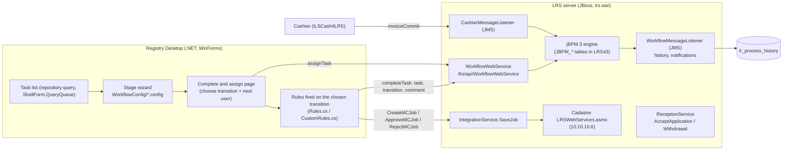

* **Process engine.** The server embeds **jBPM 3** (tables `JBPM_PROCESSDEFINITION`, `JBPM_NODE`, `JBPM_TRANSITION`,
  `JBPM_TASK`, `JBPM_SWIMLANE`, `JBPM_TASKINSTANCE`, ... in `$R/lrs-export/registry/schema/lrs-tables.sql`), wrapped by
  Alfresco 3.4's workflow service and exposed as SOAP `WorkflowWebService` (operations in
  `$R/lrs-capture/wsdl/WorkflowWebService.wsdl`: `startProcessInstance`, `getUserTasks`, `getPooledTasks`, `getTask`,
  `getTaskTransitions`, `getTaskTransitionInfo`, `completeTask`, `assignTask`, `startTask`, `suspendProcessInstance`,
  `resumeProcessInstance`, `deleteProcessInstance`, `getProcessInstanceLog`, `getProcessDefinitionFile`,
  `deployProcessDefinition`, `addComment`, `getTaskComments`, `setProcessVariables`, ...).
* **Process definitions are in the database, not in files.** `JBPM_PROCESSDEFINITION` holds 64 rows (inventory
  `$R/lrs-inventory-REGISTRY-20261101-1701.txt`, section `LRSAdmin.JBPM_PROCESSDEFINITION`): 10 Alfresco
  built-ins (`wfa:adhoc`, `wcmwf:submit`, ...) and the LRS processes in up to 4 versions each. The `processdefinition.xml`,
  `gpd.xml` and `processimage.jpg` of each version are stored as bytes (`JBPM_BYTEARRAY` lists them, e.g. id 3
  `processdefinition.xml` of file definition 22). The `alfresco/workflow/*_processdefinition.xml` files in
  `lrs.war/WEB-INF/classes` are only Alfresco's generic review/adhoc processes, not the land processes. The
  `ils/bootstrap/workflow/workflow-bootstrap.xsd` describes the bootstrap `DefinitionSet` (name, archivePath, version,
  initial) used to deploy `.par` archives at start-up; the archives themselves were not captured.
* **Latest LRS process definitions** (highest version per name, `JBPM_PROCESSDEFINITION`):

| jBPM process (NAME_) | Latest version (ID_) | Start-state node | Started for transaction types (`lr_transaction_metadata.workflow`) | Desktop config |
|---|---|---|---|---|
| Indexing and Scanning | 4 (53) | 628 | INSC | BacklogData.config |
| Recertification Registration | 4 (54) | 637 | APRF | Recertification.config |
| Ground Rent Payment | 4 (55) | 655 | GRPM | GroundRentPayment.config |
| First Registration | 4 (56) | 660 | APSL, APRO, CONT, RAOL, REGR | FirstRegistration.config |
| Subsequent Registration | 4 (57) | 691 | the 26 SSG codes (section 2.5) | SubsequentRegistration/*.config |
| Application for Certificate of Occupancy | 4 (58) | 724 | APCO | ApplicationCertificateOccupancy.config |
| Search | 4 (59) | 742 | SEAR, CETC | Search.config |
| Replacement Of Title | 4 (60) | 754 | REPT | ReplacementOfTitle.config |
| Set Right Of Occupancy As Expired | 4 (61) | 772 | SROE | SetRightOfOccupancyAsExpired.config |
| Data Correction | 2 (62) | 775 | DCT | DataCorrection.config |
| Ground Rent Review | 2 (63) | 780 | GRR | GroundRentReview.config |
| Survey Plan Checking | 2 (64) | 791 | SPC | SurveyPlanChecking.config |
| Raise Title Deed Plan | 4 (50) | 607 | (sub-process) | RaiseTitleDeedPlan.config |
| Survey Plan Checking and Approval | 4 (51) | 615 | (sub-process) | SurveyPlanCheckingAndApproval.config |
| Raise Site Analysis Report | 4 (52) | 620 | (sub-process) | RaiseSiteAnalysisReport.config |

  Sizes of the definitions (inventory row counts): `JBPM_NODE` 807, `JBPM_TRANSITION` 1,081, `JBPM_TASK` 582,
  `JBPM_SWIMLANE` 351, `JBPM_EVENT` 4,219, `JBPM_ACTION` 5,424, `JBPM_DELEGATION` 5,664 (all versions). Runtime:
  `JBPM_PROCESSINSTANCE` 99,808, `JBPM_TASKINSTANCE` 674,828, `JBPM_POOLEDACTOR` 7.06 M, `JBPM_TASKACTORPOOL` 12.6 M,
  `JBPM_JOB` 0 (no pending timers), `JBPM_LOG` 0. The three sub-processes have no transaction type of their own: they are
  entered from a parent process by a transition named after them ("Raise Title Deed Plan", "Survey Plan Checking and
  Approval", "Raise Site Analysis Report" - see `excludeTransition` / `CheckUnpaidFee` arguments in the configs) and the
  history records the sub-process name (`docs/plagis-workflow-review.docx` table 2: files "in" *Survey Plan Checking and
  Approval* / *Raise Title Deed Plan*). Whether they are jBPM `process-state` sub-processes or super-states is not
  visible **(inferred: process-state, because each has its own process definition)**.

* **Transaction type → process.** `lr_transaction_metadata.workflow` holds the jBPM process name. The desktop fails with
  `Resources.errTransactionWorkflowConfig` ("...workflow...") if no wizard is configured for the type
  (`$D/.../Controls.WorkerAssess.Forms/TransactionForm.cs` l.178). On lodgement the client calls
  `ReceptionService.AcceptApplication` (batch + transactions) and the server starts the process; server action handlers in
  `lrs-web.jar` (`CreateWorkflowHandler` "workflowName attribute...", `AssignLodgmentNumberHandler` sets
  `lr_batch.lodgment_number`/`application_status = application_lodged`, `ApproveTransactionHandler` sets
  `Transactions/RegistrationDate`, `CommitInvoiceHandler`, `CompleteBatchHandler`, `SetBatchStatusHandler`,
  `CompleteTaskHandler`) are the jBPM `action`/`decision` delegates the process definitions call (class names from
  `unzip -l lrs-web.jar`; which node calls which is in the uncaptured definitions).
* **Stages = jBPM task nodes.** A task's **name** is the config stage key (`ReviewSubmission`, `PrepareTitleDeedPlan`,
  ...); its **description** is the human label shown in lists and stored in history (`Review Submission`, *Prepare Title
  Deed Plan in Aumentum Cadastre*, *SG Review Submitted Survey Plan*, *Awaiting Acceptance of Statutory Right of Occupancy in
  Principle* - labels from `docs/plagis-workflow-review.docx`). The desktop picks the wizard by task name
  (`WizardFactory.CreateDrafterWizard(owner, assembly, stage, metainfo, ...)`, `$D/.../Controls.Core/WizardFactory.cs`).
* **Transitions are named after the target stage's label**, e.g. "Awaiting Fee Payment", "Scan Incoming Documents",
  "Review Submission", "Raise Title Deed Plan", "Prepare Title Deed Plan in Aumentum Cadastre", "ReDo Prepare Title Deed
  Plan", "Reject Transaction", "Delivery of Documents", "Finish Transaction", "Create Parcel In Aumentum Cadastre",
  "Approve Recommendation (Governor)" (all from `rules=`/`excludeTransition=` values and `lr_setting` `config`
  `HideFeeComputationTransition` = "Awaiting Fee Payment,Awaiting for Payment,Register Processing Fee Payment and
  Generate Receipt"). `lr_process_history.task_transition` has 72 distinct values, alphabetically "Approve Certificate of
  Occupancy" ... "Withdraw" (inventory, link-column section).
* **Swimlanes = Alfresco groups (units).** `getTaskTransitionInfo` returns for each transition the next task(s) and their
  `swimlane`; `CompleteAssignPage` looks the swimlane up as an Alfresco `group` authority and lists that group's users as
  possible assignees (`$D/.../Controls.Core/CompleteAssignPage.cs` l.44-86; `TaskDefinitionInfo{name, description,
  swimlane}` in `workflow-types.xsd`). After `completeTask` the client finds the new open task of the same process
  instance (Lucene `TYPE:"wf:task" AND @wf\:taskCompleted:"false" AND @wf\:taskProcInstRef:...`) and calls
  `assignTask` with the chosen user (`CompletePage.CompleteTask`, l.70-160). If no user is chosen the task stays pooled
  for the whole group (`JBPM_POOLEDACTOR`, `JBPM_TASKACTORPOOL`). The 351 swimlane definitions (group names per task)
  were not exported - see Gaps.
* **History.** `WorkflowMessageListener` (`lrs-web.jar`, JMS) receives `task-create`, `task-end`, `task-assign`,
  `task-suspend`, `task-resume` and `timer` events and writes `com.landsystems.lrs.model.ProcessHistory`
  (`lr_process_history`: process_id, process_name, task_id, task_name, task_description, task_create, task_complete,
  task_transition, actor, duration, transaction_id) - 976,928 rows (inventory), plus assignment / overdue notifications
  (strings `lrs.service.evt_assignment`, `evt_overdue_task` in `lrs.war/WEB-INF/classes/lrs/messages/lrscore-service.properties`)
  and optional e-mail (`mail_assign_to_user_subject`, `mail_assign_to_group_subject`). `lr_process_event` exists but has
  0 rows; `lr_transaction_note` (3,282 rows) holds task comments with `task_id`/`task_name`.

### 1.2 Transaction and batch status vs. stage

The stage lives only in jBPM (and `lr_process_history`); `lr_transaction` has no stage column. Status is separate
(`lr_dictionary`, category `transaction_status` / `application_status`):

| transaction_status (lr_transaction) | lr_batch.application_status | Set by |
|---|---|---|
| 24 `transaction_lodged` "Active" | 19 `application_lodged` | lodgement (`AssignLodgmentNumberHandler`); Continue |
| 25 `transaction_completed` | 20 `application_completed` | end of process (server handlers, inferred `CompleteBatchHandler`) |
| 26 `transaction_postponed` | 23 `application_postponed` | Postpone (suspends the jBPM process) |
| 27 `transaction_rejected` | 21 `application_rejected` | `CustomReject` (only when a transition in `RejectedStages` is taken) |
| 28 `transaction_suspended` | - | not used (0 rows) |
| 29 `transaction_withdrawn` | 22 `application_withdrawn` | Withdraw (`ReceptionService.Withdrawal`) |
| - | 18 `application_issued` | 14,322 batches (meaning not captured; inferred: Cashier invoice issued, not yet lodged) |

`lr_transaction.transaction_source`: 30 `normal` "Created as LRS Registration" (65,055) vs 31 `past` "Created as Past"
(50,515, mainly back-file history keyed in through *Indexing and Scanning*).

### 1.3 The stage wizard config files (schema, annotated)

The desktop loads every file listed under `<Wizards>` in
`ThomsonReuters.Aumentum.Registry.PLAGIS.RegistryDesktop.exe.config` (14 top-level files + 26 SubsequentRegistration
files; `Lease.config` and `ReleaseLease.config` are listed but **missing** from the capture, and
`WorkflowConfig/SubsequentRegistration.config` (211 KB) is **not listed** - it is an older combined file and is not used).
Parser: `WizardSectionHandler.Create` (`$D/.../Controls.Core/WizardSectionHandler.cs`). The files say "generated by the
configuration generator tool".

```xml
<Wizards>
  <!-- one <wizard> per stage (or group of stages) and per set of transaction codes -->
  <wizard stages="New,LodgmentApplication"            <!-- jBPM task names this wizard serves (comma list) -->
          assembly="ThomsonReuters.Aumentum.Registry.Controls"
          meta="all;APCA">                            <!-- "<metainfo>;<codes>": codes = lr_transaction_metadata.code list,
                                                           "all" = any; empty meta = any type (sub-processes) -->
    <!-- <editor> = one wizard page, shown in this order -->
    <editor name="transaction"                        <!-- name = "page:formDescriptor:extDescriptor:RO:ruleSet" -->
            type="...PLAGIS.Controls.WorkerAssess.Pages.CustomTransactionListPage,...PLAGIS.Controls"
            help="#_Toc414448365"                     <!-- anchor in the CHM help -->
            validate_property="checkRegisterAlready,checkTransactionMetadata" />
    <editor name="properties:PropertyGrid::RO"        <!-- form PropertyGrid (lr_formfield), read-only -->
            type="...CustomPropertiesPage,..." mainForm="PropertyForm" plotForm="PlotForm"
            mapvisible="1" mapreadonly="1" />         <!-- Cadastre map button; read-only unless maplinktransaction matches -->
    <editor name="outstanding" type="...CustomOutstandingPage,..." feetype="feetype_groundrent_"
            view_past_outstanding="1" current_year_validation="true" show_penalty_section="true" capture_past_outstanding="1"/>
    <editor name="feelist" type="...FeeListSelectionPage,..." />
    <editor name="print" type="...CustomPrintDocuments2Page,..."
            reports="LodgementLetter:pdf:1:sd_lodgement_letter;DemandNotice:pdf:1:sd_demandnotice" />
                                                      <!-- report:format:copies(inferred):document type it is filed as -->
    <editor name="completeAssign" type="ThomsonReuters.Aumentum.Registry.Controls.Core.CompleteAssignPage,..."
            rules="CheckUnpaidFee:Scan Incoming Documents|Awaiting Fee Payment"   <!-- fired before completeTask -->
            excludeTransition="APCA|Generate Final Demand Notice,APCA|Register Instrument" /> <!-- hide transitions per code -->
  </wizard>
</Wizards>
```

| Element / attribute | Meaning (source) |
|---|---|
| `wizard@stages` | Task names; `New` = creating a transaction, `LodgmentApplication` = the first jBPM task (`WizardFactory`) |
| `wizard@meta` | `"all;CODE1,CODE2"`; the wizard is used if the transaction code is in the list (`CreateDrafterWizard`). Several wizards for the same stage with different code lists = per-type variants |
| `editor@name` | `page:form:extForm:RO:ruleSet` - page key; GUI descriptor (`lr_formfield` form name, e.g. `TransactionWithDocFRGForm`); extension descriptor; `RO` = page read-only; custom GUI rule set (`WorkerWizard.cs` l.530-560) |
| `editor@type` | .NET page class (assembly-qualified). The PLAGIS assembly overrides most core pages (`Custom*Page`) |
| `mainForm, plotForm, unitForm, buildingForm, siteAnalysisForm, rrrForm, secondary_form, transaction_dialog_form, transactionListForm` | Form descriptors used inside the page |
| `mapvisible`, `mapreadonly`, `maplinktransaction` | Map (Cadastre GISViewer) button; read-only unless the transaction code is in `maplinktransaction` - that is where a UPIN can be linked (`PropertiesPage.Map_Action`, l.457-480) |
| `searchvisible`, `addbuttondisabled`, `deletebuttondisabled`, `addtotargetpropertybuttondisabled`, `max_prop_number` | Property grid buttons (also overridden by `lr_setting` `DisableProperties*ButtonOnStageName`) |
| `set_mandatory_fields`, `set_enable_fields`, `set_disable_fields` | Field rules on the page (e.g. `signDate` mandatory at Approve stages) |
| `validate_property`, `validate_right`, `validate_related_party`, `ignore_related_validation`, `checkPages`, `docEnabled` | Validations on leaving the page |
| `payments_validation`, `payments_optional`, `feetype`, `view_past_outstanding`, `current_year_validation`, `show_penalty_section`, `capture_past_outstanding`, `feesForTargetProperties` | Fee / ground-rent page behaviour |
| `reports` | Printouts generated on the page and the document type they are filed as |
| `documents` | Outgoing documents that must be scanned at *Scan Outgoing Documents* |
| `rules` | `;`-separated `Rule[:args]`; run in `CompletePage.CompleteTask` via the `before_push` callback with `_PUSH_STEP` = chosen transition name; a rule cancels the move by setting `_PUSH_STEP = null` (section 1.5) |
| `excludeTransition` | `CODE[*CODE]|Transition label,...` - transitions removed from the list for those codes (`CompleteAssignPagePresenter.ExcludeTransition`) |
| `hideCadastreTransitionForArchivedProperty` | Transition hidden when the property is archived (INSC) |
| `isRetrieveCurrentOwner`, `isAddedConsideration`, `block_search_transaction` | Special page behaviour (GRR, UPMO, DCT) |

`ExternalConfig/Workers.config` lists, per worker, the stages it handles - all PLAGIS stages are handled by
`ThomsonReuters.Aumentum.Registry.PLAGIS.Controls.WorkerAssess.CustomAssessWorker`; the order of those lists matches the
process order. `ExternalConfig/Rules.config` adds server-independent rule sets: `BLFinalReview`/INSC → `Rules.SetComplete`
and `CustomRules.UpdateBalance`; `IndexData`/INSC → `CustomRules.LinkPropertyAndPastTransaction`.

### 1.4 Moving a file: Complete, assign, postpone, continue, withdraw, reject

| Action | Client (desktop) | Server effect | Source |
|---|---|---|---|
| Open task | Task list → wizard for `task.name` + transaction code; task locked (`LockTask`) | - | `ShellForm.cs`, `WorkerFactory.cs` |
| **Suspend** (leave without completing) | Wizard "Suspend" button saves data, task stays | entity saved | `WorkerWizard` |
| **Complete** | Last page `CompleteAssignPage`: transitions from `getTaskTransitions`, minus `excludeTransition`, minus `DeactiveCofO*`/`HideFeeComputationTransition` settings; user picks one, optional comment and next assignee; rules run; `completeTask(taskRef, transition, comment)`; `addComment`; `assignTask` | jBPM moves the token; history row; assignment notice | `CompletePage.cs`, `CompleteAssignPage.cs` |
| **Assign / re-assign** | Edit → Assign; users of the task's swimlane group | `assignTask` | `WorkerFactory.LaunchAssignWorker` |
| **Postpone** | Edit → Postpone (permission `lrsPostponeRegistration`); confirm; postpone page | `SuspendProcessInstance`; batch `application_postponed`, transactions `transaction_postponed` | `ShellForm.miEditPostpone_Click`; `BusinessLogicServiceAgent.PostponeRegistration` |
| **Continue** | Edit → Continue (`lrsContinueRegistration`) | `ResumeProcessInstance`; status back to lodged | `ContinueRegistration` |
| **Withdraw** | Edit → Withdraw (`lrsCancelRegistration`); refused at the type's `non_withdrawable_tasks` ("strNonWithdrawable"); `RejectPage` (reasons) then confirm | history row with transition "Withdraw"; `ReceptionService.Withdrawal(processId)`; batch/transactions withdrawn; Cadastre job rejected (`IntegrationAgent.saveJob` with `McJob` status rejected → `RejectJob`, `lr_mc_job.job_status` 7); DCT: end-lifespan the corrected entities; GRR: delete new rental-amount revisions | `ShellForm.miEditWithdrawal_Click`, `BusinessLogicServiceAgent.WithdrawRegistration` |
| **Reject (generic)** | Choosing a transition named in `lr_setting` `config` `RejectedStages` ("Reject Registration,Rejected,Generate Rejection Letter") or `DeniedStages` ("Denied") inserts a `RejectPage`; `CustomReject` sets `transaction_rejected` and end-dates the properties | process continues on the reject branch | `CompletePage.selectTransitionView_SelectedIndexChanged`; `BusinessLogicServiceAgent.CustomReject` |
| **Reject (PLAGIS)** | PLAGIS processes use transitions "Reject Transaction" → stage `PrepareRejectionLetter` (page `RejectPage` + `RejectionLetter` printout) → "Delivery of Documents" → "Scan Outgoing Documents". These names are not in `RejectedStages`, so the status is not set to rejected by the client | only 3 transactions ever got status 27; 3,371 of 3,540 rejection records belong to withdrawn files (section 5) | configs; `lr_rejection` |
| **View workflow diagram** | View → Workflow diagram: `http://<host>/lrs/downloadBPM?definitionId=<id>&ticket=...` | serves the definition image | `ShellForm.miViewWfDiagram_Click` |
| **Notifications** | Notification window | `lrs.service.evt_assignment` "Transaction %1 has been assigned to you. It is currently at the "%2" workflow stage."; overdue/expired/lapsed/canceled events (`lr_dictionary` category `event_type` ids 11-15) | `WorkflowMessageListener` |

### 1.5 Rules (actions fired on the chosen transition)

All rules receive `_PUSH_STEP` = the chosen transition label; most act only for specific labels.

| Rule (args) | Effect | Source |
|---|---|---|
| `CheckUnpaidFee:A|B|C` | If fee lines with `calculatedFee` still exist and the user chose A or C → "you have unpaid fees", blocked; if the user chose B (the "Awaiting ... Payment" loop) and none exist → "all fees are paid", blocked. Skipped for codes in `HideFeeComputation` (RCOO, RROC, SURO) | `CustomRules.CheckUnpaidFee` |
| `UpdateSimpleCounterValue:receipt_number` / `:demandnotice_number` | Allocates the next number (`lr_simplecounter`) into `lr_transaction.internal_receipt_no` / `demandnotice_number` | `CustomRules.UpdateSimpleCounterValue` |
| `CheckUnscannedDocuments[:Confirm|Warning]` | Warns / asks if listed documents have no scanned pages | `CustomRules.CheckUnscannedDocuments` |
| `CreateMCJob:Transition|settingKey` | On that transition, if `mcintegration.IntegrationWithMC` and `multicadastre.job_creation`=1: create a Cadastre job named by `lr_setting multicadastre <settingKey>` (unless one exists), instance name `Job-<property no>`, comments = job name, parameters `@LRS:[Transaction]:[TransactionNumber]=PLS...`, priority 2, one job per target property for jobs in `mcJob_multipleTargetProperties`; failure blocks the transition | `Rules.CreateMCJob`, `DataModelUtilities.CreateMCJob` |
| `ApproveMCJob:Transition|settingKey` / `RejectMCJob:...` | Approve (status 5) / reject (status 7) the transaction's Cadastre job | `Rules.ApproveMCJob/RejectMCJob` |
| `CheckUnlinkedParcel:Confirm` / `CheckUnlinkedParcels:Confirm|Warning|codes|exceptTransitions` | Property without UPIN: ask (Confirm) or refuse (Warning), only for the listed codes and not for the listed transitions | `Rules.CheckUnlinkedParcel`, `CustomRules.CheckUnlinkedParcels` |
| `CheckOccupancyReportsParameters` | One `sd_titledeedplan` document per target property, document number = property number | `CustomRules.CheckOccupancyReportsParametersDetails` |
| `AddOutgoingSupportingDocument:Transition` | Adds the type's `complete_reports_codes` (or `reject_reports_codes` if rejected) as outgoing documents to scan | `CustomRules.AddOutgoingSupportingDocument` |
| `SaveGroundRentData`, `MapPaymentWithGroundRentInfo`, `UpdateBalance` | Ground-rent bookkeeping on the property | `CustomRules` |
| `AllowTransition:CODE|T` / `ForbidTransition:CODE|T` | For CODE only T is allowed / T is refused | `CustomRules` |
| `CheckFoundProperties:T1|T2` | T1 needs at least one property; T2 needs none | `CustomRules` |
| `BlockTransition:codes|T,...` | T refused for those codes (only in the unused combined file) | `CustomRules.BlockTransition` |
| `LinkPropertyAndPastTransaction`, `SetStatusForUnlinkedPastTransaction`, `BlockIfPropertyIsNotValid`, `CheckTranDict`, `SetComplete` | Back-file (INSC) consistency and completion | `CustomRules`, `Rules` |
| `SaveDataCorrection`, `SetRentalAmountRevisionAsActive`, `UpdateTargetPartiesForPartSurrender` | DCT / GRR / PSUR specifics | `Rules`, `CustomRules` |

### 1.6 Other workflow settings (`lr_setting`, category `config`)

| Setting | Value | Effect |
|---|---|---|
| `IntakeTransactions` | INSC,APRF | Types shown at the Intake stage |
| `DisableBatchForTransactions` | FRG | First Registration cannot be batched |
| `TransactionCodeMultipleProperties` | INSC,CEMP,APCM,LOCE,MERT,MORT,RLEA,RMOR,RSUB,SUBD,UPMO,SEAR | Types that may carry several properties |
| `HideNormalTransactionCode` / `HidePastTransactionCode` | LEAS,RLEA / LEAS,RLEA,DCT,GRR,SPC,SEAR | Not offered for new / past entry |
| `DeactiveCofOTransactionCodes`, `DeactiveCofOFRTransactionCodes`, `DeactiveCofO{Show,Hide}TransitionNames` | SSG list / APRO,APSL,CONT,RAOL,REGR / none | Hook to hide C of O transitions; no-op today (names = none) |
| `DisableProperties{Add,AddToTarget,Delete}ButtonOnStageName` | `CODE:Stage` lists, mostly `:ReviewSubmission` | Property grid locked at review |
| `HideFeeComputation` / `HideFeeComputationTransition` | RCOO,RROC,SURO / the three fee transitions | No fees for revocation/surrender |
| `ValidTransactionCodesForCaveatTransaction` | GRPM,GRR,SEAR,LOCE | Allowed while a caveat is on the property |
| `RejectedStages` / `DeniedStages` | Reject Registration,Rejected,Generate Rejection Letter / Denied | Generic reject page trigger |
| `IgnoreSchedulingDates` | 1 | Due dates not enforced (inferred) |
| `IntegrationWithCashier` | 1 | Fees go through the Cashier |
| `businesscalendar` `WorkingHoursPerDay` / `WorkingDaysPerWeek` | 8 / 5 | SLA calendar (also `lrs/calendar/business-calendar.properties`: Mon-Fri 9-12, 13-18) |

### 1.7 Transaction-type metadata fields used by the workflow (`lr_transaction_metadata`)

| Column | Use |
|---|---|
| `workflow` | jBPM process name to start |
| `group_name` / `group_code` | FRG First Registration, SSG Subsequent, MCG Miscellaneous, GRT Ground Rent, SVG Survey, BLT BackLogs |
| `meta_type` | `TTransactionMetaType` (`$D/.../DataModel/TTransactionMetaType.cs`): 0 Memo, 1 Primary, 3 Miscellaneous, 7 NewCT (creates a new title/property) |
| `action_type` | 0 create, 1 discharge, 2 modify, 99 other (inferred from the RRR columns of the rows that carry them) |
| `normal_duration`, `lapsed_duration`, `max_duration` | Days; 20/0/20 for all except INSC 10/0/10 - basis of overdue/lapsed events (inferred) |
| `right_type` | The right the transaction is about |
| `related_active_rrrs`, `blocked_by_active_rrrs`, `create_new_rrrs`, `modify_active_rrrs`, `discharge_active_rrrs` | The RRR effect (section 2) |
| `source_party_type`, `target_party_type`, `retrieve_source_parties`, `retrieve_target_parties` | Party roles and pre-fill (`lr_dictionary` `party_retrieve_type`: no_retrieve, retrieve_source, retrieve_target) |
| `blocking_transaction_code` | `CODE:status;...` - cannot lodge while such a transaction is open on the property |
| `non_withdrawable_tasks` | Stages where Withdraw is refused |
| `cashier_transaction_code`, `cashier_code_based_on_source` | Fee types sent to the Cashier |
| `complete_reports_codes`, `reject_reports_codes`, `mandatory_scan_outgoing_document_codes` | Documents produced / to be scanned |


---

## 2. The processes

### 2.0 Observed on the live system: one real First Registration file (APRO)

The History tab of the trial file PLS000138850 (property PL67363) in Web Access shows `lr_process_history` for one real
APRO file (screenshot `screens/real/web/32-transaction-history.png`; read-only, 2026-11-06; user names not recorded):

| # | Task (stage) | Transition taken | Time in stage |
|---|---|---|---|
| 1 | Lodge Application | Scan Incoming Documents | 5h 3m |
| 2 | Scan Incoming Documents | Open New Property File | 3h 16m |
| 3 | Open New Property File | Awaiting Fee Payment | 1h 53m |
| 4 | Awaiting Fee Payment | Register Processing Fee Payment and Generate Receipt | 7h 21m (overnight) |
| 5 | Register Processing Fee Payment and Generate Receipt | **Survey Plan Checking and Approval** (sub-process starts) | 50 s |
| 6 | SG Review Submitted Survey Plan | Compare and Verify Survey Plan | 166 days |
| 7 | Compare and Verify Survey Plan | Confirm Survey Plan | — |
| 8 | Confirm Survey Plan | Finish Survey Plan Checking and Approval (sub-process ends) | — |
| 9 | Review Request for Site Analysis | Schedule Site Analysis | — |
| 10 | Schedule Site Analysis | *(open — current stage on 2026-11-06)* | |

What the file shows:
- The **transition names are the names of the next stage**.
- The Survey Plan Checking and Approval sub-process runs **inside** APRO between fee payment and site analysis. Steps 6–8 were done on 2026-11-03 during the Cadastre trial.
- Payment comes **before** survey. Fees and receipt are visible in the Fees and Payment tabs: 8 fee lines, one payment.

This is the reference route for the golden tests of R3/R4. The complete graph of every process comes from the jBPM export (`tools/aumentum-inventory/export-registry-workflow.sh`, §7). Where the export disagrees with the inferred "Next" columns below, the export is right.


Conventions for every stage table below:

* **Stage** = jBPM task name (= `stages` in the config). Rows are in config-file order, which matches the process order
  in `ExternalConfig/Workers.config` except where noted.
* **Role / unit** is inferred from the stage name - the real swimlane (Alfresco group) of each task is in the
  uncaptured process definitions.
* **Screens** = the wizard pages in order; `RO` = read-only; `map` = Cadastre map button (`map link` = UPIN can be linked
  there for the listed codes).
* **Checks & actions** = page validations and `rules` run when the user completes the stage.
* **Printed / produced** = `reports` printouts (report name → document type it is filed as) and `documents` that must be
  scanned before the file can finish.
* **Next** = transitions known from config arguments, settings and history labels; where no argument names them the next
  stage is the following row **(inferred from order)**. Every review stage can also go to the reject branch
  ("Reject Transaction" → `PrepareRejectionLetter`) **(inferred: the stage exists in each process; the transition name is
  seen in RaiseTitleDeedPlan rules)**.

### 2.1 First Registration (APSL, APRO, CONT, RAOL, REGR)

Purpose: grant of a new statutory Right of Occupancy on State land and issue of its Certificate of Occupancy: application
for State land (APSL), application for statutory R of O (APRO, by far the largest flow), conversion of titles (CONT),
re-allocation (RAOL) and re-grant (REGR, metadata group SSG but process *First Registration*). This is the PLAGIS
"land journey" (section 6). Config `WorkflowConfig/FirstRegistration.config`; process **First Registration** v4.

**APRO - Application for Statutory Right of Occupancy**

| Field | Value |
|---|---|
| Code / label | `APRO` Application for Statutory Right of Occupancy (lr_transaction_metadata Id 5) |
| Group / jBPM process | First Registration (`FRG`) / **First Registration** |
| meta_type / action_type / right_type | 7 / 0 / right_type_none |
| Durations (normal/lapsed/max, days) | 20 / 0 / 20 |
| RRR effect at completion | creates **occupancy**. Parties: source party = grantor; target party = grantee |
| Fees | Cashier fee lines: Application Form Fee (`feetype_apff_C_APFF`), Premium of CofO Fee (`feetype_premiumCofO_C_PCOFO`), Infrastructure Provision Levy (`feetype_IPL_C_IPL`), C-of-O Processing Fee (`feetype_COPF_C_COPF`), Issuance Fee For C of O (`feetype_IFCO_C_IFCO`), Registration of C of O Fee (`feetype_RCOF_C_RCOF`), TDP Fee (`feetype_tdp_C_TDPF`), Survey Fee (`feetype_survey_C_SVF`), Building Plan Approval Fee (`feetype_BPAF_C_BPAF`), Plan Lodgement Fee (`feetype_planlodgement_C_PLF`), Layout Approval Fee (`feetype_LAF_C_LAF`) |
| Non-withdrawable tasks | RegisterCofO,DeliveryOfDocuments,ScanOutgoingDocuments |
| Complete / reject reports | sd_Co_title / sd_reject_letter |
| Mandatory scanned outgoing docs | `sd_landform_5`, `sd_demandnotice`, `sd_rightOcc_accept`, `sd_SAR`, `sd_traverse_compute`, `sd_finSurvey_report`, `sd_surbReport_RightOcc`, `sd_payment_receipt`, `sd_landfoem_7` |
| Blocked while another transaction on the property is lodged/postponed | ABWG, APCA, APCM, APCO, APRF, APRO, APSL, ASSI, CEMP, CHNT, CHPC, COMP, CONT, DCT, DEVO, EXTT, INSC, LEAS, LOCE, MERT, MORT, PSUR, RAOL, RCOO, REGR, REPT, RLEA, RMOR, RROC, RSUB, SUBD, SUBL, SURO, UPMO |
| Volume (all time) | 41563: Active 23996, Completed 16749, Withdrawn 786, Postponed 29, Rejected 3; created as LRS 14989, as past 26574 |
| Lodge → complete (live, completed) | median 727 d (p25 459, p75 1206, p90 1848), n=5738 |
| Age of open (Active) live files | median 683 d, n=8578 |
| Cadastre jobs (lr_mc_job) / rejection records | 12757 / 682 |

**APSL - Application for State Land**

| Field | Value |
|---|---|
| Code / label | `APSL` Application for State Land (lr_transaction_metadata Id 4) |
| Group / jBPM process | First Registration (`FRG`) / **First Registration** |
| meta_type / action_type / right_type | 7 / 0 / right_type_none |
| Durations (normal/lapsed/max, days) | 20 / 0 / 20 |
| RRR effect at completion | creates **occupancy**. Parties: source party = grantor; target party = grantee |
| Fees | Cashier fee lines: Allocation Fee (`feetype_ALF_C_ALF`), Application Form Fee (`feetype_apff_C_APFF`), Premium of CofO Fee (`feetype_premiumCofO_C_PCOFO`), Infrastructure Provision Levy (`feetype_IPL_C_IPL`), C-of-O Processing Fee (`feetype_COPF_C_COPF`), Issuance Fee For C of O (`feetype_IFCO_C_IFCO`), Registration of C of O Fee (`feetype_RCOF_C_RCOF`), TDP Fee (`feetype_tdp_C_TDPF`), Outstanding Ground Rent (`feetype_groundrent_C_GR`) |
| Non-withdrawable tasks | RegisterCofO,DeliveryOfDocuments,ScanOutgoingDocuments |
| Complete / reject reports | sd_Co_title / sd_reject_letter |
| Mandatory scanned outgoing docs | `sd_payment_receipt`, `sd_demandnotice`, `sd_landform_5`, `sd_rightOcc_accept`, `sd_landfoem_7` |
| Blocked while another transaction on the property is lodged/postponed | ABWG, APCA, APCM, APCO, APRF, APRO, APSL, ASSI, CEMP, CHNT, CHPC, COMP, CONT, DCT, DEVO, EXTT, INSC, LEAS, LOCE, MERT, MORT, PSUR, RAOL, RCOO, REGR, REPT, RLEA, RMOR, RROC, RSUB, SUBD, SUBL, SURO, UPMO |
| Volume (all time) | 919: Active 639, Completed 218, Withdrawn 62, Postponed 0, Rejected 0; created as LRS 798, as past 121 |
| Lodge → complete (live, completed) | median 1058 d (p25 591, p75 1520, p90 1907), n=209 |
| Age of open (Active) live files | median 1994 d, n=527 |
| Cadastre jobs (lr_mc_job) / rejection records | 501 / 62 |

**CONT - Conversion of Titles**

| Field | Value |
|---|---|
| Code / label | `CONT` Conversion of Titles (lr_transaction_metadata Id 11) |
| Group / jBPM process | First Registration (`FRG`) / **First Registration** |
| meta_type / action_type / right_type | 7 / 0 / right_type_none |
| Durations (normal/lapsed/max, days) | 20 / 0 / 20 |
| RRR effect at completion | creates **occupancy**. Parties: source party = grantor; target party = grantee |
| Fees | Cashier fee lines: Application Fee (`feetype_app_C_APF`), TDP Fee (`feetype_tdp_C_TDPF`), Premium of CofO Fee (`feetype_premiumCofO_C_PCOFO`), Issuance Fee For C of O (`feetype_IFCO_C_IFCO`), Registration Fee (`feetype_RF_C_RF`), Plan Lodgement Fee (`feetype_planlodgement_C_PLF`), Survey Fee (`feetype_survey_C_SVF`) |
| Non-withdrawable tasks | RegisterCofO,DeliveryOfDocuments,ScanOutgoingDocuments |
| Complete / reject reports | sd_Co_title / sd_reject_letter |
| Mandatory scanned outgoing docs | `sd_demandnotice`, `sd_landform_5`, `sd_CM`, `sd_landfoem_7`, `sd_rightOcc_accept`, `sd_SAR`, `sd_payment_receipt` |
| Blocked while another transaction on the property is lodged/postponed | ABWG, APRF, APRO, APSL, ASSI, CEMP, CHNT, CHPC, COMP, CONT, DCT, DEVO, EXTT, INSC, LEAS, LOCE, MERT, MORT, PSUR, RAOL, RCOO, REGR, RLEA, RMOR, RROC, RSUB, SUBD, SUBL, SURO, UPMO |
| Volume (all time) | 17: Active 5, Completed 0, Withdrawn 12, Postponed 0, Rejected 0; created as LRS 14, as past 3 |
| Age of open (Active) live files | median 1844 d, n=2 |
| Cadastre jobs (lr_mc_job) / rejection records | 3 / 12 |

**RAOL - Re-Allocation of Land**

| Field | Value |
|---|---|
| Code / label | `RAOL` Re-Allocation of Land (lr_transaction_metadata Id 19) |
| Group / jBPM process | First Registration (`FRG`) / **First Registration** |
| meta_type / action_type / right_type | 7 / 0 / right_type_none |
| Durations (normal/lapsed/max, days) | 20 / 0 / 20 |
| RRR effect at completion | creates **occupancy**. Parties: source party = grantor; target party = grantee |
| Fees | Cashier fee lines: Application Fee (`feetype_app_C_APF`), Re-Allocation of Land Fee (`feetype_RALF_C_RALF`), Plan Lodgement Fee (`feetype_planlodgement_C_PLF`), TDP Fee (`feetype_tdp_C_TDPF`), Survey Fee (`feetype_survey_C_SVF`), Registration Fee (`feetype_RF_C_RF`) |
| Non-withdrawable tasks | RegisterCofO,DeliveryOfDocuments,ScanOutgoingDocuments |
| Complete / reject reports | sd_Co_title / sd_reject_letter |
| Mandatory scanned outgoing docs | `sd_landform_5`, `sd_demandnotice`, `sd_rightOcc_accept`, `sd_SAR`, `sd_traverse_compute`, `sd_finSurvey_report`, `sd_surbReport_RightOcc`, `sd_payment_receipt`, `sd_regist_memoMem`, `sd_Co_title` |
| Blocked while another transaction on the property is lodged/postponed | ABWG, APRF, APRO, APSL, ASSI, CEMP, CHPC, COMP, CONT, DCT, DEVO, EXTT, INSC, LEAS, LOCE, MERT, MORT, PSUR, RAOL, RCOO, REGR, RLEA, RMOR, RROC, RSUB, SUBD, SUBL, SURO, UPMO |
| Volume (all time) | 188: Active 86, Completed 100, Withdrawn 1, Postponed 1, Rejected 0; created as LRS 1, as past 187 |
| Lodge → complete (live, completed) | median 1248 d (p25 1248, p75 1248, p90 1248), n=1 |
| Cadastre jobs (lr_mc_job) / rejection records | 1 / 0 |

**REGR - Re-Grant**

| Field | Value |
|---|---|
| Code / label | `REGR` Re-Grant (lr_transaction_metadata Id 20) |
| Group / jBPM process | Subsequent Registration (`SSG`) / **First Registration** |
| meta_type / action_type / right_type | 0 / 0 / right_type_occupancy |
| Durations (normal/lapsed/max, days) | 20 / 0 / 20 |
| RRR effect at completion | blocked by active mortgage or caveat or lease or sublease; creates **occupancy**; discharges **occupancy**. Parties: source party = grantor; target party = grantee; source parties pre-filled from source of related RRR; target parties pre-filled from target of related RRR |
| Fees | Cashier fee lines: Survey Fee (`feetype_survey_C_SVF`), TDP Fee (`feetype_tdp_C_TDPF`), Plan Lodgement Fee (`feetype_planlodgement_C_PLF`), Premium of CofO Fee (`feetype_premiumCofO_C_PCOFO`), Application Fee (`feetype_app_C_APF`), Issuance Fee For C of O (`feetype_IFCO_C_IFCO`), Registration Fee (`feetype_RF_C_RF`); fees computed from the source property: Issuance Fee For C of O (`feetype_IFCO_C_IFCO`), Premium of CofO Fee (`feetype_premiumCofO_C_PCOFO`) |
| Non-withdrawable tasks | RegisterCofO,DeliveryOfDocuments,ScanOutgoingDocuments |
| Complete / reject reports | sd_Co_title / sd_reject_letter |
| Mandatory scanned outgoing docs | `sd_landform_5`, `sd_demandnotice`, `sd_rightOcc_accept`, `sd_SAR`, `sd_traverse_compute`, `sd_finSurvey_report`, `sd_surbReport_RightOcc`, `sd_payment_receipt`, `sd_Co_title` |
| Blocked while another transaction on the property is lodged/postponed | ABWG, APRF, APRO, APSL, ASSI, CEMP, CHNT, CHPC, COMP, CONT, DCT, DEVO, EXTT, INSC, LEAS, LOCE, MERT, MORT, PSUR, RAOL, RCOO, REGR, RLEA, RMOR, RROC, RSUB, SUBD, SUBL, SURO, UPMO |
| Volume (all time) | 154: Active 78, Completed 57, Withdrawn 19, Postponed 0, Rejected 0; created as LRS 88, as past 66 |
| Lodge → complete (live, completed) | median 439 d (p25 219, p75 700, p90 855), n=25 |
| Age of open (Active) live files | median 787 d, n=45 |
| Cadastre jobs (lr_mc_job) / rejection records | 51 / 18 |

| # | Stage (jBPM task / config `stages`) | Role / unit (inferred) | Screens (wizard pages) | Checks & actions on Complete | Printed / produced | Next (transition) |
|---|---|---|---|---|---|---|
| 1 | `New,LodgmentApplication` (APSL,APRO,CONT,RAOL) | Lodgement desk (reception) | Transaction list › Applicants › Properties (map) › Fee list › Print › Complete & assign |  | LodgementLetter → `sd_lodgement_letter`<br>DemandNotice → `sd_demandnotice` | Scan Incoming Documents (inferred) |
| 2 | `New,LodgmentApplication` (REGR) | Lodgement desk (reception) | Transaction list › Applicants › Properties (map) › Fee list › Print › Complete & assign | `validate: checkRegisterAlready,checkTransactionMetadata` | LodgementLetter → `sd_lodgement_letter`<br>DemandNotice → `sd_demandnotice` | Scan Incoming Documents (inferred) |
| 3 | `ScanIncomingDocuments` (APSL,APRO,CONT,RAOL,REGR) | Scanning | Transaction + documents › Complete & assign |  |  | "Open New Property File" (APSL, APRO, CONT, RAOL) or "Awaiting Fee Payment" (REGR) - from `excludeTransition`<br>excluded here: APSL*APRO*CONT*RAOL → Awaiting Fee Payment,REGR → Open New Property File |
| 4 | `OpenNewPropertyFile` (APSL,APRO,CONT,RAOL,REGR) | Records / file room | Transaction + documents › Applicants (RO) › Properties (map) › Fee list (RO) › Complete & assign |  |  | Awaiting Fee Payment (inferred) |
| 5 | `AwaitingFeePayment` (APSL,APRO,CONT,RAOL,REGR) | Wait state (applicant / Cashier) | Transaction + documents (RO) › Complete & assign | `UpdateSimpleCounterValue:receipt_number` |  | Register Processing Fee Payment and Generate Receipt - signalled when the Cashier commits the invoice (inferred, `CashierMessageListener`) |
| 6 | `RegisterProcessingFeePaymentGenerateReceipt` (APSL,APRO,CONT,RAOL,REGR) | Accounts (fee) | Transaction + documents (RO) › Applicants (RO) › Properties (RO, map) › Demand notice › Print › Complete & assign | `payments must validate`<br>`CheckUnpaidFee:Survey Plan Checking and Approval\|Awaiting Fee Payment\|Raise Site Analysis Report` | FeePaymentVerificationReceipt → `sd_payment_receipt` | "Survey Plan Checking and Approval" (sub-process 2.8) or "Raise Site Analysis Report" (2.7); "Awaiting Fee Payment" while fees are unpaid |
| 7 | `ReviewSubmission` (APSL,APRO,CONT,RAOL,REGR) | Lands officer | Transaction + documents › Applicants (RO) › Properties (map) › Demand notice (RO) › Complete & assign |  |  | Prepare Land Form 5 (inferred); reached when the survey / site-analysis sub-process returns (inferred) |
| 8 | `PrepareLandForm5` (APSL,APRO,CONT,RAOL,REGR) | Lands (R of O office) | Transaction + documents › Properties (map) › Parties › RRR › Demand notice (RO) › Print › Complete & assign | `mandatory: termYear,buildValue,buildTerm,rentalAmount,payPeriodYear,improvementAmountCurrency` | Landform5 → `sd_landform_5` | Review Land Form 5 |
| 9 | `ReviewLandForm5` (APSL,APRO,CONT,RAOL,REGR) | Lands (R of O office) | Transaction + documents (RO) › Properties (RO, map) › Parties (RO) › Demand notice (RO) › Complete & assign |  |  | Approve Land Form 5 (or back to Prepare, inferred) |
| 10 | `ApproveLandForm5` (APSL,APRO,CONT,RAOL,REGR) | Lands (R of O office) | Transaction + documents › Properties (RO, map) › Parties (RO) › Demand notice (RO) › Complete & assign |  |  | Review Signed Land Form 5 |
| 11 | `ReviewSignedLandForm5` (APSL,APRO,CONT,RAOL,REGR) | Lands (R of O office) | Transaction + documents (RO) › Properties (RO, map) › Parties (RO) › Demand notice (RO) › Complete & assign | `UpdateSimpleCounterValue:demandnotice_number` |  | Prepare R of O Acceptance of Terms & Conditions of Grant (demand-notice no. allocated) |
| 12 | `PrepareRightOccupancyAcceptanceTermsConditionGrant` (APSL,APRO,CONT,RAOL,REGR) | Lands (R of O office) | Transaction + documents › Properties (RO, map) › Parties (RO) › RRR › Demand notice (RO) › Outstanding ground rent › Fee list › Print › Complete & assign | `mandatory: startDate` | AcceptanceOfTermsAndConditions → `sd_rightOcc_accept`<br>DemandNotice → `sd_demandnotice` | Awaiting Acceptance of Statutory R of O in Principle (applicant signs and pays) |
| 13 | `AwaitingAcceptanceStatutoryRightOccupancyPrinciple` (APSL,APRO,CONT,RAOL,REGR) | Wait state (applicant / Cashier) | Transaction + documents (RO) › Properties (RO, map) › Parties (RO) › Demand notice (RO) › Complete & assign | `UpdateSimpleCounterValue:receipt_number` |  | Awaiting C of O Fees Payment (receipt no. allocated) |
| 14 | `AwaitingCofOFeesPayment` (APSL,APRO,CONT,RAOL,REGR) | Wait state (applicant / Cashier) | Transaction + documents (RO) › Complete & assign | `UpdateSimpleCounterValue:receipt_number` |  | Register C of O Fees Payment and Generate Receipt (Cashier, inferred) |
| 15 | `RegisterCofOFeesPaymentGenerateReceipt` (APSL,APRO,CONT,RAOL,REGR) | Accounts (fee) | Transaction + documents (RO) › Applicants (RO) › Properties (RO, map) › Demand notice › Print › Complete & assign | `payments must validate`<br>`CheckUnpaidFee:Raise Title Deed Plan\|Awaiting CofO Fees Payment` | FeePaymentVerificationReceipt → `sd_payment_receipt` | "Raise Title Deed Plan" (sub-process 2.6); "Awaiting CofO Fees Payment" while unpaid |
| 16 | `GenerateCofO` (APSL,APRO,CONT,RAOL) | C of O unit | Transaction + documents › Properties (RO, map) › Parties (RO) › RRR › Demand notice (RO) › Print › Complete & assign | `mandatory: securityNumber1,securityNumber2` | CertificateOfOccupancyTitle → `sd_Co_title` | Review C of O (after the title deed sub-process returns, inferred) |
| 17 | `GenerateCofO` (REGR) | C of O unit | Transaction + documents (RO) › Properties (RO, map) › Parties (RO) › RRR › Demand notice (RO) › Print › Complete & assign | `mandatory: securityNumber1,securityNumber2` | CertificateOfOccupancyTitle → `sd_Co_title` | Review C of O (after the title deed sub-process returns, inferred) |
| 18 | `ReviewCofO` (APSL,APRO,CONT,RAOL,REGR) | C of O unit | Transaction + documents (RO) › Properties (RO, map) › Parties (RO) › Demand notice (RO) › Complete & assign |  |  | Approve C of O |
| 19 | `ApproveCofO` (APSL,APRO,CONT,RAOL,REGR) | Approving authority (signs C of O) | Transaction + documents (RO) › Properties (RO, map) › Parties (RO) › Demand notice (RO) › Complete & assign | `mandatory: signDate` |  | Review Signed C of O (sign date mandatory) |
| 20 | `ReviewSignedCofO` (APSL,APRO,CONT,RAOL,REGR) | C of O unit | Transaction + documents (RO) › Properties (RO, map) › Parties (RO) › Demand notice (RO) › Complete & assign |  |  | Register C of O |
| 21 | `RegisterCofO` (APSL,APRO,CONT,RAOL,REGR) | Deeds registry | Transaction + documents (RO) › Properties (RO, map) › Parties (RO) › Demand notice (RO) › Register instrument (RO) › Properties (RO, map) › Print › Complete & assign | `ApproveMCJob:Delivery of Documents\|job_deedplan_creation`<br>`AddOutgoingSupportingDocument:Delivery of Documents` | RegistrationMemorandumMemo → `sd_regist_memoMem` | "Delivery of Documents" (approves the Deed Plan Cadastre job; adds `sd_Co_title` as outgoing document) |
| 22 | `DeliveryOfDocuments` (APSL,APRO,CONT,RAOL,REGR) | Dispatch | Transaction + documents › Print › Complete & assign |  | DeliveryLetter → `sd_delivery_letter` | Scan Outgoing Documents |
| 23 | `PrepareRejectionLetter` (APSL,APRO,CONT,RAOL) | Lands officer | Transaction + documents › Rejection reasons › Print › Complete & assign | `RejectMCJob:Delivery of Documents\|job_parcel_creation`<br>`AddOutgoingSupportingDocument:Delivery of Documents` | RejectionLetter → `sd_reject_letter` | "Delivery of Documents" (rejects the Cadastre job - note: setting key `job_parcel_creation`, not the deed-plan job) |
| 24 | `PrepareRejectionLetter` (REGR) | Lands officer | Transaction + documents (RO) › Rejection reasons › Print › Complete & assign | `RejectMCJob:Delivery of Documents\|job_parcel_creation`<br>`AddOutgoingSupportingDocument:Delivery of Documents` | RejectionLetter → `sd_reject_letter` | "Delivery of Documents" (rejects the Cadastre job - note: setting key `job_parcel_creation`, not the deed-plan job) |
| 25 | `ScanOutgoingDocuments` (APSL) | Scanning | Transaction + documents › Complete & assign | `CheckUnscannedDocuments`<br>`SaveGroundRentData` | scan-out: `sd_payment_receipt`, `sd_demandnotice`, `sd_landform_5`, `sd_rightOcc_accept`, `sd_landfoem_7` | end - transaction completed (status 25); R of O created |
| 26 | `ScanOutgoingDocuments` (APRO) | Scanning | Transaction + documents › Complete & assign | `CheckUnscannedDocuments`<br>`SaveGroundRentData` | scan-out: `sd_landform_5`, `sd_demandnotice`, `sd_rightOcc_accept`, `sd_SAR`, `sd_traverse_compute`, `sd_finSurvey_report`, `sd_surbReport_RightOcc`, `sd_payment_receipt`, `sd_landfoem_7` | end - transaction completed (status 25); R of O created |
| 27 | `ScanOutgoingDocuments` (CONT) | Scanning | Transaction + documents › Complete & assign | `CheckUnscannedDocuments`<br>`SaveGroundRentData` | scan-out: `sd_demandnotice`, `sd_landform_5`, `sd_CM`, `sd_landfoem_7`, `sd_rightOcc_accept`, `sd_SAR`, `sd_payment_receipt` | end - transaction completed (status 25); R of O created |
| 28 | `ScanOutgoingDocuments` (RAOL) | Scanning | Transaction + documents › Complete & assign | `CheckUnscannedDocuments`<br>`SaveGroundRentData` | scan-out: `sd_landform_5`, `sd_demandnotice`, `sd_rightOcc_accept`, `sd_SAR`, `sd_traverse_compute`, `sd_finSurvey_report`, `sd_surbReport_RightOcc`, `sd_payment_receipt`, `sd_regist_memoMem`, `sd_Co_title` | end - transaction completed (status 25); R of O created |
| 29 | `ScanOutgoingDocuments` (REGR) | Scanning | Transaction + documents › Complete & assign | `CheckUnscannedDocuments`<br>`SaveGroundRentData` | scan-out: `sd_landform_5`, `sd_demandnotice`, `sd_rightOcc_accept`, `sd_SAR`, `sd_traverse_compute`, `sd_finSurvey_report`, `sd_surbReport_RightOcc`, `sd_payment_receipt`, `sd_Co_title` | end - transaction completed (status 25); R of O created |

Notes:

* Two printouts mark the R of O stages: `Landform5` (Land Form 5, "Right of Occupancy Recommendation Form", `sd_landform_5`)
  and `AcceptanceOfTermsAndConditions` (`sd_rightOcc_accept`) with a new demand notice for the C of O fees.
  Land Form 7 ("Right of Occupancy Title", `sd_landfoem_7` [sic]) is only required at scan-out, it is not printed by
  any configured page **(inferred: produced outside the system or by the C of O report)**.
* `RegisterCofO` has a second properties page `propertiesCofO:PropertyCofOGrid::RO` (map) - the C of O register entry.
* RRR effect: `create_new_rrrs = right_type_occupancy` for all five codes (`lr_transaction_metadata`); REGR also
  discharges the existing occupancy right (re-grant). The right is created at registration (inferred: `RegisterCofO`,
  `TransactionRegisterInstrumentForm`; `ApproveTransactionHandler` sets the registration date).
* Live position of files (PLAGIS review, from `lr_process_history`, files opened since 1 Jan 2024): Lodge Application 624,
  Review Land Form 5 633, Prepare Land Form 5 77, Awaiting Acceptance 83, Prepare R of O acceptance 44, Register C of O
  fees 709, Generate C of O 264, Review C of O 243, Scan Outgoing Documents 1,971; and in the sub-processes: SG Review
  Submitted Survey Plan 1,286, Receive/Review/Assign (title deed) 233, Prepare Title Deed Plan 708, Review TDP (SQCO) 56,
  Review TDP (SG) 108 (`docs/plagis-workflow-review.docx` table 3).

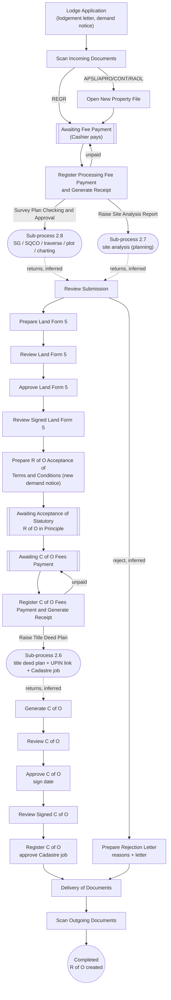


### 2.2 Application for Certificate of Occupancy (APCO)

Purpose: a holder of an existing right applies for a C of O over it (inferred from its RRR effect: needs and modifies an active occupancy right, and from its fees). Config
`ApplicationCertificateOccupancy.config`; process **Application for Certificate of Occupancy** v4. Same C of O tail as
First Registration, without the Land Form 5 / R of O stages.

**APCO - Application for Certificate of Occupancy**

| Field | Value |
|---|---|
| Code / label | `APCO` Application for Certificate of Occupancy (lr_transaction_metadata Id 3) |
| Group / jBPM process | Subsequent Registration (`SSG`) / **Application for Certificate of Occupancy** |
| meta_type / action_type / right_type | 0 / 99 / right_type_occupancy |
| Durations (normal/lapsed/max, days) | 20 / 0 / 20 |
| RRR effect at completion | needs active **occupancy**; blocked by active caveat; modifies **occupancy**. Parties: source party = grantor; target party = grantee |
| Fees | Cashier fee lines: Application Form Fee (`feetype_apff_C_APFF`), Premium of CofO Fee (`feetype_premiumCofO_C_PCOFO`), Infrastructure Provision Levy (`feetype_IPL_C_IPL`), C-of-O Processing Fee (`feetype_COPF_C_COPF`), Issuance Fee For C of O (`feetype_IFCO_C_IFCO`), Registration of C of O Fee (`feetype_RCOF_C_RCOF`), TDP Fee (`feetype_tdp_C_TDPF`), Survey Fee (`feetype_survey_C_SVF`) |
| Non-withdrawable tasks | - |
| Complete / reject reports | sd_Co_title / sd_reject_letter |
| Mandatory scanned outgoing docs | `sd_lodgement_letter`, `sd_demandnotice`, `sd_payment_receipt`, `sd_COrecom_Gov`, `sd_Co_title`, `sd_regist_memoMem`, `sd_delivery_letter` |
| Blocked while another transaction on the property is lodged/postponed | ABWG, APCA, APCM, APCO, APRF, APRO, APSL, ASSI, CEMP, CHNT, CHPC, COMP, CONT, DCT, DEVO, EXTT, INSC, LEAS, LOCE, MERT, MORT, PSUR, RAOL, RCOO, REGR, REPT, RLEA, RMOR, RROC, RSUB, SUBD, SUBL, SURO, UPMO |
| Volume (all time) | 10831: Active 5384, Completed 5041, Withdrawn 390, Postponed 16, Rejected 0; created as LRS 3390, as past 7441 |
| Lodge → complete (live, completed) | median 453 d (p25 270, p75 872, p90 1675), n=1761 |
| Age of open (Active) live files | median 1593 d, n=1283 |
| Cadastre jobs (lr_mc_job) / rejection records | 3072 / 348 |

| # | Stage (jBPM task / config `stages`) | Role / unit (inferred) | Screens (wizard pages) | Checks & actions on Complete | Printed / produced | Next (transition) |
|---|---|---|---|---|---|---|
| 1 | `New,LodgmentApplication` | Lodgement desk (reception) | Transaction list › Applicants › Properties (RO, map) › Outstanding ground rent › Fee list › Print › Complete & assign | `validate: checkRegisterAlready,checkTransactionMetadata` | LodgementLetter → `sd_lodgement_letter`<br>DemandNotice → `sd_demandnotice` | Scan Incoming Documents (inferred) |
| 2 | `ScanIncomingDocuments` | Scanning | Transaction + documents › Complete & assign | `CheckUnscannedDocuments:Confirm` |  | Awaiting Fee Payment (inferred) |
| 3 | `AwaitingFeePayment` | Wait state (applicant / Cashier) | Transaction + documents (RO) › Complete & assign | `UpdateSimpleCounterValue:receipt_number` |  | Register Fee Payment and Generate Receipt (Cashier, inferred) |
| 4 | `RegisterFeePaymentAndGenerateReceipt` | Accounts (fee) | Transaction + documents (RO) › Applicants (RO) › Properties (RO, map) › Demand notice › Print › Complete & assign | `payments must validate`<br>`CheckUnpaidFee:Review Submission\|Awaiting Fee Payment` | FeePaymentVerificationReceipt → `sd_payment_receipt` | "Review Submission"; "Awaiting Fee Payment" while unpaid |
| 5 | `ReviewSubmission` | Lands officer | Transaction + documents › Applicants (RO) › Properties (map) › Parties › RRR › Demand notice (RO) › Complete & assign | `mandatory: termYear,buildValue,buildTerm,rentalAmount,payPeriodYear,improvementAmountCurrency` |  | "Raise Title Deed Plan" (sub-process 2.6; the RTDP config lists this code) then Generate C of O (inferred); reject branch |
| 6 | `GenerateCofO` | C of O unit | Transaction + documents (RO) › Properties (RO, map) › Parties (RO) › Demand notice (RO) › RRR › Print › Complete & assign | `mandatory: termYear,buildValue,buildTerm,rentalAmount,payPeriodYear,improvementAmountCurrency` | CertificateOfOccupancyTitle → `sd_Co_title` | Review C of O |
| 7 | `ReviewCofO` | C of O unit | Transaction + documents (RO) › Properties (RO, map) › Parties (RO) › Demand notice (RO) › Complete & assign |  |  | Approve C of O |
| 8 | `ApproveCofO` | Approving authority (signs C of O) | Transaction + documents › Properties (RO, map) › Parties (RO) › Demand notice (RO) › Complete & assign | `mandatory: signDate` |  | Review Signed C of O |
| 9 | `ReviewSignedCofO` | C of O unit | Transaction + documents (RO) › Properties (RO, map) › Parties (RO) › Demand notice (RO) › Complete & assign |  |  | Register C of O |
| 10 | `RegisterCofO` | Deeds registry | Transaction + documents (RO) › Properties (RO, map) › Parties (RO) › Demand notice (RO) › Register instrument (RO) › Print › Complete & assign | `ApproveMCJob:Delivery of Documents\|job_deedplan_creation`<br>`AddOutgoingSupportingDocument:Delivery of Documents` | RegistrationMemorandumMemo → `sd_regist_memoMem` | "Delivery of Documents" (approves Deed Plan job) |
| 11 | `DeliveryOfDocuments` | Dispatch | Transaction + documents › Print › Complete & assign |  | DeliveryLetter → `sd_delivery_letter` | Scan Outgoing Documents |
| 12 | `PrepareRejectionLetter` | Lands officer | Transaction + documents (RO) › Rejection reasons › Print › Complete & assign | `RejectMCJob:Delivery of Documents\|job_deedplan_creation`<br>`AddOutgoingSupportingDocument:Delivery of Documents` | RejectionLetter → `sd_reject_letter` | "Delivery of Documents" (rejects Deed Plan job) |
| 13 | `ScanOutgoingDocuments` | Scanning | Transaction + documents › Complete & assign | `CheckUnscannedDocuments`<br>`SaveGroundRentData` | scan-out: `sd_lodgement_letter`, `sd_demandnotice`, `sd_payment_receipt`, `sd_COrecom_Gov`, `sd_Co_title`, `sd_regist_memoMem`, `sd_delivery_letter` | end - completed |

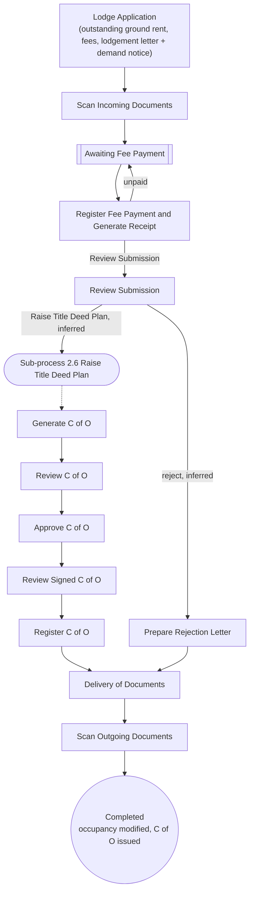


### 2.3 Recertification (APRF)

Purpose: re-certification of an existing C of O (new certificate on the same right; old certificate surrendered).
Config `Recertification.config`; process **Recertification Registration** v4 ("This workflow is ReCertificate
registration of the property with issuance of Certificate of Occupancy", `JBPM_PROCESSDEFINITION.DESCRIPTION_`). APRF is
an *Intake* type (`lr_setting IntakeTransactions`). Its transaction form `TransactionWithDocFormWithRelatedTransTypeAPRF`
also asks for the related (original) transaction type. `AwaitingFeePayment` has no data pages at all (only Complete).

**APRF - Recertification**

| Field | Value |
|---|---|
| Code / label | `APRF` Recertification (lr_transaction_metadata Id 2) |
| Group / jBPM process | Subsequent Registration (`SSG`) / **Recertification Registration** |
| meta_type / action_type / right_type | 0 / 0 / right_type_occupancy |
| Durations (normal/lapsed/max, days) | 20 / 0 / 20 |
| RRR effect at completion | needs active **occupancy**; blocked by active mortgage or caveat or lease or sublease; modifies **occupancy**. Parties: source party = grantor; target party = grantee; source parties pre-filled from source of related RRR; target parties pre-filled from target of related RRR |
| Fees | Cashier fee lines: Application Form Fee (`feetype_apff_C_APFF`), Registration of C of O Fee (`feetype_RCOF_C_RCOF`), Issuance Fee For C of O (`feetype_IFCO_C_IFCO`); fees computed from the source property: Premium of CofO Fee (`feetype_premiumCofO_C_PCOFO`) |
| Non-withdrawable tasks | RegisterCofO,DeliveryOfDocuments,ScanOutgoingDocuments |
| Complete / reject reports | sd_CM / sd_reject_letter |
| Mandatory scanned outgoing docs | `sd_lodgement_letter`, `sd_demandnotice`, `sd_payment_receipt`, `sd_COrecom_Gov`, `sd_Co_title`, `sd_regist_memoMem`, `sd_delivery_letter` |
| Blocked while another transaction on the property is lodged/postponed | ABWG, APCO, APRF, APRO, APSL, ASSI, CEMP, CHPC, COMP, CONT, DCT, DEVO, EXIT, INSC, LEAS, LOCE, MERT, MORT, PSUR, RAOL, RCOO, REGR, RLEA, RMOR, RROC, RSUB, SUBD, SUBL, SURO, UPMO |
| Volume (all time) | 274: Active 97, Completed 132, Withdrawn 45, Postponed 0, Rejected 0; created as LRS 263, as past 11 |
| Lodge → complete (live, completed) | median 434 d (p25 280, p75 792, p90 1280), n=124 |
| Age of open (Active) live files | median 611 d, n=94 |
| Cadastre jobs (lr_mc_job) / rejection records | 255 / 47 |

| # | Stage (jBPM task / config `stages`) | Role / unit (inferred) | Screens (wizard pages) | Checks & actions on Complete | Printed / produced | Next (transition) |
|---|---|---|---|---|---|---|
| 1 | `New,LodgmentApplication` | Lodgement desk (reception) | Transaction list › Applicants › Properties (RO, map) › Outstanding ground rent › Fee list › Print › Complete & assign | `validate: checkRegisterAlready,checkTransactionMetadata` | LodgementLetter → `sd_lodgement_letter`<br>DemandNotice → `sd_demandnotice` | Scan Incoming Documents (inferred) |
| 2 | `ScanIncomingDocuments` | Scanning | Transaction + documents › Complete & assign | `CheckUnscannedDocuments:Confirm` |  | Awaiting Fee Payment (inferred) |
| 3 | `AwaitingFeePayment` | Wait state (applicant / Cashier) | Complete & assign | `UpdateSimpleCounterValue:receipt_number` |  | Register Fee Payment and Generate Receipt (Cashier, inferred) |
| 4 | `RegisterFeePaymentAndGenerateReceipt` | Accounts (fee) | Transaction + documents (RO) › Applicants (RO) › Properties (RO, map) › Demand notice › Print › Complete & assign | `payments must validate`<br>`CheckUnpaidFee:Review Submission\|Awaiting Fee Payment` | FeePaymentVerificationReceipt → `sd_payment_receipt` | "Review Submission"; "Awaiting Fee Payment" while unpaid |
| 5 | `ReviewSubmission` | Lands officer | Transaction + documents › Applicants › Properties (map) › Parties › Demand notice (RO) › Complete & assign |  |  | "Raise Title Deed Plan" (sub-process 2.6; the RTDP config lists this code) then Generate C of O (inferred); reject branch |
| 6 | `GenerateCofO` | C of O unit | Transaction + documents (RO) › Properties (RO, map) › Parties (RO) › RRR › Demand notice (RO) › Print › Complete & assign | `mandatory: termYear,securityNumber1,securityNumber2` | CertificateOfOccupancyTitle → `sd_Co_title` | Review C of O |
| 7 | `ReviewCofO` | C of O unit | Transaction + documents (RO) › Properties (RO, map) › Parties (RO) › Demand notice (RO) › Complete & assign |  |  | Approve C of O |
| 8 | `ApproveCofO` | Approving authority (signs C of O) | Transaction + documents › Properties (RO, map) › Parties (RO) › Demand notice (RO) › Complete & assign | `mandatory: signDate` |  | Review Signed C of O |
| 9 | `ReviewSignedCofO` | C of O unit | Transaction + documents (RO) › Properties (RO, map) › Parties (RO) › Demand notice (RO) › Complete & assign |  |  | Register C of O |
| 10 | `RegisterCofO` | Deeds registry | Transaction + documents (RO) › Properties (RO, map) › Parties (RO) › RRR › Demand notice (RO) › Register instrument (RO) › Properties (RO, map) › Print › Complete & assign | `mandatory: startDate`<br>`ApproveMCJob:Delivery of Documents\|job_deedplan_creation`<br>`AddOutgoingSupportingDocument:Delivery of Documents` | RegistrationMemorandumMemo → `sd_regist_memoMem` | "Delivery of Documents" (approves Deed Plan job) |
| 11 | `DeliveryOfDocuments` | Dispatch | Transaction + documents › Print › Complete & assign |  | DeliveryLetter → `sd_delivery_letter` | Scan Outgoing Documents |
| 12 | `PrepareRejectionLetter` | Lands officer | Transaction + documents (RO) › Rejection reasons › Print › Complete & assign | `RejectMCJob:Delivery of Documents\|job_deedplan_creation`<br>`AddOutgoingSupportingDocument:Delivery of Documents` | RejectionLetter → `sd_reject_letter` | "Delivery of Documents" (rejects Deed Plan job) |
| 13 | `ScanOutgoingDocuments` | Scanning | Transaction + documents › Complete & assign | `CheckUnscannedDocuments`<br>`SaveGroundRentData` | scan-out: `sd_lodgement_letter`, `sd_demandnotice`, `sd_payment_receipt`, `sd_COrecom_Gov`, `sd_Co_title`, `sd_regist_memoMem`, `sd_delivery_letter` | end - completed |


### 2.4 Replacement of Title (REPT)

Purpose: replacement of a lost / damaged C of O (fees include "Penalty for loss of C of O Fee"). Config
`ReplacementOfTitle.config`; process **Replacement Of Title** v4. In the config `ScanOutgoingDocuments` is listed before
`DeliveryOfDocuments` (order of execution assumed as in APCO, inferred). The Review Submission page disables "add to
target" and "delete" on the property grid (same property is re-issued).

**REPT - Replacement of Title**

| Field | Value |
|---|---|
| Code / label | `REPT` Replacement of Title (lr_transaction_metadata Id 24) |
| Group / jBPM process | Subsequent Registration (`SSG`) / **Replacement Of Title** |
| meta_type / action_type / right_type | 0 / 99 / right_type_occupancy |
| Durations (normal/lapsed/max, days) | 20 / 0 / 20 |
| RRR effect at completion | needs active **occupancy**; modifies **occupancy**. Parties: source party = grantor; target party = grantee; source parties pre-filled from source of related RRR; target parties pre-filled from target of related RRR |
| Fees | Cashier fee lines: Application Fee (`feetype_app_C_APF`), Issuance Fee For C of O (`feetype_IFCO_C_IFCO`), TDP Fee (`feetype_tdp_C_TDPF`), Penalty for loss of C of O Fee (`feetype_PLCOF_C_PLCOF`), Processing Fee for Replacement of Title (`feetype_PFRT_C_PFRT`) |
| Non-withdrawable tasks | RegisterCofO,DeliveryOfDocuments,ScanOutgoingDocuments |
| Complete / reject reports | sd_Co_title / sd_reject_letter |
| Mandatory scanned outgoing docs | `sd_demandnotice`, `sd_payment_receipt`, `sd_landform_5`, `sd_COrecom_Gov`, `sd_Co_title`, `sd_landfoem_7`, `outd_reject_letter` |
| Blocked while another transaction on the property is lodged/postponed | ABWG, APCA, APCM, APCO, APRF, APRO, APSL, ASSI, CEMP, CHNT, CHPC, COMP, CONT, DCT, DEVO, EXTT, INSC, MERT, PSUR, RAOL, RCOO, REGR, REPT, RLEA, RMOR, RROC, RSUB, SURO |
| Volume (all time) | 77: Active 31, Completed 37, Withdrawn 9, Postponed 0, Rejected 0; created as LRS 73, as past 4 |
| Lodge → complete (live, completed) | median 237 d (p25 131, p75 318, p90 421), n=33 |
| Age of open (Active) live files | median 130 d, n=31 |
| Cadastre jobs (lr_mc_job) / rejection records | 4 / 9 |

| # | Stage (jBPM task / config `stages`) | Role / unit (inferred) | Screens (wizard pages) | Checks & actions on Complete | Printed / produced | Next (transition) |
|---|---|---|---|---|---|---|
| 1 | `New,LodgmentApplication` | Lodgement desk (reception) | Transaction list › Applicants › Properties (RO, map) › Outstanding ground rent › Fee list › Print › Complete & assign | `validate: checkRegisterAlready,checkTransactionMetadata` | LodgementLetter → `sd_lodgement_letter`<br>DemandNotice → `sd_demandnotice` | Scan Incoming Documents (inferred) |
| 2 | `ScanIncomingDocuments` | Scanning | Transaction + documents › Complete & assign | `CheckUnscannedDocuments:Confirm` |  | Awaiting Fee Payment (inferred) |
| 3 | `AwaitingFeePayment` | Wait state (applicant / Cashier) | Transaction + documents (RO) › Complete & assign | `UpdateSimpleCounterValue:receipt_number` |  | Register Fee Payment and Generate Receipt (Cashier, inferred) |
| 4 | `RegisterFeePaymentAndGenerateReceipt` | Accounts (fee) | Transaction + documents (RO) › Applicants (RO) › Properties (RO, map) › Demand notice › Print › Complete & assign | `payments must validate`<br>`CheckUnpaidFee:Review Submission\|Awaiting Fee Payment` | FeePaymentVerificationReceipt → `sd_payment_receipt` | "Review Submission"; "Awaiting Fee Payment" while unpaid |
| 5 | `ReviewSubmission` | Lands officer | Transaction + documents › Applicants (RO) › Properties (map) › Parties (RO) › Demand notice (RO) › Complete & assign |  |  | "Raise Title Deed Plan" (sub-process 2.6; the RTDP config lists this code) then Generate C of O (inferred); reject branch |
| 6 | `GenerateCofO` | C of O unit | Transaction + documents (RO) › Properties (RO, map) › Parties (RO) › RRR › Demand notice (RO) › Print › Complete & assign | `mandatory: termYear,securityNumber1,securityNumber2` | CertificateOfOccupancyTitle → `sd_Co_title` | Review C of O |
| 7 | `ReviewCofO` | C of O unit | Transaction + documents (RO) › Properties (RO, map) › Parties (RO) › Demand notice (RO) › Complete & assign |  |  | Approve C of O |
| 8 | `ApproveCofO` | Approving authority (signs C of O) | Transaction + documents › Properties (RO, map) › Parties (RO) › Demand notice (RO) › Complete & assign | `mandatory: signDate` |  | Review Signed C of O |
| 9 | `ReviewSignedCofO` | C of O unit | Transaction + documents (RO) › Properties (RO, map) › Parties (RO) › Demand notice (RO) › Complete & assign |  |  | Register C of O |
| 10 | `RegisterCofO` | Deeds registry | Transaction + documents (RO) › Properties (RO, map) › Parties (RO) › RRR › Demand notice (RO) › Register instrument (RO) › Properties (RO, map) › Print › Complete & assign | `mandatory: startDate`<br>`ApproveMCJob:Delivery of Documents\|job_deedplan_creation`<br>`AddOutgoingSupportingDocument:Delivery of Documents` | RegistrationMemorandumMemo → `sd_regist_memoMem` | "Delivery of Documents" (approves Deed Plan job) |
| 11 | `PrepareRejectionLetter` | Lands officer | Transaction + documents (RO) › Rejection reasons › Print › Complete & assign | `RejectMCJob:Delivery of Documents\|job_deedplan_creation`<br>`AddOutgoingSupportingDocument:Delivery of Documents` | RejectionLetter → `sd_reject_letter` | "Delivery of Documents" (rejects Deed Plan job) |
| 12 | `ScanOutgoingDocuments` | Scanning | Transaction + documents › Complete & assign | `CheckUnscannedDocuments`<br>`SaveGroundRentData` | scan-out: `sd_demandnotice`, `sd_payment_receipt`, `sd_landform_5`, `sd_COrecom_Gov`, `sd_Co_title`, `sd_landfoem_7`, `outd_reject_letter` | end - completed |
| 13 | `DeliveryOfDocuments` | Dispatch | Transaction + documents › Print › Complete & assign |  | DeliveryLetter → `sd_delivery_letter` | Scan Outgoing Documents |


### 2.5 Subsequent Registration (26 transaction types)

One jBPM process, **Subsequent Registration** v4, serves all 26 SSG dealings. Each type has its own config file under
`WorkflowConfig/SubsequentRegistration/` (24 captured; `Lease.config` and `ReleaseLease.config` are referenced by the
exe.config but absent, and LEAS/RLEA are hidden for new entry). The process is a superset of stages; each type uses a
subset by hiding transitions with `excludeTransition` on three decision stages:

* **Review Submission** chooses the route: "Prepare Valuation Report", "Generate Final Demand Notice", "Investigate
  Complaint", "Open New Property File and Assign Property Number", "Prepare Recommendation Memorandum", "Raise Site
  Analysis Report", "Survey Plan Checking and Approval", "Raise Title Deed Plan", "Register Instrument" (the full set is
  the union of every type's exclusions and of the `BlockTransition` lists in the old combined file).
* **Review Recommendation** chooses the approver: "Approve Recommendation (Governor)" for DEVO, RCOO, SURO; "Approve
  Recommendation (Commissioner)" for all others.
* **Review Signed Recommendation** chooses the tail: "Raise Title Deed Plan" (new C of O), "Register Instrument" (memo
  only) or "Delivery of Documents" (consents APCA/APCM - nothing to register).

Common skeleton (stages present in every SSG file): Lodge → [Awaiting Fee Payment → Register Fee Payment] → Scan Incoming
Documents → Review Submission → ... → Delivery of Documents → Scan Outgoing Documents; reject branch Prepare Rejection
Letter → Delivery of Documents. The routes per type, derived from the exclusions:

| Code | Review Submission → | Valuation / assessed fee | Recommendation approver | After signed recommendation | New C of O stages | Register Instrument |
|---|---|---|---|---|---|---|
| APCA | Prepare Valuation Report, Prepare Recommendation Memorandum | yes | (Commissioner) | Delivery of Documents | - | - |
| APCM | Prepare Recommendation Memorandum | - | (Commissioner) | Delivery of Documents | - | - |
| ABWG | Raise Title Deed Plan | - | - | - | yes | yes |
| ASSI | Raise Title Deed Plan | - | - | - | yes | yes |
| CEMP | Prepare Recommendation Memorandum | - | (Commissioner) | Register Instrument | - | yes |
| CHNT | Prepare Recommendation Memorandum, Raise Title Deed Plan | - | (Commissioner) | Raise Title Deed Plan | yes | yes |
| CHPC | Prepare Recommendation Memorandum, Raise Site Analysis Report, Raise Title Deed Plan | - | (Commissioner) | Raise Title Deed Plan | yes | yes |
| COMP | Investigate Complaint | - | (Commissioner) | Register Instrument | - | yes |
| DEVO | Prepare Recommendation Memorandum, Raise Title Deed Plan | - | (Governor) | Raise Title Deed Plan | yes | yes |
| EXTT | Prepare Recommendation Memorandum, Raise Site Analysis Report, Survey Plan Checking and Approval, Raise Title Deed Plan | - | (Commissioner) | Raise Title Deed Plan | yes | yes |
| LOCE | Register Instrument | - | - | - | - | yes |
| MERT | Prepare Recommendation Memorandum, Raise Site Analysis Report, Survey Plan Checking and Approval, Raise Title Deed Plan | - | (Commissioner) | Raise Title Deed Plan | yes | yes |
| MORT | Register Instrument | - | - | - | - | yes |
| PSUR | Prepare Valuation Report, Generate Final Demand Notice, Prepare Recommendation Memorandum, Raise Title Deed Plan | yes | (Commissioner) | Raise Title Deed Plan | yes | yes |
| PWOA | Prepare Recommendation Memorandum | - | (Commissioner) | Register Instrument | - | yes |
| RMOR | Register Instrument | - | - | - | - | yes |
| RSUB | Register Instrument | - | - | - | - | yes |
| RCOO | Prepare Recommendation Memorandum | - | (Governor) | Register Instrument | - | yes |
| RPOA | Register Instrument | - | - | - | - | yes |
| RROC | Prepare Recommendation Memorandum | - | (Commissioner) | Register Instrument | - | yes |
| SUBD | Prepare Valuation Report, Generate Final Demand Notice, Open New Property File and Assign Property Number, Prepare Recommendation Memorandum, Raise Site Analysis Report, Survey Plan Checking and Approval | yes | (Commissioner) | Raise Title Deed Plan | yes | yes |
| SUBL | Prepare Recommendation Memorandum | - | (Commissioner) | Register Instrument | - | yes |
| SURO | Prepare Recommendation Memorandum | - | (Governor) | Register Instrument | - | yes |
| UPMO | Register Instrument | - | - | - | - | yes |
| LEAS, RLEA | config files missing; metadata: LEAS creates lease, RLEA discharges lease | | | | | |

Stage pages common to the SSG files (the per-type tables below show the exact pages):

* Lodge: transaction list (`validate_property=checkRegisterAlready,checkTransactionMetadata`), applicants, properties
  (RO), outstanding ground rent (`feetype_groundrent_`, past outstanding, penalty), fee list, print LodgementLetter +
  DemandNotice.
* Register Fee Payment: demand notice page with `payments_validation=true`, print FeePaymentVerificationReceipt.
* Prepare Recommendation Memorandum: RRR page (term / consideration fields mandatory per type), print
  `RecommendationMemorandumMemo` → `sd_recMemo_Com` (Commissioner) or `sd_recMemo_Gov` (Governor: DEVO, RCOO, SURO).
* Generate C of O: RRR page, print `CertificateOfOccupancyTitle` → `sd_Co_title` (per property for ASSI/ABWG).
* Register Instrument: RRR (start date), register-instrument page, C of O property grid, print
  `RegistrationMemorandumMemo` → `sd_regist_memoMem`; rule `ApproveMCJob:Delivery of Documents|job_deedplan_creation`.

#### 2.5.1 ASSI - Assignment

Purpose: Assignment (transfer) of the right after consent; new C of O to the assignee. Config `SubsequentRegistration/Assignment.config`.

| Field | Value |
|---|---|
| Code / label | `ASSI` Assignment (lr_transaction_metadata Id 6) |
| Group / jBPM process | Subsequent Registration (`SSG`) / **Subsequent Registration** |
| meta_type / action_type / right_type | 0 / 0 / right_type_consent_assign |
| Durations (normal/lapsed/max, days) | 20 / 0 / 20 |
| RRR effect at completion | needs active **occupancy and consent_assign**; blocked by active mortgage or caveat or lease or sublease; creates **occupancy**; discharges **consent_assign, occupancy**. Parties: source party = assignor; target party = assignee; source parties pre-filled from source of related RRR; target parties pre-filled from target of related RRR |
| Fees | Cashier fee lines: Application Fee (`feetype_app_C_APF`), Registration Fee of Assignment (`feetype_RFA_C_RFA`), TDP Fee (`feetype_tdp_C_TDPF`), Premium of CofO Fee (`feetype_premiumCofO_C_PCOFO`), Issuance Fee For C of O (`feetype_IFCO_C_IFCO`), Processing Fee for Assignment (`feetype_PFA_C_PFA`); fees computed from the source property: Premium of CofO Fee (`feetype_premiumCofO_C_PCOFO`) |
| Non-withdrawable tasks | RegisterInstrument,DeliveryOfDocuments,ScanOutgoingDocuments |
| Complete / reject reports | sd_Co_title;sd_ASG / sd_reject_letter |
| Mandatory scanned outgoing docs | `sd_demandnotice`, `sd_Co_title`, `sd_payment_receipt`, `sd_regist_memoMem` |
| Blocked while another transaction on the property is lodged/postponed | ABWG, APCA, APRF, APRO, APSL, ASSI, CEMP, CHNT, CHPC, COMP, CONT, DCT, DEVO, EXTT, INSC, LEAS, LOCE, MERT, MORT, PSUR, RAOL, RCOO, REGR, RLEA, RMOR, RROC, RSUB, SUBD, SUBL, SURO, UPMO |
| Volume (all time) | 4956: Active 1370, Completed 3553, Withdrawn 28, Postponed 5, Rejected 0; created as LRS 168, as past 4788 |
| Lodge → complete (live, completed) | median 262 d (p25 190, p75 427, p90 614), n=105 |
| Age of open (Active) live files | median 263 d, n=51 |
| Cadastre jobs (lr_mc_job) / rejection records | 133 / 12 |

| # | Stage (jBPM task / config `stages`) | Role / unit (inferred) | Screens (wizard pages) | Checks & actions on Complete | Printed / produced | Next (transition) |
|---|---|---|---|---|---|---|
| 1 | `New,LodgmentApplication` | Lodgement desk (reception) | Transaction list › Applicants › Properties (RO, map) › Outstanding ground rent › Fee list › Print › Complete & assign | `validate: checkRegisterAlready,checkTransactionMetadata`<br>`CheckUnpaidFee:Scan Incoming Documents\|Awaiting Fee Payment` | LodgementLetter → `sd_lodgement_letter`<br>DemandNotice → `sd_demandnotice` | "Awaiting Fee Payment" if fees are due, else "Scan Incoming Documents" (`CheckUnpaidFee`) |
| 2 | `AwaitingFeePayment` | Wait state (applicant / Cashier) | Transaction + documents (RO) › Complete & assign | `UpdateSimpleCounterValue:receipt_number` |  | Register Fee Payment and Generate Receipt (Cashier commit, inferred) |
| 3 | `RegisterFeePaymentAndGenerateReceipt` | Accounts (fee) | Transaction + documents (RO) › Applicants (RO) › Properties (RO, map) › Demand notice › Print › Complete & assign | `payments must validate`<br>`CheckUnpaidFee:Scan Incoming Documents\|Awaiting Fee Payment` | FeePaymentVerificationReceipt → `sd_payment_receipt` | "Scan Incoming Documents"; "Awaiting Fee Payment" while unpaid |
| 4 | `ScanIncomingDocuments` | Scanning | Transaction + documents › Complete & assign | `UpdateSimpleCounterValue:demandnotice_number` |  | Review Submission (demand-notice no. allocated) |
| 5 | `ReviewSubmission` | Lands officer | Transaction + documents › Applicants (RO) › Properties (map) › Parties (RO) › Demand notice (RO) › Complete & assign |  |  | allowed: "Raise Title Deed Plan"; reject branch (inferred)<br>excluded here: ASSI → Prepare Valuation Report,ASSI → Generate Final Demand Notice,ASSI → Investigate Complaint,ASSI → Open New Property File and Assign Property Number,ASSI → Prepare Recommendation Memorandum,ASSI → Raise Site Analysis Report,ASSI → Survey Plan Checking and Approval,ASSI → Register Instrument |
| 6 | `GenerateCofO` | C of O unit | Transaction + documents (RO) › Properties (RO, map) › Parties (RO) › RRR › Demand notice (RO) › Print (per property) › Complete & assign | `mandatory: termYear` | CertificateOfOccupancyTitle → `sd_Co_title` | Review C of O (reached after Raise Title Deed Plan returns, inferred) |
| 7 | `ReviewCofO` | C of O unit | Transaction + documents (RO) › Properties (RO, map) › Parties (RO) › Demand notice (RO) › Complete & assign |  |  | Approve C of O |
| 8 | `ApproveCofO` | Approving authority (signs C of O) | Transaction + documents › Properties (RO, map) › Parties (RO) › Demand notice (RO) › Complete & assign | `mandatory: signDate` |  | Review Signed C of O |
| 9 | `ReviewSignedCofO` | C of O unit | Transaction + documents (RO) › Properties (RO, map) › Parties (RO) › Demand notice (RO) › Complete & assign |  |  | Register Instrument |
| 10 | `RegisterInstrument` | Deeds registry | Transaction + documents (RO) › Properties (RO, map) › Parties (RO) › RRR › Demand notice (RO) › Register instrument (RO) › Properties (RO, map) › Print › Complete & assign | `mandatory: startDate`<br>`ApproveMCJob:Delivery of Documents\|job_deedplan_creation`<br>`AddOutgoingSupportingDocument:Delivery of Documents` | RegistrationMemorandumMemo → `sd_regist_memoMem` | "Delivery of Documents" (approves Deed Plan job if any; adds complete reports as outgoing docs) - **RRR effect applied here (inferred)** |
| 11 | `DeliveryOfDocuments` | Dispatch | Transaction + documents › Print › Complete & assign |  | DeliveryLetter → `sd_delivery_letter` | Scan Outgoing Documents |
| 12 | `ScanOutgoingDocuments` | Scanning | Transaction + documents › Complete & assign | `CheckUnscannedDocuments`<br>`SaveGroundRentData` | scan-out: `sd_demandnotice`, `sd_Co_title`, `sd_payment_receipt`, `sd_regist_memoMem` | end - completed |
| 13 | `PrepareRejectionLetter` | Lands officer | Transaction + documents (RO) › Rejection reasons › Print › Complete & assign | `RejectMCJob:Delivery of Documents\|job_deedplan_creation`<br>`AddOutgoingSupportingDocument:Delivery of Documents` | RejectionLetter → `sd_reject_letter` | "Delivery of Documents" (rejects Deed Plan job) |

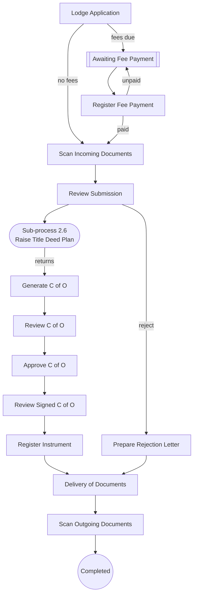

#### 2.5.2 APCA - Application for Consent (Assignment)

Purpose: Governor's/Commissioner's consent to assign (sell) a right; creates a consent right that a later ASSI needs. Config `SubsequentRegistration/ApplicationForConsentAssignment.config`.

| Field | Value |
|---|---|
| Code / label | `APCA` Application for Consent (Assignment) (lr_transaction_metadata Id 34) |
| Group / jBPM process | Subsequent Registration (`SSG`) / **Subsequent Registration** |
| meta_type / action_type / right_type | 0 / 0 / right_type_occupancy |
| Durations (normal/lapsed/max, days) | 20 / 0 / 20 |
| RRR effect at completion | needs active **occupancy**; blocked by active consent_assign; creates **consent_assign**. Parties: source party = beneficiary; target party = consentee; source parties pre-filled from target of related RRR |
| Fees | Cashier fee lines: Application Form Fee (`feetype_apff_C_APFF`), Processing Fee (`feetype_PFROFO_C_PFROFO`), Outstanding Ground Rent (`feetype_groundrent_C_GR`), Ground Rent Penalty (`feetype_groundrentpenalty_C_GRP`) |
| Non-withdrawable tasks | RegisterInstrument,DeliveryOfDocuments,ScanOutgoingDocuments |
| Complete / reject reports | - / sd_reject_letter |
| Mandatory scanned outgoing docs | `sd_demandnotice`, `sd_recMemo_Com`, `sd_payment_receipt` |
| Blocked while another transaction on the property is lodged/postponed | ABWG, APCA, APCM, APCO, APRF, APRO, APSL, ASSI, CEMP, CHNT, CHPC, COMP, CONT, DCT, DEVO, EXTT, INSC, LEAS, LOCE, MERT, MORT, PSUR, RAOL, RCOO, REGR, REPT, RLEA, RMOR, RROC, RSUB, SUBD, SUBL, SURO, UPMO |
| Volume (all time) | 5846: Active 1851, Completed 3779, Withdrawn 210, Postponed 6, Rejected 0; created as LRS 998, as past 4848 |
| Lodge → complete (live, completed) | median 161 d (p25 31, p75 358, p90 686), n=298 |
| Age of open (Active) live files | median 843 d, n=507 |
| Cadastre jobs (lr_mc_job) / rejection records | 0 / 193 |

| # | Stage (jBPM task / config `stages`) | Role / unit (inferred) | Screens (wizard pages) | Checks & actions on Complete | Printed / produced | Next (transition) |
|---|---|---|---|---|---|---|
| 1 | `New,LodgmentApplication` | Lodgement desk (reception) | Transaction list › Applicants › Properties (RO, map) › Outstanding ground rent › Fee list › Print › Complete & assign | `validate: checkRegisterAlready,checkTransactionMetadata`<br>`CheckUnpaidFee:Scan Incoming Documents\|Awaiting Fee Payment` | LodgementLetter → `sd_lodgement_letter`<br>DemandNotice → `sd_demandnotice` | "Awaiting Fee Payment" if fees are due, else "Scan Incoming Documents" (`CheckUnpaidFee`) |
| 2 | `AwaitingFeePayment` | Wait state (applicant / Cashier) | Transaction + documents (RO) › Complete & assign | `UpdateSimpleCounterValue:receipt_number` |  | Register Fee Payment and Generate Receipt (Cashier commit, inferred) |
| 3 | `RegisterFeePaymentAndGenerateReceipt` | Accounts (fee) | Transaction + documents (RO) › Applicants (RO) › Properties (RO, map) › Demand notice › Print › Complete & assign | `payments must validate`<br>`CheckUnpaidFee:Scan Incoming Documents\|Awaiting Fee Payment` | FeePaymentVerificationReceipt → `sd_payment_receipt` | "Scan Incoming Documents"; "Awaiting Fee Payment" while unpaid |
| 4 | `ScanIncomingDocuments` | Scanning | Transaction + documents › Complete & assign | `UpdateSimpleCounterValue:demandnotice_number` |  | Review Submission (demand-notice no. allocated) |
| 5 | `ReviewSubmission` | Lands officer | Transaction + documents › Applicants (RO) › Properties (map) › Parties › Demand notice (RO) › Complete & assign |  |  | allowed: "Prepare Valuation Report", "Prepare Recommendation Memorandum"; reject branch (inferred)<br>excluded here: APCA → Generate Final Demand Notice,APCA → Investigate Complaint,APCA → Open New Property File and Assign Property Number,APCA → Raise Site Analysis Report,APCA → Survey Plan Checking and Approval,APCA → Raise Title Deed Plan,APCA → Register Instrument |
| 6 | `PrepareValuationReport` | Valuation unit | Transaction + documents (RO) › Applicants (RO) › Properties (map) › Demand notice (RO) › Complete & assign |  |  | Review Valuation Report |
| 7 | `ReviewValuationReport` | Valuation unit | Transaction + documents (RO) › Applicants (RO) › Properties (RO, map) › Demand notice (RO) › Complete & assign |  |  | Prepare Recommendation Memorandum (inferred) |
| 8 | `PrepareRecommendationMemorandum` | Lands officer | Transaction + documents › Properties (RO, map) › Parties (RO) › RRR › Demand notice (RO) › Print › Complete & assign | `mandatory: termMonth` | RecommendationMemorandumMemo → `sd_recMemo_Com` | Review Recommendation |
| 9 | `ReviewRecommendation` | Director / Permanent Secretary | Transaction + documents (RO) › Properties (RO, map) › Parties (RO) › Demand notice (RO) › Complete & assign |  |  | allowed: "Approve Recommendation (Commissioner)"<br>excluded here: APCA → Approve Recommendation (Governor) |
| 10 | `ApproveRecommendation(Commissioner)` | Commissioner | Transaction + documents (RO) › Properties (RO, map) › Parties (RO) › Demand notice (RO) › Complete & assign | `mandatory: signDate` |  | Review Signed Recommendation (sign date mandatory) |
| 11 | `ReviewSignedRecommendation` | Lands officer | Transaction + documents (RO) › Properties (RO, map) › Parties (RO) › Demand notice (RO) › Complete & assign |  |  | allowed: "Delivery of Documents"<br>excluded here: APCA → Raise Title Deed Plan,APCA → Register Instrument |
| 12 | `DeliveryOfDocuments` | Dispatch | Transaction + documents › Print › Complete & assign |  | DeliveryLetter → `sd_delivery_letter` | Scan Outgoing Documents |
| 13 | `ScanOutgoingDocuments` | Scanning | Transaction + documents › Complete & assign | `CheckUnscannedDocuments`<br>`SaveGroundRentData` | scan-out: `sd_demandnotice`, `sd_recMemo_Com`, `sd_payment_receipt` | end - completed |
| 14 | `PrepareRejectionLetter` | Lands officer | Transaction + documents (RO) › Rejection reasons › Print › Complete & assign | `RejectMCJob:Delivery of Documents\|job_deedplan_creation`<br>`AddOutgoingSupportingDocument:Delivery of Documents` | RejectionLetter → `sd_reject_letter` | "Delivery of Documents" (rejects Deed Plan job) |

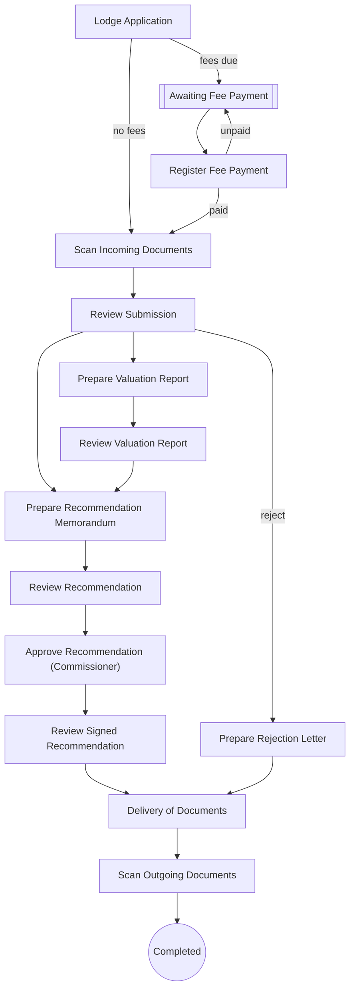

#### 2.5.3 APCM - Application for Consent (Mortgage)

Purpose: Consent to mortgage a right; creates a consent-to-mortgage right that MORT needs. Config `SubsequentRegistration/ApplicationForConsentMortgage.config`.

| Field | Value |
|---|---|
| Code / label | `APCM` Application for Consent (Mortgage) (lr_transaction_metadata Id 33) |
| Group / jBPM process | Subsequent Registration (`SSG`) / **Subsequent Registration** |
| meta_type / action_type / right_type | 0 / 0 / right_type_occupancy |
| Durations (normal/lapsed/max, days) | 20 / 0 / 20 |
| RRR effect at completion | needs active **occupancy**; blocked by active mortgage or consent_mortgage; creates **consent_mortgage**. Parties: source party = beneficiary; target party = consentee; source parties pre-filled from target of related RRR |
| Fees | Cashier fee lines: Application Form Fee (`feetype_apff_C_APFF`), Processing Fee (`feetype_PFROFO_C_PFROFO`), Outstanding Ground Rent (`feetype_groundrent_C_GR`), Ground Rent Penalty (`feetype_groundrentpenalty_C_GRP`) |
| Non-withdrawable tasks | RegisterInstrument,DeliveryOfDocuments,ScanOutgoingDocuments |
| Complete / reject reports | - / sd_reject_letter |
| Mandatory scanned outgoing docs | `sd_demandnotice`, `sd_recMemo_Com`, `sd_payment_receipt` |
| Blocked while another transaction on the property is lodged/postponed | ABWG, APCA, APCM, APCO, APRF, APRO, APSL, ASSI, CEMP, CHNT, CHPC, COMP, CONT, DCT, DEVO, EXTT, INSC, LEAS, LOCE, MERT, MORT, PSUR, RAOL, RCOO, REGR, REPT, RLEA, RMOR, RROC, RSUB, SUBD, SUBL, SURO, UPMO |
| Volume (all time) | 2205: Active 851, Completed 1316, Withdrawn 32, Postponed 6, Rejected 0; created as LRS 231, as past 1974 |
| Lodge → complete (live, completed) | median 400 d (p25 41, p75 687, p90 917), n=7 |
| Age of open (Active) live files | median 1377 d, n=200 |
| Cadastre jobs (lr_mc_job) / rejection records | 0 / 24 |

| # | Stage (jBPM task / config `stages`) | Role / unit (inferred) | Screens (wizard pages) | Checks & actions on Complete | Printed / produced | Next (transition) |
|---|---|---|---|---|---|---|
| 1 | `New,LodgmentApplication` | Lodgement desk (reception) | Transaction list › Applicants › Properties (RO, map) › Outstanding ground rent › Fee list › Print › Complete & assign | `validate: checkRegisterAlready,checkTransactionMetadata`<br>`CheckUnpaidFee:Scan Incoming Documents\|Awaiting Fee Payment` | LodgementLetter → `sd_lodgement_letter`<br>DemandNotice → `sd_demandnotice` | "Awaiting Fee Payment" if fees are due, else "Scan Incoming Documents" (`CheckUnpaidFee`) |
| 2 | `AwaitingFeePayment` | Wait state (applicant / Cashier) | Transaction + documents (RO) › Complete & assign | `UpdateSimpleCounterValue:receipt_number` |  | Register Fee Payment and Generate Receipt (Cashier commit, inferred) |
| 3 | `RegisterFeePaymentAndGenerateReceipt` | Accounts (fee) | Transaction + documents (RO) › Applicants (RO) › Properties (RO, map) › Demand notice › Print › Complete & assign | `payments must validate`<br>`CheckUnpaidFee:Scan Incoming Documents\|Awaiting Fee Payment` | FeePaymentVerificationReceipt → `sd_payment_receipt` | "Scan Incoming Documents"; "Awaiting Fee Payment" while unpaid |
| 4 | `ScanIncomingDocuments` | Scanning | Transaction + documents › Complete & assign | `UpdateSimpleCounterValue:demandnotice_number` |  | Review Submission (demand-notice no. allocated) |
| 5 | `ReviewSubmission` | Lands officer | Transaction + documents › Applicants (RO) › Properties (map) › Parties › Demand notice (RO) › Complete & assign |  |  | allowed: "Prepare Recommendation Memorandum"; reject branch (inferred)<br>excluded here: APCM → Prepare Valuation Report,APCM → Generate Final Demand Notice,APCM → Investigate Complaint,APCM → Open New Property File and Assign Property Number,APCM → Raise Site Analysis Report,APCM → Survey Plan Checking and Approval,APCM → Raise Title Deed Plan,APCM → Register Instrument |
| 6 | `PrepareRecommendationMemorandum` | Lands officer | Transaction + documents › Properties (RO, map) › Parties (RO) › RRR (+source parties) › Demand notice (RO) › Print › Complete & assign | `mandatory: termMonth,consideration,considerationCurrency` | RecommendationMemorandumMemo → `sd_recMemo_Com` | Review Recommendation |
| 7 | `ReviewRecommendation` | Director / Permanent Secretary | Transaction + documents (RO) › Properties (RO, map) › Parties (RO) › Demand notice (RO) › Complete & assign |  |  | allowed: "Approve Recommendation (Commissioner)"<br>excluded here: APCM → Approve Recommendation (Governor) |
| 8 | `ApproveRecommendation(Commissioner)` | Commissioner | Transaction + documents (RO) › Properties (RO, map) › Parties (RO) › Demand notice (RO) › Complete & assign | `mandatory: signDate` |  | Review Signed Recommendation (sign date mandatory) |
| 9 | `ReviewSignedRecommendation` | Lands officer | Transaction + documents (RO) › Properties (RO, map) › Parties (RO) › Demand notice (RO) › Complete & assign |  |  | allowed: "Delivery of Documents"<br>excluded here: APCM → Raise Title Deed Plan,APCM → Register Instrument |
| 10 | `DeliveryOfDocuments` | Dispatch | Transaction + documents › Print › Complete & assign |  | DeliveryLetter → `sd_delivery_letter` | Scan Outgoing Documents |
| 11 | `ScanOutgoingDocuments` | Scanning | Transaction + documents › Complete & assign | `CheckUnscannedDocuments`<br>`SaveGroundRentData` | scan-out: `sd_demandnotice`, `sd_recMemo_Com`, `sd_payment_receipt` | end - completed |
| 12 | `PrepareRejectionLetter` | Lands officer | Transaction + documents (RO) › Rejection reasons › Print › Complete & assign | `RejectMCJob:Delivery of Documents\|job_deedplan_creation`<br>`AddOutgoingSupportingDocument:Delivery of Documents` | RejectionLetter → `sd_reject_letter` | "Delivery of Documents" (rejects Deed Plan job) |

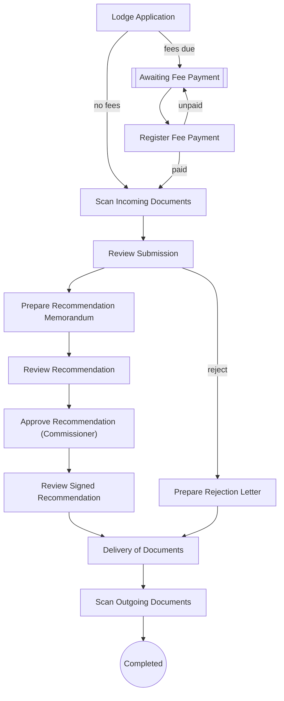

#### 2.5.4 MORT - Mortgage

Purpose: Registration of a legal mortgage (after APCM consent). Config `SubsequentRegistration/Mortgage.config`.

| Field | Value |
|---|---|
| Code / label | `MORT` Mortgage (lr_transaction_metadata Id 17) |
| Group / jBPM process | Subsequent Registration (`SSG`) / **Subsequent Registration** |
| meta_type / action_type / right_type | 0 / 0 / right_type_consent_mortgage |
| Durations (normal/lapsed/max, days) | 20 / 0 / 20 |
| RRR effect at completion | needs active **occupancy and consent_mortgage**; blocked by active mortgage or caveat or lease; creates **mortgage**; discharges **consent_mortgage**. Parties: source party = mortgagor; target party = mortgagee; source parties pre-filled from target of related RRR; target parties pre-filled from source of related RRR |
| Fees | Cashier fee lines: Application Fee (`feetype_app_C_APF`), Registration Fee of Mortgage (`feetype_RFM_C_RFM`) |
| Non-withdrawable tasks | RegisterInstrument,DeliveryOfDocuments,ScanOutgoingDocuments |
| Complete / reject reports | sd_DLegal_mortage / sd_reject_letter |
| Mandatory scanned outgoing docs | `sd_demandnotice`, `sd_payment_receipt`, `sd_regist_memoMem` |
| Blocked while another transaction on the property is lodged/postponed | ABWG, APRF, APRO, APSL, ASSI, CEMP, CHNT, CHPC, COMP, CONT, DCT, DEVO, EXTT, INSC, LEAS, LOCE, MERT, MORT, PSUR, RAOL, RCOO, REGR, RLEA, RMOR, RROC, RSUB, SUBD, SUBL, SURO, UPMO |
| Volume (all time) | 1962: Active 641, Completed 1308, Withdrawn 7, Postponed 6, Rejected 0; created as LRS 1, as past 1961 |
| Age of open (Active) live files | median 2600 d, n=1 |
| Cadastre jobs (lr_mc_job) / rejection records | 0 / 0 |

| # | Stage (jBPM task / config `stages`) | Role / unit (inferred) | Screens (wizard pages) | Checks & actions on Complete | Printed / produced | Next (transition) |
|---|---|---|---|---|---|---|
| 1 | `New,LodgmentApplication` | Lodgement desk (reception) | Transaction list › Applicants › Properties (RO, map) › Outstanding ground rent › Fee list › Print › Complete & assign | `validate: checkRegisterAlready,checkTransactionMetadata`<br>`CheckUnpaidFee:Scan Incoming Documents\|Awaiting Fee Payment` | LodgementLetter → `sd_lodgement_letter`<br>DemandNotice → `sd_demandnotice` | "Awaiting Fee Payment" if fees are due, else "Scan Incoming Documents" (`CheckUnpaidFee`) |
| 2 | `AwaitingFeePayment` | Wait state (applicant / Cashier) | Transaction + documents (RO) › Complete & assign | `UpdateSimpleCounterValue:receipt_number` |  | Register Fee Payment and Generate Receipt (Cashier commit, inferred) |
| 3 | `RegisterFeePaymentAndGenerateReceipt` | Accounts (fee) | Transaction + documents (RO) › Applicants (RO) › Properties (RO, map) › Demand notice › Print › Complete & assign | `payments must validate`<br>`CheckUnpaidFee:Scan Incoming Documents\|Awaiting Fee Payment` | FeePaymentVerificationReceipt → `sd_payment_receipt` | "Scan Incoming Documents"; "Awaiting Fee Payment" while unpaid |
| 4 | `ScanIncomingDocuments` | Scanning | Transaction + documents › Complete & assign | `UpdateSimpleCounterValue:demandnotice_number` |  | Review Submission (demand-notice no. allocated) |
| 5 | `ReviewSubmission` | Lands officer | Transaction + documents › Applicants (RO) › Properties (map) › Parties › RRR (+source parties) › Demand notice (RO) › Complete & assign |  |  | allowed: "Register Instrument"; reject branch (inferred)<br>excluded here: MORT → Prepare Valuation Report,MORT → Generate Final Demand Notice,MORT → Investigate Complaint,MORT → Open New Property File and Assign Property Number,MORT → Prepare Recommendation Memorandum,MORT → Raise Site Analysis Report,MORT → Survey Plan Checking and Approval,MORT → Raise Title Deed Plan |
| 6 | `RegisterInstrument` | Deeds registry | Transaction + documents (RO) › Properties (RO, map) › Parties (RO) › RRR (+source parties) › Demand notice (RO) › Register instrument (RO) › Properties (RO, map) › Print › Complete & assign | `mandatory: startDate`<br>`ApproveMCJob:Delivery of Documents\|job_deedplan_creation`<br>`AddOutgoingSupportingDocument:Delivery of Documents` | RegistrationMemorandumMemo → `sd_regist_memoMem` | "Delivery of Documents" (approves Deed Plan job if any; adds complete reports as outgoing docs) - **RRR effect applied here (inferred)** |
| 7 | `DeliveryOfDocuments` | Dispatch | Transaction + documents › Print › Complete & assign |  | DeliveryLetter → `sd_delivery_letter` | Scan Outgoing Documents |
| 8 | `ScanOutgoingDocuments` | Scanning | Transaction + documents › Complete & assign | `CheckUnscannedDocuments`<br>`SaveGroundRentData` | scan-out: `sd_demandnotice`, `sd_payment_receipt`, `sd_regist_memoMem` | end - completed |
| 9 | `PrepareRejectionLetter` | Lands officer | Transaction + documents (RO) › Rejection reasons › Print › Complete & assign | `RejectMCJob:Delivery of Documents\|job_deedplan_creation`<br>`AddOutgoingSupportingDocument:Delivery of Documents` | RejectionLetter → `sd_reject_letter` | "Delivery of Documents" (rejects Deed Plan job) |

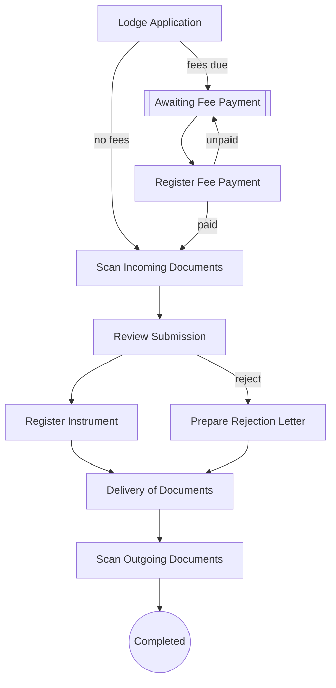

#### 2.5.5 RMOR - Release (Mortgage)

Purpose: Release (discharge) of a mortgage. Config `SubsequentRegistration/ReleaseMortgage.config`.

| Field | Value |
|---|---|
| Code / label | `RMOR` Release (Mortgage) (lr_transaction_metadata Id 22) |
| Group / jBPM process | Subsequent Registration (`SSG`) / **Subsequent Registration** |
| meta_type / action_type / right_type | 0 / 1 / right_type_mortgage |
| Durations (normal/lapsed/max, days) | 20 / 0 / 20 |
| RRR effect at completion | needs active **mortgage**; discharges **mortgage** |
| Fees | Cashier fee lines: Application Fee (`feetype_app_C_APF`), Processing Fee for Release (Mortgage) (`feetype_PFRM_C_PFRM`) |
| Non-withdrawable tasks | RegisterInstrument,DeliveryOfDocuments,ScanOutgoingDocuments |
| Complete / reject reports | - / sd_reject_letter |
| Mandatory scanned outgoing docs | `sd_demandnotice`, `sd_payment_receipt` |
| Blocked while another transaction on the property is lodged/postponed | ABWG, APRF, APRO, APSL, ASSI, CEMP, CHNT, CHPC, COMP, CONT, DCT, DEVO, EXTT, INSC, LEAS, LOCE, MERT, MORT, PSUR, RAOL, RCOO, REGR, RLEA, RMOR, RROC, RSUB, SUBD, SUBL, SURO, UPMO |
| Volume (all time) | 823: Active 193, Completed 613, Withdrawn 14, Postponed 3, Rejected 0; created as LRS 38, as past 785 |
| Lodge → complete (live, completed) | median 0 d (p25 0, p75 0, p90 201), n=10 |
| Age of open (Active) live files | median 233 d, n=16 |
| Cadastre jobs (lr_mc_job) / rejection records | 0 / 12 |

| # | Stage (jBPM task / config `stages`) | Role / unit (inferred) | Screens (wizard pages) | Checks & actions on Complete | Printed / produced | Next (transition) |
|---|---|---|---|---|---|---|
| 1 | `New,LodgmentApplication` | Lodgement desk (reception) | Transaction list › Applicants › Properties (RO, map) › Outstanding ground rent › Fee list › Print › Complete & assign | `validate: checkRegisterAlready,checkTransactionMetadata`<br>`CheckUnpaidFee:Scan Incoming Documents\|Awaiting Fee Payment` | LodgementLetter → `sd_lodgement_letter`<br>DemandNotice → `sd_demandnotice` | "Awaiting Fee Payment" if fees are due, else "Scan Incoming Documents" (`CheckUnpaidFee`) |
| 2 | `AwaitingFeePayment` | Wait state (applicant / Cashier) | Transaction + documents (RO) › Complete & assign | `UpdateSimpleCounterValue:receipt_number` |  | Register Fee Payment and Generate Receipt (Cashier commit, inferred) |
| 3 | `RegisterFeePaymentAndGenerateReceipt` | Accounts (fee) | Transaction + documents (RO) › Applicants (RO) › Properties (RO, map) › Demand notice › Print › Complete & assign | `payments must validate`<br>`CheckUnpaidFee:Scan Incoming Documents\|Awaiting Fee Payment` | FeePaymentVerificationReceipt → `sd_payment_receipt` | "Scan Incoming Documents"; "Awaiting Fee Payment" while unpaid |
| 4 | `ScanIncomingDocuments` | Scanning | Transaction + documents › Complete & assign | `UpdateSimpleCounterValue:demandnotice_number` |  | Review Submission (demand-notice no. allocated) |
| 5 | `ReviewSubmission` | Lands officer | Transaction + documents › Applicants (RO) › Properties (map) › Demand notice (RO) › Complete & assign |  |  | allowed: "Register Instrument"; reject branch (inferred)<br>excluded here: RMOR → Prepare Valuation Report,RMOR → Generate Final Demand Notice,RMOR → Investigate Complaint,RMOR → Open New Property File and Assign Property Number,RMOR → Prepare Recommendation Memorandum,RMOR → Raise Site Analysis Report,RMOR → Survey Plan Checking and Approval,RMOR → Raise Title Deed Plan |
| 6 | `RegisterInstrument` | Deeds registry | Transaction + documents (RO) › Properties (RO, map) › Demand notice (RO) › Register instrument (RO) › Properties (RO, map) › Print › Complete & assign | `ApproveMCJob:Delivery of Documents\|job_deedplan_creation`<br>`AddOutgoingSupportingDocument:Delivery of Documents` | RegistrationMemorandumMemo → `sd_regist_memoMem` | "Delivery of Documents" (approves Deed Plan job if any; adds complete reports as outgoing docs) - **RRR effect applied here (inferred)** |
| 7 | `DeliveryOfDocuments` | Dispatch | Transaction + documents › Print › Complete & assign |  | DeliveryLetter → `sd_delivery_letter` | Scan Outgoing Documents |
| 8 | `ScanOutgoingDocuments` | Scanning | Transaction + documents › Complete & assign | `CheckUnscannedDocuments`<br>`SaveGroundRentData` | scan-out: `sd_demandnotice`, `sd_payment_receipt` | end - completed |
| 9 | `PrepareRejectionLetter` | Lands officer | Transaction + documents (RO) › Rejection reasons › Print › Complete & assign | `RejectMCJob:Delivery of Documents\|job_deedplan_creation`<br>`AddOutgoingSupportingDocument:Delivery of Documents` | RejectionLetter → `sd_reject_letter` | "Delivery of Documents" (rejects Deed Plan job) |


#### 2.5.6 UPMO - Upstamping of Existing Mortgage

Purpose: Up-stamping (increasing) an existing mortgage; consideration added. Config `SubsequentRegistration/UpstampingOfExistingMortgage.config`.

| Field | Value |
|---|---|
| Code / label | `UPMO` Upstamping of Existing Mortgage (lr_transaction_metadata Id 28) |
| Group / jBPM process | Subsequent Registration (`SSG`) / **Subsequent Registration** |
| meta_type / action_type / right_type | 0 / 2 / right_type_mortgage |
| Durations (normal/lapsed/max, days) | 20 / 0 / 20 |
| RRR effect at completion | needs active **occupancy and mortgage**; blocked by active caveat or lease; modifies **mortgage**. Parties: source party = mortgagor; target party = mortgagee; source parties pre-filled from source of related RRR; target parties pre-filled from target of related RRR |
| Fees | Cashier fee lines: Application Fee (`feetype_app_C_APF`), Upstamping of Existing Mortgage Fee (`feetype_UEMF_C_UEMF`) |
| Non-withdrawable tasks | RegisterInstrument,DeliveryOfDocuments,ScanOutgoingDocuments |
| Complete / reject reports | sd_DLegal_mortage / sd_reject_letter |
| Mandatory scanned outgoing docs | `sd_demandnotice`, `sd_payment_receipt`, `sd_regist_memoMem` |
| Blocked while another transaction on the property is lodged/postponed | ABWG, APCA, APCM, APRF, APRO, APSL, ASSI, CEMP, CHPC, COMP, CONT, DCT, DEVO, EXTT, INSC, LEAS, LOCE, MERT, MORT, PSUR, RAOL, RCOO, REGR, RLEA, RROC, SUBD, SUBL, SURO, UPMO |
| Volume (all time) | 497: Active 182, Completed 312, Withdrawn 3, Postponed 0, Rejected 0; created as LRS 1, as past 496 |
| Age of open (Active) live files | median 3069 d, n=1 |
| Cadastre jobs (lr_mc_job) / rejection records | 0 / 0 |

| # | Stage (jBPM task / config `stages`) | Role / unit (inferred) | Screens (wizard pages) | Checks & actions on Complete | Printed / produced | Next (transition) |
|---|---|---|---|---|---|---|
| 1 | `New,LodgmentApplication` | Lodgement desk (reception) | Transaction list › Applicants › Properties (RO, map) › Outstanding ground rent › Fee list › Print › Complete & assign | `validate: checkRegisterAlready,checkTransactionMetadata`<br>`CheckUnpaidFee:Scan Incoming Documents\|Awaiting Fee Payment` | LodgementLetter → `sd_lodgement_letter`<br>DemandNotice → `sd_demandnotice` | "Awaiting Fee Payment" if fees are due, else "Scan Incoming Documents" (`CheckUnpaidFee`) |
| 2 | `AwaitingFeePayment` | Wait state (applicant / Cashier) | Transaction + documents (RO) › Complete & assign | `UpdateSimpleCounterValue:receipt_number` |  | Register Fee Payment and Generate Receipt (Cashier commit, inferred) |
| 3 | `RegisterFeePaymentAndGenerateReceipt` | Accounts (fee) | Transaction + documents (RO) › Applicants (RO) › Properties (RO, map) › Demand notice › Print › Complete & assign | `payments must validate`<br>`CheckUnpaidFee:Scan Incoming Documents\|Awaiting Fee Payment` | FeePaymentVerificationReceipt → `sd_payment_receipt` | "Scan Incoming Documents"; "Awaiting Fee Payment" while unpaid |
| 4 | `ScanIncomingDocuments` | Scanning | Transaction + documents › Complete & assign | `UpdateSimpleCounterValue:demandnotice_number` |  | Review Submission (demand-notice no. allocated) |
| 5 | `ReviewSubmission` | Lands officer | Transaction + documents › Applicants (RO) › Properties (map) › Parties (RO) › RRR (+source parties) › Demand notice (RO) › Complete & assign | `mandatory: consideration,considerationCurrency` |  | allowed: "Register Instrument"; reject branch (inferred)<br>excluded here: UPMO → Prepare Valuation Report,UPMO → Generate Final Demand Notice,UPMO → Investigate Complaint,UPMO → Open New Property File and Assign Property Number,UPMO → Prepare Recommendation Memorandum,UPMO → Raise Site Analysis Report,UPMO → Survey Plan Checking and Approval,UPMO → Raise Title Deed Plan |
| 6 | `RegisterInstrument` | Deeds registry | Transaction + documents (RO) › Properties (RO, map) › Parties (RO) › RRR (+source parties) › Demand notice (RO) › Register instrument (RO) › Properties (RO, map) › Print › Complete & assign | `mandatory: startDate`<br>`ApproveMCJob:Delivery of Documents\|job_deedplan_creation`<br>`AddOutgoingSupportingDocument:Delivery of Documents` | RegistrationMemorandumMemo → `sd_regist_memoMem` | "Delivery of Documents" (approves Deed Plan job if any; adds complete reports as outgoing docs) - **RRR effect applied here (inferred)** |
| 7 | `DeliveryOfDocuments` | Dispatch | Transaction + documents › Print › Complete & assign |  | DeliveryLetter → `sd_delivery_letter` | Scan Outgoing Documents |
| 8 | `ScanOutgoingDocuments` | Scanning | Transaction + documents › Complete & assign | `CheckUnscannedDocuments`<br>`SaveGroundRentData` | scan-out: `sd_demandnotice`, `sd_payment_receipt`, `sd_regist_memoMem` | end - completed |
| 9 | `PrepareRejectionLetter` | Lands officer | Transaction + documents (RO) › Rejection reasons › Print › Complete & assign | `RejectMCJob:Delivery of Documents\|job_deedplan_creation`<br>`AddOutgoingSupportingDocument:Delivery of Documents` | RejectionLetter → `sd_reject_letter` | "Delivery of Documents" (rejects Deed Plan job) |


#### 2.5.7 PSUR - Part Surrender

Purpose: Part surrender of a right: valuation, assessed fees, new C of O for the remainder. Config `SubsequentRegistration/PartSurrender.config`.

| Field | Value |
|---|---|
| Code / label | `PSUR` Part Surrender (lr_transaction_metadata Id 18) |
| Group / jBPM process | Subsequent Registration (`SSG`) / **Subsequent Registration** |
| meta_type / action_type / right_type | 7 / 0 / right_type_occupancy |
| Durations (normal/lapsed/max, days) | 20 / 0 / 20 |
| RRR effect at completion | needs active **occupancy**; blocked by active mortgage or caveat or lease or sublease; creates **occupancy**; discharges **occupancy**. Parties: source party = grantor; target party = grantee; source parties pre-filled from target of related RRR; target parties pre-filled from target of related RRR |
| Fees | Cashier fee lines: Application Fee (`feetype_app_C_APF`), Processing Fee for Part Surrender (`feetype_PFPS_C_PFPS`), TDP Fee (`feetype_tdp_C_TDPF`), Premium of CofO Fee (`feetype_premiumCofO_C_PCOFO`), Issuance Fee For C of O (`feetype_IFCO_C_IFCO`), Survey Fee (`feetype_survey_C_SVF`), Plan Lodgement Fee (`feetype_planlodgement_C_PLF`), Part Surrender Fee (`feetype_PSF_C_PSF`) |
| Non-withdrawable tasks | RegisterInstrument,DeliveryOfDocuments,ScanOutgoingDocuments |
| Complete / reject reports | sd_Co_title / sd_reject_letter |
| Mandatory scanned outgoing docs | `sd_demandnotice`, `sd_recMemo_Com`, `sd_Co_title`, `sd_valuatReport`, `sd_payment_receipt` |
| Blocked while another transaction on the property is lodged/postponed | ABWG, APRF, APRO, APSL, ASSI, CEMP, CHNT, CHPC, COMP, CONT, DCT, DEVO, EXTT, INSC, LEAS, LOCE, MERT, MORT, PSUR, RAOL, RCOO, REGR, RLEA, RMOR, RROC, RSUB, SUBD, SUBL, SURO, UPMO |
| Volume (all time) | 309: Active 254, Completed 5, Withdrawn 50, Postponed 0, Rejected 0; created as LRS 305, as past 4 |
| Lodge → complete (live, completed) | median 633 d (p25 274, p75 743, p90 743), n=5 |
| Age of open (Active) live files | median 849 d, n=252 |
| Cadastre jobs (lr_mc_job) / rejection records | 13 / 48 |

| # | Stage (jBPM task / config `stages`) | Role / unit (inferred) | Screens (wizard pages) | Checks & actions on Complete | Printed / produced | Next (transition) |
|---|---|---|---|---|---|---|
| 1 | `New,LodgmentApplication` | Lodgement desk (reception) | Transaction list › Applicants › Properties (map) › Outstanding ground rent › Fee list › Print › Complete & assign | `validate: checkRegisterAlready,checkTransactionMetadata`<br>`CheckUnpaidFee:Scan Incoming Documents\|Awaiting Fee Payment` | LodgementLetter → `sd_lodgement_letter`<br>DemandNotice → `sd_demandnotice` | "Awaiting Fee Payment" if fees are due, else "Scan Incoming Documents" (`CheckUnpaidFee`) |
| 2 | `AwaitingFeePayment` | Wait state (applicant / Cashier) | Transaction + documents (RO) › Complete & assign | `UpdateSimpleCounterValue:receipt_number` |  | Register Fee Payment and Generate Receipt (Cashier commit, inferred) |
| 3 | `RegisterFeePaymentAndGenerateReceipt` | Accounts (fee) | Transaction + documents (RO) › Applicants (RO) › Properties (RO, map) › Demand notice › Print › Complete & assign | `payments must validate`<br>`CheckUnpaidFee:Scan Incoming Documents\|Awaiting Fee Payment` | FeePaymentVerificationReceipt → `sd_payment_receipt` | "Scan Incoming Documents"; "Awaiting Fee Payment" while unpaid |
| 4 | `ScanIncomingDocuments` | Scanning | Transaction + documents › Complete & assign | `UpdateSimpleCounterValue:demandnotice_number` |  | Review Submission (demand-notice no. allocated) |
| 5 | `ReviewSubmission` | Lands officer | Transaction + documents › Applicants (RO) › Properties (map) › Parties › Demand notice (RO) › Complete & assign |  |  | allowed: "Prepare Valuation Report", "Generate Final Demand Notice", "Prepare Recommendation Memorandum", "Raise Title Deed Plan"; reject branch (inferred)<br>excluded here: PSUR → Investigate Complaint,PSUR → Open New Property File and Assign Property Number,PSUR → Raise Site Analysis Report,PSUR → Survey Plan Checking and Approval,PSUR → Register Instrument |
| 6 | `PrepareValuationReport` | Valuation unit | Transaction + documents (RO) › Applicants (RO) › Properties (map) › Demand notice (RO) › Complete & assign |  |  | Review Valuation Report |
| 7 | `ReviewValuationReport` | Valuation unit | Transaction + documents (RO) › Applicants (RO) › Properties (RO, map) › Demand notice (RO) › Complete & assign |  |  | Generate Final Demand Notice (inferred) |
| 8 | `GenerateFinalDemandNotice` | Valuation / accounts | Transaction + documents (RO) › Applicants (RO) › Properties (RO, map) › Fee list › Print › Complete & assign |  | DemandNotice → `sd_demandnotice` | Awaiting Assessed Fee Payment (prints demand notice) |
| 9 | `AwaitingAssessedFeePayment` | Wait state (applicant / Cashier) | Transaction + documents (RO) › Complete & assign | `UpdateSimpleCounterValue:receipt_number` |  | Register Assessed Fee Payment (Cashier, inferred) |
| 10 | `RegisterAssessedFeePaymentandGenerateReceipt` | Accounts (fee) | Transaction + documents (RO) › Applicants (RO) › Properties (RO, map) › Demand notice › Print › Complete & assign | `payments must validate`<br>`CheckUnpaidFee:Review Submission\|Awaiting Assessed Fee Payment` | FeePaymentVerificationReceipt → `sd_payment_receipt` | "Review Submission" (back for the next step); "Awaiting Assessed Fee Payment" while unpaid |
| 11 | `PrepareRecommendationMemorandum` | Lands officer | Transaction + documents › Properties (RO, map) › Parties (RO) › RRR › Demand notice (RO) › Print › Complete & assign | `mandatory: termYear` | RecommendationMemorandumMemo → `sd_recMemo_Com` | Review Recommendation |
| 12 | `ReviewRecommendation` | Director / Permanent Secretary | Transaction + documents (RO) › Properties (RO, map) › Parties (RO) › Demand notice (RO) › Complete & assign |  |  | allowed: "Approve Recommendation (Commissioner)"<br>excluded here: PSUR → Approve Recommendation (Governor) |
| 13 | `ApproveRecommendation(Commissioner)` | Commissioner | Transaction + documents (RO) › Properties (RO, map) › Parties (RO) › Demand notice (RO) › Complete & assign | `mandatory: signDate` |  | Review Signed Recommendation (sign date mandatory) |
| 14 | `ReviewSignedRecommendation` | Lands officer | Transaction + documents (RO) › Properties (RO, map) › Parties (RO) › Demand notice (RO) › Complete & assign |  |  | allowed: "Raise Title Deed Plan"<br>excluded here: PSUR → Register Instrument,PSUR → Delivery of Documents |
| 15 | `GenerateCofO` | C of O unit | Transaction + documents (RO) › Properties (RO, map) › Parties (RO) › RRR › Demand notice (RO) › Print (per property) › Complete & assign | `mandatory: securityNumber1,securityNumber2` | CertificateOfOccupancyTitle → `sd_Co_title` | Review C of O (reached after Raise Title Deed Plan returns, inferred) |
| 16 | `ReviewCofO` | C of O unit | Transaction + documents (RO) › Properties (RO, map) › Parties (RO) › Demand notice (RO) › Complete & assign |  |  | Approve C of O |
| 17 | `ApproveCofO` | Approving authority (signs C of O) | Transaction + documents › Properties (RO, map) › Parties (RO) › Demand notice (RO) › Complete & assign | `mandatory: signDate` |  | Review Signed C of O |
| 18 | `ReviewSignedCofO` | C of O unit | Transaction + documents (RO) › Properties (RO, map) › Parties (RO) › Demand notice (RO) › Complete & assign |  |  | Register Instrument |
| 19 | `RegisterInstrument` | Deeds registry | Transaction + documents (RO) › Properties (RO, map) › Parties (RO) › RRR › Demand notice (RO) › Register instrument (RO) › Properties (RO, map) › Print › Complete & assign | `mandatory: startDate`<br>`ApproveMCJob:Delivery of Documents\|job_deedplan_creation`<br>`AddOutgoingSupportingDocument:Delivery of Documents` | RegistrationMemorandumMemo → `sd_regist_memoMem` | "Delivery of Documents" (approves Deed Plan job if any; adds complete reports as outgoing docs) - **RRR effect applied here (inferred)** |
| 20 | `DeliveryOfDocuments` | Dispatch | Transaction + documents › Print › Complete & assign |  | DeliveryLetter → `sd_delivery_letter` | Scan Outgoing Documents |
| 21 | `ScanOutgoingDocuments` | Scanning | Transaction + documents › Complete & assign | `CheckUnscannedDocuments`<br>`SaveGroundRentData` | scan-out: `sd_demandnotice`, `sd_recMemo_Com`, `sd_Co_title`, `sd_valuatReport`, `sd_payment_receipt` | end - completed |
| 22 | `PrepareRejectionLetter` | Lands officer | Transaction + documents (RO) › Rejection reasons › Print › Complete & assign | `RejectMCJob:Delivery of Documents\|job_deedplan_creation`<br>`AddOutgoingSupportingDocument:Delivery of Documents` | RejectionLetter → `sd_reject_letter` | "Delivery of Documents" (rejects Deed Plan job) |

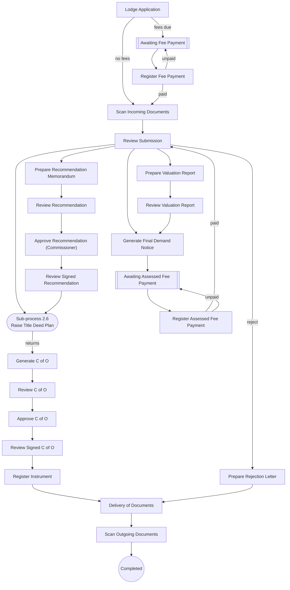

#### 2.5.8 CHPC - Change of Purpose Clause

Purpose: Change of the purpose clause (land use) of the right; site analysis possible; C of O re-issued. Config `SubsequentRegistration/ChangeOfPurposeClause.config`.

| Field | Value |
|---|---|
| Code / label | `CHPC` Change of Purpose Clause (lr_transaction_metadata Id 10) |
| Group / jBPM process | Subsequent Registration (`SSG`) / **Subsequent Registration** |
| meta_type / action_type / right_type | 0 / 99 / right_type_occupancy |
| Durations (normal/lapsed/max, days) | 20 / 0 / 20 |
| RRR effect at completion | needs active **occupancy**; modifies **occupancy**. Parties: source party = assignor; target party = assignee; source parties pre-filled from source of related RRR; target parties pre-filled from target of related RRR |
| Fees | Cashier fee lines: Application Form Fee (`feetype_apff_C_APFF`), Processing Fee for Change of Purpose Clause (`feetype_PFCPC_C_PFCPC`), Change of Purpose Clause Fee (`feetype_CPCF_C_CPCF`), Issuance Fee For C of O (`feetype_IFCO_C_IFCO`), Registration of C of O Fee (`feetype_RCOF_C_RCOF`); fees computed from the source property: Change of Purpose Clause Fee (`feetype_CPCF_C_CPCF`) |
| Non-withdrawable tasks | RegisterInstrument,DeliveryOfDocuments,ScanOutgoingDocuments |
| Complete / reject reports | sd_Co_title / sd_reject_letter |
| Mandatory scanned outgoing docs | `sd_demandnotice`, `sd_recMemo_Com`, `sd_Co_title`, `sd_SAR`, `sd_payment_receipt` |
| Blocked while another transaction on the property is lodged/postponed | ABWG, APCA, APCM, APCO, APRF, APRO, APSL, ASSI, CEMP, CHPC, COMP, CONT, DCT, DEVO, EXTT, INSC, LEAS, LOCE, MERT, MORT, PSUR, RAOL, RCOO, REGR, RLEA, RMOR, RROC, RSUB, SUBD, SUBL, SURO, UPMO |
| Volume (all time) | 378: Active 140, Completed 211, Withdrawn 27, Postponed 0, Rejected 0; created as LRS 136, as past 242 |
| Lodge → complete (live, completed) | median 325 d (p25 219, p75 520, p90 994), n=31 |
| Age of open (Active) live files | median 662 d, n=80 |
| Cadastre jobs (lr_mc_job) / rejection records | 48 / 26 |

| # | Stage (jBPM task / config `stages`) | Role / unit (inferred) | Screens (wizard pages) | Checks & actions on Complete | Printed / produced | Next (transition) |
|---|---|---|---|---|---|---|
| 1 | `New,LodgmentApplication` | Lodgement desk (reception) | Transaction list › Applicants › Properties (RO, map) › Outstanding ground rent › Fee list › Print › Complete & assign | `validate: checkRegisterAlready,checkTransactionMetadata`<br>`CheckUnpaidFee:Scan Incoming Documents\|Awaiting Fee Payment` | LodgementLetter → `sd_lodgement_letter`<br>DemandNotice → `sd_demandnotice` | "Awaiting Fee Payment" if fees are due, else "Scan Incoming Documents" (`CheckUnpaidFee`) |
| 2 | `AwaitingFeePayment` | Wait state (applicant / Cashier) | Transaction + documents (RO) › Complete & assign | `UpdateSimpleCounterValue:receipt_number` |  | Register Fee Payment and Generate Receipt (Cashier commit, inferred) |
| 3 | `RegisterFeePaymentAndGenerateReceipt` | Accounts (fee) | Transaction + documents (RO) › Applicants (RO) › Properties (RO, map) › Demand notice › Print › Complete & assign | `payments must validate`<br>`CheckUnpaidFee:Scan Incoming Documents\|Awaiting Fee Payment` | FeePaymentVerificationReceipt → `sd_payment_receipt` | "Scan Incoming Documents"; "Awaiting Fee Payment" while unpaid |
| 4 | `ScanIncomingDocuments` | Scanning | Transaction + documents › Complete & assign | `UpdateSimpleCounterValue:demandnotice_number` |  | Review Submission (demand-notice no. allocated) |
| 5 | `ReviewSubmission` | Lands officer | Transaction + documents › Applicants (RO) › Properties (map) › Parties › Demand notice (RO) › Complete & assign |  |  | allowed: "Prepare Recommendation Memorandum", "Raise Site Analysis Report", "Raise Title Deed Plan"; reject branch (inferred)<br>excluded here: CHPC → Prepare Valuation Report,CHPC → Generate Final Demand Notice,CHPC → Investigate Complaint,CHPC → Open New Property File and Assign Property Number,CHPC → Survey Plan Checking and Approval,CHPC → Register Instrument |
| 6 | `PrepareRecommendationMemorandum` | Lands officer | Transaction + documents › Properties (RO, map) › Parties (RO) › RRR › Demand notice (RO) › Print › Complete & assign | `mandatory: termYear` | RecommendationMemorandumMemo → `sd_recMemo_Com` | Review Recommendation |
| 7 | `ReviewRecommendation` | Director / Permanent Secretary | Transaction + documents (RO) › Properties (RO, map) › Parties (RO) › Demand notice (RO) › Complete & assign |  |  | allowed: "Approve Recommendation (Commissioner)"<br>excluded here: CHPC → Approve Recommendation (Governor) |
| 8 | `ApproveRecommendation(Commissioner)` | Commissioner | Transaction + documents (RO) › Properties (RO, map) › Parties (RO) › Demand notice (RO) › Complete & assign | `mandatory: signDate` |  | Review Signed Recommendation (sign date mandatory) |
| 9 | `ReviewSignedRecommendation` | Lands officer | Transaction + documents (RO) › Properties (RO, map) › Parties (RO) › Demand notice (RO) › Complete & assign |  |  | allowed: "Raise Title Deed Plan"<br>excluded here: CHPC → Register Instrument,CHPC → Delivery of Documents |
| 10 | `GenerateCofO` | C of O unit | Transaction + documents (RO) › Properties (RO, map) › Parties (RO) › RRR › Demand notice (RO) › Print (per property) › Complete & assign | `mandatory: securityNumber1,securityNumber2` | CertificateOfOccupancyTitle → `sd_Co_title` | Review C of O (reached after Raise Title Deed Plan returns, inferred) |
| 11 | `ReviewCofO` | C of O unit | Transaction + documents (RO) › Properties (RO, map) › Parties (RO) › Demand notice (RO) › Complete & assign |  |  | Approve C of O |
| 12 | `ApproveCofO` | Approving authority (signs C of O) | Transaction + documents › Properties (RO, map) › Parties (RO) › Demand notice (RO) › Complete & assign | `mandatory: signDate` |  | Review Signed C of O |
| 13 | `ReviewSignedCofO` | C of O unit | Transaction + documents (RO) › Properties (RO, map) › Parties (RO) › Demand notice (RO) › Complete & assign |  |  | Register Instrument |
| 14 | `RegisterInstrument` | Deeds registry | Transaction + documents (RO) › Properties (RO, map) › Parties (RO) › RRR › Demand notice (RO) › Register instrument (RO) › Properties (RO, map) › Print › Complete & assign | `mandatory: startDate`<br>`ApproveMCJob:Delivery of Documents\|job_deedplan_creation`<br>`AddOutgoingSupportingDocument:Delivery of Documents` | RegistrationMemorandumMemo → `sd_regist_memoMem` | "Delivery of Documents" (approves Deed Plan job if any; adds complete reports as outgoing docs) - **RRR effect applied here (inferred)** |
| 15 | `DeliveryOfDocuments` | Dispatch | Transaction + documents › Print › Complete & assign |  | DeliveryLetter → `sd_delivery_letter` | Scan Outgoing Documents |
| 16 | `ScanOutgoingDocuments` | Scanning | Transaction + documents › Complete & assign | `CheckUnscannedDocuments`<br>`SaveGroundRentData` | scan-out: `sd_demandnotice`, `sd_recMemo_Com`, `sd_Co_title`, `sd_SAR`, `sd_payment_receipt` | end - completed |
| 17 | `PrepareRejectionLetter` | Lands officer | Transaction + documents (RO) › Rejection reasons › Print › Complete & assign | `RejectMCJob:Delivery of Documents\|job_deedplan_creation`<br>`AddOutgoingSupportingDocument:Delivery of Documents` | RejectionLetter → `sd_reject_letter` | "Delivery of Documents" (rejects Deed Plan job) |

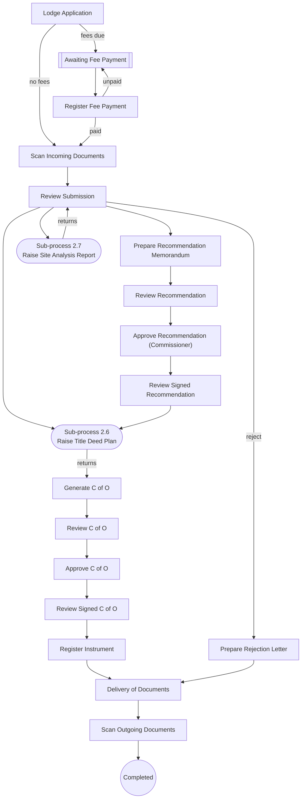

#### 2.5.9 EXTT - Extension of Title

Purpose: Extension of the term of the title; survey and site analysis possible; C of O re-issued. Config `SubsequentRegistration/ExtensionOfTitle.config`.

| Field | Value |
|---|---|
| Code / label | `EXTT` Extension of Title (lr_transaction_metadata Id 13) |
| Group / jBPM process | Subsequent Registration (`SSG`) / **Subsequent Registration** |
| meta_type / action_type / right_type | 0 / 99 / right_type_occupancy |
| Durations (normal/lapsed/max, days) | 20 / 0 / 20 |
| RRR effect at completion | needs active **occupancy**; blocked by active mortgage or caveat or lease or sublease; modifies **occupancy**. Parties: source party = grantor; target party = grantee; source parties pre-filled from target of related RRR; target parties pre-filled from target of related RRR |
| Fees | Cashier fee lines: Application Form Fee (`feetype_apff_C_APFF`), Plan Lodgement Fee (`feetype_planlodgement_C_PLF`), Site Inspection Fee (`feetype_SIF_C_SIF`), TDP Fee (`feetype_tdp_C_TDPF`), Processing Fee for Extension of Title (`feetype_PFET_C_PFET`), Issuance Fee For C of O (`feetype_IFCO_C_IFCO`), Survey Fee (`feetype_survey_C_SVF`), Registration of C of O Fee (`feetype_RCOF_C_RCOF`) |
| Non-withdrawable tasks | RegisterInstrument,DeliveryOfDocuments,ScanOutgoingDocuments |
| Complete / reject reports | sd_Co_title / sd_reject_letter |
| Mandatory scanned outgoing docs | `sd_demandnotice`, `sd_recMemo_Com`, `sd_Co_title`, `sd_SAR`, `sd_traverse_compute`, `sd_finSurvey_report`, `sd_payment_receipt`, `sd_regist_memoMem` |
| Blocked while another transaction on the property is lodged/postponed | ABWG, APRF, APRO, APSL, ASSI, CEMP, CHNT, CHPC, COMP, CONT, DCT, DEVO, EXTT, INSC, LEAS, LOCE, MERT, MORT, PSUR, RAOL, RCOO, REGR, RLEA, RMOR, RROC, RSUB, SUBD, SUBL, SURO, UPMO |
| Volume (all time) | 368: Active 132, Completed 212, Withdrawn 24, Postponed 0, Rejected 0; created as LRS 92, as past 276 |
| Lodge → complete (live, completed) | median 547 d (p25 321, p75 844, p90 1257), n=22 |
| Age of open (Active) live files | median 860 d, n=49 |
| Cadastre jobs (lr_mc_job) / rejection records | 49 / 22 |

| # | Stage (jBPM task / config `stages`) | Role / unit (inferred) | Screens (wizard pages) | Checks & actions on Complete | Printed / produced | Next (transition) |
|---|---|---|---|---|---|---|
| 1 | `New,LodgmentApplication` | Lodgement desk (reception) | Transaction list › Applicants › Properties (RO, map) › Outstanding ground rent › Fee list › Print › Complete & assign | `validate: checkRegisterAlready,checkTransactionMetadata`<br>`CheckUnpaidFee:Scan Incoming Documents\|Awaiting Fee Payment` | LodgementLetter → `sd_lodgement_letter`<br>DemandNotice → `sd_demandnotice` | "Awaiting Fee Payment" if fees are due, else "Scan Incoming Documents" (`CheckUnpaidFee`) |
| 2 | `AwaitingFeePayment` | Wait state (applicant / Cashier) | Transaction + documents (RO) › Complete & assign | `UpdateSimpleCounterValue:receipt_number` |  | Register Fee Payment and Generate Receipt (Cashier commit, inferred) |
| 3 | `RegisterFeePaymentAndGenerateReceipt` | Accounts (fee) | Transaction + documents (RO) › Applicants (RO) › Properties (RO, map) › Demand notice › Print › Complete & assign | `payments must validate`<br>`CheckUnpaidFee:Scan Incoming Documents\|Awaiting Fee Payment` | FeePaymentVerificationReceipt → `sd_payment_receipt` | "Scan Incoming Documents"; "Awaiting Fee Payment" while unpaid |
| 4 | `ScanIncomingDocuments` | Scanning | Transaction + documents › Complete & assign | `UpdateSimpleCounterValue:demandnotice_number` |  | Review Submission (demand-notice no. allocated) |
| 5 | `ReviewSubmission` | Lands officer | Transaction + documents › Applicants (RO) › Properties (map) › Parties › Demand notice (RO) › Complete & assign |  |  | allowed: "Prepare Recommendation Memorandum", "Raise Site Analysis Report", "Survey Plan Checking and Approval", "Raise Title Deed Plan"; reject branch (inferred)<br>excluded here: EXTT → Prepare Valuation Report,EXTT → Generate Final Demand Notice,EXTT → Investigate Complaint,EXTT → Open New Property File and Assign Property Number,EXTT → Register Instrument |
| 6 | `PrepareRecommendationMemorandum` | Lands officer | Transaction + documents › Properties (RO, map) › Parties (RO) › RRR › Demand notice (RO) › Print › Complete & assign | `mandatory: termYear` | RecommendationMemorandumMemo → `sd_recMemo_Com` | Review Recommendation |
| 7 | `ReviewRecommendation` | Director / Permanent Secretary | Transaction + documents (RO) › Properties (RO, map) › Parties (RO) › Demand notice (RO) › Complete & assign |  |  | allowed: "Approve Recommendation (Commissioner)"<br>excluded here: EXTT → Approve Recommendation (Governor) |
| 8 | `ApproveRecommendation(Commissioner)` | Commissioner | Transaction + documents (RO) › Properties (RO, map) › Parties (RO) › Demand notice (RO) › Complete & assign | `mandatory: signDate` |  | Review Signed Recommendation (sign date mandatory) |
| 9 | `ReviewSignedRecommendation` | Lands officer | Transaction + documents (RO) › Properties (RO, map) › Parties (RO) › Demand notice (RO) › Complete & assign |  |  | allowed: "Raise Title Deed Plan"<br>excluded here: EXTT → Register Instrument,EXTT → Delivery of Documents |
| 10 | `GenerateCofO` | C of O unit | Transaction + documents (RO) › Properties (RO, map) › Parties (RO) › RRR › Demand notice (RO) › Print (per property) › Complete & assign | `mandatory: securityNumber1,securityNumber2` | CertificateOfOccupancyTitle → `sd_Co_title` | Review C of O (reached after Raise Title Deed Plan returns, inferred) |
| 11 | `ReviewCofO` | C of O unit | Transaction + documents (RO) › Properties (RO, map) › Parties (RO) › Demand notice (RO) › Complete & assign |  |  | Approve C of O |
| 12 | `ApproveCofO` | Approving authority (signs C of O) | Transaction + documents › Properties (RO, map) › Parties (RO) › Demand notice (RO) › Complete & assign | `mandatory: signDate` |  | Review Signed C of O |
| 13 | `ReviewSignedCofO` | C of O unit | Transaction + documents (RO) › Properties (RO, map) › Parties (RO) › Demand notice (RO) › Complete & assign |  |  | Register Instrument |
| 14 | `RegisterInstrument` | Deeds registry | Transaction + documents (RO) › Properties (RO, map) › Parties (RO) › RRR › Demand notice (RO) › Register instrument (RO) › Properties (RO, map) › Print › Complete & assign | `mandatory: startDate`<br>`ApproveMCJob:Delivery of Documents\|job_deedplan_creation`<br>`AddOutgoingSupportingDocument:Delivery of Documents` | RegistrationMemorandumMemo → `sd_regist_memoMem` | "Delivery of Documents" (approves Deed Plan job if any; adds complete reports as outgoing docs) - **RRR effect applied here (inferred)** |
| 15 | `DeliveryOfDocuments` | Dispatch | Transaction + documents › Print › Complete & assign |  | DeliveryLetter → `sd_delivery_letter` | Scan Outgoing Documents |
| 16 | `ScanOutgoingDocuments` | Scanning | Transaction + documents › Complete & assign | `CheckUnscannedDocuments`<br>`SaveGroundRentData` | scan-out: `sd_demandnotice`, `sd_recMemo_Com`, `sd_Co_title`, `sd_SAR`, `sd_traverse_compute`, `sd_finSurvey_report`, `sd_payment_receipt`, `sd_regist_memoMem` | end - completed |
| 17 | `PrepareRejectionLetter` | Lands officer | Transaction + documents (RO) › Rejection reasons › Print › Complete & assign | `RejectMCJob:Delivery of Documents\|job_deedplan_creation`<br>`AddOutgoingSupportingDocument:Delivery of Documents` | RejectionLetter → `sd_reject_letter` | "Delivery of Documents" (rejects Deed Plan job) |

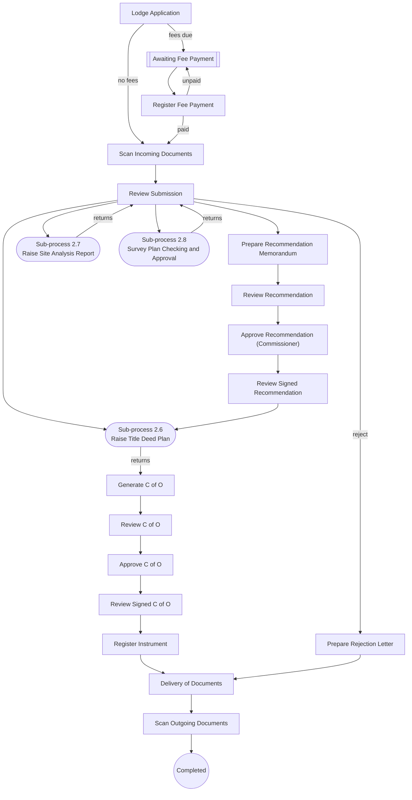

#### 2.5.10 DEVO - Devolution

Purpose: Devolution of a deceased holder's right to the heirs (Governor approval); new C of O. Config `SubsequentRegistration/Devolution.config`.

| Field | Value |
|---|---|
| Code / label | `DEVO` Devolution (lr_transaction_metadata Id 12) |
| Group / jBPM process | Subsequent Registration (`SSG`) / **Subsequent Registration** |
| meta_type / action_type / right_type | 0 / 0 / right_type_occupancy |
| Durations (normal/lapsed/max, days) | 20 / 0 / 20 |
| RRR effect at completion | needs active **occupancy**; blocked by active mortgage or caveat or lease or sublease; modifies **occupancy**. Parties: source party = deceased; target party = assignee; source parties pre-filled from target of related RRR |
| Fees | Cashier fee lines: Application Fee (`feetype_app_C_APF`), TDP Fee (`feetype_tdp_C_TDPF`), Processing Fee for Devolution (`feetype_PFD_C_PFD`), Premium of CofO Fee (`feetype_premiumCofO_C_PCOFO`), Issuance Fee For C of O (`feetype_IFCO_C_IFCO`); fees computed from the source property: Premium of CofO Fee (`feetype_premiumCofO_C_PCOFO`) |
| Non-withdrawable tasks | RegisterInstrument,DeliveryOfDocuments,ScanOutgoingDocuments |
| Complete / reject reports | sd_Co_title / sd_reject_letter |
| Mandatory scanned outgoing docs | `sd_demandnotice`, `sd_recMemo_Gov`, `sd_Co_title`, `sd_devolte_order`, `sd_payment_receipt`, `sd_regist_memoMem` |
| Blocked while another transaction on the property is lodged/postponed | ABWG, APRF, APRO, APSL, ASSI, CEMP, CHNT, CHPC, COMP, CONT, DCT, DEVO, EXTT, INSC, LEAS, LOCE, MERT, MORT, PSUR, RAOL, RCOO, REGR, RLEA, RMOR, RROC, RSUB, SUBD, SUBL, SURO, UPMO |
| Volume (all time) | 316: Active 112, Completed 169, Withdrawn 35, Postponed 0, Rejected 0; created as LRS 97, as past 219 |
| Lodge → complete (live, completed) | median 252 d (p25 169, p75 261, p90 261), n=4 |
| Age of open (Active) live files | median 1158 d, n=58 |
| Cadastre jobs (lr_mc_job) / rejection records | 12 / 35 |

| # | Stage (jBPM task / config `stages`) | Role / unit (inferred) | Screens (wizard pages) | Checks & actions on Complete | Printed / produced | Next (transition) |
|---|---|---|---|---|---|---|
| 1 | `New,LodgmentApplication` | Lodgement desk (reception) | Transaction list › Applicants › Properties (RO, map) › Outstanding ground rent › Fee list › Print › Complete & assign | `validate: checkRegisterAlready,checkTransactionMetadata`<br>`CheckUnpaidFee:Scan Incoming Documents\|Awaiting Fee Payment` | LodgementLetter → `sd_lodgement_letter`<br>DemandNotice → `sd_demandnotice` | "Awaiting Fee Payment" if fees are due, else "Scan Incoming Documents" (`CheckUnpaidFee`) |
| 2 | `AwaitingFeePayment` | Wait state (applicant / Cashier) | Transaction + documents (RO) › Complete & assign | `UpdateSimpleCounterValue:receipt_number` |  | Register Fee Payment and Generate Receipt (Cashier commit, inferred) |
| 3 | `RegisterFeePaymentAndGenerateReceipt` | Accounts (fee) | Transaction + documents (RO) › Applicants (RO) › Properties (RO, map) › Demand notice › Print › Complete & assign | `payments must validate`<br>`CheckUnpaidFee:Scan Incoming Documents\|Awaiting Fee Payment` | FeePaymentVerificationReceipt → `sd_payment_receipt` | "Scan Incoming Documents"; "Awaiting Fee Payment" while unpaid |
| 4 | `ScanIncomingDocuments` | Scanning | Transaction + documents › Complete & assign | `UpdateSimpleCounterValue:demandnotice_number` |  | Review Submission (demand-notice no. allocated) |
| 5 | `ReviewSubmission` | Lands officer | Transaction + documents › Applicants (RO) › Properties (map) › Parties › Demand notice (RO) › Complete & assign |  |  | allowed: "Prepare Recommendation Memorandum", "Raise Title Deed Plan"; reject branch (inferred)<br>excluded here: DEVO → Prepare Valuation Report,DEVO → Generate Final Demand Notice,DEVO → Investigate Complaint,DEVO → Open New Property File and Assign Property Number,DEVO → Raise Site Analysis Report,DEVO → Survey Plan Checking and Approval,DEVO → Register Instrument |
| 6 | `PrepareRecommendationMemorandum` | Lands officer | Transaction + documents › Properties (RO, map) › Parties (RO) › RRR › Demand notice (RO) › Print › Complete & assign |  | RecommendationMemorandumMemo → `sd_recMemo_Gov` | Review Recommendation |
| 7 | `ReviewRecommendation` | Director / Permanent Secretary | Transaction + documents (RO) › Properties (RO, map) › Parties (RO) › Demand notice (RO) › Complete & assign |  |  | allowed: "Approve Recommendation (Governor)"<br>excluded here: DEVO → Approve Recommendation (Commissioner) |
| 8 | `ApproveRecommendation(Governor)` | Governor | Transaction + documents (RO) › Properties (RO, map) › Parties (RO) › Demand notice (RO) › Complete & assign | `mandatory: signDate` |  | Review Signed Recommendation (sign date mandatory) |
| 9 | `ReviewSignedRecommendation` | Lands officer | Transaction + documents (RO) › Properties (RO, map) › Parties (RO) › Demand notice (RO) › Complete & assign |  |  | allowed: "Raise Title Deed Plan"<br>excluded here: DEVO → Register Instrument,DEVO → Delivery of Documents |
| 10 | `GenerateCofO` | C of O unit | Transaction + documents (RO) › Properties (RO, map) › Parties (RO) › RRR › Demand notice (RO) › Print (per property) › Complete & assign | `mandatory: securityNumber1,securityNumber2` | CertificateOfOccupancyTitle → `sd_Co_title` | Review C of O (reached after Raise Title Deed Plan returns, inferred) |
| 11 | `ReviewCofO` | C of O unit | Transaction + documents (RO) › Properties (RO, map) › Parties (RO) › Demand notice (RO) › Complete & assign |  |  | Approve C of O |
| 12 | `ApproveCofO` | Approving authority (signs C of O) | Transaction + documents › Properties (RO, map) › Parties (RO) › Demand notice (RO) › Complete & assign | `mandatory: signDate` |  | Review Signed C of O |
| 13 | `ReviewSignedCofO` | C of O unit | Transaction + documents (RO) › Properties (RO, map) › Parties (RO) › Demand notice (RO) › Complete & assign |  |  | Register Instrument |
| 14 | `RegisterInstrument` | Deeds registry | Transaction + documents (RO) › Properties (RO, map) › Parties (RO) › RRR › Demand notice (RO) › Register instrument (RO) › Properties (RO, map) › Print › Complete & assign | `ApproveMCJob:Delivery of Documents\|job_deedplan_creation`<br>`AddOutgoingSupportingDocument:Delivery of Documents` | RegistrationMemorandumMemo → `sd_regist_memoMem` | "Delivery of Documents" (approves Deed Plan job if any; adds complete reports as outgoing docs) - **RRR effect applied here (inferred)** |
| 15 | `DeliveryOfDocuments` | Dispatch | Transaction + documents › Print › Complete & assign |  | DeliveryLetter → `sd_delivery_letter` | Scan Outgoing Documents |
| 16 | `ScanOutgoingDocuments` | Scanning | Transaction + documents › Complete & assign | `CheckUnscannedDocuments`<br>`SaveGroundRentData` | scan-out: `sd_demandnotice`, `sd_recMemo_Gov`, `sd_Co_title`, `sd_devolte_order`, `sd_payment_receipt`, `sd_regist_memoMem` | end - completed |
| 17 | `PrepareRejectionLetter` | Lands officer | Transaction + documents (RO) › Rejection reasons › Print › Complete & assign | `RejectMCJob:Delivery of Documents\|job_deedplan_creation`<br>`AddOutgoingSupportingDocument:Delivery of Documents` | RejectionLetter → `sd_reject_letter` | "Delivery of Documents" (rejects Deed Plan job) |

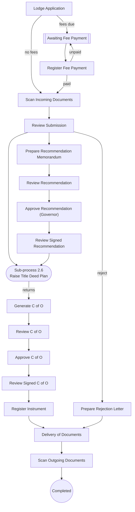

#### 2.5.11 PWOA - Power of Attorney

Purpose: Registration of a power of attorney over the property. Config `SubsequentRegistration/PowerOfAttorney.config`.

| Field | Value |
|---|---|
| Code / label | `PWOA` Power of Attorney (lr_transaction_metadata Id 38) |
| Group / jBPM process | Subsequent Registration (`SSG`) / **Subsequent Registration** |
| meta_type / action_type / right_type | 0 / 0 / right_type_occupancy |
| Durations (normal/lapsed/max, days) | 20 / 0 / 20 |
| RRR effect at completion | needs active **occupancy**; blocked by active representation; creates **representation**. Parties: source party = donor; target party = donee; source parties pre-filled from target of related RRR |
| Fees | Cashier fee lines: Application Fee (`feetype_app_C_APF`) |
| Non-withdrawable tasks | RegisterInstrument,DeliveryOfDocuments,ScanOutgoingDocuments |
| Complete / reject reports | sd_POA / - |
| Mandatory scanned outgoing docs | `sd_demandnotice`, `sd_payment_receipt` |
| Blocked while another transaction on the property is lodged/postponed | COMP, DCT, INSC, PWOA, RROC |
| Volume (all time) | 205: Active 63, Completed 132, Withdrawn 10, Postponed 0, Rejected 0; created as LRS 36, as past 169 |
| Lodge → complete (live, completed) | median 0 d (p25 0, p75 0, p90 0), n=2 |
| Age of open (Active) live files | median 684 d, n=25 |
| Cadastre jobs (lr_mc_job) / rejection records | 0 / 9 |

| # | Stage (jBPM task / config `stages`) | Role / unit (inferred) | Screens (wizard pages) | Checks & actions on Complete | Printed / produced | Next (transition) |
|---|---|---|---|---|---|---|
| 1 | `New,LodgmentApplication` | Lodgement desk (reception) | Transaction list › Applicants › Properties (RO, map) › Fee list › Print › Complete & assign | `validate: checkRegisterAlready,checkTransactionMetadata`<br>`CheckUnpaidFee:Scan Incoming Documents\|Awaiting Fee Payment` | LodgementLetter → `sd_lodgement_letter`<br>DemandNotice → `sd_demandnotice` | "Awaiting Fee Payment" if fees are due, else "Scan Incoming Documents" (`CheckUnpaidFee`) |
| 2 | `AwaitingFeePayment` | Wait state (applicant / Cashier) | Transaction + documents (RO) › Complete & assign | `UpdateSimpleCounterValue:receipt_number` |  | Register Fee Payment and Generate Receipt (Cashier commit, inferred) |
| 3 | `RegisterFeePaymentAndGenerateReceipt` | Accounts (fee) | Transaction + documents (RO) › Applicants (RO) › Properties (RO, map) › Demand notice › Print › Complete & assign | `payments must validate`<br>`CheckUnpaidFee:Scan Incoming Documents\|Awaiting Fee Payment` | FeePaymentVerificationReceipt → `sd_payment_receipt` | "Scan Incoming Documents"; "Awaiting Fee Payment" while unpaid |
| 4 | `ScanIncomingDocuments` | Scanning | Transaction + documents › Complete & assign | `UpdateSimpleCounterValue:demandnotice_number` |  | Review Submission (demand-notice no. allocated) |
| 5 | `ReviewSubmission` | Lands officer | Transaction + documents › Applicants (RO) › Properties (map) › Parties › Demand notice (RO) › Complete & assign |  |  | allowed: "Prepare Recommendation Memorandum"; reject branch (inferred)<br>excluded here: PWOA → Investigate Complaint,PWOA → Raise Title Deed Plan,PWOA → Register Instrument,PWOA → Survey Plan Checking and Approval,PWOA → Raise Site Analysis Report,PWOA → Generate Final Demand Notice,PWOA → Open New Property File and Assign Property Number,PWOA → Prepare Valuation Report |
| 6 | `PrepareRecommendationMemorandum` | Lands officer | Transaction + documents › Properties (RO, map) › Parties › RRR › Demand notice (RO) › Print › Complete & assign |  | RecommendationMemorandumMemo → `sd_recMemo_Com` | Review Recommendation |
| 7 | `ReviewRecommendation` | Director / Permanent Secretary | Transaction + documents (RO) › Properties (RO, map) › Parties (RO) › Demand notice (RO) › Complete & assign |  |  | allowed: "Approve Recommendation (Commissioner)"<br>excluded here: PWOA → Approve Recommendation (Governor) |
| 8 | `ApproveRecommendation(Commissioner)` | Commissioner | Transaction + documents (RO) › Properties (RO, map) › Parties (RO) › Demand notice (RO) › Complete & assign |  |  | Review Signed Recommendation (sign date mandatory) |
| 9 | `ReviewSignedRecommendation` | Lands officer | Transaction + documents (RO) › Properties (RO, map) › Parties (RO) › Demand notice (RO) › Complete & assign |  |  | allowed: "Register Instrument"<br>excluded here: PWOA → Raise Title Deed Plan,PWOA → Delivery of Documents |
| 10 | `RegisterInstrument` | Deeds registry | Transaction + documents (RO) › Properties (RO, map) › Parties (RO) › RRR › Demand notice (RO) › Register instrument (RO) › Properties (RO, map) › Print › Complete & assign | `mandatory: startDate`<br>`ApproveMCJob:Delivery of Documents\|job_deedplan_creation`<br>`AddOutgoingSupportingDocument:Delivery of Documents` | RegistrationMemorandumMemo → `sd_regist_memoMem` | "Delivery of Documents" (approves Deed Plan job if any; adds complete reports as outgoing docs) - **RRR effect applied here (inferred)** |
| 11 | `DeliveryOfDocuments` | Dispatch | Transaction + documents › Print › Complete & assign |  | DeliveryLetter → `sd_delivery_letter` | Scan Outgoing Documents |
| 12 | `ScanOutgoingDocuments` | Scanning | Transaction + documents › Complete & assign | `CheckUnscannedDocuments`<br>`SaveGroundRentData` | scan-out: `sd_demandnotice`, `sd_payment_receipt` | end - completed |
| 13 | `PrepareRejectionLetter` | Lands officer | Transaction + documents (RO) › Rejection reasons › Print › Complete & assign | `RejectMCJob:Delivery of Documents\|job_deedplan_creation`<br>`AddOutgoingSupportingDocument:Delivery of Documents` | RejectionLetter → `sd_reject_letter` | "Delivery of Documents" (rejects Deed Plan job) |

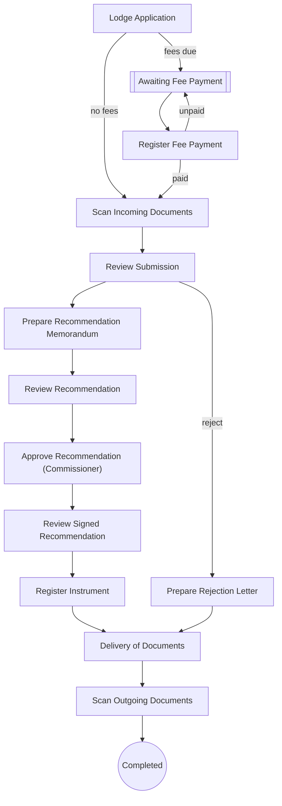

#### 2.5.12 CHNT - Change of Name on Title

Purpose: Change of the holder's name on the title; C of O re-issued. Config `SubsequentRegistration/ChangeOfNameOnTitle.config`.

| Field | Value |
|---|---|
| Code / label | `CHNT` Change of Name on Title (lr_transaction_metadata Id 9) |
| Group / jBPM process | Subsequent Registration (`SSG`) / **Subsequent Registration** |
| meta_type / action_type / right_type | 0 / 99 / right_type_occupancy |
| Durations (normal/lapsed/max, days) | 20 / 0 / 20 |
| RRR effect at completion | needs active **occupancy**; blocked by active mortgage or caveat or lease or sublease; modifies **occupancy**. Parties: target party = grantee; target parties pre-filled from target of related RRR |
| Fees | Cashier fee lines: Application Form Fee (`feetype_apff_C_APFF`), Processing Fee for Change of Name on Title (`feetype_PFCNT_C_PFCNT`), TDP Fee (`feetype_tdp_C_TDPF`), Issuance Fee For C of O (`feetype_IFCO_C_IFCO`), Outstanding Ground Rent (`feetype_groundrent_C_GR`), Ground Rent Penalty (`feetype_groundrentpenalty_C_GRP`), Registration of C of O Fee (`feetype_RCOF_C_RCOF`) |
| Non-withdrawable tasks | RegisterInstrument,DeliveryOfDocuments,ScanOutgoingDocuments |
| Complete / reject reports | sd_Co_title / sd_reject_letter |
| Mandatory scanned outgoing docs | `sd_demandnotice`, `sd_Co_title`, `sd_payment_receipt`, `sd_regist_memoMem` |
| Blocked while another transaction on the property is lodged/postponed | APCO, APRO, APSL, ASSI, CHNT, COMP, CONT, DCT, INSC, RLEA, RMOR, RROC, RSUB, UPMO |
| Volume (all time) | 31: Active 8, Completed 19, Withdrawn 4, Postponed 0, Rejected 0; created as LRS 9, as past 22 |
| Lodge → complete (live, completed) | median 84 d (p25 49, p75 570, p90 570), n=4 |
| Age of open (Active) live files | median 828 d, n=1 |
| Cadastre jobs (lr_mc_job) / rejection records | 3 / 4 |

| # | Stage (jBPM task / config `stages`) | Role / unit (inferred) | Screens (wizard pages) | Checks & actions on Complete | Printed / produced | Next (transition) |
|---|---|---|---|---|---|---|
| 1 | `New,LodgmentApplication` | Lodgement desk (reception) | Transaction list › Applicants › Properties (RO, map) › Outstanding ground rent › Fee list › Print › Complete & assign | `validate: checkRegisterAlready,checkTransactionMetadata`<br>`CheckUnpaidFee:Scan Incoming Documents\|Awaiting Fee Payment` | LodgementLetter → `sd_lodgement_letter`<br>DemandNotice → `sd_demandnotice` | "Awaiting Fee Payment" if fees are due, else "Scan Incoming Documents" (`CheckUnpaidFee`) |
| 2 | `AwaitingFeePayment` | Wait state (applicant / Cashier) | Transaction + documents (RO) › Complete & assign | `UpdateSimpleCounterValue:receipt_number` |  | Register Fee Payment and Generate Receipt (Cashier commit, inferred) |
| 3 | `RegisterFeePaymentAndGenerateReceipt` | Accounts (fee) | Transaction + documents (RO) › Applicants (RO) › Properties (RO, map) › Demand notice › Print › Complete & assign | `payments must validate`<br>`CheckUnpaidFee:Scan Incoming Documents\|Awaiting Fee Payment` | FeePaymentVerificationReceipt → `sd_payment_receipt` | "Scan Incoming Documents"; "Awaiting Fee Payment" while unpaid |
| 4 | `ScanIncomingDocuments` | Scanning | Transaction + documents › Complete & assign | `UpdateSimpleCounterValue:demandnotice_number` |  | Review Submission (demand-notice no. allocated) |
| 5 | `ReviewSubmission` | Lands officer | Transaction + documents › Applicants (RO) › Properties (map) › Parties › Demand notice (RO) › Complete & assign |  |  | allowed: "Prepare Recommendation Memorandum", "Raise Title Deed Plan"; reject branch (inferred)<br>excluded here: CHNT → Prepare Valuation Report,CHNT → Generate Final Demand Notice,CHNT → Investigate Complaint,CHNT → Open New Property File and Assign Property Number,CHNT → Raise Site Analysis Report,CHNT → Survey Plan Checking and Approval,CHNT → Register Instrument |
| 6 | `PrepareRecommendationMemorandum` | Lands officer | Transaction + documents › Properties (RO, map) › Parties › RRR › Demand notice (RO) › Print › Complete & assign |  | RecommendationMemorandumMemo → `sd_recMemo_Com` | Review Recommendation |
| 7 | `ReviewRecommendation` | Director / Permanent Secretary | Transaction + documents (RO) › Properties (RO, map) › Parties (RO) › Demand notice (RO) › Complete & assign |  |  | allowed: "Approve Recommendation (Commissioner)"<br>excluded here: CHNT → Approve Recommendation (Governor) |
| 8 | `ApproveRecommendation(Commissioner)` | Commissioner | Transaction + documents (RO) › Properties (RO, map) › Parties (RO) › Demand notice (RO) › Complete & assign | `mandatory: signDate` |  | Review Signed Recommendation (sign date mandatory) |
| 9 | `ReviewSignedRecommendation` | Lands officer | Transaction + documents (RO) › Properties (RO, map) › Parties (RO) › Demand notice (RO) › Complete & assign |  |  | allowed: "Raise Title Deed Plan"<br>excluded here: CHNT → Register Instrument,CHNT → Delivery of Documents |
| 10 | `GenerateCofO` | C of O unit | Transaction + documents (RO) › Properties (RO, map) › Parties (RO) › RRR › Demand notice (RO) › Print (per property) › Complete & assign | `mandatory: securityNumber1,securityNumber2` | CertificateOfOccupancyTitle → `sd_Co_title` | Review C of O (reached after Raise Title Deed Plan returns, inferred) |
| 11 | `ReviewCofO` | C of O unit | Transaction + documents (RO) › Properties (RO, map) › Parties (RO) › Demand notice (RO) › Complete & assign |  |  | Approve C of O |
| 12 | `ApproveCofO` | Approving authority (signs C of O) | Transaction + documents › Properties (RO, map) › Parties (RO) › Demand notice (RO) › Complete & assign | `mandatory: signDate` |  | Review Signed C of O |
| 13 | `ReviewSignedCofO` | C of O unit | Transaction + documents (RO) › Properties (RO, map) › Parties (RO) › Demand notice (RO) › Complete & assign |  |  | Register Instrument |
| 14 | `RegisterInstrument` | Deeds registry | Transaction + documents (RO) › Properties (RO, map) › Parties (RO) › RRR › Demand notice (RO) › Register instrument (RO) › Properties (RO, map) › Print › Complete & assign | `ApproveMCJob:Delivery of Documents\|job_deedplan_creation`<br>`AddOutgoingSupportingDocument:Delivery of Documents` | RegistrationMemorandumMemo → `sd_regist_memoMem` | "Delivery of Documents" (approves Deed Plan job if any; adds complete reports as outgoing docs) - **RRR effect applied here (inferred)** |
| 15 | `DeliveryOfDocuments` | Dispatch | Transaction + documents › Print › Complete & assign |  | DeliveryLetter → `sd_delivery_letter` | Scan Outgoing Documents |
| 16 | `ScanOutgoingDocuments` | Scanning | Transaction + documents › Complete & assign | `CheckUnscannedDocuments`<br>`SaveGroundRentData` | scan-out: `sd_demandnotice`, `sd_Co_title`, `sd_payment_receipt`, `sd_regist_memoMem` | end - completed |
| 17 | `PrepareRejectionLetter` | Lands officer | Transaction + documents (RO) › Rejection reasons › Print › Complete & assign | `RejectMCJob:Delivery of Documents\|job_deedplan_creation`<br>`AddOutgoingSupportingDocument:Delivery of Documents` | RejectionLetter → `sd_reject_letter` | "Delivery of Documents" (rejects Deed Plan job) |


#### 2.5.13 SUBL - Sublease

Purpose: Sublease over the property. Config `SubsequentRegistration/Sublease.config`.

| Field | Value |
|---|---|
| Code / label | `SUBL` Sublease (lr_transaction_metadata Id 26) |
| Group / jBPM process | Subsequent Registration (`SSG`) / **Subsequent Registration** |
| meta_type / action_type / right_type | 0 / 0 / right_type_occupancy |
| Durations (normal/lapsed/max, days) | 20 / 0 / 20 |
| RRR effect at completion | needs active **occupancy**; blocked by active caveat; creates **sublease**. Parties: source party = lessor; target party = lessee; source parties pre-filled from target of related RRR |
| Fees | Cashier fee lines: Application Fee (`feetype_app_C_APF`), Processing Fee for Sub Lease (`feetype_PFSL_C_PFSL`) |
| Non-withdrawable tasks | RegisterInstrument,DeliveryOfDocuments,ScanOutgoingDocuments |
| Complete / reject reports | - / sd_reject_letter |
| Mandatory scanned outgoing docs | `sd_demandnotice`, `sd_recMemo_Com`, `sd_payment_receipt`, `sd_regist_memoMem` |
| Blocked while another transaction on the property is lodged/postponed | ABWG, APRF, APRO, APSL, ASSI, CEMP, CHPC, COMP, CONT, DCT, DEVO, EXTT, INSC, LEAS, LOCE, MERT, MORT, PSUR, RAOL, RCOO, REGR, RLEA, RMOR, RROC, RSUB, SUBD, SUBL, SURO, UPMO |
| Volume (all time) | 205: Active 96, Completed 107, Withdrawn 0, Postponed 2, Rejected 0; created as LRS 0, as past 205 |
| Cadastre jobs (lr_mc_job) / rejection records | 0 / 0 |

| # | Stage (jBPM task / config `stages`) | Role / unit (inferred) | Screens (wizard pages) | Checks & actions on Complete | Printed / produced | Next (transition) |
|---|---|---|---|---|---|---|
| 1 | `New,LodgmentApplication` | Lodgement desk (reception) | Transaction list › Applicants › Properties (RO, map) › Outstanding ground rent › Fee list › Print › Complete & assign | `validate: checkRegisterAlready,checkTransactionMetadata`<br>`CheckUnpaidFee:Scan Incoming Documents\|Awaiting Fee Payment` | LodgementLetter → `sd_lodgement_letter`<br>DemandNotice → `sd_demandnotice` | "Awaiting Fee Payment" if fees are due, else "Scan Incoming Documents" (`CheckUnpaidFee`) |
| 2 | `AwaitingFeePayment` | Wait state (applicant / Cashier) | Transaction + documents (RO) › Complete & assign | `UpdateSimpleCounterValue:receipt_number` |  | Register Fee Payment and Generate Receipt (Cashier commit, inferred) |
| 3 | `RegisterFeePaymentAndGenerateReceipt` | Accounts (fee) | Transaction + documents (RO) › Applicants (RO) › Properties (RO, map) › Demand notice › Print › Complete & assign | `payments must validate`<br>`CheckUnpaidFee:Scan Incoming Documents\|Awaiting Fee Payment` | FeePaymentVerificationReceipt → `sd_payment_receipt` | "Scan Incoming Documents"; "Awaiting Fee Payment" while unpaid |
| 4 | `ScanIncomingDocuments` | Scanning | Transaction + documents › Complete & assign | `UpdateSimpleCounterValue:demandnotice_number` |  | Review Submission (demand-notice no. allocated) |
| 5 | `ReviewSubmission` | Lands officer | Transaction + documents › Applicants (RO) › Properties (map) › Parties › Demand notice (RO) › Complete & assign |  |  | allowed: "Prepare Recommendation Memorandum"; reject branch (inferred)<br>excluded here: SUBL → Prepare Valuation Report,SUBL → Generate Final Demand Notice,SUBL → Investigate Complaint,SUBL → Open New Property File and Assign Property Number,SUBL → Raise Site Analysis Report,SUBL → Survey Plan Checking and Approval,SUBL → Raise Title Deed Plan,SUBL → Register Instrument |
| 6 | `PrepareRecommendationMemorandum` | Lands officer | Transaction + documents › Properties (RO, map) › Parties (RO) › RRR › Demand notice (RO) › Print › Complete & assign | `mandatory: expirationDate,consideration,considerationCurrency` | RecommendationMemorandumMemo → `sd_recMemo_Com` | Review Recommendation |
| 7 | `ReviewRecommendation` | Director / Permanent Secretary | Transaction + documents (RO) › Properties (RO, map) › Parties (RO) › Demand notice (RO) › Complete & assign |  |  | allowed: "Approve Recommendation (Commissioner)"<br>excluded here: SUBL → Approve Recommendation (Governor) |
| 8 | `ApproveRecommendation(Commissioner)` | Commissioner | Transaction + documents (RO) › Properties (RO, map) › Parties (RO) › Demand notice (RO) › Complete & assign | `mandatory: signDate` |  | Review Signed Recommendation (sign date mandatory) |
| 9 | `ReviewSignedRecommendation` | Lands officer | Transaction + documents (RO) › Properties (RO, map) › Parties (RO) › Demand notice (RO) › Complete & assign |  |  | allowed: "Register Instrument"<br>excluded here: SUBL → Raise Title Deed Plan,SUBL → Delivery of Documents |
| 10 | `RegisterInstrument` | Deeds registry | Transaction + documents (RO) › Properties (RO, map) › Parties (RO) › RRR › Demand notice (RO) › Register instrument (RO) › Properties (RO, map) › Print › Complete & assign | `mandatory: startDate`<br>`ApproveMCJob:Delivery of Documents\|job_deedplan_creation`<br>`AddOutgoingSupportingDocument:Delivery of Documents` | RegistrationMemorandumMemo → `sd_regist_memoMem` | "Delivery of Documents" (approves Deed Plan job if any; adds complete reports as outgoing docs) - **RRR effect applied here (inferred)** |
| 11 | `DeliveryOfDocuments` | Dispatch | Transaction + documents › Print › Complete & assign |  | DeliveryLetter → `sd_delivery_letter` | Scan Outgoing Documents |
| 12 | `ScanOutgoingDocuments` | Scanning | Transaction + documents › Complete & assign | `CheckUnscannedDocuments`<br>`SaveGroundRentData` | scan-out: `sd_demandnotice`, `sd_recMemo_Com`, `sd_payment_receipt`, `sd_regist_memoMem` | end - completed |
| 13 | `PrepareRejectionLetter` | Lands officer | Transaction + documents (RO) › Rejection reasons › Print › Complete & assign | `RejectMCJob:Delivery of Documents\|job_deedplan_creation`<br>`AddOutgoingSupportingDocument:Delivery of Documents` | RejectionLetter → `sd_reject_letter` | "Delivery of Documents" (rejects Deed Plan job) |


#### 2.5.14 CEMP - Caveat Emptor

Purpose: Registers a caveat emptor (warning) on the property. Config `SubsequentRegistration/CaveatEmptor.config`.

| Field | Value |
|---|---|
| Code / label | `CEMP` Caveat Emptor (lr_transaction_metadata Id 8) |
| Group / jBPM process | Subsequent Registration (`SSG`) / **Subsequent Registration** |
| meta_type / action_type / right_type | 0 / 0 / right_type_occupancy |
| Durations (normal/lapsed/max, days) | 20 / 0 / 20 |
| RRR effect at completion | needs active **occupancy**; creates **caveat**. Parties: target party = caveator |
| Fees | Cashier fee lines: Application Form Fee (`feetype_apff_C_APFF`), Registration Fee of Caveat Emptor (`feetype_RFCE_C_RFCE`) |
| Non-withdrawable tasks | RegisterInstrument,DeliveryOfDocuments,ScanOutgoingDocuments |
| Complete / reject reports | - / sd_reject_letter |
| Mandatory scanned outgoing docs | `sd_regist_memoMem` |
| Blocked while another transaction on the property is lodged/postponed | APRO, APSL, CEMP, COMP, DCT, INSC, RLEA, RMOR, RROC, RSUB |
| Volume (all time) | 22: Active 18, Completed 1, Withdrawn 3, Postponed 0, Rejected 0; created as LRS 21, as past 1 |
| Age of open (Active) live files | median 509 d, n=18 |
| Cadastre jobs (lr_mc_job) / rejection records | 0 / 4 |

| # | Stage (jBPM task / config `stages`) | Role / unit (inferred) | Screens (wizard pages) | Checks & actions on Complete | Printed / produced | Next (transition) |
|---|---|---|---|---|---|---|
| 1 | `New,LodgmentApplication` | Lodgement desk (reception) | Transaction list › Applicants › Properties (RO, map) › Outstanding ground rent › Fee list › Print › Complete & assign | `validate: checkRegisterAlready,checkTransactionMetadata`<br>`CheckUnpaidFee:Scan Incoming Documents\|Awaiting Fee Payment` | LodgementLetter → `sd_lodgement_letter`<br>DemandNotice → `sd_demandnotice` | "Awaiting Fee Payment" if fees are due, else "Scan Incoming Documents" (`CheckUnpaidFee`) |
| 2 | `AwaitingFeePayment` | Wait state (applicant / Cashier) | Transaction + documents (RO) › Complete & assign | `UpdateSimpleCounterValue:receipt_number` |  | Register Fee Payment and Generate Receipt (Cashier commit, inferred) |
| 3 | `RegisterFeePaymentAndGenerateReceipt` | Accounts (fee) | Transaction + documents (RO) › Applicants (RO) › Properties (RO, map) › Demand notice › Print › Complete & assign | `payments must validate`<br>`CheckUnpaidFee:Scan Incoming Documents\|Awaiting Fee Payment` | FeePaymentVerificationReceipt → `sd_payment_receipt` | "Scan Incoming Documents"; "Awaiting Fee Payment" while unpaid |
| 4 | `ScanIncomingDocuments` | Scanning | Transaction + documents › Complete & assign | `UpdateSimpleCounterValue:demandnotice_number` |  | Review Submission (demand-notice no. allocated) |
| 5 | `ReviewSubmission` | Lands officer | Transaction + documents › Applicants (RO) › Properties (map) › Parties › Demand notice (RO) › Complete & assign |  |  | allowed: "Prepare Recommendation Memorandum"; reject branch (inferred)<br>excluded here: CEMP → Prepare Valuation Report,CEMP → Generate Final Demand Notice,CEMP → Investigate Complaint,CEMP → Open New Property File and Assign Property Number,CEMP → Raise Site Analysis Report,CEMP → Survey Plan Checking and Approval,CEMP → Raise Title Deed Plan,CEMP → Register Instrument |
| 6 | `PrepareRecommendationMemorandum` | Lands officer | Transaction + documents › Properties (RO, map) › Parties (RO) › RRR › Demand notice (RO) › Print › Complete & assign |  | RecommendationMemorandumMemo → `sd_recMemo_Com` | Review Recommendation |
| 7 | `ReviewRecommendation` | Director / Permanent Secretary | Transaction + documents (RO) › Properties (RO, map) › Parties (RO) › Demand notice (RO) › Complete & assign |  |  | allowed: "Approve Recommendation (Commissioner)"<br>excluded here: CEMP → Approve Recommendation (Governor) |
| 8 | `ApproveRecommendation(Commissioner)` | Commissioner | Transaction + documents (RO) › Properties (RO, map) › Parties (RO) › Demand notice (RO) › Complete & assign | `mandatory: signDate` |  | Review Signed Recommendation (sign date mandatory) |
| 9 | `ReviewSignedRecommendation` | Lands officer | Transaction + documents (RO) › Properties (RO, map) › Parties (RO) › Demand notice (RO) › Complete & assign |  |  | allowed: "Register Instrument"<br>excluded here: CEMP → Raise Title Deed Plan,CEMP → Delivery of Documents |
| 10 | `RegisterInstrument` | Deeds registry | Transaction + documents (RO) › Properties (RO, map) › Parties (RO) › RRR › Demand notice (RO) › Register instrument (RO) › Properties (RO, map) › Print › Complete & assign | `mandatory: startDate`<br>`ApproveMCJob:Delivery of Documents\|job_deedplan_creation`<br>`AddOutgoingSupportingDocument:Delivery of Documents` | RegistrationMemorandumMemo → `sd_regist_memoMem` | "Delivery of Documents" (approves Deed Plan job if any; adds complete reports as outgoing docs) - **RRR effect applied here (inferred)** |
| 11 | `DeliveryOfDocuments` | Dispatch | Transaction + documents › Print › Complete & assign |  | DeliveryLetter → `sd_delivery_letter` | Scan Outgoing Documents |
| 12 | `ScanOutgoingDocuments` | Scanning | Transaction + documents › Complete & assign | `CheckUnscannedDocuments`<br>`SaveGroundRentData` | scan-out: `sd_regist_memoMem` | end - completed |
| 13 | `PrepareRejectionLetter` | Lands officer | Transaction + documents (RO) › Rejection reasons › Print › Complete & assign | `RejectMCJob:Delivery of Documents\|job_deedplan_creation`<br>`AddOutgoingSupportingDocument:Delivery of Documents` | RejectionLetter → `sd_reject_letter` | "Delivery of Documents" (rejects Deed Plan job) |


#### 2.5.15 RCOO - Revocation of Certificate of Occupancy

Purpose: Revocation of a C of O (Governor approval); discharges all rights. No fees. Config `SubsequentRegistration/RevocationOfCertificationOfOccupancy.config`.

| Field | Value |
|---|---|
| Code / label | `RCOO` Revocation of Certificate of Occupancy (lr_transaction_metadata Id 31) |
| Group / jBPM process | Subsequent Registration (`SSG`) / **Subsequent Registration** |
| meta_type / action_type / right_type | 0 / 1 / right_type_occupancy |
| Durations (normal/lapsed/max, days) | 20 / 0 / 20 |
| RRR effect at completion | needs active **occupancy**; discharges **occupancy, consent_assign, consent_mortgage, caveat, lease, sublease, mortgage** |
| Fees | Cashier fee lines: Processing Fee (`feetype_PFROFO_C_PFROFO`) |
| Non-withdrawable tasks | RegisterInstrument,DeliveryOfDocuments,ScanOutgoingDocuments |
| Complete / reject reports | - / sd_reject_letter |
| Mandatory scanned outgoing docs | `sd_recMemo_Gov`, `sd_regist_memoMem` |
| Blocked while another transaction on the property is lodged/postponed | ABWG, APRF, APRO, APSL, ASSI, CEMP, CHPC, COMP, CONT, DCT, DEVO, EXTT, INSC, LEAS, LOCE, MERT, MORT, PSUR, RAOL, RCOO, REGR, RLEA, RMOR, RROC, RSUB, SUBD, SUBL, SURO, UPMO |
| Volume (all time) | 29: Active 21, Completed 6, Withdrawn 2, Postponed 0, Rejected 0; created as LRS 1, as past 28 |
| Age of open (Active) live files | median 2223 d, n=1 |
| Cadastre jobs (lr_mc_job) / rejection records | 0 / 0 |

| # | Stage (jBPM task / config `stages`) | Role / unit (inferred) | Screens (wizard pages) | Checks & actions on Complete | Printed / produced | Next (transition) |
|---|---|---|---|---|---|---|
| 1 | `New,LodgmentApplication` | Lodgement desk (reception) | Transaction list › Applicants › Properties (RO, map) › Outstanding ground rent › Fee list › Print › Complete & assign | `validate: checkRegisterAlready,checkTransactionMetadata`<br>`CheckUnpaidFee:Scan Incoming Documents\|Awaiting Fee Payment` | LodgementLetter → `sd_lodgement_letter`<br>DemandNotice → `sd_demandnotice` | Scan Incoming Documents (fee transitions hidden: `HideFeeComputation`) |
| 2 | `AwaitingFeePayment` | Wait state (applicant / Cashier) | Transaction + documents (RO) › Complete & assign | `UpdateSimpleCounterValue:receipt_number` |  |  |
| 3 | `RegisterFeePaymentAndGenerateReceipt` | Accounts (fee) | Transaction + documents (RO) › Applicants (RO) › Properties (RO, map) › Demand notice › Print › Complete & assign | `payments must validate`<br>`CheckUnpaidFee:Scan Incoming Documents\|Awaiting Fee Payment` | FeePaymentVerificationReceipt → `sd_payment_receipt` |  |
| 4 | `ScanIncomingDocuments` | Scanning | Transaction + documents › Complete & assign | `UpdateSimpleCounterValue:demandnotice_number` |  | Review Submission (demand-notice no. allocated) |
| 5 | `ReviewSubmission` | Lands officer | Transaction + documents › Applicants (RO) › Properties (map) › Demand notice (RO) › Complete & assign |  |  | allowed: "Prepare Recommendation Memorandum"; reject branch (inferred)<br>excluded here: RCOO → Prepare Valuation Report,RCOO → Generate Final Demand Notice,RCOO → Investigate Complaint,RCOO → Open New Property File and Assign Property Number,RCOO → Raise Site Analysis Report,RCOO → Survey Plan Checking and Approval,RCOO → Raise Title Deed Plan,RCOO → Register Instrument |
| 6 | `PrepareRecommendationMemorandum` | Lands officer | Transaction + documents › Properties (RO, map) › Demand notice (RO) › Print › Complete & assign |  | RecommendationMemorandumMemo → `sd_recMemo_Gov` | Review Recommendation |
| 7 | `ReviewRecommendation` | Director / Permanent Secretary | Transaction + documents (RO) › Properties (RO, map) › Demand notice (RO) › Complete & assign |  |  | allowed: "Approve Recommendation (Governor)"<br>excluded here: RCOO → Approve Recommendation (Commissioner) |
| 8 | `ApproveRecommendation(Governor)` | Governor | Transaction + documents (RO) › Properties (RO, map) › Demand notice (RO) › Complete & assign | `mandatory: signDate` |  | Review Signed Recommendation (sign date mandatory) |
| 9 | `ReviewSignedRecommendation` | Lands officer | Transaction + documents (RO) › Properties (RO, map) › Demand notice (RO) › Complete & assign |  |  | allowed: "Register Instrument"<br>excluded here: RCOO → Raise Title Deed Plan,RCOO → Delivery of Documents |
| 10 | `RegisterInstrument` | Deeds registry | Transaction + documents (RO) › Properties (RO, map) › Demand notice (RO) › Register instrument (RO) › Properties (RO, map) › Print › Complete & assign | `ApproveMCJob:Delivery of Documents\|job_deedplan_creation`<br>`AddOutgoingSupportingDocument:Delivery of Documents` | RegistrationMemorandumMemo → `sd_regist_memoMem` | "Delivery of Documents" (approves Deed Plan job if any; adds complete reports as outgoing docs) - **RRR effect applied here (inferred)** |
| 11 | `DeliveryOfDocuments` | Dispatch | Transaction + documents › Print › Complete & assign |  | DeliveryLetter → `sd_delivery_letter` | Scan Outgoing Documents |
| 12 | `ScanOutgoingDocuments` | Scanning | Transaction + documents › Complete & assign | `CheckUnscannedDocuments`<br>`SaveGroundRentData` | scan-out: `sd_recMemo_Gov`, `sd_regist_memoMem` | end - completed |
| 13 | `PrepareRejectionLetter` | Lands officer | Transaction + documents (RO) › Rejection reasons › Print › Complete & assign | `RejectMCJob:Delivery of Documents\|job_deedplan_creation`<br>`AddOutgoingSupportingDocument:Delivery of Documents` | RejectionLetter → `sd_reject_letter` | "Delivery of Documents" (rejects Deed Plan job) |

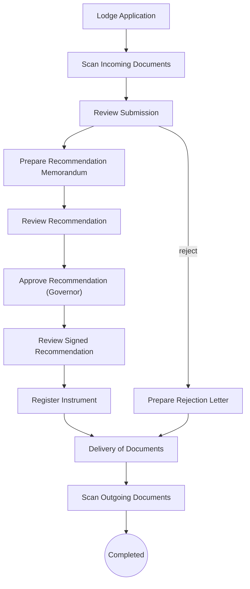

#### 2.5.16 RROC - Revocation of Right of Occupancy

Purpose: Revocation of a Right of Occupancy; discharges all rights. No fees. Config `SubsequentRegistration/RevocationOfRightOfOccupancy.config`.

| Field | Value |
|---|---|
| Code / label | `RROC` Revocation of Right of Occupancy (lr_transaction_metadata Id 29) |
| Group / jBPM process | Subsequent Registration (`SSG`) / **Subsequent Registration** |
| meta_type / action_type / right_type | 0 / 0 / right_type_occupancy |
| Durations (normal/lapsed/max, days) | 20 / 0 / 20 |
| RRR effect at completion | needs active **occupancy**; discharges **occupancy, consent_assign, consent_mortgage, caveat, lease, sublease, mortgage** |
| Fees | none configured |
| Non-withdrawable tasks | RegisterInstrument,DeliveryOfDocuments,ScanOutgoingDocuments |
| Complete / reject reports | - / sd_reject_letter |
| Mandatory scanned outgoing docs | - |
| Blocked while another transaction on the property is lodged/postponed | DCT |
| Volume (all time) | 26: Active 20, Completed 6, Withdrawn 0, Postponed 0, Rejected 0; created as LRS 0, as past 26 |
| Cadastre jobs (lr_mc_job) / rejection records | 0 / 0 |

| # | Stage (jBPM task / config `stages`) | Role / unit (inferred) | Screens (wizard pages) | Checks & actions on Complete | Printed / produced | Next (transition) |
|---|---|---|---|---|---|---|
| 1 | `New,LodgmentApplication` | Lodgement desk (reception) | Transaction list › Applicants › Properties (RO, map) › Outstanding ground rent › Fee list › Print › Complete & assign | `validate: checkRegisterAlready,checkTransactionMetadata`<br>`CheckUnpaidFee:Scan Incoming Documents\|Awaiting Fee Payment` | LodgementLetter → `sd_lodgement_letter`<br>DemandNotice → `sd_demandnotice` | Scan Incoming Documents (fee transitions hidden: `HideFeeComputation`) |
| 2 | `AwaitingFeePayment` | Wait state (applicant / Cashier) | Transaction + documents (RO) › Complete & assign | `UpdateSimpleCounterValue:receipt_number` |  |  |
| 3 | `RegisterFeePaymentAndGenerateReceipt` | Accounts (fee) | Transaction + documents (RO) › Applicants (RO) › Properties (RO, map) › Demand notice › Print › Complete & assign | `payments must validate`<br>`CheckUnpaidFee:Scan Incoming Documents\|Awaiting Fee Payment` | FeePaymentVerificationReceipt → `sd_payment_receipt` |  |
| 4 | `ScanIncomingDocuments` | Scanning | Transaction + documents › Complete & assign | `UpdateSimpleCounterValue:demandnotice_number` |  | Review Submission (demand-notice no. allocated) |
| 5 | `ReviewSubmission` | Lands officer | Transaction + documents › Applicants (RO) › Properties (map) › Demand notice (RO) › Complete & assign |  |  | allowed: "Prepare Recommendation Memorandum"; reject branch (inferred)<br>excluded here: RROC → Prepare Valuation Report,RROC → Generate Final Demand Notice,RROC → Investigate Complaint,RROC → Open New Property File and Assign Property Number,RROC → Raise Site Analysis Report,RROC → Survey Plan Checking and Approval,RROC → Raise Title Deed Plan,RROC → Register Instrument |
| 6 | `PrepareRecommendationMemorandum` | Lands officer | Transaction + documents › Properties (RO, map) › Demand notice (RO) › Print › Complete & assign |  | RecommendationMemorandumMemo → `sd_recMemo_Com` | Review Recommendation |
| 7 | `ReviewRecommendation` | Director / Permanent Secretary | Transaction + documents (RO) › Properties (RO, map) › Demand notice (RO) › Complete & assign |  |  | allowed: "Approve Recommendation (Commissioner)"<br>excluded here: RROC → Approve Recommendation (Governor) |
| 8 | `ApproveRecommendation(Commissioner)` | Commissioner | Transaction + documents (RO) › Properties (RO, map) › Demand notice (RO) › Complete & assign | `mandatory: signDate` |  | Review Signed Recommendation (sign date mandatory) |
| 9 | `ReviewSignedRecommendation` | Lands officer | Transaction + documents (RO) › Properties (RO, map) › Demand notice (RO) › Complete & assign |  |  | allowed: "Register Instrument"<br>excluded here: RROC → Raise Title Deed Plan,RROC → Delivery of Documents |
| 10 | `RegisterInstrument` | Deeds registry | Transaction + documents (RO) › Properties (RO, map) › Demand notice (RO) › Register instrument (RO) › Properties (RO, map) › Print › Complete & assign | `ApproveMCJob:Delivery of Documents\|job_deedplan_creation`<br>`AddOutgoingSupportingDocument:Delivery of Documents` | RegistrationMemorandumMemo → `sd_regist_memoMem` | "Delivery of Documents" (approves Deed Plan job if any; adds complete reports as outgoing docs) - **RRR effect applied here (inferred)** |
| 11 | `DeliveryOfDocuments` | Dispatch | Transaction + documents › Print › Complete & assign |  | DeliveryLetter → `sd_delivery_letter` | Scan Outgoing Documents |
| 12 | `ScanOutgoingDocuments` | Scanning | Transaction + documents › Complete & assign | `CheckUnscannedDocuments`<br>`SaveGroundRentData` |  | end - completed |
| 13 | `PrepareRejectionLetter` | Lands officer | Transaction + documents (RO) › Rejection reasons › Print › Complete & assign | `RejectMCJob:Delivery of Documents\|job_deedplan_creation`<br>`AddOutgoingSupportingDocument:Delivery of Documents` | RejectionLetter → `sd_reject_letter` | "Delivery of Documents" (rejects Deed Plan job) |

```mermaid
flowchart TD
  L["Lodge Application"]
  SI["Scan Incoming Documents"]
  RS["Review Submission"]
  PR["Prepare Recommendation Memorandum"]
  RJ["Prepare Rejection Letter"]
  RR["Review Recommendation"]
  AC["Approve Recommendation (Commissioner)"]
  SR["Review Signed Recommendation"]
  RI["Register Instrument"]
  DD["Delivery of Documents"]
  SO["Scan Outgoing Documents"]
  DONE((Completed))
  L --> SI
  SI --> RS
  RS --> PR
  RS -->|reject| RJ
  PR --> RR
  RR --> AC
  AC --> SR
  SR --> RI
  RI --> DD
  DD --> SO
  SO --> DONE
  RJ --> DD
```

#### 2.5.17 SURO - Surrender of Right of Occupancy

Purpose: Surrender of the Right of Occupancy (Governor approval); discharges it. No fees. Config `SubsequentRegistration/SurrenderOfRightOfOccupancy.config`.

| Field | Value |
|---|---|
| Code / label | `SURO` Surrender of Right of Occupancy (lr_transaction_metadata Id 27) |
| Group / jBPM process | Subsequent Registration (`SSG`) / **Subsequent Registration** |
| meta_type / action_type / right_type | 0 / 1 / right_type_occupancy |
| Durations (normal/lapsed/max, days) | 20 / 0 / 20 |
| RRR effect at completion | needs active **occupancy**; blocked by active mortgage or caveat or lease or sublease; discharges **occupancy** |
| Fees | Cashier fee lines: Registration Fee (`feetype_RF_C_RF`) |
| Non-withdrawable tasks | RegisterInstrument,DeliveryOfDocuments,ScanOutgoingDocuments |
| Complete / reject reports | - / sd_reject_letter |
| Mandatory scanned outgoing docs | `sd_recMemo_Gov`, `sd_regist_memoMem` |
| Blocked while another transaction on the property is lodged/postponed | ABWG, APRF, APRO, APSL, ASSI, CEMP, CHNT, CHPC, COMP, CONT, DCT, DEVO, EXTT, INSC, LEAS, LOCE, MERT, MORT, PSUR, RAOL, RCOO, REGR, RLEA, RMOR, RROC, RSUB, SUBD, SUBL, SURO, UPMO |
| Volume (all time) | 22: Active 11, Completed 10, Withdrawn 1, Postponed 0, Rejected 0; created as LRS 1, as past 21 |
| Cadastre jobs (lr_mc_job) / rejection records | 0 / 1 |

| # | Stage (jBPM task / config `stages`) | Role / unit (inferred) | Screens (wizard pages) | Checks & actions on Complete | Printed / produced | Next (transition) |
|---|---|---|---|---|---|---|
| 1 | `New,LodgmentApplication` | Lodgement desk (reception) | Transaction list › Applicants › Properties (RO, map) › Outstanding ground rent › Fee list › Print › Complete & assign | `validate: checkRegisterAlready,checkTransactionMetadata`<br>`CheckUnpaidFee:Scan Incoming Documents\|Awaiting Fee Payment` | LodgementLetter → `sd_lodgement_letter`<br>DemandNotice → `sd_demandnotice` | Scan Incoming Documents (fee transitions hidden: `HideFeeComputation`) |
| 2 | `AwaitingFeePayment` | Wait state (applicant / Cashier) | Transaction + documents (RO) › Complete & assign | `UpdateSimpleCounterValue:receipt_number` |  |  |
| 3 | `RegisterFeePaymentAndGenerateReceipt` | Accounts (fee) | Transaction + documents (RO) › Applicants (RO) › Properties (RO, map) › Demand notice › Print › Complete & assign | `payments must validate`<br>`CheckUnpaidFee:Scan Incoming Documents\|Awaiting Fee Payment` | FeePaymentVerificationReceipt → `sd_payment_receipt` |  |
| 4 | `ScanIncomingDocuments` | Scanning | Transaction + documents › Complete & assign | `UpdateSimpleCounterValue:demandnotice_number` |  | Review Submission (demand-notice no. allocated) |
| 5 | `ReviewSubmission` | Lands officer | Transaction + documents › Applicants (RO) › Properties (map) › Demand notice (RO) › Complete & assign |  |  | allowed: "Prepare Recommendation Memorandum"; reject branch (inferred)<br>excluded here: SURO → Prepare Valuation Report,SURO → Generate Final Demand Notice,SURO → Investigate Complaint,SURO → Open New Property File and Assign Property Number,SURO → Raise Site Analysis Report,SURO → Survey Plan Checking and Approval,SURO → Raise Title Deed Plan,SURO → Register Instrument |
| 6 | `PrepareRecommendationMemorandum` | Lands officer | Transaction + documents › Properties (RO, map) › Demand notice (RO) › Print › Complete & assign |  | RecommendationMemorandumMemo → `sd_recMemo_Gov` | Review Recommendation |
| 7 | `ReviewRecommendation` | Director / Permanent Secretary | Transaction + documents (RO) › Properties (RO, map) › Demand notice (RO) › Complete & assign |  |  | allowed: "Approve Recommendation (Governor)"<br>excluded here: SURO → Approve Recommendation (Commissioner) |
| 8 | `ApproveRecommendation(Governor)` | Governor | Transaction + documents (RO) › Properties (RO, map) › Demand notice (RO) › Complete & assign | `mandatory: signDate` |  | Review Signed Recommendation (sign date mandatory) |
| 9 | `ReviewSignedRecommendation` | Lands officer | Transaction + documents (RO) › Properties (RO, map) › Demand notice (RO) › Complete & assign |  |  | allowed: "Register Instrument"<br>excluded here: SURO → Raise Title Deed Plan,SURO → Delivery of Documents |
| 10 | `RegisterInstrument` | Deeds registry | Transaction + documents (RO) › Properties (RO, map) › Demand notice (RO) › Register instrument (RO) › Properties (RO, map) › Print › Complete & assign | `ApproveMCJob:Delivery of Documents\|job_deedplan_creation`<br>`AddOutgoingSupportingDocument:Delivery of Documents` | RegistrationMemorandumMemo → `sd_regist_memoMem` | "Delivery of Documents" (approves Deed Plan job if any; adds complete reports as outgoing docs) - **RRR effect applied here (inferred)** |
| 11 | `DeliveryOfDocuments` | Dispatch | Transaction + documents › Print › Complete & assign |  | DeliveryLetter → `sd_delivery_letter` | Scan Outgoing Documents |
| 12 | `ScanOutgoingDocuments` | Scanning | Transaction + documents › Complete & assign | `CheckUnscannedDocuments`<br>`SaveGroundRentData` | scan-out: `sd_recMemo_Gov`, `sd_regist_memoMem` | end - completed |
| 13 | `PrepareRejectionLetter` | Lands officer | Transaction + documents (RO) › Rejection reasons › Print › Complete & assign | `RejectMCJob:Delivery of Documents\|job_deedplan_creation`<br>`AddOutgoingSupportingDocument:Delivery of Documents` | RejectionLetter → `sd_reject_letter` | "Delivery of Documents" (rejects Deed Plan job) |

```mermaid
flowchart TD
  L["Lodge Application"]
  SI["Scan Incoming Documents"]
  RS["Review Submission"]
  PR["Prepare Recommendation Memorandum"]
  RJ["Prepare Rejection Letter"]
  RR["Review Recommendation"]
  AG["Approve Recommendation (Governor)"]
  SR["Review Signed Recommendation"]
  RI["Register Instrument"]
  DD["Delivery of Documents"]
  SO["Scan Outgoing Documents"]
  DONE((Completed))
  L --> SI
  SI --> RS
  RS --> PR
  RS -->|reject| RJ
  PR --> RR
  RR --> AG
  AG --> SR
  SR --> RI
  RI --> DD
  DD --> SO
  SO --> DONE
  RJ --> DD
```

#### 2.5.18 LOCE - Lifting of Caveat Emptor

Purpose: Lifting of a caveat emptor. Config `SubsequentRegistration/LiftingOfCaveatEmptor.config`.

| Field | Value |
|---|---|
| Code / label | `LOCE` Lifting of Caveat Emptor (lr_transaction_metadata Id 15) |
| Group / jBPM process | Subsequent Registration (`SSG`) / **Subsequent Registration** |
| meta_type / action_type / right_type | 0 / 1 / right_type_caveat |
| Durations (normal/lapsed/max, days) | 20 / 0 / 20 |
| RRR effect at completion | needs active **caveat**; discharges **caveat** |
| Fees | Cashier fee lines: Application Fee (`feetype_app_C_APF`) |
| Non-withdrawable tasks | RegisterInstrument,DeliveryOfDocuments,ScanOutgoingDocuments |
| Complete / reject reports | - / - |
| Mandatory scanned outgoing docs | `sd_demandnotice`, `sd_payment_receipt`, `sd_regist_memoMem` |
| Blocked while another transaction on the property is lodged/postponed | ABWG, APRF, APRO, APSL, ASSI, CEMP, CHPC, COMP, CONT, DCT, DEVO, EXTT, INSC, LEAS, LOCE, MERT, MORT, PSUR, RAOL, RCOO, REGR, RLEA, RMOR, RROC, RSUB, SUBD, SUBL, SURO, UPMO |
| Volume (all time) | 0: Active 0, Completed 0, Withdrawn 0, Postponed 0, Rejected 0; created as LRS 0, as past 0 |
| Cadastre jobs (lr_mc_job) / rejection records | 0 / 0 |

| # | Stage (jBPM task / config `stages`) | Role / unit (inferred) | Screens (wizard pages) | Checks & actions on Complete | Printed / produced | Next (transition) |
|---|---|---|---|---|---|---|
| 1 | `New,LodgmentApplication` | Lodgement desk (reception) | Transaction list › Applicants › Properties (RO, map) › Outstanding ground rent › Fee list › Print › Complete & assign | `validate: checkRegisterAlready,checkTransactionMetadata`<br>`CheckUnpaidFee:Scan Incoming Documents\|Awaiting Fee Payment` | LodgementLetter → `sd_lodgement_letter`<br>DemandNotice → `sd_demandnotice` | "Awaiting Fee Payment" if fees are due, else "Scan Incoming Documents" (`CheckUnpaidFee`) |
| 2 | `AwaitingFeePayment` | Wait state (applicant / Cashier) | Transaction + documents (RO) › Complete & assign | `UpdateSimpleCounterValue:receipt_number` |  | Register Fee Payment and Generate Receipt (Cashier commit, inferred) |
| 3 | `RegisterFeePaymentAndGenerateReceipt` | Accounts (fee) | Transaction + documents (RO) › Applicants (RO) › Properties (RO, map) › Demand notice › Print › Complete & assign | `payments must validate`<br>`CheckUnpaidFee:Scan Incoming Documents\|Awaiting Fee Payment` | FeePaymentVerificationReceipt → `sd_payment_receipt` | "Scan Incoming Documents"; "Awaiting Fee Payment" while unpaid |
| 4 | `ScanIncomingDocuments` | Scanning | Transaction + documents › Complete & assign | `UpdateSimpleCounterValue:demandnotice_number` |  | Review Submission (demand-notice no. allocated) |
| 5 | `ReviewSubmission` | Lands officer | Transaction + documents › Applicants (RO) › Properties (map) › Demand notice (RO) › Complete & assign |  |  | allowed: "Register Instrument"; reject branch (inferred)<br>excluded here: LOCE → Prepare Valuation Report,LOCE → Generate Final Demand Notice,LOCE → Investigate Complaint,LOCE → Open New Property File and Assign Property Number,LOCE → Prepare Recommendation Memorandum,LOCE → Raise Site Analysis Report,LOCE → Survey Plan Checking and Approval,LOCE → Raise Title Deed Plan |
| 6 | `RegisterInstrument` | Deeds registry | Transaction + documents (RO) › Properties (RO, map) › Demand notice (RO) › Register instrument (RO) › Properties (RO, map) › Print › Complete & assign | `ApproveMCJob:Delivery of Documents\|job_deedplan_creation`<br>`AddOutgoingSupportingDocument:Delivery of Documents` | RegistrationMemorandumMemo → `sd_regist_memoMem` | "Delivery of Documents" (approves Deed Plan job if any; adds complete reports as outgoing docs) - **RRR effect applied here (inferred)** |
| 7 | `DeliveryOfDocuments` | Dispatch | Transaction + documents › Print › Complete & assign |  | DeliveryLetter → `sd_delivery_letter` | Scan Outgoing Documents |
| 8 | `ScanOutgoingDocuments` | Scanning | Transaction + documents › Complete & assign | `CheckUnscannedDocuments`<br>`SaveGroundRentData` | scan-out: `sd_demandnotice`, `sd_payment_receipt`, `sd_regist_memoMem` | end - completed |
| 9 | `PrepareRejectionLetter` | Lands officer | Transaction + documents (RO) › Rejection reasons › Print › Complete & assign | `RejectMCJob:Delivery of Documents\|job_deedplan_creation`<br>`AddOutgoingSupportingDocument:Delivery of Documents` | RejectionLetter → `sd_reject_letter` | "Delivery of Documents" (rejects Deed Plan job) |

```mermaid
flowchart TD
  L["Lodge Application"]
  AF[["Awaiting Fee Payment"]]
  SI["Scan Incoming Documents"]
  RF["Register Fee Payment"]
  RS["Review Submission"]
  RI["Register Instrument"]
  RJ["Prepare Rejection Letter"]
  DD["Delivery of Documents"]
  SO["Scan Outgoing Documents"]
  DONE((Completed))
  L -->|fees due| AF
  L -->|no fees| SI
  AF --> RF
  RF -->|paid| SI
  RF -->|unpaid| AF
  SI --> RS
  RS --> RI
  RS -->|reject| RJ
  RI --> DD
  DD --> SO
  SO --> DONE
  RJ --> DD
```

#### 2.5.19 ABWG - Assignment By Way of Gift

Purpose: Assignment of the right as a gift; new C of O to the assignee. Config `SubsequentRegistration/AssignmentByWayOfGift.config`.

| Field | Value |
|---|---|
| Code / label | `ABWG` Assignment By Way of Gift (lr_transaction_metadata Id 7) |
| Group / jBPM process | Subsequent Registration (`SSG`) / **Subsequent Registration** |
| meta_type / action_type / right_type | 0 / 0 / right_type_consent_assign |
| Durations (normal/lapsed/max, days) | 20 / 0 / 20 |
| RRR effect at completion | needs active **occupancy and consent_assign**; blocked by active mortgage or caveat or lease or sublease; creates **occupancy**; discharges **consent_assign, occupancy**. Parties: source party = assignor; target party = assignee; source parties pre-filled from source of related RRR; target parties pre-filled from target of related RRR |
| Fees | Cashier fee lines: Application Form Fee (`feetype_apff_C_APFF`), Premium of CofO Fee (`feetype_premiumCofO_C_PCOFO`), Processing Fee (`feetype_PFROFO_C_PFROFO`), Issuance Fee For C of O (`feetype_IFCO_C_IFCO`), Registration of C of O Fee (`feetype_RCOF_C_RCOF`), Survey Fee (`feetype_survey_C_SVF`), TDP Fee (`feetype_tdp_C_TDPF`), Outstanding Ground Rent (`feetype_groundrent_C_GR`), Ground Rent Penalty (`feetype_groundrentpenalty_C_GRP`); fees computed from the source property: TDP Fee (`feetype_tdp_C_TDPF`), Premium of CofO Fee (`feetype_premiumCofO_C_PCOFO`), Issuance Fee For C of O (`feetype_IFCO_C_IFCO`) |
| Non-withdrawable tasks | RegisterInstrument,DeliveryOfDocuments,ScanOutgoingDocuments |
| Complete / reject reports | sd_Co_title;sd_ASG / sd_reject_letter |
| Mandatory scanned outgoing docs | `sd_demandnotice`, `sd_recMemo_Com`, `sd_Co_title`, `sd_valuatReport`, `sd_payment_receipt`, `sd_regist_memoMem` |
| Blocked while another transaction on the property is lodged/postponed | ABWG, APCA, APCM, APCO, APRF, APRO, APSL, ASSI, CEMP, CHNT, CHPC, COMP, CONT, DCT, DEVO, EXTT, INSC, LEAS, LOCE, MERT, MORT, PSUR, RAOL, RCOO, REGR, REPT, RLEA, RMOR, RROC, RSUB, SUBD, SUBL, SURO, UPMO |
| Volume (all time) | 36: Active 8, Completed 28, Withdrawn 0, Postponed 0, Rejected 0; created as LRS 3, as past 33 |
| Lodge → complete (live, completed) | median 320 d (p25 71, p75 320, p90 320), n=3 |
| Cadastre jobs (lr_mc_job) / rejection records | 3 / 0 |

| # | Stage (jBPM task / config `stages`) | Role / unit (inferred) | Screens (wizard pages) | Checks & actions on Complete | Printed / produced | Next (transition) |
|---|---|---|---|---|---|---|
| 1 | `New,LodgmentApplication` | Lodgement desk (reception) | Transaction list › Applicants › Properties (RO, map) › Outstanding ground rent › Fee list › Print › Complete & assign | `validate: checkRegisterAlready,checkTransactionMetadata`<br>`CheckUnpaidFee:Scan Incoming Documents\|Awaiting Fee Payment` | LodgementLetter → `sd_lodgement_letter`<br>DemandNotice → `sd_demandnotice` | "Awaiting Fee Payment" if fees are due, else "Scan Incoming Documents" (`CheckUnpaidFee`) |
| 2 | `AwaitingFeePayment` | Wait state (applicant / Cashier) | Transaction + documents (RO) › Complete & assign | `UpdateSimpleCounterValue:receipt_number` |  | Register Fee Payment and Generate Receipt (Cashier commit, inferred) |
| 3 | `RegisterFeePaymentAndGenerateReceipt` | Accounts (fee) | Transaction + documents (RO) › Applicants (RO) › Properties (RO, map) › Demand notice › Print › Complete & assign | `payments must validate`<br>`CheckUnpaidFee:Scan Incoming Documents\|Awaiting Fee Payment` | FeePaymentVerificationReceipt → `sd_payment_receipt` | "Scan Incoming Documents"; "Awaiting Fee Payment" while unpaid |
| 4 | `ScanIncomingDocuments` | Scanning | Transaction + documents › Complete & assign | `UpdateSimpleCounterValue:demandnotice_number` |  | Review Submission (demand-notice no. allocated) |
| 5 | `ReviewSubmission` | Lands officer | Transaction + documents › Applicants (RO) › Properties (map) › Parties (RO) › Demand notice (RO) › Complete & assign |  |  | allowed: "Raise Title Deed Plan"; reject branch (inferred)<br>excluded here: ABWG → Prepare Valuation Report,ABWG → Generate Final Demand Notice,ABWG → Investigate Complaint,ABWG → Open New Property File and Assign Property Number,ABWG → Prepare Recommendation Memorandum,ABWG → Raise Site Analysis Report,ABWG → Survey Plan Checking and Approval,ABWG → Register Instrument |
| 6 | `GenerateCofO` | C of O unit | Transaction + documents (RO) › Properties (RO, map) › Parties (RO) › RRR › Demand notice (RO) › Print (per property) › Complete & assign | `mandatory: termYear` | CertificateOfOccupancyTitle → `sd_Co_title` | Review C of O (reached after Raise Title Deed Plan returns, inferred) |
| 7 | `ReviewCofO` | C of O unit | Transaction + documents (RO) › Properties (RO, map) › Parties (RO) › Demand notice (RO) › Complete & assign |  |  | Approve C of O |
| 8 | `ApproveCofO` | Approving authority (signs C of O) | Transaction + documents › Properties (RO, map) › Parties (RO) › Demand notice (RO) › Complete & assign | `mandatory: signDate` |  | Review Signed C of O |
| 9 | `ReviewSignedCofO` | C of O unit | Transaction + documents (RO) › Properties (RO, map) › Parties (RO) › Demand notice (RO) › Complete & assign |  |  | Register Instrument |
| 10 | `RegisterInstrument` | Deeds registry | Transaction + documents (RO) › Properties (RO, map) › Parties (RO) › RRR › Demand notice (RO) › Register instrument (RO) › Properties (RO, map) › Print › Complete & assign | `mandatory: startDate`<br>`ApproveMCJob:Delivery of Documents\|job_deedplan_creation`<br>`AddOutgoingSupportingDocument:Delivery of Documents` | RegistrationMemorandumMemo → `sd_regist_memoMem` | "Delivery of Documents" (approves Deed Plan job if any; adds complete reports as outgoing docs) - **RRR effect applied here (inferred)** |
| 11 | `DeliveryOfDocuments` | Dispatch | Transaction + documents › Print › Complete & assign |  | DeliveryLetter → `sd_delivery_letter` | Scan Outgoing Documents |
| 12 | `ScanOutgoingDocuments` | Scanning | Transaction + documents › Complete & assign | `CheckUnscannedDocuments`<br>`SaveGroundRentData` | scan-out: `sd_demandnotice`, `sd_recMemo_Com`, `sd_Co_title`, `sd_valuatReport`, `sd_payment_receipt`, `sd_regist_memoMem` | end - completed |
| 13 | `PrepareRejectionLetter` | Lands officer | Transaction + documents (RO) › Rejection reasons › Print › Complete & assign | `RejectMCJob:Delivery of Documents\|job_deedplan_creation`<br>`AddOutgoingSupportingDocument:Delivery of Documents` | RejectionLetter → `sd_reject_letter` | "Delivery of Documents" (rejects Deed Plan job) |

```mermaid
flowchart TD
  L["Lodge Application"]
  AF[["Awaiting Fee Payment"]]
  SI["Scan Incoming Documents"]
  RF["Register Fee Payment"]
  RS["Review Submission"]
  RTDP(["Sub-process 2.6<br>Raise Title Deed Plan"])
  RJ["Prepare Rejection Letter"]
  GC["Generate C of O"]
  VC["Review C of O"]
  PC["Approve C of O"]
  SC["Review Signed C of O"]
  RI["Register Instrument"]
  DD["Delivery of Documents"]
  SO["Scan Outgoing Documents"]
  DONE((Completed))
  L -->|fees due| AF
  L -->|no fees| SI
  AF --> RF
  RF -->|paid| SI
  RF -->|unpaid| AF
  SI --> RS
  RS --> RTDP
  RS -->|reject| RJ
  RTDP -->|returns| GC
  GC --> VC
  VC --> PC
  PC --> SC
  SC --> RI
  RI --> DD
  DD --> SO
  SO --> DONE
  RJ --> DD
```

#### 2.5.20 MERT - Merger of Titles

Purpose: Merger of titles into one new title; survey possible; new C of O. Config `SubsequentRegistration/MergerOfTitles.config`.

| Field | Value |
|---|---|
| Code / label | `MERT` Merger of Titles (lr_transaction_metadata Id 16) |
| Group / jBPM process | Subsequent Registration (`SSG`) / **Subsequent Registration** |
| meta_type / action_type / right_type | 7 / 0 / right_type_occupancy |
| Durations (normal/lapsed/max, days) | 20 / 0 / 20 |
| RRR effect at completion | needs active **occupancy**; blocked by active mortgage or caveat or lease or sublease; creates **occupancy**; discharges **occupancy**. Parties: source party = grantor; target party = grantee |
| Fees | Cashier fee lines: TDP Fee (`feetype_tdp_C_TDPF`), Plan Lodgement Fee (`feetype_planlodgement_C_PLF`), Application Fee (`feetype_app_C_APF`), Issuance Fee For C of O (`feetype_IFCO_C_IFCO`), Premium of CofO Fee (`feetype_premiumCofO_C_PCOFO`), Processing Fee for Merger of titles (`feetype_PFMT_C_PFMT`), Survey Fee (`feetype_survey_C_SVF`); fees computed from the source property: Premium of CofO Fee (`feetype_premiumCofO_C_PCOFO`) |
| Non-withdrawable tasks | RegisterInstrument,DeliveryOfDocuments,ScanOutgoingDocuments |
| Complete / reject reports | sd_Co_title / sd_reject_letter |
| Mandatory scanned outgoing docs | `sd_demandnotice`, `sd_Co_title`, `sd_SAR`, `sd_survey_67`, `sd_surbReport_RightOcc`, `sd_traverse_compute`, `sd_finSurvey_report`, `sd_payment_receipt` |
| Blocked while another transaction on the property is lodged/postponed | ABWG, APRF, APRO, APSL, ASSI, CEMP, CHPC, COMP, CONT, DCT, DEVO, EXTT, INSC, LEAS, LOCE, MERT, MORT, PSUR, RAOL, RCOO, REGR, RLEA, RMOR, RROC, RSUB, SUBD, SUBL, SURO, UPMO |
| Volume (all time) | 53: Active 17, Completed 15, Withdrawn 21, Postponed 0, Rejected 0; created as LRS 50, as past 3 |
| Lodge → complete (live, completed) | median 242 d (p25 103, p75 445, p90 970), n=15 |
| Age of open (Active) live files | median 1356 d, n=14 |
| Cadastre jobs (lr_mc_job) / rejection records | 30 / 21 |

| # | Stage (jBPM task / config `stages`) | Role / unit (inferred) | Screens (wizard pages) | Checks & actions on Complete | Printed / produced | Next (transition) |
|---|---|---|---|---|---|---|
| 1 | `New,LodgmentApplication` | Lodgement desk (reception) | Transaction list › Applicants › Properties (map) › Outstanding ground rent › Fee list › Print › Complete & assign | `validate: checkRegisterAlready,checkTransactionMetadata`<br>`CheckUnpaidFee:Scan Incoming Documents\|Awaiting Fee Payment` | LodgementLetter → `sd_lodgement_letter`<br>DemandNotice → `sd_demandnotice` | "Awaiting Fee Payment" if fees are due, else "Scan Incoming Documents" (`CheckUnpaidFee`) |
| 2 | `AwaitingFeePayment` | Wait state (applicant / Cashier) | Transaction + documents (RO) › Complete & assign | `UpdateSimpleCounterValue:receipt_number` |  | Register Fee Payment and Generate Receipt (Cashier commit, inferred) |
| 3 | `RegisterFeePaymentAndGenerateReceipt` | Accounts (fee) | Transaction + documents (RO) › Applicants (RO) › Properties (RO, map) › Demand notice › Print › Complete & assign | `payments must validate`<br>`CheckUnpaidFee:Scan Incoming Documents\|Awaiting Fee Payment` | FeePaymentVerificationReceipt → `sd_payment_receipt` | "Scan Incoming Documents"; "Awaiting Fee Payment" while unpaid |
| 4 | `ScanIncomingDocuments` | Scanning | Transaction + documents › Complete & assign | `UpdateSimpleCounterValue:demandnotice_number` |  | Review Submission (demand-notice no. allocated) |
| 5 | `ReviewSubmission` | Lands officer | Transaction + documents › Applicants (RO) › Properties (map) › Parties › Demand notice (RO) › Complete & assign |  |  | allowed: "Prepare Recommendation Memorandum", "Raise Site Analysis Report", "Survey Plan Checking and Approval", "Raise Title Deed Plan"; reject branch (inferred)<br>excluded here: MERT → Prepare Valuation Report,MERT → Generate Final Demand Notice,MERT → Investigate Complaint,MERT → Open New Property File and Assign Property Number,MERT → Register Instrument |
| 6 | `PrepareRecommendationMemorandum` | Lands officer | Transaction + documents › Properties (map) › Parties (RO) › RRR › Demand notice (RO) › Print › Complete & assign | `mandatory: termYear` | RecommendationMemorandumMemo → `sd_recMemo_Com` | Review Recommendation |
| 7 | `ReviewRecommendation` | Director / Permanent Secretary | Transaction + documents (RO) › Properties (RO, map) › Parties (RO) › Demand notice (RO) › Complete & assign |  |  | allowed: "Approve Recommendation (Commissioner)"<br>excluded here: MERT → Approve Recommendation (Governor) |
| 8 | `ApproveRecommendation(Commissioner)` | Commissioner | Transaction + documents (RO) › Properties (RO, map) › Parties (RO) › Demand notice (RO) › Complete & assign | `mandatory: signDate` |  | Review Signed Recommendation (sign date mandatory) |
| 9 | `ReviewSignedRecommendation` | Lands officer | Transaction + documents (RO) › Properties (RO, map) › Parties (RO) › Demand notice (RO) › Complete & assign |  |  | allowed: "Raise Title Deed Plan"<br>excluded here: MERT → Register Instrument,MERT → Delivery of Documents |
| 10 | `GenerateCofO` | C of O unit | Transaction + documents (RO) › Properties (RO, map) › Parties (RO) › RRR › Demand notice (RO) › Print (per property) › Complete & assign | `mandatory: securityNumber1,securityNumber2` | CertificateOfOccupancyTitle → `sd_Co_title` | Review C of O (reached after Raise Title Deed Plan returns, inferred) |
| 11 | `ReviewCofO` | C of O unit | Transaction + documents (RO) › Properties (RO, map) › Parties (RO) › Demand notice (RO) › Complete & assign |  |  | Approve C of O |
| 12 | `ApproveCofO` | Approving authority (signs C of O) | Transaction + documents › Properties (RO, map) › Parties (RO) › Demand notice (RO) › Complete & assign | `mandatory: signDate` |  | Review Signed C of O |
| 13 | `ReviewSignedCofO` | C of O unit | Transaction + documents (RO) › Properties (RO, map) › Parties (RO) › Demand notice (RO) › Complete & assign |  |  | Register Instrument |
| 14 | `RegisterInstrument` | Deeds registry | Transaction + documents (RO) › Properties (RO, map) › Parties (RO) › RRR › Demand notice (RO) › Register instrument (RO) › Properties (RO, map) › Print › Complete & assign | `mandatory: startDate`<br>`ApproveMCJob:Delivery of Documents\|job_deedplan_creation`<br>`AddOutgoingSupportingDocument:Delivery of Documents` | RegistrationMemorandumMemo → `sd_regist_memoMem` | "Delivery of Documents" (approves Deed Plan job if any; adds complete reports as outgoing docs) - **RRR effect applied here (inferred)** |
| 15 | `DeliveryOfDocuments` | Dispatch | Transaction + documents › Print › Complete & assign |  | DeliveryLetter → `sd_delivery_letter` | Scan Outgoing Documents |
| 16 | `ScanOutgoingDocuments` | Scanning | Transaction + documents › Complete & assign | `CheckUnscannedDocuments`<br>`SaveGroundRentData` | scan-out: `sd_demandnotice`, `sd_Co_title`, `sd_SAR`, `sd_survey_67`, `sd_surbReport_RightOcc`, `sd_traverse_compute`, `sd_finSurvey_report`, `sd_payment_receipt` | end - completed |
| 17 | `PrepareRejectionLetter` | Lands officer | Transaction + documents (RO) › Rejection reasons › Print › Complete & assign | `RejectMCJob:Delivery of Documents\|job_deedplan_creation`<br>`AddOutgoingSupportingDocument:Delivery of Documents` | RejectionLetter → `sd_reject_letter` | "Delivery of Documents" (rejects Deed Plan job) |

```mermaid
flowchart TD
  L["Lodge Application"]
  AF[["Awaiting Fee Payment"]]
  SI["Scan Incoming Documents"]
  RF["Register Fee Payment"]
  RS["Review Submission"]
  PR["Prepare Recommendation Memorandum"]
  RSAR(["Sub-process 2.7<br>Raise Site Analysis Report"])
  SPCA(["Sub-process 2.8<br>Survey Plan Checking and Approval"])
  RTDP(["Sub-process 2.6<br>Raise Title Deed Plan"])
  RJ["Prepare Rejection Letter"]
  RR["Review Recommendation"]
  AC["Approve Recommendation (Commissioner)"]
  SR["Review Signed Recommendation"]
  GC["Generate C of O"]
  VC["Review C of O"]
  PC["Approve C of O"]
  SC["Review Signed C of O"]
  RI["Register Instrument"]
  DD["Delivery of Documents"]
  SO["Scan Outgoing Documents"]
  DONE((Completed))
  L -->|fees due| AF
  L -->|no fees| SI
  AF --> RF
  RF -->|paid| SI
  RF -->|unpaid| AF
  SI --> RS
  RS --> PR
  RS --> RSAR
  RS --> SPCA
  RS --> RTDP
  RS -->|reject| RJ
  RSAR -->|returns| RS
  SPCA -->|returns| RS
  PR --> RR
  RR --> AC
  AC --> SR
  SR --> RTDP
  RTDP -->|returns| GC
  GC --> VC
  VC --> PC
  PC --> SC
  SC --> RI
  RI --> DD
  DD --> SO
  SO --> DONE
  RJ --> DD
```

#### 2.5.21 COMP - Complaint

Purpose: A complaint about a property is investigated and decided by memo. Config `SubsequentRegistration/Complaint.config`.

| Field | Value |
|---|---|
| Code / label | `COMP` Complaint (lr_transaction_metadata Id 30) |
| Group / jBPM process | Subsequent Registration (`SSG`) / **Subsequent Registration** |
| meta_type / action_type / right_type | 0 / 99 / right_type_occupancy |
| Durations (normal/lapsed/max, days) | 20 / 0 / 20 |
| RRR effect at completion | needs active **occupancy**. Parties: target party = complainant |
| Fees | Cashier fee lines: Application Form Fee (`feetype_apff_C_APFF`), Site Inspection Fee (`feetype_SIF_C_SIF`), Processing Fee for Complaints (`feetype_PFC_C_PFC`) |
| Non-withdrawable tasks | RegisterInstrument,DeliveryOfDocuments,ScanOutgoingDocuments |
| Complete / reject reports | - / sd_reject_letter |
| Mandatory scanned outgoing docs | `sd_recMemo_Com` |
| Blocked while another transaction on the property is lodged/postponed | APRO, APSL, DCT, INSC |
| Volume (all time) | 10: Active 10, Completed 0, Withdrawn 0, Postponed 0, Rejected 0; created as LRS 10, as past 0 |
| Age of open (Active) live files | median 614 d, n=10 |
| Cadastre jobs (lr_mc_job) / rejection records | 0 / 0 |

| # | Stage (jBPM task / config `stages`) | Role / unit (inferred) | Screens (wizard pages) | Checks & actions on Complete | Printed / produced | Next (transition) |
|---|---|---|---|---|---|---|
| 1 | `New,LodgmentApplication` | Lodgement desk (reception) | Transaction list › Applicants › Properties (RO, map) › Outstanding ground rent › Fee list › Print › Complete & assign | `validate: checkRegisterAlready,checkTransactionMetadata`<br>`CheckUnpaidFee:Scan Incoming Documents\|Awaiting Fee Payment` | LodgementLetter → `sd_lodgement_letter`<br>DemandNotice → `sd_demandnotice` | "Awaiting Fee Payment" if fees are due, else "Scan Incoming Documents" (`CheckUnpaidFee`) |
| 2 | `AwaitingFeePayment` | Wait state (applicant / Cashier) | Transaction + documents (RO) › Complete & assign | `UpdateSimpleCounterValue:receipt_number` |  | Register Fee Payment and Generate Receipt (Cashier commit, inferred) |
| 3 | `RegisterFeePaymentAndGenerateReceipt` | Accounts (fee) | Transaction + documents (RO) › Applicants (RO) › Properties (RO, map) › Demand notice › Print › Complete & assign | `payments must validate`<br>`CheckUnpaidFee:Scan Incoming Documents\|Awaiting Fee Payment` | FeePaymentVerificationReceipt → `sd_payment_receipt` | "Scan Incoming Documents"; "Awaiting Fee Payment" while unpaid |
| 4 | `ScanIncomingDocuments` | Scanning | Transaction + documents › Complete & assign | `UpdateSimpleCounterValue:demandnotice_number` |  | Review Submission (demand-notice no. allocated) |
| 5 | `ReviewSubmission` | Lands officer | Transaction + documents › Applicants (RO) › Properties (map) › Parties › Demand notice (RO) › Complete & assign |  |  | allowed: "Investigate Complaint"; reject branch (inferred)<br>excluded here: COMP → Prepare Valuation Report,COMP → Generate Final Demand Notice,COMP → Open New Property File and Assign Property Number,COMP → Raise Site Analysis Report,COMP → Survey Plan Checking and Approval,COMP → Raise Title Deed Plan,COMP → Register Instrument,COMP → Prepare Recommendation Memorandum |
| 6 | `InvestigateComplaint` | Lands / legal | Transaction + documents (RO) › Applicants (RO) › Properties (RO, map) › Demand notice (RO) › Complete & assign |  |  | Prepare Recommendation Memorandum (inferred) |
| 7 | `PrepareRecommendationMemorandum` | Lands officer | Transaction + documents › Properties (RO, map) › Parties (RO) › Demand notice (RO) › Print › Complete & assign |  | RecommendationMemorandumMemo → `sd_recMemo_Com` | Review Recommendation |
| 8 | `ReviewRecommendation` | Director / Permanent Secretary | Transaction + documents (RO) › Properties (RO, map) › Parties (RO) › Demand notice (RO) › Complete & assign |  |  | allowed: "Approve Recommendation (Commissioner)"<br>excluded here: COMP → Approve Recommendation (Governor) |
| 9 | `ApproveRecommendation(Commissioner)` | Commissioner | Transaction + documents (RO) › Properties (RO, map) › Parties (RO) › Demand notice (RO) › Complete & assign | `mandatory: signDate` |  | Review Signed Recommendation (sign date mandatory) |
| 10 | `ReviewSignedRecommendation` | Lands officer | Transaction + documents (RO) › Properties (RO, map) › Parties (RO) › Demand notice (RO) › Complete & assign |  |  | allowed: "Register Instrument"<br>excluded here: COMP → Raise Title Deed Plan,COMP → Delivery of Documents |
| 11 | `RegisterInstrument` | Deeds registry | Transaction + documents (RO) › Properties (RO, map) › Parties (RO) › Demand notice (RO) › Register instrument (RO) › Properties (RO, map) › Print › Complete & assign | `ApproveMCJob:Delivery of Documents\|job_deedplan_creation`<br>`AddOutgoingSupportingDocument:Delivery of Documents` | RegistrationMemorandumMemo → `sd_regist_memoMem` | "Delivery of Documents" (approves Deed Plan job if any; adds complete reports as outgoing docs) - **RRR effect applied here (inferred)** |
| 12 | `DeliveryOfDocuments` | Dispatch | Transaction + documents › Print › Complete & assign |  | DeliveryLetter → `sd_delivery_letter` | Scan Outgoing Documents |
| 13 | `ScanOutgoingDocuments` | Scanning | Transaction + documents › Complete & assign | `CheckUnscannedDocuments`<br>`SaveGroundRentData`<br>`UpdateTargetPartiesForPartSurrender` | scan-out: `sd_recMemo_Com` | end - completed |
| 14 | `PrepareRejectionLetter` | Lands officer | Transaction + documents (RO) › Rejection reasons › Print › Complete & assign | `RejectMCJob:Delivery of Documents\|job_deedplan_creation`<br>`AddOutgoingSupportingDocument:Delivery of Documents` | RejectionLetter → `sd_reject_letter` | "Delivery of Documents" (rejects Deed Plan job) |

```mermaid
flowchart TD
  L["Lodge Application"]
  AF[["Awaiting Fee Payment"]]
  SI["Scan Incoming Documents"]
  RF["Register Fee Payment"]
  RS["Review Submission"]
  IC["Investigate Complaint"]
  RJ["Prepare Rejection Letter"]
  PR["Prepare Recommendation Memorandum"]
  RR["Review Recommendation"]
  AC["Approve Recommendation (Commissioner)"]
  SR["Review Signed Recommendation"]
  RI["Register Instrument"]
  DD["Delivery of Documents"]
  SO["Scan Outgoing Documents"]
  DONE((Completed))
  L -->|fees due| AF
  L -->|no fees| SI
  AF --> RF
  RF -->|paid| SI
  RF -->|unpaid| AF
  SI --> RS
  RS --> IC
  RS -->|reject| RJ
  IC --> PR
  PR --> RR
  RR --> AC
  AC --> SR
  SR --> RI
  RI --> DD
  DD --> SO
  SO --> DONE
  RJ --> DD
```

#### 2.5.22 RPOA - Revocation of Power of Attorney

Purpose: Revocation of a power of attorney. Config `SubsequentRegistration/RevocationOfPowerOfAttorney.config`.

| Field | Value |
|---|---|
| Code / label | `RPOA` Revocation of Power of Attorney (lr_transaction_metadata Id 39) |
| Group / jBPM process | Subsequent Registration (`SSG`) / **Subsequent Registration** |
| meta_type / action_type / right_type | 0 / 1 / right_type_representation |
| Durations (normal/lapsed/max, days) | 20 / 0 / 20 |
| RRR effect at completion | needs active **representation**; discharges **representation** |
| Fees | Cashier fee lines: Application Fee (`feetype_app_C_APF`) |
| Non-withdrawable tasks | RegisterInstrument,DeliveryOfDocuments,ScanOutgoingDocuments |
| Complete / reject reports | - / - |
| Mandatory scanned outgoing docs | `sd_demandnotice`, `sd_payment_receipt`, `sd_CM` |
| Blocked while another transaction on the property is lodged/postponed | COMP, DCT, INSC, RPOA, RROC |
| Volume (all time) | 2: Active 1, Completed 1, Withdrawn 0, Postponed 0, Rejected 0; created as LRS 0, as past 2 |
| Cadastre jobs (lr_mc_job) / rejection records | 0 / 0 |

| # | Stage (jBPM task / config `stages`) | Role / unit (inferred) | Screens (wizard pages) | Checks & actions on Complete | Printed / produced | Next (transition) |
|---|---|---|---|---|---|---|
| 1 | `New,LodgmentApplication` | Lodgement desk (reception) | Transaction list › Applicants › Properties (RO, map) › Outstanding ground rent › Fee list › Print › Complete & assign | `validate: checkRegisterAlready,checkTransactionMetadata`<br>`CheckUnpaidFee:Scan Incoming Documents\|Awaiting Fee Payment` | LodgementLetter → `sd_lodgement_letter`<br>DemandNotice → `sd_demandnotice` | "Awaiting Fee Payment" if fees are due, else "Scan Incoming Documents" (`CheckUnpaidFee`) |
| 2 | `AwaitingFeePayment` | Wait state (applicant / Cashier) | Transaction + documents (RO) › Complete & assign | `UpdateSimpleCounterValue:receipt_number` |  | Register Fee Payment and Generate Receipt (Cashier commit, inferred) |
| 3 | `RegisterFeePaymentAndGenerateReceipt` | Accounts (fee) | Transaction + documents (RO) › Applicants (RO) › Properties (RO, map) › Demand notice › Print › Complete & assign | `payments must validate`<br>`CheckUnpaidFee:Scan Incoming Documents\|Awaiting Fee Payment` | FeePaymentVerificationReceipt → `sd_payment_receipt` | "Scan Incoming Documents"; "Awaiting Fee Payment" while unpaid |
| 4 | `ScanIncomingDocuments` | Scanning | Transaction + documents › Complete & assign | `UpdateSimpleCounterValue:demandnotice_number` |  | Review Submission (demand-notice no. allocated) |
| 5 | `ReviewSubmission` | Lands officer | Transaction + documents › Applicants (RO) › Properties (map) › Demand notice (RO) › Complete & assign |  |  | allowed: "Register Instrument"; reject branch (inferred)<br>excluded here: RPOA → Prepare Valuation Report,RPOA → Generate Final Demand Notice,RPOA → Investigate Complaint,RPOA → Open New Property File and Assign Property Number,RPOA → Raise Site Analysis Report,RPOA → Survey Plan Checking and Approval,RPOA → Raise Title Deed Plan,RPOA → Prepare Recommendation Memorandum |
| 6 | `RegisterInstrument` | Deeds registry | Transaction + documents (RO) › Properties (RO, map) › Demand notice (RO) › Register instrument (RO) › Properties (RO, map) › Print › Complete & assign | `ApproveMCJob:Delivery of Documents\|job_deedplan_creation`<br>`AddOutgoingSupportingDocument:Delivery of Documents` | RegistrationMemorandumMemo → `sd_regist_memoMem` | "Delivery of Documents" (approves Deed Plan job if any; adds complete reports as outgoing docs) - **RRR effect applied here (inferred)** |
| 7 | `DeliveryOfDocuments` | Dispatch | Transaction + documents › Print › Complete & assign |  | DeliveryLetter → `sd_delivery_letter` | Scan Outgoing Documents |
| 8 | `ScanOutgoingDocuments` | Scanning | Transaction + documents › Complete & assign | `CheckUnscannedDocuments`<br>`SaveGroundRentData` | scan-out: `sd_demandnotice`, `sd_payment_receipt`, `sd_CM` | end - completed |
| 9 | `PrepareRejectionLetter` | Lands officer | Transaction + documents (RO) › Rejection reasons › Print › Complete & assign | `RejectMCJob:Delivery of Documents\|job_deedplan_creation`<br>`AddOutgoingSupportingDocument:Delivery of Documents` | RejectionLetter → `sd_reject_letter` | "Delivery of Documents" (rejects Deed Plan job) |

```mermaid
flowchart TD
  L["Lodge Application"]
  AF[["Awaiting Fee Payment"]]
  SI["Scan Incoming Documents"]
  RF["Register Fee Payment"]
  RS["Review Submission"]
  RI["Register Instrument"]
  RJ["Prepare Rejection Letter"]
  DD["Delivery of Documents"]
  SO["Scan Outgoing Documents"]
  DONE((Completed))
  L -->|fees due| AF
  L -->|no fees| SI
  AF --> RF
  RF -->|paid| SI
  RF -->|unpaid| AF
  SI --> RS
  RS --> RI
  RS -->|reject| RJ
  RI --> DD
  DD --> SO
  SO --> DONE
  RJ --> DD
```

#### 2.5.23 RSUB - Release (Sublease)

Purpose: Release of a sublease. Config `SubsequentRegistration/ReleaseSublease.config`.

| Field | Value |
|---|---|
| Code / label | `RSUB` Release (Sublease) (lr_transaction_metadata Id 23) |
| Group / jBPM process | Subsequent Registration (`SSG`) / **Subsequent Registration** |
| meta_type / action_type / right_type | 0 / 1 / right_type_sublease |
| Durations (normal/lapsed/max, days) | 20 / 0 / 20 |
| RRR effect at completion | needs active **sublease**; discharges **sublease** |
| Fees | Cashier fee lines: Application Fee (`feetype_app_C_APF`), Processing Fee for Release (Sub-Lease) (`feetype_PFRS_C_PFRS`) |
| Non-withdrawable tasks | RegisterInstrument,DeliveryOfDocuments,ScanOutgoingDocuments |
| Complete / reject reports | - / sd_reject_letter |
| Mandatory scanned outgoing docs | `sd_demandnotice`, `sd_payment_receipt` |
| Blocked while another transaction on the property is lodged/postponed | ABWG, APRF, APRO, APSL, ASSI, CEMP, CHNT, CHPC, COMP, CONT, DCT, DEVO, EXTT, INSC, LEAS, LOCE, MERT, MORT, PSUR, RAOL, RCOO, REGR, RLEA, RMOR, RROC, RSUB, SUBD, SUBL, SURO, UPMO |
| Volume (all time) | 3: Active 1, Completed 2, Withdrawn 0, Postponed 0, Rejected 0; created as LRS 0, as past 3 |
| Cadastre jobs (lr_mc_job) / rejection records | 0 / 0 |

| # | Stage (jBPM task / config `stages`) | Role / unit (inferred) | Screens (wizard pages) | Checks & actions on Complete | Printed / produced | Next (transition) |
|---|---|---|---|---|---|---|
| 1 | `New,LodgmentApplication` | Lodgement desk (reception) | Transaction list › Applicants › Properties (RO, map) › Outstanding ground rent › Fee list › Print › Complete & assign | `validate: checkRegisterAlready,checkTransactionMetadata`<br>`CheckUnpaidFee:Scan Incoming Documents\|Awaiting Fee Payment` | LodgementLetter → `sd_lodgement_letter`<br>DemandNotice → `sd_demandnotice` | "Awaiting Fee Payment" if fees are due, else "Scan Incoming Documents" (`CheckUnpaidFee`) |
| 2 | `AwaitingFeePayment` | Wait state (applicant / Cashier) | Transaction + documents (RO) › Complete & assign | `UpdateSimpleCounterValue:receipt_number` |  | Register Fee Payment and Generate Receipt (Cashier commit, inferred) |
| 3 | `RegisterFeePaymentAndGenerateReceipt` | Accounts (fee) | Transaction + documents (RO) › Applicants (RO) › Properties (RO, map) › Demand notice › Print › Complete & assign | `payments must validate`<br>`CheckUnpaidFee:Scan Incoming Documents\|Awaiting Fee Payment` | FeePaymentVerificationReceipt → `sd_payment_receipt` | "Scan Incoming Documents"; "Awaiting Fee Payment" while unpaid |
| 4 | `ScanIncomingDocuments` | Scanning | Transaction + documents › Complete & assign | `UpdateSimpleCounterValue:demandnotice_number` |  | Review Submission (demand-notice no. allocated) |
| 5 | `ReviewSubmission` | Lands officer | Transaction + documents › Applicants (RO) › Properties (map) › Demand notice (RO) › Complete & assign |  |  | allowed: "Register Instrument"; reject branch (inferred)<br>excluded here: RSUB → Prepare Valuation Report,RSUB → Generate Final Demand Notice,RSUB → Investigate Complaint,RSUB → Open New Property File and Assign Property Number,RSUB → Prepare Recommendation Memorandum,RSUB → Raise Site Analysis Report,RSUB → Survey Plan Checking and Approval,RSUB → Raise Title Deed Plan |
| 6 | `RegisterInstrument` | Deeds registry | Transaction + documents (RO) › Properties (RO, map) › Demand notice (RO) › Register instrument (RO) › Properties (RO, map) › Print › Complete & assign | `ApproveMCJob:Delivery of Documents\|job_deedplan_creation`<br>`AddOutgoingSupportingDocument:Delivery of Documents` | RegistrationMemorandumMemo → `sd_regist_memoMem` | "Delivery of Documents" (approves Deed Plan job if any; adds complete reports as outgoing docs) - **RRR effect applied here (inferred)** |
| 7 | `DeliveryOfDocuments` | Dispatch | Transaction + documents › Print › Complete & assign |  | DeliveryLetter → `sd_delivery_letter` | Scan Outgoing Documents |
| 8 | `ScanOutgoingDocuments` | Scanning | Transaction + documents › Complete & assign | `CheckUnscannedDocuments`<br>`SaveGroundRentData` | scan-out: `sd_demandnotice`, `sd_payment_receipt` | end - completed |
| 9 | `PrepareRejectionLetter` | Lands officer | Transaction + documents (RO) › Rejection reasons › Print › Complete & assign | `RejectMCJob:Delivery of Documents\|job_deedplan_creation`<br>`AddOutgoingSupportingDocument:Delivery of Documents` | RejectionLetter → `sd_reject_letter` | "Delivery of Documents" (rejects Deed Plan job) |

```mermaid
flowchart TD
  L["Lodge Application"]
  AF[["Awaiting Fee Payment"]]
  SI["Scan Incoming Documents"]
  RF["Register Fee Payment"]
  RS["Review Submission"]
  RI["Register Instrument"]
  RJ["Prepare Rejection Letter"]
  DD["Delivery of Documents"]
  SO["Scan Outgoing Documents"]
  DONE((Completed))
  L -->|fees due| AF
  L -->|no fees| SI
  AF --> RF
  RF -->|paid| SI
  RF -->|unpaid| AF
  SI --> RS
  RS --> RI
  RS -->|reject| RJ
  RI --> DD
  DD --> SO
  SO --> DONE
  RJ --> DD
```

#### 2.5.24 SUBD - Subdivision

Purpose: Subdivision: valuation, assessed fees, new property files and numbers, survey/site analysis, new C of Os. Config `SubsequentRegistration/Subdivision.config`.

| Field | Value |
|---|---|
| Code / label | `SUBD` Subdivision (lr_transaction_metadata Id 25) |
| Group / jBPM process | Subsequent Registration (`SSG`) / **Subsequent Registration** |
| meta_type / action_type / right_type | 7 / 1 / right_type_occupancy |
| Durations (normal/lapsed/max, days) | 20 / 0 / 20 |
| RRR effect at completion | needs active **occupancy**; blocked by active mortgage or lease or sublease; creates **occupancy**; discharges **occupancy**. Parties: source party = grantor; target party = grantee; source parties pre-filled from target of related RRR |
| Fees | Cashier fee lines: Application Fee (`feetype_app_C_APF`), Issuance Fee For C of O (`feetype_IFCO_C_IFCO`), Premium of CofO Fee (`feetype_premiumCofO_C_PCOFO`), TDP Fee (`feetype_tdp_C_TDPF`), Processing Fee for Subdivision (`feetype_PFS_C_PFS`), Site Inspection Fee (Subdivision) (`feetype_SIFS_C_SIFS`) |
| Non-withdrawable tasks | RegisterInstrument,DeliveryOfDocuments,ScanOutgoingDocuments |
| Complete / reject reports | sd_Co_title / sd_reject_letter |
| Mandatory scanned outgoing docs | `sd_demandnotice`, `sd_Co_title`, `sd_valuatReport`, `sd_payment_receipt`, `sd_regist_memoMem` |
| Blocked while another transaction on the property is lodged/postponed | ABWG, APCO, APRF, APRO, APSL, ASSI, CEMP, CHPC, COMP, CONT, DCT, DEVO, EXTT, INSC, LEAS, LOCE, MERT, MORT, PSUR, RAOL, RCOO, REGR, RLEA, RMOR, RROC, RSUB, SUBD, SUBL, SURO, UPMO |
| Volume (all time) | 2: Active 0, Completed 0, Withdrawn 2, Postponed 0, Rejected 0; created as LRS 2, as past 0 |
| Cadastre jobs (lr_mc_job) / rejection records | 0 / 2 |

| # | Stage (jBPM task / config `stages`) | Role / unit (inferred) | Screens (wizard pages) | Checks & actions on Complete | Printed / produced | Next (transition) |
|---|---|---|---|---|---|---|
| 1 | `New,LodgmentApplication` | Lodgement desk (reception) | Transaction list › Applicants › Properties (map) › Outstanding ground rent › Fee list › Print › Complete & assign | `validate: checkRegisterAlready,checkTransactionMetadata`<br>`CheckUnpaidFee:Scan Incoming Documents\|Awaiting Fee Payment` | LodgementLetter → `sd_lodgement_letter`<br>DemandNotice → `sd_demandnotice` | "Awaiting Fee Payment" if fees are due, else "Scan Incoming Documents" (`CheckUnpaidFee`) |
| 2 | `AwaitingFeePayment` | Wait state (applicant / Cashier) | Transaction + documents (RO) › Complete & assign | `UpdateSimpleCounterValue:receipt_number` |  | Register Fee Payment and Generate Receipt (Cashier commit, inferred) |
| 3 | `RegisterFeePaymentAndGenerateReceipt` | Accounts (fee) | Transaction + documents (RO) › Applicants (RO) › Properties (RO, map) › Demand notice › Print › Complete & assign | `payments must validate`<br>`CheckUnpaidFee:Scan Incoming Documents\|Awaiting Fee Payment` | FeePaymentVerificationReceipt → `sd_payment_receipt` | "Scan Incoming Documents"; "Awaiting Fee Payment" while unpaid |
| 4 | `ScanIncomingDocuments` | Scanning | Transaction + documents › Complete & assign | `UpdateSimpleCounterValue:demandnotice_number` |  | Review Submission (demand-notice no. allocated) |
| 5 | `ReviewSubmission` | Lands officer | Transaction + documents › Applicants (RO) › Properties (map) › Parties › Demand notice (RO) › Complete & assign |  |  | allowed: "Prepare Valuation Report", "Generate Final Demand Notice", "Open New Property File and Assign Property Number", "Prepare Recommendation Memorandum", "Raise Site Analysis Report", "Survey Plan Checking and Approval"; reject branch (inferred)<br>excluded here: SUBD → Investigate Complaint,SUBD → Raise Title Deed Plan,SUBD → Register Instrument |
| 6 | `PrepareValuationReport` | Valuation unit | Transaction + documents (RO) › Applicants (RO) › Properties (map) › Demand notice (RO) › Complete & assign |  |  | Review Valuation Report |
| 7 | `ReviewValuationReport` | Valuation unit | Transaction + documents (RO) › Applicants (RO) › Properties (RO, map) › Demand notice (RO) › Complete & assign |  |  | Generate Final Demand Notice (inferred) |
| 8 | `GenerateFinalDemandNotice` | Valuation / accounts | Transaction + documents (RO) › Applicants (RO) › Properties (RO, map) › Fee list › Print › Complete & assign |  | DemandNotice → `sd_demandnotice` | Awaiting Assessed Fee Payment (prints demand notice) |
| 9 | `AwaitingAssessedFeePayment` | Wait state (applicant / Cashier) | Transaction + documents (RO) › Complete & assign | `UpdateSimpleCounterValue:receipt_number` |  | Register Assessed Fee Payment (Cashier, inferred) |
| 10 | `RegisterAssessedFeePaymentandGenerateReceipt` | Accounts (fee) | Transaction + documents (RO) › Applicants (RO) › Properties (RO, map) › Demand notice › Print › Complete & assign | `payments must validate`<br>`CheckUnpaidFee:Review Submission\|Awaiting Assessed Fee Payment` | FeePaymentVerificationReceipt → `sd_payment_receipt` | "Review Submission" (back for the next step); "Awaiting Assessed Fee Payment" while unpaid |
| 11 | `OpenNewPropertyFileandAssignPropertyNumber` | Records / file room | Transaction + documents › Applicants (RO) › Properties (RO, map) › Demand notice (RO) › Complete & assign |  |  | back to Review Submission (inferred) |
| 12 | `PrepareRecommendationMemorandum` | Lands officer | Transaction + documents › Properties (RO, map) › Parties (RO) › RRR › Demand notice (RO) › Print › Complete & assign | `mandatory: termYear` | RecommendationMemorandumMemo → `sd_recMemo_Com` | Review Recommendation |
| 13 | `ReviewRecommendation` | Director / Permanent Secretary | Transaction + documents (RO) › Properties (RO, map) › Parties (RO) › Demand notice (RO) › Complete & assign |  |  | allowed: "Approve Recommendation (Commissioner)"<br>excluded here: SUBD → Approve Recommendation (Governor) |
| 14 | `ApproveRecommendation(Commissioner)` | Commissioner | Transaction + documents (RO) › Properties (RO, map) › Parties (RO) › Demand notice (RO) › Complete & assign | `mandatory: signDate` |  | Review Signed Recommendation (sign date mandatory) |
| 15 | `ReviewSignedRecommendation` | Lands officer | Transaction + documents (RO) › Properties (RO, map) › Parties (RO) › Demand notice (RO) › Complete & assign |  |  | allowed: "Raise Title Deed Plan"<br>excluded here: SUBD → Register Instrument,SUBD → Delivery of Documents |
| 16 | `GenerateCofO` | C of O unit | Transaction + documents (RO) › Properties (RO, map) › Parties (RO) › RRR › Demand notice (RO) › Print (per property) › Complete & assign | `mandatory: securityNumber1,securityNumber2` | CertificateOfOccupancyTitle → `sd_Co_title` | Review C of O (reached after Raise Title Deed Plan returns, inferred) |
| 17 | `ReviewCofO` | C of O unit | Transaction + documents (RO) › Properties (RO, map) › Parties (RO) › Demand notice (RO) › Complete & assign |  |  | Approve C of O |
| 18 | `ApproveCofO` | Approving authority (signs C of O) | Transaction + documents › Properties (RO, map) › Parties (RO) › Demand notice (RO) › Complete & assign | `mandatory: signDate` |  | Review Signed C of O |
| 19 | `ReviewSignedCofO` | C of O unit | Transaction + documents (RO) › Properties (RO, map) › Parties (RO) › Demand notice (RO) › Complete & assign |  |  | Register Instrument |
| 20 | `RegisterInstrument` | Deeds registry | Transaction + documents (RO) › Properties (RO, map) › Parties (RO) › RRR › Demand notice (RO) › Register instrument (RO) › Properties (RO, map) › Print › Complete & assign | `mandatory: startDate`<br>`ApproveMCJob:Delivery of Documents\|job_deedplan_creation`<br>`AddOutgoingSupportingDocument:Delivery of Documents` | RegistrationMemorandumMemo → `sd_regist_memoMem` | "Delivery of Documents" (approves Deed Plan job if any; adds complete reports as outgoing docs) - **RRR effect applied here (inferred)** |
| 21 | `DeliveryOfDocuments` | Dispatch | Transaction + documents › Print › Complete & assign |  | DeliveryLetter → `sd_delivery_letter` | Scan Outgoing Documents |
| 22 | `ScanOutgoingDocuments` | Scanning | Transaction + documents › Complete & assign | `CheckUnscannedDocuments`<br>`SaveGroundRentData` | scan-out: `sd_demandnotice`, `sd_Co_title`, `sd_valuatReport`, `sd_payment_receipt`, `sd_regist_memoMem` | end - completed |
| 23 | `PrepareRejectionLetter` | Lands officer | Transaction + documents (RO) › Rejection reasons › Print › Complete & assign | `RejectMCJob:Delivery of Documents\|job_deedplan_creation`<br>`AddOutgoingSupportingDocument:Delivery of Documents` | RejectionLetter → `sd_reject_letter` | "Delivery of Documents" (rejects Deed Plan job) |

```mermaid
flowchart TD
  L["Lodge Application"]
  AF[["Awaiting Fee Payment"]]
  SI["Scan Incoming Documents"]
  RF["Register Fee Payment"]
  RS["Review Submission"]
  PV["Prepare Valuation Report"]
  FD["Generate Final Demand Notice"]
  OP["Open New Property File and Assign Property No."]
  PR["Prepare Recommendation Memorandum"]
  RSAR(["Sub-process 2.7<br>Raise Site Analysis Report"])
  SPCA(["Sub-process 2.8<br>Survey Plan Checking and Approval"])
  RJ["Prepare Rejection Letter"]
  RV["Review Valuation Report"]
  AA[["Awaiting Assessed Fee Payment"]]
  RA["Register Assessed Fee Payment"]
  RR["Review Recommendation"]
  AC["Approve Recommendation (Commissioner)"]
  SR["Review Signed Recommendation"]
  RTDP(["Sub-process 2.6<br>Raise Title Deed Plan"])
  GC["Generate C of O"]
  VC["Review C of O"]
  PC["Approve C of O"]
  SC["Review Signed C of O"]
  RI["Register Instrument"]
  DD["Delivery of Documents"]
  SO["Scan Outgoing Documents"]
  DONE((Completed))
  L -->|fees due| AF
  L -->|no fees| SI
  AF --> RF
  RF -->|paid| SI
  RF -->|unpaid| AF
  SI --> RS
  RS --> PV
  RS --> FD
  RS --> OP
  RS --> PR
  RS --> RSAR
  RS --> SPCA
  RS -->|reject| RJ
  PV --> RV
  RV --> FD
  FD --> AA
  AA --> RA
  RA -->|paid| RS
  RA -->|unpaid| AA
  OP --> RS
  RSAR -->|returns| RS
  SPCA -->|returns| RS
  PR --> RR
  RR --> AC
  AC --> SR
  SR --> RTDP
  RTDP -->|returns| GC
  GC --> VC
  VC --> PC
  PC --> SC
  SC --> RI
  RI --> DD
  DD --> SO
  SO --> DONE
  RJ --> DD
```

#### 2.5.25 LEAS - Lease and 2.5.26 RLEA - Release (Lease)

`Lease.config` / `ReleaseLease.config` are referenced in the exe.config but were not in the captured client folder; both
codes are hidden for new and past entry (`HideNormalTransactionCode`, `HidePastTransactionCode` = LEAS,RLEA). Volumes: LEAS
2 transactions (both 2015, active), RLEA 0. Build them only if PLAGIS asks; the metadata below is complete.

**LEAS - Lease**

| Field | Value |
|---|---|
| Code / label | `LEAS` Lease (lr_transaction_metadata Id 14) |
| Group / jBPM process | Subsequent Registration (`SSG`) / **Subsequent Registration** |
| meta_type / action_type / right_type | 0 / 0 / right_type_occupancy |
| Durations (normal/lapsed/max, days) | 20 / 0 / 20 |
| RRR effect at completion | needs active **occupancy**; blocked by active mortgage or caveat or lease or sublease; creates **lease**. Parties: source party = lessor; target party = lessee; source parties pre-filled from target of related RRR |
| Fees | Cashier fee lines: Consent Fee (`feetype_CSF_C_CSF`), Registration Fee (`feetype_RF_C_RF`) |
| Non-withdrawable tasks | RegisterInstrument,DeliveryOfDocuments,ScanOutgoingDocuments |
| Complete / reject reports | - / sd_reject_letter |
| Mandatory scanned outgoing docs | `sd_demandnotice`, `sd_recMemo_Com`, `sd_payment_receipt`, `sd_regist_memoMem` |
| Blocked while another transaction on the property is lodged/postponed | ABWG, APRF, APRO, APSL, ASSI, CEMP, CHPC, COMP, CONT, DCT, DEVO, EXTT, INSC, LEAS, LOCE, MERT, MORT, PSUR, RAOL, RCOO, REGR, RLEA, RMOR, RROC, RSUB, SUBD, SUBL, SURO, UPMO |
| Volume (all time) | 2: Active 2, Completed 0, Withdrawn 0, Postponed 0, Rejected 0; created as LRS 0, as past 2 |
| Cadastre jobs (lr_mc_job) / rejection records | 0 / 0 |

**RLEA - Release (Lease)**

| Field | Value |
|---|---|
| Code / label | `RLEA` Release (Lease) (lr_transaction_metadata Id 21) |
| Group / jBPM process | Subsequent Registration (`SSG`) / **Subsequent Registration** |
| meta_type / action_type / right_type | 0 / 1 / right_type_lease |
| Durations (normal/lapsed/max, days) | 20 / 0 / 20 |
| RRR effect at completion | needs active **lease**; discharges **lease** |
| Fees | Cashier fee lines: Processing Fee (`feetype_PFROFO_C_PFROFO`) |
| Non-withdrawable tasks | RegisterInstrument,DeliveryOfDocuments,ScanOutgoingDocuments |
| Complete / reject reports | - / sd_reject_letter |
| Mandatory scanned outgoing docs | `sd_demandnotice`, `sd_payment_receipt` |
| Blocked while another transaction on the property is lodged/postponed | ABWG, APRF, APRO, APSL, ASSI, CEMP, CHNT, CHPC, COMP, CONT, DCT, DEVO, EXTT, INSC, LEAS, LOCE, MERT, MORT, PSUR, RAOL, RCOO, REGR, RLEA, RMOR, RROC, RSUB, SUBD, SUBL, SURO, UPMO |
| Volume (all time) | 0: Active 0, Completed 0, Withdrawn 0, Postponed 0, Rejected 0; created as LRS 0, as past 0 |
| Cadastre jobs (lr_mc_job) / rejection records | 0 / 0 |


### 2.6 Raise Title Deed Plan (sub-process)

Purpose: the title deed unit prepares, checks and approves the Title Deed Plan (TDP) of each target property, in the
Cadastre, before the C of O is generated. **This is where the Registry property gets its UPIN** (map link) and where the
Registry creates the *Deed Plan Creationv2* job in the Cadastre. Config `RaiseTitleDeedPlan.config` (two wizard sets: one
for 33 codes - APCO, REGR, RAOL, CONT, APRO, APSL, REPT and all SSG codes - and one for APRF, which uses the
`TransactionWithDocFormWithRelatedTransTypeAPRF` form); process **Raise Title Deed Plan** v4. Entered by the transition
"Raise Title Deed Plan" from Register C of O Fees Payment (FRG), Review Submission (ASSI, ABWG, CHNT, CHPC, DEVO, EXTT, MERT, PSUR from the exclusions; APCO, APRF, REPT inferred) or
Review Signed Recommendation (CHNT, CHPC, DEVO, EXTT, MERT, PSUR, SUBD).

Transitions named in the rules of this config: "Prepare Title Deed Plan in Aumentum Cadastre", "Scan Title Deed Plan",
"Reject Transaction", "ReDo Prepare Title Deed Plan".

| # | Stage (jBPM task / config `stages`) | Role / unit (inferred) | Screens (wizard pages) | Checks & actions on Complete | Printed / produced | Next (transition) |
|---|---|---|---|---|---|---|
| 1 | `ReceiveReviewDocumentsAndAssignTask` | Title deed unit (head) | Transaction + documents › Applicants (RO) › Properties (RO, map link) › Parties (RO) › Complete & assign | `CheckUnlinkedParcels:Confirm\|APRO,APSL,CONT,RAOL,MERT,SUBD,PSUR,EXTT\|Reject Transaction,Scan Title Deed Plan`<br>`CheckUnlinkedParcels:Warning\|APRO,APSL,CONT,RAOL,MERT,SUBD,PSUR,EXTT\|Reject Transaction,Prepare Title Deed Plan in Aumentum Cadastre`<br>`CreateMCJob:Prepare Title Deed Plan in Aumentum Cadastre\|job_deedplan_creation` |  | "Prepare Title Deed Plan in Aumentum Cadastre" (creates the Cadastre job `Deed Plan Creationv2`, one per target property; for APRO, APSL, CONT, RAOL, MERT, SUBD, PSUR, EXTT asks for confirmation if a property has no UPIN yet), "Scan Title Deed Plan" (plan already exists; **refused** while a property of those types has no UPIN), "Reject Transaction" (no check) |
| 2 | `PrepareTitleDeedPlan` | Title deed unit (Cadastre job) | Transaction + documents › Properties (RO, map) › Complete & assign |  |  | Review Title Deed Plan (SQCO) - the work happens in the Cadastre job; the plan comes back as a scanned/attached `sd_titledeedplan` (Cadastre `SendImageCommand`, docs/registry-integration.md) |
| 3 | `ReviewTitleDeedPlanSQCO` | SQCO | Transaction + documents › Properties (RO, map link) › Complete & assign | `CheckUnlinkedParcels:Warning\|APRO,APSL,CONT,RAOL,MERT,SUBD,PSUR,EXTT,REGR\|ReDo Prepare Title Deed Plan`<br>`CreateMCJob:ReDo Prepare Title Deed Plan\|job_deedplan_creation` |  | Review Title Deed Plan (SG) - **refused** while a property of APRO, APSL, CONT, RAOL, MERT, SUBD, PSUR, EXTT, REGR has no UPIN; or "ReDo Prepare Title Deed Plan" (always allowed; new Cadastre job if none is open) |
| 4 | `ReviewTitleDeedPlanSG` | Surveyor-General | Transaction + documents › Properties (RO, map) › Complete & assign |  |  | Approve Title Deed Plan (or back, inferred) |
| 5 | `ApproveTitleDeedPlan` | Title deed approver | Transaction + documents › Properties (RO, map) › Complete & assign |  |  | Scan Title Deed Plan |
| 6 | `ScanTitleDeedPlan` | Title deed unit / scanning | Transaction + documents › Complete & assign | `CheckOccupancyReportsParameters` |  | end of sub-process → parent continues at Generate C of O (inferred); `CheckOccupancyReportsParameters` requires one `sd_titledeedplan` per target property, document number = property number |
| 7 | `ReceiveReviewDocumentsAndAssignTask` (APRF) | Title deed unit (head) | Transaction + documents › Applicants (RO) › Properties (RO, map link) › Parties (RO) › Complete & assign | `CheckUnlinkedParcels:Confirm\|APRO,APSL,CONT,RAOL,MERT,SUBD,PSUR,EXTT\|Reject Transaction,Scan Title Deed Plan`<br>`CheckUnlinkedParcels:Warning\|APRO,APSL,CONT,RAOL,MERT,SUBD,PSUR,EXTT\|Reject Transaction,Prepare Title Deed Plan in Aumentum Cadastre`<br>`CreateMCJob:Prepare Title Deed Plan in Aumentum Cadastre\|job_deedplan_creation` |  | "Prepare Title Deed Plan in Aumentum Cadastre" (creates the Cadastre job `Deed Plan Creationv2`, one per target property; for APRO, APSL, CONT, RAOL, MERT, SUBD, PSUR, EXTT asks for confirmation if a property has no UPIN yet), "Scan Title Deed Plan" (plan already exists; **refused** while a property of those types has no UPIN), "Reject Transaction" (no check) |
| 8 | `PrepareTitleDeedPlan` (APRF) | Title deed unit (Cadastre job) | Transaction + documents › Properties (RO, map) › Complete & assign |  |  | Review Title Deed Plan (SQCO) - the work happens in the Cadastre job; the plan comes back as a scanned/attached `sd_titledeedplan` (Cadastre `SendImageCommand`, docs/registry-integration.md) |
| 9 | `ReviewTitleDeedPlanSQCO` (APRF) | SQCO | Transaction + documents › Properties (RO, map) › Complete & assign | `CheckUnlinkedParcels:Warning\|APRO,APSL,CONT,RAOL,MERT,SUBD,PSUR,EXTT\|ReDo Prepare Title Deed Plan`<br>`CreateMCJob:ReDo Prepare Title Deed Plan\|job_deedplan_creation` |  | Review Title Deed Plan (SG) - **refused** while a property of APRO, APSL, CONT, RAOL, MERT, SUBD, PSUR, EXTT, REGR has no UPIN; or "ReDo Prepare Title Deed Plan" (always allowed; new Cadastre job if none is open) |
| 10 | `ReviewTitleDeedPlanSG` (APRF) | Surveyor-General | Transaction + documents › Properties (RO, map) › Complete & assign |  |  | Approve Title Deed Plan (or back, inferred) |
| 11 | `ApproveTitleDeedPlan` (APRF) | Title deed approver | Transaction + documents › Properties (RO, map) › Complete & assign |  |  | Scan Title Deed Plan |
| 12 | `ScanTitleDeedPlan` (APRF) | Title deed unit / scanning | Transaction + documents › Complete & assign | `CheckOccupancyReportsParameters` |  | end of sub-process → parent continues at Generate C of O (inferred); `CheckOccupancyReportsParameters` requires one `sd_titledeedplan` per target property, document number = property number |

Cadastre job rules for these stages also exist in `lr_setting` `multicadastre`: `job_stage_description(n)` =
`<code>:<stage>:<job setting>:Warning` - 32 rules `<code>:PrepareTitleDeedPlan:job_deedplan_creation`, 32 rules
`<code>:ReviewTitleDeedPlanSQCO:job_deedplan_creation`, 29 rules `<code>:PlotParcelInCadastre:job_plot_parcels`, 1
`INSC:CreateParcel:job_parcel_creation`, 1 `SPC:PlotSurveyPlanlInCadastre:job_plot_survey_plan` (95 rules). The desktop
code that reads them was not found in the decompiled client (the `CreateMCJob` rules are what fire); **(inferred)** they
are the server-side / Cadastre-side description of which stage a job belongs to (the Cadastre shows it), and "Warning"
is the severity when the job is missing.

Observed: PLAGIS's review (`docs/plagis-workflow-review.docx` table 3) shows the UPIN is on 14 % of files at *Receive,
Review Documents and Assign Task*, 97 % at *Prepare Title Deed Plan in Aumentum Cadastre*, 93-98 % at the SQCO/SG
reviews and 100 % from Generate C of O onwards. `lr_mc_job` holds 16,935 *Deed Plan Creationv2* jobs (template job_id 9),
named `Job-<property no>` (e.g. `Job-PL55124`), parameters `@LRS:[Transaction]:[TransactionNumber]=PLS...` (+ an attached
image path), 1-11 jobs per transaction (8,353 transactions with 1, 2,819 with 2, 660 with 3, ...).

```mermaid
flowchart TD
  P(["from parent: 'Raise Title Deed Plan'"]) --> RA["Receive, Review Documents and Assign Task<br>map link of UPIN (FR-type codes)"]
  RA -->|Prepare Title Deed Plan in Aumentum Cadastre<br>CreateMCJob Deed Plan Creationv2| PT["Prepare Title Deed Plan<br>(Cadastre job: plot/commit/TDP)"]
  RA -->|Scan Title Deed Plan<br>UPIN required| ST
  RA -->|Reject Transaction| RJ(["parent reject branch (inferred)"])
  PT --> SQ["Review Title Deed Plan (SQCO)"]
  SQ -->|ReDo Prepare Title Deed Plan<br>CreateMCJob| PT
  SQ --> SG["Review Title Deed Plan (SG)"] --> AP[Approve Title Deed Plan] --> ST["Scan Title Deed Plan<br>1 sd_titledeedplan per property"]
  ST --> B(["back to parent: Generate C of O (inferred)"])
```

### 2.7 Raise Site Analysis Report (sub-process)

Purpose: physical inspection and site analysis report (land use, development, services) for town-planning
recommendation. No `meta` codes (used by any parent). Config `RaiseSiteAnalysisReport.config`; process **Raise Site
Analysis Report** v4. Entered by "Raise Site Analysis Report" from FRG Register Processing Fee Payment and from SSG
Review Submission (CHPC, EXTT, MERT, SUBD). Writes `lr_site_analysis` through the `SiteAnalysisForm` of the properties
page (inferred from the form name and table).

| # | Stage (jBPM task / config `stages`) | Role / unit (inferred) | Screens (wizard pages) | Checks & actions on Complete | Printed / produced | Next (transition) |
|---|---|---|---|---|---|---|
| 1 | `ReviewRequestForSiteAnalysis` | Town planning / site analysis | Transaction + documents › Applicants (RO) › Properties (RO, map) › Demand notice (RO) › Complete & assign |  |  | Schedule Site Analysis (inferred) |
| 2 | `ScheduleSiteAnalysis` | Town planning / site analysis | Transaction + documents › Applicants (RO) › Properties (RO, map) › Demand notice (RO) › Complete & assign |  |  | Inspect Property (inferred) |
| 3 | `InspectProperty` | Town planning / site analysis | Transaction + documents › Applicants (RO) › Properties (RO, map) › Demand notice (RO) › Complete & assign |  |  | Prepare Site Analysis Report (inferred) |
| 4 | `PrepareSiteAnalysisReport` | Town planning / site analysis | Transaction + documents › Applicants (RO) › Properties (map) › Demand notice (RO) › Print (per property) › Complete & assign |  | SiteAnalysis → `sd_SAR` | Review Site Analysis Report (prints SiteAnalysis → `sd_SAR`) |
| 5 | `ReviewSiteAnalysisReport` | Town planning / site analysis | Transaction + documents › Applicants (RO) › Properties (RO, map) › Demand notice (RO) › Complete & assign |  |  | Review Report and Approve / Review Site Analysis Report and Approve (inferred: two approval levels) |
| 6 | `ReviewReportAndApprove` | Town planning (approver) | Transaction + documents › Applicants (RO) › Properties (RO, map) › Demand notice (RO) › Complete & assign |  |  | end of sub-process (inferred) |
| 7 | `ReviewSiteAnalysisReportAndApprove` | Town planning / site analysis | Transaction + documents › Applicants (RO) › Properties (RO, map) › Demand notice (RO) › Complete & assign |  |  | end of sub-process (inferred) |

```mermaid
flowchart TD
  P(["from parent"]) --> RQ[Review Request for Site Analysis] --> SC[Schedule Site Analysis] --> IP[Inspect Property] --> PR["Prepare Site Analysis Report<br>(SiteAnalysisForm, prints SAR)"]
  PR --> RV[Review Site Analysis Report] --> A1[Review Report and Approve] --> B(["back to parent (inferred)"])
  RV --> A2[Review Site Analysis Report and Approve] --> B
```

### 2.8 Survey Plan Checking and Approval (sub-process)

Purpose: the Surveyor-General's office (SQCO) checks the surveyor's plan, computes the traverse, plots the parcel in the
Cadastre and charts it - PLAGIS steps 3-7 (section 6). No `meta` codes. Config `SurveyPlanCheckingAndApproval.config`;
process **Survey Plan Checking and Approval** v4. Entered by "Survey Plan Checking and Approval" from FRG Register
Processing Fee Payment and from SSG Review Submission (EXTT, MERT, SUBD).

| # | Stage (jBPM task / config `stages`) | Role / unit (inferred) | Screens (wizard pages) | Checks & actions on Complete | Printed / produced | Next (transition) |
|---|---|---|---|---|---|---|
| 1 | `SGReviewSubmittedSurveyPlan` | Surveyor-General | Transaction + documents › Applicants (RO) › Properties (RO, map) › Demand notice (RO) › Complete & assign |  |  | Run Traverse Computations, or Compare and Verify Survey Plan (inferred: two routes; Workers.config lists Compare/Confirm last) |
| 2 | `CompareAndVerifySurveyPlan` | Survey (SQCO) | Transaction + documents › Applicants (RO) › Properties (RO, map) › Demand notice (RO) › Complete & assign |  |  | Confirm Survey Plan (inferred) |
| 3 | `ConfirmSurveyPlan` | Survey (SQCO) | Transaction + documents › Applicants (RO) › Properties (RO, map) › Demand notice (RO) › Complete & assign |  |  | Charting and Reporting / end (inferred) |
| 4 | `RunTraverseComputations` | Survey computation | Transaction + documents › Applicants (RO) › Properties (RO, map) › Demand notice (RO) › Complete & assign | `CreateMCJob:Plot Parcel in Aumentum Cadastre\|job_plot_parcels` |  | "Plot Parcel in Aumentum Cadastre" - creates a Cadastre job named by `multicadastre job_plot_parcels` = "Plot Parcels" |
| 5 | `PlotParcelInCadastre` | Cadastre (digitising) | Transaction + documents › Applicants (RO) › Properties (RO, map) › Demand notice (RO) › Complete & assign | `CheckUnlinkedParcel:Confirm` |  | Charting and Reporting (asks if the property has no UPIN) |
| 6 | `ChartingAndReporting` | Charting & reporting | Transaction + documents › Applicants (RO) › Properties (map) › Demand notice (RO) › Complete & assign |  |  | Review and Approve Survey Plan |
| 7 | `ReviewApproveSurveyPlan` | Surveyor-General | Transaction + documents › Applicants (RO) › Properties (RO, map) › Demand notice (RO) › Complete & assign |  |  | end of sub-process → parent Review Submission (inferred) |

Observed: **no "Plot Parcels" job exists in `lr_mc_job`** (16,935 *Deed Plan Creationv2*, 10 *Parcel Creation*), so the
"Plot Parcel in Aumentum Cadastre" transition has never created a job - either the stage is skipped in practice or the
job creation fails and blocks the move (a failed `CreateMCJob` cancels the transition). PLAGIS digitises earlier, from
the Cadastre side (`docs/plagis-workflow-review.docx` section 5, question 4). 1,286 files opened since 2024 sit at
*SG Review Submitted Survey Plan* (same source, table 3).

```mermaid
flowchart TD
  P(["from parent"]) --> SG["SG Review Submitted Survey Plan"]
  SG --> TC["Run Traverse Computations"]
  TC -->|Plot Parcel in Aumentum Cadastre<br>CreateMCJob 'Plot Parcels'| PP["Plot Parcel in Cadastre<br>(UPIN check)"]
  PP --> CR[Charting and Reporting] --> RA[Review and Approve Survey Plan] --> B(["back to parent (inferred)"])
  SG -.->|inferred| CV[Compare and Verify Survey Plan] --> CF[Confirm Survey Plan] -.-> CR
```

### 2.9 Survey Plan Checking (SPC)

Purpose: a stand-alone lodgement of a private surveyor's plan for checking and registration (no property; the
transaction carries a `lr_survey_plan`). Config `SurveyPlanChecking.config`; process **Survey Plan Checking** v2.

**SPC - Survey Plan Checking**

| Field | Value |
|---|---|
| Code / label | `SPC` Survey Plan Checking (lr_transaction_metadata Id 41) |
| Group / jBPM process | Survey (`SVG`) / **Survey Plan Checking** |
| meta_type / action_type / right_type | 0 / 99 / - |
| Durations (normal/lapsed/max, days) | 20 / 0 / 20 |
| RRR effect at completion | none configured |
| Fees | Cashier fee lines: Plan Lodgement Fee (`feetype_planlodgement_C_PLF`), Survey Fee (`feetype_survey_C_SVF`) |
| Non-withdrawable tasks | RegisterSurveyPlan,DeliveryOfDocuments,ScanOutgoingDocuments |
| Complete / reject reports | sd_surveyPlan / sd_reject_letter |
| Mandatory scanned outgoing docs | `sd_surveyPlan` |
| Blocked while another transaction on the property is lodged/postponed | - |
| Volume (all time) | 10: Active 5, Completed 0, Withdrawn 5, Postponed 0, Rejected 0; created as LRS 10, as past 0 |
| Age of open (Active) live files | median 787 d, n=5 |
| Cadastre jobs (lr_mc_job) / rejection records | 0 / 5 |

| # | Stage (jBPM task / config `stages`) | Role / unit (inferred) | Screens (wizard pages) | Checks & actions on Complete | Printed / produced | Next (transition) |
|---|---|---|---|---|---|---|
| 1 | `New,LodgmentApplication` | Lodgement desk (reception) | Transaction list › Applicants › Survey plan › Fee list › Print › Complete & assign |  | LodgementLetter → `sd_lodgement_letter`<br>DemandNotice → `sd_demandnotice` | Awaiting Fee Payment (inferred) |
| 2 | `AwaitingFeePayment` | Wait state (applicant / Cashier) | Transaction + documents › Complete & assign | `UpdateSimpleCounterValue:receipt_number` |  | Register Fee Payment (Cashier, inferred) |
| 3 | `RegisterFeePaymentAndGenerateReceipt` | Accounts (fee) | Transaction + documents › Applicants (RO) › Survey plan (RO) › Demand notice › Print › Complete & assign | `payments must validate`<br>`CheckUnpaidFee:Scan Incoming Documents\|Awaiting Fee Payment` | FeePaymentVerificationReceipt → `sd_payment_receipt` | "Scan Incoming Documents"; "Awaiting Fee Payment" while unpaid |
| 4 | `ScanIncomingDocuments` | Scanning | Transaction + documents › Complete & assign | `CheckUnscannedDocuments:Confirm` |  | SG Review Submitted Survey Plan (inferred) |
| 5 | `SGReviewSubmittedSurveyPlanChecking` | Surveyor-General | Transaction + documents (RO) › Applicants (RO) › Survey plan (RO) › Demand notice (RO) › Complete & assign |  |  | Run Traverse Computations (inferred) |
| 6 | `RunTraverseComputationsSurveyPlanChecking` | Survey computation | Transaction + documents (RO) › Applicants (RO) › Survey plan (RO) › Demand notice (RO) › Complete & assign | `CreateMCJob:Plot Survey Plan in Aumentum Cadastre\|job_plot_survey_plan` |  | "Plot Survey Plan in Aumentum Cadastre" (CreateMCJob `job_plot_survey_plan` = "Plot Parcels") |
| 7 | `PlotSurveyPlanlInCadastre` | Cadastre (digitising) | Transaction + documents (RO) › Applicants (RO) › Survey plan (RO) › Demand notice (RO) › Complete & assign |  |  | Charting and Reporting (inferred) |
| 8 | `ChartingAndReportingSurveyPlanChecking` | Charting & reporting | Transaction + documents (RO) › Applicants (RO) › Survey plan (RO) › Demand notice (RO) › Complete & assign |  |  | Review and Approve (inferred) |
| 9 | `ReviewApproveSurveyPlanChecking` | Surveyor-General | Transaction + documents (RO) › Applicants (RO) › Survey plan (RO) › Demand notice (RO) › Complete & assign |  |  | Register Survey Plan, or Awaiting Rectification and Resubmission (inferred) |
| 10 | `AwaitingRectificationAndResubmission` | Wait state (applicant / Cashier) | Transaction + documents › Complete & assign |  |  | back to SG review (inferred) |
| 11 | `RegisterSurveyPlan` | Survey registry | Transaction + documents › Survey plan (RO) › Demand notice (RO) › Register plan number (RO) › Complete & assign | `ApproveMCJob:Delivery of Documents\|job_deedplan_creation`<br>`AddOutgoingSupportingDocument:Delivery of Documents` |  | "Delivery of Documents" (registers the plan number; ApproveMCJob uses `job_deedplan_creation` [sic]) |
| 12 | `DeliveryOfDocuments` | Dispatch | Transaction + documents › Print › Complete & assign |  | DeliveryLetter → `sd_delivery_letter` | Scan Outgoing Documents |
| 13 | `ScanOutgoingDocuments` | Scanning | Transaction + documents › Complete & assign | `CheckUnscannedDocuments` | scan-out: `sd_surveyPlan` | end |
| 14 | `PrepareRejectionLetter` | Lands officer | Transaction + documents (RO) › Rejection reasons › Print › Complete & assign | `RejectMCJob:Delivery of Documents\|job_deedplan_creation`<br>`AddOutgoingSupportingDocument:Delivery of Documents` | RejectionLetter → `sd_reject_letter` | "Delivery of Documents" |

```mermaid
flowchart TD
  L["Lodge (survey plan, fees)"] --> AF[["Awaiting Fee Payment"]] --> RF[Register Fee Payment]
  RF -->|unpaid| AF
  RF -->|Scan Incoming Documents| SI[Scan Incoming Documents] --> SG[SG Review Submitted Survey Plan] --> TC[Run Traverse Computations]
  TC -->|Plot Survey Plan in Aumentum Cadastre| PP[Plot Survey Plan in Cadastre] --> CR[Charting and Reporting] --> RA[Review and Approve]
  RA --> RG["Register Survey Plan<br>(plan number)"] --> DD[Delivery of Documents] --> SO[Scan Outgoing Documents] --> E((Completed))
  RA -.->|inferred| AR[["Awaiting Rectification and Resubmission"]] -.-> SG
  SG -.->|reject, inferred| RJ[Prepare Rejection Letter] --> DD
```

### 2.10 Ground Rent Payment (GRPM)

Purpose: the annual ground rent (and arrears/penalty) on an occupancy right is billed and paid. Config
`GroundRentPayment.config`; process **Ground Rent Payment** v4. Third-largest flow; 10,497 still Active.

**GRPM - Ground Rent Payment**

| Field | Value |
|---|---|
| Code / label | `GRPM` Ground Rent Payment (lr_transaction_metadata Id 32) |
| Group / jBPM process | Ground Rent (`GRT`) / **Ground Rent Payment** |
| meta_type / action_type / right_type | 0 / 99 / right_type_occupancy |
| Durations (normal/lapsed/max, days) | 20 / 0 / 20 |
| RRR effect at completion | needs active **occupancy** |
| Fees | none configured |
| Non-withdrawable tasks | - |
| Complete / reject reports | - / - |
| Mandatory scanned outgoing docs | `sd_demandnotice`, `sd_payment_receipt` |
| Blocked while another transaction on the property is lodged/postponed | DCT |
| Volume (all time) | 14585: Active 10497, Completed 2759, Withdrawn 1328, Postponed 1, Rejected 0; created as LRS 14585, as past 0 |
| Lodge → complete (live, completed) | median 44 d (p25 15, p75 294, p90 763), n=2759 |
| Age of open (Active) live files | median 1147 d, n=10497 |
| Cadastre jobs (lr_mc_job) / rejection records | 0 / 1331 |

| # | Stage (jBPM task / config `stages`) | Role / unit (inferred) | Screens (wizard pages) | Checks & actions on Complete | Printed / produced | Next (transition) |
|---|---|---|---|---|---|---|
| 1 | `New,LodgmentApplication` | Lodgement desk (reception) | Transaction list › Applicants › Properties (RO, map) › Outstanding ground rent › Fee list › Print › Complete & assign | `validate: checkRegisterAlready,checkTransactionMetadata`<br>`UpdateSimpleCounterValue:receipt_number` | DemandNotice → `sd_demandnotice` | Awaiting Fee Payment and Registration Receipt Generation (receipt no. allocated; prints demand notice) |
| 2 | `AwaitingFeePaymentRegReceiptGen` | Accounts (fee) / Cashier | Transaction + documents (RO) › Applicants (RO) › Properties (RO, map) › Demand notice › Print › Complete & assign | `CheckUnpaidFee:Scan Outgoing Documents` | FeePaymentVerificationReceipt → `sd_payment_receipt` | "Scan Outgoing Documents" once paid (blocked while unpaid) |
| 3 | `ScanOutgoingDocuments` | Scanning | Transaction + documents › Complete & assign | `CheckUnscannedDocuments`<br>`SaveGroundRentData` | scan-out: `sd_demandnotice`, `sd_payment_receipt` | end (SaveGroundRentData updates the property's ground-rent balance) |

```mermaid
flowchart TD
  L["Lodge: outstanding ground rent<br>(current year, arrears, penalty), fee list, demand notice"] --> AP[["Awaiting Fee Payment and<br>Registration Receipt Generation"]]
  AP -->|paid| SO[Scan Outgoing Documents<br>demand notice + receipt] --> E((Completed<br>ground rent saved))
```

### 2.11 Ground Rent Review (GRR)

Purpose: the ground rent of a property is reviewed by memorandum and a new annual rental amount applied
(`lr_rental_amount_revision`). Config `GroundRentReview.config`; process **Ground Rent Review** v2. Low volume (12, 11
withdrawn).

**GRR - Ground Rent Review**

| Field | Value |
|---|---|
| Code / label | `GRR` Ground Rent Review (lr_transaction_metadata Id 40) |
| Group / jBPM process | Ground Rent (`GRT`) / **Ground Rent Review** |
| meta_type / action_type / right_type | 0 / 99 / right_type_occupancy |
| Durations (normal/lapsed/max, days) | 20 / 0 / 20 |
| RRR effect at completion | needs active **occupancy** |
| Fees | none configured |
| Non-withdrawable tasks | - |
| Complete / reject reports | sd_groundrent_conveyance / - |
| Mandatory scanned outgoing docs | `sd_groundrent_conveyance` |
| Blocked while another transaction on the property is lodged/postponed | RCOO, RROC, SURO |
| Volume (all time) | 12: Active 1, Completed 0, Withdrawn 11, Postponed 0, Rejected 0; created as LRS 12, as past 0 |
| Age of open (Active) live files | median 1027 d, n=1 |
| Cadastre jobs (lr_mc_job) / rejection records | 0 / 11 |

| # | Stage (jBPM task / config `stages`) | Role / unit (inferred) | Screens (wizard pages) | Checks & actions on Complete | Printed / produced | Next (transition) |
|---|---|---|---|---|---|---|
| 1 | `New,LodgeMemorandum` | Ground-rent / lands officer | Transaction list › Transaction + documents (RO) › Applicants › Properties (RO, map) › RRR (RO) › Ground rent review › Complete & assign | `validate: checkRegisterAlready,checkTransactionMetadata,checkGroundRentReviewTransactionCanStart` |  | Scan Incoming Documents (validate `checkGroundRentReviewTransactionCanStart`) |
| 2 | `ScanIncomingDocuments` | Scanning | Transaction + documents › RRR (RO) › Complete & assign |  |  | Review Memorandum |
| 3 | `ReviewMemorandum` | Lands / ground-rent unit | Transaction + documents (RO) › Properties (RO, map) › RRR (RO) › Ground rent review (RO) › Complete & assign |  |  | Review and Sign Memorandum |
| 4 | `ReviewAndSignMemorandum` | Lands / ground-rent unit | Transaction + documents (RO) › Properties (RO, map) › RRR (RO) › Ground rent review (RO) › Complete & assign |  |  | Review Signed Memorandum, or Redo Prepare Memorandum (inferred) |
| 5 | `RedoPrepareMemorandum` | Lands / ground-rent unit | Transaction + documents (RO) › Properties (RO, map) › RRR (RO) › Ground rent review › Complete & assign |  |  | Review Memorandum (inferred) |
| 6 | `ReviewSignedMemorandum` | Lands / ground-rent unit | Transaction + documents (RO) › Properties (RO, map) › RRR (RO) › Ground rent review (RO) › Complete & assign |  |  | Apply New Ground Rental Amount |
| 7 | `ApplyNewGroundRentalAmount` | Ground-rent unit | Transaction + documents (RO) › Properties (RO, map) › RRR (RO) › Ground rent review (RO) › Print › Complete & assign | `AddOutgoingSupportingDocument:Delivery of Documents` | GroundRentReviewConveyance → `sd_groundrent_conveyance` | "Delivery of Documents" (prints GroundRentReviewConveyance) |
| 8 | `DeliveryOfDocuments` | Dispatch | Transaction + documents › RRR (RO) › Print › Complete & assign |  | DeliveryLetter → `sd_delivery_letter` | Scan Outgoing Documents |
| 9 | `ScanOutgoingDocuments` | Scanning | Transaction + documents › RRR (RO) › Complete & assign | `CheckUnscannedDocuments`<br>`SetRentalAmountRevisionAsActive` | scan-out: `sd_groundrent_conveyance` | end (SetRentalAmountRevisionAsActive) |

```mermaid
flowchart TD
  L["Lodge Memorandum<br>(ground rent review page)"] --> SI[Scan Incoming Documents] --> RM[Review Memorandum] --> RS[Review and Sign Memorandum]
  RS -.->|inferred| RD[Redo Prepare Memorandum] -.-> RM
  RS --> SM[Review Signed Memorandum] --> AN["Apply New Ground Rental Amount<br>(conveyance printed)"] --> DD[Delivery of Documents] --> SO[Scan Outgoing Documents] --> E((Completed<br>new rent active))
```

### 2.12 Set Right of Occupancy as Expired (SROE)

Purpose: administratively end an expired R of O. Single-stage process **Set Right Of Occupancy As Expired** v4 (start node
772 and only 3 nodes in that version range, inferred: start → task → end). Config `SetRightOfOccupancyAsExpired.config`.
No transactions recorded (volume 0).

**SROE - Set Right Of Occupancy As Expired**

| Field | Value |
|---|---|
| Code / label | `SROE` Set Right Of Occupancy As Expired (lr_transaction_metadata Id 37) |
| Group / jBPM process | Subsequent Registration (`SSG`) / **Set Right Of Occupancy As Expired** |
| meta_type / action_type / right_type | 0 / 2 / right_type_occupancy |
| Durations (normal/lapsed/max, days) | 20 / 0 / 20 |
| RRR effect at completion | needs active **occupancy**; discharges **occupancy, consent_assign, consent_mortgage, caveat, lease, sublease, mortgage** |
| Fees | none configured |
| Non-withdrawable tasks | - |
| Complete / reject reports | - / - |
| Mandatory scanned outgoing docs | - |
| Blocked while another transaction on the property is lodged/postponed | DCT |
| Volume (all time) | 0: Active 0, Completed 0, Withdrawn 0, Postponed 0, Rejected 0; created as LRS 0, as past 0 |
| Cadastre jobs (lr_mc_job) / rejection records | 0 / 0 |

| # | Stage (jBPM task / config `stages`) | Role / unit (inferred) | Screens (wizard pages) | Checks & actions on Complete | Printed / produced | Next (transition) |
|---|---|---|---|---|---|---|
| 1 | `New,LodgmentApplication` | Lodgement desk (reception) | Transaction list › Transaction + documents › Properties (RO, map) › Parties › Complete & assign | `validate: checkRegisterAlready,checkTransactionMetadata` |  | end - all rights on the property discharged |

```mermaid
flowchart LR
  L["Lodge: pick property (must be registered, occupancy right)<br>documents, parties"] --> E((Completed<br>occupancy and all dependent rights discharged))
```

### 2.13 Data Correction (DCT)

Purpose: correct registered data (transaction fields, RRR, property) with an audit trail; the corrected transaction is
referenced in `lr_transaction.data_corrected_*`. Config `DataCorrection.config`; process **Data Correction** v2. 2
transactions. Withdrawal end-dates every entity the correction created (`ShellForm.miEditWithdrawal_Click`).

**DCT - Data Correction**

| Field | Value |
|---|---|
| Code / label | `DCT` Data Correction (lr_transaction_metadata Id 42) |
| Group / jBPM process | Miscellaneous Registration (`MCG`) / **Data Correction** |
| meta_type / action_type / right_type | 3 / 99 / - |
| Durations (normal/lapsed/max, days) | 20 / 0 / 20 |
| RRR effect at completion | none configured |
| Fees | none configured |
| Non-withdrawable tasks | - |
| Complete / reject reports | - / - |
| Mandatory scanned outgoing docs | - |
| Blocked while another transaction on the property is lodged/postponed | ABWG, APCO, APRF, APRO, APSL, ASSI, CEMP, CHPC, COMP, CONT, DCT, DEVO, EXIT, INSC, LEAS, LOCE, MERT, MORT, PSUR, RAOL, RCOO, REGR, RLEA, RMOR, RROC, RSUB, SUBD, SUBL, SURO, UPMO |
| Volume (all time) | 2: Active 1, Completed 0, Withdrawn 1, Postponed 0, Rejected 0; created as LRS 2, as past 0 |
| Age of open (Active) live files | median 572 d, n=1 |
| Cadastre jobs (lr_mc_job) / rejection records | 0 / 1 |

| # | Stage (jBPM task / config `stages`) | Role / unit (inferred) | Screens (wizard pages) | Checks & actions on Complete | Printed / produced | Next (transition) |
|---|---|---|---|---|---|---|
| 1 | `New` | Lodgement desk | Transaction list › Transaction correction (RO) › RRR correction (RO) › Transaction correction › RRR correction › Complete & assign |  |  | Scan Corrected Documents (inferred) |
| 2 | `ScanCorrectedDocuments` | Scanning | Transaction correction › Complete & assign |  |  | Review Correction |
| 3 | `ReviewCorrection` | Data-correction officer | Transaction correction › RRR correction › Complete & assign | `SaveDataCorrection` |  | end (`SaveDataCorrection` writes the corrections) |

Lodgement shows the original transaction read-only, then an editable copy (`set_enable_fields = applicationDate,
recordingno, folio, volume, relatedInstrNumber, relatedPageNumber, relatedVolume, dataCorrectedComments`); the search
for the transaction to correct excludes DCT, INSC, GRR, SPC (`block_search_transaction`).

```mermaid
flowchart LR
  L["Lodge: pick transaction to correct<br>edit transaction + RRR"] --> SC[Scan Corrected Documents] --> RC["Review Correction<br>SaveDataCorrection"] --> E((Completed))
```

### 2.14 Indexing and Scanning - back-file (INSC)

Purpose: capture an existing paper property file (history of past transactions, parties, ground-rent arrears) into the
Registry and, if needed, create its parcel in the Cadastre. Config `BacklogData.config`; process **Indexing and Scanning**
v4; an *Intake* type. Second-largest flow (27,564; 15,985 Active). Creates the "past" transactions (`transaction_source`
31, 50,515 rows) attached to the property.

**INSC - Indexing and Scanning**

| Field | Value |
|---|---|
| Code / label | `INSC` Indexing and Scanning (lr_transaction_metadata Id 1) |
| Group / jBPM process | BackLogs (`BLT`) / **Indexing and Scanning** |
| meta_type / action_type / right_type | 7 / 99 / - |
| Durations (normal/lapsed/max, days) | 10 / 0 / 10 |
| RRR effect at completion | none configured |
| Fees | none configured |
| Non-withdrawable tasks | - |
| Complete / reject reports | - / - |
| Mandatory scanned outgoing docs | - |
| Blocked while another transaction on the property is lodged/postponed | ABWG, APCA, APCM, APCO, APRF, APRO, APSL, ASSI, CEMP, CHNT, CHPC, COMP, CONT, DCT, DEVO, EXTT, GRPM, GRR, LEAS, LOCE, MERT, MORT, PSUR, PWOA, RAOL, RCOO, REGR, REPT, RLEA, RMOR, RPOA, RROC, RSUB, SPC, SROE, SUBD, SUBL, SURO, UPMO |
| Volume (all time) | 27564: Active 15985, Completed 11257, Withdrawn 264, Postponed 58, Rejected 0; created as LRS 27564, as past 0 |
| Lodge → complete (live, completed) | median 103 d (p25 6, p75 744, p90 2513), n=11257 |
| Age of open (Active) live files | median 2225 d, n=15985 |
| Cadastre jobs (lr_mc_job) / rejection records | 10 / 415 |

| # | Stage (jBPM task / config `stages`) | Role / unit (inferred) | Screens (wizard pages) | Checks & actions on Complete | Printed / produced | Next (transition) |
|---|---|---|---|---|---|---|
| 1 | `New,LodgmentApplication` | Lodgement desk (reception) | Transaction list › Properties (map) › Complete & assign | `validate: checkTransactionMetadata` |  | Index Data / New Index Data (inferred) |
| 2 | `IndexData` | Backlog indexing | Transaction list › Transaction + documents › Properties (map) › Past (title) transactions › Outstanding ground rent › Complete & assign | `validate: checkTransactionMetadata`<br>`LinkPropertyAndPastTransaction` |  | Scan Property File (inferred) |
| 3 | `NewIndexData` | Backlog indexing | Transaction + documents › Properties (map) › Past (title) transactions › Outstanding ground rent › Complete & assign | `LinkPropertyAndPastTransaction`<br>`SetStatusForUnlinkedPastTransaction` |  | Scan Property File (inferred) |
| 4 | `ScanPropertyFile` | Scanning (backlog) | Transaction + documents › Complete & assign | `CheckUnscannedDocuments:Confirm` |  | Review Data (inferred) |
| 5 | `ReviewDataINSC` | Backlog reviewer | Transaction + documents › Properties (RO, map) › Past (title) transactions (RO) › Outstanding ground rent (RO) › Complete & assign | `CreateMCJob:Create Parcel In Aumentum Cadastre\|job_parcel_creation` |  | "Create Parcel In Aumentum Cadastre" (CreateMCJob `job_parcel_creation` = "Parcel Creation"; hidden if the property is archived), or straight to Property File Verification (inferred) |
| 6 | `CreateParcel` | Cadastre (parcel creation) | Transaction + documents › Complete & assign |  |  | Property File Verification (inferred) |
| 7 | `PropertyFileVerification` | Backlog verifier | Transaction + documents › Properties (RO, map) › Complete & assign | `CheckUnlinkedParcel:Confirm` |  | BL Final Review (asks if no UPIN) |
| 8 | `BLFinalReview` | Backlog final reviewer | Transaction + documents › Properties (RO, map) › Past (title) transactions (RO) › Outstanding ground rent (RO) › Complete & assign | `BlockIfPropertyIsNotValid`<br>`CheckTranDict`<br>`MapPaymentWithGroundRentInfo`<br>`SaveGroundRentData`<br>`ApproveMCJob:Finish Transaction\|job_parcel_creation` |  | "Finish Transaction" → end (approves the Parcel Creation job; `SetComplete` registers; ReDo Index Data if the chain is broken) |

```mermaid
flowchart TD
  L[Lodge back-file] --> IX["Index Data / New Index Data<br>past transactions, outstanding rent"] --> SP["Scan Property File<br>(page check)"] --> RD[Review Data]
  RD -->|Create Parcel In Aumentum Cadastre| CP["Create Parcel<br>(Cadastre job 'Parcel Creation')"] --> PV
  RD -.->|inferred| PV[Property File Verification<br>UPIN check] --> BF["BL Final Review"]
  BF -->|Finish Transaction| E((Completed<br>past chain linked, ground rent mapped))
  BF -.->|ReDo Index Data, inferred| IX
```

### 2.15 Search (SEAR) and Certified True Copies (CETC)

Purpose: official search of the register (search letter) or certified true copies of documents in a property file.
Config `Search.config`; process **Search** v4 (both codes).

**SEAR - Search**

| Field | Value |
|---|---|
| Code / label | `SEAR` Search (lr_transaction_metadata Id 35) |
| Group / jBPM process | Miscellaneous Registration (`MCG`) / **Search** |
| meta_type / action_type / right_type | 3 / 99 / right_type_occupancy |
| Durations (normal/lapsed/max, days) | 20 / 0 / 20 |
| RRR effect at completion | none configured |
| Fees | Cashier fee lines: Application Fee (`feetype_app_C_APF`) |
| Non-withdrawable tasks | - |
| Complete / reject reports | sd_search_report / sd_reject_letter |
| Mandatory scanned outgoing docs | `sd_demandnotice`, `sd_payment_receipt` |
| Blocked while another transaction on the property is lodged/postponed | COMP, DCT, RROC |
| Volume (all time) | 803: Active 516, Completed 137, Withdrawn 150, Postponed 0, Rejected 0; created as LRS 803, as past 0 |
| Lodge → complete (live, completed) | median 8 d (p25 1, p75 29, p90 104), n=137 |
| Age of open (Active) live files | median 1195 d, n=516 |
| Cadastre jobs (lr_mc_job) / rejection records | 0 / 150 |

**CETC - Certified True Copies**

| Field | Value |
|---|---|
| Code / label | `CETC` Certified True Copies (lr_transaction_metadata Id 36) |
| Group / jBPM process | Miscellaneous Registration (`MCG`) / **Search** |
| meta_type / action_type / right_type | 0 / 99 / right_type_occupancy |
| Durations (normal/lapsed/max, days) | 20 / 0 / 20 |
| RRR effect at completion | needs active **occupancy** |
| Fees | Cashier fee lines: Application Form Fee (`feetype_apff_C_APFF`), PF for Certified True Copy (CTC) / Page (`feetype_PFCTC_C_PFCTC`), Outstanding Ground Rent (`feetype_groundrent_C_GR`), Ground Rent Penalty (`feetype_groundrentpenalty_C_GRP`) |
| Non-withdrawable tasks | - |
| Complete / reject reports | sd_certified_document / sd_reject_letter |
| Mandatory scanned outgoing docs | `sd_demandnotice`, `sd_payment_receipt` |
| Blocked while another transaction on the property is lodged/postponed | COMP, DCT, RROC |
| Related transaction codes | APRO;DEVO;CHNT;ABWG;CHPC;ASSI;PSUR;EXTT;CONT;MERT;RAOL;REGR |
| Volume (all time) | 263: Active 222, Completed 5, Withdrawn 36, Postponed 0, Rejected 0; created as LRS 263, as past 0 |
| Lodge → complete (live, completed) | median 42 d (p25 14, p75 52, p90 52), n=5 |
| Age of open (Active) live files | median 712 d, n=222 |
| Cadastre jobs (lr_mc_job) / rejection records | 0 / 36 |

| # | Stage (jBPM task / config `stages`) | Role / unit (inferred) | Screens (wizard pages) | Checks & actions on Complete | Printed / produced | Next (transition) |
|---|---|---|---|---|---|---|
| 1 | `New,LodgmentApplication` (SEAR) | Lodgement desk (reception) | Transaction list › Applicants › Property search › Outstanding ground rent › Fee list › Print › Complete & assign |  | LodgementLetter → `sd_lodgement_letter`<br>DemandNotice → `sd_demandnotice` | Scan Incoming Documents (inferred) |
| 2 | `New,LodgmentApplication` (CETC) | Lodgement desk (reception) | Transaction list › Applicants › Property search › Outstanding ground rent › Fee list › Print › Complete & assign | `validate: checkRegisterAlready` | LodgementLetter → `sd_lodgement_letter`<br>DemandNotice → `sd_demandnotice` | Scan Incoming Documents (inferred) |
| 3 | `ScanIncomingDocuments` (SEAR,CETC) | Scanning | Transaction + documents › Complete & assign |  |  | Awaiting Fee Payment (inferred) |
| 4 | `AwaitingFeePayment` (SEAR,CETC) | Wait state (applicant / Cashier) | Transaction + documents (RO) › Complete & assign | `UpdateSimpleCounterValue:receipt_number` |  | Register Fee Payment (Cashier, inferred) |
| 5 | `RegisterFeePaymentAndGenerateReceipt` (SEAR) | Accounts (fee) | Transaction + documents (RO) › Applicants (RO) › Property search (RO) › Demand notice › Print › Complete & assign | `payments must validate`<br>`CheckUnpaidFee:Generate Search Letter\|Awaiting Fee Payment\|Retrieve Property File`<br>`CheckFoundProperties:Generate Search Letter\|Retrieve Property File` | FeePaymentVerificationReceipt → `sd_payment_receipt` | SEAR: "Generate Search Letter" (needs a found property) or "Retrieve Property File" (only when no property is linked); CETC: "Retrieve Property File" ("Generate Search Letter" forbidden); "Awaiting Fee Payment" while unpaid |
| 6 | `RegisterFeePaymentAndGenerateReceipt` (CETC) | Accounts (fee) | Transaction + documents (RO) › Applicants (RO) › Property search (RO) › Demand notice › Print › Complete & assign | `payments must validate`<br>`CheckUnpaidFee:Retrieve Property File\|Awaiting Fee Payment`<br>`ForbidTransition:CETC\|Generate Search Letter` | FeePaymentVerificationReceipt → `sd_payment_receipt` | SEAR: "Generate Search Letter" (needs a found property) or "Retrieve Property File" (only when no property is linked); CETC: "Retrieve Property File" ("Generate Search Letter" forbidden); "Awaiting Fee Payment" while unpaid |
| 7 | `GenerateSearchLetter` (SEAR) | Search desk | Transaction + documents › Property search (RO) › Applicants (RO) › Demand notice (RO) › Print search › Complete & assign | `AddOutgoingSupportingDocument:Delivery of Documents` | SearchLetter → `sd_search_report` | "Delivery of Documents" |
| 8 | `RetrievePropertyFile` (SEAR,CETC) | Records / file room | Transaction + documents › Complete & assign | `AllowTransition:CETC\|Certify Documents`<br>`AllowTransition:SEAR\|Dispatch Property File for Applicant Review` |  | CETC → "Certify Documents" only; SEAR → "Dispatch Property File for Applicant Review" only |
| 9 | `CertifyDocuments` (CETC) | Registrar (certify) | Transaction + documents › Complete & assign | `AddOutgoingSupportingDocument:Delivery of Documents` |  | "Delivery of Documents" |
| 10 | `DispatchPropertyFileApplicantReview` (SEAR) | Records / file room | Transaction + documents › Complete & assign |  |  | Delivery of Documents (inferred) |
| 11 | `DeliveryOfDocuments` (SEAR) | Dispatch | Transaction + documents › Print › Complete & assign |  | DeliveryLetter → `sd_delivery_letter`<br>scan-out: `sd_search_report` | Scan Outgoing Documents |
| 12 | `DeliveryOfDocuments` (CETC) | Dispatch | Transaction + documents › Print › Complete & assign |  | DeliveryLetter → `sd_delivery_letter`<br>scan-out: `sd_certified_document` | Scan Outgoing Documents |
| 13 | `ScanOutgoingDocuments` (SEAR) | Scanning | Transaction + documents › Complete & assign | `CheckUnscannedDocuments`<br>`SaveGroundRentData` | scan-out: `sd_demandnotice`, `sd_payment_receipt` | end |
| 14 | `ScanOutgoingDocuments` (CETC) | Scanning | Transaction + documents › Complete & assign | `CheckUnscannedDocuments`<br>`SaveGroundRentData` | scan-out: `sd_demandnotice`, `sd_payment_receipt` | end |

```mermaid
flowchart TD
  L["Lodge (property search, fees)"] --> SI[Scan Incoming Documents] --> AF[["Awaiting Fee Payment"]] --> RF[Register Fee Payment]
  RF -->|unpaid| AF
  RF -->|SEAR, property found| GS["Generate Search Letter"] --> DD[Delivery of Documents]
  RF -->|SEAR without property / CETC| RP[Retrieve Property File]
  RP -->|SEAR| DP[Dispatch Property File for Applicant Review] --> DD
  RP -->|CETC| CD[Certify Documents] --> DD
  DD --> SO[Scan Outgoing Documents] --> E((Completed))
```


---

## 3. Cross-system hand-offs

### 3.1 Registry → Cadastre jobs (`lr_mc_job`, `createJobInstance`)

| Where (process / stage → transition) | Rule | Cadastre job (`lr_setting multicadastre`) | Observed in `lr_mc_job` |
|---|---|---|---|
| Raise Title Deed Plan / Receive, Review Documents and Assign Task → "Prepare Title Deed Plan in Aumentum Cadastre" | `CreateMCJob:...|job_deedplan_creation` | `job_deedplan_creation` = **Deed Plan Creationv2** (one per target property: `mcJob_multipleTargetProperties`) | 16,935 jobs, template `job_id` 9, comments "Deed Plan Creationv2"; by type APRO 12,757, APCO 3,072, APSL 501, APRF 255, ASSI 133, REGR 51, EXTT 49, CHPC 48, MERT 30, PSUR 13, DEVO 12, REPT 4, ABWG/CHNT/CONT 3, RAOL 1 |
| Raise Title Deed Plan / Review Title Deed Plan (SQCO) → "ReDo Prepare Title Deed Plan" | `CreateMCJob:ReDo Prepare Title Deed Plan|job_deedplan_creation` | same (only if no job present: `IsJobPresent`) | 2-11 jobs per transaction for 3,694 transactions |
| Survey Plan Checking and Approval / Run Traverse Computations → "Plot Parcel in Aumentum Cadastre" | `CreateMCJob:...|job_plot_parcels` | **Plot Parcels** | **0** - never created |
| Survey Plan Checking / Run Traverse Computations → "Plot Survey Plan in Aumentum Cadastre" | `CreateMCJob:...|job_plot_survey_plan` | **Plot Parcels** | 0 |
| Indexing and Scanning / Review Data → "Create Parcel In Aumentum Cadastre" | `CreateMCJob:...|job_parcel_creation` | **Parcel Creation** (template `job_id` 5) | 10 jobs (INSC) |
| Register C of O / Register Instrument / Register Survey Plan → "Delivery of Documents" | `ApproveMCJob:Delivery of Documents|job_deedplan_creation` | job → status 5 (approved) | only 3 jobs ever reached 5 |
| BL Final Review → "Finish Transaction" | `ApproveMCJob:Finish Transaction|job_parcel_creation` | Parcel Creation → 5 | - |
| Prepare Rejection Letter → "Delivery of Documents" | `RejectMCJob:...|job_deedplan_creation` (FRG: `job_parcel_creation`) | job → status 7 | 5 jobs at 7 |
| Withdraw (any stage) | `BusinessLogicServiceAgent.WithdrawRegistration` → `IntegrationAgent.saveJob(McJob, rejected)` | job → status 7 | as above |

Job record (`DataModelUtilities.CreateMCJob`): `JobName` = setting value, `JobInstanceName` = `Job-<property number>`
(or survey plan number), `JobPriority` 2, `JobComments` = job name, `JobParameters` =
`@LRS:[Transaction]:[TransactionNumber]=<PLS...>`, `TransactionId`. The server (`IntegrationService.SaveJob`,
`lrs-mc-integration.jar`) calls the Cadastre's `GetAllJobs` (find job type by name) and `CreateJobInstance`, then stores
`lr_mc_job` (job_instance_id, job_id, status, started/ended). Status values: 2 active (637), 3 completed in Cadastre /
"Waiting for LRS Commit" (16,302), 5 approved (3), 7 rejected (5) (`$R/lrs-export/registry/lrs-export-summary.txt`;
meanings in `docs/registry-integration.md` §3.2). The Cadastre replacement in this repo already answers these calls
(`crates/cadastre-server/src/routes/mcservice.rs`: `CreateJobInstance`, `ApproveJob`, `RejectJob`, `CompleteJobInstance`,
`GetJobStatusByTransaction`, ...). Job timing (first job per live transaction, `lr_mc_job.job_started` vs
`lr_transaction.create_date`): APRO median 355 days after lodgement (p25 192, p75 762), APCO 155, APSL 700, APRF 138,
ASSI 38, REGR 231; from job start to completion of the transaction: APRO median 283 days, APCO 237, APSL 302. A job
itself is short: median 0.6 h from start to end (p90 94 h, 16,304 jobs with both dates).

### 3.2 Where the UPIN is linked

* The Registry property's spatial unit carries the UPIN (`lr_spatial_unit.upin`). It is linked from the Registry's
  map form (Properties page → Map → GISViewer `MapWorker`, `ConnectObjectsAsync` → `UpdateCadastralData`; see
  `docs/registry-integration.md` §3.3). The map is editable only where the config says `maplinktransaction`:
  **Raise Title Deed Plan / Receive, Review Documents and Assign Task** for APRO, APSL, CONT, RAOL, MERT, SUBD, PSUR,
  EXTT and **Review Title Deed Plan (SQCO)** for REGR, RAOL, CONT, APRO, APSL. Everywhere else the map is read-only.
* UPIN checks (`CustomRules.CheckUnlinkedParcels`; args `mode|codes|transitions it does NOT apply to`): at Receive/Review,
  "Prepare Title Deed Plan in Aumentum Cadastre" only asks for confirmation when a property has no UPIN, while "Scan Title
  Deed Plan" is refused without UPIN (FR-type codes APRO, APSL, CONT, RAOL, MERT, SUBD, PSUR, EXTT); at Review TDP (SQCO)
  every transition except "ReDo Prepare Title Deed Plan" is refused without UPIN (same codes + REGR),
  `CheckUnlinkedParcel:Confirm` at Survey Plan Checking and Approval / Plot Parcel in Cadastre and at INSC Property File
  Verification.
* In practice the link is made at title-deed time (97 % linked at Prepare Title Deed Plan, 2-6 % before;
  `docs/plagis-workflow-review.docx` table 3).

### 3.3 Payments (Cashier, `lr_payment`, `lr_payment_transaction`)

* Fee lines are computed from `cashier_transaction_code` (+ `cashier_code_based_on_source`) of the type and chosen on the
  Fee list page at lodgement (`FeeListSelectionPage`), printed as a **Demand Notice**, and sent to the Cashier
  (`lr_setting config IntegrationWithCashier=1`, `CashierServiceAddress` = `http://localhost/ILSCash4LRS.asmx`; the
  Cashier service ops are `CalculateFee`, `SubmitInvoice`, `GetPayment`, `CheckStatus`).
* The file then waits in an **Awaiting ... Payment** task. When the Cashier commits the invoice, it posts a JMS message
  (`invoiceCommit` / `invoiceVoid` with `invoiceNumber`); `CashierMessageListener` (`lrs-web.jar`) finds the
  transactions with that invoice number and signals the waiting task with the transition configured in its
  `cashierTaskNames` property (Spring config not captured). **(inferred)** that is how *Awaiting Fee Payment* moves on
  without user input; the following *Register Fee Payment and Generate Receipt* stage is done by a person (prints the
  Fee Payment Verification Receipt `sd_payment_receipt`) and `CheckUnpaidFee` stops it while any fee line is unpaid.
* Payment points per process:

| Process | Payment wait stage(s) | Register / receipt stage |
|---|---|---|
| First Registration | Awaiting Fee Payment (processing fees); Awaiting Acceptance of Statutory R of O in Principle + Awaiting C of O Fees Payment (C of O fees, after Land Form 5) | Register Processing Fee Payment and Generate Receipt; Register C of O Fees Payment and Generate Receipt |
| APCO, APRF, REPT, Search, SPC | Awaiting Fee Payment | Register Fee Payment and Generate Receipt |
| Subsequent Registration | Awaiting Fee Payment (optional, skipped when no fees; none for RCOO, RROC, SURO); Awaiting Assessed Fee Payment (PSUR, SUBD after valuation + final demand notice) | Register Fee Payment...; Register Assessed Fee Payment and Generate Receipt |
| Ground Rent Payment | Awaiting Fee Payment and Registration Receipt Generation | same stage |
| GRR, DCT, SROE, INSC, sub-processes | none | - |

* Volumes: `lr_payment` 32,134 rows, `lr_payment_transaction` 457,747 fee lines (209,426 of them ground-rent lines
  `feetype_groundrent_C_GR`); fee lines per transaction type (distinct transactions with lines): GRPM 9,883, APRO 2,962,
  APCO 888, APCA 680, SEAR 532, APSL 230, CETC 221, PSUR 178, APCM 115; 270,455 lines carry no transaction id (past /
  property-level ground rent).

### 3.4 SQCO, charting, town planning (PLAGIS view)

| PLAGIS step (plagis-workflow-review.docx) | Registry stage that represents it | System today |
|---|---|---|
| 1 Application, file number | Lodge Application (FRG) - lodgement letter + demand notice; Open New Property File | Registry |
| 2 Accounts: payment | Awaiting Fee Payment → Register Processing Fee Payment | Registry + Cashier |
| 3 Digitising, UPIN created | (no Registry stage used; PLAGIS digitises from the Cadastre) - the Registry's own place is SPCA "Plot Parcel in Cadastre" | Cadastre (new) |
| 5 SQCO: schedule, transformation, back-computation | SPCA: SG Review Submitted Survey Plan, Compare and Verify, Confirm, Run Traverse Computations | separate system + Registry stage |
| 6/7 Charting and reporting | SPCA: Charting and Reporting | to be built in the Cadastre; manual today |
| 8 Town planning | Raise Site Analysis Report sub-process (site inspection, SAR) **(inferred mapping)** | separate software |
| 9 R of O office | FRG Review Submission → Land Form 5 (prepare/review/approve/signed) → R of O acceptance → awaiting acceptance | Registry |
| 9b Recommendation | Land Form 5 is the "Right of Occupancy Recommendation Form"; SSG uses Recommendation Memorandum stages | not on software (PLAGIS) / Registry stages exist |
| 10 C of O processing (title deed unit) | Awaiting/Register C of O fees → Raise Title Deed Plan → Generate/Review/Approve/Review Signed/Register C of O | Registry + Cadastre (TDP) |

### 3.5 Documents generated (printouts, `reports=`)

| Report (BIRT, inferred `.rptdesign`) | Filed as | Printed at |
|---|---|---|
| LodgementLetter | `sd_lodgement_letter` Confirmation of Lodgement Letter | Lodge (FRG, APCO, APRF, REPT, SSG, Search, SPC) |
| DemandNotice | `sd_demandnotice` Demand Notice | Lodge; GRPM lodge; R of O acceptance (FRG); Generate Final Demand Notice (PSUR, SUBD) |
| FeePaymentVerificationReceipt | `sd_payment_receipt` | Register (…) Fee Payment and Generate Receipt (all) |
| Landform5 | `sd_landform_5` Land Form 5 (Right of Occupancy Recommendation Form) | FRG Prepare Land Form 5 |
| AcceptanceOfTermsAndConditions | `sd_rightOcc_accept` Right of Occupancy Acceptance Form | FRG Prepare R of O Acceptance |
| CertificateOfOccupancyTitle | `sd_Co_title` Certificate of Occupancy Title | Generate C of O (FRG, APCO, APRF, REPT, SSG C of O types) |
| RegistrationMemorandumMemo | `sd_regist_memoMem` Registration Memorandum Memo | Register C of O / Register Instrument |
| RecommendationMemorandumMemo | `sd_recMemo_Com` / `sd_recMemo_Gov` | SSG Prepare Recommendation Memorandum |
| SiteAnalysis | `sd_SAR` Site Analysis Report | RSAR Prepare Site Analysis Report |
| SearchLetter | `sd_search_report` Search Letter | SEAR Generate Search Letter |
| GroundRentReviewConveyance | `sd_groundrent_conveyance` | GRR Apply New Ground Rental Amount |
| DeliveryLetter | `sd_delivery_letter` | Delivery of Documents (all) |
| RejectionLetter | `sd_reject_letter` | Prepare Rejection Letter (all) |
| WithdrawLetter (`WithdrawLetter.rptdesign`, only if printing allowed) | - | Withdraw worker (`WorkerFactory.LaunchWithdrawWorker`) |

Scanned-in outputs not printed by a page: Land Form 7 (`sd_landfoem_7`), C of O recommendation for the Governor
(`sd_COrecom_Gov`), Conveyance Memorandum (`sd_CM`), Traverse Computation / Final Survey Report / Survey Report on R of O
(`sd_traverse_compute`, `sd_finSurvey_report`, `sd_surbReport_RightOcc`), Valuation Report (`sd_valuatReport`), Survey 67
(`sd_survey_67`), Devolution Order, Signed Title Deed Plan (`sd_Signed_TDP`), Title Deed Plan (`sd_titledeedplan`, from the
Cadastre). `complete_reports_codes` (e.g. `sd_Co_title;sd_ASG` for ASSI) are added as outgoing documents on "Delivery of
Documents" (`AddOutgoingSupportingDocument`). Documents per transaction (`lr_transaction_document`, 409,461 links): APRO
5.7 on average, APSL 10.0, REPT 8.5, APRF 7.6, MERT 7.0, INSC 3.4, APCO 3.1.

---

## 4. Volumes (for prioritising the build)

All transactions in `lr_transaction` (115,570) by type and status; "live" = `transaction_source` 30 (created through a
workflow), "past" = 31 (history keyed in). Durations only for live completed files (create → complete), days.

| Code | Process | Total | Active | Completed | Withdrawn | Postponed | Rejected | Live / past | First live | Last live | Median days (p75) | Open live files: median age (d) |
|---|---|---|---|---|---|---|---|---|---|---|---|---|
| APRO | First Registration | 41563 | 23996 | 16749 | 786 | 29 | 3 | 14989 / 26574 | 2016-05 | 2026-11 | 727 (1206) | 683 (n=8578) |
| INSC | Indexing and Scanning | 27564 | 15985 | 11257 | 264 | 58 | 0 | 27564 / 0 | 2014-12 | 2026-11 | 103 (744) | 2225 (n=15985) |
| GRPM | Ground Rent Payment | 14585 | 10497 | 2759 | 1328 | 1 | 0 | 14585 / 0 | 2016-06 | 2026-10 | 44 (294) | 1147 (n=10497) |
| APCO | Application for Certificate of Occupancy | 10831 | 5384 | 5041 | 390 | 16 | 0 | 3390 / 7441 | 2016-05 | 2026-11 | 453 (872) | 1593 (n=1283) |
| APCA | Subsequent Registration | 5846 | 1851 | 3779 | 210 | 6 | 0 | 998 / 4848 | 2017-05 | 2026-10 | 161 (358) | 843 (n=507) |
| ASSI | Subsequent Registration | 4956 | 1370 | 3553 | 28 | 5 | 0 | 168 / 4788 | 2018-12 | 2026-09 | 262 (427) | 263 (n=51) |
| APCM | Subsequent Registration | 2205 | 851 | 1316 | 32 | 6 | 0 | 231 / 1974 | 2017-03 | 2026-10 | 400 (687) | 1377 (n=200) |
| MORT | Subsequent Registration | 1962 | 641 | 1308 | 7 | 6 | 0 | 1 / 1961 | 2019-09 | 2019-09 | - | 2600 (n=1) |
| APSL | First Registration | 919 | 639 | 218 | 62 | 0 | 0 | 798 / 121 | 2016-09 | 2026-10 | 1058 (1520) | 1994 (n=527) |
| RMOR | Subsequent Registration | 823 | 193 | 613 | 14 | 3 | 0 | 38 / 785 | 2017-12 | 2026-07 | 0 (0) | 233 (n=16) |
| SEAR | Search | 803 | 516 | 137 | 150 | 0 | 0 | 803 / 0 | 2016-07 | 2026-10 | 8 (29) | 1195 (n=516) |
| UPMO | Subsequent Registration | 497 | 182 | 312 | 3 | 0 | 0 | 1 / 496 | 2018-06 | 2018-06 | - | 3069 (n=1) |
| CHPC | Subsequent Registration | 378 | 140 | 211 | 27 | 0 | 0 | 136 / 242 | 2016-07 | 2026-10 | 325 (520) | 662 (n=80) |
| EXTT | Subsequent Registration | 368 | 132 | 212 | 24 | 0 | 0 | 92 / 276 | 2017-01 | 2026-10 | 547 (844) | 860 (n=49) |
| DEVO | Subsequent Registration | 316 | 112 | 169 | 35 | 0 | 0 | 97 / 219 | 2016-11 | 2026-07 | 252 (261) | 1158 (n=58) |
| PSUR | Subsequent Registration | 309 | 254 | 5 | 50 | 0 | 0 | 305 / 4 | 2016-10 | 2026-10 | 633 (743) | 849 (n=252) |
| APRF | Recertification Registration | 274 | 97 | 132 | 45 | 0 | 0 | 263 / 11 | 2016-06 | 2026-11 | 434 (792) | 611 (n=94) |
| CETC | Search | 263 | 222 | 5 | 36 | 0 | 0 | 263 / 0 | 2016-11 | 2026-10 | 42 (52) | 712 (n=222) |
| SUBL | Subsequent Registration | 205 | 96 | 107 | 0 | 2 | 0 | 0 / 205 |  |  | - | - |
| PWOA | Subsequent Registration | 205 | 63 | 132 | 10 | 0 | 0 | 36 / 169 | 2021-08 | 2026-09 | 0 (0) | 684 (n=25) |
| RAOL | First Registration | 188 | 86 | 100 | 1 | 1 | 0 | 1 / 187 | 2021-12 | 2021-12 | 1248 (1248) | - |
| REGR | First Registration | 154 | 78 | 57 | 19 | 0 | 0 | 88 / 66 | 2016-12 | 2026-08 | 439 (700) | 787 (n=45) |
| REPT | Replacement Of Title | 77 | 31 | 37 | 9 | 0 | 0 | 73 / 4 | 2021-06 | 2026-10 | 237 (318) | 130 (n=31) |
| MERT | Subsequent Registration | 53 | 17 | 15 | 21 | 0 | 0 | 50 / 3 | 2016-07 | 2026-06 | 242 (445) | 1356 (n=14) |
| ABWG | Subsequent Registration | 36 | 8 | 28 | 0 | 0 | 0 | 3 / 33 | 2021-01 | 2023-01 | 320 (320) | - |
| CHNT | Subsequent Registration | 31 | 8 | 19 | 4 | 0 | 0 | 9 / 22 | 2017-02 | 2025-12 | 84 (570) | 828 (n=1) |
| RCOO | Subsequent Registration | 29 | 21 | 6 | 2 | 0 | 0 | 1 / 28 | 2020-09 | 2020-09 | - | 2223 (n=1) |
| RROC | Subsequent Registration | 26 | 20 | 6 | 0 | 0 | 0 | 0 / 26 |  |  | - | - |
| SURO | Subsequent Registration | 22 | 11 | 10 | 1 | 0 | 0 | 1 / 21 | 2022-09 | 2022-09 | - | - |
| CEMP | Subsequent Registration | 22 | 18 | 1 | 3 | 0 | 0 | 21 / 1 | 2021-04 | 2026-09 | - | 509 (n=18) |
| CONT | First Registration | 17 | 5 | 0 | 12 | 0 | 0 | 14 / 3 | 2017-04 | 2026-03 | - | 1844 (n=2) |
| GRR | Ground Rent Review | 12 | 1 | 0 | 11 | 0 | 0 | 12 / 0 | 2019-07 | 2025-02 | - | 1027 (n=1) |
| SPC | Survey Plan Checking | 10 | 5 | 0 | 5 | 0 | 0 | 10 / 0 | 2021-11 | 2025-03 | - | 787 (n=5) |
| COMP | Subsequent Registration | 10 | 10 | 0 | 0 | 0 | 0 | 10 / 0 | 2022-12 | 2025-04 | - | 614 (n=10) |
| RSUB | Subsequent Registration | 3 | 1 | 2 | 0 | 0 | 0 | 0 / 3 |  |  | - | - |
| LEAS | Subsequent Registration | 2 | 2 | 0 | 0 | 0 | 0 | 0 / 2 |  |  | - | - |
| SUBD | Subsequent Registration | 2 | 0 | 0 | 2 | 0 | 0 | 2 / 0 | 2017-10 | 2022-01 | - | - |
| DCT | Data Correction | 2 | 1 | 0 | 1 | 0 | 0 | 2 / 0 | 2020-12 | 2025-04 | - | 572 (n=1) |
| RPOA | Subsequent Registration | 2 | 1 | 1 | 0 | 0 | 0 | 0 / 2 |  |  | - | - |
| LOCE | Subsequent Registration | 0 | | | | | | | | | | |
| RLEA | Subsequent Registration | 0 | | | | | | | | | | |
| SROE | Set Right Of Occupancy As Expired | 0 | | | | | | | | | | |

Live transactions lodged per year (top types; 2026 = to 2 Nov):

| Code | 2014 | 2015 | 2016 | 2017 | 2018 | 2019 | 2020 | 2021 | 2022 | 2023 | 2024 | 2025 | 2026 |
|---|---|---|---|---|---|---|---|---|---|---|---|---|---|
| APRO | 0 | 0 | 315 | 1383 | 735 | 741 | 1057 | 1314 | 1269 | 1122 | 2111 | 2705 | 2237 |
| INSC | 730 | 3708 | 1052 | 1671 | 1068 | 1610 | 4984 | 2231 | 2268 | 507 | 6208 | 1259 | 268 |
| GRPM | 0 | 0 | 94 | 176 | 105 | 444 | 345 | 1099 | 2862 | 3376 | 1860 | 3035 | 1189 |
| APCO | 0 | 0 | 222 | 669 | 351 | 303 | 266 | 306 | 347 | 127 | 262 | 340 | 197 |
| APCA | 0 | 0 | 0 | 4 | 3 | 9 | 18 | 51 | 154 | 218 | 228 | 217 | 96 |
| SEAR | 0 | 0 | 11 | 49 | 38 | 32 | 75 | 120 | 133 | 84 | 110 | 109 | 42 |
| APSL | 0 | 0 | 3 | 10 | 66 | 95 | 150 | 130 | 113 | 67 | 68 | 82 | 14 |
| PSUR | 0 | 0 | 1 | 1 | 1 | 5 | 8 | 11 | 54 | 59 | 59 | 71 | 35 |
| APRF | 0 | 0 | 8 | 29 | 15 | 16 | 19 | 23 | 30 | 17 | 29 | 55 | 22 |
| CETC | 0 | 0 | 1 | 2 | 3 | 7 | 10 | 14 | 28 | 35 | 47 | 57 | 59 |
| APCM | 0 | 0 | 0 | 6 | 6 | 14 | 11 | 38 | 38 | 23 | 47 | 33 | 15 |
| ASSI | 0 | 0 | 0 | 0 | 1 | 3 | 4 | 9 | 24 | 27 | 30 | 37 | 33 |
| CHPC | 0 | 0 | 3 | 8 | 0 | 5 | 5 | 13 | 8 | 14 | 29 | 32 | 19 |
| EXTT | 0 | 0 | 0 | 8 | 8 | 4 | 8 | 4 | 13 | 11 | 11 | 14 | 11 |
| DEVO | 0 | 0 | 1 | 12 | 7 | 2 | 8 | 12 | 10 | 15 | 14 | 10 | 6 |
| REGR | 0 | 0 | 1 | 5 | 2 | 5 | 6 | 6 | 7 | 19 | 10 | 16 | 11 |
| REPT | 0 | 0 | 0 | 0 | 0 | 0 | 0 | 1 | 6 | 9 | 12 | 17 | 28 |

Totals by process: First Registration 42,841 (APRO 41,563); Indexing and Scanning 27,564; Ground Rent Payment 14,585;
Application for C of O 10,831; Subsequent Registration 18,308 (APCA 5,846, ASSI 4,956, APCM 2,205, MORT 1,962, RMOR 823,
UPMO 497 - mostly past records; live SSG work is dominated by APCA 998, PSUR 305, APCM 231, ASSI 168, CHPC 136, DEVO 97,
EXTT 92, MERT 50); Search 1,066 (SEAR 803, CETC 263); Recertification 274; Replacement of Title 77; GRR 12; SPC 10; DCT 2;
SROE 0.

Workflow activity (inventory, `lr_process_history.task_create` per month): 37,222 tasks in Nov 2024, 55,032 in Dec 2024,
then 6,000-19,000 a month (Oct 2026: 8,632); `JBPM_TASKINSTANCE.CREATE_` 6,000-26,000 a month over the same period.

**Time in stage:** not computable from the exports - it needs `lr_process_history` (task_create / task_complete /
duration per task), which was not exported (976,928 rows). What the exports allow (above and section 3.1): lodgement →
completion per type, lodgement → first Cadastre job, Cadastre job → completion.

Build priority suggested by volume and current use **(inferred)**: (1) First Registration APRO/APSL with the three
sub-processes (survey checking, site analysis, title deed plan) and the C of O tail; (2) Ground Rent Payment; (3)
Indexing and Scanning (back-file intake, still 2,000-6,000 a year); (4) Application for C of O; (5) consents and
assignment (APCA/APCM/ASSI/MORT/RMOR), PSUR; (6) Search/CETC, Recertification; (7) the rest (each under 100 live files).

---

## 5. Rejection, postponement and withdrawal

| Mechanism | How | Result in data | Count |
|---|---|---|---|
| Withdraw | Menu Edit → Withdraw (permission `lrsCancelRegistration`), not allowed at the type's `non_withdrawable_tasks` (C of O types: RegisterCofO, DeliveryOfDocuments, ScanOutgoingDocuments; SSG: RegisterInstrument, DeliveryOfDocuments, ScanOutgoingDocuments; SPC: RegisterSurveyPlan, ...); reason page (`RejectPage`) | `transaction_withdrawn` 29, batch `application_withdrawn`, jBPM process ended (`ReceptionService.Withdrawal`), history transition "Withdraw", Cadastre job rejected (7), `lr_rejection` + reasons | 3,592 transactions; 3,366 batches |
| Postpone / Continue | Edit → Postpone (`lrsPostponeRegistration`) / Continue (`lrsContinueRegistration`) | jBPM process suspended / resumed; status 26 ↔ 24 | 133 transactions postponed now (APRO 29, INSC 58, APCO 16, ...) |
| Reject branch | "Reject Transaction" → Prepare Rejection Letter (reasons + RejectionLetter `sd_reject_letter`) → Delivery of Documents (Cadastre job rejected) → Scan Outgoing | status stays as set by the process (not 27 unless a `RejectedStages` transition is used) | `transaction_rejected` only 3 (APRO) |
| Generic reject | Transition in `RejectedStages` ("Reject Registration", "Rejected", "Generate Rejection Letter") | `CustomReject`: status 27, batch rejected, properties and spatial units end-dated | (3) |

`lr_rejection` (3,540 rows, one per batch, `lodgment_id` → `lr_batch.id`) and `lr_rejection_reason` (3,549 rows,
`reason_type` → `lr_dictionary` category `returned_reason`, free-text `comments` not exported). Status of the main
transaction of the rejected batch: withdrawn 3,371, postponed 66, completed 52, active 49, rejected 2 - so in PLAGIS the
reason page is used almost only for **withdrawals**. Rejection records per type: GRPM 1,331, APRO 682, INSC 415, APCO 348,
APCA 193, SEAR 150, APSL 62, PSUR 48, APRF 47, CETC 36, DEVO 35, CHPC 26, APCM 24, ... Per year: 2015 184, 2016 97, 2017 253,
2018 100, 2019 137, 2020 177, 2021 236, 2022 546, 2023 421, 2024 586, 2025 528, 2026 275.

Reason codes (`lr_dictionary` `returned_reason`) and how often each was given:

| Id | Code | Label | Times used |
|---|---|---|---|
| 161 | r1 | Variation of signature | 1 |
| 162 | r2 | Failure to pay or underpayment of fees | 261 |
| 163 | r3 | Non-payment of proposed fees | 25 |
| 164 | r4 | Incorrect parcel identification | 237 |
| 165 | r5 | Statutory forms incorrectly completed | 3 |
| 166 | r6 | Initial all amendments | 262 |
| 167 | r7 | State the tenancy of the transferees | 0 |
| 168 | r8 | State date of birth or age of | 0 |
| 169 | r9 | Reconcile the words and figures in | 1 |
| 170 | r10 | Submit original or certified copy of | 0 |
| 171 | r11 | Submit release of restrictive covenant | 0 |
| 172 | r12 | State the capacity of the person(s) signing on behalf of | 0 |
| 173 | r13 | Submit original of Agreement | 1 |
| 174 | r14 | Submit original certificate of good standing from the Registrar of Companies | 0 |
| 175 | r15 | The following name(s) is(are) inconsistent | 1 |
| 176 | r16 | Outstanding mortgage/caveat(s) | 0 |
| 177 | r17 | Address incorrectly completed | 24 |
| 178 | r18 | Reconcile following name(s) with those on the Certificate of Occupancy | 2 |
| 179 | r19 | Reconcile the following description(s) of land with those on the Certificate of Occupancy | 1 |
| 180 | r20 | Perfom the Payment of Fees or Stamp Duties | 1 |
| 181 | r21 | Returned for Regeneration by the MLH: | 7 |
| 182 | r22 | Provide on demand of MLH: | 0 |
| 183 | r23 | Fraudulent Documents: | 128 |
| 184 | r24 | Duplicated Documents: | 78 |
| 185 | r25 | Irregularities in application form, property details or caveats on the land so applied | 67 |
| 1765 | r26 | Incorrect Property File Number Entry | 618 |
| 2209 | r27 | Irregular Transaction Sequence in Property File | 1831 |

Most reasons used are data-quality reasons from back-file work: r27 "Irregular Transaction Sequence in Property File"
(1,831) and r26 "Incorrect Property File Number Entry" (618); then r6, r2 (fees), r4 (parcel identification), r23
(fraudulent documents), r24 (duplicates), r25 (irregularities). 3,502 rejections have one reason, 19 two, 3 three.
Other reason-like lists: `condition_status` (Approved, Approved upon the Terms and Conditions, Deferred, Not Approved,
Confirmed, Not Confirmed, Not Available; survey: Available, Requested) for conditions on the right.

Blocking: a transaction cannot be lodged while another listed type is lodged or postponed on the same property
(`blocking_transaction_code`, e.g. APRO is blocked by any open INSC, APRO, APCO, ..., DCT); an active caveat blocks
most dealings (`blocked_by_active_rrrs`) except GRPM, GRR, SEAR, LOCE (`ValidTransactionCodesForCaveatTransaction`).

---

## 6. Master diagram: the PLAGIS land journey

Built from the PLAGIS description (`docs/plagis-workflow-review.docx` §1) and the Registry stages that carry each step
(sections 2.1, 2.6-2.8, 2.5). Dashed = outside the Registry.

```mermaid
flowchart TD
  A["1. Applicant applies<br>FRG Lodge Application (APRO/APSL/...)<br>file no. PL.., transaction PLS..; lodgement letter + demand notice"] --> B["2. Accounts: payment<br>Awaiting Fee Payment → Register Processing Fee Payment<br>(Cashier invoice, receipt)"]
  B --> C["3. Digitising (Cadastre, this repo)<br>parcel committed, UPIN created"]
  B --> SP["Registry: Survey Plan Checking and Approval<br>SG Review Submitted Survey Plan"]
  C -.-> SP
  SP --> D["5. SQCO: schedule, transformation,<br>back-computation (separate system)<br>Run Traverse Computations"]
  D --> E["6/7. Charting and reporting<br>(manual; to be built in the Cadastre)"]
  E --> F["8. Town planning<br>(separate software; Registry: Raise Site Analysis Report)"]
  F --> G["9. R of O office (Registry)<br>Review Submission → Land Form 5 prepare/review/approve/signed<br>→ R of O acceptance → awaiting acceptance"]
  G --> H["9b. Recommendation<br>(Land Form 5 = R of O recommendation form; off-system)"]
  H --> I["Awaiting / Register C of O fees (Cashier)"]
  I --> J["10. C of O processing - title deed unit<br>Raise Title Deed Plan: receive/assign, UPIN link on map,<br>Cadastre job 'Deed Plan Creationv2', SQCO + SG review, approve, scan TDP"]
  J --> K["Generate C of O → Review → Approve (sign date) → Review signed"]
  K --> L["Register C of O (RRR occupancy created, registration memo)<br>Cadastre job approved"]
  L --> M["Delivery of Documents → Scan Outgoing Documents<br>transaction Completed"]
  M --> N{"Subsequent transactions on the title"}
  N --> N1["Ground Rent Payment (yearly), Ground Rent Review"]
  N --> N2["Consent (APCA/APCM) → Assignment / Mortgage → Release"]
  N --> N3["Change of name / purpose, extension, merger,<br>part surrender, subdivision → new C of O (Raise Title Deed Plan again)"]
  N --> N4["Caveat / lifting, power of attorney, complaint,<br>devolution, recertification, replacement of title"]
  N --> N5["Revocation / surrender / expiry → rights discharged"]
  N --> N6["Search, certified true copies, data correction"]
  G -. "withdraw / reject at any stage" .-> X["Rejection reasons + letter; Cadastre job rejected"]
```

---

## 7. Gaps / still to capture

| Gap | Why it matters | How to capture (read-only) |
|---|---|---|
| **jBPM process definitions** (`processdefinition.xml` per process and version: nodes, transitions, task names/descriptions, swimlanes, decisions, timers, action handlers) | The exact graph, every transition name, which group does each task, which server actions run. This document's "Next" column is partly inferred | Export `JBPM_PROCESSDEFINITION`, `JBPM_NODE` (807), `JBPM_TRANSITION` (1,081), `JBPM_TASK` (582), `JBPM_SWIMLANE` (351), `JBPM_EVENT`, `JBPM_ACTION`, `JBPM_DELEGATION` (CLASSNAME_, CONFIGURATION_), `JBPM_MODULEDEFINITION`, `JBPM_BYTEARRAY` + `JBPM_BYTEBLOCK` (the stored `processdefinition.xml`/`gpd.xml`/`processimage.jpg`); or `WorkflowWebService.getProcessDefinitionFile`, or `/lrs/downloadBPM?definitionId=` |
| **`lr_process_history`** (976,928 rows) and `lr_transaction_note` (3,282) | Current stage of every open file, time in stage, who did what, transition counts (72 names), comments | Export both (counts and codes only for the docs; actor names are personal data - keep them out of the docs) |
| **Who-does-what** (swimlane groups and their members, permissions per group such as `lrsCancelRegistration`, `lrsPostponeRegistration`, `lrsContinueRegistration`, `lrsMapAccess`) | RBAC and the assignee lists of the new engine | Alfresco authorities (`alf_authority`, `alf_child_assoc` group membership) and the permission model; `JBPM_SWIMLANE.POOLEDACTORSEXPRESSION_` |
| **SLA timers / due dates** | Overdue, lapsed, expired notifications (`event_type` 11-14, `evt_overdue_task`); `normal_duration` 20 days, business calendar 8 h × 5 d | `JBPM_ACTION` timers (`TIMERNAME_`, `DUEDATE_`, `REPEAT_`), `JBPM_TASK.DUEDATE_`; `JBPM_JOB` is empty now, so timers are probably not used - confirm |
| **Cashier → workflow signal** (`CashierMessageListener.cashierTaskNames`, which task/transition each invoice commit fires) and the other Spring beans (`WorkflowMessageListener` destinations) | Payment-driven moves | Spring context XMLs inside `lrs.war/WEB-INF` (not in the capture - only `web.xml` and `classes/{alfresco,ils,lrs}` were copied) |
| `Lease.config`, `ReleaseLease.config` | LEAS/RLEA stages | Copy from a Registry desktop install (`WorkflowConfig/SubsequentRegistration/`) |
| `lr_rejection_reason.comments`, `lr_rejection.comments` | Free-text reasons | Export (personal data review first) |
| Report templates (`*.rptdesign`) for the printouts in 3.5 and `WithdrawLetter` | Document generation | `lrs.war` reports folder / Alfresco repository (`lrs/bootstrap/reports` holds only report properties) |
| `job_stage_description(n)` consumer | Which component uses these 95 rules | Search `lrs-mc-integration.jar` / Cadastre MCServer (javap string search) |
| Meaning of `lr_batch.application_status` 18 "Issued" (14,322 batches) and of `action_type` values | Status model | Server code (`ReceptionService`) / data sample |
| Transaction ↔ process instance link | Needed to read stages from jBPM | Alfresco node properties of the lodgement (`lrs:Lodgment`, `PROP_TRN_PROC_ID` in the desktop) - `alf_node_properties` |
| SPCA "Plot Parcels" jobs never created; ApproveMCJob rarely reaches status 5 | Decide whether the new engine keeps these hand-offs | Ask PLAGIS (review question 4) and check `lr_process_history` for those stages |
