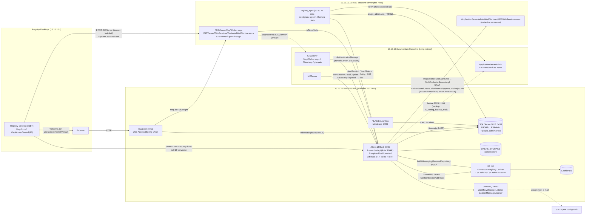

# 07 — Integrations between the Registry (10.10.10.5) and other systems

Every connection between Aumentum Registry LRS43 on **10.10.10.5** and anything else: the Cadastre
(Aumentum MultiCadastre on **10.10.10.6**, and its replacement in this repo, `cadastre-server`, now on
**10.10.10.11:8080**), the Cashier, e-mail, payments, scanning, the map windows, analytics and the
Registry's own web/desktop clients. For each: direction, protocol, endpoint, authentication, operations,
data, trigger, and what the replica must keep compatible.

Requirement gathering only; read-only captures. Abbreviations as in `06-web-access-and-server.md`:
`$R` = `tools/aumentum-inventory`, `$APP` = `$R/lrs-export/registry/app/LRSAS/server/default`,
`$DATA` = `$R/lrs-export/registry/data`, `$J` = scratchpad `in/*.jar` (javap only), `$D` = scratchpad
`dec/net/**` (decompiled .NET). Repo code paths are relative to `crates/cadastre-server/src/`.
**(inferred)** marks deductions.

---

## 1. Summary table

| # | Integration | Direction | Protocol / endpoint | Trigger | Status at PLAGIS |
|---|---|---|---|---|---|
| I-1 | Registry creates / approves / rejects **Cadastre jobs** | .5 → Cadastre | SOAP 1.1 (Axis client) → `{mcServiceAddress}` = `…/ApplicationServerAdmin/WebServices/LRSWebServices.asmx` | workflow rules at configured stages; withdrawal | **Active** (16,945 jobs). Since 2026-11-04 the address points to **10.10.10.11:8080** (this repo) |
| I-2 | Registry checks a stage's **Cadastre job is finished** before the stage completes | Desktop → .5 → (DB) | SOAP `IntegrationService.GetJob` | completing a stage listed in `job_stage_description(n)` | Active (95 rules, all "Warning") |
| I-3 | Cadastre **reads** Registry data (files, transactions, properties, settings, links) | Cadastre → .5 | SOAP `/lrs/api/AuthenticationService` + `DomainModelService.loadObjects` (HQL) | Cadastre user actions; link poll every 60 s; unlink reconcile every 15 min | Active (Aumentum MCServer on .6, and this repo) |
| I-4 | Cadastre **writes** to the Registry (title-deed plan document, link fields, comments) | Cadastre → .5 | SOAP `IntegrationService.SaveEntity` + `PUT /lrs/upload/{guid}.{ext}?ticket=` | user action "Send plan" / resend / withdraw; (link from Cadastre: off) | Active |
| I-5 | Registry Desktop **map window** (link a property to a parcel) | Desktop ↔ Cadastre GISViewer; GISViewer → .5 | HTTP POST `{GISServer}` (MapWorker.aspx) in embedded IE + SOAP `CadastralWebService.asmx` `UpdateCadastralData`; GISViewer validates the Registry ticket at .5 | Registry admin links on the Properties page | Active (now served by this repo) |
| I-6 | Registry **Web Access map tab** | browser ↔ Cadastre GISViewer | Silverlight `Client.xap` + `gis.gate/*` | user opens Map / "Show on Map" | Active; this repo forwards to .6 (bridge) |
| I-7 | Cadastre user sign-in and Registry user admin | Cadastre → .5 | SOAP `AuthenticationService`, `AccessControlService.getParentAuthorities`, `AdministrationService.changePassword/createUsers`; SQL `plagis_admin.*` procedures | sign-in, password change, Sysadmin "Users & Units" | Active (this repo) |
| I-8 | **Cashier** fee calculation (and invoicing) | Desktop → .5 → Cashier service (IIS on .5) → `Cashier` DB | SOAP `/lrs/api/CashierService` → `http://localhost/ILSCashSrv/ILSCash4LRS.asmx` (`Cash4LRS`) | fee pages of the workflow | Active for **fee calculation**; invoicing not used |
| I-9 | Cashier events → workflow | Cashier → .5 | JMS / MessagingService (`invoiceCommit`, `invoiceVoid`) | invoice committed/voided | Not used (no invoices) (inferred) |
| I-10 | **E-mail** (task assignment, scheduled reports, filestore alerts) | .5 → SMTP | JavaMail / Alfresco OutboundSMTP | workflow events, report schedules | Configured with Alfresco demo defaults → effectively **off** (inferred) |
| I-11 | SMS | — | — | — | **None found** |
| I-12 | Payment gateway / bank (Remita etc.) | — | — | — | **None found**; payments recorded by hand |
| I-13 | Scanning | scanner → Desktop → .5 | TWAIN (client) → `PUT /lrs/upload` + `IncomingDocument` | data entry / scanning stages | Active (client side) |
| I-14 | Desktop → **Web Access** deep links | Desktop → browser → `/lrswa` | HTTP GET `welcome.do?user=&ticket=#…` | "Show in LWA", "view registered documents" | Active |
| I-15 | Alfresco CMIS / WebDAV / web scripts | any → .5 | `/lrs/cmis`, `/lrs/webdav`, `/lrs/service` | — | Exposed; no known consumer |
| I-16 | **PLAGIS Analytics** (Metabase) | Metabase (on .5) → SQL Server | JDBC to `localhost:1433` | dashboards | Running; reads SQL (inferred LRS43) |
| I-17 | Replication between offices | .5 ↔ other LRS | `IntegrationWithReplica` | — | **Off** (`0`; `lr_replication*` tables empty) |
| I-18 | ArcMap extension (`gisintegration`) | ArcMap ↔ .5 | SOAP + HQL queries in `lr_setting` | — | No evidence of use (inferred) |

---

## 2. Settings that configure integrations (`LRSAdmin.lr_setting`)

Exported 2026-11-02 (`$DATA/lr_setting.psv.gz`, 363 rows). **Since 2026-11-04** three values point
to this repo's server (script `$R/registry-settings-switch-to-cadastre-server.sql`; originals saved in
**`LRSAdmin.lr_setting_backup_trial`**, restore with `$R/registry-settings-revert-to-aumentum.sql`;
Registry desktops must log out and in again because each reads settings once per session).

### 2.1 `multicadastre` (104 rows)

| Name | Value (2026-11-02 export) | Current | Used by |
|---|---|---|---|
| `mcServiceAddress` | `http://10.10.10.6/ApplicationServerAdmin/WebServices/LRSWebServices.asmx` | **`http://10.10.10.11:8080/ApplicationServerAdmin/WebServices/LRSWebServices.asmx`** | `MultiCadastreServiceImpl.getServiceAddress()` (default `http://localhost/ApplicationServerAdmin/WebServices/LRSWebServices.asmx` when empty) |
| `mcUserName` | `administrator` (a **Cadastre** account) | same | `Login()` → `authenticate(user, password)` |
| `mcPassword` | **<redacted, in lr_setting>** | same; must equal this repo's `CADASTRE_MC_SERVICE_PASSWORD` | same |
| `job_creation` | `1` | | Desktop `AssessWorker`: allow job creation / completion check |
| `job_plot_parcels` | `Plot Parcels` | | job name key |
| `job_parcel_creation` | `Parcel Creation` | | job name key |
| `job_deedplan_creation` | `Deed Plan Creationv2` | | job name key |
| `job_plot_survey_plan` | `Plot Parcels` | | job name key |
| `mcJob_multipleTargetProperties` | `Deed Plan Creationv2` | | one job **per target property** for these job names |
| `job_stage_description(1…95)` | `<transaction codes>:<stage name>:<job key>:<Warning|Confirm>` | | stage-completion check (I-2). Breakdown: `PrepareTitleDeedPlan → job_deedplan_creation` 32, `ReviewTitleDeedPlanSQCO → job_deedplan_creation` 32, `PlotParcelInCadastre → job_plot_parcels` 29, `CreateParcel → job_parcel_creation` 1, `PlotSurveyPlanlInCadastre → job_plot_survey_plan` 1; all 95 are `Warning`; transaction codes ABWG APCA APCM APCO APRF APRO APSL ASSI CEMP CHNT CHPC COMP CONT DEVO EXTT INSC LEAS LOCE MERT MORT PSUR RAOL RCOO REGR REPT RLEA RMOR RROC RSUB SPC SUBD SUBL SURO UPMO |
| (not set) `mcAsyncMode` | — | | read by `IntegrationServiceImpl` (async job calls), absent → synchronous |
| (not set) `mcParcelAttribute` | — | | read by `MultiCadastreServiceImpl.CreateParcel` (legacy path, unused (inferred)) |

### 2.2 `mcintegration` (25 rows)

| Name | Value | Meaning / consumer |
|---|---|---|
| `IntegrationWithMC` | `1` | master switch (Desktop `AssessWorker`, `BusinessLogicServiceAgent.WithdrawRegistration`) |
| `GISServer` | was `http://10.10.10.6/GISViewer/MapWorker.aspx`; **now `http://10.10.10.11:8080/GISViewer/MapWorker.aspx`** | Desktop `MapForm` / `MapWorkerControl` (I-5) |
| `LWAMapURL` | was `http://10.10.10.6/GISViewer/MapWorker.aspx`; **now `http://10.10.10.11:8080/GISViewer/MapWorker.aspx`** | Web Access map tab (I-6) |
| `ShowMapInLWA` | `1` | Web Access shows the Map tab |
| `GISLinkageConfig` | `MapName=property-select;MapLayer=Plateau_State_Parcels;SDELayer=sde.SDE.Plateau_State_Parcels->ParcelID->ParcelID->sde.SDE.ParcelAttributeTable` | map + layer used for linking (I-5) |
| `GISLinkageConfigUnit` | `MapName=property-select;MapLayer=WGS84_Parcels;SDELayer=sde.SDE.WGS84_Parcels->ParcelID->ParcelID->sde.SDE.ParcelAttributeTable` | strata units |
| `GISSearchFields` (+`Unit`) | `uid::false:Property UID,upin:UPIN:false:Upin:true,district::false:Country` | search fields sent to the map: `[Registry attr]:[GIS field]:[hidden]:[label]:[key]` |
| `GISRetrievedFields` (+`Unit`) | `upin:UPIN` | Cadastre → Registry on link: the parcel's UPIN goes into the property's `upin` |
| `GISUpdatedFields` | `suID:LRSID,1:LinkageStatus,spatialDate1:LinkageDate,refnum:PropertyNumber,plotNumber:Plot,blockNumber:Block` | Registry → Cadastre on link: written to the parcel attribute record (the literal texts `plotNumber`/`blockNumber` are what Aumentum wrote, `docs/registry-integration.md` §3.1) |
| `GISPropertyParam` (+`Unit`) | `upin:UPIN` | Web Access "Show on Map": search the map by UPIN |
| `LWASearchSpatialUnit` | `Plateau_State_Parcels;upin:UPIN` | Web Access map search layer/field |
| `TOCSearchCriteria` | `Region:Province;District:District;Plot Number:Lot` | Web Access map search grid |
| `LinkageFields` | `upin:UPIN;LRSID:suid,PropertyNumber:refnum,Plot:plotNumber,Block:blockNumber` | Cadastre-side linking (Aumentum desktop `LinkParcel`; this repo: off) |
| `LinkStatusAttributeName` | `LinkageStatus` | parcel attribute flagging a link |
| `SearchValues` | `UPIN:upin:upin` | find properties from a selected parcel |
| `UniquenessValues` | `District:Address.District.Code;Region:Address.Region.Code` | |
| `UpdatePropertyValues` | `UPIN:upin;REFNUM:PropertyNumber` | |
| `AreaUnitMatch` | `1:sqft;2:acre;3:sqm;4:sqkm;5sqyrd` | Cadastre area unit code → Registry unit (Desktop `MapForm`) |
| `MCParcelFabricConfig` | `SDE=true;FileGDBPath=;ServerName=10.10.10.6` | Aumentum parcel fabric workspace (Aumentum desktop) |
| `DeedPlanQueries` | `R_PROPINFO;[R_HOLDERS]` | title-deed plan prefill queries (re-implemented in `routes/titledeed.rs`) |
| `LRSTransAllowUpdateKeyFields`, `LRSNonUpdatableKeyFields` | empty | which Registry key fields the map may overwrite (Desktop `MapForm`) |

### 2.3 `gisintegration` (9 rows)

`lrsMcJobClass = com.landsystems.lrs.model.McJob`, `lrsParcelClass = com.landsystems.lrs.model.Parcel`,
`lrsDocumentClass = com.landsystems.lrs.model.IncomingDocument` (entity classes accepted by
`IntegrationService.SaveEntity/SaveJob`), and HQL templates for the ArcMap extension:
`queryTransactionByUser` (open tasks of a user/swimlane from `ProcessHistory` + jBPM `TaskInstance`),
`queryPropertyByTransaction`, `queryPartyByTransaction`, `queryDocumentsByTransaction`;
`extensionTasks` / `extensionTasksCanComplete` = `Manage Spatial Data,Review Spatial Data`.

### 2.4 `config` items that are integrations

| Name | Value | Meaning |
|---|---|---|
| `IntegrationWithCashier` | `1` | Desktop fee pages use the Cashier (`CalculateFeePage`, `CalculateFeeForm`, …) |
| `CashierServiceAddress` | `http://localhost/ILSCashSrv/ILSCash4LRS.asmx` | "billing subsystem lookup address" — Cashier service on the **same server's IIS** |
| `LwaUrl` | `http://{0}/lrswa/welcome.do` | Web Access entry for Desktop deep links (`{0}` = Registry host) |
| `IntegrationWithReplica` | `0` | office replication off |
| `SoapClientTimeout` | `350000` | client SOAP timeout (ms) |
| `ScanCompanyName` | `Supreme Court` | "Department that scan documents" (label) |
| `scan.MaxImageSize` / `scan.MaxAttachmentSize` | `1024` KB / `100` MB | upload limits for scanning (I-13) |

No `lr_setting` row configures SMTP, SMS, a payment gateway, a bank, Remita or a report server.
Categories `governor_default`, `deedregistrar_default` and `header_default` hold the names of the
current officials and the PLAGIS phone/web address printed on documents (values not reproduced here).

---

## 3. Cadastre integration in full

### 3.1 I-1 — Registry → Cadastre: the job service

**Chain** (all evidence from decompiled/inspected code):

```
Registry Desktop (workflow rule CreateMCJob / ApproveMCJob / RejectMCJob, or Withdraw)
  → SOAP  http://<registry>:8080/lrs/api/IntegrationService   SaveJob(Entity[])          [Desktop: DataModelUtilities.cs, Rules.cs, BusinessLogicServiceAgent.cs]
    → IntegrationServiceImpl.saveJob → proceedJobEntity                                  [$J/lrs-mc-integration.jar]
      → MultiCadastreServiceImpl (Axis stub LRSWebServicesSoapStub)                      [$J/lrs-mc-integration.jar]
        → SOAP  {multicadastre.mcServiceAddress}  (LRSWebServices.asmx, ns http://tempuri.org/)
      ← JobInstance → saved as LRSAdmin.lr_mc_job (class com.landsystems.lrs.model.McJob)
```

**Authentication.** Every operation does `Login()` → `authenticate(mcUserName, mcPassword)` with
`setMaintainSession(true)` (the ASP.NET session cookie `ASP.NET_SessionId` is reused for the next
call), runs one operation, then `Logout()` → `logOut()`. Axis timeout **60,000 ms**. On failure the
server throws `lrs.service.mc_err_connect_server` = "The connection to ILS MultiCadastre server could not
be established." and the Desktop shows one of: UnknownHostException / Logon failure / Connection timed out /
"unable to process request" / unworkable state (`Rules.cs`). The asmx (Aumentum `MCAdminWebSite`)
reverse-resolves the caller's IP; this repo's outbound client binds to `CADASTRE_OUTBOUND_ADDR` for the
same reason (`lrs.rs connect`).

**Operations the Registry calls** (`MultiCadastreServiceImpl`; the stub interface `LRSWebServicesSoap`
lists all 28 asmx operations):

| Registry method | asmx operation(s) | Arguments | When |
|---|---|---|---|
| `getJobDefinition(name)` | `GetAllJobs` → pick `WFJob` whose `Name` equals the job name | job name from `lr_setting` (e.g. `Deed Plan Creationv2`) | before creating a job |
| `createJob(jobID, instanceName, priority, comments, parameters)` | `CreateJobInstance` | `jobID` = WFJob.ID; `instanceName` = `Job-<property uid>` (or `Job-<surveyor plan no>`, or `Job-`); priority `UnsignedShort` from `JobPriority` (`"2"`); comments = job name; parameters = `@LRS:[Transaction]:[TransactionNumber]=PLS…` | `SaveJob` with status **added** |
| `updateJob(...)` | `UpdateJobInstance` | same fields | `SaveJob` status modified |
| `getJob(jobInstanceId)` | `GetJobInstance` | | refresh after create/approve/reject |
| `approveJob(id)` | `ApproveJob` | latest `lr_mc_job` of the transaction | `SaveJob` status **approved** (rule `ApproveMCJob`) |
| `rejectJob(id)` | `RejectJob` | latest `lr_mc_job` of the transaction | `SaveJob` status **rejected** (rule `RejectMCJob`; **every withdrawal** when `IntegrationWithMC=1`) |
| `deleteJob(id)` | `DeleteJobInstance` | | `SaveJob` status deleted |
| `getParcelPointsData(upin)` | `GetParcelPointsData` | UPIN | `IntegrationService.GetParcelPointsData` (Desktop helper exists; **no caller found** in the captured client) |
| `batchUpdate(text)` | `BatchUpdateDataFromRegistry` | `NAME=value|…` | **no caller found** in captured jars |
| `CreateParcel(Batch)` | `CreateJobInstance` (job id 1, params from `multicadastre.mcParcelAttribute`) | | legacy, setting absent → unused (inferred) |

**`SaveJob` entity contract** (Desktop `DataModelUtilities.CreateMCJob` and server strings): class name
from `gisintegration.lrsMcJobClass`; properties `JobName`, `JobInstanceName`, `JobPriority`,
`JobComments`, `JobParameters`, `TransactionId` (added); only `TransactionId` for approved/rejected
(the server picks `from McJob where TransactionId = ? and id = (select max(id) …)`; "No Job for … which
requested by …" if none). `GetJob(transactionId)` returns every `McJob` of the transaction as entities
(`Id`, `JobId`, `JobName`, `JobInstanceId`, `JobInstanceName`, `JobPriority`, `JobComments`,
`JobParameters`, `JobStatus`, `JobEnded`, …).

**Data stored** — `LRSAdmin.lr_mc_job` (`$DATA/lr_mc_job.psv.gz`): `Id, job_instance_id, job_id,
job_priority, job_name (Job-PL…), job_status, job_started, job_updated, job_ended, job_comments (job
type name), job_parameters, transaction_id`. 16,945 rows; status 2 (Active) 637, 3 (Waiting for LRS
Commit) 16,302, 5 (approved) 3, 7 (rejected) 5 (`lrs-export-summary.txt`). The Cadastre appends its own
parameters, e.g. `…|@MC:[JobInstanceAddFile]:[FilePath]=<local path>` (seen in the data).

**When jobs are created.** Workflow configuration calls the Desktop rule `Rules.CreateMCJob(state, args)`
with the job key (e.g. at "Plot Parcel in Cadastre" / "Prepare Title Deed Plan"); it creates the job only
if none with that name is open (`IsJobPresent`: `JobComments == name && JobEnded empty`). `ApproveMCJob`
/ `RejectMCJob` rules close it at completion / rejection. The exact stages come from the workflow config
files (covered in the workflow document).

**This repo's replacement** (`routes/mcservice.rs`, `PATH = /ApplicationServerAdmin/WebServices/LRSWebServices.asmx`):
same path, SOAP 1.1 document/literal, namespace `http://tempuri.org/`, `GET ?WSDL` returns the captured
contract. Authenticate checks `CADASTRE_MC_SERVICE_USER` / `_PASSWORD` (must equal `mcUserName` /
`mcPassword`) and sets `ASP.NET_SessionId`. Implemented: Authenticate, LogOut, GetAllJobs,
CreateJobInstance (status 2, unassigned start task, priority >2 → 2, `@LRS:[Transaction]:[TransactionNumber]`
parsed), GetJobInstance(/Parameters), UpdateJobInstance(/Parameters), ApproveJob (status 5), RejectJob
(discard unposted edits, status 7), CompleteJobInstance (3), DeleteJobInstance (**cancel, status 9**, a
deliberate difference), IsJobInstanceCompleted, GetJobStatusByJobInstanceID/ByTransaction,
Get/Complete/CancelTaskInstance, GetUpinsByJobInstance/ByTransaction, GetParcelAttributesByUPIN,
GetParcelStatus, GetParcelPointsData, GetConfiguredRegions (`Plateau_State`), GetDomains,
GetDomainDetailsByName, BatchUpdateDataFromRegistry (format inferred), GetAllJobsInstances
(`docs/registry-integration.md` §3.2). Job ids issued here start at 1,000,001.

**Compatibility the replica must keep:** if the replica **replaces the Registry side**, it must call this
asmx exactly as `MultiCadastreServiceImpl` does (login per call, cookie, `GetAllJobs` by name,
`CreateJobInstance` arguments and parameter string, Approve/Reject on completion/withdrawal) and keep
writing `lr_mc_job`, because the Cadastre and the stage checks read it. Keep `mcServiceAddress` /
`mcUserName` / `mcPassword` in `lr_setting`.

### 3.2 I-2 — Stage completion guard

`AssessWorker` (Desktop, `$D/ThomsonReuters.Aumentum.Registry.Controls.dll/.../WorkerAssess/AssessWorker.cs` ~l.300):
when a user completes a stage and `IntegrationWithMC=1` and `job_creation=1`, it reads
`job_stage_description(1)`, `(2)`, … until empty; for a rule whose transaction list contains the
transaction type (or `all`) and whose stage list contains the current stage (or `all`), it reads the job
name from the key and calls `GetMCJobComplete` (= `IntegrationService.GetJob(transactionId)` and looks for
an `McJob` with that `JobComments` and an **empty `JobEnded`**). If such an open job exists: **Warning** →
message "Cadastre job … not complete" and the stage is **not** completed; **Confirm** → ask. Replica: keep
this rule engine (or an equivalent) and the meaning of `JobEnded` (set when the Cadastre marks the job
3/5/7, via `GetJobInstance` refresh).

### 3.3 I-3 / I-4 / I-7 — Cadastre → Registry (SOAP into `/lrs/api`)

**Callers:** Aumentum MCServer / Cadastre desktop on .6 (`dsssettings` Integration/RegParam: `10.10.10.5:8080`,
user `admin`, customer code `THOMSONREUTERS`; `docs/registry-integration.md` §2) and this repo
(`lrs.rs`; `CADASTRE_REGISTRY_URL=http://10.10.10.5:8080/lrs/api/`, `CADASTRE_REGISTRY_USER/_PASSWORD`).

**Session and security** (`lrs.rs`):

| Step | Call | Detail |
|---|---|---|
| clock | `GET /lrs/api/DomainModelService?wsdl` | read the HTTP `Date` header; the WS-Security timestamp uses the **Registry's** clock (it runs ~19 min fast) |
| sign in | `AuthenticationService.startSession(username, password)` (ns `http://www.alfresco.org/ws/service/authentication/1.0`) | returns `ticket` |
| every call | header `wsse:Security` with `wsu:Timestamp` (Created/Expires +600 s) and `UsernameToken` (Username = user, Password `#PasswordText` = **ticket**) | |
| sign out | `AuthenticationService.endSession(ticket)` | |
| ticket check | `AuthenticationService.isTicketValid(ticket)` with the user's own name in the token | used for the map window (I-5) |

**Reads** — `DomainModelService.loadObjects` (ns `http://www.landsystems.com/domainmodel-service/1.0`)
with `<lrs:SimpleQuery><lrs:queryString>HQL</lrs:queryString><lrs:maxResults>n</lrs:maxResults>`; rows come
back as `ResultScalar/items/value(record)/items/value(type,value)` (`parse_scalar_rows`). HQL used by this repo:

| Purpose | HQL (abridged) | Where |
|---|---|---|
| Link poll (every `CADASTRE_REGISTRY_POLL_SECS`, 60 s) | `select s.SuID, s.Upin, s.Refnum, s.SpatialDate1, t.TransactionNumber, ts.Code, ts.Label, s.LotNumber, s.BlockNumber from Transaction t join t.TransactionStatus ts join t.Properties l join l.SpatialUnits s where s.SpatialDate1 >= ? and s.Upin is not null and l.EndLifespanVersion is null and s.EndLifespanVersion is null` | `registry_sync.rs links_query` |
| Integration settings (Aumentum's `A_MCINTEGRATION`) | `select s.Name, s.Value from Setting s where s.Category = 'mcintegration'` | `registry_sync.rs SETTINGS_QUERY` |
| Unlink reconcile snapshot (every 900 s) | `select s.Id, s.SuID, s.Upin, s.Refnum from SpatialUnit s where s.Upin is not null and s.Upin <> '' and s.EndLifespanVersion is null` | `registry_sync.rs SNAPSHOT_QUERY` |
| Find a file / transaction | `… Transaction t join t.TransactionStatus s where t.TransactionNumber = '…'`; properties by transaction; dictionary lookups | `routes/registry.rs` |
| Title-deed prefill (`R_PROPINFO`, `R_HOLDERS`) | location (Zone), tracing no., refnum, LGA, surveyor, survey date, survey plan no., region by `s.SuID`; holders = `select distinct a.Name, s.Upin from RRR r join r.Party a join r.LaUnit p join p.SpatialUnits s` | `routes/titledeed.rs` |
| Workflow position | `ProcessHistory` (TaskName, TaskDescription, TaskCreate, TaskComplete, Actor), `McJob` by TransactionId | `routes/registry.rs` |
| Earlier plan documents | `IncomingDocument … DocumentType.Code = 'sd_titledeedPlan'` (via `Transaction.Documents`) | `routes/registry.rs` |

**Writes** — only with `CADASTRE_REGISTRY_WRITE=1`, on a user's action:

| Write | Call | Payload |
|---|---|---|
| Upload the plan file | `PUT /lrs/upload/{uuid}.pdf?ticket={ticket}&encoding=UTF%2D8` (`Content-Type: application/octet-stream`) | bytes; the answer is the content reference |
| File it on the transaction | `IntegrationService.SaveEntity(transactionId, entities)` (ns `http://www.landsystems.com/lrs-integration-service/1.0`) | `DocumentEntity` `com.landsystems.lrs.model.IncomingDocument`, status `added`: `DocumentType` = `sd_titledeedPlan` (MCServer `SurveyPlanFromMC`), `Comments` "Survey Plan" (or "Survey Plan (corrected, <date>)"), `Submission` now, `PageCount` 1; content + one page with `{lrs core}referenceid` = transaction id, `isattachment`, `pagename`, `pageindex` 0, `{cm}content` = upload answer; page type `attachment` (PDF) or `image` |
| Mark earlier plans replaced / withdrawn | `SaveEntity` `IncomingDocument` status `modified`, `Id`, `Comments` "… REPLACED …" / "WITHDRAWN" | |
| Link from the Cadastre (off: `CADASTRE_REGISTRY_CADASTRE_LINKING`) / on map OK (`CADASTRE_REGISTRY_LINK_ON_MAP_OK`) | `SaveEntity` `com.landsystems.lrs.model.Parcel` status `modified`: `Id`, `Upin`, `SpatialDate1` | |
| Users (I-7) | `AccessControlService.getParentAuthorities` (groups at sign-in), `AdministrationService.changePassword` (own session), `AdministrationService.createUsers` (admin session) | `lrs.rs` |
| Users & Units (I-7) | **SQL**, login `plagis_admin_app` (EXECUTE only) → `LRS43.plagis_admin.usp_list_users`, `usp_list_groups`, `usp_user_groups`, `usp_create_user`, `usp_create_group`, `usp_add_to_group`, `usp_remove_from_group`, `usp_reset_password`, `usp_set_user_enabled`, `usp_update_user`; audit in `plagis_admin.audit_log`; JBoss restart needed for Alfresco caches | `regadmin.rs`, `tools/registry-admin/` |

Rules mirrored from Aumentum: links/unlinks refused for transactions Withdrawn, Postponed, Completed,
Rejected (`registry.rs CLOSED_STATUS_CODES`); `P-` (past) transactions refused.

**Compatibility the replica must keep:** if the Registry server is replaced, **these SOAP operations,
the WS-Security ticket scheme, the HQL subset above (entity and property names of the Hibernate model)
and the upload servlet** are what Aumentum Cadastre and this repo depend on. Simplest path: keep JBoss
`/lrs/api` running read/write against LRS43 during the transition, or provide a façade implementing
exactly these calls (including enough HQL to answer the listed queries) — or change this repo's
Cadastre to call the replica's own API instead and retire Aumentum Cadastre first.

### 3.4 I-5 — Desktop map window (linking) and I-6 — Web Access map tab

**I-5, Registry Desktop map** (`$D/.../Controls.dll/.../WorkerAssess/Forms/MapForm.cs`,
`$D/.../Services.dll/.../MapWorker/MapWorkerControl.cs`; full protocol in `docs/registry-integration.md` §3.3a):

| Step | Detail |
|---|---|
| Open | `MapForm` reads `GISServer`, `GISLinkageConfig`, `GISSearchFields`, `GISRetrievedFields`, `GISUpdatedFields`, `AreaUnitMatch`, `LRSNonUpdatableKeyFields`, `LRSTransAllowUpdateKeyFields`; the embedded Internet Explorer **POSTs** to `{GISServer}?ct=indexer&justmap=1&map=property-select&lang=…` with `auth=1&lrsuser=<user>&lrsticket=<ticket>&initparam_inputobjects=<base64 JSON in [BEGIN]…[END]>&initparam_extent=…` |
| Ticket | the map server validates the Registry ticket at .5 (`AuthenticationService.isTicketValid`); Aumentum's GISViewer is configured with `<lrsAuthServer server="10.10.10.5" port="8080" protocol="http" app="lrs"/>` and `authManagerCls="ILS.MCPortal.Services.LrsAuthenticationManager"`, operations `WebServicesAccess` and `CursorCoordinates` allowed to `GROUP_LRS` (`$R/lrs-export/map-capture/gisviewer/Conf/server.xml`) |
| Script bridge | Desktop waits for element `silverlightControl`, sets `indexerEvents` = `Map Ready`; calls `doAction("SelectionSet","GetSelectedObjects")`, `doAction("Map","GetExtentAsString")`, `doAction("Editor","IsEditInProgress")` |
| Link (OK) | Desktop copies the UPIN into the property (saved when the officer Suspends or completes the stage) and calls `{GISServer}/../WebServices/CadastralWebService.asmx` → `UpdateCadastralData` (ns `http://www.landsystems.com/multicadastre/in4/service`, `SecurityHeader{User, Password = ticket}`) with the `GISUpdatedFields` values |
| Replacement | this repo: `GET/POST /GISViewer/MapWorker.aspx`, `/GISViewer/data/parcels` (map token, 8 h), `POST /GISViewer/WebServices/CadastralWebService.asmx` (`UpdateRecordByOID` / `UpdateRecordByFields`), ES5 + Leaflet for IE11 (`routes/gisviewer.rs`) |

**I-6, Web Access map tab** (`map.do`): Aumentum's Silverlight viewer — probes `{GISViewer}/Assets/s.gif`,
loads `Client/Client.xap` (ESRI ArcGIS Silverlight API 3.0), map config `web-access` (anonymous:
`login="false"`, `allow="*"`, one dynamic layer "Parcels"), draws via `GISViewer/gis.gate/*` from
Aumentum's database. This repo forwards unknown `/GISViewer/*` paths to `CADASTRE_GISVIEWER_UPSTREAM`
(`http://10.10.10.6`) and answers empty `gis.gate/0/0/query` searches (`UPIN`, `propertyNo`, `PlotNo`,
`BlockNo`, `PlanNo`, `ParcelName`) from its own parcels (`routes/gisviewer_passthrough.rs`). A real
replacement (answering `gis.gate` from PostGIS, or a new non-Silverlight map in the replica's Web Access)
is still to do.

**Compatibility:** the replica's Desktop replacement must keep calling MapWorker with the same POST
fields (or link natively against this repo's API); the replica's Web Access should embed a modern map
(Leaflet/OpenLayers) fed by this repo's parcel endpoints, keyed by `GISPropertyParam` (`upin` → `UPIN`).

### 3.5 Cadastre ↔ Registry data mapping (what crosses)

| Registry (LRS43) | Cadastre | Direction | Rule |
|---|---|---|---|
| `lr_spatial_unit.upin` (`SpatialUnit.Upin`) | parcel `UPIN` (`PL` + 12 digits) | Cadastre → Registry | set on link (map OK) |
| `lr_spatial_unit.spatial_date1` | `LinkageDate` (yyyy-mm-dd) | Registry → Cadastre | link time; poll watermark |
| `lr_spatial_unit.su_id` (`SuID`) | `LRSID` | Registry → Cadastre | |
| `lr_spatial_unit.refnum` | `PropertyNumber` | Registry → Cadastre | Registry file number `PL…` |
| literal `1` | `LinkageStatus` | Registry → Cadastre | 0 on unlink |
| literal `plotNumber` / `blockNumber` | `Plot` / `Block` | Registry → Cadastre | as Aumentum wrote them |
| `lr_transaction.transaction_number` (`PLS…`) | job parameter `@LRS:[Transaction]:[TransactionNumber]` | Registry → Cadastre | at job creation |
| `lr_mc_job.job_instance_id`, `job_status` | job id / status 2,3,5,7(,9) | both | |
| Title deed plan (PDF/JPG) | IncomingDocument `sd_titledeedPlan` | Cadastre → Registry | "Send plan" |

---

## 4. I-8 / I-9 — Cashier and payments

**Components** (all on .5): the LRS `CashierService` SOAP (`/lrs/api/CashierService`, class
`CashierServiceSOAPImpl`, ops `SubmitInvoice`, `CheckStatus`, `GetSchema`, `CalculateFee`, `GetPayment`);
the Java client `com.ils.lrs.cashier.service.CashierService` (`$J/lrs-web.jar`) to the **Cash4LRS** SOAP
service at `config.CashierServiceAddress = http://localhost/ILSCashSrv/ILSCash4LRS.asmx` (IIS); the
**Aumentum Registry Cashier** ASP.NET application (v3.2.29.194) and database **`Cashier`** (v3.0.85,
company "PLAGIS", register "PLAGIS Account", Jos; 12 payment types Cash, Check, Credit/Debit Card,
Customer Account, Money Order, Wire Transfer …); and the **Aumentum Registry Cashier Scheduler** Windows service.

**Cash4LRS operations** (`Cash4LRSSoap`): `login(…4 strings)`, `logoff`, `newInvoice`, `saveInvoice`,
`saveInvoiceWithStatus`, `voidInvoice(ByNumber)`, `freeInvoice(ByNumber)`, `selectInvoice(ByNumber)`,
`getInvoiceIdByInvoiceNumber`, `customerInfo`, `findCustomer`, `findOrAddCustomerAndSetToInvoice`,
`getTransactionList`, `getTransactionParametersByTRN`, `viewInvoiceStatusByNumber`,
`calculateTransactionByTRN`, `addTransactionToInvoiceByTRN(withManualAmount)`, `delTransactionByID`,
`delTransactionsFromInvoice`, `customerSave`, `getDatesOfTransactionsPay`. Data travels as `ILSDataSet`
(tables/rows/columns/fields). The LRS logs in as the Cashier user **`LRSRobot`** with a password
constant compiled into `CashierService` (**redacted**) — the replica must not depend on it.

**LRS-side methods** (`CashierService`): `CalculateFee(transactionCode, params)`, `CreateInvoice(Batch)`,
`UpdateInvoice(Batch)`, `CommitInvoice(invoice, …)`, `VoidInvoice`, `GetReceiptNumber`, `Refund`,
`GetTransactionMetaInfo`, `GetInvoiceStatus`, `GetPaymentDetails`, `GetSchema`; messages
"Skip Create Cashier Invoice - cash params are not specified." etc. Workflow action handler
`com.ils.lrs.workflow.actions.CommitInvoiceHandler`. Errors `lrs.service.cs_err_*` ("The connection to
ILS Cashier server could not be established.", "Cannot calculate fee.", …).

**What PLAGIS actually uses** (data evidence):

| Evidence | Meaning |
|---|---|
| `Cashier.dbo.Invoice` = 0 rows, `InvoicePosition` = 0, `TransactionLog` = 869,401 (`-1701.txt`) | no invoices are created; the Cashier is called a lot (fee calculations, inferred) |
| `lr_payment` 32,134 rows: `invoice_number` and `receipt_number` empty in all; `receipt_no` filled in 31,758 | receipts are typed in from bank tellers/deposit slips, not issued by the Cashier |
| `lr_payment_transaction`: 380,650 rows with `transaction_params` **and** a calculated fee; parameters like `paidYear=…`, `Account=1;4;0;0;Account`, `SurveyPlanType=…`, `DoneByPrivateSurveyor=…`, `LeasePeriodRentalAmount=…` | the Desktop sends the transaction code + parameter string to `CalculateFee`; the Cashier's fee schedule (`Parameters`, `InventoryType` tables) computes the amount |
| Dictionary `sd_recappfee` "Bank Deposit Slip", `sd_teller` "Teller Printout" | proof of payment is scanned as a supporting document |
| `config.HideFeeComputation = RCOO,RROC,SURO`, `HideFeeComputationTransition`, `CheckPrintReceipt=0` | fee step skipped for some transaction types |

The Desktop: `CalculateFeePage` reads `IntegrationWithCashier`; if 0 it forces manual amounts, else it
allows calculation (`ICashierServiceAgent.CalculateFee`, `CreateCashEntity`, `GetMetaInfo`,
`SubmitInvoice`, `CheckInvoiceStatus`, `GetPayment`, `SearchCustomer`, `CreateCustomer`) through
`/lrs/api/CashierService`. A second, LRS-native fee engine exists: `FeeService`
(`calculateFee`, `calculateFeeByEmptyProperty`) over `lr_fee_structure` (55) / `lr_fee_rate` (29,003).

**I-9:** `CashierMessageListener` (JMS) handles `invoiceCommit` / `invoiceVoid` messages carrying an
`invoiceNumber` and moves the waiting workflow task along (`cashierTaskNames` mapping, not captured).
With no invoices, this path is idle (inferred).

**Compatibility the replica must keep:** the fee amounts PLAGIS charges come from the **Cashier
database's fee schedule** via `calculateTransactionByTRN(transactionCode, parameters)`. The replica must
either keep calling `ILSCash4LRS.asmx` with the same transaction codes and parameter strings, or port the
Cashier fee schedule (`Cashier.dbo.Parameters`, `InventoryType`, `InventoryTypeAccount`, `v_FeeSchedule`)
and reproduce the same results, then keep writing `lr_payment` / `lr_payment_transaction` the same way
(receipt number typed, `transaction_params`, `calculated_fee`, `manual_fee`).

---

## 5. I-10 to I-13 — Notifications, payments, scanning

| Integration | Finding | Source |
|---|---|---|
| **E-mail** | LRS sends mail from `WorkflowMessageListener` (task assigned to user/group: subject "Task '%1$s' was assigned to you." / "…to your group.", body "The transaction '%1$s' - '%2$s' has been assigned to you on %3$s."), from scheduled reports (from `ScheduledReports@landsystems.com`) and from the filestore monitor (`sdms@blomaerofilms.com`). Outbound SMTP is at Alfresco defaults (`smtp.alfresco.com:25`, anonymous); the Spring mail bean was not captured. **Effectively not working (inferred).** This repo has its own SMTP outbox (`mail.rs`, `cadastre.app_setting mail.*`, nothing sent without a server). | `lrs/messages/lrscore-service.properties`, `lrs/lrs-config.properties`, `ils/messages/multiFileStores-service.properties`, `subsystems/email/OutboundSMTP/outboundSMTP.properties`, `$J/lrs-web.jar` |
| **Delivery notice** | text "Registration finished." / "Please come to the Ministry of Lands and take your documents." (`notify_delivery_*`) — channel not configured | `lrscore-service.properties` |
| **SMS** | no SMS gateway, setting, class or string anywhere in the captures | grep of `lr_setting`, `$J`, `$D` |
| **Payment gateway / bank / Remita** | none: no setting, class or endpoint; banks appear only as dictionary values (`issued_by_*`, use "Banks") and proof-of-payment document types | `$DATA/lr_setting`, `$DATA/lr_dictionary` |
| **Scanning** | client-side: `ILS.Scanning.dll` in the Desktop; pages uploaded to `/lrs/upload` and attached as `IncomingDocument` pages (types `image` / `attachment`); limits `scan.MaxImageSize` 1024 KB, `scan.MaxAttachmentSize` 100 MB; `ScanVersioningSupported=0`, `ScanShowFileNames=1`, `ScanHideUnknownDocuments=1` | `$D/ILS.Scanning.dll`, `$DATA/lr_setting` |

Replica: a new SMS/e-mail/payment integration is an **upgrade**, not parity; nothing existing must be kept.

---

## 6. I-14 — Desktop → Web Access

The Desktop opens `{LwaUrl}?locale=…&user=…&ticket=…#detail:Transaction:{id}` and
`http://{host}/lrswa/welcome.do?user=…&ticket=…#result:SourceDocument:Transaction.TransactionNumber={PLS…}`
(details and sources in `06-web-access-and-server.md` §3.2). Keep while the old Desktop is in use.

---

## 7. I-15 — Alfresco protocol endpoints

Exposed by `lrs.war`: CMIS web services (`/lrs/cmis/*`, CXF; `Alfresco-CMISWS-Service.wsdl`), CMIS
browser (`/lrs/cmisbrowse`), WebDAV (`/lrs/webdav`), web scripts (`/lrs/service`, `/lrs/s`, `/lrs/wcs`),
download servlets (`/lrs/d`, `/lrs/download`), ILS remoting (`/lrs/remoting`, `/lrs/remoteauth`), HTTP proxy
(`/lrs/proxy`). `file-servers.properties` has `cifs.enabled=true` / `ftp.enabled=true` at the top level while
the subsystem defaults are `false` (state at run time unknown; no 445/21 listener belongs to JBoss in
`netstat`, so CIFS/FTP are off (inferred)). **No consumer of CMIS/WebDAV was found.** They are useful
read-only paths to export documents (see Gaps).

---

## 8. I-16 to I-18 — Other

| Integration | Finding |
|---|---|
| **PLAGIS Analytics** (Metabase 0.41.5, service "PLAGIS Analytics", port 3000, PostgreSQL 17 on 5432) | runs on .5 with an open connection to SQL Server on `127.0.0.1:1433` (`$INV` NETWORK, pid 5020). It almost certainly queries LRS43 tables directly (inferred). **Replica: keep LRS43 table/column names stable or re-point the dashboards.** |
| **Office replication** | `IntegrationWithReplica=0`; `lr_replicationpackage/log/content` 0 rows; dictionary `rep_created … rep_processed` unused |
| **ArcMap extension** | `gisintegration` HQL templates and task names; ArcGIS 10.2.1 Desktop on .5; no evidence of use by PLAGIS (inferred) |
| **SSRS / SSAS / SSIS** | installed and running on .5; `ReportServer` holds no reports; nothing found that integrates with them |
| **Aumentum Cadastre .6 → Registry SQL** | `$INV` shows WinRM sessions from .6 only (the capture tooling). No direct SQL link from .6 to LRS43 was captured; the Cadastre works through the SOAP API (§3.3) |

---

## 9. Integration diagram



---

## 10. What the replica must keep compatible (checklist)

1. **Database:** LRS43 / `LRSAdmin` schema unchanged; `lr_mc_job`, `lr_setting` (all categories above),
   `lr_spatial_unit.upin/spatial_date1`, `lr_payment*`, `lr_process_history` written the same way; never
   reuse UPINs; coexist with Hibernate `hbm2ddl=update` of the old JBoss; Metabase reads tables directly.
2. **Outbound to the Cadastre job service:** same SOAP calls and arguments as `MultiCadastreServiceImpl`
   (§3.1); config from `multicadastre.*`; stage guard from `job_stage_description(n)` (§3.2);
   reject on withdrawal.
3. **Inbound from Cadastre clients** (Aumentum MCServer until retired, this repo): `/lrs/api`
   AuthenticationService (startSession/endSession/isTicketValid), DomainModelService.loadObjects (HQL
   subset §3.3), IntegrationService.SaveEntity (Parcel, IncomingDocument), AccessControlService,
   AdministrationService, `PUT /lrs/upload` — with WS-Security ticket tokens and tolerance for clock skew.
4. **Map:** `GISServer` / `LWAMapURL` / `GISPropertyParam` settings; MapWorker POST contract and
   `UpdateCadastralData` (if the old Desktop stays); a non-Silverlight Web Access map.
5. **Cashier:** same fee results for the same transaction code + parameter strings (call `ILSCash4LRS.asmx`
   or port the fee schedule); manual receipt entry.
6. **Desktop deep links into Web Access** (§6).
7. Nothing to keep for SMS, payment gateways, replication, SSRS — new features there are upgrades.

---

## 11. Gaps / still to capture

| Gap | Fetch |
|---|---|
| Workflow configuration that calls `CreateMCJob` / `ApproveMCJob` / `RejectMCJob` (which stage, which job key) | Desktop `bin\WorkflowConfig\**\*.config` and `ExternalConfig\Rules.config` (partly captured under `$R/lrs-export/map-capture/registry-client/bin/WorkflowConfig`, only `ApplicationCertificateOccupancy.config` present) — copy the full folder from a Desktop or `C:\Program Files (x86)\Aumentum Registry\bin` on .5 |
| `IntegrationServiceImpl.saveJob` exact status handling and `JobEnded` update | the source is only inspectable via javap (done); confirm by observing `lr_mc_job` before/after one job's approve on a test transaction |
| Cashier service (`ILSCashSrv`) code/config, fee schedule semantics, Cashier Scheduler | `ILSCashSrv` folder and `Web.config` from IIS on .5 (mask credentials); `Aumentum.Registry.Cashier.Scheduler.exe(.config)`; export `Cashier.dbo.Parameters`, `InventoryType`, `InventoryTypeAccount`, `v_FeeSchedule` |
| LRS Spring contexts: mail sender, JMS destinations, `cashierTaskNames`, report scheduler | `lrs.war\WEB-INF\classes\alfresco\extension\*-context.xml` and `WEB-INF\*-context.xml` |
| BatchUpdateDataFromRegistry / GetParcelPointsData callers and formats | MCServer workflow service (not captured on .6); search the remaining `lrs.war\WEB-INF\lib\*.jar` (only 21 copied) |
| Web Access map request log | run Web Access against this repo's passthrough and keep `gisviewer_passthrough` logs |
| Metabase data sources and dashboards that read LRS43 | Metabase admin (Databases, Questions) — list only, no credentials |
| IIS site bindings on .5 | `applicationHost.config` |
| Current `lr_setting` values after the 2026-11-04 switch, and `lr_setting_backup_trial` | `bash tools/aumentum-inventory/registry-settings.sh check` (read-only) |
