# 11 - The Workstation UI: screen by screen (visual and interaction layer)

Scope: what the officers actually see in the Aumentum Registry Workstation 4.3 (Registry Desktop) as configured for PLAGIS:
every window, page, dialog and docked view that has WinForms designer code, its controls (caption, position, size,
docking, events), the menus and keyboard shortcuts, how the metadata-driven pages turn `lr_formfield` rows into
controls, and 56 reconstructed screenshots. Behaviour, rules, service calls and the field lists themselves are in
[05 Workstation](05-workstation.md) and are not repeated here; this document links to it by section number.

Read first:

- [05 Workstation](05-workstation.md) sections 1.5-1.6 (how WorkflowConfig picks pages, the shell) and Appendix A (every `lr_formfield` form).
- [04 Workflows](04-workflows.md) for the stage sequences behind the wizard screens shown here.
- [07 Integrations](07-integrations.md) for the map (GISViewer) and Cashier.

Conventions:

- `$D` = `scratchpad/dec/net/<assembly>/...` (ILSpy output of the client; see the common brief). Class references are
  written `Namespace-tail.Class`, for example `Pages.RrrPage` = `ThomsonReuters.Aumentum.Registry.Controls.WorkerAssess.Pages.RrrPage`,
  `Core.LoginForm` = `...Controls.Core.LoginForm`, `RegistryDesktop.ShellForm` = `...RegistryDesktop.exe/.../ShellForm`.
  `TAR.` in paths = `ThomsonReuters.Aumentum.Registry.`.
- `$R` = `tools/aumentum-inventory`. WorkflowConfig = `$R/lrs-export/map-capture/registry-client/bin/WorkflowConfig/*.config`.
- Positions and sizes are WinForms design pixels at 96 dpi (`AutoScaleDimensions 6,13` = Microsoft Sans Serif 8.25 pt).
  They come from the designer code and, where the code calls `ComponentResourceManager.ApplyResources`, from the
  decompiled `.resx` (binary-serialised `Point`/`Size`/enums decoded for this document).
- "runtime:" in a caption cell means the class overwrites the designer caption from a resource string when it loads
  (for example the Edit menu says "&Postpone Transaction", not the designer's "&Postpone Registration"). The runtime text is what officers see.
- "(inferred)" marks anything not read directly from code, resx or config.

How the screenshots were made (so a reader knows what to trust): a small Python tool in the scratchpad parsed
every `InitializeComponent` and its `.resx` into a control tree (type, Location, Size, Dock, Anchor, Text, z-order,
items, events, embedded images), laid it out with WinForms docking/anchoring rules, and drew HTML in a classic
grey Windows look, rendered to PNG with headless Chrome. Pages built at run time (fields from `lr_formfield`)
were filled with the real `lr_formfield` rows using the same rules as `BindingFactory2` (section 4). Data in the
screens is invented and non-personal (APPLICANT A, PLS000138850, PLT00042705). Every PNG carries the banner
"Reconstructed from <class> designer code - not a real screenshot". Toolbar icons that live in ImageList streams
(not decoded) are drawn as dotted placeholders; icons that are plain PNG resources (shell toolbar, wizard step icons,
View-bar icons) are the real ones. Vendor branding bitmaps (login header, splash) are replaced by a labelled box.
The HTML sources are in `scratchpad/ui/html/` (not in the repo).

Contents:

1. Navigation map (start -> login -> shell -> queue -> wizard -> complete/assign)
2. Every menu item, toolbar button, context menu and shortcut
3. Screen catalogue by area (every class with designer code: control tables, messages, screenshots)
4. How metadata-driven pages render `lr_formfield` rows
5. Wizard page-type gallery (the 24 page types used at PLAGIS)
6. UI style guide of the existing application (to keep the new UI familiar)
7. Cashier
8. Gaps / still to capture (per screen)

---

## 1. Navigation map

```mermaid
flowchart TD
    A[Start ThomsonReuters.Aumentum.Registry.PLAGIS.RegistryDesktop.exe<br/>single instance 'Aumentum Registry Workstation 4.3'] --> B[SplashForm 450x278]
    B --> C{LoginForm<br/>Server / User Name / Password}
    C -- Cancel --> X[Exit]
    C -- OK, startSession fails --> C
    C -- OK, no active RegistryOffice --> C
    C -- OK --> D[ShellForm: menu + toolbar<br/>Transaction Filter dock | Transaction Queue | Notification Window]
    D -- File > New > group > type<br/>or toolbar New --> W1[Worker wizard, stage New<br/>pages from WorkflowConfig]
    D -- Edit > Open F2 / double-click / toolbar Open --> L{task checks:<br/>postponed? caveat? assigned to me/my group?<br/>open cadastre job? lock}
    L -- refused --> D
    L -- ok --> W[Worker wizard for task stage<br/>one wizard per transaction of the batch]
    W -- Next/Previous/step buttons --> W
    W -- View: Scanning --> S[ScanForm ribbon window]
    W -- View: Property Info --> PI[PropertyInfoForm]
    W -- View: Processing History --> H[HistoryForm]
    W -- page buttons --> DLG[Dialogs: Transaction, Applicant, Party,<br/>Property, Document, Payment Info,<br/>Calculate Fee, searches, Map link]
    W -- Suspend --> SV[save batch, unlock, back to queue]
    W -- Cancel / Esc --> CQ{"You have chosen to cancel current task..."}
    CQ -- Yes --> D
    W -- Finish on Complete Task page --> R[rules, save, CompleteTask(transition, comment),<br/>optional AssignTask to chosen user] --> D
    D -- Edit > Assign... --> AS[Assign Task wizard] --> D
    D -- Edit > Postpone / Withdraw --> RJ[confirm, reasons page RejectPage] --> D
    D -- Edit > Continue --> CT[confirm, resume process] --> D
    D -- View menu --> V[Details F3 / Web Access / Map F6 /<br/>History F4 / Workflow Diagram / Refresh F5]
    D -- toolbar Fee > Configuration --> F[Fee Structure / Fee Rate]
    D -- Tools --> T[Change Password / Options]
    D -- Help --> HP[Contents F1 / About]
```

Notes on the flow (sources: `RegistryDesktop.ShellContext.Main/Authenticate`, `RegistryDesktop.ShellForm`, `WorkerAssess.AssessWorker.EditObject`, `WorkerWizard.WizardBase`):

- Login loops until success or Cancel. Errors from the server are shown as the exception text in a Warning box; "The active registration office has not been set. Please contact your administrator." when no `RegistryOffice` with `active=1` exists.
- A task opens a wizard per transaction in the lodgement batch, in order; the Complete Task page exists only on the last one (05 section 1.5). The wizard title is `Transaction '<type label>', No. '<number>': <stage label>`.
- Leaving a wizard without Finish: Suspend saves (`werSave`); Cancel discards after confirmation and returns reserved numbers to the pool.
- The queue refreshes after any wizard closes (inferred from `RefreshTaskList` calls after `LaunchWorker`).

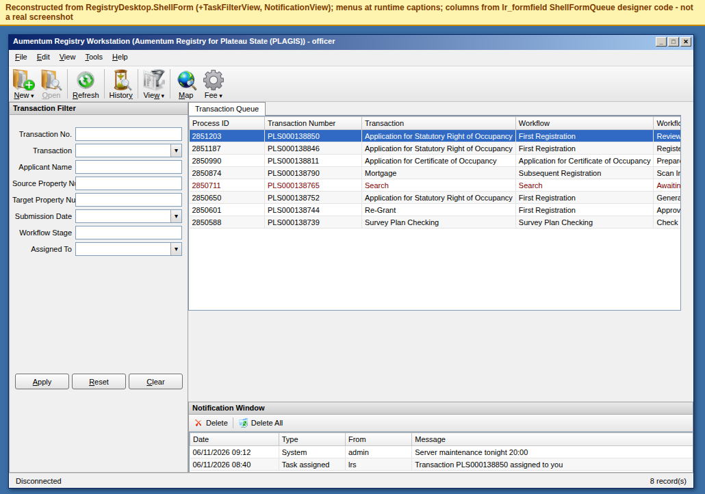

## 2. Menus, toolbar, context menus and shortcuts

Source: `RegistryDesktop.ShellForm` designer + `ApplyResourceStrings` (runtime captions) + `InitializeMainMenu` / `*_DropDownOpening` (visibility rules). Permissions are Alfresco/LRS permission names checked with `AccessControlAgent.IsPermissionExist/GetPermission`; settings are `lr_setting` keys (05 section 1.6 and 8).

### 2.1 Main menu

| Menu | Item (runtime caption) | Shortcut | Visible / enabled when | Permission / setting | Opens / does |
|---|---|---|---|---|---|
| File | &New > {group} > {transaction type} | - | signed in and the user may start at least one process definition | jBPM authorised definitions; `config/HideNormalTransactionCode`, `config/WFShowGroups`; `SupportRegistry=False` -> groups | new lodgement wizard, stage New (screens 10-15, 07) |
| File | &Log In... | - | always | - | ClickOnce update check, then LoginForm |
| File | Log &Out | - | signed in | - | ends the session (`AuthenticationService.endSession`), clears the queue |
| File | E&xit | Alt+F4 | always | - | closes the application |
| Edit | &Open | F2 (also double-click a row, toolbar Open) | exactly one stage across the selected rows and user is actor or member of the actor group | - (postponed tasks: only group "Postpone Clerk") | worker wizard for the task |
| Edit | Unlock | - | selected task locked by the current user | - | confirm "Are you sure you want to unlock current task?" -> `AuthoringService.UnLock` |
| Edit | &Assign... | - | one row | `lrsAssignTask` | Assign Task wizard (screen 23) |
| Edit | &Extension... | F7 | `config/LodgmentExtension=1` (not set at PLAGIS -> hidden) | - | lodgement extension worker |
| Edit | &Diary Book | F6 | `config/CheckDiaryBook=1` and permission (hidden at PLAGIS) | `lrsDiaryBook` | diary book worker |
| Edit | &Postpone Transaction | - | one row, not suspended, not completed | `lrsPostponeRegistration` | confirm "Are you sure you wish to postpone transaction?" -> reasons page (screen 22) |
| Edit | &Continue Transaction | - | one row, suspended | `lrsContinueRegistration` | confirm "Are you sure you wish to continue transaction?" -> resume |
| Edit | &Withdraw Transaction | - | one row, stage not in `non_withdrawable_tasks` | `lrsCancelRegistration` | confirm "Are you sure you wish to withdraw transaction?" (screen 52) -> reasons -> "Transaction {0} has been successfully withdrawn." |
| View | Transaction Details | F3 | one row | - | DetailsForm (screen 08) |
| View | Transaction Details in Web | - | one row | `config/LwaUrl` | opens Web Access `.../lrswa/welcome.do?...#detail:Transaction:<id>` in the default browser |
| View | View &Map | F6 | map integration on | `lrsMapAccess` + `mcintegration/IntegrationWithMC=1` | Core.MapForm (screen 34) |
| View | Transaction Filter | Ctrl+Shift+F | always | - | shows/hides the filter dock |
| View | Notification Window | Ctrl+Shift+N | always | - | shows/hides the notification dock |
| View | &History | F4 | one row | - | HistoryForm (screen 36) |
| View | Workflow Diagram | - | one row | - | BrowserForm with `/lrs/downloadBPM` (screen 51) |
| View | &Refresh | F5 | signed in | - | reloads the queue (Lucene query) |
| Tools | Change Password... | - | `config/RestrictChangePswd=0` | - | ChangePasswordForm (screen 39) |
| Tools | &Options... | - | always | - | OptionsForm (screen 38) |
| Tools | Signature &Enrolment... | - | `SupportSignature=True` (False at PLAGIS -> hidden) | - | signature wizard |
| Help | Contents | F1 | always | `HelpFile=WorkstationHelp.htm` (not captured) | HelpHtmForm |
| Help | &About... | - | always | - | AboutForm (screen 37) |

Note the clash in the designer: View Map and Diary Book both declare F6, Extension declares F7. At PLAGIS Diary Book and Extension are hidden, so F6 = View Map. The toolbar tooltips confirm: Open "Edit (F2)", Refresh "Refresh (F5)", History "Processing History (F4)", Map "View Map (F6)".

### 2.2 Toolbar (32x32 icons, text under icon, `_mainToolStrip`, height 52)

| Button (runtime caption) | Tooltip | Same as | Visible when |
|---|---|---|---|
| &New (drop-down of groups > types) | - | File > New | signed in |
| &Open | Edit (F2) | Edit > Open | enabled like Edit > Open |
| &Refresh | Refresh (F5) | View > Refresh | always |
| Histor&y | Processing History (F4) | View > History | always |
| Vie&w (drop-down: &All Transactions / Assigned to &Me / Assigned to My &Groups, check marks) | - | queue scope (05 1.6) | hidden when `config/RestrictTaskView=1` |
| &Map | View Map (F6) | View > View Map | as the menu item |
| Fee (drop-down: Configuration > Fee Structure / Fee Rate) | - | - | permission `lrsFeeConfiguration` |

### 2.3 Status bar

`_statusLabel` "Ready" / "Loading..." / "Disconnected"; `_filterLabel` "Filtered" in red, right-aligned, shown when the filter is active; `_recordsLabel` "{0} record(s)".

### 2.4 Context menus and other shortcuts

| Where | Items / keys | Source |
|---|---|---|
| Queue grid right-click | DevExpress column menu with grouping, filter-editor and footer items hidden (`OnShowGridMenu` hides GridStringId 36-39, 43, 75) - sort ascending/descending, best fit, column chooser remain (inferred mapping of the ids) | `ShellForm.OnShowGridMenu`, `BindingFactory2.OnShowGridMenu` |
| Wizard anywhere (right-click) | Cancel / Next / Back / Suspend (owner-drawn, 32 px icons) | `WizardBase.pmShortCuts` |
| Wizard keys | Esc = Cancel, F1 = help topic of the page, F2 = Next / Finish, F3 = Previous (key-hint line at the bottom) | `WizardBase.TfrmWizardBase_KeyDown`, `UpdateButtons/UpdateCaption` |
| Lookup editors | Down-arrow on an empty lookup selects the first real item | `BindingFactory2` KeyDown handler |
| Page toolbars | each page toolbar has an equal right-click menu (`pmToolbar` with New/Edit/Delete/...) | page designers (`miAdd`, `miEdit`...) |
| Complete Task transitions | right-click "Clear Selection" | `Core.CompleteAssignPage.contextMenuStrip1` |

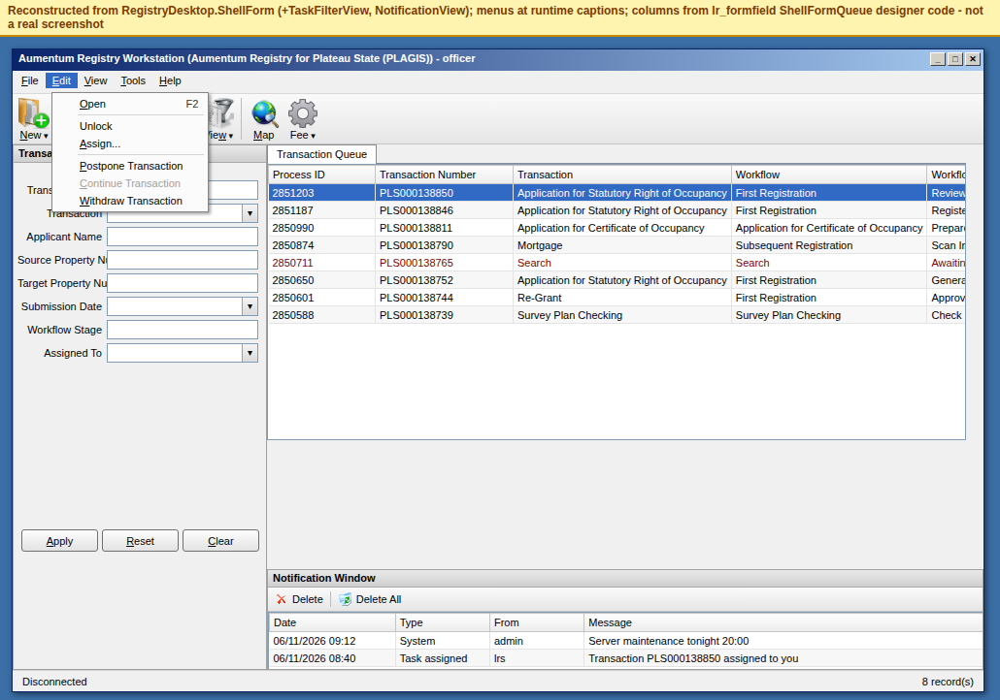


---

## 3. Screen catalogue by area

One entry per class with WinForms designer code (255 classes in 8 assemblies). Each entry gives: source file and resx, status at PLAGIS, purpose, where it is opened from (callers found in the decompiled code, form-factory calls resolved to the page that calls them), form events, `lr_formfield` bindings, screenshot(s), the control table (tree order; indentation = parent/child; "tab n" = TabIndex; geometry = Location, Size, Dock, Anchor), every message-box text the class can raise, and the other resource strings it uses (captions, prompts, hints). Base classes are listed once; PLAGIS subclasses list only what they add. Group 3.16 lists classes that are present but not used at PLAGIS.

### 3.1 Shell, login and common chrome

Start-up, sign-in, the main window and its docked views, and the generic dialogs/message boxes every other screen uses.

#### 3.1.1 SplashForm

- Source: `TAR.Controls.dll/TAR.Controls.Core/SplashForm.cs` (`TAR.Controls.Core`), base `Form`; form Text "Aumentum Registry Workstation"; design size 450x278; border None; start CenterScreen; resx `TAR.Controls.Core.SplashForm.resx`.
- Status at PLAGIS: Used (reachable from the PLAGIS configuration).
- Purpose: Borderless 450x278 splash with the product bitmap while services start and the login dialog is shown.
- Opened from: `ShellContext` constructor.

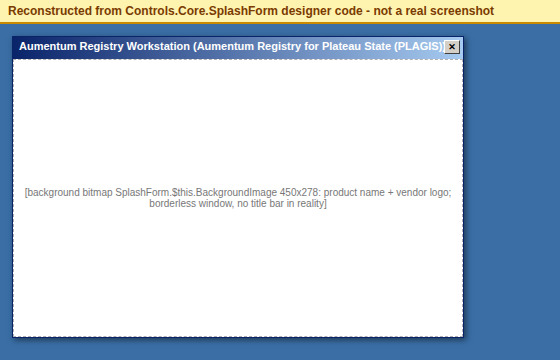

| Control | Type | Caption / label | Position / size | Bound field / data | Event handlers |
|---|---|---|---|---|---|
| lblProjectName | Label |  | 94,54 0x13 hidden | tab 0 |  |

#### 3.1.2 LoginForm

- Source: `TAR.Controls.dll/TAR.Controls.Core/LoginForm.cs` (`TAR.Controls.Core`), base `DialogForm`; form Text "Login"; design size 354x325; resx `TAR.Controls.Core.LoginForm.resx`.
- Status at PLAGIS: Used (reachable from the PLAGIS configuration).
- Purpose: Sign-in dialog. Server combo (history of up to 8 servers kept in the Windows registry `LoginSettings.ServerList`), user name, password. Language combo and "Working through Crypto Server" are hidden at PLAGIS (SupportBilingual=False, SupportCryptoServer=False).
- Opened from: `ShellContext.Authenticate` at start-up and File &gt; Log In...
- Form events: Load -&gt; `LoginForm_Load`, Shown -&gt; `LoginForm_VisibleChanged`, FormClosing -&gt; `LoginForm_FormClosing`
- Behaviour/validation: OK -&gt; `AuthenticationAgent.SignIn(server,user,password)`; on failure the exception text is shown (Warning) and the dialog re-opens; if no active RegistryOffice: "no active office" warning and sign-out. Focus goes to the first empty field (Server, then User Name, then Password).

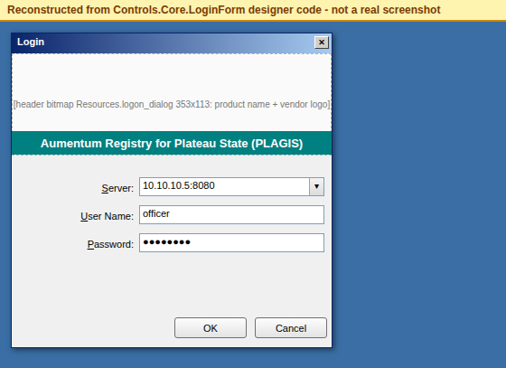

| Control | Type | Caption / label | Position / size | Bound field / data | Event handlers |
|---|---|---|---|---|---|
| tableLayoutPanel1 | TableLayoutPanel |  | 8,134 341x155 Anchor T+L+R | tab 11 |  |
| &nbsp;&nbsp;└ lblServer | Label | &Server: | 3,0 124x31 Dock Fill | tab 4 |  |
| &nbsp;&nbsp;└ lblUserName | Label | &User Name: | 3,31 124x31 Dock Fill | tab 5 |  |
| &nbsp;&nbsp;└ cbServer | ComboBox |  | 133,3 205x21 Anchor T+L+R | tab 1 |  |
| &nbsp;&nbsp;└ tbUserName | TextBox |  | 133,34 205x21 Anchor T+L+R | tab 2 |  |
| &nbsp;&nbsp;└ lblPassword | Label | &Password: | 3,62 124x31 Dock Fill | tab 6 |  |
| &nbsp;&nbsp;└ tbPassword | TextBox |  | 133,65 205x21 Anchor T+L+R | tab 3 |  |
| &nbsp;&nbsp;└ lblLanguage | Label | &Language: | 3,124 124x31 Dock Fill | tab 10 |  |
| &nbsp;&nbsp;└ cbLanguage | ComboBox |  | 133,127 205x21 Anchor T+L+R | tab 9 | SelectedIndexChanged-&gt;cbLanguage_SelectedIndexChanged |
| &nbsp;&nbsp;└ cbxCryptoServer | CheckBox | Working through Crypto Server -&gt; runtime: "Work through Crypto Server" | 133,96 205x17 Anchor T+L+R | tab 11 |  |
| lblProjectName | Label |  | 0,86 354x26 | tab 8 |  |
| pbHeaderImage | PictureBox |  | 0,0 354x113 Anchor T+L+R | tab 7 |  |
| btnCancel | SimpleButton | Cancel | 269,292 80x23 Anchor B+R | tab 1 |  |
| btnOK | SimpleButton | OK | 180,292 80x23 Anchor B+R | tab 0 |  |
| cultureManager | CultureManager |  |  |  | UICultureChanged-&gt;cultureManager_UICultureChanged |

Messages this class can show (MessageBoxService kind: text):

- Show: "Error"

<details><summary>Other resource strings used by LoginForm (8)</summary>

- `strOK` = "OK"
- `strCancel` = "Cancel"
- `strServer` = "&Server:"
- `strUserName` = "&User Name:"
- `strPassword` = "&Password:"
- `strLanguage` = "&Language:"
- `strCryptoServer` = "Work through Crypto Server"
- `strApplicationLogin` = "{0} Login"

</details>

#### 3.1.3 ShellForm

- Source: `TAR.RegistryDesktop.exe/TAR.RegistryDesktop/ShellForm.cs` (`TAR.RegistryDesktop`), base `Form`; form Text "Aumentum Registry Workstation"; design size 831x507; start CenterScreen; resx `TAR.RegistryDesktop.ShellForm.resx`.
- Status at PLAGIS: Used (reachable from the PLAGIS configuration).
- Purpose: Main window: menu bar, 32-px toolbar, docked Transaction Filter (left), Transaction Queue (centre, tabbed document), Notification Window (bottom), status bar (Ready/Loading/Disconnected, "Filtered" in red, "{0} record(s)"). See section 2 for every menu item.
- Opened from: Application start (after login).
- Form events: FormClosing -&gt; `ShellForm_FormClosing`, Load -&gt; `ShellForm_Load`
- Layout: SandDock layout is persisted per user (`ApplicationSettings.Layout`); the queue grid columns/widths are persisted (`DataViewerColumnSettings`). Queue grid: DevExpress BandedGridView, not editable, multi-select, no group panel, no indicator, no filter row, ColumnAutoWidth=false (horizontal scroll), even/odd row colours, master-detail rows (child list of tasks).


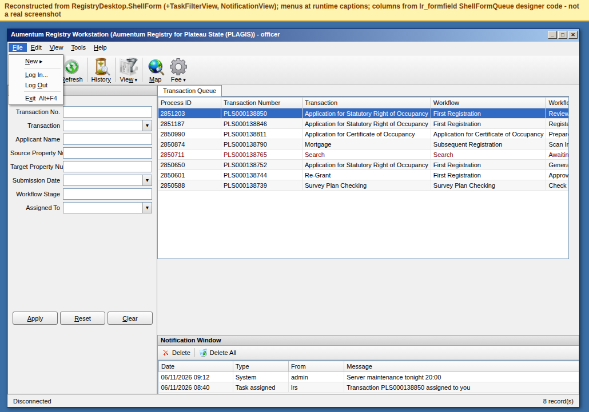


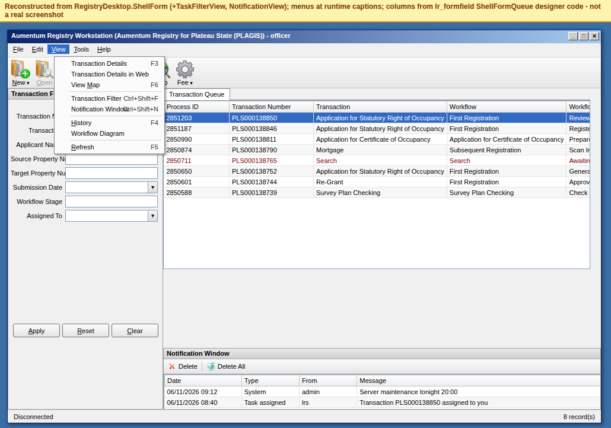

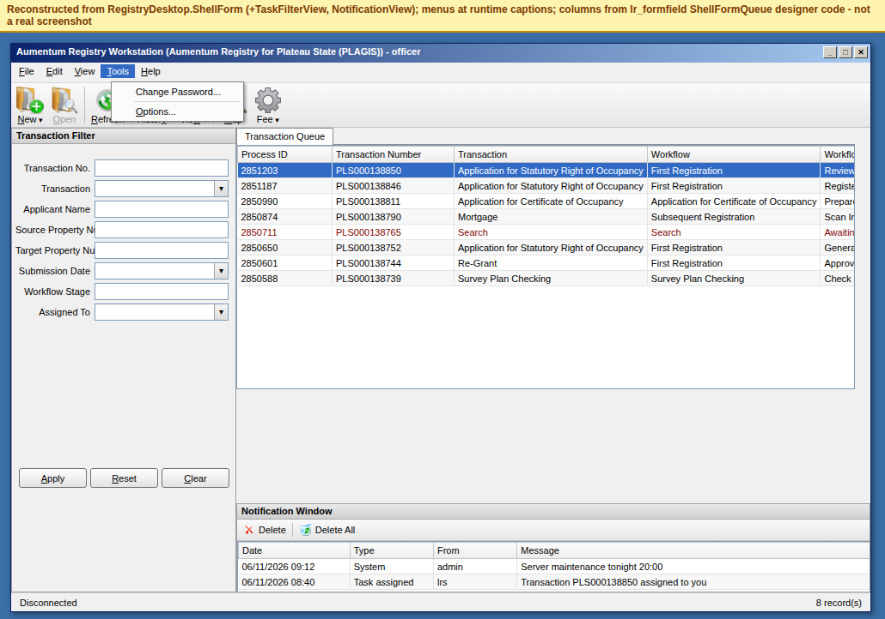

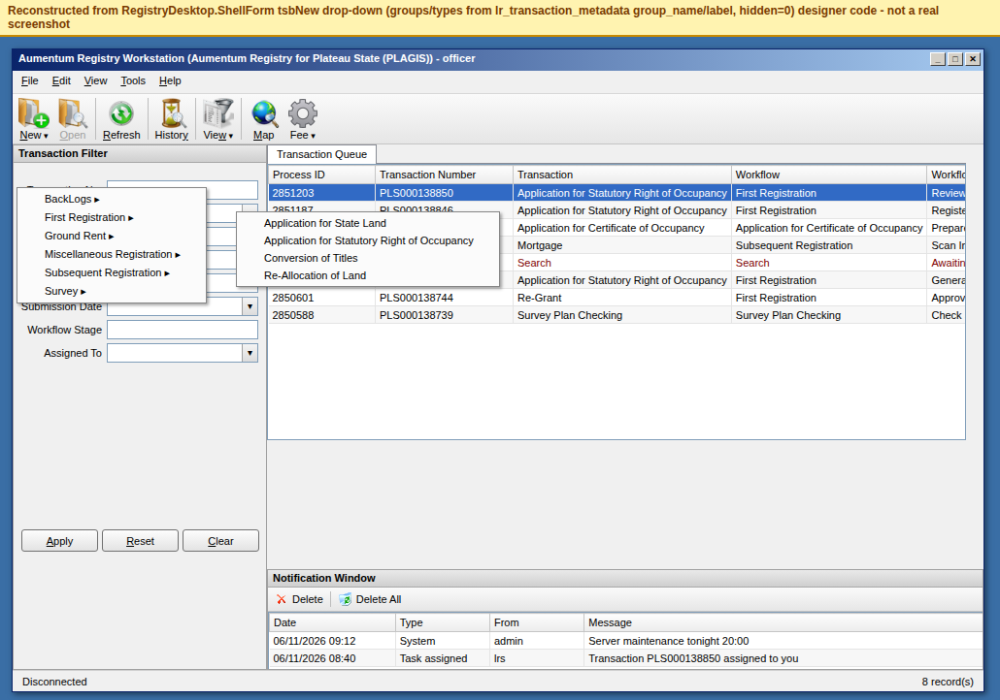

| Control | Type | Caption / label | Position / size | Bound field / data | Event handlers |
|---|---|---|---|---|---|
| toolStripContainer1 | ToolStripContainer | toolStripContainer1 | 0,24 831x461 Dock Fill | tab 2 |  |
| &nbsp;&nbsp;└ val | DocumentContainer |  | 104,0 727x305 | tab 0 |  |
| &nbsp;&nbsp;&nbsp;&nbsp;└ tabbedDocument | TabbedDocument | Transaction Queue | 1,21 725x283 | tab 0 |  |
| &nbsp;&nbsp;&nbsp;&nbsp;&nbsp;&nbsp;└ gridControl | GridControl |  | 0,0 725x283 Anchor T+B+L+R | tab 0 | DoubleClick-&gt;gridControl_DoubleClick, MouseDown-&gt;gridControl_MouseDown |
| &nbsp;&nbsp;└ val2 | DockContainer |  | 104,305 727x104 Dock Bottom | tab 2 |  |
| &nbsp;&nbsp;&nbsp;&nbsp;└ dwNotify | DockableWindow | Notification Window | 0,20 727x60 | tab 0 |  |
| &nbsp;&nbsp;&nbsp;&nbsp;&nbsp;&nbsp;└ notificationView | NotificationView |  | 0,0 727x60 Dock Fill | tab 0 |  |
| &nbsp;&nbsp;└ val3 | DockContainer |  | 0,0 104x409 Dock Left | tab 1 |  |
| &nbsp;&nbsp;&nbsp;&nbsp;└ dwFilter | DockableWindow | Transaction Filter | 0,16 100x369 | tab 1 |  |
| &nbsp;&nbsp;&nbsp;&nbsp;&nbsp;&nbsp;└ taskFilterView | TaskFilterView |  | 0,0 257x426 Dock Top | tab 0 |  |
| &nbsp;&nbsp;└ _mainToolStrip | ToolStrip |  | 0,0 831x52 | tab 0 |  |
| &nbsp;&nbsp;&nbsp;&nbsp;└ tsbNew | ToolStripDropDownButton | New -&gt; runtime: "&New" | 45x49 |  |  |
| &nbsp;&nbsp;&nbsp;&nbsp;└ tsbEdit | ToolStripButton | Open -&gt; runtime: "&Open" | 37x49 disabled |  | Click-&gt;miEditEdit_Click |
| &nbsp;&nbsp;&nbsp;&nbsp;└ tsSeparator1 | ToolStripSeparator |  | 6x52 |  |  |
| &nbsp;&nbsp;&nbsp;&nbsp;└ tsbRefresh | ToolStripButton | Refresh -&gt; runtime: "&Refresh" | 49x49 |  | Click-&gt;miViewRefresh_Click |
| &nbsp;&nbsp;&nbsp;&nbsp;└ toolStripSeparator7 | ToolStripSeparator |  | 6x52 |  |  |
| &nbsp;&nbsp;&nbsp;&nbsp;└ tsbHistory | ToolStripButton | History -&gt; runtime: "Histor&y" | 45x49 |  | Click-&gt;miViewHistory_Click |
| &nbsp;&nbsp;&nbsp;&nbsp;└ toolStripSeparator9 | ToolStripSeparator |  | 6x52 |  |  |
| &nbsp;&nbsp;&nbsp;&nbsp;└ tsbTask | ToolStripDropDownButton | View -&gt; runtime: "Vie&w" | 45x49 |  |  |
| &nbsp;&nbsp;&nbsp;&nbsp;└ tsSeparatorMap | ToolStripSeparator |  | 6x52 |  |  |
| &nbsp;&nbsp;&nbsp;&nbsp;└ tsbMap | ToolStripButton | Map -&gt; runtime: "&Map" | 36x49 |  | Click-&gt;miViewMap_Click |
| &nbsp;&nbsp;&nbsp;&nbsp;└ tbsConfigurationFee | ToolStripDropDownButton | Fee | 45x49 |  |  |
| &nbsp;&nbsp;&nbsp;&nbsp;&nbsp;&nbsp;└ feeStructureToolStripMenuItem | ToolStripMenuItem | Configuration | 139x22 |  |  |
| &nbsp;&nbsp;&nbsp;&nbsp;&nbsp;&nbsp;&nbsp;&nbsp;└ feeStructureToolStripMenuItem1 | ToolStripMenuItem | Fee Structure | 140x22 |  | Click-&gt;feeStructureToolStripMenuItem_Click |
| &nbsp;&nbsp;&nbsp;&nbsp;&nbsp;&nbsp;&nbsp;&nbsp;└ feeRateToolStripMenuItem | ToolStripMenuItem | Fee Rate | 140x22 |  | Click-&gt;feeRateToolStripMenuItem_Click |
| &nbsp;&nbsp;└ toolStripContainer1.RightToolStripPanel | ToolStripPanel |  |  |  |  |
| &nbsp;&nbsp;└ toolStripContainer1.BottomToolStripPanel | ToolStripPanel |  |  |  |  |
| &nbsp;&nbsp;└ toolStripContainer1.ContentPanel | ToolStripContentPanel |  | 831x409 |  |  |
| &nbsp;&nbsp;└ toolStripContainer1.TopToolStripPanel | ToolStripPanel |  |  |  |  |
| &nbsp;&nbsp;└ toolStripContainer1.LeftToolStripPanel | ToolStripPanel |  |  |  |  |
| _mainStatus | StatusStrip | statusStrip1 | 0,485 831x22 | tab 1 |  |
| &nbsp;&nbsp;└ _statusLabel | ToolStripStatusLabel | Ready | 44x17 |  |  |
| &nbsp;&nbsp;└ _filterLabel | ToolStripStatusLabel | Filtered | 766x17 |  |  |
| &nbsp;&nbsp;└ _recordsLabel | ToolStripStatusLabel |  | 6x17 |  |  |
| _mainMenu | MenuStrip | menuStrip1 | 0,0 831x24 | tab 0 |  |
| &nbsp;&nbsp;└ miFile | ToolStripMenuItem | &File | 35x20 |  | DropDownOpening-&gt;miFile_DropDownOpening |
| &nbsp;&nbsp;&nbsp;&nbsp;└ miFileNew | ToolStripMenuItem | &New | 132x22 |  |  |
| &nbsp;&nbsp;&nbsp;&nbsp;└ toolStripMenuItem1 | ToolStripSeparator |  | 129x6 |  |  |
| &nbsp;&nbsp;&nbsp;&nbsp;└ miFileConnect | ToolStripMenuItem | &Log In... | 132x22 |  | Click-&gt;miFileConnect_Click |
| &nbsp;&nbsp;&nbsp;&nbsp;└ miFileDisconnect | ToolStripMenuItem | Log &Out | 132x22 |  | Click-&gt;miFileDisconnect_Click |
| &nbsp;&nbsp;&nbsp;&nbsp;└ toolStripMenuItem3 | ToolStripSeparator |  | 129x6 |  |  |
| &nbsp;&nbsp;&nbsp;&nbsp;└ miFileExit | ToolStripMenuItem | E&xit | 132x22 key Alt+F4 |  | Click-&gt;miFileExit_Click |
| &nbsp;&nbsp;└ miEdit | ToolStripMenuItem | &Edit | 37x20 |  | DropDownOpening-&gt;miEdit_DropDownOpening |
| &nbsp;&nbsp;&nbsp;&nbsp;└ miEditEdit | ToolStripMenuItem | &Open | 142x22 disabled key F2 |  | Click-&gt;miEditEdit_Click |
| &nbsp;&nbsp;&nbsp;&nbsp;└ toolStripMenuItem4 | ToolStripSeparator |  | 139x6 |  |  |
| &nbsp;&nbsp;&nbsp;&nbsp;└ miEditUnlock | ToolStripMenuItem | Unlock | 142x22 |  | Click-&gt;miEditUnlock_Click |
| &nbsp;&nbsp;&nbsp;&nbsp;└ miEditAssign | ToolStripMenuItem | &Assign Task... -&gt; runtime: "&Assign..." | 142x22 |  | Click-&gt;miEditAssign_Click |
| &nbsp;&nbsp;└ miView | ToolStripMenuItem | &View | 41x20 |  | DropDownOpening-&gt;miView_DropDownOpening |
| &nbsp;&nbsp;&nbsp;&nbsp;└ miViewDetail | ToolStripMenuItem | Transaction Details | 238x22 key F3 |  | Click-&gt;miViewDetail_Click |
| &nbsp;&nbsp;&nbsp;&nbsp;└ miViewDetailWeb | ToolStripMenuItem | Transaction Details in Web | 238x22 |  | Click-&gt;miViewDetailWeb_Click |
| &nbsp;&nbsp;&nbsp;&nbsp;└ miViewMap | ToolStripMenuItem | View Map -&gt; runtime: "View &Map" | 238x22 key F6 |  | Click-&gt;miViewMap_Click |
| &nbsp;&nbsp;&nbsp;&nbsp;└ toolStripSeparator4 | ToolStripSeparator |  | 235x6 |  |  |
| &nbsp;&nbsp;&nbsp;&nbsp;└ miViewTaskFilter | ToolStripMenuItem | Transaction Filter | 238x22 key Ctrl+Shift+F |  | Click-&gt;miView_Click |
| &nbsp;&nbsp;&nbsp;&nbsp;└ miViewNotifyWindow | ToolStripMenuItem | Notification Window | 238x22 key Ctrl+Shift+N |  | Click-&gt;miView_Click |
| &nbsp;&nbsp;&nbsp;&nbsp;└ toolStripSeparator8 | ToolStripSeparator |  | 235x6 |  |  |
| &nbsp;&nbsp;&nbsp;&nbsp;└ miViewHistory | ToolStripMenuItem | &History | 238x22 key F4 |  | Click-&gt;miViewHistory_Click |
| &nbsp;&nbsp;&nbsp;&nbsp;└ miViewWfDiagram | ToolStripMenuItem | runtime: "Workflow Diagram" | 238x22 |  | Click-&gt;miViewWfDiagram_Click |
| &nbsp;&nbsp;&nbsp;&nbsp;└ toolStripMenuItem6 | ToolStripSeparator |  | 235x6 |  |  |
| &nbsp;&nbsp;&nbsp;&nbsp;└ miViewRefresh | ToolStripMenuItem | &Refresh | 238x22 key F5 |  | Click-&gt;miViewRefresh_Click |
| &nbsp;&nbsp;└ miTools | ToolStripMenuItem | &Tools | 44x20 |  | DropDownOpening-&gt;miTools_DropDownOpening |
| &nbsp;&nbsp;&nbsp;&nbsp;└ miToolsChangePassword | ToolStripMenuItem | Change Password... | 183x22 |  | Click-&gt;miToolsChangePassword_Click |
| &nbsp;&nbsp;&nbsp;&nbsp;└ toolStripMenuItem9 | ToolStripSeparator |  | 180x6 |  |  |
| &nbsp;&nbsp;&nbsp;&nbsp;└ miToolsOptions | ToolStripMenuItem | &Options... | 183x22 |  | Click-&gt;miToolsOptions_Click |
| &nbsp;&nbsp;&nbsp;&nbsp;└ toolStripSeparator3 | ToolStripSeparator |  | 180x6 |  |  |
| &nbsp;&nbsp;&nbsp;&nbsp;└ miToolsSignatureEnrolment | ToolStripMenuItem | Signature &Enrolment... | 183x22 |  | Click-&gt;miToolsSignatureEnrolment_Click |
| &nbsp;&nbsp;└ miHelp | ToolStripMenuItem | &Help | 40x20 |  |  |
| &nbsp;&nbsp;&nbsp;&nbsp;└ miHelpContents | ToolStripMenuItem | Contents | 137x22 key F1 |  | Click-&gt;miHelpContents_Click |
| &nbsp;&nbsp;&nbsp;&nbsp;└ toolStripMenuItem8 | ToolStripSeparator |  | 134x6 |  |  |
| &nbsp;&nbsp;&nbsp;&nbsp;└ miHelpAbout | ToolStripMenuItem | &About... | 137x22 |  | Click-&gt;miHelpAbout_Click |
| sandDockManager | SandDockManager |  |  |  |  |
| contextMenuStrip1 | ContextMenuStrip |  | 185x70 |  |  |
| &nbsp;&nbsp;└ tsmiAllTasks | ToolStripMenuItem | All Transactions -&gt; runtime: "&All Transactions" | 184x22 |  | Click-&gt;taskMenuItem_Click |
| &nbsp;&nbsp;└ tsmiMyTasks | ToolStripMenuItem | Assigned to Me -&gt; runtime: "Assigned to &Me" | 184x22 |  | Click-&gt;taskMenuItem_Click |
| &nbsp;&nbsp;└ tsmiByMyGroups | ToolStripMenuItem | Assigned to My Groups -&gt; runtime: "Assigned to My &Groups" | 184x22 |  | Click-&gt;taskMenuItem_Click |
| gridViewTask | BandedGridView |  |  |  | CustomDrawCell-&gt;gridViewTask_CustomDrawCell, MasterRowEmpty-&gt;gridViewTask_MasterRowEmpty, MasterRowGetLevelDefaultView-&gt;gridViewTask_MasterRowGetLevelDefaultView, MasterRowGetChildList-&gt;gridViewTask_MasterRowGetChildList, MasterRowGetRelationName-&gt;gridViewTask_MasterRowGetRelationName, MasterRowGetRelationCount-&gt;gridViewTask_MasterRowGetRelationCount, ShowGridMenu-&gt;OnShowGridMenu, SelectionChanged-&gt;gridView_SelectionChanged, FocusedRowChanged-&gt;gridView_FocusedRowChanged |
| &nbsp;&nbsp;└ gridBand1 | GridBand |  |  |  |  |
| toolStripMenuItem5 | ToolStripSeparator |  | 178x6 |  |  |
| miEditPostpone | ToolStripMenuItem | &Postpone Registration -&gt; runtime: "&Postpone Transaction" | 181x22 |  | Click-&gt;miEditPostpone_Click |
| miEditContinue | ToolStripMenuItem | &Continue Registration -&gt; runtime: "&Continue Transaction" | 181x22 |  | Click-&gt;miEditContinue_Click |
| miEditWithdrawal | ToolStripMenuItem | &Withdraw Registration -&gt; runtime: "&Withdraw Transaction" | 181x22 |  | Click-&gt;miEditWithdrawal_Click |
| toolStripSeparator2 | ToolStripSeparator |  | 178x6 |  |  |
| miEditDiaryBook | ToolStripMenuItem | &Diary Book | 181x22 key F6 |  | Click-&gt;miEditDiaryBook_Click |
| miEditExtension | ToolStripMenuItem | &Extension... | 181x22 key F7 |  | Click-&gt;miEditExtension_Click |
| cultureManager | CultureManager |  |  |  | UICultureChanged-&gt;cultureManager_UICultureChanged |
| alertControl | AlertControl |  |  |  |  |

Messages this class can show (MessageBoxService kind: text):

- Error: "&lt;exception message&gt;"
- Warning: "&lt;exception message&gt;"
- Info: "&lt;exception message&gt;"
- Info: "Access denied. You cannot edit this transaction."
- Info: "The transaction is assigned to user {0} ({1}). You cannot edit this transaction."
- Warning: "Selected transactions are postponed. You do not have permissions to continue registration."
- Confirm: "Selected transactions are postponed. Continue registration?"
- Confirm: "Are you sure you want to unlock current task?"
- Info: "The withdrawal of transaction is not allowed at this stage."
- Confirm: "Are you sure you wish to withdraw transaction?"
- Info: "Transaction {0} has been successfully withdrawn."
- Confirm: "Are you sure you wish to postpone transaction?"
- Confirm: "Are you sure you wish to continue transaction?"

<details><summary>Other resource strings used by ShellForm (58)</summary>

- `strSandDockAutoHide` = "Auto Hide"
- `strSandDockClose` = "Close"
- `strSandDockScrollLeft` = "Scroll Left"
- `strSandDockScrollRight` = "Scroll Right"
- `strSandDockWindowPosition` = "Window Position"
- `strFile` = "&File"
- `strFileNew` = "&New"
- `strLogin` = "&Log In..."
- `strLogout` = "Log &Out"
- `strExit` = "E&xit"
- `strEdit` = "&Edit"
- `strEditTask` = "&Open"
- `strUnLock` = "Unlock"
- `strAssignTask` = "&Assign..."
- `strDiaryBook` = "&Diary Book"
- `strExtension` = "&Extension..."
- `strPostpone` = "&Postpone Transaction"
- `strContinue` = "&Continue Transaction"
- `strWithdraw` = "&Withdraw Transaction"
- `strView` = "&View"
- `strViewDetails` = "Transaction Details"
- `strViewInLWA` = "Transaction Details in Web"
- `strViewWfDiagram` = "Workflow Diagram"
- `strViewMap` = "View &Map"
- `strTransactionFilter` = "Transaction Filter"
- `strNotificationWindow` = "Notification Window"
- `strHistory` = "&History"
- `strRefresh` = "&Refresh"
- `strTools` = "&Tools"
- `strChangePassword` = "Change Password..."
- `strOptions` = "&Options..."
- `strSignatureEnrolment` = "Signature &Enrolment..."
- `strHelp` = "&Help"
- `strContents` = "Contents"
- `strAbout` = "&About..."
- `strEditToolButton` = "&Open"
- `strEditToolTip` = "Edit (F2)"
- `strRefreshToolButton` = "&Refresh"
- `strRefreshToolTip` = "Refresh (F5)"
- `strHistoryToolButton` = "Histor&y"
- `strHistoryToolTip` = "Processing History (F4)"
- `strTransactionView` = "Vie&w"
- `strAllTransactions` = "&All Transactions"
- `strAssignedToMe` = "Assigned to &Me"
- `strAssignedToMyGroups` = "Assigned to My &Groups"
- `strMapToolButton` = "&Map"
- `strMapToolTip` = "View Map (F6)"
- `strRegistrationQueue` = "Transaction Queue"
- `errCantEditCompletedTask` = "Cannot edit task. Task already completed by another user."
- `strViewWfDiagramTitle` = "Workflow Diagram: {0}"
- `strReady` = "Ready"
- `strLoading` = "Loading..."
- `strDisconnected` = "Disconnected"
- `strRecords` = "{0} record(s)"
- `strFiltered` = "Filtered"
- `strNoRegistrOffice` = "&lt;NO REGISTRATION OFFICE&gt;"
- `strNoFullName` = "&lt;NO FULL NAME&gt;"
- `strSystemMessageTitle` = "Aumentum Registry Message"

</details>

#### 3.1.4 TaskFilterView

- Source: `TAR.RegistryDesktop.exe/TAR.RegistryDesktop/TaskFilterView.cs` (`TAR.RegistryDesktop`), base `UserControl`; design size 257x426; min 257x0; resx `TAR.RegistryDesktop.TaskFilterView.resx`.
- Status at PLAGIS: Used (reachable from the PLAGIS configuration).
- Purpose: Transaction Filter dock: fields from lr_formfield `TaskFilterForm` laid out by `EditPanel` (TableLayout binding: label column, editor column).
- Opened from (code references): `ShellForm.InitializeComponent`
- Form events: Load -&gt; `TaskFilterView_Load`
- lr_formfield bindings in code: _meta -&gt; "TaskFilterForm"
- Behaviour/validation: Apply builds a Lucene clause (string fields become AND-ed word tokens minus English stop words; dates become a [day T00:00 TO T12:00] range; lockOwner uses @cm) and refreshes the queue; Clear empties the fields; Reset = Clear + Apply. The serialized filter is saved in the user settings; the status bar shows "Filtered".

| Control | Type | Caption / label | Position / size | Bound field / data | Event handlers |
|---|---|---|---|---|---|
| pnlFilter | EditPanel |  | 0,0 257x371 Anchor T+B+L+R | tab 0 |  |
| pnlTop | TableLayoutPanel |  | 0,377 254x46 Anchor T+R | tab 4 |  |
| &nbsp;&nbsp;└ btnReset | Button | &Reset | 86,1 79x23 Anchor T+R | tab 9 | Click-&gt;btnReset_Click |
| &nbsp;&nbsp;└ btnClear | Button | &Clear | 169,1 79x23 Anchor T+R | tab 10 | Click-&gt;btnClear_Click |
| &nbsp;&nbsp;└ btnSearch | Button | &Apply | 3,1 79x23 Anchor T+R | tab 8 | Click-&gt;btnSearch_Click |

<details><summary>Other resource strings used by TaskFilterView (3)</summary>

- `strApply` = "&Apply"
- `strReset` = "&Reset"
- `strClearFilter` = "&Clear"

</details>

#### 3.1.5 NotificationView

- Source: `TAR.RegistryDesktop.exe/TAR.RegistryDesktop/NotificationView.cs` (`TAR.RegistryDesktop`), base `UserControl`; design size 447x174; resx `TAR.RegistryDesktop.NotificationView.resx`.
- Status at PLAGIS: Used (reachable from the PLAGIS configuration).
- Purpose: Notification Window dock: grid of messages received through the JMS-style messaging subscription, toolbar Delete / Clear. Messages are cached in %AppData%\_lrsIndexerMessage_&lt;user&gt;.xml.
- Opened from (code references): `ShellForm.InitializeComponent`
- Form events: Load -&gt; `NotificationView_Load`

| Control | Type | Caption / label | Position / size | Bound field / data | Event handlers |
|---|---|---|---|---|---|
| dataViewerEx1 | DataViewerEx |  | 0,25 447x149 Dock Fill | tab 1 |  |
| toolStrip1 | ToolStrip | toolStrip1 | 0,0 447x25 | tab 0 |  |
| &nbsp;&nbsp;└ tsbDelete | ToolStripButton | Delete | 60x22 |  | Click-&gt;tsbDelete_Click |
| &nbsp;&nbsp;└ toolStripSeparator1 | ToolStripSeparator |  | 6x25 |  |  |
| &nbsp;&nbsp;└ tsbClearAll | ToolStripButton | Clear -&gt; runtime: "Delete All" | 54x22 |  | Click-&gt;tsbClearAll_Click |

<details><summary>Other resource strings used by NotificationView (8)</summary>

- `strDate` = "Date"
- `strStatus` = "Status"
- `strDetails` = "Transaction Details"
- `strSender` = "Sender"
- `strDelete` = "Delete"
- `strDeleteToolTip` = "Delete selected notification"
- `strClear` = "Delete All"
- `strClearToolTip` = "Delete all notifications"

</details>

#### 3.1.6 DetailsForm

- Source: `TAR.RegistryDesktop.exe/TAR.RegistryDesktop/DetailsForm.cs` (`TAR.RegistryDesktop`), base `BaseForm`; form Text "Details"; design size 562x459; start CenterParent; resx `TAR.RegistryDesktop.DetailsForm.resx`.
- Status at PLAGIS: Used (reachable from the PLAGIS configuration).
- Purpose: View &gt; Transaction Details (F3): read-only fields of lr_formfield `ShellFormQueueDetails` for the selected queue row.
- Opened from (code references): `ShellForm.miViewDetail_Click`
- Form events: Activated -&gt; `DetailsForm_Activated`, FormClosing -&gt; `DetailsForm_FormClosing`, Load -&gt; `DetailsForm_Load`

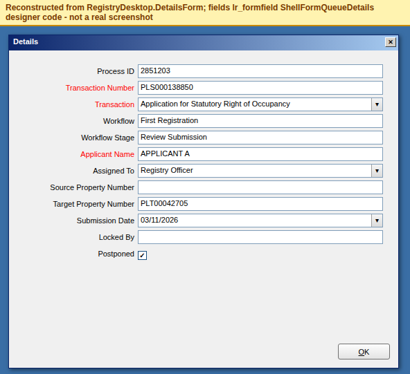

| Control | Type | Caption / label | Position / size | Bound field / data | Event handlers |
|---|---|---|---|---|---|
| panel | Panel |  | 12,12 538x406 Anchor T+B+L+R | tab 3 |  |
| btnOK | Button | &OK | 475,424 75x23 Anchor B+R | tab 2 |  |

<details><summary>Other resource strings used by DetailsForm (2)</summary>

- `strDetails` = "Transaction Details"
- `strOK` = "&OK"

</details>

#### 3.1.7 CustomMessageForm

- Source: `TAR.Common.dll/TAR.Common.Services/CustomMessageForm.cs` (`TAR.Common.Services`), base `Form`; form Text "CustomMessageForm"; design size 305x135; min 240x39; border FixedSingle; start CenterParent.
- Status at PLAGIS: Used (reachable from the PLAGIS configuration).
- Purpose: The message box used by every `MBoxService.Info/Warning/Error/Confirm` call: white top panel with the system icon and text, up to three buttons bottom-right (OK / Yes / No / Cancel / Abort / Retry / Ignore from resources mbx*). Title = Application.ProductName = "Aumentum Registry Workstation".
- Opened from (code references): `CustomMessageBox.Show`

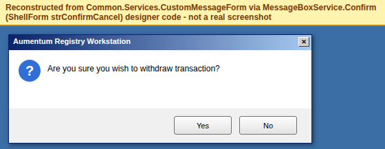

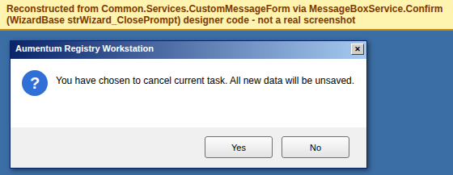

| Control | Type | Caption / label | Position / size | Bound field / data | Event handlers |
|---|---|---|---|---|---|
| flowLayoutPanel1 | FlowLayoutPanel |  | -3,-2 314x85 Anchor T+B+L | tab 6 |  |
| &nbsp;&nbsp;└ pictureBoxForIcon | PictureBox |  | 30,27 32x32 | tab 4 |  |
| &nbsp;&nbsp;└ textBoxMessage | Label | &lt;message&gt; | 69,34 72x15 | tab 5 |  |
| button3 | Button | button3 | 207,95 84x27 Anchor B+R hidden | tab 2 |  |
| button2 | Button | button2 | 112,95 84x27 Anchor B+R hidden | tab 1 |  |
| button1 | Button | button1 | 18,95 84x27 Anchor B+R hidden | tab 0 |  |

<details><summary>Other resource strings used by CustomMessageForm (7)</summary>

- `mbxOK` = "&OK"
- `mbxCancel` = "&Cancel"
- `mbxYes` = "&Yes"
- `mbxNo` = "&No"
- `mbxAbort` = "&Abort"
- `mbxRetry` = "&Retry"
- `mbxIgnore` = "&Ignore"

</details>

#### 3.1.8 CustomMessageForm2

- Source: `TAR.Common.dll/TAR.Common.Services/CustomMessageForm2.cs` (`TAR.Common.Services`), base `Form`; form Text "CustomMessageForm"; design size 453x166; min 318x41; border FixedSingle; start CenterParent.
- Status at PLAGIS: Used (reachable from the PLAGIS configuration).
- Purpose: Larger variant (CustomMessageBox2).
- Opened from (code references): `CustomMessageBox2.Show`

| Control | Type | Caption / label | Position / size | Bound field / data | Event handlers |
|---|---|---|---|---|---|
| flowLayoutPanel1 | FlowLayoutPanel |  | 0,0 453x110 Dock Fill | tab 6 |  |
| &nbsp;&nbsp;└ pictureBoxForIcon | PictureBox |  | 40,33 43x39 | tab 4 |  |
| &nbsp;&nbsp;└ panel2 | Panel |  | 95,3 142x75 | tab 6 |  |
| &nbsp;&nbsp;&nbsp;&nbsp;└ textBoxMessage | Label | &lt;message&gt; | 8,39 87x18 | tab 5 |  |
| panel1 | Panel |  | 0,110 453x56 Dock Bottom | tab 7 |  |
| &nbsp;&nbsp;└ button2 | Button | button2 | 192,12 112x33 Anchor B+R hidden | tab 1 |  |
| &nbsp;&nbsp;└ button3 | Button | button3 | 328,12 112x33 Anchor B+R hidden | tab 2 |  |
| &nbsp;&nbsp;└ button1 | Button | button1 | 59,12 112x33 Anchor B+R hidden | tab 0 |  |

<details><summary>Other resource strings used by CustomMessageForm2 (7)</summary>

- `mbxOK` = "&OK"
- `mbxCancel` = "&Cancel"
- `mbxYes` = "&Yes"
- `mbxNo` = "&No"
- `mbxAbort` = "&Abort"
- `mbxRetry` = "&Retry"
- `mbxIgnore` = "&Ignore"

</details>

#### 3.1.9 ProgressDialog

- Source: `TAR.Controls.dll/TAR.Controls.Core/ProgressDialog.cs` (`TAR.Controls.Core`), base `Form`; form Text "ProgressDialog"; design size 336x114; border FixedDialog; start CenterParent; resx `TAR.Controls.Core.ProgressDialog.resx`.
- Status at PLAGIS: Used (reachable from the PLAGIS configuration).
- Purpose: Progress window shown while the batch is saved (`AssessWorker.DoSaveBatch`).
- Opened from (code references): `AssessWorker.DoSaveBatch`

| Control | Type | Caption / label | Position / size | Bound field / data | Event handlers |
|---|---|---|---|---|---|
| pictureBox | PictureBox |  | 12,2 272x60 | tab 3 |  |
| cancelButton | Button | Cancel -&gt; runtime: "&Cancel" | 253,85 75x23 Anchor B+R disabled | tab 2 |  |
| progressBar | ProgressBar |  | 12,85 235x22 Anchor B+L+R | tab 1 |  |
| taskLabel | Label | Please wait... | 9,66 70x13 Anchor B+L | tab 0 |  |

<details><summary>Other resource strings used by ProgressDialog (2)</summary>

- `mbxCancel` = "&Cancel"
- `strProgress` = "complete"

</details>

#### 3.1.10 InputForm

- Source: `TAR.Controls.dll/TAR.Controls.Core/InputForm.cs` (`TAR.Controls.Core`), base `DialogForm`; design size 381x217; resx `TAR.Controls.Core.InputForm.resx`.
- Status at PLAGIS: Used (reachable from the PLAGIS configuration).
- Purpose: Single-value input prompt (InputForm.ShowInput).
- Opened from (code references): `TransactionListPage.ButtonSetFee_Click`
- Form events: Shown -&gt; `InputForm_Shown`

| Control | Type | Caption / label | Position / size | Bound field / data | Event handlers |
|---|---|---|---|---|---|
| txtComment | TextBox |  | 12,91 350x78 | tab 5 |  |
| lblComment | Label | Comments | 9,75 57x13 | tab 4 |  |
| txtValue | TextBox |  | 12,41 350x21 | tab 3 |  |
| lblMessage | Label | Value | 9,25 33x13 | tab 0 |  |
| btnCancel | SimpleButton | Cancel | 287,184 80x23 Anchor B+R | tab 1 | Click-&gt;btnCancel_Click |
| btnOK | SimpleButton | OK | 203,184 80x23 Anchor B+R | tab 0 | Click-&gt;btnOK_Click |

#### 3.1.11 DialogForm

- Source: `TAR.Controls.dll/TAR.Controls.Core/DialogForm.cs` (`TAR.Controls.Core`), base `BaseForm`; form Text "DialogForm"; design size 424x391; border FixedDialog; start CenterParent; resx `TAR.Controls.Core.DialogForm.resx`.
- Status at PLAGIS: Base class only (its controls appear in every subclass).
- Purpose: Base of all OK/Cancel dialogs: OK at (246,358) and Cancel at (330,358) 75x23, anchored bottom-right; FixedDialog, centred on parent, no min/max box.
- Form events: Load -&gt; `DialogForm_Load`

| Control | Type | Caption / label | Position / size | Bound field / data | Event handlers |
|---|---|---|---|---|---|
| btnCancel | SimpleButton | Cancel | 325,358 80x23 Anchor B+R | tab 1 |  |
| btnOK | SimpleButton | OK | 236,358 80x23 Anchor B+R | tab 0 |  |

<details><summary>Other resource strings used by DialogForm (2)</summary>

- `strOK` = "OK"
- `strCancel` = "Cancel"

</details>

#### 3.1.12 BaseForm

- Source: `TAR.Controls.dll/TAR.Controls.Core/BaseForm.cs` (`TAR.Controls.Core`), base `XtraForm`; form Text "BaseForm"; design size 562x459; resx `TAR.Controls.Core.BaseForm.resx`.
- Status at PLAGIS: Base class only (its controls appear in every subclass).
- Purpose: Base XtraForm (icon, F1 help hook).
- Form events: Load -&gt; `BaseForm_Load`, HelpRequested -&gt; `BaseForm_HelpRequested`, Resize -&gt; `BaseForm_Resize`

#### 3.1.13 BaseEditorForm

- Source: `TAR.Controls.dll/TAR.Controls.Core/BaseEditorForm.cs` (`TAR.Controls.Core`), base `DialogForm`; design size 555x373; resx `TAR.Controls.Core.BaseEditorForm.resx`.
- Status at PLAGIS: Base class only (its controls appear in every subclass).
- Purpose: Base of View/Edit dialogs: XtraTabControl with "Main" and "Additional" tabs above OK/Cancel.

| Control | Type | Caption / label | Position / size | Bound field / data | Event handlers |
|---|---|---|---|---|---|
| xtraTabControl1 | XtraTabControl |  | 4,4 550x330 Anchor T+B+L+R | tab 2 |  |
| &nbsp;&nbsp;└ tpMain | XtraTabPage | General Information | 543x301 |  |  |
| &nbsp;&nbsp;└ tpAdditional | XtraTabPage | Additional Information | 543x301 |  |  |
| &nbsp;&nbsp;└ tpAdditional2 | XtraTabPage | Additional Information | 543x301 |  |  |
| btnCancel | SimpleButton | Cancel | 461,340 80x23 Anchor B+R | tab 1 | Click-&gt;btnCancel_Click |
| btnOK | SimpleButton | OK | 377,340 80x23 Anchor B+R | tab 0 | Click-&gt;btnOK_Click |

#### 3.1.14 AboutForm

- Source: `TAR.Controls.dll/TAR.Controls.Core/AboutForm.cs` (`TAR.Controls.Core`), base `Form`; form Text "About"; design size 585x449; border FixedSingle; start CenterScreen; resx `TAR.Controls.Core.AboutForm.resx`.
- Status at PLAGIS: Used (reachable from the PLAGIS configuration).
- Purpose: Help &gt; About: copyright, LEADTOOLS notice, Information property grid and Loaded Assemblies list.
- Opened from (code references): `ShellForm.miHelpAbout_Click`
- Form events: Load -&gt; `AboutForm_Load`, HelpRequested -&gt; `AboutForm_HelpRequested`

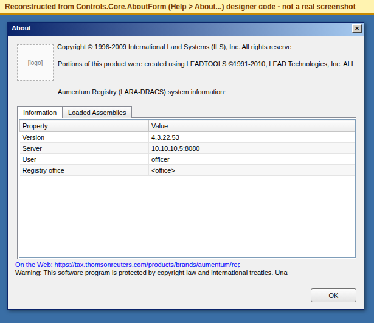

| Control | Type | Caption / label | Position / size | Bound field / data | Event handlers |
|---|---|---|---|---|---|
| lblLeadtools | Label | Portions of this product were created using LEADTOOLS ©1991-2010, LEAD Technologies, Inc.  ALL RIGHTS RESERVED.  Portions of this product are licensed under US patent 5,327,254 and foreign counterparts. | 82,40 491x44 | tab 8 |  |
| tabControl1 | TabControl |  | 15,114 558x253 | tab 7 |  |
| &nbsp;&nbsp;└ tabPage1 | TabPage | Information | 4,22 550x227 | tab 0 |  |
| &nbsp;&nbsp;&nbsp;&nbsp;└ _infoGrid | PropertyGrid |  | 3,3 544x221 Dock Fill | tab 0 |  |
| &nbsp;&nbsp;└ tabPage2 | TabPage | Loaded Assemblies | 4,22 550x227 | tab 1 |  |
| &nbsp;&nbsp;&nbsp;&nbsp;└ _assemblyListView | ListView |  | 3,3 544x221 Dock Fill | tab 0 |  |
| &nbsp;&nbsp;&nbsp;&nbsp;&nbsp;&nbsp;└ cheader1 | ColumnHeader | Name |  |  |  |
| &nbsp;&nbsp;&nbsp;&nbsp;&nbsp;&nbsp;└ cheader2 | ColumnHeader | Version |  |  |  |
| &nbsp;&nbsp;&nbsp;&nbsp;&nbsp;&nbsp;└ cheader3 | ColumnHeader | Location |  |  |  |
| pictureBox1 | PictureBox |  | 15,14 60x60 | tab 6 |  |
| linkLabel1 | LinkLabel | On the Web: https://tax.thomsonreuters.com/products/brands/aumentum/registry/ | 12,370 369x13 | tab 5 | LinkClicked-&gt;linkLabel1_LinkClicked |
| lblCopyRight | Label | Copyright © 2013 Thomson Reuters. All rights reserved. -&gt; runtime: "Copyright © 1996-2009 International Land Systems (ILS), Inc. All rights reserved." | 81,12 385x29 | tab 4 | Click-&gt;lblCopyRight_Click |
| lblSystemInfo | Label | Aumentum Registry (LARA-DRACS) system information: | 82,86 395x29 | tab 3 |  |
| lblWarning | Label | Warning: This software program is protected by copyright law and international treaties. Unauthorized reproduction or distribution of this program, or any portion of it may result in severe civil or criminal penalties, and will be prosecuted to the fullest extent of the law. | 12,383 449x55 | tab 1 |  |
| btnOk | Button | OK | 498,415 75x23 | tab 0 |  |

Messages this class can show (MessageBoxService kind: text):

- Show: "The website could not be opened."

<details><summary>Other resource strings used by AboutForm (11)</summary>

- `strAboutSystemInformation` = "{0}{1} system information:"
- `strAbout` = "About"
- `strOK` = "OK"
- `strCopyRight` = "Copyright © 1996-2009 International Land Systems (ILS), Inc. All rights reserved."
- `strLeadtoolsCopyRight` = "Portions of this product were created using LEADTOOLS ©1991-2010, LEAD Technologies, Inc.  ALL RIGHTS RESERVED.  Portions of this product are licensed under US patent 5,327,254 and foreign counterpart"
- `strLicenseWarning` = "Warning: This software program is protected by copyright law and international treaties. Unauthorized reproduction or distribution of this program, or any portion of it may result in severe civil or c"
- `strInformation` = "Information"
- `strLoadedAssemblies` = "Loaded Assemblies"
- `strName` = "Name"
- `strVersion` = "Version"
- `strLocation` = "Location"

</details>

#### 3.1.15 BrowserForm

- Source: `TAR.Controls.dll/TAR.Controls.Core/BrowserForm.cs` (`TAR.Controls.Core`), base `Form`; form Text "Report"; design size 788x408; start CenterParent; resx `TAR.Controls.Core.BrowserForm.resx`.
- Status at PLAGIS: Used (reachable from the PLAGIS configuration).
- Purpose: Generic embedded-browser window used for View &gt; Workflow Diagram (`/lrs/downloadBPM?definitionId=..&ticket=..`) and report previews.
- Opened from (code references): `CalculateFeePage.Print_Action`, `CalculateGroundFeePage.Print_Action`, `FinishPage.PrintDeliveryReport`, `PagePropReportPrinting.LandRegisterReport`, `PaymentPage.PrintReport`, `RejectForm.OnPrintReport`, `RejectPage.OnPrintReport`, `ShellForm.miViewWfDiagram_Click`
- Form events: FormClosing -&gt; `BrowserForm_FormClosing`

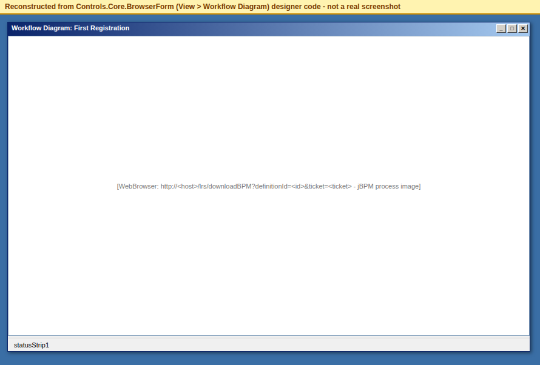

| Control | Type | Caption / label | Position / size | Bound field / data | Event handlers |
|---|---|---|---|---|---|
| statusStrip1 | StatusStrip | statusStrip1 | 0,386 788x22 | tab 1 |  |
| webBrowser | WebBrowser |  | 0,0 788x383 Anchor T+B+L+R | tab 0 |  |

<details><summary>Other resource strings used by BrowserForm (1)</summary>

- `BrowserForm_Caption` = "Report"

</details>

#### 3.1.16 HelpHtmForm

- Source: `TAR.Common.dll/TAR.Common/HelpHtmForm.cs` (`TAR.Common`), base `Form`; form Text "Help"; design size 756x542; resx `TAR.Common.HelpHtmForm.resx`.
- Status at PLAGIS: Used (reachable from the PLAGIS configuration).
- Purpose: Help viewer for WorkstationHelp.htm (F1). The help file itself is not captured.
- Form events: FormClosing -&gt; `HelpHtmForm_FormClosing`

| Control | Type | Caption / label | Position / size | Bound field / data | Event handlers |
|---|---|---|---|---|---|
| webCtrl | WebBrowser |  | 0,0 756x542 Dock Fill | tab 0 |  |

### 3.2 Queue / work list and list infrastructure

The transaction queue grid is inside `ShellForm` (3.1). This group holds the reusable grid/list controls every page uses.

#### 3.2.1 DataViewerEx

- Source: `TAR.Controls.dll/TAR.Controls.Core.Controls/DataViewerEx.cs` (`TAR.Controls.Core.Controls`), base `UserControl`; design size 502x299.
- Status at PLAGIS: Used (reachable from the PLAGIS configuration).
- Purpose: The standard read-only grid (DevExpress GridControl + BandedGridView) used in pages and dialogs. Columns are created at run time from lr_formfield by `BindingFactory2.CreateGridColumnsAndBind2` (caption, width = text width + 16 px, min 75; numbers right-aligned; dates in UI culture; dictionary values show the label).
- Opened from (code references): `FinishPage.InitializeComponent`, `ListEditor.InitializeComponent`, `ListEditorT.InitializeComponent`, `NotificationView.InitializeComponent`, `PaymentPage.InitializeComponent`, `SearchApplicantView.InitializeComponent`, `SelectEntityForm.InitializeComponent`, `SelectPage.InitializeComponent`, `TransactionListBasePage.InitializeComponent`, `TransactionListView.InitializeComponent`

| Control | Type | Caption / label | Position / size | Bound field / data | Event handlers |
|---|---|---|---|---|---|
| _gridControl | GridControl |  | 0,0 502x299 Dock Fill | tab 0 |  |
| _advBandedGridView | BandedGridView |  |  |  | EndSorting-&gt;OnEndSorting, FocusedRowChanged-&gt;OnFocusedRowChanged, SelectionChanged-&gt;OnSelectionChanged, DoubleClick-&gt;OnDoubleClick, ShowGridMenu-&gt;OnShowGridMenu |
| &nbsp;&nbsp;└ gridBand1 | GridBand | gridBand1 |  |  |  |

#### 3.2.2 BaseList

- Source: `TAR.Controls.dll/TAR.Controls.WorkerWizard/BaseList.cs` (`TAR.Controls.WorkerWizard`), base `BaseForm`; form Text "BaseList"; design size 513x298; start CenterParent; resx `TAR.Controls.WorkerWizard.BaseList.resx`.
- Status at PLAGIS: Base class only (its controls appear in every subclass).
- Purpose: Base of small list windows (BatchContentForm, ListOfInstruments).
- Opened from (code references): `WizardPage.GetHint`
- Form events: FormClosing -&gt; `BaseList_FormClosing`, Load -&gt; `BaseList_Load`, VisibleChanged -&gt; `BaseList_VisibleChanged`, KeyDown -&gt; `BaseList_KeyDown`, Move -&gt; `BaseList_Move`, Resize -&gt; `BaseList_Resize`

| Control | Type | Caption / label | Position / size | Bound field / data | Event handlers |
|---|---|---|---|---|---|
| dbgList | GridControl |  | 0,42 513x240 Dock Fill | tab 8 |  |
| sbMain | StatusBar |  | 0,282 513x16 hidden | tab 6 |  |
| tbMain | ToolBar |  | 0,0 513x42 | tab 7 |  |
| &nbsp;&nbsp;└ btnNew | ToolBarButton |  |  | tip "New" |  |
| &nbsp;&nbsp;└ btnDelete | ToolBarButton |  |  | tip "Delete" |  |
| &nbsp;&nbsp;└ btnEdit | ToolBarButton |  |  | tip "Edit" |  |
| gvList | GridView |  |  |  |  |
| cmMain | ContextMenu |  |  |  |  |
| miNew | WMenuItem | New | key Shortcut(45) |  |  |
| miDelete | WMenuItem | Delete | key Shortcut(46) |  |  |
| miEdit | WMenuItem | Edit | key Shortcut(113) |  |  |

#### 3.2.3 BatchContentForm

- Source: `TAR.Controls.dll/TAR.Controls.WorkerAssess.Forms/BatchContentForm.cs` (`TAR.Controls.WorkerAssess.Forms`), base `BaseList`; form Text "Batch Content"; design size 489x263; resx `TAR.Controls.WorkerAssess.Forms.BatchContentForm.resx`.
- Status at PLAGIS: Used (reachable from the PLAGIS configuration).
- Purpose: "Batch Content": the transactions of the current lodgement (grid lr_formfield `SimpleTransactionGrid`).
- Opened from (code references): `AssessWorker.ShowBatchContent`
- lr_formfield bindings in code: gvList -&gt; "SimpleTransactionGrid"

| Control | Type | Caption / label | Position / size | Bound field / data | Event handlers |
|---|---|---|---|---|---|
| dbgList | GridControl |  | 0,42 513x240 Dock Fill | lr_formfield SimpleTransactionGrid; tab 8 |  |
| sbMain | StatusBar |  | 0,247 489x16 hidden | tab 6 |  |
| tbMain | ToolBar |  | 0,0 489x42 | tab 7 |  |
| &nbsp;&nbsp;└ btnNew | ToolBarButton |  |  | tip "New" |  |
| &nbsp;&nbsp;└ btnDelete | ToolBarButton |  |  | tip "Delete" |  |
| &nbsp;&nbsp;└ btnEdit | ToolBarButton |  |  | tip "Edit" |  |

#### 3.2.4 DataViewer

- Source: `TAR.Controls.dll/TAR.Controls.Core.Controls/DataViewer.cs` (`TAR.Controls.Core.Controls`), base `UserControl`; design size 507x331.
- Status at PLAGIS: Not used at PLAGIS (no WorkflowConfig reference / no reachable caller).
- Purpose: Older grid wrapper.

| Control | Type | Caption / label | Position / size | Bound field / data | Event handlers |
|---|---|---|---|---|---|
| _dataGridView | DataGridView |  | 0,0 507x331 Dock Fill | tab 0 |  |

#### 3.2.5 ListEditor

- Source: `TAR.Controls.dll/TAR.Controls.Core.Controls/ListEditor.cs` (`TAR.Controls.Core.Controls`), base `UserControl`; design size 478x384; resx `TAR.Controls.Core.Controls.ListEditor.resx`.
- Status at PLAGIS: Not used at PLAGIS (no WorkflowConfig reference / no reachable caller).
- Form events: Enter -&gt; `ListEditor_Enter`

| Control | Type | Caption / label | Position / size | Bound field / data | Event handlers |
|---|---|---|---|---|---|
| pnlButtons | TableLayoutPanel |  | 390,2 88x192 Anchor T+R | tab 1 |  |
| &nbsp;&nbsp;└ btnAdd | Button | &Add | 3,3 75x23 | tab 0 | Click-&gt;btnAdd_Click |
| &nbsp;&nbsp;└ btnEdit | Button | &Update | 3,33 75x23 | tab 1 | Click-&gt;btnEdit_Click |
| &nbsp;&nbsp;└ btnRemove | Button | &Remove | 3,63 75x23 | tab 2 | Click-&gt;btnRemove_Click |
| &nbsp;&nbsp;└ btnPrint | Button | &Print | 3,93 75x23 | tab 3 |  |
| dataViewerEx | DataViewerEx |  | 0,200 478x184 Anchor T+B+L+R | tab 2 | SelectedIndexChanged-&gt;dataViewerEx_SelectedIndexChanged |
| pnlEdit | EditPanel |  | 2,4 378x192 Anchor T+L+R | tab 0 |  |

### 3.3 Wizard frame

The worker wizard window and page base classes. Every workflow stage is rendered inside `WorkerWizard.WizardBase`.

#### 3.3.1 WizardBase

- Source: `TAR.Controls.dll/TAR.Controls.WorkerWizard/WizardBase.cs` (`TAR.Controls.WorkerWizard`), base `XtraForm`; form Text "Form1"; design size 974x533; min 960x560; start CenterScreen; resx `TAR.Controls.WorkerWizard.WizardBase.resx`.
- Status at PLAGIS: Used (reachable from the PLAGIS configuration).
- Purpose: The worker wizard window (974x533, min 960x560): left = WOutlookBar with the stage name as header and one numbered button per page (48x32 page icon + caption "n. Caption", current page highlighted; clicking an earlier page jumps back), below it a "View" bar (Scanning, Property Info, Processing History from InternalViewers.config); right = bold prompt line, page area, buttons Suspend / &lt; Previous / Next &gt; (Finish on the last page) / Cancel; bottom = key-hint line.
- Opened from (code references): `WorkerWizard.WorkerWizard`
- Form events: Activated -&gt; `WizardBase_Activated`, Closing -&gt; `TfrmWizardBase_Closing`, Load -&gt; `TfrmWizardBase_Load`, VisibleChanged -&gt; `TfrmWizardBase_VisibleChanged`, KeyDown -&gt; `TfrmWizardBase_KeyDown`
- Layout: Title: "Transaction '&lt;type label&gt;', No. '&lt;number&gt;': &lt;stage label&gt;". Window size/position and the left splitter position are saved per user (registry keys WindowSize, WindowLocation, TopToolbarSize).
- Behaviour/validation: Esc = Cancel (asks "You have chosen to cancel current task. All new data will be unsaved." unless nothing changed), F1 = help topic of the page, Next validates dates on the page then the page AfterExecute; Suspend = save and close (werSave). Right-click anywhere gives a context menu Cancel / Next / Back / Suspend.

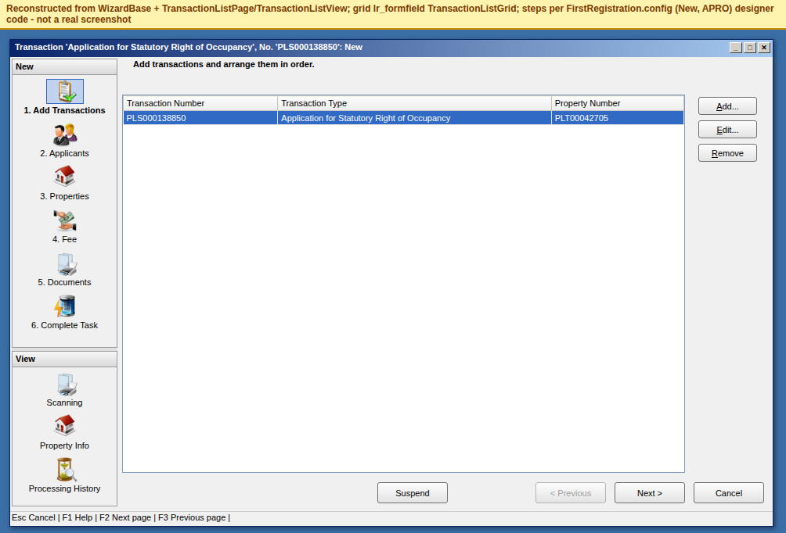

| Control | Type | Caption / label | Position / size | Bound field / data | Event handlers |
|---|---|---|---|---|---|
| label1 | Label |  | 2,516 972x17 Anchor B+L+R | tab 7 |  |
| pnlLeft | SplitContainer |  | 2,2 135x506 Anchor T+B+L | tab 6 |  |
| &nbsp;&nbsp;└ pnlLeft.Panel1 | SplitterPanel |  |  |  |  |
| &nbsp;&nbsp;└ pnlLeft.Panel2 | SplitterPanel |  |  |  |  |
| tableLayoutPanel1 | TableLayoutPanel |  | 137,0 837x513 Anchor T+B+L+R | tab 5 |  |
| &nbsp;&nbsp;└ pnlButtons | TableLayoutPanel |  | 3,474 831x36 Dock Fill | tab 0 |  |
| &nbsp;&nbsp;&nbsp;&nbsp;└ btnBack | SimpleButton | &lt; Previous | 531,3 90x27 Anchor T+R | tab 0 | Click-&gt;btnBack_Click |
| &nbsp;&nbsp;&nbsp;&nbsp;└ btnCancel | SimpleButton | Cancel | 733,3 90x27 Anchor T+R | tab 2 | Click-&gt;btnCancel_Click |
| &nbsp;&nbsp;&nbsp;&nbsp;└ btnNext | SimpleButton | Next &gt; | 632,3 90x27 Anchor T+R | tab 1 | Click-&gt;btnNext_Click |
| &nbsp;&nbsp;&nbsp;&nbsp;└ btnSuspend | SimpleButton | &Suspend | 329,3 90x27 Anchor T+R | tab 3 | Click-&gt;btnSuspend_Click |
| &nbsp;&nbsp;└ lblPrompt | Label |  | 20,3 797x35 Anchor T+L+R | tab 0 |  |
| &nbsp;&nbsp;└ pnlPages | TableLayoutPanel |  | 3,45 831x423 Dock Fill | tab 1 |  |
| sbMain | StatusBar |  | 0,514 974x19 | tab 2 |  |
| obWorkflow | WOutlookBar |  | 0,0 135x192 Dock Fill | tab 0 | ItemClicked-&gt;obWorkflow_ItemClicked |
| obView | WOutlookBar |  | 0,0 135x310 Dock Fill | tab 1 | ItemClicked-&gt;obView_ItemClicked |
| pmShortCuts | ContextMenu |  |  |  |  |
| miClose | WMenuItem | Close -&gt; runtime: "Cancel" |  |  | Click-&gt;btnCancel_Click |
| miNext | WMenuItem | Next | key Shortcut(113) |  | Click-&gt;miNext_Click |
| miBack | WMenuItem | Back | key Shortcut(114) |  | Click-&gt;btnBack_Click |
| miSuspend | WMenuItem | Suspend |  |  | Click-&gt;btnSuspend_Click |
| pnlLeft#1 |  |  |  |  |  |
| pnlLeft#2 |  |  |  |  |  |

Messages this class can show (MessageBoxService kind: text):

- Service: "&lt;exception message / formatted text: ``&gt;"
- Confirm: "You have chosen to cancel current task. All new data will be unsaved. Are you sure you want to continue?"

<details><summary>Other resource strings used by WizardBase (10)</summary>

- `strWizard_Back` = "Previous"
- `strWizard_Next` = "Next"
- `strWizard_Finish` = "Finish"
- `strWizard_Cancel` = "Cancel"
- `strWizard_Suspend` = "Suspend"
- `strWizard_ClosePrompt` = "You have chosen to cancel current task. All new data will be unsaved. Are you sure you want to continue?"
- `strWizard_SuspendHint` = "Save data and suspend"
- `strWizard_WordPage` = "Page"
- `strWizard_WordWizard` = "Wizard"
- `strWizard_Help` = "Help"

</details>

#### 3.3.2 WizardPage

- Source: `TAR.Controls.dll/TAR.Controls.WorkerWizard/WizardPage.cs` (`TAR.Controls.WorkerWizard`), base `UserControl`; design size 333x291; resx `TAR.Controls.WorkerWizard.WizardPage.resx`.
- Status at PLAGIS: Base class only (its controls appear in every subclass).
- Purpose: Base of every page (ButtonCaption, ButtonHint, PagePrompt, pbButtonNormal/Selected = the 48x32 step icons, PageReadOnly from the ":RO" editor suffix).

#### 3.3.3 TransactionListBasePage

- Source: `TAR.Controls.dll/TAR.Controls.WorkerAssess/TransactionListBasePage.cs` (`TAR.Controls.WorkerAssess`), base `WizardPage`; design size 459x370.
- Status at PLAGIS: Base class only (its controls appear in every subclass).
- Purpose: Base of most pages: hidden "Batch Content" panel (pnlTransactions, Visible=False) above `pnlRelatedStuff`, where each page puts its own controls.
- lr_formfield bindings in code: _meta -&gt; "TransactionListGrid"

| Control | Type | Caption / label | Position / size | Bound field / data | Event handlers |
|---|---|---|---|---|---|
| pnlRelatedStuff | Panel |  | 0,110 459x260 Dock Fill | tab 3 |  |
| pnlTransactions | Panel |  | 0,0 459x110 Dock Top hidden | tab 2 |  |
| &nbsp;&nbsp;└ dveTransactions | DataViewerEx |  | 0,18 459x92 Dock Fill | tab 2 |  |
| &nbsp;&nbsp;└ lblTransactions | Label | Batch Content | 0,0 459x18 Dock Top | tab 0 |  |

<details><summary>Other resource strings used by TransactionListBasePage (1)</summary>

- `strTransactionCaption` = "Transaction '{0}', No. '{1}'"

</details>

#### 3.3.4 WOutlookBar

- Source: `TAR.Controls.dll/LumiSoft.UI.Controls.WOutlookBar/WOutlookBar.cs` (`LumiSoft.UI.Controls.WOutlookBar`), base `UserControl`.
- Status at PLAGIS: Used (reachable from the PLAGIS configuration).
- Purpose: LumiSoft Outlook-style bar used for the step list and the View list.
- Opened from (code references): `Bars.Add`, `WizardBase.InitializeComponent`

#### 3.3.5 Wizard

- Source: `TAR.Controls.dll/TAR.Controls.Wizard/Wizard.cs` (`TAR.Controls.Wizard`), base `Form`; form Text "Wizard"; design size 480x325; border FixedDialog; start CenterParent; resx `TAR.Controls.Wizard.Wizard.resx`.
- Status at PLAGIS: Used (reachable from the PLAGIS configuration).
- Purpose: Simple generic wizard ("{0} - Step {1} of {2}") used by `WorkerFactory.LaunchCompleteWorker` (stages without a Workers.config entry) and signature enrolment.
- Opened from (code references): `SignatureEnrolment.Execute`, `WizardFactory.CreateWizard`, `WorkerFactory._LaunchCompleteWorker`
- Form events: Deactivate -&gt; `Wizard_Deactivate`, Activated -&gt; `Wizard_Activated`

#### 3.3.6 WizardBase

- Source: `TAR.Controls.dll/TAR.Controls.Wizard/WizardBase.cs` (`TAR.Controls.Wizard`), base `Form`; form Text "{0} - Step {1} of {2}"; design size 574x455; border FixedDialog; resx `TAR.Controls.Wizard.WizardBase.resx`.
- Status at PLAGIS: Base class only (its controls appear in every subclass).
- Opened from (code references): `WorkerWizard.WorkerWizard`

| Control | Type | Caption / label | Position / size | Bound field / data | Event handlers |
|---|---|---|---|---|---|
| pnlFooter | Panel |  | 0,409 574x46 Dock Bottom | tab 4 |  |
| &nbsp;&nbsp;└ btnCancel | Button | Cancel | 487,14 75x23 Anchor B+R | tab 3 | Click-&gt;btnCancel_Click |
| &nbsp;&nbsp;└ btnNext | Button | &Next &gt; | 407,14 75x23 Anchor B+R | tab 2 | Click-&gt;btnNext_Click |
| &nbsp;&nbsp;└ btnBack | Button | &lt; &Back | 327,14 75x23 Anchor B+R | tab 1 | Click-&gt;btnBack_Click |
| &nbsp;&nbsp;└ lblFooterLine | Label |  | 0,0 574x2 Dock Top | tab 0 |  |

<details><summary>Other resource strings used by WizardBase (5)</summary>

- `strWizardText` = "{0} - Step {1} of {2}"
- `strBack` = "&lt; &Back"
- `strNext` = "&Next &gt;"
- `strCancel` = "Cancel"
- `strFinish` = "&Finish"

</details>

#### 3.3.7 StepBase

- Source: `TAR.Controls.dll/TAR.Controls.Wizard/StepBase.cs` (`TAR.Controls.Wizard`), base `WizardBase`; design size 574x455; resx `TAR.Controls.Wizard.StepBase.resx`.
- Status at PLAGIS: Base class only (its controls appear in every subclass).

| Control | Type | Caption / label | Position / size | Bound field / data | Event handlers |
|---|---|---|---|---|---|
| pnlBody | Panel |  | 0,56 574x399 Dock Fill | tab 1 |  |
| pnlHeader | Panel |  | 0,0 574x56 Dock Top | tab 0 |  |
| &nbsp;&nbsp;└ lblHeaderLine | Label |  | 0,54 574x2 Dock Bottom | tab 2 |  |
| &nbsp;&nbsp;└ pbHeaderImage | PictureBox |  | 520,8 48x40 Anchor T+R | tab 1 |  |
| &nbsp;&nbsp;└ lblPrompt | Label | Make step actions, please. | 16,9 416x40 | tab 0 |  |
| pnlFooter | Panel |  | 0,409 574x46 Dock Bottom | tab 4 |  |
| &nbsp;&nbsp;└ lblFooterLine | Label |  | 0,0 574x2 Dock Top | tab 0 |  |
| &nbsp;&nbsp;└ btnCancel | Button | Cancel | 487,14 75x23 Anchor B+R | tab 3 | Click-&gt;btnCancel_Click |
| &nbsp;&nbsp;└ btnBack | Button | &lt; &Back | 327,14 75x23 Anchor B+R | tab 1 | Click-&gt;btnBack_Click |
| &nbsp;&nbsp;└ btnNext | Button | &Next &gt; | 407,14 75x23 Anchor B+R | tab 2 | Click-&gt;btnNext_Click |

#### 3.3.8 IndexerWizardPage

- Source: `TAR.Controls.dll/TAR.Controls.Core/IndexerWizardPage.cs` (`TAR.Controls.Core`), base `StepBase`; design size 574x455; min 580x25; resx `TAR.Controls.Core.IndexerWizardPage.resx`.
- Status at PLAGIS: Base class only (its controls appear in every subclass).
- Purpose: Header-image page base for the generic wizard.
- Form events: Load -&gt; `IndexerWizardPage_Load`

| Control | Type | Caption / label | Position / size | Bound field / data | Event handlers |
|---|---|---|---|---|---|
| pnlHeader | Panel |  | 0,0 574x56 Dock Top | tab 0 |  |
| &nbsp;&nbsp;└ lblHeaderLine | Label |  | 0,54 574x2 Dock Bottom | tab 2 |  |
| &nbsp;&nbsp;└ pbHeaderImage | PictureBox |  | 0,0 574x56 Dock Fill | tab 1 | Paint-&gt;pbHeaderImage_Paint |
| &nbsp;&nbsp;└ lblPrompt | Label | Make step actions, please. | 16,9 416x40 | tab 0 |  |
| pnlBody | Panel |  | 0,56 574x399 Dock Fill | tab 1 |  |
| pnlFooter | Panel |  | 0,409 574x46 Dock Bottom | tab 4 |  |
| &nbsp;&nbsp;└ lblFooterLine | Label |  | 0,0 574x2 Dock Top | tab 0 |  |
| &nbsp;&nbsp;└ btnCancel | Button | Cancel | 487,14 75x23 Anchor B+R | tab 3 | Click-&gt;btnCancel_Click |
| &nbsp;&nbsp;└ btnBack | Button | &lt; &Back | 327,14 75x23 Anchor B+R | tab 1 | Click-&gt;btnBack_Click |
| &nbsp;&nbsp;└ btnNext | Button | &Next &gt; | 407,14 75x23 Anchor B+R | tab 2 | Click-&gt;btnNext_Click |

Messages this class can show (MessageBoxService kind: text):

- Show: "Do you want to save the changes?"
- Error: "&lt;exception message&gt;"

### 3.4 Reception / lodgement and the transaction

Add Transactions page, the Transaction dialog, and the transaction-with-documents page used at almost every stage.

#### 3.4.1 TransactionListPage

- Source: `TAR.Controls.dll/TAR.Controls.WorkerAssess.Pages/TransactionListPage.cs` (`TAR.Controls.WorkerAssess.Pages`), base `WizardPage`; design size 498x412; resx `TAR.Controls.WorkerAssess.Pages.TransactionListPage.resx`.
- Status at PLAGIS: Used (reachable from the PLAGIS configuration). Base of PLAGIS CustomTransactionListPage (15 wizards).
- Purpose: "Add Transactions": grid of the batch transactions (lr_formfield `TransactionListGrid`) with Add... / Edit... / Remove buttons (Set Fee... is hidden in code).


| Control | Type | Caption / label | Position / size | Bound field / data | Event handlers |
|---|---|---|---|---|---|
| transactionListView | TransactionListView |  | 0,0 498x412 Dock Fill | tab 0 |  |

Messages this class can show (MessageBoxService kind: text):

- Warning: "Please add transaction."
- Confirm: "Are you sure you wish to delete selected item?"
- Warning: "Please specify a valid currency value."
- Warning: "Custom Fee value must be less than 999,999,999,999.99"

<details><summary>Other resource strings used by TransactionListPage (5)</summary>

- `strTransactionList` = "Add Transactions"
- `strTransactionListPromt` = "Add transactions and arrange them in order."
- `strTransactionCaption` = "Transaction '{0}', No. '{1}'"
- `strSetFee` = "Set Fee..."
- `strComments` = "Comments"

</details>

#### 3.4.2 CustomTransactionListPage

- Source: `TAR.PLAGIS.Controls.dll/TAR.PLAGIS.Controls.WorkerAssess.Pages/CustomTransactionListPage.cs` (`TAR.PLAGIS.Controls.WorkerAssess.Pages`), base `TransactionListPage`.
- Status at PLAGIS: PLAGIS override of `TransactionListPage` (designer only adds/changes the controls listed; behaviour in 05 section 3).
- Purpose: See the base class above.

| Control | Type | Caption / label | Position / size | Bound field / data | Event handlers |
|---|---|---|---|---|---|
| transactionListView | TransactionListView |  | 0,0 498x412 Dock Fill | tab 0 |  |

Messages this class can show (MessageBoxService kind: text):

- Warning: "Not all mandatory fields are filled in. Please fill in all fields marked in red."

#### 3.4.3 TransactionListView

- Source: `TAR.Controls.dll/TAR.Controls.WorkerAssess/TransactionListView.cs` (`TAR.Controls.WorkerAssess`), base `UserControl`; design size 535x350; resx `TAR.Controls.WorkerAssess.TransactionListView.resx`.
- Status at PLAGIS: Used (reachable from the PLAGIS configuration).
- Purpose: The grid + button column used by TransactionListPage.
- Opened from (code references): `TransactionListPage.InitializeComponent`
- Form events: Load -&gt; `TransactionListView_Load`

| Control | Type | Caption / label | Position / size | Bound field / data | Event handlers |
|---|---|---|---|---|---|
| tableLayoutPanel1 | TableLayoutPanel |  | 0,0 535x350 Dock Fill | tab 3 |  |
| &nbsp;&nbsp;└ dataViewerEx | DataViewerEx |  | 3,3 423x344 Dock Fill | tab 2 |  |
| &nbsp;&nbsp;└ pnlButtons | TableLayoutPanel |  | 432,3 94x344 | tab 1 |  |
| &nbsp;&nbsp;&nbsp;&nbsp;└ btnSetFee | Button | Set &Fee... -&gt; runtime: "Set Fee..." | 11,133 75x23 | tab 3 |  |
| &nbsp;&nbsp;&nbsp;&nbsp;└ btnRemove | Button | &Remove | 11,63 75x23 | tab 2 |  |
| &nbsp;&nbsp;&nbsp;&nbsp;└ btnEdit | Button | &Edit... | 11,33 75x23 | tab 1 |  |
| &nbsp;&nbsp;&nbsp;&nbsp;└ btnAdd | Button | &Add... | 11,3 75x23 | tab 0 |  |

<details><summary>Other resource strings used by TransactionListView (4)</summary>

- `strAdd` = "&Add..."
- `strEdit` = "&Edit..."
- `strRemove` = "&Remove"
- `strSetFee` = "Set Fee..."

</details>

#### 3.4.4 TransactionForm

- Source: `TAR.Controls.dll/TAR.Controls.WorkerAssess.Forms/TransactionForm.cs` (`TAR.Controls.WorkerAssess.Forms`), base `DialogForm`; form Text "Transaction"; design size 724x595; start CenterScreen; resx `TAR.Controls.WorkerAssess.Forms.TransactionForm.resx`.
- Status at PLAGIS: Used (reachable from the PLAGIS configuration). Subclassed by PLAGIS CustomTransactionForm.
- Purpose: "Transaction" dialog opened by Add.../Edit... on the Add Transactions page: transaction fields (TransactionLayoutControl, lr_formfield form from `transaction_dialog_form`, default `TransactionForm`), hidden "Transaction Parameters" cashier group, "Supporting Documents" list (DocumentListView).
- Opened from (code references): `CustomTransactionListPage.ButtonAdd_Click`, `TransactionListPage.ButtonAdd_Click`, `TransactionListPage.ButtonEdit_Click`
- Form events: FormClosing -&gt; `TransactionForm_FormClosing`
- lr_formfield bindings in code: CashEditor -&gt; _metaInfoCashier

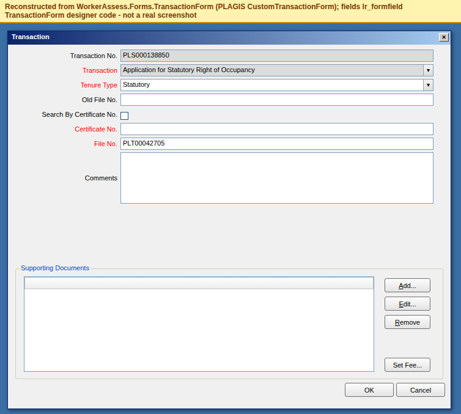

| Control | Type | Caption / label | Position / size | Bound field / data | Event handlers |
|---|---|---|---|---|---|
| ctrlTransaction | TransactionLayoutControl |  | 0,0 706x333 | tab 2 |  |
| gbDocuments | GroupBox | runtime: "Supporting Documents" | 12,360 700x187 | tab 3 |  |
| &nbsp;&nbsp;└ lvDocuments | DocumentListView |  | 10,15 685x162 | tab 0 |  |
| gbCashier | GroupBox | Transaction Parameters | 12,289 698x65 Anchor T+L+R hidden | tab 6 |  |
| btnCancel | SimpleButton | Cancel | 635,553 80x23 | tab 1 |  |
| btnOK | SimpleButton | OK | 551,553 80x23 | tab 0 | Click-&gt;btnOK_Click |
| _timer | Timer |  |  |  | Tick-&gt;_timer_Tick |
| ctrlTransactionGroup1 | LayoutControlGroup | ctrlTransactionGroup1 | 0,0 706x333 |  |  |

Messages this class can show (MessageBoxService kind: text):

- Error: "Source Property is not support multiple property in case of original property registration."
- Error: "Target Property Number need to be the same as Source Property Number for Original property registration case."
- Warning: "Please enter property number"
- Error: "&lt;exception message / formatted text: `(IWin32Window)(object)this, ex2.Message`&gt;"

<details><summary>Other resource strings used by TransactionForm (6)</summary>

- `strGeneralObjects_Transaction` = "Transaction"
- `strTransactionParams` = "Transaction Parameters"
- `strSupportedDocs` = "Supporting Documents"
- `errTransactionWorkflowConfig` = "Transaction type '{0}' configuration error. The workflow with name '{1}' is not registered in the system."
- `errCashTrnNotSpecified` = "Cashier transaction is not specified"
- `errCashTransList` = "Cannot retrieve transaction parameters from Cashier:"

</details>

#### 3.4.5 CustomTransactionForm

- Source: `TAR.PLAGIS.Controls.dll/TAR.PLAGIS.Controls.WorkerAssess.Forms/CustomTransactionForm.cs` (`TAR.PLAGIS.Controls.WorkerAssess.Forms`), base `TransactionForm`; form Text "CustomTransactionForm".
- Status at PLAGIS: PLAGIS override of `TransactionForm` (designer only adds/changes the controls listed; behaviour in 05 section 3).
- Purpose: See the base class above.
- Opened from (code references): `CustomTransactionListPage.ButtonAdd_Click`, `TransactionListPage.ButtonAdd_Click`, `TransactionListPage.ButtonEdit_Click`

| Control | Type | Caption / label | Position / size | Bound field / data | Event handlers |
|---|---|---|---|---|---|
| ctrlTransaction | TransactionLayoutControl |  | 0,0 706x333 | tab 2 |  |
| gbDocuments | GroupBox |  | 12,360 700x187 | tab 3 |  |
| &nbsp;&nbsp;└ lvDocuments | DocumentListView |  | 10,15 685x162 | tab 0 |  |
| gbCashier | GroupBox | Transaction Parameters | 12,289 698x65 Anchor T+L+R hidden | tab 6 |  |
| btnCancel | SimpleButton | Cancel | 635,553 75x23 | tab 1 |  |
| btnOK | SimpleButton | OK | 551,553 75x23 | tab 0 | Click-&gt;btnOK_Click |

Messages this class can show (MessageBoxService kind: text):

- Error: "This Transaction is not support for multiple properties"
- Error: "The parameters used were already introduced, please verify the information in fields: Source Property, Target Property and Property Registration Type and try again."
- Error: "There is broken chain transaction(s) which required to re-do index data before creating this transaction. {0}{0}Transactions are required to re-do index:{0}"
- Error: "\r\n"
- Warning: "Consideration was not in a correct format."
- Warning: "The Consideration Currency value selected doesn’t match the previous Consideration Currency. Please change it accordingly to continue with the transaction."
- Warning: "&lt;exception message / formatted text: `(IWin32Window)(object)this, text`&gt;"

<details><summary>Other resource strings used by CustomTransactionForm (1)</summary>

- `strCompareOldNewConsideration` = "The previous consideration of the property '{0}' is {1} {2:0.00}. The new consideration of the property '{0}' will be {1} {3:0.00}."

</details>

#### 3.4.6 TransactionLayoutControl

- Source: `TAR.Controls.dll/TAR.Controls.WorkerAssess/TransactionLayoutControl.cs` (`TAR.Controls.WorkerAssess`), base `LayoutControl`; design size 200x200.
- Status at PLAGIS: Used (reachable from the PLAGIS configuration).
- Purpose: LayoutControl that renders the transaction fields of the Transaction dialog.
- Opened from (code references): `PastTransactionForm.InitializeComponent`, `TransactionForm.InitializeComponent`
- lr_formfield bindings in code: this -&gt; meta

Messages this class can show (MessageBoxService kind: text):

- Warning: "Property No. '{0}' is already registered in the system."
- Warning: "Property No. '{0}' is already archived."

<details><summary>Other resource strings used by TransactionLayoutControl (6)</summary>

- `strVerifyPropertyID_CannotRegisterPending` = "Cannot register transaction for Property No. '{0}'. Transaction '{1}' is pending in the transaction queue."
- `strTransactionNotRegister` = "Property No. '{0}' does not register in the related transaction. Please register this Property No. in any following transaction {1}."
- `strTransactionBlocking` = "Cannot register Property No. '{0}'. It is blocking by following transaction {1}"
- `strPropertyNoNotLink` = "Property No. '{0}' does not link to the Parcel. Please link to the Parcel."
- `strPropertyNoNotFound` = "Property No. '{0}' does not exist in Aumentum Registry."
- `strVerifyPropertyID_CannotStartGroundRentReviewTransaction` = "No ground rent revision can be done for this property '{0}' since the next ground rent revision date is the same as or greater than the right of occupancy expiration date."

</details>

#### 3.4.7 DocumentListView

- Source: `TAR.Controls.dll/TAR.Controls.WorkerAssess/DocumentListView.cs` (`TAR.Controls.WorkerAssess`), base `TransactionListView`; design size 590x319.
- Status at PLAGIS: Used (reachable from the PLAGIS configuration).
- Purpose: Supporting documents list inside the Transaction dialog (Add.../Edit.../Remove).
- Opened from (code references): `PastTransactionForm.InitializeComponent`, `TransactionForm.InitializeComponent`
- lr_formfield bindings in code: _meta -&gt; "SupportedDocGrid"

| Control | Type | Caption / label | Position / size | Bound field / data | Event handlers |
|---|---|---|---|---|---|
| tableLayoutPanel1 | TableLayoutPanel |  | 0,0 535x350 Dock Fill | tab 3 |  |
| &nbsp;&nbsp;└ dataViewerEx | DataViewerEx |  | 3,3 423x344 Dock Fill | tab 2 |  |
| &nbsp;&nbsp;└ pnlButtons | TableLayoutPanel |  | 432,3 94x344 | tab 1 |  |
| &nbsp;&nbsp;&nbsp;&nbsp;└ btnSetFee | Button | Set &Fee... | 11,133 75x23 | tab 3 |  |
| &nbsp;&nbsp;&nbsp;&nbsp;└ btnRemove | Button | &Remove | 11,63 75x23 | tab 2 |  |
| &nbsp;&nbsp;&nbsp;&nbsp;└ btnEdit | Button | &Edit... | 11,33 75x23 | tab 1 |  |
| &nbsp;&nbsp;&nbsp;&nbsp;└ btnAdd | Button | &Add... | 11,3 75x23 | tab 0 |  |

Messages this class can show (MessageBoxService kind: text):

- Confirm: "&lt;exception message / formatted text: `(IWin32Window)(object)this, deletePromtMessage`&gt;"
- Confirm: "The {0} document is already set as primary. Are you sure you want to change primary to {1} document?"
- Warning: "Please, set one Primary document for current transaction."

<details><summary>Other resource strings used by DocumentListView (1)</summary>

- `confirmChangeProofDocument` = "The {0} document is already set as primary. Are you sure you want to change primary to {1} document?"

</details>

#### 3.4.8 TransactionWithDocumentsPage

- Source: `TAR.Controls.dll/TAR.Controls.WorkerAssess.Pages/TransactionWithDocumentsPage.cs` (`TAR.Controls.WorkerAssess.Pages`), base `TransactionListBasePage`; design size 645x561; resx `TAR.Controls.WorkerAssess.Pages.TransactionWithDocumentsPage.resx`.
- Status at PLAGIS: Used (reachable from the PLAGIS configuration). Base of PLAGIS CustomTransactionWithDocumentsPage (293 wizards - the most used page).
- Purpose: Top: XtraTabControl "Transaction" with the transaction form named in the editor (e.g. `TransactionWithDocFRGForm`) and an extension tab; bottom: "Documents" toolbar New / View/Edit / Delete / Attachments / Registered and grid `SupportedDocGrid`.
- lr_formfield bindings in code: gvListOfSupportDocs -&gt; _formName, lcTransactionAttributes -&gt; gUIElement, lcTransactionExtAttributes -&gt; typeof(Transaction)

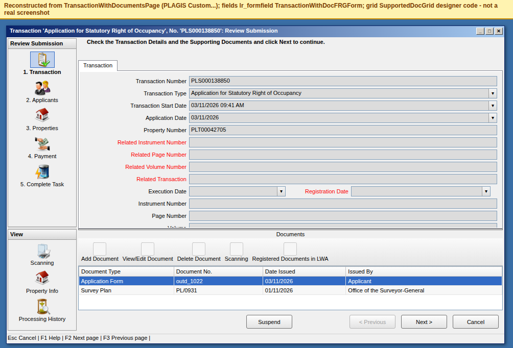

| Control | Type | Caption / label | Position / size | Bound field / data | Event handlers |
|---|---|---|---|---|---|
| pnlRelatedStuff | Panel |  | 0,110 645x451 Dock Fill | tab 3 |  |
| &nbsp;&nbsp;└ splitter1 | Splitter |  | 0,330 645x3 Dock Top | tab 2 |  |
| &nbsp;&nbsp;└ pnlDocuments | Panel |  | 0,330 645x121 Dock Fill | tab 1 |  |
| &nbsp;&nbsp;&nbsp;&nbsp;└ dbgListOfSupportDocs | GridControl |  | 0,70 645x51 Dock Fill | lr_formfield _formName; tab 14 |  |
| &nbsp;&nbsp;&nbsp;&nbsp;└ tsDocuments | ToolStrip | tsDocuments | 0,16 645x54 | tab 13 |  |
| &nbsp;&nbsp;&nbsp;&nbsp;&nbsp;&nbsp;└ btnNew | ToolStripButton | New -&gt; runtime: "Add Document" | 36x51 |  |  |
| &nbsp;&nbsp;&nbsp;&nbsp;&nbsp;&nbsp;└ btnEdit | ToolStripButton | View/Edit -&gt; runtime: "View/Edit Document" | 61x51 |  |  |
| &nbsp;&nbsp;&nbsp;&nbsp;&nbsp;&nbsp;└ btnDelete | ToolStripButton | Delete -&gt; runtime: "Delete Document" | 44x51 |  |  |
| &nbsp;&nbsp;&nbsp;&nbsp;&nbsp;&nbsp;└ btnViewPages | ToolStripButton | Attachments -&gt; runtime: "Scanning" | 79x51 |  |  |
| &nbsp;&nbsp;&nbsp;&nbsp;&nbsp;&nbsp;└ btnViewReg | ToolStripButton | Registered -&gt; runtime: "Registered Documents in LWA" | 66x51 |  |  |
| &nbsp;&nbsp;&nbsp;&nbsp;└ label1 | Label | Documents | 0,0 645x16 Dock Top | tab 12 |  |
| &nbsp;&nbsp;└ tabControl | XtraTabControl |  | 0,0 645x330 Dock Top | tab 3 |  |
| &nbsp;&nbsp;&nbsp;&nbsp;└ tabTransaction | XtraTabPage | runtime: "Principal Details" | 638x301 |  |  |
| &nbsp;&nbsp;&nbsp;&nbsp;&nbsp;&nbsp;└ pnlTransactionAttributes | Panel |  | 3,3 633x305 Dock Fill | tab 2 |  |
| &nbsp;&nbsp;&nbsp;&nbsp;&nbsp;&nbsp;&nbsp;&nbsp;└ lcTransactionAttributes | LayoutControl | layoutControl1 | 0,0 632x300 Dock Fill | lr_formfield gUIElement; tab 0 |  |
| &nbsp;&nbsp;&nbsp;&nbsp;└ tabTransactionExt | XtraTabPage | runtime: "Supplementary Details" | 638x311 |  |  |
| &nbsp;&nbsp;&nbsp;&nbsp;&nbsp;&nbsp;└ pnlTransactionExtAttributes | Panel |  | 3,3 632x300 Dock Top | tab 2 |  |
| &nbsp;&nbsp;&nbsp;&nbsp;&nbsp;&nbsp;&nbsp;&nbsp;└ lcTransactionExtAttributes | LayoutControl | layoutControl1 | 0,0 632x300 Dock Top | lr_formfield typeof(Transaction); tab 0 |  |
| pnlTransactions | Panel |  | 0,0 459x110 Dock Top hidden | tab 2 |  |
| &nbsp;&nbsp;└ dveTransactions | DataViewerEx |  | 0,18 645x92 Dock Fill | tab 2 |  |
| &nbsp;&nbsp;└ lblTransactions | Label | Batch Content | 0,0 459x18 Dock Top | tab 0 |  |
| pmToolbar | ContextMenu |  |  |  |  |
| miNew | WMenuItem |  |  |  |  |
| miEdit | WMenuItem |   |  |  |  |
| miDelete | WMenuItem |   |  |  |  |
| miViewPages | WMenuItem |   |  |  |  |
| miRegDocs | WMenuItem |  |  |  |  |
| gvListOfSupportDocs | GridView |  |  | lr_formfield _formName | FocusedRowChanged-&gt;gvListOfSupportDocs_FocusedRowChanged, DoubleClick-&gt;gvListOfSupportDocs_DoubleClick |
| layoutControlGroup1 | LayoutControlGroup | layoutControlGroup1 | 0,0 632x300 |  |  |
| layoutControlGroup2 | LayoutControlGroup | layoutControlGroup1 | 0,0 632x300 |  |  |

Messages this class can show (MessageBoxService kind: text):

- Confirm: "&lt;exception message / formatted text: `null, documentNotScannedWarningMessage`&gt;"
- Warning: "Cannot change Old File No. It is already exists in pending transaction {0}."
- Warning: "Cannot change Old File No. Transaction with Old File No '{0}' already registered."
- Error: "Cannot Delete mandatory document from previous stages"
- Confirm: "&lt;exception message / formatted text: `(IWin32Window)(object)this, deletePromtMessage`&gt;"
- Show: "&lt;exception message&gt;"
- Show: "&lt;exception message / formatted text: `ex2.Message`&gt;"

<details><summary>Other resource strings used by TransactionWithDocumentsPage (9)</summary>

- `strTransactionWithDocumentsPage_Prompt` = "Check the Transaction Details and the Supporting Documents and click Next to continue."
- `strPrintDocumentsPage_Caption` = "Documents"
- `strMainTab` = "Principal Details"
- `strExtensionTab` = "Supplementary Details"
- `strTransactionWithDocumentsPage_AddDoc` = "Add Document"
- `strTransactionWithDocumentsPage_EditDoc` = "View/Edit Document"
- `strTransactionWithDocumentsPage_DeleteDoc` = "Delete Document"
- `strScannedDocuments` = "Scanning"
- `strRegisteredDocuments` = "Registered Documents in LWA"

</details>

#### 3.4.9 CustomTransactionWithDocumentsPage

- Source: `TAR.PLAGIS.Controls.dll/TAR.PLAGIS.Controls.WorkerAssess.Pages/CustomTransactionWithDocumentsPage.cs` (`TAR.PLAGIS.Controls.WorkerAssess.Pages`), base `TransactionWithDocumentsPage`.
- Status at PLAGIS: PLAGIS override of `TransactionWithDocumentsPage` (designer only adds/changes the controls listed; behaviour in 05 section 3).
- Purpose: See the base class above.

| Control | Type | Caption / label | Position / size | Bound field / data | Event handlers |
|---|---|---|---|---|---|
| pnlRelatedStuff | Panel |  | 0,110 645x451 Dock Fill | tab 3 |  |
| &nbsp;&nbsp;└ splitter1 | Splitter |  | 0,330 645x3 Dock Top | tab 2 |  |
| &nbsp;&nbsp;└ pnlDocuments | Panel |  | 0,330 645x121 Dock Fill | tab 1 |  |
| &nbsp;&nbsp;&nbsp;&nbsp;└ dbgListOfSupportDocs | GridControl |  | 0,70 645x51 Dock Fill | tab 14 |  |
| &nbsp;&nbsp;&nbsp;&nbsp;└ tsDocuments | ToolStrip | tsDocuments | 0,16 645x54 | tab 13 |  |
| &nbsp;&nbsp;&nbsp;&nbsp;&nbsp;&nbsp;└ btnNew | ToolStripButton | New | 36x51 |  |  |
| &nbsp;&nbsp;&nbsp;&nbsp;&nbsp;&nbsp;└ btnEdit | ToolStripButton | View/Edit | 61x51 |  |  |
| &nbsp;&nbsp;&nbsp;&nbsp;&nbsp;&nbsp;└ btnDelete | ToolStripButton | Delete | 44x51 |  |  |
| &nbsp;&nbsp;&nbsp;&nbsp;&nbsp;&nbsp;└ btnViewPages | ToolStripButton | Attachments | 79x51 |  |  |
| &nbsp;&nbsp;&nbsp;&nbsp;&nbsp;&nbsp;└ btnViewReg | ToolStripButton | Registered | 66x51 |  |  |
| &nbsp;&nbsp;&nbsp;&nbsp;└ label1 | Label | Documents | 0,0 645x16 Dock Top | tab 12 |  |
| &nbsp;&nbsp;└ tabControl | XtraTabControl |  | 0,0 645x330 Dock Top | tab 3 |  |
| &nbsp;&nbsp;&nbsp;&nbsp;└ tabTransaction | XtraTabPage |  | 638x301 |  |  |
| &nbsp;&nbsp;&nbsp;&nbsp;&nbsp;&nbsp;└ pnlTransactionAttributes | Panel |  | 3,3 633x305 Dock Fill | tab 2 |  |
| &nbsp;&nbsp;&nbsp;&nbsp;&nbsp;&nbsp;&nbsp;&nbsp;└ lcTransactionAttributes | LayoutControl | layoutControl1 | 0,0 632x300 Dock Fill | tab 0 |  |
| &nbsp;&nbsp;&nbsp;&nbsp;└ tabTransactionExt | XtraTabPage |  | 638x311 |  |  |
| &nbsp;&nbsp;&nbsp;&nbsp;&nbsp;&nbsp;└ pnlTransactionExtAttributes | Panel |  | 3,3 632x300 Dock Top | tab 2 |  |
| &nbsp;&nbsp;&nbsp;&nbsp;&nbsp;&nbsp;&nbsp;&nbsp;└ lcTransactionExtAttributes | LayoutControl | layoutControl1 | 0,0 632x300 Dock Top | tab 0 |  |
| pnlTransactions | Panel |  | 0,0 459x110 Dock Top hidden | tab 2 |  |
| &nbsp;&nbsp;└ dveTransactions | DataViewerEx |  | 0,18 645x92 Dock Fill | tab 2 |  |
| &nbsp;&nbsp;└ lblTransactions | Label | Batch Content | 0,0 459x18 Dock Top | tab 0 |  |

Messages this class can show (MessageBoxService kind: text):

- Warning: "The Execution Date introduced must be between the Generation Date and Registration Date of the Certificate of Occupancy"

#### 3.4.10 CustomSearchPropertyPage

- Source: `TAR.PLAGIS.Controls.dll/TAR.PLAGIS.Controls.WorkerAssess.Pages/CustomSearchPropertyPage.cs` (`TAR.PLAGIS.Controls.WorkerAssess.Pages`), base `WizardPage`; design size 746x526; resx `TAR.PLAGIS.Controls.WorkerAssess.Pages.CustomSearchPropertyPage.resx`.
- Status at PLAGIS: Used (reachable from the PLAGIS configuration). SEAR/CETC (5 wizards).
- Purpose: "Search Properties" page: Search for Property Number box + Search button; "Properties Found" grid with New/View/Delete; "Properties Not Found" grid with New/View/Edit/Delete.
- lr_formfield bindings in code: gvPropertiesFound -&gt; text

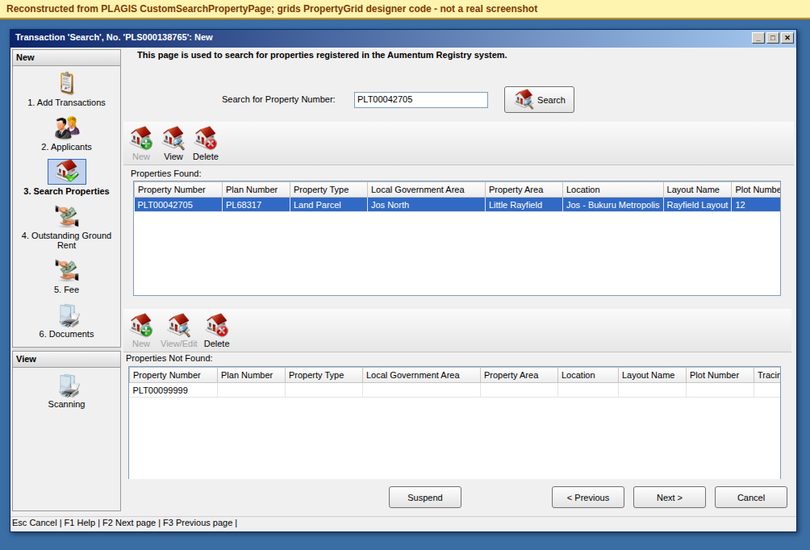

| Control | Type | Caption / label | Position / size | Bound field / data | Event handlers |
|---|---|---|---|---|---|
| pnlGrids | Panel |  | 0,47 746x479 Dock Fill | tab 10 |  |
| &nbsp;&nbsp;└ toolStrip1 | ToolStrip | toolStrip1 | 0,0 746x54 | tab 25 |  |
| &nbsp;&nbsp;&nbsp;&nbsp;└ toolStripButton1 | ToolStripButton | New | 36x51 disabled |  |  |
| &nbsp;&nbsp;&nbsp;&nbsp;└ btnViewParcel | ToolStripButton | View | 36x51 |  | Click-&gt;btnViewParcel_Click |
| &nbsp;&nbsp;&nbsp;&nbsp;└ btnDeleteFoundProperty | ToolStripButton | Delete | 44x51 |  | Click-&gt;btnDeleteFoundProperty_Click |
| &nbsp;&nbsp;└ panel1 | Panel |  | 0,232 743x249 Anchor T+L+R | tab 10 |  |
| &nbsp;&nbsp;&nbsp;&nbsp;└ tsProperties | ToolStrip | toolStrip1 | 0,0 743x54 | tab 25 |  |
| &nbsp;&nbsp;&nbsp;&nbsp;&nbsp;&nbsp;└ btnNew | ToolStripButton | New | 36x51 disabled |  |  |
| &nbsp;&nbsp;&nbsp;&nbsp;&nbsp;&nbsp;└ btnEdit | ToolStripButton | View/Edit | 61x51 disabled |  |  |
| &nbsp;&nbsp;&nbsp;&nbsp;&nbsp;&nbsp;└ btnDeleteNotFoundProperty | ToolStripButton | Delete | 44x51 |  | Click-&gt;btnDeleteNotFoundProperty_Click |
| &nbsp;&nbsp;&nbsp;&nbsp;└ lblNotFoundProperties | Label | Properties Not Found: | 3,55 110x13 | tab 6 |  |
| &nbsp;&nbsp;&nbsp;&nbsp;└ dbgPropertiesNotFound | GridControl |  | 6,71 724x156 Anchor T+L+R | tab 7 |  |
| &nbsp;&nbsp;└ lblFoundProperties | Label | Properties Found: | 9,58 90x13 | tab 5 |  |
| &nbsp;&nbsp;└ dbgPropertiesFound | GridControl |  | 12,73 718x143 Anchor T+L+R | lr_formfield text; tab 4 |  |
| pnlSearch | Panel |  | 0,0 746x47 Dock Top | tab 11 |  |
| &nbsp;&nbsp;└ lblSearchProperty | Label | Search for Property Number: | 122,13 141x13 | tab 1 |  |
| &nbsp;&nbsp;└ txtPropertyNumber | TextBox |  | 286,10 166x20 | tab 2 |  |
| &nbsp;&nbsp;└ btnSearchProperty | Button | Search | 472,3 87x33 | tab 3 | Click-&gt;btnSearchProperty_Click |
| gvPropertiesFound | GridView |  |  | lr_formfield text |  |
| gvPropertiesNotFound | GridView |  |  |  |  |

Messages this class can show (MessageBoxService kind: text):

- Info: "Please search for at least one property."
- Warning: "No Property Found"
- Info: "This Transaction does not support multiple properties."

<details><summary>Other resource strings used by CustomSearchPropertyPage (9)</summary>

- `strPropertySearch` = "Search for Property Number:"
- `strSearch` = "Search"
- `strPropertiesFound` = "Properties Found:"
- `strPropertiesNotFound` = "Properties Not Found:"
- `strDelete` = "Delete"
- `strCustomSearchPropertyPage_Caption` = "Search Properties"
- `strCustomSearchPropertyPage_ButtonCaption` = "Search Properties"
- `strCustomSearchPropertyPage_ButtonHint` = "Search Properties"
- `strCustomSearchPropertyPage_PagePrompt` = "This page is used to search for properties registered in the Aumentum Registry system."

</details>

#### 3.4.11 ChangeFileNo

- Source: `TAR.Controls.dll/TAR.Controls.WorkerAssess.Forms/ChangeFileNo.cs` (`TAR.Controls.WorkerAssess.Forms`), base `DialogForm`; form Text "Change File No."; design size 339x114; start CenterScreen; resx `TAR.Controls.WorkerAssess.Forms.ChangeFileNo.resx`.
- Status at PLAGIS: Used (reachable from the PLAGIS configuration).
- Purpose: "Change File No." small dialog.
- Opened from (code references): `RelatedTransactionPage.Change_Action`
- Form events: Load -&gt; `ChangeFileNo_Load`, HelpRequested -&gt; `ChangeFileNo_HelpRequested`

| Control | Type | Caption / label | Position / size | Bound field / data | Event handlers |
|---|---|---|---|---|---|
| txtFileNo | TextEdit |  | 61,28 259x20 | tab 6 |  |
| edFileNo | MemoEdit |  | 326,12 226x57 Anchor T+L+R hidden | tab 5 |  |
| label1 | Label | File No. | 12,31 43x13 | tab 2 |  |
| btnCancel | SimpleButton | Cancel | 240,81 80x23 Anchor B+R | tab 1 | Click-&gt;btnCancel_Click |
| btnOK | SimpleButton | OK | 151,81 80x23 Anchor B+R | tab 0 | Click-&gt;btnOK_Click |

Messages this class can show (MessageBoxService kind: text):

- Confirm: "File No. will be changed."
- Error: "&lt;exception message&gt;"

<details><summary>Other resource strings used by ChangeFileNo (4)</summary>

- `strChangeFileNo` = "Change File No."
- `strNewFileEmpty` = "New File Number is empty."
- `strCantChangeFileNoReg` = "Cannot change File No. because new File No. '{0}' already exists in registered transactions."
- `strRelinkPropertyToMap` = "Don't forgot relink property to map on correspondence step."

</details>

#### 3.4.12 TransactionInfoForm

- Source: `TAR.Controls.dll/TAR.Controls.WorkerAssess.Forms/TransactionInfoForm.cs` (`TAR.Controls.WorkerAssess.Forms`), base `BaseEditorForm`; form Text "View Transaction Info"; design size 744x322; border Sizable; resx `TAR.Controls.WorkerAssess.Forms.TransactionInfoForm.resx`.
- Status at PLAGIS: Used (reachable from the PLAGIS configuration).
- Purpose: Read-only "View Transaction Info" dialog.
- Opened from (code references): `CustomPropertyInfoForm.gvListOfTransactions_DoubleClick`, `PropertyInfoForm.gvListOfTransactions_DoubleClick`, `TransactionSearchForm.dbgListOfTransactions_DoubleClick`
- lr_formfield bindings in code: layoutControl -&gt; _formName

| Control | Type | Caption / label | Position / size | Bound field / data | Event handlers |
|---|---|---|---|---|---|
| txtTransactions | ButtonEdit |  | 6,290 539x20 Anchor T+L+R hidden | tab 6 |  |
| btnCancel | SimpleButton | Cancel | 647,287 80x23 Anchor B+R | tab 1 | Click-&gt;btnCancel_Click |
| btnOK | SimpleButton | OK | 563,287 80x23 Anchor B+R hidden | tab 0 | Click-&gt;btnOK_Click |
| xtraTabControl1 | XtraTabControl |  | 4,4 735x273 Anchor T+B+L+R | tab 2 |  |
| &nbsp;&nbsp;└ tpMain | XtraTabPage | General Information | 728x244 |  |  |
| &nbsp;&nbsp;&nbsp;&nbsp;└ layoutControl | LayoutControl | layoutControl1 | 0,0 728x244 Dock Fill | lr_formfield _formName; tab 0 |  |
| &nbsp;&nbsp;└ tpAdditional | XtraTabPage | Additional Information | 728x244 |  |  |
| &nbsp;&nbsp;└ tpAdditional2 | XtraTabPage | Additional Information | 543x301 |  |  |
| layoutControlGroup1 | LayoutControlGroup | layoutControlGroup1 | 0,0 728x244 |  |  |
| txtTransactions.Properties |  |  |  |  |  |
| &nbsp;&nbsp;└ new |  |  |  |  |  |
| &nbsp;&nbsp;└ EditorButton |  |  |  |  |  |

### 3.5 Applicants and parties

Applicant and party pages, dialogs, searches and contact panels. Field sets come from lr_formfield (Appendix A of 05).

#### 3.5.1 MultiApplicantsPage

- Source: `TAR.Controls.dll/TAR.Controls.WorkerAssess.Pages/MultiApplicantsPage.cs` (`TAR.Controls.WorkerAssess.Pages`), base `TransactionListBasePage`; design size 543x473; resx `TAR.Controls.WorkerAssess.Pages.MultiApplicantsPage.resx`.
- Status at PLAGIS: Used (reachable from the PLAGIS configuration). Base of PLAGIS CustomMultiApplicantsPage (99 wizards).
- Purpose: "Applicants": toolbar New Applicant / View/Edit / Delete / Search Applicant, grid `PartiesGrid`.
- lr_formfield bindings in code: gvListOfApplicants -&gt; "PartiesGrid"

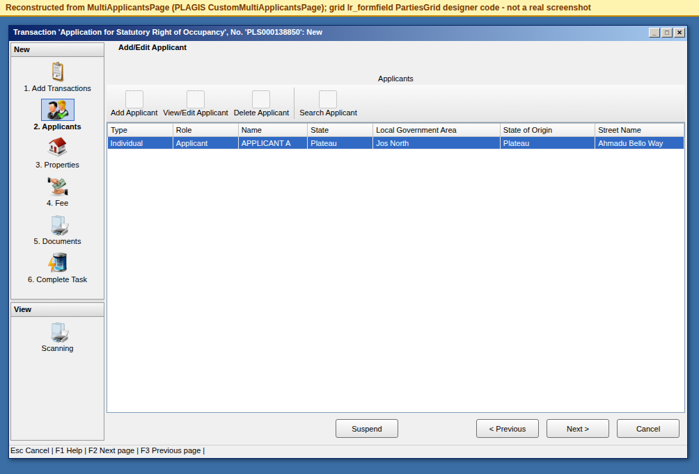

| Control | Type | Caption / label | Position / size | Bound field / data | Event handlers |
|---|---|---|---|---|---|
| pnlRelatedStuff | Panel |  | 0,110 543x363 Dock Fill | tab 3 |  |
| &nbsp;&nbsp;└ dbgListOfApplicants | GridControl |  | 0,72 543x291 Dock Fill | lr_formfield PartiesGrid; tab 8 |  |
| &nbsp;&nbsp;└ tsNames | ToolStrip | toolStrip1 | 0,18 543x54 | tab 4 |  |
| &nbsp;&nbsp;&nbsp;&nbsp;└ btnAdd | ToolStripButton | New Applicant -&gt; runtime: "Add Applicant" | 65x51 |  |  |
| &nbsp;&nbsp;&nbsp;&nbsp;└ btnEdit | ToolStripButton | View/Edit -&gt; runtime: "View/Edit Applicant" | 61x51 |  |  |
| &nbsp;&nbsp;&nbsp;&nbsp;└ btnDelete | ToolStripButton | Delete -&gt; runtime: "Delete Applicant" | 44x51 |  |  |
| &nbsp;&nbsp;&nbsp;&nbsp;└ separatorSearchApplicant | ToolStripSeparator |  | 6x54 |  |  |
| &nbsp;&nbsp;&nbsp;&nbsp;└ btnSearchApplicant | ToolStripButton | Search Applicant | 76x51 |  |  |
| &nbsp;&nbsp;└ lblNames | Label | Applicants | 0,0 543x18 Dock Top | tab 1 |  |
| pnlTransactions | Panel |  | 0,0 459x110 Dock Top hidden | tab 2 |  |
| &nbsp;&nbsp;└ dveTransactions | DataViewerEx |  | 0,18 543x92 Dock Fill | tab 2 |  |
| &nbsp;&nbsp;└ lblTransactions | Label | Batch Content | 0,0 459x18 Dock Top | tab 0 |  |
| pmToolbar | ContextMenu |  |  |  |  |
| miAdd | WMenuItem | New |  |  |  |
| miEdit | WMenuItem | Edit |  |  |  |
| miDelete | WMenuItem | Delete |  |  |  |
| miSearchApplicant | WMenuItem | SearchApplicant |  |  |  |
| gvListOfApplicants | GridView |  |  | lr_formfield PartiesGrid | DoubleClick-&gt;gridControl_DoubleClick, FocusedRowChanged-&gt;gridControl_FocusedRowChanged |

Messages this class can show (MessageBoxService kind: text):

- Info: "&lt;exception message / formatted text: `(IWin32Window)(object)this, text`&gt;"
- Warning: "Agent is duplicated with '{0}'.  System does not allow  to enter the "Agent" into the system twice."
- Confirm: "The selected applicant will be deleted. Continue?"

<details><summary>Other resource strings used by MultiApplicantsPage (9)</summary>

- `strMultiApplicants` = "Applicants"
- `strMultiApplicantsPrompt` = "Add/Edit Applicant"
- `strMultiApplicantsPage_NoApplicant` = "Please enter at least one applicant."
- `strTransactionCaption` = "Transaction '{0}', No. '{1}'"
- `strMultiApplicantsPage_Add` = "Add Applicant"
- `strMultiApplicantsPage_Edit` = "View/Edit Applicant"
- `strMultiApplicantsPage_Delete` = "Delete Applicant"
- `strMultiApplicantsPage_Search` = "Search Applicant"
- `wrnAgentIsDuplicated` = "Agent is duplicated with '{0}'.  System does not allow  to enter the "Agent" into the system twice."

</details>

#### 3.5.2 CustomMultiApplicantsPage

- Source: `TAR.PLAGIS.Controls.dll/TAR.PLAGIS.Controls.WorkerAssess.Pages/CustomMultiApplicantsPage.cs` (`TAR.PLAGIS.Controls.WorkerAssess.Pages`), base `MultiApplicantsPage`.
- Status at PLAGIS: PLAGIS override of `MultiApplicantsPage` (designer only adds/changes the controls listed; behaviour in 05 section 3).
- Purpose: See the base class above.

| Control | Type | Caption / label | Position / size | Bound field / data | Event handlers |
|---|---|---|---|---|---|
| pnlRelatedStuff | Panel |  | 0,110 543x363 Dock Fill | tab 3 |  |
| &nbsp;&nbsp;└ dbgListOfApplicants | GridControl |  | 0,72 543x291 Dock Fill | tab 8 |  |
| &nbsp;&nbsp;└ tsNames | ToolStrip | toolStrip1 | 0,18 543x54 | tab 4 |  |
| &nbsp;&nbsp;&nbsp;&nbsp;└ btnAdd | ToolStripButton | New Applicant | 65x51 |  |  |
| &nbsp;&nbsp;&nbsp;&nbsp;└ btnEdit | ToolStripButton | View/Edit | 61x51 |  |  |
| &nbsp;&nbsp;&nbsp;&nbsp;└ btnDelete | ToolStripButton | Delete | 44x51 |  |  |
| &nbsp;&nbsp;&nbsp;&nbsp;└ separatorSearchApplicant | ToolStripSeparator |  | 6x54 |  |  |
| &nbsp;&nbsp;&nbsp;&nbsp;└ btnSearchApplicant | ToolStripButton | Search Applicant | 76x51 |  |  |
| &nbsp;&nbsp;└ lblNames | Label | Applicants | 0,0 543x18 Dock Top | tab 1 |  |
| pnlTransactions | Panel |  | 0,0 459x110 Dock Top hidden | tab 2 |  |
| &nbsp;&nbsp;└ dveTransactions | DataViewerEx |  | 0,18 543x92 Dock Fill | tab 2 |  |
| &nbsp;&nbsp;└ lblTransactions | Label | Batch Content | 0,0 459x18 Dock Top | tab 0 |  |

#### 3.5.3 ApplicantForm

- Source: `TAR.Controls.dll/TAR.Controls.WorkerAssess.Forms/ApplicantForm.cs` (`TAR.Controls.WorkerAssess.Forms`), base `BaseEditorForm`; form Text "View/Edit Applicant"; design size 734x741; min 700x600; resx `TAR.Controls.WorkerAssess.Forms.ApplicantForm.resx`.
- Status at PLAGIS: Used (reachable from the PLAGIS configuration). Subclassed by PLAGIS CustomApplicantForm.
- Purpose: "View/Edit Applicant": party type and role (MultiApplicantForm) then the person/organisation fields (ApplicantIndividualForm / ApplicantCorporationForm / ApplicantCorporationStateForm) and contacts.
- Opened from (code references): `ApplicantSearchForm.gvListOfApplicants_DoubleClick`, `MultiApplicantsPage.AddApplicant`, `MultiApplicantsPage.EditApplicant`, `MultiApplicantsPage.SearchApplicant`
- lr_formfield bindings in code: layoutControl1 -&gt; _formName, layoutControl2 -&gt; _corporationStateFormName

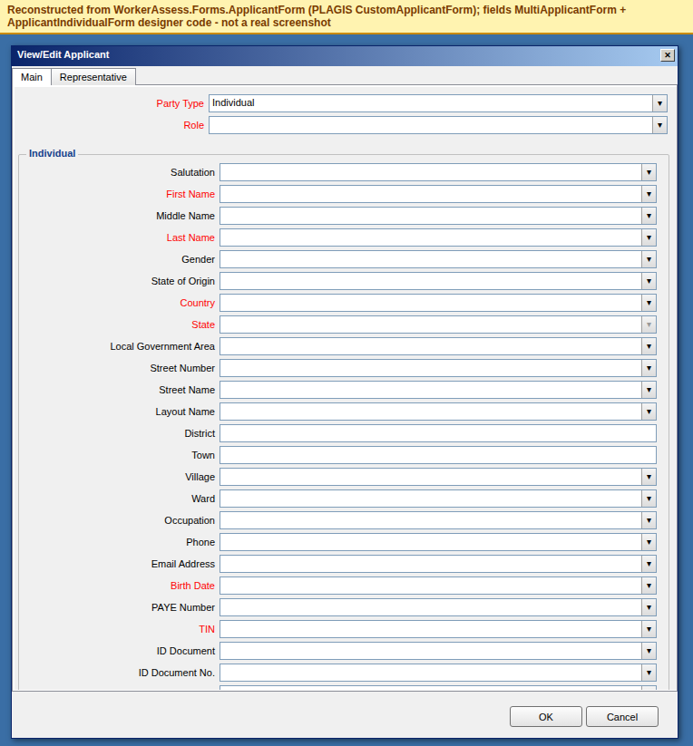

| Control | Type | Caption / label | Position / size | Bound field / data | Event handlers |
|---|---|---|---|---|---|
| xtraTabControl1 | XtraTabControl |  | 0,0 734x690 Anchor T+B+L+R | tab 2 |  |
| &nbsp;&nbsp;└ tpMain | XtraTabPage | General Information | 727x661 |  |  |
| &nbsp;&nbsp;&nbsp;&nbsp;└ layoutControl2 | LayoutControl | layoutControl2 | 0,145 727x250 Dock Top | lr_formfield _corporationStateFormName; tab 1 |  |
| &nbsp;&nbsp;&nbsp;&nbsp;└ layoutControl1 | LayoutControl | layoutControl1 | 0,0 727x145 Dock Top | lr_formfield _formName; tab 0 |  |
| &nbsp;&nbsp;└ tpAdditional | XtraTabPage | Additional Information | 543x301 |  |  |
| &nbsp;&nbsp;└ tpAdditional2 | XtraTabPage | Additional Information -&gt; runtime: "Representative" | 543x301 |  |  |
| btnCancel | SimpleButton | Cancel | 633,706 80x23 Anchor B+R | tab 1 | Click-&gt;btnCancel_Click |
| btnOK | SimpleButton | OK | 549,706 80x23 Anchor B+R | tab 0 | Click-&gt;btnOK_Click |
| layoutControlGroup1 | LayoutControlGroup | layoutControlGroup1 | 0,0 727x145 |  |  |
| layoutControlGroup2 | LayoutControlGroup | layoutControlGroup2 | 0,0 727x250 |  |  |

<details><summary>Other resource strings used by ApplicantForm (3)</summary>

- `strViewEditApplicant` = "View/Edit Applicant"
- `strPartyGeneralTab` = "General Information"
- `strRepresentativeTab` = "Representative"

</details>

#### 3.5.4 CustomApplicantForm

- Source: `TAR.PLAGIS.Controls.dll/TAR.PLAGIS.Controls.WorkerAssess.Forms/CustomApplicantForm.cs` (`TAR.PLAGIS.Controls.WorkerAssess.Forms`), base `ApplicantForm`; form Text "CustomApplicantForm".
- Status at PLAGIS: PLAGIS override of `ApplicantForm` (designer only adds/changes the controls listed; behaviour in 05 section 3).
- Purpose: See the base class above.
- Opened from (code references): `ApplicantSearchForm.gvListOfApplicants_DoubleClick`, `MultiApplicantsPage.AddApplicant`, `MultiApplicantsPage.EditApplicant`, `MultiApplicantsPage.SearchApplicant`

| Control | Type | Caption / label | Position / size | Bound field / data | Event handlers |
|---|---|---|---|---|---|
| xtraTabControl1 | XtraTabControl |  | 0,0 734x690 Anchor T+B+L+R | tab 2 |  |
| &nbsp;&nbsp;└ tpMain | XtraTabPage | General Information | 727x661 |  |  |
| &nbsp;&nbsp;&nbsp;&nbsp;└ layoutControl2 | LayoutControl | layoutControl2 | 0,145 727x250 Dock Top | tab 1 |  |
| &nbsp;&nbsp;&nbsp;&nbsp;└ layoutControl1 | LayoutControl | layoutControl1 | 0,0 727x145 Dock Top | tab 0 |  |
| &nbsp;&nbsp;└ tpAdditional | XtraTabPage | Additional Information | 543x301 |  |  |
| &nbsp;&nbsp;└ tpAdditional2 | XtraTabPage | Additional Information | 543x301 |  |  |
| btnCancel | Button | Cancel | 633,706 75x23 Anchor B+R | tab 1 | Click-&gt;btnCancel_Click |
| btnOK | Button | OK | 549,706 75x23 Anchor B+R | tab 0 | Click-&gt;btnOK_Click |

#### 3.5.5 PartiesPage

- Source: `TAR.Controls.dll/TAR.Controls.WorkerAssess.Pages/PartiesPage.cs` (`TAR.Controls.WorkerAssess.Pages`), base `TransactionListBasePage`; design size 543x473; resx `TAR.Controls.WorkerAssess.Pages.PartiesPage.resx`.
- Status at PLAGIS: Used (reachable from the PLAGIS configuration). Base of PLAGIS CustomPartiesPage (104 wizards).
- Purpose: "Parties": toolbar New Party / View/Edit / Delete / Add Applicant / Add Owners (hidden by PLAGIS) / Search Party, grid `PartiesGrid`.
- lr_formfield bindings in code: gvListOfParties -&gt; GridName

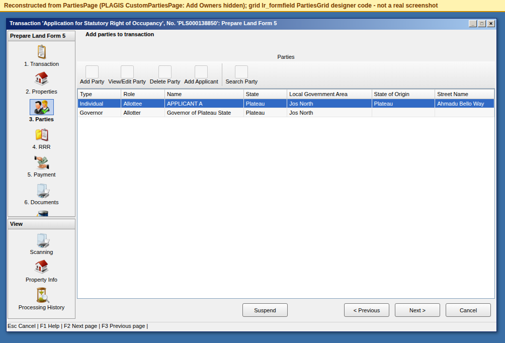

| Control | Type | Caption / label | Position / size | Bound field / data | Event handlers |
|---|---|---|---|---|---|
| pnlRelatedStuff | Panel |  | 0,110 543x363 Dock Fill | tab 3 |  |
| &nbsp;&nbsp;└ dbgListOfParties | GridControl |  | 0,72 543x291 Dock Fill | lr_formfield GridName; tab 8 |  |
| &nbsp;&nbsp;└ tsNames | ToolStrip | toolStrip1 | 0,18 543x54 | tab 4 |  |
| &nbsp;&nbsp;&nbsp;&nbsp;└ btnAdd | ToolStripButton | New Party -&gt; runtime: "Add Party" | 65x51 |  |  |
| &nbsp;&nbsp;&nbsp;&nbsp;└ btnEdit | ToolStripButton | View/Edit -&gt; runtime: "View/Edit Party" | 61x51 |  |  |
| &nbsp;&nbsp;&nbsp;&nbsp;└ btnDelete | ToolStripButton | Delete -&gt; runtime: "Delete Party" | 44x51 |  |  |
| &nbsp;&nbsp;&nbsp;&nbsp;└ btnAddApplicant | ToolStripButton | Add Applicant | 87x51 |  |  |
| &nbsp;&nbsp;&nbsp;&nbsp;└ separatorAddOwners | ToolStripSeparator |  | 6x54 |  |  |
| &nbsp;&nbsp;&nbsp;&nbsp;└ btnAddOwners | ToolStripButton | Add Owners | 76x51 |  |  |
| &nbsp;&nbsp;&nbsp;&nbsp;└ separatorSearchParty | ToolStripSeparator |  | 6x54 |  |  |
| &nbsp;&nbsp;&nbsp;&nbsp;└ btnSearchParty | ToolStripButton | Search Party | 76x51 |  |  |
| &nbsp;&nbsp;&nbsp;&nbsp;└ btnSpecifyTransferRules | ToolStripButton | toolStripButton7 | 36x51 |  |  |
| &nbsp;&nbsp;└ lblNames | Label | Parties | 0,0 543x18 Dock Top | tab 1 |  |
| pnlTransactions | Panel |  | 0,0 459x110 Dock Top hidden | tab 2 |  |
| &nbsp;&nbsp;└ dveTransactions | DataViewerEx |  | 0,18 543x92 Dock Fill | tab 2 |  |
| &nbsp;&nbsp;└ lblTransactions | Label | Batch Content | 0,0 459x18 Dock Top | tab 0 |  |
| pmToolbar | ContextMenu |  |  |  |  |
| miAdd | WMenuItem | New |  |  |  |
| miEdit | WMenuItem | Edit |  |  |  |
| miDelete | WMenuItem | Delete |  |  |  |
| miAddOwners | WMenuItem | AddOwners |  |  |  |
| miSpecifyTransferRules | WMenuItem | SpecifyTransferRules |  |  |  |
| miAddApplicant | WMenuItem | AddApplicant |  |  |  |
| miSearchParty | WMenuItem | SearchParty |  |  |  |
| gvListOfParties | GridView |  |  | lr_formfield GridName | DoubleClick-&gt;gridControl_DoubleClick, FocusedRowChanged-&gt;gridControl_FocusedRowChanged |

Messages this class can show (MessageBoxService kind: text):

- Warning: "Please enter at least one {0} for transaction '{1}' No. '{2}'."
- Warning: "party"
- Info: "&lt;exception message / formatted text: `(IWin32Window)(object)this, message`&gt;"
- Confirm: "The selected party will be deleted. Continue?"

<details><summary>Other resource strings used by PartiesPage (9)</summary>

- `strGeneralObjects_Parties` = "Parties"
- `strPartiesPage_Prompt` = "Add parties to transaction"
- `strPartiesPage_Add` = "Add Party"
- `strPartiesPage_Edit` = "View/Edit Party"
- `strPartiesPage_Delete` = "Delete Party"
- `strPartiesPage_AddOwner` = "Add Owners as Parties"
- `strPartiesPage_AddOwner1` = "Add Owners"
- `strPartiesPage_AsApplicant` = "Add Applicant"
- `strPartiesPage_SearchParty` = "Search Party"

</details>

#### 3.5.6 CustomPartiesPage

- Source: `TAR.PLAGIS.Controls.dll/TAR.PLAGIS.Controls.WorkerAssess.Pages/CustomPartiesPage.cs` (`TAR.PLAGIS.Controls.WorkerAssess.Pages`), base `PartiesPage`.
- Status at PLAGIS: PLAGIS override of `PartiesPage` (designer only adds/changes the controls listed; behaviour in 05 section 3).
- Purpose: See the base class above.

| Control | Type | Caption / label | Position / size | Bound field / data | Event handlers |
|---|---|---|---|---|---|
| pnlRelatedStuff | Panel |  | 0,110 543x363 Dock Fill | tab 3 |  |
| &nbsp;&nbsp;└ dbgListOfParties | GridControl |  | 0,72 543x291 Dock Fill | tab 8 |  |
| &nbsp;&nbsp;└ tsNames | ToolStrip | toolStrip1 | 0,18 543x54 | tab 4 |  |
| &nbsp;&nbsp;&nbsp;&nbsp;└ btnAdd | ToolStripButton | New Party | 65x51 |  |  |
| &nbsp;&nbsp;&nbsp;&nbsp;└ btnEdit | ToolStripButton | View/Edit | 61x51 |  |  |
| &nbsp;&nbsp;&nbsp;&nbsp;└ btnDelete | ToolStripButton | Delete | 44x51 |  |  |
| &nbsp;&nbsp;&nbsp;&nbsp;└ btnAddApplicant | ToolStripButton | Add Applicant | 87x51 |  |  |
| &nbsp;&nbsp;&nbsp;&nbsp;└ separatorAddOwners | ToolStripSeparator |  | 6x54 |  |  |
| &nbsp;&nbsp;&nbsp;&nbsp;└ btnAddOwners | ToolStripButton | Add Owners | 76x51 |  |  |
| &nbsp;&nbsp;&nbsp;&nbsp;└ separatorSearchParty | ToolStripSeparator |  | 6x54 |  |  |
| &nbsp;&nbsp;&nbsp;&nbsp;└ btnSearchParty | ToolStripButton | Search Party | 76x51 |  |  |
| &nbsp;&nbsp;&nbsp;&nbsp;└ btnSpecifyTransferRules | ToolStripButton | toolStripButton7 | 36x51 |  |  |
| &nbsp;&nbsp;└ lblNames | Label | Parties | 0,0 543x18 Dock Top | tab 1 |  |
| pnlTransactions | Panel |  | 0,0 459x110 Dock Top hidden | tab 2 |  |
| &nbsp;&nbsp;└ dveTransactions | DataViewerEx |  | 0,18 543x92 Dock Fill | tab 2 |  |
| &nbsp;&nbsp;└ lblTransactions | Label | Batch Content | 0,0 459x18 Dock Top | tab 0 |  |

Messages this class can show (MessageBoxService kind: text):

- Info: "Please set one party with role '{0}' as the title holder, to whom all correspondence relating to the title will be sent (e.g. ground rent bills, notification of lapsed registrations, etc)."

#### 3.5.7 PartyForm

- Source: `TAR.Controls.dll/TAR.Controls.WorkerAssess.Forms/PartyForm.cs` (`TAR.Controls.WorkerAssess.Forms`), base `BaseEditorForm`; form Text "View/Edit Party"; design size 734x741; min 700x600; resx `TAR.Controls.WorkerAssess.Forms.PartyForm.resx`.
- Status at PLAGIS: Used (reachable from the PLAGIS configuration). Subclassed by PLAGIS CustomPartyForm.
- Purpose: "View/Edit Party": PartyForm (type, legal role), person/organisation fields, comment, contacts tab.
- Opened from (code references): `AddOwnersForm.gvListOfParties_DoubleClick`, `DataCorrectionRrrPage.EditParty`, `DataCorrectionRrrPage.NewParty`, `DataCorrectionRrrPage.SearchParty`, `PartiesPage.AddParty`, `PartiesPage.AsApplicant`, `PartiesPage.EditParty`, `PartiesPage.SearchParty`, `PartySearchForm.gvListOfParties_DoubleClick`, `PropertyInfoForm.gvListOfParties_DoubleClick` (+3 more)
- lr_formfield bindings in code: layoutControl1 -&gt; metaInfo, layoutControl2 -&gt; _corporationStateForeignFormname, layoutControl3 -&gt; _commentFormName, layoutControl4 -&gt; typeof(SpatialUnit)

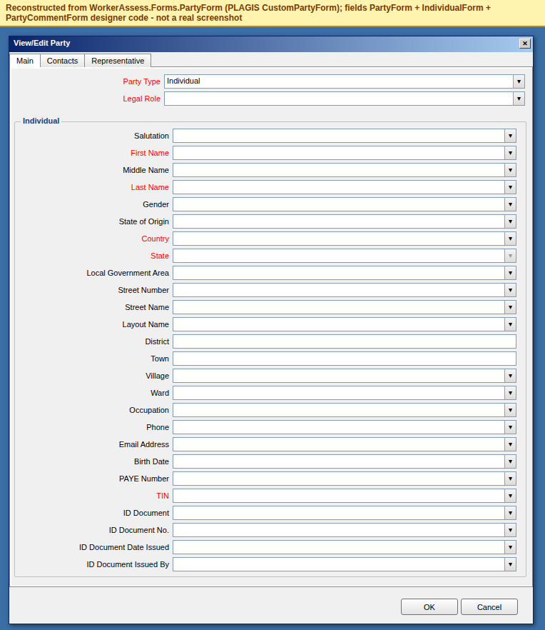

| Control | Type | Caption / label | Position / size | Bound field / data | Event handlers |
|---|---|---|---|---|---|
| xtraTabControl1 | XtraTabControl |  | 0,0 734x690 Anchor T+B+L+R | tab 2 |  |
| &nbsp;&nbsp;└ tpMain | XtraTabPage | General Information | 727x661 |  |  |
| &nbsp;&nbsp;&nbsp;&nbsp;└ layoutControl3 | LayoutControl | layoutControl3 | 0,420 727x80 Dock Top | lr_formfield _commentFormName; tab 2 |  |
| &nbsp;&nbsp;&nbsp;&nbsp;└ layoutControl2 | LayoutControl | layoutControl2 | 0,170 727x250 Dock Top | lr_formfield _corporationStateForeignFormname; tab 1 |  |
| &nbsp;&nbsp;&nbsp;&nbsp;└ layoutControl1 | LayoutControl | layoutControl1 | 0,0 727x20 Dock Top | lr_formfield metaInfo; tab 0 |  |
| &nbsp;&nbsp;└ tpAdditional | XtraTabPage | Additional Information -&gt; runtime: "Supplementary Details" | 727x661 |  |  |
| &nbsp;&nbsp;&nbsp;&nbsp;└ layoutControl4 | LayoutControl | layoutControl4 | 0,0 727x660 Dock Top | lr_formfield typeof(SpatialUnit); tab 0 |  |
| &nbsp;&nbsp;└ tpAdditional2 | XtraTabPage | Additional Information -&gt; runtime: "Representative" | 543x301 |  |  |
| btnCancel | SimpleButton | Cancel | 633,706 80x23 Anchor B+R | tab 1 | Click-&gt;btnCancel_Click |
| btnOK | SimpleButton | OK | 549,706 80x23 Anchor B+R | tab 0 | Click-&gt;btnOK_Click |
| layoutControlGroup1 | LayoutControlGroup | layoutControlGroup1 | 0,0 727x20 |  |  |
| layoutControlGroup2 | LayoutControlGroup | layoutControlGroup2 | 0,0 727x250 |  |  |
| layoutControlGroup3 | LayoutControlGroup | layoutControlGroup3 | 0,0 727x80 |  |  |
| layoutControlGroup4 | LayoutControlGroup | layoutControlGroup4 | 0,0 727x660 |  |  |

<details><summary>Other resource strings used by PartyForm (4)</summary>

- `strViewEditParty` = "View/Edit Party"
- `strPartyGeneralTab` = "General Information"
- `strExtensionTab` = "Supplementary Details"
- `strRepresentativeTab` = "Representative"

</details>

#### 3.5.8 CustomPartyForm

- Source: `TAR.PLAGIS.Controls.dll/TAR.PLAGIS.Controls.WorkerAssess.Forms/CustomPartyForm.cs` (`TAR.PLAGIS.Controls.WorkerAssess.Forms`), base `PartyForm`; form Text "CustomPartyForm".
- Status at PLAGIS: PLAGIS override of `PartyForm` (designer only adds/changes the controls listed; behaviour in 05 section 3).
- Purpose: See the base class above.
- Opened from (code references): `AddOwnersForm.gvListOfParties_DoubleClick`, `DataCorrectionRrrPage.EditParty`, `DataCorrectionRrrPage.NewParty`, `DataCorrectionRrrPage.SearchParty`, `PartiesPage.AddParty`, `PartiesPage.AsApplicant`, `PartiesPage.EditParty`, `PartiesPage.SearchParty`, `PartySearchForm.gvListOfParties_DoubleClick`, `PropertyInfoForm.gvListOfParties_DoubleClick` (+3 more)

| Control | Type | Caption / label | Position / size | Bound field / data | Event handlers |
|---|---|---|---|---|---|
| xtraTabControl1 | XtraTabControl |  | 0,0 734x690 Anchor T+B+L+R | tab 2 |  |
| &nbsp;&nbsp;└ tpMain | XtraTabPage | General Information | 727x661 |  |  |
| &nbsp;&nbsp;&nbsp;&nbsp;└ layoutControl3 | LayoutControl | layoutControl3 | 0,420 727x80 Dock Top | tab 2 |  |
| &nbsp;&nbsp;&nbsp;&nbsp;└ layoutControl2 | LayoutControl | layoutControl2 | 0,170 727x250 Dock Top | tab 1 |  |
| &nbsp;&nbsp;&nbsp;&nbsp;└ layoutControl1 | LayoutControl | layoutControl1 | 0,0 727x20 Dock Top | tab 0 |  |
| &nbsp;&nbsp;└ tpAdditional | XtraTabPage | Additional Information | 727x661 |  |  |
| &nbsp;&nbsp;&nbsp;&nbsp;└ layoutControl4 | LayoutControl | layoutControl4 | 0,0 727x660 Dock Top | tab 0 |  |
| &nbsp;&nbsp;└ tpAdditional2 | XtraTabPage | Additional Information | 543x301 |  |  |
| btnCancel | Button | Cancel | 633,706 75x23 Anchor B+R | tab 1 | Click-&gt;btnCancel_Click |
| btnOK | Button | OK | 549,706 75x23 Anchor B+R | tab 0 | Click-&gt;btnOK_Click |

#### 3.5.9 AddOwnersForm

- Source: `TAR.Controls.dll/TAR.Controls.WorkerAssess.Forms/AddOwnersForm.cs` (`TAR.Controls.WorkerAssess.Forms`), base `DialogForm`; design size 567x276; border Sizable; resx `TAR.Controls.WorkerAssess.Forms.AddOwnersForm.resx`.
- Status at PLAGIS: Reachable but hidden at PLAGIS (Add Owners button hidden).
- Purpose: Pick registered owners to add as parties.
- Opened from (code references): `PartiesPage.AddOwners`, `PropertiesPage.ViewOwners`
- lr_formfield bindings in code: gvListOfParties -&gt; "PartiesGrid"

| Control | Type | Caption / label | Position / size | Bound field / data | Event handlers |
|---|---|---|---|---|---|
| dbgListOfParties | GridControl |  | 4,4 559x229 Anchor T+B+L+R | lr_formfield PartiesGrid; tab 23 |  |
| btnCancel | SimpleButton | Cancel | 473,243 80x23 Anchor B+R | tab 1 |  |
| btnOK | SimpleButton | OK | 389,243 80x23 Anchor B+R | tab 0 |  |
| gvListOfParties | GridView |  |  | lr_formfield PartiesGrid | SelectionChanged-&gt;gvListOfParties_SelectionChanged, CustomRowFilter-&gt;gvListOfParties_CustomRowFilter |
| &nbsp;&nbsp;└ gridColumn4 | GridColumn | Last Name |  | field Unit |  |
| &nbsp;&nbsp;└ gridColumn5 | GridColumn | First Name |  | field Number |  |
| &nbsp;&nbsp;└ gridColumn6 | GridColumn | Address |  | field Name |  |

<details><summary>Other resource strings used by AddOwnersForm (2)</summary>

- `strAddOwnersForm_Caption` = "Add Owners to Transaction"
- `strPartiesTransferPage_Owners` = "Current Owners"

</details>

#### 3.5.10 ContactInfoPanel

- Source: `TAR.Controls.dll/TAR.Controls.WorkerAssess/ContactInfoPanel.cs` (`TAR.Controls.WorkerAssess`), base `UserControl`; design size 670x242.
- Status at PLAGIS: Used (reachable from the PLAGIS configuration).
- Opened from (code references): `PartyContactsPanel.PartyContactsPanel`

| Control | Type | Caption / label | Position / size | Bound field / data | Event handlers |
|---|---|---|---|---|---|
| layoutControl1 | LayoutControl | layoutControl1 | 0,0 670x242 Dock Fill | tab 0 |  |
| layoutControlItem13 | LayoutControlItem | Tax Id Type | 0,28 325x28 |  |  |
| layoutControlItem15 | LayoutControlItem | Tax Id Number | 0,28 325x56 |  |  |
| layoutControlItem14 | LayoutControlItem | Driver Licence No | 0,224 205x28 |  |  |
| layoutControlItem27 | LayoutControlItem | State | 0,224 325x28 |  |  |
| layoutControlGroup1 | LayoutControlGroup | layoutControlGroup1 | 0,0 670x242 |  |  |

#### 3.5.11 PartyContactForm

- Source: `TAR.Controls.dll/TAR.Controls.WorkerAssess.Forms/PartyContactForm.cs` (`TAR.Controls.WorkerAssess.Forms`), base `BaseEditorForm`; design size 669x455; resx `TAR.Controls.WorkerAssess.Forms.PartyContactForm.resx`.
- Status at PLAGIS: Used (reachable from the PLAGIS configuration).
- Purpose: Representative/contact dialog (PartyContactForm, 27 fields).
- Opened from (code references): `PartyContactSearchForm.gvListOfParties_DoubleClick`, `PartyContacts2Panel.Add_Action`, `PartyContacts2Panel.Edit_Action`, `PartyContacts2Panel.Search_Action`
- lr_formfield bindings in code: layoutControl -&gt; _GUIDescriptor

| Control | Type | Caption / label | Position / size | Bound field / data | Event handlers |
|---|---|---|---|---|---|
| btnCancel | SimpleButton | Cancel | 575,422 80x23 Anchor B+R | tab 1 | Click-&gt;btnCancel_Click |
| btnOK | SimpleButton | OK | 491,422 80x23 Anchor B+R | tab 0 | Click-&gt;btnOK_Click |
| xtraTabControl1 | XtraTabControl |  | 4,4 664x412 Anchor T+B+L+R | tab 2 |  |
| &nbsp;&nbsp;└ tpMain | XtraTabPage | General Information | 657x405 |  |  |
| &nbsp;&nbsp;&nbsp;&nbsp;└ layoutControl | LayoutControl | layoutControl1 | 0,0 657x405 Dock Fill | lr_formfield _GUIDescriptor; tab 3 |  |
| &nbsp;&nbsp;└ tpAdditional | XtraTabPage | Additional Information | 657x405 |  |  |
| &nbsp;&nbsp;└ tpAdditional2 | XtraTabPage | Additional Information | 543x301 |  |  |
| layoutControlGroup1 | LayoutControlGroup | layoutControlGroup1 | 0,0 657x405 |  |  |

<details><summary>Other resource strings used by PartyContactForm (1)</summary>

- `strEditRepresentative` = "View/Edit Representative"

</details>

#### 3.5.12 PartyContacts2Panel

- Source: `TAR.Controls.dll/TAR.Controls.WorkerAssess/PartyContacts2Panel.cs` (`TAR.Controls.WorkerAssess`), base `UserControl`; design size 516x366; resx `TAR.Controls.WorkerAssess.PartyContacts2Panel.resx`.
- Status at PLAGIS: Used (reachable from the PLAGIS configuration).
- Purpose: Contacts grid inside the applicant/party dialogs.
- Opened from (code references): `ApplicantForm.InitInterface`, `PartyForm.InitInterface`
- lr_formfield bindings in code: gvListOfContacts -&gt; PartyContactGrid

| Control | Type | Caption / label | Position / size | Bound field / data | Event handlers |
|---|---|---|---|---|---|
| dbgListOfContacts | GridControl |  | 0,58 516x308 Dock Fill | lr_formfield PartyContactGrid; tab 9 | DoubleClick-&gt;dbgListOfContacts_DoubleClick |
| tbNames | ToolBar |  | 0,0 516x58 | tab 8 |  |
| &nbsp;&nbsp;└ btnNew | ToolBarButton | New -&gt; runtime: "Add Representative" |  |  |  |
| &nbsp;&nbsp;└ btnEdit | ToolBarButton | View/Edit -&gt; runtime: "View/Edit Representative" |  |  |  |
| &nbsp;&nbsp;└ btnDelete | ToolBarButton | Delete -&gt; runtime: "Delete Representative" |  |  |  |
| &nbsp;&nbsp;└ btnSearch | ToolBarButton | Search -&gt; runtime: "Search Representative" |  |  |  |
| pmToolbar | ContextMenu |  |  |  |  |
| miAdd | WMenuItem |   |  |  |  |
| miEdit | WMenuItem |   |  |  |  |
| miDelete | WMenuItem |   |  |  |  |
| miSearch | WMenuItem |   |  |  |  |
| gvListOfContacts | GridView |  |  | lr_formfield PartyContactGrid |  |

Messages this class can show (MessageBoxService kind: text):

- Confirm: "The selected representative will be deleted. Continue?"

<details><summary>Other resource strings used by PartyContacts2Panel (4)</summary>

- `strAddRepresentative` = "Add Representative"
- `strEditRepresentative` = "View/Edit Representative"
- `strDeleteRepresentative` = "Delete Representative"
- `strSearchRepresentative` = "Search Representative"

</details>

#### 3.5.13 PartyContactsPanel

- Source: `TAR.Controls.dll/TAR.Controls.WorkerAssess/PartyContactsPanel.cs` (`TAR.Controls.WorkerAssess`), base `UserControl`; design size 670x450; resx `TAR.Controls.WorkerAssess.PartyContactsPanel.resx`.
- Status at PLAGIS: Used (reachable from the PLAGIS configuration).
- Opened from (code references): `PartyForm.InitInterface`
- lr_formfield bindings in code: m_ContactInfoPanel -&gt; "PartyContactForm", gvListOfContacts -&gt; "PartyContactsGrid"

| Control | Type | Caption / label | Position / size | Bound field / data | Event handlers |
|---|---|---|---|---|---|
| pnlAttributes | Panel |  | 0,226 670x224 Dock Fill | tab 0 |  |
| pnlTop | Panel |  | 0,0 670x226 Dock Top | tab 0 |  |
| &nbsp;&nbsp;└ dbgListOfContacts | GridControl |  | 0,58 670x168 Dock Fill | lr_formfield PartyContactsGrid; tab 8 |  |
| &nbsp;&nbsp;└ tbNames | ToolBar |  | 0,0 670x58 | tab 7 |  |
| &nbsp;&nbsp;&nbsp;&nbsp;└ btnNew | ToolBarButton | New |  |  |  |
| &nbsp;&nbsp;&nbsp;&nbsp;└ btnSave | ToolBarButton | Save |  |  |  |
| &nbsp;&nbsp;&nbsp;&nbsp;└ btnDelete | ToolBarButton | Delete |  |  |  |
| gvListOfContacts | GridView |  |  | lr_formfield PartyContactsGrid | DoubleClick-&gt;gvListOfContacts_DoubleClick |
| pmToolbar | ContextMenu |  |  |  |  |
| miAdd | WMenuItem |   |  |  |  |
| miSave | WMenuItem |   |  |  |  |
| miDelete | WMenuItem |   |  |  |  |

Messages this class can show (MessageBoxService kind: text):

- Confirm: "You have unsaved information in the Contacts screen. Do you want to save it?"
- Confirm: "You have unsaved information in the Contacts screen. Do you want to discard the changes?"
- Confirm: "The selected contact will be deleted. Continue?"

<details><summary>Other resource strings used by PartyContactsPanel (6)</summary>

- `strNewContactButton` = "New"
- `strSaveContactButton` = "Save"
- `strDeleteContactButton` = "Delete"
- `strAddContact` = "Add Contact"
- `strDeleteContact` = "Delete Contact"
- `strSaveContact` = "Save Contact"

</details>

### 3.6 Properties, survey plans, ground-rent review

Property (LA unit / spatial unit) pages and dialogs, survey plans, plan numbers and ground-rent review.

#### 3.6.1 PropertiesPage

- Source: `TAR.Controls.dll/TAR.Controls.WorkerAssess.Pages/PropertiesPage.cs` (`TAR.Controls.WorkerAssess.Pages`), base `TransactionListBasePage`; design size 600x444; resx `TAR.Controls.WorkerAssess.Pages.PropertiesPage.resx`.
- Status at PLAGIS: Used (reachable from the PLAGIS configuration). Base of PLAGIS CustomPropertiesPage (196 wizards).
- Purpose: "Properties": "Source Property Details" grid (Add to Target Property / View Property / Map) and "Target Property Details" grid (New / View/Edit / Delete / Owners / Map / Search); grids from the editor form (usually `PropertyGrid`).
- lr_formfield bindings in code: gvListOfSourcePropertyParts -&gt; base.EntityGUIDescriptorName, gvListOfTargetPropertyParts -&gt; base.EntityGUIDescriptorName

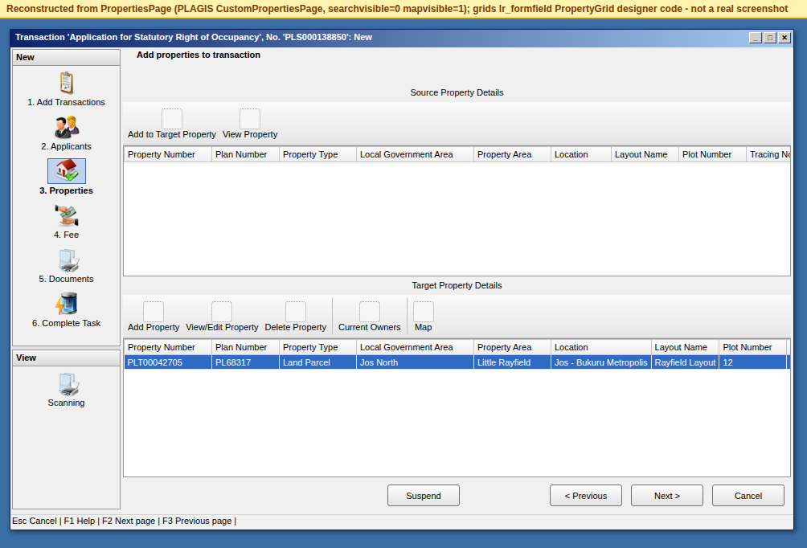

| Control | Type | Caption / label | Position / size | Bound field / data | Event handlers |
|---|---|---|---|---|---|
| pnlRelatedStuff | Panel |  | 0,110 459x260 Dock Fill | tab 3 |  |
| &nbsp;&nbsp;└ pnlSourcePropertyParts | Panel |  | 0,0 600x244 Dock Fill | tab 1 |  |
| &nbsp;&nbsp;&nbsp;&nbsp;└ dbgListOfSourcePropertyParts | GridControl |  | 0,77 600x167 Dock Fill Anchor T+B+L+R | lr_formfield base.EntityGUIDescriptorName; tab 23 |  |
| &nbsp;&nbsp;&nbsp;&nbsp;└ tsSourcePropertyParts | ToolStrip | Tool Strip for Source Property Parts | 0,23 600x54 | tab 24 |  |
| &nbsp;&nbsp;&nbsp;&nbsp;&nbsp;&nbsp;└ btnAddSource2Target | ToolStripButton | Add to Target Property | 35x35 |  |  |
| &nbsp;&nbsp;&nbsp;&nbsp;&nbsp;&nbsp;└ btnViewSourceProperty | ToolStripButton | View Property | 35x35 |  |  |
| &nbsp;&nbsp;&nbsp;&nbsp;&nbsp;&nbsp;└ btnMapSourceProperty | ToolStripButton | Map -&gt; runtime: "View Map" | 35x35 hidden |  |  |
| &nbsp;&nbsp;&nbsp;&nbsp;└ lblSourcePropertyParts | Label | Source Property Details | 0,0 600x23 Dock Top | tab 1 |  |
| &nbsp;&nbsp;└ pnlTargetPropertyParts | Panel |  | 0,245 600x250 Dock Bottom | tab 2 |  |
| &nbsp;&nbsp;&nbsp;&nbsp;└ dbgListOfTargetPropertyParts | GridControl |  | 0,77 600x123 Dock Fill | lr_formfield base.EntityGUIDescriptorName; tab 23 |  |
| &nbsp;&nbsp;&nbsp;&nbsp;└ tsTargetPropertyParts | ToolStrip | Tool Strip for Target Property Parts | 0,23 600x54 | tab 24 |  |
| &nbsp;&nbsp;&nbsp;&nbsp;&nbsp;&nbsp;└ btnNew | ToolStripButton | New -&gt; runtime: "Add Property" | 35x35 |  |  |
| &nbsp;&nbsp;&nbsp;&nbsp;&nbsp;&nbsp;└ btnEdit | ToolStripButton | View/Edit -&gt; runtime: "View/Edit Property" | 61x35 |  |  |
| &nbsp;&nbsp;&nbsp;&nbsp;&nbsp;&nbsp;└ btnDelete | ToolStripButton | Delete -&gt; runtime: "Delete Property" | 44x35 |  |  |
| &nbsp;&nbsp;&nbsp;&nbsp;&nbsp;&nbsp;└ separatorViewOwners | ToolStripSeparator |  | 6x38 |  |  |
| &nbsp;&nbsp;&nbsp;&nbsp;&nbsp;&nbsp;└ btnViewOwners | ToolStripButton | Owners -&gt; runtime: "Current Owners" | 51x35 |  |  |
| &nbsp;&nbsp;&nbsp;&nbsp;&nbsp;&nbsp;└ separatorMap | ToolStripSeparator |  | 6x38 |  |  |
| &nbsp;&nbsp;&nbsp;&nbsp;&nbsp;&nbsp;└ btnMap | ToolStripButton | Map | 35x35 |  |  |
| &nbsp;&nbsp;&nbsp;&nbsp;&nbsp;&nbsp;└ separatorSearch | ToolStripSeparator |  | 6x38 |  |  |
| &nbsp;&nbsp;&nbsp;&nbsp;&nbsp;&nbsp;└ btnSearch | ToolStripButton | Search | 46x35 |  |  |
| &nbsp;&nbsp;&nbsp;&nbsp;└ lblTargetPropertyParts | Label | Target Property Details | 0,0 600x23 Dock Top | tab 1 |  |
| pnlTransactions | Panel |  | 0,0 459x110 Dock Top hidden | tab 2 |  |
| &nbsp;&nbsp;└ dveTransactions | DataViewerEx |  | 0,18 459x92 Dock Fill | tab 2 |  |
| &nbsp;&nbsp;└ lblTransactions | Label | Batch Content | 0,0 459x18 Dock Top | tab 0 |  |
| pmToolbar | ContextMenu |  |  |  |  |
| miAddSource2Target | WMenuItem |  |  |  |  |
| miViewSourceProperty | WMenuItem |  |  |  |  |
| miMapSourceProperty | WMenuItem |  |  |  |  |
| miNew | WMenuItem | F7 |  |  |  |
| miEdit | WMenuItem | F9 |  |  |  |
| miDelete | WMenuItem | F8 |  |  |  |
| miViewOwnersSeparator | MenuItem | -- |  |  |  |
| miViewOwners | WMenuItem | F9 |  |  |  |
| miMapSeparator | MenuItem | -- |  |  |  |
| miMap | WMenuItem | View Map |  |  |  |
| miSearchSeparator | MenuItem | -- |  |  |  |
| miSearch | WMenuItem | Search |  |  |  |
| gvListOfSourcePropertyParts | GridView |  |  | lr_formfield base.EntityGUIDescriptorName | DoubleClick-&gt;gvListOfSourcePropertyParts_DoubleClick |
| gvListOfTargetPropertyParts | GridView |  |  | lr_formfield base.EntityGUIDescriptorName | DoubleClick-&gt;gvListOfTargetPropertyParts_DoubleClick |

Messages this class can show (MessageBoxService kind: text):

- Confirm: "&lt;exception message / formatted text: `(IWin32Window)(object)this, text`&gt;"
- Warning: "The original source of this target property was reject/withdraw. Please delete this target property (all past transactions will be deleted)."
- Warning: "Not all mandatory fields are filled in.  Please fill in all fields marked in red."
- Warning: "Please enter at least one property for transaction {0} No. {1}."

<details><summary>Other resource strings used by PropertiesPage (16)</summary>

- `strPropertiesPage_Caption` = "Properties"
- `strPropertiesPage_Prompt` = "Add properties to transaction"
- `strPropertiesPage_SourcePropertyDetails` = "Source Property Details"
- `strPropertiesPage_TargetPropertyDetails` = "Target Property Details"
- `strPropertiesPage_AddSource2Target` = "Add to Target Property"
- `strPropertiesPage_ViewProperty` = "View Property"
- `strViewMap_Property` = "View Map"
- `strPropertiesPage_Add` = "Add Property"
- `strPropertiesPage_Delete` = "Delete Property"
- `strPropertiesPage_Edit` = "View/Edit Property"
- `strPartiesTransferPage_Owners` = "Current Owners"
- `strMap_Property` = "Map"
- `strPropertiesPage_Search` = "Search"
- `strPropertiesPage_DeletePrompt` = "Selected property will be deleted. Continue?"
- `strPropertiesPage_DeletePromptINSC` = "Selected property will be deleted (Past transactions will be deleted too). Continue?"
- `frmPagePropertyInfo_ValidatError` = "Not all mandatory fields are filled in.  Please fill in all fields marked in red."

</details>

#### 3.6.2 PropertyForm

- Source: `TAR.Controls.dll/TAR.Controls.WorkerAssess.Forms/PropertyForm.cs` (`TAR.Controls.WorkerAssess.Forms`), base `BaseEditorForm`; form Text "View/Edit Property"; design size 737x415; border Sizable; resx `TAR.Controls.WorkerAssess.Forms.PropertyForm.resx`.
- Status at PLAGIS: Used (reachable from the PLAGIS configuration). Subclassed by PLAGIS CustomPropertyForm.
- Purpose: "View/Edit Property": tab Main = main form (`mainForm` attribute, e.g. PropertyFormForLodgment) + plot/unit/building sub-form; Additional tabs = extension data and site analysis (`siteAnalysisForm`).
- Opened from (code references): `CustomSearchPropertyPresenter.ViewPropertyDetails`, `DataCorrectionRrrPage.ViewPropertyAction`, `NotesPage.EditProperty`, `NotesPage.NewProperty`, `PropertiesPage.EditProperty`, `PropertiesPage.NewProperty`, `PropertiesPage.ViewSourceProperty_Action`, `PropertyInfoForm.gvListOfPropertyParts_DoubleClick`, `PropertySearchForm.dbgListOfProperties_DoubleClick`, `PropertySearchFormINSC.dbgListOfProperties_DoubleClick` (+2 more)
- Form events: FormClosing -&gt; `PropertyForm_FormClosing`
- lr_formfield bindings in code: layoutControl1 -&gt; _formName, layoutControl2 -&gt; m_GUIDescriptopUnit, layoutControl3 -&gt; typeof(SpatialUnit), layoutControl4 -&gt; _siteAnalysisFormName

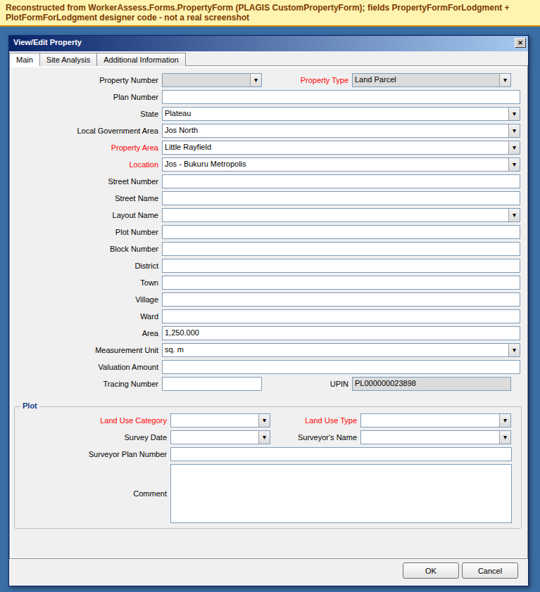

| Control | Type | Caption / label | Position / size | Bound field / data | Event handlers |
|---|---|---|---|---|---|
| xtraTabControl1 | XtraTabControl |  | 0,0 737x377 Anchor T+B+L+R | tab 2 |  |
| &nbsp;&nbsp;└ tpMain | XtraTabPage | General Information | 730x348 |  |  |
| &nbsp;&nbsp;&nbsp;&nbsp;└ layoutControl2 | LayoutControl | layoutControl2 | 0,30 730x318 Dock Fill hidden | lr_formfield m_GUIDescriptopUnit; tab 1 |  |
| &nbsp;&nbsp;&nbsp;&nbsp;└ layoutControl1 | LayoutControl | layoutControl1 | 0,0 730x30 Dock Top | lr_formfield _formName; tab 0 |  |
| &nbsp;&nbsp;└ tpAdditional | XtraTabPage | Additional Information -&gt; runtime: "Site Analysis" | 730x348 |  |  |
| &nbsp;&nbsp;&nbsp;&nbsp;└ layoutControl4 | LayoutControl | layoutControl4 | 0,0 730x318 Dock Fill | lr_formfield _siteAnalysisFormName; tab 0 |  |
| &nbsp;&nbsp;└ tpAdditional2 | XtraTabPage | Additional Information | 543x301 |  |  |
| btnCancel | SimpleButton | Cancel | 643,382 80x23 Anchor B+R | tab 1 | Click-&gt;btnCancel_Click |
| btnOK | SimpleButton | OK | 559,382 80x23 Anchor B+R | tab 0 | Click-&gt;btnOK_Click |
| layoutControlGroup1 | LayoutControlGroup | layoutControlGroup1 | 0,0 730x30 |  |  |
| layoutControlGroup2 | LayoutControlGroup | layoutControlGroup2 | 0,0 730x318 |  |  |
| layoutControl3 | LayoutControl | layoutControl3 | 0,0 730x318 Dock Fill | lr_formfield typeof(SpatialUnit); tab 0 |  |
| layoutControlGroup3 | LayoutControlGroup | layoutControlGroup3 | 0,0 730x318 |  |  |
| layoutControlGroup4 | LayoutControlGroup | layoutControlGroup4 | 0,0 730x318 |  |  |

Messages this class can show (MessageBoxService kind: text):

- Show: "Plan number {0} does not exist in the system. Would you like to continue ?"

<details><summary>Other resource strings used by PropertyForm (3)</summary>

- `strPropertyForm` = "View/Edit Property"
- `strPartyGeneralTab` = "General Information"
- `strSiteAnalysisTab` = "Site Analysis"

</details>

#### 3.6.3 CustomPropertyForm

- Source: `TAR.PLAGIS.Controls.dll/TAR.PLAGIS.Controls.WorkerAssess.Forms/CustomPropertyForm.cs` (`TAR.PLAGIS.Controls.WorkerAssess.Forms`), base `PropertyForm`; form Text "CustomPropertyForm".
- Status at PLAGIS: PLAGIS override of `PropertyForm` (designer only adds/changes the controls listed; behaviour in 05 section 3).
- Purpose: See the base class above.
- Opened from (code references): `CustomSearchPropertyPresenter.ViewPropertyDetails`, `DataCorrectionRrrPage.ViewPropertyAction`, `NotesPage.EditProperty`, `NotesPage.NewProperty`, `PropertiesPage.EditProperty`, `PropertiesPage.NewProperty`, `PropertiesPage.ViewSourceProperty_Action`, `PropertyInfoForm.gvListOfPropertyParts_DoubleClick`, `PropertySearchForm.dbgListOfProperties_DoubleClick`, `PropertySearchFormINSC.dbgListOfProperties_DoubleClick` (+2 more)
- lr_formfield bindings in code: layoutControl2 -&gt; _unitFormName

| Control | Type | Caption / label | Position / size | Bound field / data | Event handlers |
|---|---|---|---|---|---|
| xtraTabControl1 | XtraTabControl |  | 0,0 737x377 Anchor T+B+L+R | tab 2 |  |
| &nbsp;&nbsp;└ tpMain | XtraTabPage | General Information | 730x348 |  |  |
| &nbsp;&nbsp;&nbsp;&nbsp;└ layoutControl2 | LayoutControl | layoutControl2 | 0,30 730x318 Dock Fill hidden | lr_formfield _unitFormName; tab 1 |  |
| &nbsp;&nbsp;&nbsp;&nbsp;└ layoutControl1 | LayoutControl | layoutControl1 | 0,0 730x30 Dock Top | tab 0 |  |
| &nbsp;&nbsp;└ tpAdditional | XtraTabPage | Additional Information | 730x348 |  |  |
| &nbsp;&nbsp;&nbsp;&nbsp;└ layoutControl4 | LayoutControl | layoutControl4 | 0,0 730x318 Dock Fill | tab 0 |  |
| &nbsp;&nbsp;└ tpAdditional2 | XtraTabPage | Additional Information | 543x301 |  |  |
| btnCancel | Button | Cancel | 643,382 75x23 Anchor B+R | tab 1 | Click-&gt;btnCancel_Click |
| btnOK | Button | OK | 559,382 75x23 Anchor B+R | tab 0 | Click-&gt;btnOK_Click |

#### 3.6.4 PropertyInfoForm

- Source: `TAR.Controls.dll/TAR.Controls.WorkerAssess.Forms/PropertyInfoForm.cs` (`TAR.Controls.WorkerAssess.Forms`), base `DialogForm`; form Text "Property Info"; design size 741x596; border Sizable; resx `TAR.Controls.WorkerAssess.Forms.PropertyInfoForm.resx`.
- Status at PLAGIS: Used (reachable from the PLAGIS configuration). via PLAGIS CustomPropertyInfoForm (View &gt; Property Info).
- Purpose: Read-only dossier: Properties, Owners, Transactions, then tabs Parties / Documents / Payments.
- Opened from (code references): `AssessWorker.ShowPropertyInfo`, `ListOfInstruments.ShowPropertyInfo`
- Form events: VisibleChanged -&gt; `PropertyInfoForm_VisibleChanged`, KeyDown -&gt; `PropertyInfoForm2_KeyDown`
- lr_formfield bindings in code: gvListOfTransactions -&gt; "PropertyTransactionsGrid", gvListOfPropertyParts -&gt; "PropertyGrid", gvListOfSupportDocs -&gt; "SupportedDocGrid", gvListOfParties -&gt; "PartiesGrid", gvListOfOwners -&gt; "PartiesGrid", gvListOfPayments -&gt; "PaymentGrid"

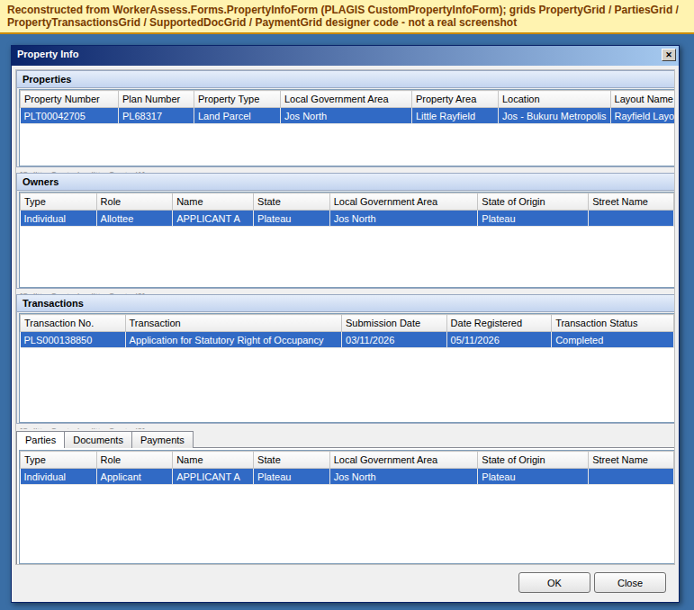

| Control | Type | Caption / label | Position / size | Bound field / data | Event handlers |
|---|---|---|---|---|---|
| pcMain | PanelControl |  | 4,4 733x551 Anchor T+B+L+R | tab 7 |  |
| &nbsp;&nbsp;└ tcDocumentsParties | XtraTabControl |  | 2,401 729x148 Dock Fill | tab 4 |  |
| &nbsp;&nbsp;&nbsp;&nbsp;└ tpParties | XtraTabPage | Parties | 722x119 |  |  |
| &nbsp;&nbsp;&nbsp;&nbsp;&nbsp;&nbsp;└ dbgListOfParties | GridControl |  | 0,0 722x119 Dock Fill | lr_formfield PartiesGrid; tab 22 |  |
| &nbsp;&nbsp;&nbsp;&nbsp;└ tpDocuments | XtraTabPage | Documents | 722x119 |  |  |
| &nbsp;&nbsp;&nbsp;&nbsp;&nbsp;&nbsp;└ dbgListOfSupportDocs | GridControl |  | 0,0 722x119 Dock Fill | lr_formfield SupportedDocGrid; tab 0 |  |
| &nbsp;&nbsp;&nbsp;&nbsp;└ tpPayments | XtraTabPage | Payments | 722x119 |  |  |
| &nbsp;&nbsp;&nbsp;&nbsp;&nbsp;&nbsp;└ dbgListOfPayments | GridControl |  | 0,0 722x119 Dock Fill | lr_formfield PaymentGrid; tab 1 |  |
| &nbsp;&nbsp;└ splitterControl3 | SplitterControl |  | 2,395 729x6 Dock Top | tab 9 |  |
| &nbsp;&nbsp;└ gcTransactions | GroupControl | Transactions -&gt; runtime: "Registered Transactions" | 2,251 729x144 Dock Top | tab 5 |  |
| &nbsp;&nbsp;&nbsp;&nbsp;└ dbgListOfTransactions | GridControl |  | 2,22 725x120 Dock Fill | lr_formfield PropertyTransactionsGrid; tab 0 |  |
| &nbsp;&nbsp;└ splitterControl2 | SplitterControl |  | 2,245 729x6 Dock Top | tab 7 |  |
| &nbsp;&nbsp;└ gcOwners | GroupControl | Properties -&gt; runtime: "Current Owners" | 2,116 729x129 Dock Top | tab 8 |  |
| &nbsp;&nbsp;&nbsp;&nbsp;└ dbgListOfOwners | GridControl |  | 2,22 725x105 Dock Fill | lr_formfield PartiesGrid; tab 0 |  |
| &nbsp;&nbsp;└ splitterControl1 | SplitterControl |  | 2,110 729x6 Dock Top | tab 4 |  |
| &nbsp;&nbsp;└ gcProperties | GroupControl | Properties | 2,2 729x108 Dock Top | tab 1 |  |
| &nbsp;&nbsp;&nbsp;&nbsp;└ dbgListOfPropertyParts | GridControl |  | 2,22 725x84 Dock Fill | lr_formfield PropertyGrid; tab 0 |  |
| btnCancel | SimpleButton | Cancel -&gt; runtime: "Close" | 647,563 80x23 Anchor B+R | tab 1 |  |
| btnOK | SimpleButton | OK | 563,563 80x23 Anchor B+R | tab 0 |  |
| gvListOfParties | GridView |  |  | lr_formfield PartiesGrid | DoubleClick-&gt;gvListOfParties_DoubleClick |
| gvListOfSupportDocs | GridView |  |  | lr_formfield SupportedDocGrid | DoubleClick-&gt;gvListOfSupportDocs_DoubleClick |
| gvListOfTransactions | GridView |  |  | lr_formfield PropertyTransactionsGrid | FocusedRowChanged-&gt;gvListOfTransactions_FocusedRowChanged, DoubleClick-&gt;gvListOfTransactions_DoubleClick |
| gvListOfOwners | GridView |  |  | lr_formfield PartiesGrid | DoubleClick-&gt;gvListOfParties_DoubleClick |
| gvListOfPropertyParts | GridView |  |  | lr_formfield PropertyGrid | FocusedRowChanged-&gt;gvListOfPropertyParts_FocusedRowChanged, DoubleClick-&gt;gvListOfPropertyParts_DoubleClick |
| gvListOfPayments | GridView |  |  | lr_formfield PaymentGrid | DoubleClick-&gt;gvListOfPayments_DoubleClick |

Messages this class can show (MessageBoxService kind: text):

- Info: "This transaction has not been associated with any property so far."

<details><summary>Other resource strings used by PropertyInfoForm (11)</summary>

- `strGeneralObjects_PropertyInfo` = "Property Info"
- `strPropertiesPage_Caption` = "Properties"
- `strPartiesTransferPage_Owners` = "Current Owners"
- `strGeneralObjects_RegisteredTransactions` = "Registered Transactions"
- `strGeneralObjects_Parties` = "Parties"
- `strPrintDocumentsPage_Caption` = "Documents"
- `strPayments` = "Payments"
- `strClose` = "Close"
- `strPartiesPage_Caption` = "Parties"
- `strGeneralObjects_Transactions` = "Transactions"
- `strScannedDocuments` = "Scanning"

</details>

#### 3.6.5 SurveyPlanPage

- Source: `TAR.Controls.dll/TAR.Controls.WorkerAssess.Pages/SurveyPlanPage.cs` (`TAR.Controls.WorkerAssess.Pages`), base `TransactionListBasePage`; design size 600x444; resx `TAR.Controls.WorkerAssess.Pages.SurveyPlanPage.resx`.
- Status at PLAGIS: Used (reachable from the PLAGIS configuration). SPC (8 wizards).
- Purpose: "Survey Plan": toolbar New / View/Edit / Delete, grid `SurveyPlanGrid`.
- lr_formfield bindings in code: gvListOfSurveyPlanParts -&gt; _formName

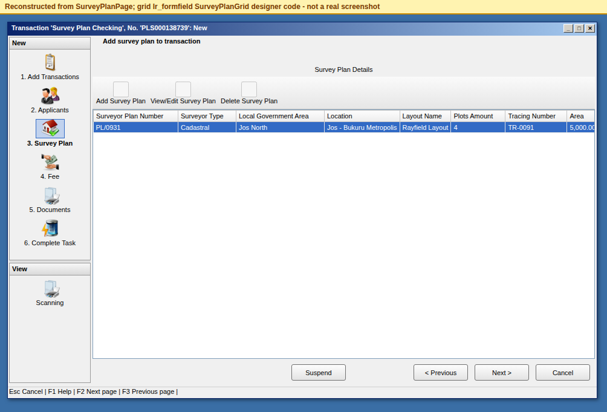

| Control | Type | Caption / label | Position / size | Bound field / data | Event handlers |
|---|---|---|---|---|---|
| pnlRelatedStuff | Panel |  | 0,110 459x260 Dock Fill | tab 3 |  |
| &nbsp;&nbsp;└ pnlSurveyPlanParts | Panel |  | 0,0 600x244 Dock Fill | tab 1 |  |
| &nbsp;&nbsp;&nbsp;&nbsp;└ dbgListOfSurveyPlanParts | GridControl |  | 0,77 600x167 Dock Fill Anchor T+B+L+R | lr_formfield _formName; tab 23 |  |
| &nbsp;&nbsp;&nbsp;&nbsp;└ tsSurveyPlanParts | ToolStrip | Tool Strip for Survey Plan Parts | 0,23 600x54 | tab 24 |  |
| &nbsp;&nbsp;&nbsp;&nbsp;&nbsp;&nbsp;└ btnNew | ToolStripButton | New -&gt; runtime: "Add Survey Plan" | 35x35 |  |  |
| &nbsp;&nbsp;&nbsp;&nbsp;&nbsp;&nbsp;└ btnEdit | ToolStripButton | View/Edit -&gt; runtime: "View/Edit Survey Plan" | 61x35 |  |  |
| &nbsp;&nbsp;&nbsp;&nbsp;&nbsp;&nbsp;└ btnDelete | ToolStripButton | Delete -&gt; runtime: "Delete Survey Plan" | 44x35 |  |  |
| &nbsp;&nbsp;&nbsp;&nbsp;└ lblSurveyPlanParts | Label | Survey Plan Details | 0,0 600x23 Dock Top | tab 1 |  |
| pnlTransactions | Panel |  | 0,0 459x110 Dock Top hidden | tab 2 |  |
| &nbsp;&nbsp;└ dveTransactions | DataViewerEx |  | 0,18 459x92 Dock Fill | tab 2 |  |
| &nbsp;&nbsp;└ lblTransactions | Label | Batch Content | 0,0 459x18 Dock Top | tab 0 |  |
| pmToolbar | ContextMenu |  |  |  |  |
| miNew | WMenuItem | F7 |  |  |  |
| miEdit | WMenuItem | F9 |  |  |  |
| miDelete | WMenuItem | F8 |  |  |  |
| gvListOfSurveyPlanParts | GridView |  |  | lr_formfield _formName | DoubleClick-&gt;gvListOfSurveyPlanParts_DoubleClick |

Messages this class can show (MessageBoxService kind: text):

- Confirm: "&lt;exception message / formatted text: `(IWin32Window)(object)this, strSurveyPlanDelete_propmt`&gt;"
- Error: "Please enter at least one survey plan."

<details><summary>Other resource strings used by SurveyPlanPage (6)</summary>

- `strSurveyPlanPage_Caption` = "Survey Plan"
- `strSurveyPlanPage_Prompt` = "Add survey plan to transaction"
- `strSurveyPlanPage_Add` = "Add Survey Plan"
- `strSurveyPlanPage_Delete` = "Delete Survey Plan"
- `strSurveyPlanPage_Edit` = "View/Edit Survey Plan"
- `strSurveyPlanDelete_propmt` = "The selected survey plan will be deleted. Continue?"

</details>

#### 3.6.6 SurveyPlanForm

- Source: `TAR.Controls.dll/TAR.Controls.WorkerAssess.Forms/SurveyPlanForm.cs` (`TAR.Controls.WorkerAssess.Forms`), base `BaseEditorForm`; form Text "View/Edit Survey Plan"; design size 737x415; min 700x600; border Sizable.
- Status at PLAGIS: Used (reachable from the PLAGIS configuration).
- Purpose: "View/Edit Survey Plan": fields `SurveyPlanForm` (25).
- Opened from (code references): `SurveyPlanPage.EditSurveyplan`, `SurveyPlanPage.NewSurveyPlan`
- lr_formfield bindings in code: layoutControl1 -&gt; "SurveyPlanForm"

| Control | Type | Caption / label | Position / size | Bound field / data | Event handlers |
|---|---|---|---|---|---|
| xtraTabControl1 | XtraTabControl |  | 0,0 737x377 Anchor T+B+L+R | tab 2 |  |
| &nbsp;&nbsp;└ tpMain | XtraTabPage | Survey Plan Details | 730x348 |  |  |
| &nbsp;&nbsp;&nbsp;&nbsp;└ layoutControl1 | LayoutControl | layoutControl1 | 0,0 727x318 Dock Fill | lr_formfield SurveyPlanForm; tab 0 |  |
| &nbsp;&nbsp;└ tpAdditional | XtraTabPage | Additional Information | 730x348 |  |  |
| &nbsp;&nbsp;└ tpAdditional2 | XtraTabPage | Additional Information | 730x348 |  |  |
| btnCancel | SimpleButton | Cancel | 643,382 80x23 Anchor B+R | tab 1 | Click-&gt;btnCancel_Click |
| btnOK | SimpleButton | OK | 559,382 80x23 Anchor B+R | tab 0 | Click-&gt;btnOK_Click |
| layoutControlGroup1 | LayoutControlGroup | layoutControlGroup1 | 0,0 727x318 |  |  |

Messages this class can show (MessageBoxService kind: text):

- Warning: "The 'Beacon Amount (Perimeter)' value must be greater than 0."
- Error: "&lt;exception message&gt;"

<details><summary>Other resource strings used by SurveyPlanForm (1)</summary>

- `strSurveyPlanPage_Edit` = "View/Edit Survey Plan"

</details>

#### 3.6.7 RegisterPlanNumberPage

- Source: `TAR.Controls.dll/TAR.Controls.WorkerAssess.Pages/RegisterPlanNumberPage.cs` (`TAR.Controls.WorkerAssess.Pages`), base `TransactionListBasePage`.
- Status at PLAGIS: Used (reachable from the PLAGIS configuration). SPC RegisterSurveyPlan.
- Purpose: "Register Plan Number": button generates `plan_number` (DP prefix); fields `RegisterPlanNumberForm` (read-only).
- lr_formfield bindings in code: layoutControlPlanNumber -&gt; base.EntityGUIDescriptorName

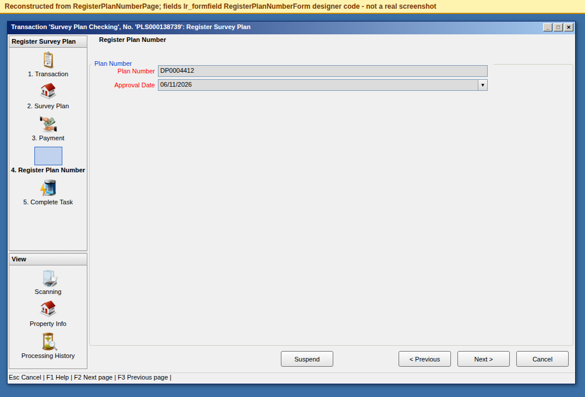

| Control | Type | Caption / label | Position / size | Bound field / data | Event handlers |
|---|---|---|---|---|---|
| pnlRelatedStuff | Panel |  | 0,110 459x260 Dock Fill | tab 3 |  |
| &nbsp;&nbsp;└ groupBoxPlanNumber | GroupBox | groupBoxPlanNumber -&gt; runtime: "Plan Number Generation" | 0,0 459x260 Dock Fill | tab 0 |  |
| &nbsp;&nbsp;&nbsp;&nbsp;└ tableLayoutPanelPlanNumber | TableLayoutPanel |  | 3,16 453x241 Dock Fill | tab 0 |  |
| &nbsp;&nbsp;&nbsp;&nbsp;&nbsp;&nbsp;└ layoutControlPlanNumber | LayoutControl | layoutControl1 | 3,3 312x74 Dock Fill | lr_formfield base.EntityGUIDescriptorName; tab 0 |  |
| &nbsp;&nbsp;&nbsp;&nbsp;&nbsp;&nbsp;└ btnRegisterPlanNumber | Button | btnRegisterPlanNumber -&gt; runtime: "Register Plan Number" | 30,28 100x46 Anchor T+R | tab 0 | Click-&gt;btnRegisterPlanNumber_Click |
| pnlTransactions | Panel |  | 0,0 459x110 Dock Top hidden | tab 2 |  |
| &nbsp;&nbsp;└ dveTransactions | DataViewerEx |  | 0,18 459x92 Dock Fill | tab 2 |  |
| &nbsp;&nbsp;└ lblTransactions | Label | Batch Content | 0,0 459x18 Dock Top | tab 0 |  |
| layoutControlGroupPlanNumber | LayoutControlGroup | layoutControlGroupPlanNumber | 0,0 312x74 |  |  |

Messages this class can show (MessageBoxService kind: text):

- Warning: "'{0}' is a mandatory field. Please specify a value."

<details><summary>Other resource strings used by RegisterPlanNumberPage (2)</summary>

- `strGeneralObjects_RegisterPlanNumber` = "Register Plan Number"
- `strGeneralObjects_PlanNumberGeneration` = "Plan Number Generation"

</details>

#### 3.6.8 GroundRentReviewPage

- Source: `TAR.Controls.dll/TAR.Controls.WorkerAssess.Pages/GroundRentReviewPage.cs` (`TAR.Controls.WorkerAssess.Pages`), base `TransactionListBasePage`; design size 600x444; resx `TAR.Controls.WorkerAssess.Pages.GroundRentReviewPage.resx`.
- Status at PLAGIS: Used (reachable from the PLAGIS configuration). GRR (6 wizards).
- Purpose: "Ground Rent Review": toolbar View/Edit Annual Rental Amount, grid with `GroundRentReviewAttributeForm` columns per property.
- lr_formfield bindings in code: gvGroundrentReview -&gt; "GroundRentReviewAttributeForm"

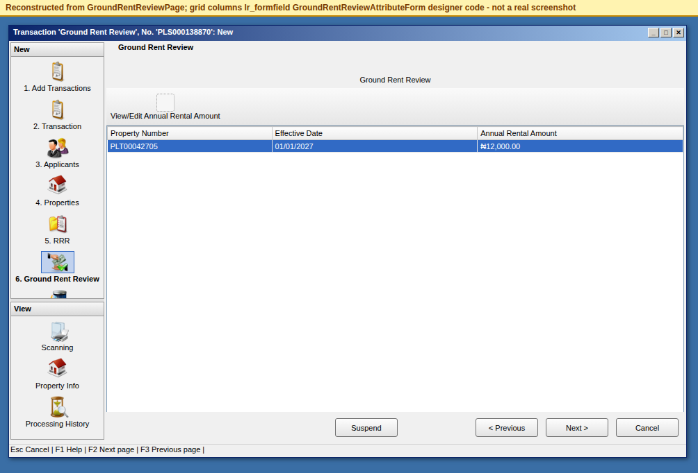

| Control | Type | Caption / label | Position / size | Bound field / data | Event handlers |
|---|---|---|---|---|---|
| pnlGroundRentReview | Panel |  | 0,0 600x330 Dock Fill | tab 1 |  |
| &nbsp;&nbsp;└ dbgGroundrentReview | GridControl |  | 0,77 600x280 Anchor T+B+L+R | lr_formfield GroundRentReviewAttributeForm; tab 27 |  |
| &nbsp;&nbsp;└ toolStripGroundrentReview | ToolStrip | toolStripGroundrentReview | 0,23 600x54 | tab 32 |  |
| &nbsp;&nbsp;&nbsp;&nbsp;└ btnEditGroundrentReview | ToolStripButton | View/Edit Annual Rental Amount | 81x51 | tip "Edit/View Annual Rental Amount" |  |
| &nbsp;&nbsp;└ lblGroundRentReview | Label | Ground Rent Review | 0,0 600x23 Dock Top | tab 1 |  |
| pnlRelatedStuff | Panel |  | 0,110 459x260 Dock Fill | tab 3 |  |
| pnlTransactions | Panel |  | 0,0 459x110 Dock Top hidden | tab 2 |  |
| &nbsp;&nbsp;└ dveTransactions | DataViewerEx |  | 0,18 459x92 Dock Fill | tab 2 |  |
| &nbsp;&nbsp;└ lblTransactions | Label | Batch Content | 0,0 459x18 Dock Top | tab 0 |  |
| pmGroundrentReview | ContextMenu |  |  |  |  |
| miAddGroundrentReview | WMenuItem | F6 | hidden |  |  |
| miEditGroundrentReview | WMenuItem | F7 |  |  |  |
| miDeleteGroundrentReview | WMenuItem | F8 | hidden |  |  |
| groundRentReviewLabelPart | Label | Ground Rent Review | 0,0 600x23 Dock Top | tab 24 |  |
| gvGroundrentReview | GridView |  |  | lr_formfield GroundRentReviewAttributeForm | DoubleClick-&gt;gvGroundrentReview_DoubleClick |

<details><summary>Other resource strings used by GroundRentReviewPage (2)</summary>

- `strGeneralObjects_GroundRent` = "Ground Rent Review"
- `strEditAnnualRentalAmount` = "View/Edit Annual Rental Amount"

</details>

#### 3.6.9 AnnualRentalAmountForm

- Source: `TAR.Controls.dll/TAR.Controls.WorkerAssess.Forms/AnnualRentalAmountForm.cs` (`TAR.Controls.WorkerAssess.Forms`), base `DialogForm`; design size 500x180; start CenterScreen.
- Status at PLAGIS: Used (reachable from the PLAGIS configuration).
- Purpose: Edit Effective Date / Annual Rental Amount (&gt;=0) of one property (GroundRentReviewAttributeForm).
- Opened from (code references): `GroundRentReviewPage.EditAnnualRentalAmount_Action`
- lr_formfield bindings in code: layoutControl -&gt; "GroundRentReviewAttributeForm"

| Control | Type | Caption / label | Position / size | Bound field / data | Event handlers |
|---|---|---|---|---|---|
| layoutControl | LayoutControl | layoutControl1 | 20,12 400x110 Anchor T+L+R | lr_formfield GroundRentReviewAttributeForm |  |
| btnCancel | SimpleButton | Cancel | 400,140 80x23 Anchor B+R | tab 1 | Click-&gt;btnCancel_Click |
| btnOK | SimpleButton | OK | 310,140 80x23 Anchor B+R | tab 0 | Click-&gt;btnOK_Click |
| layoutControlGroup1 | LayoutControlGroup | layoutControlGroup1 | 0,0 400x110 |  |  |

Messages this class can show (MessageBoxService kind: text):

- Error: "&lt;exception message&gt;"

<details><summary>Other resource strings used by AnnualRentalAmountForm (1)</summary>

- `strAnnualRentalAmount` = "Annual Rental Amount."

</details>

### 3.7 Rights (RRR), instrument registration, past and corrected transactions


#### 3.7.1 RrrPage

- Source: `TAR.Controls.dll/TAR.Controls.WorkerAssess.Pages/RrrPage.cs` (`TAR.Controls.WorkerAssess.Pages`), base `TransactionListBasePage`; design size 849x725; resx `TAR.Controls.WorkerAssess.Pages.RrrPage.resx`.
- Status at PLAGIS: Used (reachable from the PLAGIS configuration). (19 wizards).
- Purpose: "RRR": Target Property grid, Party tabs Target/Source (`PartiesRrrPageGrid` with a select check box), and the RRR attribute group (`rrrForm`, default RRRAttributeForm).
- lr_formfield bindings in code: layoutControl1 -&gt; "RRRAttributeForm", gvListOfTargetPartyParts -&gt; "PartiesRrrPageGrid", gvListOfTargetPropertyParts -&gt; "PropertyGrid"

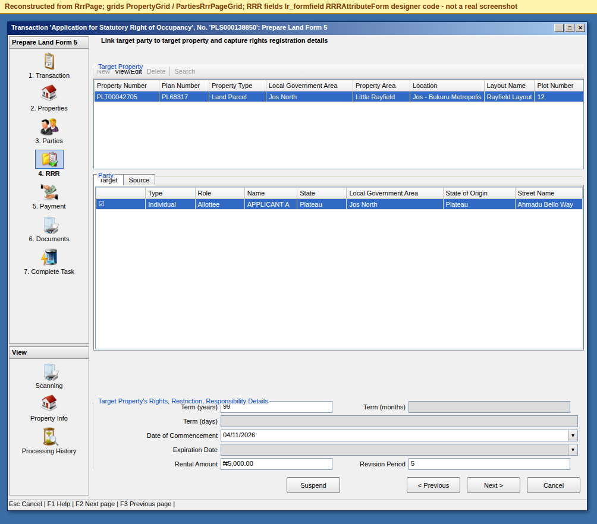

| Control | Type | Caption / label | Position / size | Bound field / data | Event handlers |
|---|---|---|---|---|---|
| pnlRelatedStuff | Panel |  | 0,110 849x615 Dock Fill | tab 3 |  |
| &nbsp;&nbsp;└ tableLayoutPanel1 | TableLayoutPanel |  | 0,0 849x615 Dock Fill | tab 0 |  |
| &nbsp;&nbsp;&nbsp;&nbsp;└ grpBxRRR | GroupBox | Target Property's Rights, Restriction, Responsibility Details  | 3,491 843x121 Dock Fill | tab 2 |  |
| &nbsp;&nbsp;&nbsp;&nbsp;&nbsp;&nbsp;└ layoutControl1 | LayoutControl | layoutControl1 | 3,16 837x102 Dock Fill | lr_formfield RRRAttributeForm; tab 0 |  |
| &nbsp;&nbsp;&nbsp;&nbsp;└ grpBxTargetParty | GroupBox | Party | 3,186 843x299 Dock Fill | tab 1 |  |
| &nbsp;&nbsp;&nbsp;&nbsp;&nbsp;&nbsp;└ tabParties | TabControl |  | 3,16 837x280 Dock Fill | tab 0 |  |
| &nbsp;&nbsp;&nbsp;&nbsp;&nbsp;&nbsp;&nbsp;&nbsp;└ tabTargetParties | TabPage | Target | 4,22 829x254 | tab 0 |  |
| &nbsp;&nbsp;&nbsp;&nbsp;&nbsp;&nbsp;&nbsp;&nbsp;&nbsp;&nbsp;└ pnlTargetPartyParts | Panel |  | 3,3 823x248 Dock Fill | tab 4 |  |
| &nbsp;&nbsp;&nbsp;&nbsp;&nbsp;&nbsp;&nbsp;&nbsp;&nbsp;&nbsp;&nbsp;&nbsp;└ dbgListOfTargetPartyParts | GridControl |  | 0,0 823x248 Dock Fill | lr_formfield PartiesRrrPageGrid; tab 23 |  |
| &nbsp;&nbsp;&nbsp;&nbsp;&nbsp;&nbsp;&nbsp;&nbsp;&nbsp;&nbsp;&nbsp;&nbsp;└ toolStripTargetPartyParts | ToolStrip | Tool Strip for Target Property Parts | 0,0 823x25 hidden | tab 24 |  |
| &nbsp;&nbsp;&nbsp;&nbsp;&nbsp;&nbsp;&nbsp;&nbsp;&nbsp;&nbsp;&nbsp;&nbsp;&nbsp;&nbsp;└ btnPartyNew | ToolStripButton | New | 35x22 disabled |  |  |
| &nbsp;&nbsp;&nbsp;&nbsp;&nbsp;&nbsp;&nbsp;&nbsp;&nbsp;&nbsp;&nbsp;&nbsp;&nbsp;&nbsp;└ btnPartyEdit | ToolStripButton | View/Edit | 61x22 |  |  |
| &nbsp;&nbsp;&nbsp;&nbsp;&nbsp;&nbsp;&nbsp;&nbsp;&nbsp;&nbsp;&nbsp;&nbsp;&nbsp;&nbsp;└ btnPartyDelete | ToolStripButton | Delete | 44x22 disabled |  |  |
| &nbsp;&nbsp;&nbsp;&nbsp;&nbsp;&nbsp;&nbsp;&nbsp;&nbsp;&nbsp;&nbsp;&nbsp;&nbsp;&nbsp;└ toolStripSeparator1 | ToolStripSeparator |  | 6x25 |  |  |
| &nbsp;&nbsp;&nbsp;&nbsp;&nbsp;&nbsp;&nbsp;&nbsp;&nbsp;&nbsp;&nbsp;&nbsp;&nbsp;&nbsp;└ btnPartySearch | ToolStripButton | Search | 46x22 disabled |  |  |
| &nbsp;&nbsp;&nbsp;&nbsp;&nbsp;&nbsp;&nbsp;&nbsp;└ tabSourceParties | TabPage | Source | 4,22 439x78 | tab 1 |  |
| &nbsp;&nbsp;&nbsp;&nbsp;&nbsp;&nbsp;&nbsp;&nbsp;&nbsp;&nbsp;└ pnlSourcePartyParts | Panel |  | 3,3 433x72 Dock Fill | tab 5 |  |
| &nbsp;&nbsp;&nbsp;&nbsp;&nbsp;&nbsp;&nbsp;&nbsp;&nbsp;&nbsp;&nbsp;&nbsp;└ dbgListOfSourcePartyParts | GridControl |  | 0,0 433x72 Dock Fill | tab 23 |  |
| &nbsp;&nbsp;&nbsp;&nbsp;&nbsp;&nbsp;&nbsp;&nbsp;&nbsp;&nbsp;&nbsp;&nbsp;└ toolStripSourcePartyParts | ToolStrip | Tool Strip for Target Property Parts | 0,0 433x25 hidden | tab 24 |  |
| &nbsp;&nbsp;&nbsp;&nbsp;&nbsp;&nbsp;&nbsp;&nbsp;&nbsp;&nbsp;&nbsp;&nbsp;&nbsp;&nbsp;└ btnPartySrcNew | ToolStripButton | New | 35x22 disabled |  |  |
| &nbsp;&nbsp;&nbsp;&nbsp;&nbsp;&nbsp;&nbsp;&nbsp;&nbsp;&nbsp;&nbsp;&nbsp;&nbsp;&nbsp;└ btnPartySrcEdit | ToolStripButton | View/Edit | 61x22 |  |  |
| &nbsp;&nbsp;&nbsp;&nbsp;&nbsp;&nbsp;&nbsp;&nbsp;&nbsp;&nbsp;&nbsp;&nbsp;&nbsp;&nbsp;└ btnPartySrcDelete | ToolStripButton | Delete | 44x22 disabled |  |  |
| &nbsp;&nbsp;&nbsp;&nbsp;&nbsp;&nbsp;&nbsp;&nbsp;&nbsp;&nbsp;&nbsp;&nbsp;&nbsp;&nbsp;└ toolStripSeparator2 | ToolStripSeparator |  | 6x25 |  |  |
| &nbsp;&nbsp;&nbsp;&nbsp;&nbsp;&nbsp;&nbsp;&nbsp;&nbsp;&nbsp;&nbsp;&nbsp;&nbsp;&nbsp;└ btnPartySrcSearch | ToolStripButton | Search | 46x22 disabled |  |  |
| &nbsp;&nbsp;&nbsp;&nbsp;└ grpBxTargetProperty | GroupBox | Target Property  | 3,3 843x177 Dock Fill | tab 0 |  |
| &nbsp;&nbsp;&nbsp;&nbsp;&nbsp;&nbsp;└ pnlTargetPropertyParts | Panel |  | 3,16 837x158 Dock Fill | tab 3 |  |
| &nbsp;&nbsp;&nbsp;&nbsp;&nbsp;&nbsp;&nbsp;&nbsp;└ dbgListOfTargetPropertyParts | GridControl |  | 0,25 837x133 Dock Fill | lr_formfield PropertyGrid; tab 23 |  |
| &nbsp;&nbsp;&nbsp;&nbsp;&nbsp;&nbsp;&nbsp;&nbsp;└ tsTargetPropertyParts | ToolStrip | Tool Strip for Target Property Parts | 0,0 837x25 | tab 24 |  |
| &nbsp;&nbsp;&nbsp;&nbsp;&nbsp;&nbsp;&nbsp;&nbsp;&nbsp;&nbsp;└ btnPropertyNew | ToolStripButton | New | 35x22 disabled |  |  |
| &nbsp;&nbsp;&nbsp;&nbsp;&nbsp;&nbsp;&nbsp;&nbsp;&nbsp;&nbsp;└ btnPropertyEdit | ToolStripButton | View/Edit | 61x22 |  |  |
| &nbsp;&nbsp;&nbsp;&nbsp;&nbsp;&nbsp;&nbsp;&nbsp;&nbsp;&nbsp;└ btnPropertyDelete | ToolStripButton | Delete | 44x22 disabled |  |  |
| &nbsp;&nbsp;&nbsp;&nbsp;&nbsp;&nbsp;&nbsp;&nbsp;&nbsp;&nbsp;└ separatorViewOwners | ToolStripSeparator |  | 6x25 |  |  |
| &nbsp;&nbsp;&nbsp;&nbsp;&nbsp;&nbsp;&nbsp;&nbsp;&nbsp;&nbsp;└ btnPropertySearch | ToolStripButton | Search | 46x22 disabled |  |  |
| pnlTransactions | Panel |  | 0,0 849x110 Dock Top hidden | tab 2 |  |
| &nbsp;&nbsp;└ dveTransactions | DataViewerEx |  | 0,18 849x92 Dock Fill | tab 2 |  |
| &nbsp;&nbsp;└ lblTransactions | Label | Batch Content | 0,0 459x18 Dock Top | tab 0 |  |
| layoutControlGroup1 | LayoutControlGroup | layoutControlGroup1 | 0,0 837x102 |  |  |
| gvListOfTargetPartyParts | GridView |  |  | lr_formfield PartiesRrrPageGrid | DoubleClick-&gt;gvListOfTargetPartyParts_DoubleClick |
| gvListOfSourcePartyParts | GridView |  |  |  | DoubleClick-&gt;gvListOfSourcePartyParts_DoubleClick |
| gvListOfTargetPropertyParts | GridView |  |  | lr_formfield PropertyGrid | DoubleClick-&gt;gvListOfTargetPropertyParts_DoubleClick |
| gcSelectedParty | GridColumn | Select |  | field SelectParty |  |

Messages this class can show (MessageBoxService kind: text):

- Error: "Property No. '{0}' does not have any target parties. Please add target parties."
- Error: "Security Number must be a nine-digit number."
- Error: "Security Numbers must be unique."
- Confirm: "Selected property will be deleted. Continue?"
- Warning: "'{0}' in '{1}' is a mandatory field. Please specify a value."
- Warning: "Expiration Date for property '{0}' should be greater than today."

#### 3.7.2 DataCorrectionRrrPage

- Source: `TAR.Controls.dll/TAR.Controls.WorkerAssess.Pages/DataCorrectionRrrPage.cs` (`TAR.Controls.WorkerAssess.Pages`), base `RrrPage`.
- Status at PLAGIS: Used (reachable from the PLAGIS configuration). DCT.
- Purpose: RRR page variant for Data Correction (view/correct properties, parties, RRR).
- Opened from (code references): `RrrPage.RrrPage`
- lr_formfield bindings in code: gvListOfTargetPartyParts -&gt; "PartiesRrrPageGrid", gvListOfSourcePartyParts -&gt; "PartiesGrid"

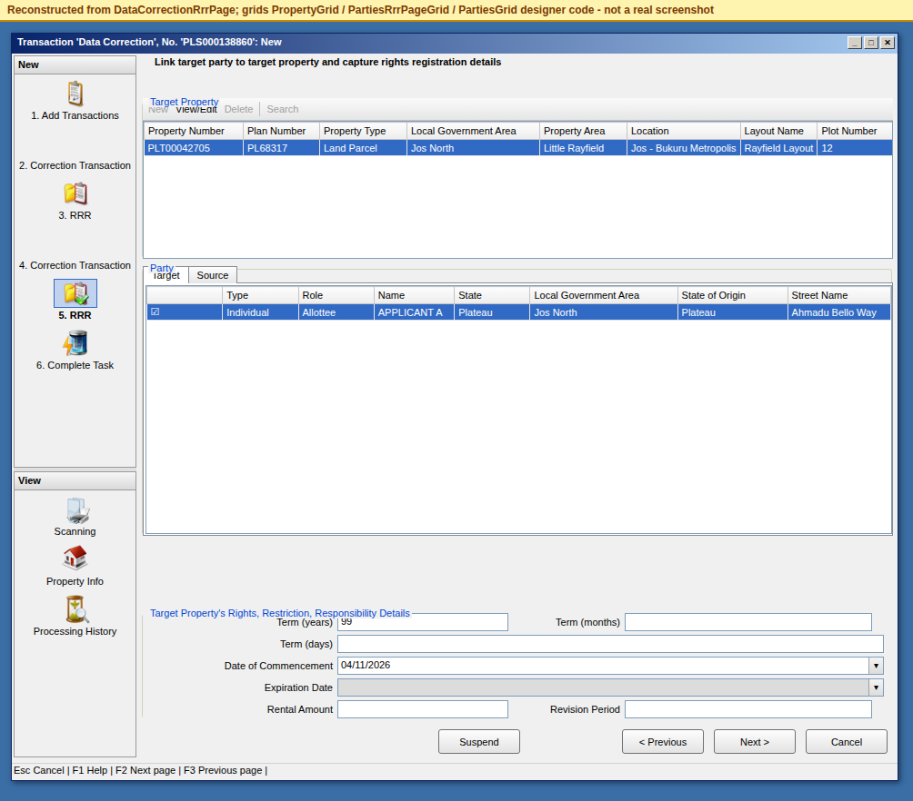

| Control | Type | Caption / label | Position / size | Bound field / data | Event handlers |
|---|---|---|---|---|---|
| pnlRelatedStuff | Panel |  | 0,110 849x615 Dock Fill | tab 3 |  |
| &nbsp;&nbsp;└ tableLayoutPanel1 | TableLayoutPanel |  | 0,0 849x615 Dock Fill | tab 0 |  |
| &nbsp;&nbsp;&nbsp;&nbsp;└ grpBxRRR | GroupBox | Target Property's Rights, Restriction, Responsibility Details  | 3,491 843x121 Dock Fill | tab 2 |  |
| &nbsp;&nbsp;&nbsp;&nbsp;&nbsp;&nbsp;└ layoutControl1 | LayoutControl | layoutControl1 | 3,16 837x102 Dock Fill | tab 0 |  |
| &nbsp;&nbsp;&nbsp;&nbsp;└ grpBxTargetParty | GroupBox | Party | 3,186 843x299 Dock Fill | tab 1 |  |
| &nbsp;&nbsp;&nbsp;&nbsp;&nbsp;&nbsp;└ tabParties | TabControl |  | 3,16 837x280 Dock Fill | tab 0 |  |
| &nbsp;&nbsp;&nbsp;&nbsp;&nbsp;&nbsp;&nbsp;&nbsp;└ tabTargetParties | TabPage | Target | 4,22 829x254 | tab 0 |  |
| &nbsp;&nbsp;&nbsp;&nbsp;&nbsp;&nbsp;&nbsp;&nbsp;&nbsp;&nbsp;└ pnlTargetPartyParts | Panel |  | 3,3 823x248 Dock Fill | tab 4 |  |
| &nbsp;&nbsp;&nbsp;&nbsp;&nbsp;&nbsp;&nbsp;&nbsp;&nbsp;&nbsp;&nbsp;&nbsp;└ dbgListOfTargetPartyParts | GridControl |  | 0,0 823x248 Dock Fill | lr_formfield PartiesRrrPageGrid; tab 23 |  |
| &nbsp;&nbsp;&nbsp;&nbsp;&nbsp;&nbsp;&nbsp;&nbsp;&nbsp;&nbsp;&nbsp;&nbsp;└ toolStripTargetPartyParts | ToolStrip | Tool Strip for Target Property Parts | 0,0 823x25 hidden | tab 24 |  |
| &nbsp;&nbsp;&nbsp;&nbsp;&nbsp;&nbsp;&nbsp;&nbsp;&nbsp;&nbsp;&nbsp;&nbsp;&nbsp;&nbsp;└ btnPartyNew | ToolStripButton | New | 35x22 disabled |  |  |
| &nbsp;&nbsp;&nbsp;&nbsp;&nbsp;&nbsp;&nbsp;&nbsp;&nbsp;&nbsp;&nbsp;&nbsp;&nbsp;&nbsp;└ btnPartyEdit | ToolStripButton | View/Edit | 61x22 |  |  |
| &nbsp;&nbsp;&nbsp;&nbsp;&nbsp;&nbsp;&nbsp;&nbsp;&nbsp;&nbsp;&nbsp;&nbsp;&nbsp;&nbsp;└ btnPartyDelete | ToolStripButton | Delete | 44x22 disabled |  |  |
| &nbsp;&nbsp;&nbsp;&nbsp;&nbsp;&nbsp;&nbsp;&nbsp;&nbsp;&nbsp;&nbsp;&nbsp;&nbsp;&nbsp;└ toolStripSeparator1 | ToolStripSeparator |  | 6x25 |  |  |
| &nbsp;&nbsp;&nbsp;&nbsp;&nbsp;&nbsp;&nbsp;&nbsp;&nbsp;&nbsp;&nbsp;&nbsp;&nbsp;&nbsp;└ btnPartySearch | ToolStripButton | Search | 46x22 disabled |  |  |
| &nbsp;&nbsp;&nbsp;&nbsp;&nbsp;&nbsp;&nbsp;&nbsp;└ tabSourceParties | TabPage | Source | 4,22 439x78 | tab 1 |  |
| &nbsp;&nbsp;&nbsp;&nbsp;&nbsp;&nbsp;&nbsp;&nbsp;&nbsp;&nbsp;└ pnlSourcePartyParts | Panel |  | 3,3 433x72 Dock Fill | tab 5 |  |
| &nbsp;&nbsp;&nbsp;&nbsp;&nbsp;&nbsp;&nbsp;&nbsp;&nbsp;&nbsp;&nbsp;&nbsp;└ dbgListOfSourcePartyParts | GridControl |  | 0,0 433x72 Dock Fill | lr_formfield PartiesGrid; tab 23 |  |
| &nbsp;&nbsp;&nbsp;&nbsp;&nbsp;&nbsp;&nbsp;&nbsp;&nbsp;&nbsp;&nbsp;&nbsp;└ toolStripSourcePartyParts | ToolStrip | Tool Strip for Target Property Parts | 0,0 433x25 hidden | tab 24 |  |
| &nbsp;&nbsp;&nbsp;&nbsp;&nbsp;&nbsp;&nbsp;&nbsp;&nbsp;&nbsp;&nbsp;&nbsp;&nbsp;&nbsp;└ btnPartySrcNew | ToolStripButton | New | 35x22 disabled |  |  |
| &nbsp;&nbsp;&nbsp;&nbsp;&nbsp;&nbsp;&nbsp;&nbsp;&nbsp;&nbsp;&nbsp;&nbsp;&nbsp;&nbsp;└ btnPartySrcEdit | ToolStripButton | View/Edit | 61x22 |  |  |
| &nbsp;&nbsp;&nbsp;&nbsp;&nbsp;&nbsp;&nbsp;&nbsp;&nbsp;&nbsp;&nbsp;&nbsp;&nbsp;&nbsp;└ btnPartySrcDelete | ToolStripButton | Delete | 44x22 disabled |  |  |
| &nbsp;&nbsp;&nbsp;&nbsp;&nbsp;&nbsp;&nbsp;&nbsp;&nbsp;&nbsp;&nbsp;&nbsp;&nbsp;&nbsp;└ toolStripSeparator2 | ToolStripSeparator |  | 6x25 |  |  |
| &nbsp;&nbsp;&nbsp;&nbsp;&nbsp;&nbsp;&nbsp;&nbsp;&nbsp;&nbsp;&nbsp;&nbsp;&nbsp;&nbsp;└ btnPartySrcSearch | ToolStripButton | Search | 46x22 disabled |  |  |
| &nbsp;&nbsp;&nbsp;&nbsp;└ grpBxTargetProperty | GroupBox | Target Property  | 3,3 843x177 Dock Fill | tab 0 |  |
| &nbsp;&nbsp;&nbsp;&nbsp;&nbsp;&nbsp;└ pnlTargetPropertyParts | Panel |  | 3,16 837x158 Dock Fill | tab 3 |  |
| &nbsp;&nbsp;&nbsp;&nbsp;&nbsp;&nbsp;&nbsp;&nbsp;└ dbgListOfTargetPropertyParts | GridControl |  | 0,25 837x133 Dock Fill | tab 23 |  |
| &nbsp;&nbsp;&nbsp;&nbsp;&nbsp;&nbsp;&nbsp;&nbsp;└ tsTargetPropertyParts | ToolStrip | Tool Strip for Target Property Parts | 0,0 837x25 | tab 24 |  |
| &nbsp;&nbsp;&nbsp;&nbsp;&nbsp;&nbsp;&nbsp;&nbsp;&nbsp;&nbsp;└ btnPropertyNew | ToolStripButton | New | 35x22 disabled |  |  |
| &nbsp;&nbsp;&nbsp;&nbsp;&nbsp;&nbsp;&nbsp;&nbsp;&nbsp;&nbsp;└ btnPropertyEdit | ToolStripButton | View/Edit | 61x22 |  |  |
| &nbsp;&nbsp;&nbsp;&nbsp;&nbsp;&nbsp;&nbsp;&nbsp;&nbsp;&nbsp;└ btnPropertyDelete | ToolStripButton | Delete | 44x22 disabled |  |  |
| &nbsp;&nbsp;&nbsp;&nbsp;&nbsp;&nbsp;&nbsp;&nbsp;&nbsp;&nbsp;└ separatorViewOwners | ToolStripSeparator |  | 6x25 |  |  |
| &nbsp;&nbsp;&nbsp;&nbsp;&nbsp;&nbsp;&nbsp;&nbsp;&nbsp;&nbsp;└ btnPropertySearch | ToolStripButton | Search | 46x22 disabled |  |  |
| pnlTransactions | Panel |  | 0,0 849x110 Dock Top hidden | tab 2 |  |
| &nbsp;&nbsp;└ dveTransactions | DataViewerEx |  | 0,18 849x92 Dock Fill | tab 2 |  |
| &nbsp;&nbsp;└ lblTransactions | Label | Batch Content | 0,0 459x18 Dock Top | tab 0 |  |

Messages this class can show (MessageBoxService kind: text):

- Warning: "Please enter at least one {0} for transaction '{1}' No. '{2}'."
- Error: "Property No. '{0}' does not have any target parties. Please add target parties."
- Warning: "Not all mandatory fields are filled in.  Please fill in all fields marked in red."
- Warning: "'{0}' in '{1}' is a mandatory field. Please specify a value."
- Confirm: "The selected party will be deleted. Continue?"
- Warning: "The following transactions are expected to edit related party       {0} "

<details><summary>Other resource strings used by DataCorrectionRrrPage (2)</summary>

- `frmPagePropertyInfo_ValidatError` = "Not all mandatory fields are filled in.  Please fill in all fields marked in red."
- `wrnEditRelatedParty` = "The following transactions are expected to edit related party       {0} "

</details>

#### 3.7.3 RegisterInstrumentPage

- Source: `TAR.Controls.dll/TAR.Controls.WorkerAssess.Pages/RegisterInstrumentPage.cs` (`TAR.Controls.WorkerAssess.Pages`), base `TransactionWithDocumentsPage`; design size 645x561.
- Status at PLAGIS: Used (reachable from the PLAGIS configuration). RegisterCofO / RegisterInstrument (10 wizards).
- Purpose: Transaction page plus a "Register Instrument" button (80x40) and fields `RegisterInstrumentForm` (Instrument Number, Page Number, Volume, Registration Date - filled by the button).
- lr_formfield bindings in code: lcRegisterInstrumentAttributes -&gt; "RegisterInstrumentForm"

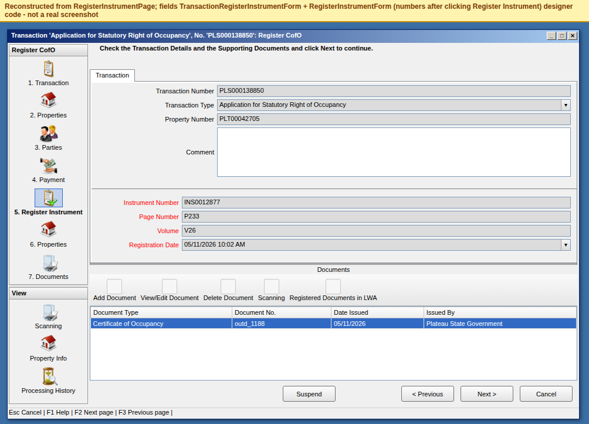

| Control | Type | Caption / label | Position / size | Bound field / data | Event handlers |
|---|---|---|---|---|---|
| pnlRelatedStuff | Panel |  | 0,110 645x451 Dock Fill | tab 3 |  |
| &nbsp;&nbsp;└ splitter1 | Splitter |  | 0,330 645x3 Dock Top | tab 2 |  |
| &nbsp;&nbsp;└ pnlDocuments | Panel |  | 0,330 645x121 Dock Fill | tab 1 |  |
| &nbsp;&nbsp;&nbsp;&nbsp;└ dbgListOfSupportDocs | GridControl |  | 0,70 645x51 Dock Fill | tab 14 |  |
| &nbsp;&nbsp;&nbsp;&nbsp;└ tsDocuments | ToolStrip | tsDocuments | 0,16 645x54 | tab 13 |  |
| &nbsp;&nbsp;&nbsp;&nbsp;&nbsp;&nbsp;└ btnNew | ToolStripButton | New | 36x51 |  |  |
| &nbsp;&nbsp;&nbsp;&nbsp;&nbsp;&nbsp;└ btnEdit | ToolStripButton | View/Edit | 61x51 |  |  |
| &nbsp;&nbsp;&nbsp;&nbsp;&nbsp;&nbsp;└ btnDelete | ToolStripButton | Delete | 44x51 |  |  |
| &nbsp;&nbsp;&nbsp;&nbsp;&nbsp;&nbsp;└ btnViewPages | ToolStripButton | Attachments | 79x51 |  |  |
| &nbsp;&nbsp;&nbsp;&nbsp;&nbsp;&nbsp;└ btnViewReg | ToolStripButton | Registered | 66x51 |  |  |
| &nbsp;&nbsp;&nbsp;&nbsp;└ label1 | Label | Documents | 0,0 645x16 Dock Top | tab 12 |  |
| &nbsp;&nbsp;└ tabControl | XtraTabControl |  | 0,0 645x330 Dock Top | tab 3 |  |
| &nbsp;&nbsp;&nbsp;&nbsp;└ tabTransaction | XtraTabPage | runtime: "Principal Details" | 638x301 |  |  |
| &nbsp;&nbsp;&nbsp;&nbsp;&nbsp;&nbsp;└ pnlTransactionAttributes | Panel |  | 3,3 632x300 Dock Top | tab 2 |  |
| &nbsp;&nbsp;&nbsp;&nbsp;&nbsp;&nbsp;&nbsp;&nbsp;└ lcTransactionAttributes | LayoutControl | layoutControl1 | 0,0 632x170 Dock Top | tab 0 |  |
| &nbsp;&nbsp;&nbsp;&nbsp;&nbsp;&nbsp;&nbsp;&nbsp;└ pnlLine | Panel |  | 0,180 1264x1 | tab 2 |  |
| &nbsp;&nbsp;&nbsp;&nbsp;&nbsp;&nbsp;&nbsp;&nbsp;└ lcRegisterInstrumentAttributes | LayoutControl | layoutControl3 | 0,190 632x110 Dock Bottom | lr_formfield RegisterInstrumentForm; tab 0 |  |
| &nbsp;&nbsp;&nbsp;&nbsp;&nbsp;&nbsp;&nbsp;&nbsp;└ btnRegisterInstrument | Button | Register Instrument | 17,192 80x40 | tab 15 | Click-&gt;btnRegisterInstrument_Click |
| &nbsp;&nbsp;&nbsp;&nbsp;└ tabTransactionExt | XtraTabPage | runtime: "Supplementary Details" | 638x311 |  |  |
| &nbsp;&nbsp;&nbsp;&nbsp;&nbsp;&nbsp;└ pnlTransactionExtAttributes | Panel |  | 3,3 632x300 Dock Top | tab 2 |  |
| &nbsp;&nbsp;&nbsp;&nbsp;&nbsp;&nbsp;&nbsp;&nbsp;└ lcTransactionExtAttributes | LayoutControl | layoutControl1 | 0,0 632x300 Dock Top | tab 0 |  |
| pnlTransactions | Panel |  | 0,0 459x110 Dock Top hidden | tab 2 |  |
| &nbsp;&nbsp;└ dveTransactions | DataViewerEx |  | 0,18 645x92 Dock Fill | tab 2 |  |
| &nbsp;&nbsp;└ lblTransactions | Label | Batch Content | 0,0 459x18 Dock Top | tab 0 |  |
| pmToolbar | ContextMenu |  |  |  |  |
| miNew | WMenuItem |  |  |  |  |
| miEdit | WMenuItem |   |  |  |  |
| miDelete | WMenuItem |   |  |  |  |
| miViewPages | WMenuItem |   |  |  |  |
| miRegDocs | WMenuItem |  |  |  |  |
| gvListOfSupportDocs | GridView |  |  |  | FocusedRowChanged-&gt;base.gvListOfSupportDocs_FocusedRowChanged, DoubleClick-&gt;base.gvListOfSupportDocs_DoubleClick |
| layoutControlGroup1 | LayoutControlGroup | layoutControlGroup1 | 0,0 632x150 |  |  |
| layoutControlGroup3 | LayoutControlGroup | layoutControlGroup3 | 0,152 632x148 |  |  |
| layoutControlGroup2 | LayoutControlGroup | layoutControlGroup1 | 0,0 632x300 |  |  |

Messages this class can show (MessageBoxService kind: text):

- Warning: "'{0}' is a mandatory field. Please specify a value."

<details><summary>Other resource strings used by RegisterInstrumentPage (5)</summary>

- `strGeneralObjects_RegisterInstrument` = "Register Instrument"
- `strTransactionWithDocumentsPage_Prompt` = "Check the Transaction Details and the Supporting Documents and click Next to continue."
- `strPrintDocumentsPage_Caption` = "Documents"
- `strMainTab` = "Principal Details"
- `strExtensionTab` = "Supplementary Details"

</details>

#### 3.7.4 PastTransactionPage

- Source: `TAR.Controls.dll/TAR.Controls.WorkerAssess.Pages/PastTransactionPage.cs` (`TAR.Controls.WorkerAssess.Pages`), base `WizardPage`; design size 589x489; resx `TAR.Controls.WorkerAssess.Pages.PastTransactionPage.resx`.
- Status at PLAGIS: Used (reachable from the PLAGIS configuration). via PLAGIS CustomPastTransactionPage (INSC).
- Purpose: "Title Transactions (Input Past Transactions)": toolbar New / View/Edit / Delete / Search, grid of past transactions.
- lr_formfield bindings in code: layoutControl -&gt; attributeValue, gvList -&gt; text

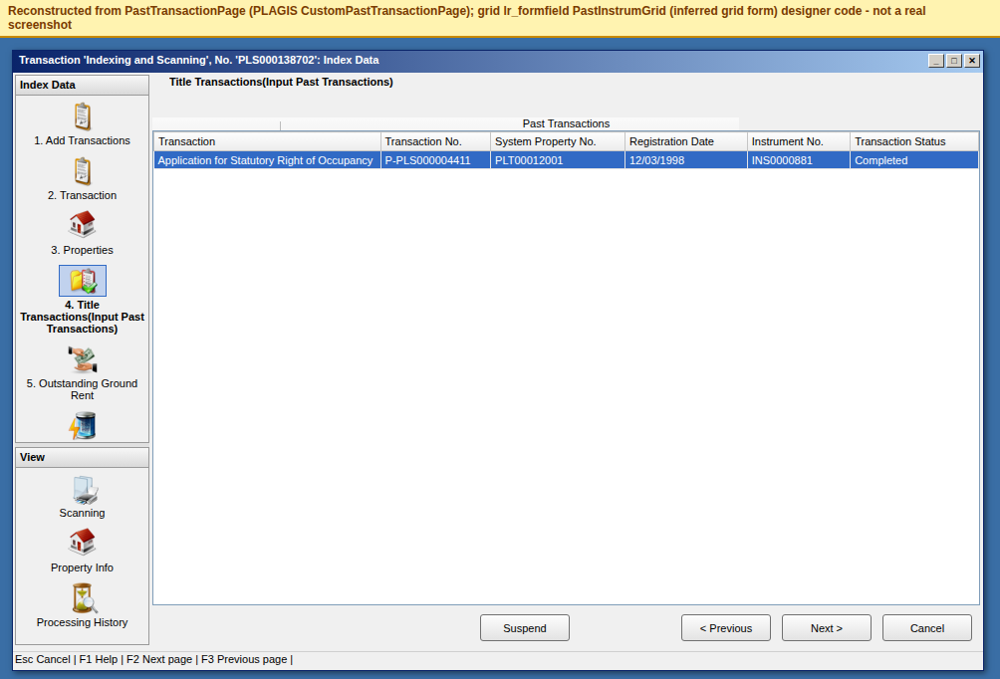

| Control | Type | Caption / label | Position / size | Bound field / data | Event handlers |
|---|---|---|---|---|---|
| pnlPast | Panel |  | 0,152 589x337 Dock Fill | tab 2 |  |
| &nbsp;&nbsp;└ dbgList | GridControl |  | 0,71 589x266 Dock Fill | lr_formfield text; tab 24 |  |
| &nbsp;&nbsp;└ label1 | Label | Past Transactions | 0,58 589x13 Dock Top | tab 8 |  |
| &nbsp;&nbsp;└ tbProperties | ToolBar |  | 0,0 589x58 | tab 7 |  |
| &nbsp;&nbsp;&nbsp;&nbsp;└ btnNew | ToolBarButton | New -&gt; runtime: "Add Past Transaction" |  |  |  |
| &nbsp;&nbsp;&nbsp;&nbsp;└ btnEdit | ToolBarButton | View/Edit -&gt; runtime: "View/Edit Past Transaction" |  |  |  |
| &nbsp;&nbsp;&nbsp;&nbsp;└ btnDelete | ToolBarButton | Delete -&gt; runtime: "Delete Past Transaction" |  |  |  |
| &nbsp;&nbsp;&nbsp;&nbsp;└ btnSearchSeparator | ToolBarButton |  |  |  |  |
| &nbsp;&nbsp;&nbsp;&nbsp;└ btnSearch | ToolBarButton | Search |  |  |  |
| pnlForm | Panel |  | 0,0 589x152 Dock Top hidden | tab 1 |  |
| &nbsp;&nbsp;└ layoutControl | LayoutControl | layoutControl1 | 0,0 589x152 Dock Fill | lr_formfield attributeValue; tab 7 |  |
| layoutControlGroup1 | LayoutControlGroup | layoutControlGroup1 | 0,0 589x152 |  |  |
| gvList | GridView |  |  | lr_formfield text |  |
| pmToolbar | ContextMenu |  |  |  |  |
| miNew | WMenuItem | F7 |  |  |  |
| miEdit | WMenuItem | F9 |  |  |  |
| miDelete | WMenuItem | F8 |  |  |  |
| miSearchSeparator | MenuItem | - |  |  |  |
| miSearch | WMenuItem | Search |  |  |  |

Messages this class can show (MessageBoxService kind: text):

- Warning: "Cannot delete this transaction. It is currently used by other related transaction."
- Warning: "Cannot delete this transaction. It is not the latest transaction in the list based on 'Registration Date'."
- Confirm: "Selected past transaction will be deleted. Continue?"

<details><summary>Other resource strings used by PastTransactionPage (6)</summary>

- `strTitleTransFull` = "Title Transactions(Input Past Transactions)"
- `strPastTransactionForm_PastTransactions` = "Past Transactions"
- `strPastTransactionPage_Add` = "Add Past Transaction"
- `strPastTransactionPage_Delete` = "Delete Past Transaction"
- `strPastTransactionPage_Edit` = "View/Edit Past Transaction"
- `strPastTransactionPage_Search` = "Search"

</details>

#### 3.7.5 CustomPastTransactionPage

- Source: `TAR.PLAGIS.Controls.dll/TAR.PLAGIS.Controls.WorkerAssess.Pages/CustomPastTransactionPage.cs` (`TAR.PLAGIS.Controls.WorkerAssess.Pages`), base `PastTransactionPage`; form Text "CustomPastTransactionPage".
- Status at PLAGIS: PLAGIS override of `PastTransactionPage` (designer only adds/changes the controls listed; behaviour in 05 section 3).
- Purpose: See the base class above.

| Control | Type | Caption / label | Position / size | Bound field / data | Event handlers |
|---|---|---|---|---|---|
| pnlPast | Panel |  | 0,152 589x337 Dock Fill | tab 2 |  |
| &nbsp;&nbsp;└ dbgList | GridControl |  | 0,71 589x266 Dock Fill | tab 24 |  |
| &nbsp;&nbsp;└ label1 | Label | Past Transactions | 0,58 589x13 Dock Top | tab 8 |  |
| &nbsp;&nbsp;└ tbProperties | ToolBar |  | 0,0 589x58 | tab 7 |  |
| &nbsp;&nbsp;&nbsp;&nbsp;└ btnNew | ToolBarButton | New |  |  |  |
| &nbsp;&nbsp;&nbsp;&nbsp;└ btnEdit | ToolBarButton | View/Edit |  |  |  |
| &nbsp;&nbsp;&nbsp;&nbsp;└ btnDelete | ToolBarButton | Delete |  |  |  |
| &nbsp;&nbsp;&nbsp;&nbsp;└ btnSearchSeparator | ToolBarButton |  |  |  |  |
| &nbsp;&nbsp;&nbsp;&nbsp;└ btnSearch | ToolBarButton | Search |  |  |  |
| pnlForm | Panel |  | 0,0 589x152 Dock Top hidden | tab 1 |  |
| &nbsp;&nbsp;└ layoutControl | LayoutControl | layoutControl1 | 0,0 589x152 Dock Fill | tab 7 |  |

Messages this class can show (MessageBoxService kind: text):

- Warning: "Please enter at least one past transaction."
- Warning: "Cannot add more past transaction. This transaction is in the middle of chain."

#### 3.7.6 PastTransactionForm

- Source: `TAR.Controls.dll/TAR.Controls.WorkerAssess.Forms/PastTransactionForm.cs` (`TAR.Controls.WorkerAssess.Forms`), base `DialogForm`; form Text "View/Edit Past Transaction"; design size 763x765; resx `TAR.Controls.WorkerAssess.Forms.PastTransactionForm.resx`.
- Status at PLAGIS: Used (reachable from the PLAGIS configuration). via PLAGIS CustomPastTransactionForm.
- Purpose: "View/Edit Past Transaction": PastTransactionForm fields, parties page, past payments page, registration unit.
- Opened from (code references): `PastTransactionPage.EditPast`, `PastTransactionPage.NewPast`, `RelatedTransactionPage.AddPast_Action`, `RelatedTransactionPage.EditPast_Action`

| Control | Type | Caption / label | Position / size | Bound field / data | Event handlers |
|---|---|---|---|---|---|
| xtraTabControl1 | XtraTabControl |  | 13,13 738x709 Anchor T+B+L+R | tab 2 |  |
| &nbsp;&nbsp;└ xtraTabPageTransaction | XtraTabPage | Transaction | 731x680 |  |  |
| &nbsp;&nbsp;&nbsp;&nbsp;└ gbDocuments | GroupBox |  | 13,474 707x192 Anchor T+B+L+R | tab 4 |  |
| &nbsp;&nbsp;&nbsp;&nbsp;&nbsp;&nbsp;└ lvDocuments | DocumentListView |  | 0,15 710x175 | tab 0 |  |
| &nbsp;&nbsp;&nbsp;&nbsp;└ ctrlTransaction | TransactionLayoutControl | transactionLayoutControl1 | 5,15 698x421 | tab 0 |  |
| &nbsp;&nbsp;&nbsp;&nbsp;&nbsp;&nbsp;└ groupBox1 | GroupBox |  | 8,402 590x302 Anchor T+B+L+R hidden | tab 5 |  |
| &nbsp;&nbsp;└ xtraTabPageParties | XtraTabPage | Parties | 731x680 |  |  |
| &nbsp;&nbsp;&nbsp;&nbsp;└ pageParties | PastPartiesPage |  | 13,15 703x390 Anchor T+B+L+R | tab 0 |  |
| &nbsp;&nbsp;└ xtraTabPagePayment | XtraTabPage | Fee Payments | 731x680 |  |  |
| &nbsp;&nbsp;&nbsp;&nbsp;└ pagePayment | PastPaymentsFeePage |  | 13,15 703x390 Anchor T+B+L+R | tab 0 |  |
| btnCancel | SimpleButton | Cancel | 669,732 80x23 Anchor B+R | tab 1 |  |
| btnOK | SimpleButton | OK | 585,732 80x23 Anchor B+R | tab 0 | Click-&gt;btnOK_Click |
| lcgTransaction | LayoutControlGroup | lcgTransaction | 0,0 698x421 |  |  |

Messages this class can show (MessageBoxService kind: text):

- Warning: "Property with current File No. has been registered using legal transaction in Aumentum Registry. You can not enter Date of Registration of Past Transaction more then Date of Registration of legal transaction."
- Warning: "'{0}' is a mandatory field. Please specify a value of 'Term (years)', 'Term (months)' or 'Term (days)'."
- Warning: "Editing Registration Date may affect the chain of past transactions"
- Error: "&lt;exception message&gt;"

<details><summary>Other resource strings used by PastTransactionForm (3)</summary>

- `strPastTransactionForm` = "View/Edit Past Transaction"
- `strTabPageParties_PastTransactionForm` = "Parties"
- `strTabPagePayment_PastTransactionForm` = "Fee Payments"

</details>

#### 3.7.7 CustomPastTransactionForm

- Source: `TAR.PLAGIS.Controls.dll/TAR.PLAGIS.Controls.WorkerAssess.Forms/CustomPastTransactionForm.cs` (`TAR.PLAGIS.Controls.WorkerAssess.Forms`), base `PastTransactionForm`; form Text "CustomPastTransactionForm".
- Status at PLAGIS: PLAGIS override of `PastTransactionForm` (designer only adds/changes the controls listed; behaviour in 05 section 3).
- Purpose: See the base class above.
- Opened from (code references): `PastTransactionPage.EditPast`, `PastTransactionPage.NewPast`, `RelatedTransactionPage.AddPast_Action`, `RelatedTransactionPage.EditPast_Action`

| Control | Type | Caption / label | Position / size | Bound field / data | Event handlers |
|---|---|---|---|---|---|
| xtraTabControl1 | XtraTabControl |  | 13,13 738x709 Anchor T+B+L+R | tab 2 |  |
| &nbsp;&nbsp;└ xtraTabPageTransaction | XtraTabPage | Transaction | 731x680 |  |  |
| &nbsp;&nbsp;&nbsp;&nbsp;└ gbDocuments | GroupBox |  | 13,474 707x192 Anchor T+B+L+R | tab 4 |  |
| &nbsp;&nbsp;&nbsp;&nbsp;&nbsp;&nbsp;└ lvDocuments | DocumentListView |  | 0,15 710x175 | tab 0 |  |
| &nbsp;&nbsp;&nbsp;&nbsp;└ ctrlTransaction | TransactionLayoutControl | transactionLayoutControl1 | 5,15 698x421 | tab 0 |  |
| &nbsp;&nbsp;&nbsp;&nbsp;&nbsp;&nbsp;└ groupBox1 | GroupBox |  | 8,402 590x302 Anchor T+B+L+R hidden | tab 5 |  |
| &nbsp;&nbsp;└ xtraTabPageParties | XtraTabPage | Parties | 731x680 |  |  |
| &nbsp;&nbsp;&nbsp;&nbsp;└ pageParties | PastPartiesPage |  | 13,15 703x390 Anchor T+B+L+R | tab 0 |  |
| &nbsp;&nbsp;└ xtraTabPagePayment | XtraTabPage | Fee Payments | 731x680 |  |  |
| &nbsp;&nbsp;&nbsp;&nbsp;└ pagePayment | PastPaymentsFeePage |  | 13,15 703x390 Anchor T+B+L+R | tab 0 |  |
| btnCancel | Button | Cancel | 669,732 75x23 Anchor B+R | tab 1 |  |
| btnOK | Button | OK | 585,732 75x23 Anchor B+R | tab 0 | Click-&gt;btnOK_Click |

Messages this class can show (MessageBoxService kind: text):

- Info: "Cannot add {0}. There is no active {1} for this transaction."
- Info: "Cannot add {0}. There is already an existing {1} with expiration date after the commencement date of this transaction."
- Warning: "Cannot add more past transaction. This transaction is in the middle of chain."

#### 3.7.8 TransactionCorrectionPage

- Source: `TAR.Controls.dll/TAR.Controls.WorkerAssess.Pages/TransactionCorrectionPage.cs` (`TAR.Controls.WorkerAssess.Pages`), base `TransactionListBasePage`; design size 849x725; resx `TAR.Controls.WorkerAssess.Pages.TransactionCorrectionPage.resx`.
- Status at PLAGIS: Used (reachable from the PLAGIS configuration). DCT (3 wizards).
- Purpose: "Correction Transaction": transaction tab, corrected-transaction tab, documents.
- lr_formfield bindings in code: lcTransactionAttributes -&gt; entityGUIDescriptorName, lcTransactionExtAttributes -&gt; GetAttributeValue&lt;string&gt;("secondary_form"), gvListOfSupportDocs -&gt; _formName

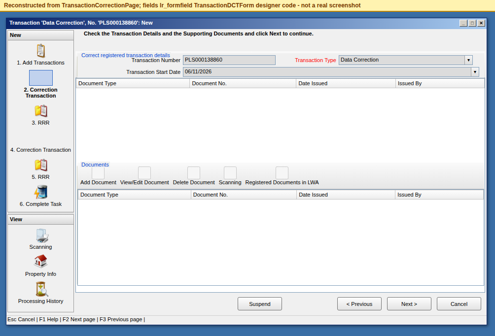

| Control | Type | Caption / label | Position / size | Bound field / data | Event handlers |
|---|---|---|---|---|---|
| pnlRelatedStuff | Panel |  | 0,110 849x92 Dock Fill | tab 3 |  |
| &nbsp;&nbsp;└ tableLayoutPanel1 | TableLayoutPanel |  | 0,0 849x615 Dock Fill | tab 0 |  |
| &nbsp;&nbsp;&nbsp;&nbsp;└ grpDocuments | GroupBox | Documents  | 3,350 843x250 Dock Fill | tab 0 |  |
| &nbsp;&nbsp;&nbsp;&nbsp;&nbsp;&nbsp;└ pnlDocuments | Panel |  | 3,16 837x240 Dock Fill | tab 1 |  |
| &nbsp;&nbsp;&nbsp;&nbsp;&nbsp;&nbsp;&nbsp;&nbsp;└ dbgListOfSupportDocs | GridControl |  | 0,70 645x51 Dock Fill | lr_formfield _formName; tab 14 |  |
| &nbsp;&nbsp;&nbsp;&nbsp;&nbsp;&nbsp;&nbsp;&nbsp;└ tsDocuments | ToolStrip | tsDocuments | 0,16 645x54 | tab 13 |  |
| &nbsp;&nbsp;&nbsp;&nbsp;&nbsp;&nbsp;&nbsp;&nbsp;&nbsp;&nbsp;└ btnNew | ToolStripButton | New -&gt; runtime: "Add Document" | 36x51 |  |  |
| &nbsp;&nbsp;&nbsp;&nbsp;&nbsp;&nbsp;&nbsp;&nbsp;&nbsp;&nbsp;└ btnEdit | ToolStripButton | View/Edit -&gt; runtime: "View/Edit Document" | 61x51 |  |  |
| &nbsp;&nbsp;&nbsp;&nbsp;&nbsp;&nbsp;&nbsp;&nbsp;&nbsp;&nbsp;└ btnDelete | ToolStripButton | Delete -&gt; runtime: "Delete Document" | 44x51 |  |  |
| &nbsp;&nbsp;&nbsp;&nbsp;&nbsp;&nbsp;&nbsp;&nbsp;&nbsp;&nbsp;└ btnViewPages | ToolStripButton | Attachments -&gt; runtime: "Scanning" | 79x51 |  |  |
| &nbsp;&nbsp;&nbsp;&nbsp;&nbsp;&nbsp;&nbsp;&nbsp;&nbsp;&nbsp;└ btnViewReg | ToolStripButton | Registered -&gt; runtime: "Registered Documents in LWA" | 66x51 |  |  |
| &nbsp;&nbsp;&nbsp;&nbsp;└ grpBxSelectedTransaction | GroupBox | Correction Transaction  | 3,279 843x118 Dock Fill | tab 2 |  |
| &nbsp;&nbsp;&nbsp;&nbsp;&nbsp;&nbsp;└ pnlTransactionExtAttributes | Panel |  | 3,3 632x300 Dock Fill | tab 2 |  |
| &nbsp;&nbsp;&nbsp;&nbsp;&nbsp;&nbsp;&nbsp;&nbsp;└ lcTransactionExtAttributes | LayoutControl | layoutControl1 | 0,0 632x300 Dock Fill | lr_formfield GetAttributeValue&lt;string&gt;("secondary_form"); tab 0 |  |
| &nbsp;&nbsp;&nbsp;&nbsp;└ grpBxCorrectionTransaction | GroupBox | Correct registered transaction details  | 3,3 843x50 Dock Fill | tab 2 |  |
| &nbsp;&nbsp;&nbsp;&nbsp;&nbsp;&nbsp;└ pnlTransactionAttributes | Panel |  | 3,16 837x50 Dock Fill | tab 2 |  |
| &nbsp;&nbsp;&nbsp;&nbsp;&nbsp;&nbsp;&nbsp;&nbsp;└ lcTransactionAttributes | LayoutControl | layoutControl1 | 0,0 873x50 Dock Fill | lr_formfield entityGUIDescriptorName; tab 0 |  |
| pnlTransactions | Panel |  | 0,0 459x110 Dock Top hidden | tab 2 |  |
| &nbsp;&nbsp;└ dveTransactions | DataViewerEx |  | 0,18 645x92 Dock Fill | tab 2 |  |
| &nbsp;&nbsp;└ lblTransactions | Label | Batch Content | 0,0 459x18 Dock Top | tab 0 |  |
| pmToolbar | ContextMenu |  |  |  |  |
| miNew | WMenuItem |  |  |  |  |
| miEdit | WMenuItem |   |  |  |  |
| miDelete | WMenuItem |   |  |  |  |
| miViewPages | WMenuItem |   |  |  |  |
| miRegDocs | WMenuItem |  |  |  |  |
| gvListOfSupportDocs | GridView |  |  | lr_formfield _formName | FocusedRowChanged-&gt;gvListOfSupportDocs_FocusedRowChanged, DoubleClick-&gt;gvListOfSupportDocs_DoubleClick |
| layoutControlGroup1 | LayoutControlGroup | layoutControlGroup1 | 0,0 873x99 |  |  |
| layoutControlGroup2 | LayoutControlGroup | layoutControlGroup1 | 0,0 632x300 |  |  |

Messages this class can show (MessageBoxService kind: text):

- Warning: "Please search for transaction to correct before proceeding to the next page."
- Warning: "The following transactions are expected to edit related field:  {0}"
- Confirm: "&lt;exception message / formatted text: `null, documentNotScannedWarningMessage`&gt;"
- Error: "Cannot Delete mandatory document from previous stages"
- Confirm: "&lt;exception message / formatted text: `(IWin32Window)(object)this, deletePromtMessage`&gt;"
- Show: "&lt;exception message&gt;"
- Show: "&lt;exception message / formatted text: `ex2.Message`&gt;"

<details><summary>Other resource strings used by TransactionCorrectionPage (7)</summary>

- `strGeneralObjects_CorrectionTransaction` = "Correction Transaction"
- `strTransactionWithDocumentsPage_Prompt` = "Check the Transaction Details and the Supporting Documents and click Next to continue."
- `strTransactionWithDocumentsPage_AddDoc` = "Add Document"
- `strTransactionWithDocumentsPage_EditDoc` = "View/Edit Document"
- `strTransactionWithDocumentsPage_DeleteDoc` = "Delete Document"
- `strScannedDocuments` = "Scanning"
- `strRegisteredDocuments` = "Registered Documents in LWA"

</details>

#### 3.7.9 PastPartiesPage

- Source: `TAR.Controls.dll/TAR.Controls.WorkerAssess.Pages/PastPartiesPage.cs` (`TAR.Controls.WorkerAssess.Pages`), base `PartiesPage`.
- Status at PLAGIS: Used (reachable from the PLAGIS configuration).
- Purpose: Parties tab inside the Past Transaction dialog.
- Opened from (code references): `PastTransactionForm.InitializeComponent`
- lr_formfield bindings in code: _meta -&gt; "TransactionListGrid", gvListOfParties -&gt; GridName

| Control | Type | Caption / label | Position / size | Bound field / data | Event handlers |
|---|---|---|---|---|---|
| pnlRelatedStuff | Panel |  | 0,110 543x363 Dock Fill | tab 3 |  |
| &nbsp;&nbsp;└ dbgListOfParties | GridControl |  | 0,72 543x291 Dock Fill | lr_formfield GridName; tab 8 |  |
| &nbsp;&nbsp;└ tsNames | ToolStrip | toolStrip1 | 0,18 543x54 | tab 4 |  |
| &nbsp;&nbsp;&nbsp;&nbsp;└ btnAdd | ToolStripButton | New Party | 65x51 |  |  |
| &nbsp;&nbsp;&nbsp;&nbsp;└ btnEdit | ToolStripButton | View/Edit | 61x51 |  |  |
| &nbsp;&nbsp;&nbsp;&nbsp;└ btnDelete | ToolStripButton | Delete | 44x51 |  |  |
| &nbsp;&nbsp;&nbsp;&nbsp;└ btnAddApplicant | ToolStripButton | Add Applicant | 87x51 |  |  |
| &nbsp;&nbsp;&nbsp;&nbsp;└ separatorAddOwners | ToolStripSeparator |  | 6x54 |  |  |
| &nbsp;&nbsp;&nbsp;&nbsp;└ btnAddOwners | ToolStripButton | Add Owners | 76x51 |  |  |
| &nbsp;&nbsp;&nbsp;&nbsp;└ separatorSearchParty | ToolStripSeparator |  | 6x54 |  |  |
| &nbsp;&nbsp;&nbsp;&nbsp;└ btnSearchParty | ToolStripButton | Search Party | 76x51 |  |  |
| &nbsp;&nbsp;&nbsp;&nbsp;└ btnSpecifyTransferRules | ToolStripButton | toolStripButton7 | 36x51 |  |  |
| &nbsp;&nbsp;└ lblNames | Label | Parties | 0,0 543x18 Dock Top | tab 1 |  |
| pnlTransactions | Panel |  | 0,0 459x110 Dock Top hidden | tab 2 |  |
| &nbsp;&nbsp;└ dveTransactions | DataViewerEx |  | 0,18 543x92 Dock Fill | tab 2 |  |
| &nbsp;&nbsp;└ lblTransactions | Label | Batch Content | 0,0 459x18 Dock Top | tab 0 |  |

Messages this class can show (MessageBoxService kind: text):

- Info: "Please add party with role '{0}' to current transaction."

#### 3.7.10 PastPaymentsFeePage

- Source: `TAR.Controls.dll/TAR.Controls.WorkerAssess.Pages/PastPaymentsFeePage.cs` (`TAR.Controls.WorkerAssess.Pages`), base `PaymentsFeePage`.
- Status at PLAGIS: Used (reachable from the PLAGIS configuration).
- Purpose: Payments tab inside the Past Transaction dialog.
- Opened from (code references): `PastTransactionForm.InitializeComponent`

| Control | Type | Caption / label | Position / size | Bound field / data | Event handlers |
|---|---|---|---|---|---|
| toolStrip1 | ToolStrip | toolStrip1 | 0,23 600x54 | tab 32 |  |
| &nbsp;&nbsp;└ btnCalc | ToolStripButton |  | 23x51 hidden |  |  |
| &nbsp;&nbsp;└ btnPrint | ToolStripButton |  | 23x51 hidden |  |  |
| &nbsp;&nbsp;└ btnAdd | ToolStripButton | Add Payment | 83x51 | tip "Add payment information" |  |
| &nbsp;&nbsp;└ btnEdit | ToolStripButton | View/Edit Payment | 81x51 | tip "Edit/View payment information" |  |
| &nbsp;&nbsp;└ btnRemove | ToolStripButton | Remove Payment | 104x51 | tip "Remove payment information" |  |
| lblTotal | Label | Total: | 348,424 95x17 Anchor B+R | tab 31 |  |
| txtTotal | TextEdit |  | 446,421 151x20 Anchor B+R | tab 29 |  |
| dbgPaymentTransactions | GridControl |  | 0,75 600x340 Anchor T+B+L+R | tab 27 |  |
| label1 | Label | Payments | 0,0 600x23 Dock Top | tab 24 |  |

Messages this class can show (MessageBoxService kind: text):

- Warning: "Please enter at least one Payment for transaction {0} No. {1}."

#### 3.7.11 RelatedTransactionInfoForm

- Source: `TAR.Controls.dll/TAR.Controls.WorkerAssess.Forms/RelatedTransactionInfoForm.cs` (`TAR.Controls.WorkerAssess.Forms`), base `DialogForm`; form Text "Transaction Info"; design size 741x596; border Sizable; resx `TAR.Controls.WorkerAssess.Forms.RelatedTransactionInfoForm.resx`.
- Status at PLAGIS: Used (reachable from the PLAGIS configuration).
- Purpose: "Transaction Info" read-only dossier of a related transaction.
- Opened from (code references): `PastTransactionForm.SearchRelatedTransactions_ButtonClick`
- Form events: VisibleChanged -&gt; `RelatedTransactionInfoForm_VisibleChanged`, KeyDown -&gt; `RelatedTransactionInfoForm_KeyDown`
- lr_formfield bindings in code: gvListOfTransactions -&gt; "RelatedTransactionGrid", gvListOfSupportDocs -&gt; "SupportedDocGrid", gvListOfParties -&gt; "PartiesGrid"

| Control | Type | Caption / label | Position / size | Bound field / data | Event handlers |
|---|---|---|---|---|---|
| pcMain | PanelControl |  | 4,4 733x551 Anchor T+B+L+R | tab 7 |  |
| &nbsp;&nbsp;└ tcDocumentsParties | XtraTabControl |  | 2,500 729x49 Dock Fill | tab 4 |  |
| &nbsp;&nbsp;&nbsp;&nbsp;└ tpParties | XtraTabPage | Parties | 722x20 |  |  |
| &nbsp;&nbsp;&nbsp;&nbsp;&nbsp;&nbsp;└ dbgListOfParties | GridControl |  | 0,0 722x20 Dock Fill | lr_formfield PartiesGrid; tab 22 |  |
| &nbsp;&nbsp;&nbsp;&nbsp;└ tpDocuments | XtraTabPage | Documents | 722x20 |  |  |
| &nbsp;&nbsp;&nbsp;&nbsp;&nbsp;&nbsp;└ dbgListOfSupportDocs | GridControl |  | 0,0 722x20 Dock Fill | lr_formfield SupportedDocGrid; tab 0 |  |
| &nbsp;&nbsp;└ splitterControl | SplitterControl |  | 2,494 729x6 Dock Top | tab 9 |  |
| &nbsp;&nbsp;└ gcTransactions | GroupControl | Transactions -&gt; runtime: "Registered Transactions" | 2,94 729x400 Dock Top | tab 5 |  |
| &nbsp;&nbsp;&nbsp;&nbsp;└ dbgListOfTransactions | GridControl |  | 2,22 725x376 Dock Fill | lr_formfield RelatedTransactionGrid; tab 0 |  |
| btnCancel | SimpleButton | Cancel -&gt; runtime: "Close" | 647,563 80x23 Anchor B+R | tab 1 |  |
| btnOK | SimpleButton | OK | 563,563 80x23 Anchor B+R | tab 0 | Click-&gt;btnOK_Click |
| gvListOfParties | GridView |  |  | lr_formfield PartiesGrid | DoubleClick-&gt;gvListOfParties_DoubleClick |
| gvListOfSupportDocs | GridView |  |  | lr_formfield SupportedDocGrid | DoubleClick-&gt;gvListOfSupportDocs_DoubleClick |
| gvListOfTransactions | GridView |  |  | lr_formfield RelatedTransactionGrid | DoubleClick-&gt;gvListOfTransactions_DoubleClick |

Messages this class can show (MessageBoxService kind: text):

- Error: "&lt;exception message&gt;"

<details><summary>Other resource strings used by RelatedTransactionInfoForm (8)</summary>

- `strGeneralObjects_TransactionInfo` = "Transaction Info"
- `strGeneralObjects_RegisteredTransactions` = "Registered Transactions"
- `strGeneralObjects_Parties` = "Parties"
- `strPrintDocumentsPage_Caption` = "Documents"
- `strClose` = "Close"
- `strPartiesPage_Caption` = "Parties"
- `strGeneralObjects_Transactions` = "Transactions"
- `strScannedDocuments` = "Scanning"

</details>

#### 3.7.12 CustomPastPartiesPage

- Source: `TAR.PLAGIS.Controls.dll/TAR.PLAGIS.Controls.WorkerAssess.Pages/CustomPastPartiesPage.cs` (`TAR.PLAGIS.Controls.WorkerAssess.Pages`), base `PastPartiesPage`; form Text "CustomPastPartiesPage".
- Status at PLAGIS: PLAGIS override of `PastPartiesPage` (designer only adds/changes the controls listed; behaviour in 05 section 3).
- Purpose: See the base class above.

| Control | Type | Caption / label | Position / size | Bound field / data | Event handlers |
|---|---|---|---|---|---|
| pnlRelatedStuff | Panel |  | 0,110 543x363 Dock Fill | tab 3 |  |
| &nbsp;&nbsp;└ dbgListOfParties | GridControl |  | 0,72 543x291 Dock Fill | tab 8 |  |
| &nbsp;&nbsp;└ tsNames | ToolStrip | toolStrip1 | 0,18 543x54 | tab 4 |  |
| &nbsp;&nbsp;&nbsp;&nbsp;└ btnAdd | ToolStripButton | New Party | 65x51 |  |  |
| &nbsp;&nbsp;&nbsp;&nbsp;└ btnEdit | ToolStripButton | View/Edit | 61x51 |  |  |
| &nbsp;&nbsp;&nbsp;&nbsp;└ btnDelete | ToolStripButton | Delete | 44x51 |  |  |
| &nbsp;&nbsp;&nbsp;&nbsp;└ btnAddApplicant | ToolStripButton | Add Applicant | 87x51 |  |  |
| &nbsp;&nbsp;&nbsp;&nbsp;└ separatorAddOwners | ToolStripSeparator |  | 6x54 |  |  |
| &nbsp;&nbsp;&nbsp;&nbsp;└ btnAddOwners | ToolStripButton | Add Owners | 76x51 |  |  |
| &nbsp;&nbsp;&nbsp;&nbsp;└ separatorSearchParty | ToolStripSeparator |  | 6x54 |  |  |
| &nbsp;&nbsp;&nbsp;&nbsp;└ btnSearchParty | ToolStripButton | Search Party | 76x51 |  |  |
| &nbsp;&nbsp;&nbsp;&nbsp;└ btnSpecifyTransferRules | ToolStripButton | toolStripButton7 | 36x51 |  |  |
| &nbsp;&nbsp;└ lblNames | Label | Parties | 0,0 543x18 Dock Top | tab 1 |  |
| pnlTransactions | Panel |  | 0,0 459x110 Dock Top hidden | tab 2 |  |
| &nbsp;&nbsp;└ dveTransactions | DataViewerEx |  | 0,18 543x92 Dock Fill | tab 2 |  |
| &nbsp;&nbsp;└ lblTransactions | Label | Batch Content | 0,0 459x18 Dock Top | tab 0 |  |

### 3.8 Documents and scanning

Supporting-document dialog, the scanning worker (ribbon window, dock windows) and the ILS.Scanning imaging library dialogs (LeadTools based).

#### 3.8.1 DocumentForm

- Source: `TAR.Controls.dll/TAR.Controls.WorkerAssess.Forms/DocumentForm.cs` (`TAR.Controls.WorkerAssess.Forms`), base `BaseEditorForm`; form Text "View/Edit Document"; design size 737x415; min 700x349; border Sizable; resx `TAR.Controls.WorkerAssess.Forms.DocumentForm.resx`.
- Status at PLAGIS: Used (reachable from the PLAGIS configuration). via PLAGIS CustomDocumentForm.
- Purpose: "View/Edit Document": `SupportedDocForm` (incoming) or `SupportedDocFormOut` (outgoing) fields; extension tab.
- Opened from (code references): `CustomTransactionWithDocumentsPage.NewDocument`, `DocumentListView.btnAdd_Click`, `DocumentListView.btnEdit_Click`, `DocumentManager.AddDocument`, `DocumentManager.DeleteDocument`, `TransactionCorrectionPage.Edit_Action`, `TransactionCorrectionPage.NewDocument`, `TransactionDeedPage.Edit_Action`, `TransactionDeedPage.NewDocument`, `TransactionWithDocumentsPage.Edit_Action` (+1 more)
- lr_formfield bindings in code: layoutControl2 -&gt; typeof(SourceDocument), layoutControl1 -&gt; _formName

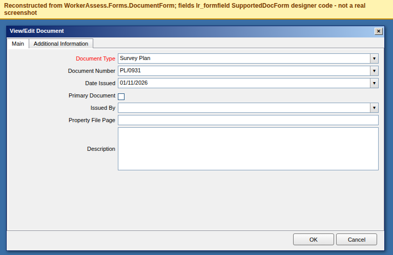

| Control | Type | Caption / label | Position / size | Bound field / data | Event handlers |
|---|---|---|---|---|---|
| xtraTabControl1 | XtraTabControl |  | 0,0 737x377 Anchor T+B+L+R | tab 2 |  |
| &nbsp;&nbsp;└ tpMain | XtraTabPage | General Information -&gt; runtime: "Principal Details" | 730x348 |  |  |
| &nbsp;&nbsp;&nbsp;&nbsp;└ layoutControl1 | LayoutControl | layoutControl1 | 0,0 730x30 Dock Top | lr_formfield _formName; tab 0 |  |
| &nbsp;&nbsp;└ tpAdditional | XtraTabPage | Additional Information -&gt; runtime: "Supplementary Details" | 730x348 |  |  |
| &nbsp;&nbsp;&nbsp;&nbsp;└ layoutControl2 | LayoutControl | layoutControl2 | 0,30 730x318 Dock Fill hidden | lr_formfield typeof(SourceDocument); tab 1 |  |
| &nbsp;&nbsp;└ tpAdditional2 | XtraTabPage | Additional Information | 543x301 |  |  |
| btnCancel | SimpleButton | Cancel | 643,382 80x23 Anchor B+R | tab 1 | Click-&gt;btnCancel_Click |
| btnOK | SimpleButton | OK | 559,382 80x23 Anchor B+R | tab 0 | Click-&gt;btnOK_Click |
| layoutControlGroup1 | LayoutControlGroup | layoutControlGroup1 | 0,0 730x30 |  |  |
| layoutControlGroup2 | LayoutControlGroup | layoutControlGroup2 | 0,0 730x318 |  |  |

<details><summary>Other resource strings used by DocumentForm (3)</summary>

- `strDocumentForm_Caption` = "View/Edit Document"
- `strMainTab` = "Principal Details"
- `strExtensionTab` = "Supplementary Details"

</details>

#### 3.8.2 ScanForm

- Source: `TAR.Controls.dll/TAR.Controls.WorkerScanning/ScanForm.cs` (`TAR.Controls.WorkerScanning`), base `Form`; form Text "Form1"; design size 884x462; min 850x400; start CenterScreen; resx `TAR.Controls.WorkerScanning.ScanForm.resx`.
- Status at PLAGIS: Used (reachable from the PLAGIS configuration).
- Purpose: Scanning window opened from the wizard View &gt; Scanning button: DevExpress ribbon (Main / Raster / Annotation), Batch tree dock (left), image viewer (centre), Document Properties dock (right), status bar.
- Opened from (code references): `PropertiesDockableWindow.DocumentNumberChanged`
- Form events: Load -&gt; `ScanForm_Load`, Activated -&gt; `ScanForm_Activated`, FormClosing -&gt; `ScanForm_FormClosing`, Resize -&gt; `ScanForm_Resize`, HelpRequested -&gt; `ScanForm_HelpRequested`

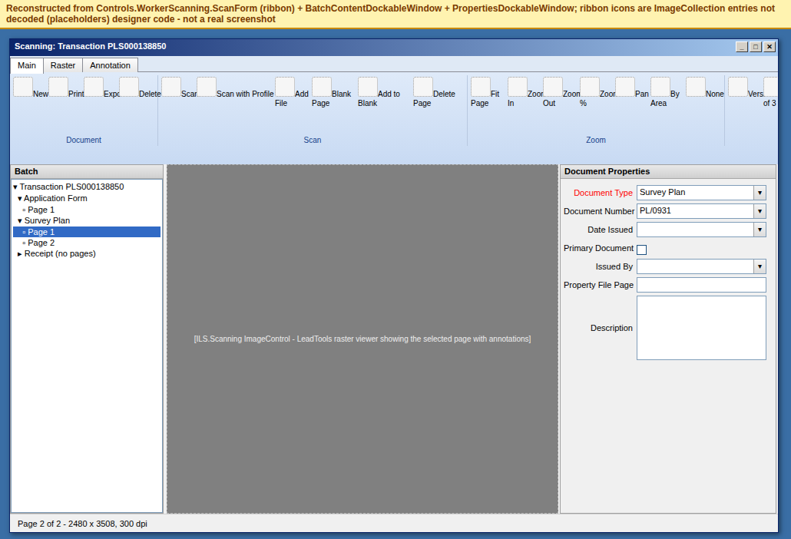

| Control | Type | Caption / label | Position / size | Bound field / data | Event handlers |
|---|---|---|---|---|---|
| panelControl | PanelControl |  | 0,141 884x297 Dock Fill | tab 4 |  |
| &nbsp;&nbsp;└ imageControl | ImageControl |  | 2,2 880x293 Dock Fill | tab 2 |  |
| ribbonStatusBar1 | RibbonStatusBar |  | 0,438 884x24 |  |  |
| ribbonControl | RibbonControl |  | 0,0 884x141 |  | ShowCustomizationMenu-&gt;ribbonControl_ShowCustomizationMenu |
| &nbsp;&nbsp;└ iDocumentDelete | BarButtonItem | Delete |  |  | ItemClick-&gt;iDocumentDelete_ItemClick |
| &nbsp;&nbsp;└ iDocumentProperties | BarButtonItem | Properties |  |  |  |
| &nbsp;&nbsp;└ iDocumentNew | BarButtonItem | &New -&gt; runtime: "New" |  |  | ItemClick-&gt;idDocumentNew_ItemClick |
| &nbsp;&nbsp;└ iPrintPreview | BarButtonItem | Print Preview |  |  |  |
| &nbsp;&nbsp;└ iReadingPane | BarButtonItem | Reading Pane |  |  |  |
| &nbsp;&nbsp;└ iPrintSettings | BarButtonItem | Print Settings |  |  |  |
| &nbsp;&nbsp;└ iPrintPages | BarButtonItem | Print Pages |  |  |  |
| &nbsp;&nbsp;└ iPrintSelection | BarButtonItem | Print Selection |  |  |  |
| &nbsp;&nbsp;└ iExportToFolder | BarButtonItem | Export to Folder |  |  |  |
| &nbsp;&nbsp;└ iExportToMultiPageTiff | BarButtonItem | Convert to Multipage TIFF |  |  |  |
| &nbsp;&nbsp;└ iScan | BarButtonItem | Scan |  |  |  |
| &nbsp;&nbsp;└ iRescan | BarButtonItem | Rescan |  |  |  |
| &nbsp;&nbsp;└ iFitWidth | BarButtonItem | Fit Width |  |  |  |
| &nbsp;&nbsp;└ iFitPage | BarButtonItem | Fit Page |  |  |  |
| &nbsp;&nbsp;└ iFit100 | BarButtonItem | Fit 100% |  |  |  |
| &nbsp;&nbsp;└ iSelectBlankPages | BarButtonItem | Select Blank |  |  |  |
| &nbsp;&nbsp;└ iAddBlankToSelection | BarButtonItem | Add to Blank |  |  |  |
| &nbsp;&nbsp;└ iZoomOverview | BarButtonItem | Overview Window |  |  |  |
| &nbsp;&nbsp;└ iZoomCenterArt | BarButtonItem | Center Art |  |  |  |
| &nbsp;&nbsp;└ iZoomMagnifier | BarButtonItem | Magnifier |  |  |  |
| &nbsp;&nbsp;└ iZoomNone | BarButtonItem | None |  |  |  |
| &nbsp;&nbsp;└ idDocumentNew | BarButtonItem | New |  |  | ItemClick-&gt;idDocumentNew_ItemClick |
| &nbsp;&nbsp;└ idPrintPreview | BarButtonItem | &Print |  |  |  |
| &nbsp;&nbsp;└ idExportToFolder | BarButtonItem | &Export |  |  |  |
| &nbsp;&nbsp;└ idSave | BarButtonItem | &Save |  |  | ItemClick-&gt;iSave_ItemClick |
| &nbsp;&nbsp;└ idScan | BarButtonItem | &Scan |  |  |  |
| &nbsp;&nbsp;└ iSave | BarButtonItem | Save |  |  | ItemClick-&gt;iSave_ItemClick |
| &nbsp;&nbsp;└ iSaveAll | BarButtonItem | Save All |  |  | ItemClick-&gt;iSaveAll_ItemClick |
| &nbsp;&nbsp;└ idScanWithProfile | BarButtonItem | Scan with Profile |  |  | ItemClick-&gt;idScanWithProfile_ItemClick |
| &nbsp;&nbsp;└ idSelectBlankPages | BarButtonItem | Blank Page |  |  |  |
| &nbsp;&nbsp;└ idPageDelete | BarButtonItem | Delete Page |  |  |  |
| &nbsp;&nbsp;└ idScanOptions | BarButtonItem | Options |  |  | ItemClick-&gt;idScanOptions_ItemClick |
| &nbsp;&nbsp;└ idFitPage | BarButtonItem | Fit Page |  |  |  |
| &nbsp;&nbsp;└ idZoomIn | BarButtonItem | Zoom In |  |  |  |
| &nbsp;&nbsp;└ idZoomOut | BarButtonItem | Zoom Out |  |  |  |
| &nbsp;&nbsp;└ idZoomTools | BarButtonItem | Tools |  |  |  |
| &nbsp;&nbsp;└ idDocumentProperties | BarButtonItem | Properties -&gt; runtime: "Document Properties" |  |  |  |
| &nbsp;&nbsp;└ siStatus | BarButtonItem |  |  |  |  |
| &nbsp;&nbsp;└ idScanAddFile | BarButtonItem | Add File |  |  |  |
| &nbsp;&nbsp;└ idRasterSelect | BarCheckItem | Select |  |  |  |
| &nbsp;&nbsp;└ idRasterCrop | BarButtonItem | Crop |  |  |  |
| &nbsp;&nbsp;└ idRasterUndo | BarButtonItem | &Undo |  |  |  |
| &nbsp;&nbsp;└ idRasterRedo | BarButtonItem | &Redo |  |  |  |
| &nbsp;&nbsp;└ idRasterContrast | BarButtonItem | Contrast |  |  |  |
| &nbsp;&nbsp;└ idRasterBrightness | BarButtonItem | Brightness |  |  |  |
| &nbsp;&nbsp;└ idRasterFreeRotate | BarButtonItem | Free Rotate |  |  |  |
| &nbsp;&nbsp;└ idRasterRotateCW | BarButtonItem | Rotate CW |  |  |  |
| &nbsp;&nbsp;└ idRasterRotateCCW | BarButtonItem | Rotate CCW |  |  |  |
| &nbsp;&nbsp;└ idRasterRotate180 | BarButtonItem | Rotate 180 |  |  |  |
| &nbsp;&nbsp;└ idRasterFlip | BarButtonItem | Flip |  |  |  |
| &nbsp;&nbsp;└ idRasterDeskew | BarButtonItem | Deskew |  |  |  |
| &nbsp;&nbsp;└ idRasterDespeckle | BarButtonItem | Despeckle |  |  |  |
| &nbsp;&nbsp;└ idRasterToneUp | BarButtonItem | Tone Up |  |  |  |
| &nbsp;&nbsp;└ idRasterToneDown | BarButtonItem | Tone Down |  |  |  |
| &nbsp;&nbsp;└ idRasterInvert | BarButtonItem | Invert |  |  |  |
| &nbsp;&nbsp;└ idRasterClear | BarButtonItem | Clear |  |  |  |
| &nbsp;&nbsp;└ idRasterFillArea | BarButtonItem | Fill Area |  |  |  |
| &nbsp;&nbsp;└ idRasterBlankArea | BarButtonItem | Blank Area |  |  |  |
| &nbsp;&nbsp;└ idRasterImageInfo | BarButtonItem | Image Info |  |  |  |
| &nbsp;&nbsp;└ iRasterClearBorderRemove | BarButtonItem | Border Remove |  |  |  |
| &nbsp;&nbsp;└ iRasterClearHolePunchRemove | BarButtonItem | Hole Punch Remove |  |  |  |
| &nbsp;&nbsp;└ iRasterClearLineRemove | BarButtonItem | Line Remove |  |  |  |
| &nbsp;&nbsp;└ iRasterClearSmooth | BarButtonItem | Smooth |  |  |  |
| &nbsp;&nbsp;└ idAnnotationEdit | BarButtonItem | Edit |  |  |  |
| &nbsp;&nbsp;└ idAnnotationSelect | BarButtonItem | Select |  |  |  |
| &nbsp;&nbsp;└ idAnnotationLine | BarButtonItem | Line |  |  |  |
| &nbsp;&nbsp;└ idAnnotationRectangle | BarButtonItem | Rectangle |  |  |  |
| &nbsp;&nbsp;└ idAnnotationElliplse | BarButtonItem | Elliplse |  |  |  |
| &nbsp;&nbsp;└ idAnnotationNote | BarButtonItem | Note |  |  |  |
| &nbsp;&nbsp;└ idAnnotationText | BarButtonItem | Text |  |  |  |
| &nbsp;&nbsp;└ idAnnotationFreehand | BarButtonItem | Freehand |  |  |  |
| &nbsp;&nbsp;└ idAnnotationHighlight | BarButtonItem | Highlight |  |  |  |
| &nbsp;&nbsp;└ idAnnotationRedaction | BarButtonItem | Redaction |  |  |  |
| &nbsp;&nbsp;└ idZoomToValue | BarEditItem |  |  |  |  |
| &nbsp;&nbsp;└ idDocumentVersionValue | BarEditItem |  |  |  |  |
| &nbsp;&nbsp;└ iDocumentRevertVersion | BarButtonItem | Revert to Version -&gt; runtime: "Revert Version..." |  |  | ItemClick-&gt;iDocumentRevertVersion_ItemClick |
| &nbsp;&nbsp;└ iDocumentVersionHistory | BarButtonItem | History... -&gt; runtime: "Version History" |  |  | ItemClick-&gt;iDocumentVersionHistory_ItemClick |
| &nbsp;&nbsp;└ bgNavigation | BarButtonGroup | bgNavigation |  |  |  |
| &nbsp;&nbsp;└ idDocumentVersion | BarButtonItem | Version |  |  |  |
| &nbsp;&nbsp;└ idDocumentView | BarButtonItem | View -&gt; runtime: "Document" |  |  |  |
| &nbsp;&nbsp;└ idDocumentViewBatch | BarButtonItem | Batch |  |  |  |
| &nbsp;&nbsp;└ idNavigationFirst | BarButtonItem | First Page |  |  |  |
| &nbsp;&nbsp;└ idNavigationPrev | BarButtonItem | Previouse Page |  |  |  |
| &nbsp;&nbsp;└ idNavigationNext | BarButtonItem | Next Page |  |  |  |
| &nbsp;&nbsp;└ idNavigationLast | BarButtonItem | Last Page |  |  |  |
| &nbsp;&nbsp;└ idNavigationPageValue | BarEditItem |  |  |  |  |
| &nbsp;&nbsp;└ iZoomByRectangle | BarButtonItem | By Area |  |  |  |
| &nbsp;&nbsp;└ iPan | BarButtonItem | Pan |  |  |  |
| &nbsp;&nbsp;└ iExit | BarButtonItem | Exit -&gt; runtime: "Close" |  |  | ItemClick-&gt;iExit_ItemClick |
| barAndDockingController | BarAndDockingController |  |  |  |  |
| pmNew | PopupMenu |  |  |  |  |
| pmPrint | PopupMenu |  |  |  |  |
| pmExport | PopupMenu |  |  |  |  |
| pmSave | PopupMenu |  |  |  |  |
| pmScan | PopupMenu |  |  |  |  |
| pmScanProfile | PopupMenu |  |  |  | BeforePopup-&gt;pmScanProfile_BeforePopup |
| pmBlank | PopupMenu |  |  |  |  |
| pmFit | PopupMenu |  |  |  |  |
| pmZoomTools | PopupMenu |  |  |  |  |
| pmRasterClear | PopupMenu |  |  |  | BeforePopup-&gt;pmRasterClear_BeforePopup |
| zoomToValueComboBox | RepositoryItemComboBox |  |  |  |  |
| &nbsp;&nbsp;└ new |  |  |  |  |  |
| &nbsp;&nbsp;└ EditorButton |  |  |  |  |  |
| &nbsp;&nbsp;└ componentResourceManager |  |  |  |  |  |
| &nbsp;&nbsp;└ GetObject |  |  |  |  |  |
| &nbsp;&nbsp;└ Buttons |  |  |  |  |  |
| &nbsp;&nbsp;└ GetString |  |  |  |  |  |
| &nbsp;&nbsp;└ Items |  |  |  |  |  |
| &nbsp;&nbsp;└ Items1 |  |  |  |  |  |
| &nbsp;&nbsp;└ Items2 |  |  |  |  |  |
| &nbsp;&nbsp;└ Items3 |  |  |  |  |  |
| &nbsp;&nbsp;└ Items4 |  |  |  |  |  |
| &nbsp;&nbsp;└ Items5 |  |  |  |  |  |
| &nbsp;&nbsp;└ Items6 |  |  |  |  |  |
| documentVersionComboBox | RepositoryItemComboBox |  |  |  | EditValueChanged-&gt;versionComboBox_SelectedIndexChanged |
| pmVersion | PopupMenu |  |  |  |  |
| pmDocument | PopupMenu |  |  |  | BeforePopup-&gt;pmDocument_BeforePopup |
| navigationPageTextEdit | RepositoryItemTextEdit |  |  |  |  |
| pageMain | RibbonPage | Main |  |  |  |
| pgMainDocument | RibbonPageGroup | runtime: "Document" |  |  | CaptionButtonClick-&gt;pageGroupDocument_CaptionButtonClick |
| pgMainScan | RibbonPageGroup | runtime: "Scan" |  |  | CaptionButtonClick-&gt;pageGroupScan_CaptionButtonClick |
| pgMainZoom | RibbonPageGroup | runtime: "Zoom" |  |  | CaptionButtonClick-&gt;pageGroupZoom_CaptionButtonClick |
| pgMainNavigation | RibbonPageGroup | runtime: "Navigation" |  |  |  |
| pgMainExit | RibbonPageGroup | runtime: "Exit" |  |  |  |
| pageRaster | RibbonPage | runtime: "Raster" |  |  |  |
| pgRasterMain | RibbonPageGroup | Main |  |  |  |
| pgRasterEnchance | RibbonPageGroup | Enchance -&gt; runtime: "Enhance" |  |  |  |
| pgRasterRotate | RibbonPageGroup | Rotate |  |  |  |
| pgRasterEdit | RibbonPageGroup | Edit |  |  |  |
| pageAnnotation | RibbonPage | runtime: "Annotation" |  |  |  |
| pgAnnotationTools | RibbonPageGroup | runtime: "Tools" |  |  |  |
| pmMain | PopupMenu |  |  |  |  |
| dockManager | DockManager |  |  |  |  |

Messages this class can show (MessageBoxService kind: text):

- Error: "&lt;exception message&gt;"
- Confirm: "Are you sure you wish to revert current document to version {0}?"
- Info: "None of the documents has scanned pages."
- Error: "Cannot Delete mandatory document from previous stages"

<details><summary>Other resource strings used by ScanForm (32)</summary>

- `strBatchContent` = "Batch"
- `strDocumentProperties` = "Document Properties"
- `strGeneralObjects_View` = "View"
- `pageMainText` = "Main"
- `pageRasterText` = "Raster"
- `pageAnnotationText` = "Annotation"
- `pgMainDocumentText` = "Document"
- `pgMainScanText` = "Scan"
- `pgMainZoomText` = "Zoom"
- `pgMainNavigationText` = "Navigation"
- `pgMainExitText` = "Exit"
- `pgRasterMainText` = "Main"
- `pgRasterEnchanceText` = "Enhance"
- `pgRasterRotateText` = "Rotate"
- `pgRasterEditText` = "Edit"
- `pgAnnotationToolsText` = "Tools"
- `idDocumentNewCaption` = "New"
- `idDocumentNewHint` = "Creates a new, blank document."
- `iDocumentDeleteHint` = "Deletes the active document."
- `strDocument` = "Document"
- `strView` = "View"
- `idDocumentVersionCaption` = "Version"
- `strVersionHistory` = "Version History"
- `strRevertVersion` = "Revert Version..."
- `iExitCaption` = "Close"
- `ToolbarMain` = "Main"
- `ToolbarRaster` = "Raster Operations"
- `ToolbarAnnotations` = "Annotations"
- `ToolbarNavigation` = "Navigation"
- `ToolbarDocNav` = "Document Navigation"
- `strDocumentVersion` = "Document Version"
- `strDeleteDocument` = "Delete Document"

</details>

#### 3.8.3 ScanViewForm

- Source: `TAR.Controls.dll/TAR.Controls.WorkerScanning/ScanViewForm.cs` (`TAR.Controls.WorkerScanning`), base `Form`; form Text "ScanViewForm"; design size 788x408; start CenterParent; resx `TAR.Controls.WorkerScanning.ScanViewForm.resx`.
- Status at PLAGIS: Used (reachable from the PLAGIS configuration).
- Purpose: View-only image window.
- Form events: FormClosing -&gt; `ScanViewForm_FormClosing`, HelpRequested -&gt; `ScanViewForm_HelpRequested`

| Control | Type | Caption / label | Position / size | Bound field / data | Event handlers |
|---|---|---|---|---|---|
| scanViewControl1 | ScanViewControl |  | 0,0 788x408 Dock Fill | tab 0 |  |

#### 3.8.4 ScanViewControl

- Source: `TAR.Controls.dll/TAR.Controls.WorkerScanning/ScanViewControl.cs` (`TAR.Controls.WorkerScanning`), base `UserControl`; design size 646x427; resx `TAR.Controls.WorkerScanning.ScanViewControl.resx`.
- Status at PLAGIS: Used (reachable from the PLAGIS configuration).
- Purpose: Viewer control shared by ScanViewForm and ScanningClientPanel.
- Opened from (code references): `ScanViewForm.InitializeComponent`, `ScanningClientPanel.InitializeComponent`
- lr_formfield bindings in code: _meta -&gt; "SupportedDocGrid"

| Control | Type | Caption / label | Position / size | Bound field / data | Event handlers |
|---|---|---|---|---|---|
| panel1 | Panel |  | 0,50 646x355 Dock Fill | tab 4 |  |
| &nbsp;&nbsp;└ imageControl | ImageControl |  | 0,0 646x355 Dock Fill | tab 2 |  |
| toolStripContainer | ToolStripContainer | toolStripContainer | 0,0 646x50 Dock Top | tab 3 |  |
| &nbsp;&nbsp;└ toolStripContainer.TopToolStripPanel | ToolStripPanel |  |  |  |  |
| &nbsp;&nbsp;└ toolStripContainer.LeftToolStripPanel | ToolStripPanel |  |  |  |  |
| &nbsp;&nbsp;└ toolStripContainer.RightToolStripPanel | ToolStripPanel |  |  |  |  |
| &nbsp;&nbsp;└ toolStripContainer.ContentPanel | ToolStripContentPanel |  |  |  |  |
| &nbsp;&nbsp;└ toolStripContainer.BottomToolStripPanel | ToolStripPanel |  |  |  |  |
| statusStrip | StatusStrip | statusStrip1 | 0,405 646x22 | tab 2 |  |
| &nbsp;&nbsp;└ statusLabel | ToolStripStatusLabel |  | 0x17 |  |  |

Messages this class can show (MessageBoxService kind: text):

- Show: "Read-only folder cannot be selected."
- Confirm: "Are you sure you wish to revert current document to version {0}?"
- Info: "None of the documents has scanned pages."

<details><summary>Other resource strings used by ScanViewControl (18)</summary>

- `strBatchContent` = "Batch"
- `strDocumentProperties` = "Document Properties"
- `strDocument` = "Document"
- `ToolbarDocNav` = "Document Navigation"
- `ToolbarMain` = "Main"
- `ToolbarRaster` = "Raster Operations"
- `ToolbarAnnotations` = "Annotations"
- `ToolbarNavigation` = "Navigation"
- `strDocumentVersion` = "Document Version"
- `idDocumentNewCaption` = "New"
- `strDeleteDocument` = "Delete Document"
- `strVersionHistory` = "Version History"
- `strRevertVersion` = "Revert Version..."
- `strClass` = "Class"
- `strDateIssued` = "Date Issued"
- `strDateScanned` = "Date Scanned"
- `strPages` = "Pages"
- `strSelectDocumentsToScan` = "Select Documents to Scan"

</details>

#### 3.8.5 ScanningClientPanel

- Source: `TAR.Controls.dll/TAR.Controls.WorkerScanning/ScanningClientPanel.cs` (`TAR.Controls.WorkerScanning`), base `WizardPage`; design size 801x421; resx `TAR.Controls.WorkerScanning.ScanningClientPanel.resx`.
- Status at PLAGIS: Used only by the stand-alone runner; not configured as a page at PLAGIS.
- Purpose: Scanning as a wizard page.
- Opened from (code references): `RunnerStub.InitializeComponent`

| Control | Type | Caption / label | Position / size | Bound field / data | Event handlers |
|---|---|---|---|---|---|
| scanViewControl | ScanViewControl |  | 0,0 801x421 Dock Fill | tab 1 |  |

Messages this class can show (MessageBoxService kind: text):

- Confirm: "There are still documents without scanned images. Do you want to continue?"

<details><summary>Other resource strings used by ScanningClientPanel (2)</summary>

- `strGeneralObjects_Scanning` = "Documents"
- `strScanningPrompt` = "Select the type of document to scan by clicking the Document button and choosing Select from the context menu.  Once you have scanned all documents click the Next button to continue."

</details>

#### 3.8.6 BatchContentDockableWindow

- Source: `TAR.Controls.dll/TAR.Controls.WorkerScanning/BatchContentDockableWindow.cs` (`TAR.Controls.WorkerScanning`), base `UserDockableWindow`; form Text "Batch Content"; design size 196x450.
- Status at PLAGIS: Used (reachable from the PLAGIS configuration).
- Opened from (code references): `RunnerStub.InitializeComponent`, `ScanForm.InitScanningServices`, `ScanViewControl.InitScanningServices`
- Form events: HelpRequested -&gt; `BatchContentDockableWindow_HelpRequested`

| Control | Type | Caption / label | Position / size | Bound field / data | Event handlers |
|---|---|---|---|---|---|
| thumbnailBar | DocumentListTreeView |  | 0,0 196x450 Anchor T+B+L+R | tab 2 | HelpRequested-&gt;thumbnailBar_HelpRequested |

#### 3.8.7 PropertiesDockableWindow

- Source: `TAR.Controls.dll/TAR.Controls.WorkerScanning/PropertiesDockableWindow.cs` (`TAR.Controls.WorkerScanning`), base `UserDockableWindow`; form Text "Document Properties"; design size 280x450.
- Status at PLAGIS: Used (reachable from the PLAGIS configuration).
- Opened from (code references): `ScanForm.InitScanningServices`, `ScanViewControl.InitScanningServices`
- Form events: HelpRequested -&gt; `PropertiesDockableWindow_HelpRequested`

| Control | Type | Caption / label | Position / size | Bound field / data | Event handlers |
|---|---|---|---|---|---|
| editPanel | EditPanel |  | 0,23 278x426 Anchor T+B+L+R | tab 0 |  |

Messages this class can show (MessageBoxService kind: text):

- Warning: "Date must be greater than '01/01/1753'"

#### 3.8.8 AboutWindow

- Source: `ILS.Scanning.dll/ILS.Scanning/AboutWindow.cs` (`ILS.Scanning`), base `Form`; form Text "Imager .NET"; design size 459x372; min 475x410; start CenterParent; resx `ILS.Scanning.AboutWindow.resx`.
- Opened from (code references): `ImageProcessingComponent.OnAboutBox`
- Form events: Paint -&gt; `AboutWindow_Paint`

| Control | Type | Caption / label | Position / size | Bound field / data | Event handlers |
|---|---|---|---|---|---|
| ok | Button | OK | 380,343 75x23 | tab 1 |  |
| panel1 | Panel |  | 12,12 442x318 | tab 0 |  |
| &nbsp;&nbsp;└ product | Label | Version {0} | 250,66 74x16 | tab 1 |  |

<details><summary>Other resource strings used by AboutWindow (2)</summary>

- `ToolImgAbout` = "About Imager .NET"
- `ButtonOK` = "OK"

</details>

#### 3.8.9 AutoCrop

- Source: `ILS.Scanning.dll/ILS.Scanning/AutoCrop.cs` (`ILS.Scanning`), base `UserControl`; design size 264x72; resx `ILS.Scanning.AutoCrop.resx`.
- Opened from (code references): `AutoCropFilter2.GetNewPropertiesPanel`

| Control | Type | Caption / label | Position / size | Bound field / data | Event handlers |
|---|---|---|---|---|---|
| numericUpDown1 | NumericUpDown |  | 128,24 72x20 | tab 2 |  |
| label1 | Label | Threshold: | 22,24 100x23 | tab 3 |  |

#### 3.8.10 AutoCropMargins

- Source: `ILS.Scanning.dll/ILS.Scanning/AutoCropMargins.cs` (`ILS.Scanning`), base `UserControl`; design size 401x223; resx `ILS.Scanning.AutoCropMargins.resx`.
- Opened from (code references): `AutoCropMarginsFilter.GetNewPropertiesPanel`

| Control | Type | Caption / label | Position / size | Bound field / data | Event handlers |
|---|---|---|---|---|---|
| gbPosition | GroupBox | Crop Position: | 171,7 221x208 | tab 1 |  |
| &nbsp;&nbsp;└ tableLayoutPanel | TableLayoutPanel |  | 11,14 198x188 Anchor T+B+L+R | tab 0 |  |
| &nbsp;&nbsp;&nbsp;&nbsp;└ rbTopLeft | RadioButton |  | 4,4 59x56 Anchor T+B+L+R | tab 0 |  |
| &nbsp;&nbsp;&nbsp;&nbsp;└ rbTopCenter | RadioButton |  | 69,4 59x56 Anchor T+B+L+R | tab 1 |  |
| &nbsp;&nbsp;&nbsp;&nbsp;└ rbTopRight | RadioButton |  | 134,4 60x56 Anchor T+B+L+R | tab 2 |  |
| &nbsp;&nbsp;&nbsp;&nbsp;└ rbMiddleLeft | RadioButton |  | 4,66 59x56 Anchor T+B+L+R | tab 3 |  |
| &nbsp;&nbsp;&nbsp;&nbsp;└ rbMiddleCenter | RadioButton |  | 69,66 59x56 Anchor T+B+L+R | tab 4 |  |
| &nbsp;&nbsp;&nbsp;&nbsp;└ rbMiddleRight | RadioButton |  | 134,66 60x56 Anchor T+B+L+R | tab 5 |  |
| &nbsp;&nbsp;&nbsp;&nbsp;└ rbBottomLeft | RadioButton |  | 4,128 59x56 Anchor T+B+L+R | tab 6 |  |
| &nbsp;&nbsp;&nbsp;&nbsp;└ rbBottomCenter | RadioButton |  | 69,128 59x56 Anchor T+B+L+R | tab 7 |  |
| &nbsp;&nbsp;&nbsp;&nbsp;└ rbBottomRight | RadioButton |  | 134,128 60x56 Anchor T+B+L+R | tab 8 |  |
| gbSize | GroupBox | Crop Size: | 8,7 157x139 | tab 0 |  |
| &nbsp;&nbsp;└ nudHeight | NumericUpDown |  | 65,101 76x20 | tab 5 |  |
| &nbsp;&nbsp;└ lblHeight | Label | Height": -&gt; runtime: "Height:''" | 12,103 46x13 | tab 4 |  |
| &nbsp;&nbsp;└ nudWidth | NumericUpDown |  | 65,74 76x20 | tab 3 |  |
| &nbsp;&nbsp;└ lblWidth | Label | Width": -&gt; runtime: "Width'':" | 12,76 43x13 | tab 2 |  |
| &nbsp;&nbsp;└ cboPaperSize | ComboBox |  | 15,36 126x21 | tab 1 |  |
| &nbsp;&nbsp;└ lblPaperSize | Label | PaperSize: -&gt; runtime: "Paper Size:" | 12,20 58x13 | tab 0 |  |
| toolTip | ToolTip |  |  |  |  |

<details><summary>Other resource strings used by AutoCropMargins (6)</summary>

- `strCustomSize` = "Custom Size"
- `AutocropGBSizeText` = "Crop Size:"
- `AutocropLblPaperSizeText` = "Paper Size:"
- `AutocropLblWidthText` = "Width'':"
- `AutocropGbPositionText` = "Crop Position:"
- `AutocropLblHeightText` = "Height:''"

</details>

#### 3.8.11 AutoFilters

- Source: `ILS.Scanning.dll/ILS.Scanning/AutoFilters.cs` (`ILS.Scanning`), base `UserControl`; design size 296x208.
- Opened from (code references): `FiltersRepositoryOptionsSheet.?`, `ScanModuleOptionsPanel.button3_Click`
- Form events: Load -&gt; `AutoFilters_Load`, Leave -&gt; `AutoFilters_Leave`, Enter -&gt; `AutoFilters_Enter`

| Control | Type | Caption / label | Position / size | Bound field / data | Event handlers |
|---|---|---|---|---|---|
| button2 | Button | Enable -&gt; runtime: "Disable" | 87,176 106x23 Anchor B+R | tab 13 | Click-&gt;button2_Click |
| listView1 | ListView |  | 8,16 280x152 Anchor T+B+L+R | tab 10 | ItemActivate-&gt;listView1_ItemActivate, SelectedIndexChanged-&gt;listView1_SelectedIndexChanged, KeyDown-&gt;listView1_KeyDown |
| &nbsp;&nbsp;└ columnHeader1 | ColumnHeader | No. |  |  |  |
| &nbsp;&nbsp;└ columnHeader2 | ColumnHeader | Filter |  |  |  |
| &nbsp;&nbsp;└ columnHeader3 | ColumnHeader | Enabled |  |  |  |
| button1 | Button | Parameters | 196,176 95x23 Anchor B+R disabled | tab 12 | Click-&gt;button1_Click |

<details><summary>Other resource strings used by AutoFilters (4)</summary>

- `ButtonYes` = "Yes"
- `ButtonNo` = "No"
- `DisableString` = "Disable"
- `EnableString` = "Enable"

</details>

#### 3.8.12 AutoRotate

- Source: `ILS.Scanning.dll/ILS.Scanning/AutoRotate.cs` (`ILS.Scanning`), base `UserControl`; design size 264x72.
- Opened from (code references): `AutoRotateFilter2.GetNewPropertiesPanel`

| Control | Type | Caption / label | Position / size | Bound field / data | Event handlers |
|---|---|---|---|---|---|
| numericUpDown1 | NumericUpDown |  | 128,24 72x20 | tab 2 |  |
| label1 | Label | Rotate Angle: | 3,24 119x23 | tab 1 |  |

#### 3.8.13 BorderRemove

- Source: `ILS.Scanning.dll/ILS.Scanning/BorderRemove.cs` (`ILS.Scanning`), base `UserControl`; design size 273x278.
- Opened from (code references): `BorderRemoveDialog.InitializeComponent`, `BorderRemoveDialog._btnOk_Click`, `DocumentBorderRemove2.Filter`, `DocumentBorderRemove2.GetNewPropertiesPanel`
- Form events: Load -&gt; `BorderRemove_Load`

| Control | Type | Caption / label | Position / size | Bound field / data | Event handlers |
|---|---|---|---|---|---|
| _gbOptions | GroupBox | Options | 8,148 256x120 | tab 5 |  |
| &nbsp;&nbsp;└ _lblWhiteNoiseLength | Label | White Noise Length | 16,88 140x23 | tab 4 |  |
| &nbsp;&nbsp;└ _numWhiteNoiseLength | NumericUpDown |  | 165,88 80x20 | tab 5 | Leave-&gt;_num_Leave |
| &nbsp;&nbsp;└ _numVariance | NumericUpDown |  | 165,56 80x20 | tab 3 | Leave-&gt;_num_Leave |
| &nbsp;&nbsp;└ _lblPercent | Label | Percent | 16,24 140x23 | tab 0 |  |
| &nbsp;&nbsp;└ _lblVariance | Label | Variance | 16,56 140x23 | tab 2 |  |
| &nbsp;&nbsp;└ _numPercent | NumericUpDown |  | 165,24 80x20 | tab 1 | Leave-&gt;_num_Leave |
| _gbFlags | GroupBox | Flags | 8,4 152x136 | tab 3 |  |
| &nbsp;&nbsp;└ _cbUseVariance | CheckBox | Use Variance | 16,52 120x24 | tab 1 | CheckedChanged-&gt;_cbUseVariance_CheckedChanged |
| &nbsp;&nbsp;└ _cbImageUnchanged | CheckBox | Image Unchanged | 16,24 120x24 | tab 0 |  |
| _gbBorder | GroupBox | Border | 168,4 96x136 | tab 4 |  |
| &nbsp;&nbsp;└ _cbTop | CheckBox | Top | 16,52 72x24 | tab 1 |  |
| &nbsp;&nbsp;└ _cbBottom | CheckBox | Bottom | 16,108 72x24 | tab 3 |  |
| &nbsp;&nbsp;└ _cbRight | CheckBox | Right | 16,80 72x24 | tab 2 |  |
| &nbsp;&nbsp;└ _cbLeft | CheckBox | Left | 16,24 72x24 | tab 0 |  |

<details><summary>Other resource strings used by BorderRemove (12)</summary>

- `BorderRemoveOptions` = "Options"
- `BorderRemoveWhiteNoiseLength` = "White Noise Length"
- `BorderRemovePercent` = "Percent"
- `BorderRemoveVariance` = "Variance"
- `BorderRemoveFlags` = "Flags"
- `BorderRemoveUseVariance` = "Use Variance"
- `BorderRemoveImageUnchanged` = "Image Unchanged"
- `BorderRemoveBorder` = "Border"
- `RectTop` = "Top"
- `RectBottom` = "Bottom"
- `RectRight` = "Right"
- `RectLeft` = "Left"

</details>

#### 3.8.14 BorderRemoveDialog

- Source: `ILS.Scanning.dll/ILS.Scanning/BorderRemoveDialog.cs` (`ILS.Scanning`), base `Form`; form Text "Border Remove"; design size 276x343; border FixedDialog; start CenterParent.
- Opened from (code references): `ImageProcessingComponent.OnDocumentBorderRemove`

| Control | Type | Caption / label | Position / size | Bound field / data | Event handlers |
|---|---|---|---|---|---|
| BorderRemove | BorderRemove |  | 8,1 274x290 | tab 5 |  |
| _btnCancel | Button | Cancel | 151,297 75x23 | tab 4 |  |
| _btnOk | Button | OK | 42,297 75x23 | tab 3 | Click-&gt;_btnOk_Click |

#### 3.8.15 CropDialog

- Source: `ILS.Scanning.dll/ILS.Scanning/CropDialog.cs` (`ILS.Scanning`), base `Form`; form Text "Crop (Trim)"; design size 346x159; border FixedDialog; start CenterParent.
- Opened from (code references): `ImageProcessingComponent.OnCrop`
- Form events: Load -&gt; `CropDialog_Load`

| Control | Type | Caption / label | Position / size | Bound field / data | Event handlers |
|---|---|---|---|---|---|
| _gbOptions | GroupBox |  | 8,8 250x144 | tab 0 |  |
| &nbsp;&nbsp;└ label3 | Label | Pixels | 180,112 64x23 | tab 13 |  |
| &nbsp;&nbsp;└ label2 | Label | Pixels | 180,80 64x23 | tab 12 |  |
| &nbsp;&nbsp;└ label1 | Label | Pixels | 180,48 64x23 | tab 11 |  |
| &nbsp;&nbsp;└ _lblUnitsMinWidth | Label | Pixels | 180,16 64x23 | tab 10 |  |
| &nbsp;&nbsp;└ _numHeight | NumericUpDown |  | 96,112 75x20 | tab 8 | Leave-&gt;_num_Leave |
| &nbsp;&nbsp;└ _lblHeight | Label | Height | 16,112 64x23 | tab 7 |  |
| &nbsp;&nbsp;└ _numWidth | NumericUpDown |  | 96,80 75x20 | tab 6 | Leave-&gt;_num_Leave |
| &nbsp;&nbsp;└ _lblWidth | Label | Width | 16,80 64x23 | tab 5 |  |
| &nbsp;&nbsp;└ _numTop | NumericUpDown |  | 96,48 75x20 | tab 4 | Leave-&gt;_num_Leave |
| &nbsp;&nbsp;└ _lblTop | Label | Top | 16,48 64x23 | tab 3 |  |
| &nbsp;&nbsp;└ _numLeft | NumericUpDown |  | 96,16 75x20 | tab 2 | Leave-&gt;_num_Leave |
| &nbsp;&nbsp;└ _lblLeft | Label | Left | 16,16 64x23 | tab 1 |  |
| _btnCancel | Button | Cancel | 264,48 75x23 | tab 13 |  |
| _btnOk | Button | OK | 264,16 75x23 | tab 12 | Click-&gt;_btnOk_Click |

#### 3.8.16 CurrentObjectDialog

- Source: `ILS.Scanning.dll/ILS.Scanning/CurrentObjectDialog.cs` (`ILS.Scanning`), base `Form`; form Text "Current Annotation Object"; design size 362x85; border FixedDialog; start CenterParent; resx `ILS.Scanning.CurrentObjectDialog.resx`.
- Form events: Load -&gt; `CurrentObjectDialog_Load`

| Control | Type | Caption / label | Position / size | Bound field / data | Event handlers |
|---|---|---|---|---|---|
| _cbType | ComboBox |  | 80,48 168x21 | tab 3 |  |
| _lblType | Label | &Type: | 16,47 56x23 | tab 2 |  |
| _cbObject | ComboBox |  | 80,16 168x21 | tab 1 | SelectedIndexChanged-&gt;_cbObject_SelectedIndexChanged, DrawItem-&gt;_cbObject_DrawItem |
| _lblObject | Label | &Object: | 16,16 56x23 | tab 0 |  |
| _btnCancel | Button | Cancel | 272,48 | tab 5 |  |
| _btnOk | Button | OK | 272,16 | tab 4 | Click-&gt;_btnOk_Click |

#### 3.8.17 DeskewDialog

- Source: `ILS.Scanning.dll/ILS.Scanning/DeskewDialog.cs` (`ILS.Scanning`), base `Form`; form Text "Deskew"; design size 367x117; border FixedDialog; start CenterParent.
- Form events: Load -&gt; `DeskewDialog_Load`

| Control | Type | Caption / label | Position / size | Bound field / data | Event handlers |
|---|---|---|---|---|---|
| _gb | GroupBox |  | 12,10 256x92 | tab 0 |  |
| &nbsp;&nbsp;└ _rbNoFill | RadioButton | Do not fill exposed area | 15,62 144x24 | tab 1 | CheckedChanged-&gt;_rb_CheckedChanged |
| &nbsp;&nbsp;└ _rbFill | RadioButton | Fill Exposed Area | 15,8 120x24 | tab 0 | CheckedChanged-&gt;_rb_CheckedChanged |
| &nbsp;&nbsp;└ _btnFillColor | Button | ... | 215,35 24x23 | tab 4 | Click-&gt;_btnFillColor_Click |
| &nbsp;&nbsp;└ _pnlFillColor | Panel |  | 113,35 96x24 | tab 3 | Paint-&gt;_pnlFillColor_Paint |
| &nbsp;&nbsp;└ _lblFillColor | Label | Fill Color | 62,36 56x23 | tab 2 | Click-&gt;_lblFillColor_Click |
| _btnCancel | Button | Cancel | 281,48 75x23 | tab 2 |  |
| _btnOk | Button | OK | 281,19 75x23 | tab 1 | Click-&gt;_btnOk_Click |

#### 3.8.18 DocTemplateForm

- Source: `TAR.Controls.dll/TAR.Controls.Core/DocTemplateForm.cs` (`TAR.Controls.Core`), base `DialogForm`; form Text "Document Templates"; design size 588x418; border Sizable; resx `TAR.Controls.Core.DocTemplateForm.resx`.
- Status at PLAGIS: Used (reachable from the PLAGIS configuration).
- Purpose: Document templates list.

| Control | Type | Caption / label | Position / size | Bound field / data | Event handlers |
|---|---|---|---|---|---|
| docTemplateView | DocTemplateView |  | 0,0 588x379 Anchor T+B+L+R | tab 2 |  |
| btnCancel | SimpleButton | Cancel | 494,385 80x23 Anchor B+R | tab 1 |  |
| btnOK | SimpleButton | OK | 410,385 80x23 Anchor B+R | tab 0 |  |

#### 3.8.19 DocTemplateView

- Source: `TAR.Controls.dll/TAR.Controls.Core.Views/DocTemplateView.cs` (`TAR.Controls.Core.Views`), base `UserControl`; design size 512x372; resx `TAR.Controls.Core.Views.DocTemplateView.resx`.
- Status at PLAGIS: Used (reachable from the PLAGIS configuration).
- Opened from (code references): `DocTemplateForm.InitializeComponent`
- Form events: Load -&gt; `DocTemplateView_Load`

| Control | Type | Caption / label | Position / size | Bound field / data | Event handlers |
|---|---|---|---|---|---|
| treeList | TreeList |  | 0,31 512x341 Dock Fill | tab 0 | CustomDrawNodeCell-&gt;treeList_CustomDrawNodeCell, GetStateImage-&gt;treeList_GetStateImage, VirtualTreeGetChildNodes-&gt;treeList_VirtualTreeGetChildNodes, DoubleClick-&gt;treeList_DoubleClick, VirtualTreeGetCellValue-&gt;treeList_VirtualTreeGetCellValue |
| &nbsp;&nbsp;└ colName | TreeListColumn | Name |  | field Name |  |
| &nbsp;&nbsp;└ colType | TreeListColumn | Type |  | field Type |  |
| &nbsp;&nbsp;└ colSize | TreeListColumn | Size |  | field Size |  |
| panel1 | Panel |  | 0,0 512x31 Dock Top | tab 1 |  |
| &nbsp;&nbsp;└ label1 | Label | Please double click on file to open | 16,10 169x13 | tab 0 |  |

#### 3.8.20 DocumentListControl

- Source: `ILS.Scanning.dll/ILS.Scanning/DocumentListControl.cs` (`ILS.Scanning`), base `UserControl`; design size 246x299.

| Control | Type | Caption / label | Position / size | Bound field / data | Event handlers |
|---|---|---|---|---|---|
| panel | Panel |  | 0,0 246x261 Dock Fill | tab 1 |  |
| outlookBar | OutlookBar | outlookBar1 | 0,261 246x38 Dock Bottom | tab 0 | ButtonClicked-&gt;outlookBar_ButtonClicked |

#### 3.8.21 DocumentListTreeView

- Source: `ILS.Scanning.dll/ILS.Scanning/DocumentListTreeView.cs` (`ILS.Scanning`), base `UserControl`; design size 265x210.
- Opened from (code references): `BatchContentDockableWindow.InitializeComponent`

| Control | Type | Caption / label | Position / size | Bound field / data | Event handlers |
|---|---|---|---|---|---|
| statusStrip1 | StatusStrip | statusStrip1 | 0,188 265x22 | tab 1 |  |
| &nbsp;&nbsp;└ toolStripProgressBar1 | ToolStripProgressBar |  | 100x16 |  |  |
| panel1 | Panel |  | 0,0 265x210 Dock Fill | tab 0 |  |
| &nbsp;&nbsp;└ tvDocuments |  |  | 0,0 265x210 Dock Fill | tab 0 | NodeMouseDoubleClick-&gt;tvDocuments_NodeMouseDoubleClick, AfterCollapse-&gt;tvDocuments_AfterCollapse, DrawNode-&gt;tvDocuments_DrawNode, AfterSelect-&gt;tvDocuments_AfterSelect, BeforeSelect-&gt;tvDocuments_BeforeSelect, AfterExpand-&gt;tvDocuments_AfterExpand, Click-&gt;tvDocuments_Click |

#### 3.8.22 DotRemoveDialog

- Source: `ILS.Scanning.dll/ILS.Scanning/DotRemoveDialog.cs` (`ILS.Scanning`), base `Form`; form Text "Dot Remove"; design size 394x311; border FixedDialog; start CenterParent; resx `ILS.Scanning.DotRemoveDialog.resx`.
- Opened from (code references): `ImageProcessingComponent.OnDocumentDotRemove`
- Form events: Load -&gt; `DotRemoveDialog_Load`

| Control | Type | Caption / label | Position / size | Bound field / data | Event handlers |
|---|---|---|---|---|---|
| _gbOptions | GroupBox | Pixels | 8,104 376x192 | tab 1 |  |
| &nbsp;&nbsp;└ _lblUnitsMaxHeight | Label | Pixels | 280,160 64x23 | tab 12 |  |
| &nbsp;&nbsp;└ _lblUnitsMaxWidth | Label | Pixels | 280,128 64x23 | tab 11 |  |
| &nbsp;&nbsp;└ _lblUnitsMinHeight | Label | Pixels | 280,95 64x23 | tab 10 |  |
| &nbsp;&nbsp;└ _lblUnitsMinWidth | Label | Pixels | 280,63 64x23 | tab 9 |  |
| &nbsp;&nbsp;└ _lblUnits | Label | Units of 1/1000 inch means 1000 is an inch. | 24,24 248x23 | tab 8 |  |
| &nbsp;&nbsp;└ _lblMaxHeight | Label | Maximum Height | 16,160 104x23 | tab 6 |  |
| &nbsp;&nbsp;└ _numMaxHeight | NumericUpDown |  | 128,160 136x20 | tab 7 | Leave-&gt;_num_Leave |
| &nbsp;&nbsp;└ _lblMaxWidth | Label | Maximum Width | 16,128 104x23 | tab 4 |  |
| &nbsp;&nbsp;└ _numMaxWidth | NumericUpDown |  | 128,128 136x20 | tab 5 | Leave-&gt;_num_Leave |
| &nbsp;&nbsp;└ _lblMinHeight | Label | Minimum Height | 16,96 104x23 | tab 2 |  |
| &nbsp;&nbsp;└ _numMinHeight | NumericUpDown |  | 128,96 136x20 | tab 3 | Leave-&gt;_num_Leave |
| &nbsp;&nbsp;└ _lblMinWidth | Label | Minimum Width | 16,64 104x23 | tab 0 |  |
| &nbsp;&nbsp;└ _numMinWidth | NumericUpDown |  | 128,64 136x20 | tab 1 | Leave-&gt;_num_Leave |
| _btnCancel | Button | Cancel | 312,48 | tab 3 |  |
| _btnOk | Button | OK | 312,16 | tab 2 | Click-&gt;_btnOk_Click |
| _gbFlags | GroupBox | Flags | 8,8 280x88 | tab 0 |  |
| &nbsp;&nbsp;└ _cbUseSize | CheckBox | Use Size | 152,52 120x24 | tab 3 | CheckedChanged-&gt;_cbUseSize_CheckedChanged |
| &nbsp;&nbsp;└ _cbUseDpi | CheckBox | Use Dpi | 152,24 120x24 | tab 1 | CheckedChanged-&gt;_cbUseDpi_CheckedChanged |
| &nbsp;&nbsp;└ _cbUseDiagonals | CheckBox | Use Diagonals | 16,52 120x24 | tab 2 |  |
| &nbsp;&nbsp;└ _cbImageUnchanged | CheckBox | Image Unchanged | 16,24 120x24 | tab 0 |  |

Messages this class can show (MessageBoxService kind: text):

- ShowWarning: "Minimum width must be less than maximum width"
- ShowWarning: "Minimum height must be less than maximum height"

<details><summary>Other resource strings used by DotRemoveDialog (1)</summary>

- `DotRemovePixels` = "Pixels"

</details>

#### 3.8.23 FileAttributesDialog

- Source: `ILS.Scanning.dll/ILS.Scanning/FileAttributesDialog.cs` (`ILS.Scanning`), base `Form`; form Text "File Attributes"; design size 359x278; border FixedDialog; start CenterParent.
- Opened from (code references): `ImageListControlBase.OnChangeAttributes`

| Control | Type | Caption / label | Position / size | Bound field / data | Event handlers |
|---|---|---|---|---|---|
| swapCheck | CheckBox | Swap Pages | 104,197 86x17 | tab 11 |  |
| label5 | Label | &Order: | 16,112 80x23 | tab 6 |  |
| cancelButton | Button | Cancel | 269,241 75x23 Anchor T+R | tab 10 |  |
| okButton | Button | OK | 181,241 75x23 Anchor T+R | tab 9 |  |
| label4 | Label | If you will change the order of this file, other files could be re-ordered automatically. | 16,152 325x32 Anchor T+L+R | tab 8 |  |
| indexEdit | NumericUpDown |  | 104,112 72x20 | tab 7 |  |
| label3 | Label | This file is stored in the ordered list. It's possible to change this file order: | 19,63 325x40 Anchor T+L+R | tab 5 | Click-&gt;label3_Click |
| button1 | Button | &Current | 277,40 64x20 Anchor T+R | tab 4 | Click-&gt;button1_Click |
| dateEdit | TextBox |  | 104,40 165x20 Anchor T+L+R | tab 3 |  |
| nameEdit | TextBox |  | 104,16 237x20 Anchor T+L+R | tab 1 |  |
| label2 | Label | Last &Modified: | 16,40 80x23 | tab 2 |  |
| label1 | Label | File &Name: | 16,16 80x23 | tab 0 |  |

#### 3.8.24 FlipDialog

- Source: `ILS.Scanning.dll/ILS.Scanning/FlipDialog.cs` (`ILS.Scanning`), base `Form`; form Text "Flip"; design size 250x103; border FixedDialog; start CenterParent; resx `ILS.Scanning.FlipDialog.resx`.
- Opened from (code references): `ImageProcessingComponent.OnFlip`
- Form events: Load -&gt; `FlipDialog_Load`

| Control | Type | Caption / label | Position / size | Bound field / data | Event handlers |
|---|---|---|---|---|---|
| _gbOptions | GroupBox |  | 8,8 136x88 | tab 0 |  |
| &nbsp;&nbsp;└ _rbVertical | RadioButton | Flip Vertically | 16,56 | tab 2 |  |
| &nbsp;&nbsp;└ _rbHorizontal | RadioButton | Flip Horizontally | 16,24 | tab 1 |  |
| _btnCancel | Button | Cancel | 168,48 | tab 4 |  |
| _btnOk | Button | OK | 168,16 | tab 3 | Click-&gt;_btnOk_Click |

#### 3.8.25 HolePunchRemove

- Source: `ILS.Scanning.dll/ILS.Scanning/HolePunchRemove.cs` (`ILS.Scanning`), base `UserControl`; design size 342x454.
- Opened from (code references): `HolePunchRemove2.Filter`, `HolePunchRemove2.GetNewPropertiesPanel`, `HolePunchRemoveDialog.InitializeComponent`, `HolePunchRemoveDialog._btnOk_Click`
- Form events: Load -&gt; `HolePunchRemove_Load`

| Control | Type | Caption / label | Position / size | Bound field / data | Event handlers |
|---|---|---|---|---|---|
| _gbOptions | GroupBox | Options | 8,188 321x256 | tab 5 |  |
| &nbsp;&nbsp;└ _lblUnits | Label | Units of 1/1000 inch means 1000 is an inch. | 16,20 299x34 | tab 16 |  |
| &nbsp;&nbsp;└ _lblUnitsMaxHeight | Label | Pixels | 197,213 118x23 | tab 15 |  |
| &nbsp;&nbsp;└ _lblUnitsMaxWidth | Label |  | 197,181 118x23 | tab 14 |  |
| &nbsp;&nbsp;└ _lblUnitsMinHeight | Label |  | 197,149 118x23 | tab 13 |  |
| &nbsp;&nbsp;└ _lblUnitsMinWidth | Label |  | 197,117 118x23 | tab 12 |  |
| &nbsp;&nbsp;└ _lblMaxHeight | Label | Maximum Height | 16,216 101x29 | tab 10 |  |
| &nbsp;&nbsp;└ _numMaxHeight | NumericUpDown |  | 121,216 69x20 | tab 11 | Leave-&gt;_num_Leave |
| &nbsp;&nbsp;└ _lblMaxWidth | Label | Maximum Width | 16,184 101x29 | tab 8 |  |
| &nbsp;&nbsp;└ _numMaxWidth | NumericUpDown |  | 121,184 69x20 | tab 9 | Leave-&gt;_num_Leave |
| &nbsp;&nbsp;└ _lblMinHeight | Label | Minimum Height | 16,152 101x29 | tab 6 |  |
| &nbsp;&nbsp;└ _numMinHeight | NumericUpDown |  | 121,152 69x20 | tab 7 | Leave-&gt;_num_Leave |
| &nbsp;&nbsp;└ _lblMinWidth | Label | Minimum Width | 16,120 101x29 | tab 4 |  |
| &nbsp;&nbsp;└ _numMinWidth | NumericUpDown |  | 121,120 69x20 | tab 5 | Leave-&gt;_num_Leave |
| &nbsp;&nbsp;└ _numMaxCount | NumericUpDown |  | 121,88 69x20 | tab 3 | ValueChanged-&gt;_numMaxCount_ValueChanged, Leave-&gt;_num_Leave |
| &nbsp;&nbsp;└ _lblMinCount | Label | Minimum Count | 16,56 101x29 | tab 0 |  |
| &nbsp;&nbsp;└ _lblMaxCount | Label | Maximum Count | 16,88 101x29 | tab 2 |  |
| &nbsp;&nbsp;└ _numMinCount | NumericUpDown |  | 121,56 69x20 | tab 1 | ValueChanged-&gt;_numMinCount_ValueChanged, Leave-&gt;_num_Leave |
| _gbFlags | GroupBox | Flags | 8,4 190x176 | tab 3 |  |
| &nbsp;&nbsp;└ _cbUseSize | CheckBox | Use Size | 16,144 120x24 | tab 4 | CheckedChanged-&gt;_cbUseSize_CheckedChanged |
| &nbsp;&nbsp;└ _cbUseLocation | CheckBox | Use Location | 16,84 120x24 | tab 2 | CheckedChanged-&gt;_cbUseLocation_CheckedChanged |
| &nbsp;&nbsp;└ _cbUseDpi | CheckBox | Use Dpi | 16,114 120x24 | tab 3 | CheckedChanged-&gt;_cbUseDpi_CheckedChanged |
| &nbsp;&nbsp;└ _cbUseCount | CheckBox | Use Count | 16,54 120x24 | tab 1 | CheckedChanged-&gt;_cbUseCount_CheckedChanged |
| &nbsp;&nbsp;└ _cbImageUnchanged | CheckBox | Image Unchanged | 16,24 120x24 | tab 0 |  |
| _gbLocation | GroupBox | Location | 206,4 122x176 | tab 4 |  |
| &nbsp;&nbsp;└ _rbButtonBottom | RadioButton | Bottom | 16,114 72x24 | tab 3 |  |
| &nbsp;&nbsp;└ _rbButtonRight | RadioButton | Right | 16,84 72x24 | tab 2 |  |
| &nbsp;&nbsp;└ _rbButtonTop | RadioButton | Top | 16,54 72x24 | tab 1 |  |
| &nbsp;&nbsp;└ _rbButtonLeft | RadioButton | Left | 16,24 72x24 | tab 0 |  |

<details><summary>Other resource strings used by HolePunchRemove (20)</summary>

- `DotRemovePixels` = "Pixels"
- `OptionsTabTitle` = "Options"
- `DotRemoveUnits` = "Units of 1/1000 inch means 1000 is an inch."
- `DotRemoveMaximumHeight` = "Maximum Height"
- `DotRemoveMaximumWidth` = "Maximum Width"
- `DotRemoveMinumumHeight` = "Minimum Height"
- `DotRemoveMinumumWidth` = "Minimum Width"
- `HolePunchRemoveMinimumCount` = "Minimum Count"
- `HolePunchRemoveMaximumCount` = "Maximum Count"
- `SmoothFlags` = "Flags"
- `DotRemoveUseSize` = "Use Size"
- `HolePunchRemoveUseLocation` = "Use Location"
- `DotRemoveUseDpi` = "Use Dpi"
- `HolePunchRemoveUseCount` = "Use Count"
- `BorderRemoveImageUnchanged` = "Image Unchanged"
- `HolePunchRemoveLocation` = "Location"
- `RectBottom` = "Bottom"
- `RectRight` = "Right"
- `RectTop` = "Top"
- `RectLeft` = "Left"

</details>

#### 3.8.26 HolePunchRemoveDialog

- Source: `ILS.Scanning.dll/ILS.Scanning/HolePunchRemoveDialog.cs` (`ILS.Scanning`), base `Form`; form Text "Hole Punch Remove"; design size 334x502; border FixedDialog; start CenterParent.
- Opened from (code references): `ImageProcessingComponent.OnDocumentHolePunchRemove`

| Control | Type | Caption / label | Position / size | Bound field / data | Event handlers |
|---|---|---|---|---|---|
| HolePunchRemove | HolePunchRemove |  | 0,3 335x454 | tab 5 |  |
| _btnCancel | Button | Cancel | 157,472 75x23 | tab 4 |  |
| _btnOk | Button | OK | 36,472 75x23 | tab 3 | Click-&gt;_btnOk_Click |

#### 3.8.27 ImageControl

- Source: `ILS.Scanning.dll/ILS.Scanning/ImageControl.cs` (`ILS.Scanning`), base `UserControl`; design size 204x196.
- Opened from (code references): `DocumentListControlManager.ReleaseILCResources`, `LTORedaction.LTORedaction`, `ScanForm.InitializeComponent`, `ScanViewControl.InitializeComponent`

<details><summary>Other resource strings used by ImageControl (8)</summary>

- `CtxImgCtrlZoomIn` = "Zoom In"
- `CtxImgCtrlZoomOut` = "Zoom Out"
- `CtxImgCtrlActualSize` = "Actual Size"
- `CtxImgCtrlFitPage` = "Fit Page"
- `CtxImgCtrlFitWidth` = "Fit Width"
- `CtxImgCtrlToolbars` = "Toolbars"
- `CtxImgCtrlImgInfo` = "Image Information"
- `CtxImgCtrlAbout` = "About Imager .NET"

</details>

#### 3.8.28 ImageInformationDialog

- Source: `ILS.Scanning.dll/ILS.Scanning/ImageInformationDialog.cs` (`ILS.Scanning`), base `Form`; form Text "Image Information"; design size 382x328; border FixedDialog; start CenterParent.
- Opened from (code references): `ImageProcessingComponent.OnImageInfo`
- Form events: Load -&gt; `ImageInformationDialog_Load`

| Control | Type | Caption / label | Position / size | Bound field / data | Event handlers |
|---|---|---|---|---|---|
| _btnPalette | Button | Palette... | 8,297 112x23 Anchor B+L | tab 6 | Click-&gt;_btnPalette_Click |
| _lvInfo | ListView |  | 8,12 367x279 Anchor T+B+L+R | tab 5 |  |
| &nbsp;&nbsp;└ _chItem | ColumnHeader | Item |  |  |  |
| &nbsp;&nbsp;└ _chValue | ColumnHeader | Value |  |  |  |
| &nbsp;&nbsp;└ val |  |  |  |  |  |
| &nbsp;&nbsp;└ val2 | ListViewItem |  |  |  |  |
| &nbsp;&nbsp;└ val3 | ListViewItem |  |  |  |  |
| &nbsp;&nbsp;└ val4 | ListViewItem |  |  |  |  |
| &nbsp;&nbsp;└ val5 | ListViewItem |  |  |  |  |
| &nbsp;&nbsp;└ val6 | ListViewItem |  |  |  |  |
| &nbsp;&nbsp;└ val7 | ListViewItem |  |  |  |  |
| &nbsp;&nbsp;└ val8 | ListViewItem |  |  |  |  |
| &nbsp;&nbsp;└ val9 | ListViewItem |  |  |  |  |
| &nbsp;&nbsp;└ val10 | ListViewItem |  |  |  |  |
| &nbsp;&nbsp;└ val11 | ListViewItem |  |  |  |  |
| &nbsp;&nbsp;└ val12 | ListViewItem |  |  |  |  |
| &nbsp;&nbsp;└ val13 | ListViewItem |  |  |  |  |
| &nbsp;&nbsp;└ val14 | ListViewItem |  |  |  |  |
| &nbsp;&nbsp;└ val15 | ListViewItem |  |  |  |  |
| _btnPageLast | Button | &gt;\| | 288,16 32x23 hidden | tab 4 | Click-&gt;_btnPageLast_Click |
| _btnPageNext | Button | &gt; | 256,16 32x23 hidden | tab 3 | Click-&gt;_btnPageNext_Click |
| _btnPagePrevious | Button | &lt; | 40,16 32x23 hidden | tab 1 | Click-&gt;_btnPagePrevious_Click |
| _btnPageFirst | Button | \|&lt; | 8,16 32x23 hidden | tab 0 | Click-&gt;_btnPageFirst_Click |
| _labelPage | Label |  | 72,16 184x23 hidden | tab 2 |  |
| _btnOk | Button | OK | 300,297 75x23 Anchor B+R | tab 8 |  |

<details><summary>Other resource strings used by ImageInformationDialog (7)</summary>

- `DotRemovePixels` = "Pixels"
- `ButtonYes` = "Yes"
- `ButtonNo` = "No"
- `strNotCompressed` = "Not compressed"
- `strManagedMemory` = "Managed memory"
- `strUnmanagedMemory` = "Unmanaged memory"
- `ScanSetupNo` = "No"

</details>

#### 3.8.29 ImageListControl

- Source: `ILS.Scanning.dll/ILS.Scanning/ImageListControl.cs` (`ILS.Scanning`), base `ImageListControlBase`; design size 310x333.
- Opened from (code references): `DocumentListControl.CreateImageList`, `TabbedThumbnailControl.CreateImageList`
- Form events: DoubleClick -&gt; `base.ImageListControl_DoubleClick`

| Control | Type | Caption / label | Position / size | Bound field / data | Event handlers |
|---|---|---|---|---|---|
| statusStrip1 | StatusStrip | statusStrip1 | 0,311 310x22 | tab 1 |  |
| &nbsp;&nbsp;└ toolStripProgressBar1 | ToolStripProgressBar |  | 100x16 |  |  |
| panel1 | Panel |  | 0,0 310x333 Dock Fill | tab 0 |  |
| &nbsp;&nbsp;└ Browser | RasterThumbnailBrowser |  | Dock Fill |  | DoubleClick-&gt;Browser_DoubleClick, KeyDown-&gt;Browser_KeyDown, DrawItem-&gt;Browser_DrawItem, SelectedIndexChanged-&gt;Browser_SelectedIndexChangedHandler |
| &nbsp;&nbsp;└ toolStrip1 | ToolStrip | toolStrip1 | 3,3 278x25 Dock Top disabled | tab 0 |  |

#### 3.8.30 ImageListControlBase

- Source: `ILS.Scanning.dll/ILS.Scanning/ImageListControlBase.cs` (`ILS.Scanning`), base `UserControl`; design size 310x333.
- Opened from (code references): `DocumentListControlManager.loadListMessageQueue_AfterProcess`
- Form events: DoubleClick -&gt; `ImageListControl_DoubleClick`

Messages this class can show (MessageBoxService kind: text):

- Show: "&lt;exception message / formatted text: `text, Application.ProductName, (MessageBoxButtons)4, (MessageBoxIcon)32`&gt;"
- Show: "&lt;exception message / formatted text: `text, Application.ProductName, (MessageBoxButtons)4, (MessageBoxIcon)32, (MessageBoxDefaul`&gt;"
- Show: "&lt;exception message / formatted text: `ex4.Message`&gt;"
- Show: "The file you are trying to open is an executable. Do you want to continue?"
- Show: "No application is associated with the specified file for this operation"
- Show: "&lt;exception message / formatted text: `(IWin32Window)(object)this, msg, Application.ProductName, (MessageBoxButtons)0, (MessageBo`&gt;"
- Show: "&lt;exception message / formatted text: `ex3.Message`&gt;"

<details><summary>Other resource strings used by ImageListControlBase (25)</summary>

- `SelectAll` = "Select All"
- `ToolImgDeleteText` = "Delete Page"
- `ToolImgDelete` = "Delete Page"
- `ToolImgChangeDocIndex` = "Change Document position"
- `ToolImgChangeIndexText` = "Change Position"
- `ToolImgChangeIndex` = "Change position of Page in Document"
- `ToolImgChangeNameText` = "Rename"
- `ToolImgChangeName` = "Rename Page"
- `ToolImgSwapText` = "Swap 2 Selected Items"
- `ToolImgSwap` = "Swap two selected pages within control"
- `ToolImgAddPagesText` = "Add Files"
- `ToolImgAddPages` = "Add Files"
- `AddToImageList` = "Add to Image List"
- `AddToImageListHint` = "Add Selected Item to Existing Image List"
- `ToolImgAddAttachmentsText` = "Add Attachments"
- `DocLstCtrlChangesConfirmationMessageTo` = "Do you want to save the changes to {0}?"
- `ImageListDeleteConfirmationMessage` = "Are you sure you want to delete"
- `strSelectedItems` = "selected items"
- `fileNameTextFormat` = "{0} ({1})"
- `pageNumberTextFormat` = "Page {0}{1}"
- `pageNumberTextFormatBlank` = "(BLANK) Page {0}{1}"
- `ImageListLoadingThumbnails` = "Loading Thumbnails..."
- `HideThumbnails` = "Hide Thumbnails"
- `ShowThumbnails` = "Show Thumbnails"
- `LoadingImageListString` = "Loading Image List..."

</details>

#### 3.8.31 ImageListControlListView

- Source: `ILS.Scanning.dll/ILS.Scanning/ImageListControlListView.cs` (`ILS.Scanning`), base `ImageListControlBase`; design size 310x333.
- Opened from (code references): `TabbedThumbnailControl.CreateImageList`
- Form events: DoubleClick -&gt; `base.ImageListControl_DoubleClick`

| Control | Type | Caption / label | Position / size | Bound field / data | Event handlers |
|---|---|---|---|---|---|
| panel1 | Panel |  | 0,30 310x300 Dock Fill | tab 0 |  |
| &nbsp;&nbsp;└ toolStrip1 | ToolStrip | toolStrip1 | 3,3 278x25 Dock Top disabled | tab 0 |  |
| statusStrip1 | StatusStrip | statusStrip1 | 0,311 310x22 | tab 1 |  |
| &nbsp;&nbsp;└ toolStripProgressBar1 | ToolStripProgressBar |  | 100x16 |  |  |
| listView | ListView |  | Dock Fill |  | DoubleClick-&gt;listView_DoubleClick, ItemSelectionChanged-&gt;listView_ItemSelectionChanged |
| val | ColumnHeader | # |  |  |  |
| val2 | ColumnHeader | File Name |  |  |  |
| PanelControl |  |  |  |  |  |

#### 3.8.32 ImageListControlTreeView

- Source: `ILS.Scanning.dll/ILS.Scanning/ImageListControlTreeView.cs` (`ILS.Scanning`), base `ImageListControlBase`.
- Opened from (code references): `DocumentListTreeView.CreateImageList`

#### 3.8.33 ImageListView

- Source: `ILS.Scanning.dll/ILS.Scanning/ImageListView.cs` (`ILS.Scanning`), base `RasterImageList`; design size 451x297.
- Form events: DrawItem -&gt; `ImageListView_DrawItem`, Paint -&gt; `ImageListView_Paint`

| Control | Type | Caption / label | Position / size | Bound field / data | Event handlers |
|---|---|---|---|---|---|
| lvItems | ListView |  | 0,0 447x293 Dock Fill | tab 0 |  |
| &nbsp;&nbsp;└ colIndex | ColumnHeader | # |  |  |  |
| &nbsp;&nbsp;└ colName | ColumnHeader | Name |  |  |  |
| &nbsp;&nbsp;└ colBPP | ColumnHeader | Bits per Pixel |  |  |  |
| &nbsp;&nbsp;└ colDimensions | ColumnHeader | Dimensions |  |  |  |

#### 3.8.34 ImageNameChangeDialog

- Source: `ILS.Scanning.dll/ILS.Scanning/ImageNameChangeDialog.cs` (`ILS.Scanning`), base `Form`; form Text "Rename"; design size 352x96.
- Opened from (code references): `ImageListControlBase.OnChangeFileName`

| Control | Type | Caption / label | Position / size | Bound field / data | Event handlers |
|---|---|---|---|---|---|
| cancelButton | Button | Cancel | 265,61 75x23 Anchor B+R | tab 12 |  |
| okButton | Button | OK | 177,61 75x23 Anchor B+R | tab 11 |  |
| nameEdit | TextBox |  | 110,15 230x20 Anchor T+L+R | tab 3 |  |
| label1 | Label | File &Name: | 12,15 87x42 | tab 2 |  |

<details><summary>Other resource strings used by ImageNameChangeDialog (2)</summary>

- `ScanSetupRename` = "Rename"
- `FileAttributesFileName` = "File &Name:"

</details>

#### 3.8.35 IndexChangeDialog

- Source: `ILS.Scanning.dll/ILS.Scanning/IndexChangeDialog.cs` (`ILS.Scanning`), base `Form`; form Text "Change Position"; design size 238x107.
- Opened from (code references): `ImageListControlBase.OnChangeDocIndex`, `ImageListControlBase.OnChangeIndex`

| Control | Type | Caption / label | Position / size | Bound field / data | Event handlers |
|---|---|---|---|---|---|
| label5 | Label | &Order: | 37,19 65x23 | tab 13 |  |
| indexEdit | NumericUpDown |  | 115,19 72x20 | tab 14 |  |
| cancelButton | Button | Cancel | 151,72 75x23 Anchor B+R | tab 12 |  |
| okButton | Button | OK | 63,72 75x23 Anchor B+R | tab 11 |  |

#### 3.8.36 LineRemove

- Source: `ILS.Scanning.dll/ILS.Scanning/LineRemove.cs` (`ILS.Scanning`), base `UserControl`; design size 347x444.
- Opened from (code references): `DocumentLineRemove2.Filter`, `DocumentLineRemove2.GetNewPropertiesPanel`, `LineRemoveDialog.InitializeComponent`, `LineRemoveDialog._btnOk_Click`
- Form events: Load -&gt; `LineRemove_Load`

| Control | Type | Caption / label | Position / size | Bound field / data | Event handlers |
|---|---|---|---|---|---|
| _gbOptions | GroupBox | Options | 7,187 328x248 | tab 5 |  |
| &nbsp;&nbsp;└ _lblUnits | Label | Units of 1/1000 inch means 1000 is an inch. | 15,17 307x30 | tab 17 |  |
| &nbsp;&nbsp;└ _lblUnitsHeight | Label | Pixels | 232,178 90x23 | tab 14 |  |
| &nbsp;&nbsp;└ _lblUnitsWidth | Label | Pixels | 232,114 90x23 | tab 13 |  |
| &nbsp;&nbsp;└ _lblWall | Label | Wall | 8,210 148x29 | tab 10 |  |
| &nbsp;&nbsp;└ _numWall | NumericUpDown |  | 159,210 68x20 | tab 11 |  |
| &nbsp;&nbsp;└ _lblMinLineLength | Label | Min Line Length | 8,178 148x31 | tab 8 |  |
| &nbsp;&nbsp;└ _numMinLineLength | NumericUpDown |  | 159,178 68x20 | tab 9 |  |
| &nbsp;&nbsp;└ _lblMaxWallPercent | Label | Max Wall Percent | 8,146 147x33 | tab 6 |  |
| &nbsp;&nbsp;└ _numMaxWallPercent | NumericUpDown |  | 159,146 68x20 | tab 7 |  |
| &nbsp;&nbsp;└ _lblMaxLineWidth | Label | Max Line Width | 8,114 148x28 | tab 4 |  |
| &nbsp;&nbsp;└ _numMaxLineWidth | NumericUpDown |  | 159,114 68x20 | tab 5 |  |
| &nbsp;&nbsp;└ _numLineVariance | NumericUpDown |  | 159,82 68x20 | tab 3 |  |
| &nbsp;&nbsp;└ _lblGapLength | Label | Gap Length | 8,50 148x32 | tab 0 |  |
| &nbsp;&nbsp;└ _lblLineVariance | Label | Line Variance | 8,82 148x27 | tab 2 |  |
| &nbsp;&nbsp;└ _numGapLength | NumericUpDown |  | 159,50 68x20 | tab 1 |  |
| _gbFlags | GroupBox | Flags | 7,3 190x176 | tab 3 |  |
| &nbsp;&nbsp;└ _cbUseDpi | CheckBox | Use Dpi | 16,136 168x24 | tab 4 | CheckedChanged-&gt;_cbUseDpi_CheckedChanged |
| &nbsp;&nbsp;└ _cbUseGap | CheckBox | Use Gap | 16,108 168x24 | tab 3 | CheckedChanged-&gt;_cbUseGap_CheckedChanged |
| &nbsp;&nbsp;└ _cbUseVariance | CheckBox | Use Variance | 16,80 168x24 | tab 2 | CheckedChanged-&gt;_cbUseVariance_CheckedChanged |
| &nbsp;&nbsp;└ _cbRemoveEntire | CheckBox | Remove Entire | 16,52 168x24 | tab 1 |  |
| &nbsp;&nbsp;└ _cbImageUnchanged | CheckBox | Image Unchanged | 16,24 168x24 | tab 0 |  |
| _gbBorder | GroupBox | Remove | 203,3 132x176 | tab 4 |  |
| &nbsp;&nbsp;└ _rbVertical | RadioButton | Vertical | 16,52 110x24 | tab 1 |  |
| &nbsp;&nbsp;└ _rbHorizontal | RadioButton | Horizontal | 16,24 110x24 | tab 0 |  |

<details><summary>Other resource strings used by LineRemove (19)</summary>

- `DotRemovePixels` = "Pixels"
- `inch1_1000` = "1/1000 inch"
- `BorderRemoveOptions` = "Options"
- `DotRemoveUnits` = "Units of 1/1000 inch means 1000 is an inch."
- `LineRemoveWall` = "Wall"
- `LineRemoveMinLineLength` = "Min Line Length"
- `LineRemoveMaxWallPercent` = "Max Wall Percent"
- `LineRemoveMaxLineWidth` = "Max Line Width"
- `LineRemoveGapLength` = "Gap Length"
- `LineRemoveLineVariance` = "Line Variance"
- `DotRemoveFlags` = "Flags"
- `DotRemoveUseDpi` = "Use Dpi"
- `LineRemoveUseGap` = "Use Gap"
- `BorderRemoveUseVariance` = "Use Variance"
- `LineRemoveRemoveEntire` = "Remove Entire"
- `BorderRemoveImageUnchanged` = "Image Unchanged"
- `LineRemoveRemove` = "Remove"
- `LineRemoveVertical` = "Vertical"
- `LineRemoveHorizontal` = "Horizontal"

</details>

#### 3.8.37 LineRemoveDialog

- Source: `ILS.Scanning.dll/ILS.Scanning/LineRemoveDialog.cs` (`ILS.Scanning`), base `Form`; form Text "Line Remove"; design size 350x490; border FixedDialog; start CenterParent; resx `ILS.Scanning.LineRemoveDialog.resx`.
- Opened from (code references): `ImageProcessingComponent.OnDocumentLineRemove`

| Control | Type | Caption / label | Position / size | Bound field / data | Event handlers |
|---|---|---|---|---|---|
| LineRemove | LineRemove |  | 9,3 341x444 | tab 5 |  |
| _btnCancel | Button | Cancel | 170,462 75x23 | tab 4 |  |
| _btnOk | Button | OK | 43,462 75x23 | tab 3 | Click-&gt;_btnOk_Click |

#### 3.8.38 MyPrintPreviewDialog

- Source: `ILS.Scanning.dll/ILS.Scanning/MyPrintPreviewDialog.cs` (`ILS.Scanning`), base `Form`; form Text "Print Preview"; design size 312x286; resx `ILS.Scanning.MyPrintPreviewDialog.resx`.

#### 3.8.39 OptionsDialog

- Source: `ILS.Scanning.dll/ILS.Scanning/OptionsDialog.cs` (`ILS.Scanning`), base `Form`; design size 328x317; resx `ILS.Scanning.OptionsDialog.resx`.
- Opened from (code references): `ScanForm.ShowScanOptions`, `ScanViewControl.OnOptions`

<details><summary>Other resource strings used by OptionsDialog (3)</summary>

- `ToolImgOptionsText` = "Options"
- `ButtonOK` = "OK"
- `ButtonCancel` = "Cancel"

</details>

#### 3.8.40 PaletteDialog

- Source: `ILS.Scanning.dll/ILS.Scanning/PaletteDialog.cs` (`ILS.Scanning`), base `Form`; form Text "Palette"; design size 367x263; border FixedDialog; start CenterParent.
- Opened from (code references): `ImageInformationDialog._btnPalette_Click`
- Form events: Load -&gt; `PaletteDialog_Load`

| Control | Type | Caption / label | Position / size | Bound field / data | Event handlers |
|---|---|---|---|---|---|
| _pnlPalette | Panel |  | 12,72 341x138 Anchor T+B+L+R | tab 2 | MouseMove-&gt;_pnlPalette_MouseMove, Paint-&gt;_pnlPalette_Paint |
| _lblCurrentColor | Label |  | 13,40 339x23 Anchor T+L+R | tab 1 |  |
| _lblPaletteInfo | Label |  | 12,8 340x23 Anchor T+L+R | tab 0 |  |
| _btnClose | Button | Close | 273,228 80x23 Anchor B+R | tab 3 |  |

#### 3.8.41 PanViewerForm

- Source: `ILS.Scanning.dll/ILS.Scanning/PanViewerForm.cs` (`ILS.Scanning`), base `Form`; form Text "Overview Window"; design size 233x207; border SizableToolWindow; resx `ILS.Scanning.PanViewerForm.resx`.
- Opened from (code references): `ImageProcessingComponent.?`, `ImageProcessingComponent.OnPanViewer`

#### 3.8.42 PdfEngineDialog

- Source: `ILS.Scanning.dll/ILS.Scanning/PdfEngineDialog.cs` (`ILS.Scanning`), base `Form`; form Text "LEADTOOLS PDF Engine Warning"; design size 458x181; border FixedDialog; start CenterParent; resx `ILS.Scanning.PdfEngineDialog.resx`.

| Control | Type | Caption / label | Position / size | Bound field / data | Event handlers |
|---|---|---|---|---|---|
| _gbOptions | GroupBox | What do you want to do now: | 8,88 336x80 | tab 4 |  |
| &nbsp;&nbsp;└ _rbContinue | RadioButton | Try to load the image anyway | 16,48 184x24 | tab 1 |  |
| &nbsp;&nbsp;└ _rbCancel | RadioButton | Cancel loading the image | 16,16 160x24 | tab 0 |  |
| _lblLine2 | Label | Please download and install the LEADTOOLS PDF engine from the following address: | 8,32 448x23 | tab 2 |  |
| _lbEngine | LinkLabel | http://www.leadtools.com/ReleaseDownloads/v14/LEADTOOLSPDFRuntime.exe | 8,56 432x23 | tab 3 | LinkClicked-&gt;_lbEngine_LinkClicked |
| _lblLine1 | Label | The LEADTOOLS PDF engine is missing. | 8,8 216x23 | tab 1 |  |
| _btnOk | Button | OK | 376,104 | tab 0 | Click-&gt;_btnOk_Click |

#### 3.8.43 PrintPreviewDocument

- Source: `ILS.Scanning.dll/ILS.Printing/PrintPreviewDocument.cs` (`ILS.Printing`), base `UserControl`; design size 301x291.
- Opened from (code references): `ReadingView.InitializeComponent`
- Form events: MouseWheel -&gt; `PrintPreviewDocument_MouseWheel`, Paint -&gt; `PrintPreviewDocument_Paint`, SizeChanged -&gt; `PrintPreviewDocument_SizeChanged`, KeyDown -&gt; `PrintPreviewDocument_KeyDown`

<details><summary>Other resource strings used by PrintPreviewDocument (2)</summary>

- `strPageNofN` = "Page {0} of {1}"
- `strSeen` = "Seen:"

</details>

#### 3.8.44 ReadingView

- Source: `ILS.Scanning.dll/ILS.Printing/ReadingView.cs` (`ILS.Printing`), base `Form`; form Text "Form1"; design size 491x357; resx `ILS.Printing.ReadingView.resx`.
- Opened from (code references): `ImageProcessingComponent.OnReadingView`
- Form events: Load -&gt; `Form1_Load`

| Control | Type | Caption / label | Position / size | Bound field / data | Event handlers |
|---|---|---|---|---|---|
| printPreviewDocument1 | PrintPreviewDocument |  | 0,0 491x357 Dock Fill | tab 1 |  |

<details><summary>Other resource strings used by ReadingView (1)</summary>

- `ReadingViewStringTitle` = "Reading View"

</details>

#### 3.8.45 ResizeDialog

- Source: `ILS.Scanning.dll/ILS.Scanning/ResizeDialog.cs` (`ILS.Scanning`), base `Form`; form Text "Resize"; design size 370x164; border FixedDialog; start CenterParent.
- Opened from (code references): `ImageProcessingComponent.OnResize`
- Form events: Load -&gt; `ResizeDialog_Load`

| Control | Type | Caption / label | Position / size | Bound field / data | Event handlers |
|---|---|---|---|---|---|
| checkBox2 | CheckBox | Resize only if greater | 145,125 124x17 | tab 20 |  |
| _gbOptions | GroupBox | Image Size | 12,8 258x77 | tab 0 |  |
| &nbsp;&nbsp;└ comboBox5 | ComboBox | Pixels | 174,20 72x21 | tab 14 |  |
| &nbsp;&nbsp;└ comboBox4 | ComboBox | Pixels | 174,44 72x21 | tab 13 |  |
| &nbsp;&nbsp;└ comboBox1 | ComboBox | DPI | 174,68 72x21 hidden | tab 7 |  |
| &nbsp;&nbsp;└ _numHeight | NumericUpDown |  | 89,44 79x20 | tab 4 | Leave-&gt;_num_Leave |
| &nbsp;&nbsp;└ textBox1 | TextBox | 300 | 89,69 79x20 hidden | tab 6 |  |
| &nbsp;&nbsp;└ label2 | Label | Resolution: | 12,66 71x23 hidden | tab 5 |  |
| &nbsp;&nbsp;└ _lblHeight | Label | Height: | 12,42 71x23 | tab 3 |  |
| &nbsp;&nbsp;└ _numWidth | NumericUpDown |  | 89,20 79x20 | tab 2 | Leave-&gt;_num_Leave |
| &nbsp;&nbsp;└ _lblWidth | Label | Width: | 12,18 71x23 | tab 1 |  |
| checkBox1 | CheckBox | Constrain proportions | 145,102 125x17 | tab 12 |  |
| _btnCancel | Button | Cancel | 281,41 75x23 | tab 13 |  |
| _btnOk | Button | OK | 281,12 75x23 | tab 12 | Click-&gt;_btnOk_Click |

#### 3.8.46 RotateDialog

- Source: `ILS.Scanning.dll/ILS.Scanning/RotateDialog.cs` (`ILS.Scanning`), base `Form`; form Text "Rotate"; design size 368x303; border FixedDialog; start CenterParent; resx `ILS.Scanning.RotateDialog.resx`.
- Opened from (code references): `ImageProcessingComponent.OnRotate`
- Form events: Load -&gt; `RotateDialog_Load`

| Control | Type | Caption / label | Position / size | Bound field / data | Event handlers |
|---|---|---|---|---|---|
| _gbOptions | GroupBox |  | 8,8 264x288 | tab 0 |  |
| &nbsp;&nbsp;└ _lblInterpolation | Label | Interpolation | 16,160 | tab 8 |  |
| &nbsp;&nbsp;└ _gbOptionsInterpolation | GroupBox |  | 16,136 232x8 | tab 7 |  |
| &nbsp;&nbsp;└ _cbResize | CheckBox | Resize | 16,104 | tab 6 |  |
| &nbsp;&nbsp;└ _btnFillColor | Button | ... | 224,56 24x23 | tab 5 | Click-&gt;_btnFillColor_Click |
| &nbsp;&nbsp;└ _pnlFillColor | Panel |  | 128,56 96x24 | tab 4 | Paint-&gt;_pnlFillColor_Paint |
| &nbsp;&nbsp;└ _lblFillColor | Label | Fill Color | 16,56 96x48 | tab 3 |  |
| &nbsp;&nbsp;└ _numAngle | NumericUpDown |  | 128,24 | tab 2 | Leave-&gt;_num_Leave |
| &nbsp;&nbsp;└ _lblAngle | Label | Angle | 16,24 | tab 1 |  |
| &nbsp;&nbsp;└ _rbButtonBicubic | RadioButton | BiCubic | 16,256 128x24 | tab 11 |  |
| &nbsp;&nbsp;└ _rbButtonNormal | RadioButton | Normal | 16,192 128x24 | tab 9 |  |
| &nbsp;&nbsp;└ _rbButtonResample | RadioButton | Resample (Bilinear) | 16,224 128x24 | tab 10 |  |
| _btnCancel | Button | Cancel | 288,48 | tab 13 |  |
| _btnOk | Button | OK | 288,16 | tab 12 | Click-&gt;_btnOk_Click |

#### 3.8.47 ScanModuleImagePanel

- Source: `ILS.Scanning.dll/ILS.Scanning/ScanModuleImagePanel.cs` (`ILS.Scanning`), base `UserControl`; design size 360x405; resx `ILS.Scanning.ScanModuleImagePanel.resx`.
- Opened from (code references): `ScanModuleImageSheet.?`

| Control | Type | Caption / label | Position / size | Bound field / data | Event handlers |
|---|---|---|---|---|---|
| groupBox4 | GroupBox | Image Source | 17,228 328x42 Anchor T+L+R | tab 5 |  |
| &nbsp;&nbsp;└ button3 | Button | Select Source | 144,14 176x23 | tab 2 | Click-&gt;button3_Click |
| &nbsp;&nbsp;└ button1 | Button | Options | 161,212 64x24 hidden | tab 0 | Click-&gt;button1_Click |
| groupBox1 | GroupBox | Pages | 17,165 328x57 Anchor T+L+R | tab 2 |  |
| &nbsp;&nbsp;└ detectCheck | CheckBox |  | 308,23 15x14 Anchor T+R | tab 4 |  |
| &nbsp;&nbsp;└ button2 | Button | Default | 176,18 71x24 Anchor T+R | tab 3 | Click-&gt;button2_Click |
| &nbsp;&nbsp;└ label1 | Label | Blank Pages Threshold | 6,18 100x29 | tab 1 |  |
| &nbsp;&nbsp;└ Threshold | TextBox | runtime: "100" | 112,20 61x20 Anchor T+L+R | tab 0 | KeyPress-&gt;Threshold_KeyPress |
| groupBox2 | GroupBox | JPEG Quality Factor | 17,278 328x47 Anchor T+L+R | tab 3 |  |
| &nbsp;&nbsp;└ label7 | Label | Size | 208,18 40x23 | tab 6 |  |
| &nbsp;&nbsp;└ label2 | Label | Quality | 6,16 40x23 | tab 1 |  |
| &nbsp;&nbsp;└ Q | NumericUpDown |  | 268,16 50x20 disabled | tab 4 | ValueChanged-&gt;Q_ValueChanged |
| &nbsp;&nbsp;└ trackBar1 | TrackBar |  | 56,16 156x23 | tab 5 | Scroll-&gt;trackBar1_Scroll |
| groupBox3 | GroupBox | Scanned Image Format | 17,18 328x145 Anchor T+L+R | tab 5 |  |
| &nbsp;&nbsp;└ chkApplyFormatForImport | CheckBox | Apply color setting to attached images | 105,118 205x17 Anchor T+R | tab 7 |  |
| &nbsp;&nbsp;└ label6 | Label | Bar Codes | 72,56 64x23 hidden | tab 2 |  |
| &nbsp;&nbsp;└ label5 | Label | Color | 26,88 110x23 | tab 6 |  |
| &nbsp;&nbsp;└ label4 | Label | Gray Scale | 23,56 113x23 | tab 5 |  |
| &nbsp;&nbsp;└ comboBox3 | ComboBox |  | 144,88 168x21 Anchor T+L+R | tab 4 |  |
| &nbsp;&nbsp;└ comboBox2 | ComboBox |  | 144,56 168x21 Anchor T+L+R | tab 3 |  |
| &nbsp;&nbsp;└ comboBox1 | ComboBox |  | 144,24 168x21 Anchor T+L+R | tab 2 |  |
| &nbsp;&nbsp;└ label3 | Label | Black and White | 9,24 127x23 | tab 1 |  |

Messages this class can show (MessageBoxService kind: text):

- ShowError: "There is no installed scanner on the computer."

#### 3.8.48 ScanModuleOptionsPanel

- Source: `ILS.Scanning.dll/ILS.Scanning/ScanModuleOptionsPanel.cs` (`ILS.Scanning`), base `UserControl`; design size 372x263.
- Opened from (code references): `ScanModuleOptionsSheet.?`
- Form events: Load -&gt; `ScanModuleOptionsPanel_Load`, HelpRequested -&gt; `ScanModuleOptionsPanel_HelpRequested`

| Control | Type | Caption / label | Position / size | Bound field / data | Event handlers |
|---|---|---|---|---|---|
| button5 | Button | Rename | 7,231 89x23 Anchor B+R disabled | tab 8 | Click-&gt;button5_Click |
| button4 | Button | Scanning | 264,231 89x23 Anchor B+R disabled | tab 6 | Click-&gt;button4_Click |
| button3 | Button | Filters | 179,231 81x23 Anchor B+R disabled | tab 5 | Click-&gt;button3_Click |
| label1 | Label | Scan Method | 8,8 138x16 | tab 1 |  |
| comboBox1 | ComboBox |  | 152,8 212x21 Anchor T+L+R | tab 2 | SelectedIndexChanged-&gt;comboBox1_SelectedIndexChanged |
| listView1 | ListView |  | 8,40 356x183 Anchor T+B+L+R | tab 3 | SelectedIndexChanged-&gt;listView1_SelectedIndexChanged, KeyDown-&gt;listView1_KeyDown |
| &nbsp;&nbsp;└ columnHeader1 | ColumnHeader | No. |  |  |  |
| &nbsp;&nbsp;└ columnHeader2 | ColumnHeader | Profile |  |  |  |
| &nbsp;&nbsp;└ columnHeader3 | ColumnHeader | Assigned |  |  |  |
| button2 | Button | Clear | 100,231 75x23 Anchor B+R disabled | tab 4 | Click-&gt;button2_Click |
| button1 | Button | Preview | 355,231 64x23 Anchor B+R hidden disabled | tab 7 | Click-&gt;button1_Click |

Messages this class can show (MessageBoxService kind: text):

- ShowError: "&lt;exception message / formatted text: `(IWin32Window)(object)this, ex`&gt;"

<details><summary>Other resource strings used by ScanModuleOptionsPanel (7)</summary>

- `ProfileStringTitle` = "Profile"
- `ButtonNo` = "No"
- `ButtonYes` = "Yes"
- `FiltersConfigurationString` = "Filters Configuration"
- `ProfileFormTitle` = "'{0}' Profile Properties"
- `ScanSetupRename` = "Rename"
- `ScanSetupProfile` = "Profile"

</details>

#### 3.8.49 ScanTwainTemplate

- Source: `ILS.Scanning.dll/ILS.Scanning/ScanTwainTemplate.cs` (`ILS.Scanning`), base `UserControl`; design size 349x291.
- Opened from (code references): `TwainWrapper.ShowAdditionalPropertiesDialog`

| Control | Type | Caption / label | Position / size | Bound field / data | Event handlers |
|---|---|---|---|---|---|
| activeProfile | CheckBox | Active | 110,182 163x17 | tab 15 |  |
| duplex | CheckBox | Duplex | 110,106 165x17 | tab 14 |  |
| pageCountLabel | Label | PageCount: | 216,128 66x13 | tab 13 |  |
| pageCount | TextBox |  | 285,125 48x20 Anchor T+L+R | tab 11 |  |
| pageCountAuto | CheckBox | All | 110,128 107x17 | tab 10 | CheckedChanged-&gt;pageCountAuto_CheckedChanged |
| dpi | ComboBox |  | 110,155 223x21 Anchor T+L+R | tab 9 |  |
| dpiLabel | Label | DPI: | 56,158 48x13 | tab 8 |  |
| label2 | Label |  | 0,0 100x23 | tab 12 |  |
| paperFeed | ComboBox |  | 110,75 223x21 Anchor T+L+R | tab 5 | SelectedIndexChanged-&gt;paperFeed_SelectedIndexChanged |
| label1 | Label | Paper Feeding: | 2,78 99x45 | tab 4 |  |
| paperFormat | ComboBox |  | 110,47 223x21 Anchor T+L+R | tab 3 |  |
| paperFormatLabel | Label | Paper Format: | 8,50 93x28 | tab 2 |  |
| pixelTypeLabel | Label | Pixel Type: | 2,23 99x27 | tab 1 |  |
| pixelType | ComboBox |  | 110,20 223x21 Anchor T+L+R | tab 0 |  |

<details><summary>Other resource strings used by ScanTwainTemplate (6)</summary>

- `ImageOptionsBlackWhite` = "Black and White"
- `ImageOptionsGrayScale` = "Gray Scale"
- `PaletteTitle` = "Palette"
- `ImageOptionsColor` = "Color"
- `AutoFeedString` = "Auto Feed"
- `FlatString` = "Flatbed"

</details>

#### 3.8.50 SelectEntityForm

- Source: `TAR.Controls.dll/TAR.Controls.Storage/SelectEntityForm.cs` (`TAR.Controls.Storage`), base `DialogForm`; design size 682x305; resx `TAR.Controls.Storage.SelectEntityForm.resx`.
- Status at PLAGIS: Used (reachable from the PLAGIS configuration).
- Purpose: Pick the entity a scanned document belongs to.
- Opened from (code references): `ScanViewControl.miSelectDoc_Click`
- Form events: FormClosed -&gt; `SelectEntityForm_FormClosed`, Load -&gt; `SelectEntityForm_Load`

| Control | Type | Caption / label | Position / size | Bound field / data | Event handlers |
|---|---|---|---|---|---|
| dataViewerEx1 | DataViewerEx |  | 12,12 660x250 | tab 2 |  |
| btnCancel | SimpleButton | Cancel | 588,272 80x23 Anchor B+R | tab 1 |  |
| btnOK | SimpleButton | OK | 504,272 80x23 Anchor B+R | tab 0 |  |

<details><summary>Other resource strings used by SelectEntityForm (1)</summary>

- `strSelectEntityForScanning` = "Select {0} for scanning"

</details>

#### 3.8.51 SelectMethodForm

- Source: `ILS.Scanning.dll/ILS.Scanning/SelectMethodForm.cs` (`ILS.Scanning`), base `Form`; form Text "Select Scan Method"; design size 242x123; border FixedDialog; start CenterParent.
- Opened from (code references): `ScanComponent.GetScanWrapper`
- Form events: Load -&gt; `SelectMethodForm_Load`

| Control | Type | Caption / label | Position / size | Bound field / data | Event handlers |
|---|---|---|---|---|---|
| methodsListBox | ListBox |  | 11,29 149x82 Anchor T+B+L+R | tab 3 | DoubleClick-&gt;methodsListBox_DoubleClick, SelectedIndexChanged-&gt;methodsListBox_SelectedIndexChanged |
| label | Label |  | 11,9 79x13 | tab 2 |  |
| cancelButton | Button | Cancel | 169,88 64x23 Anchor B+R | tab 1 |  |
| selectButton | Button | Select | 169,56 64x23 Anchor B+R | tab 0 |  |

#### 3.8.52 ShearDialog

- Source: `ILS.Scanning.dll/ILS.Scanning/ShearDialog.cs` (`ILS.Scanning`), base `Form`; form Text "Shear"; design size 368x215; border FixedDialog; start CenterParent; resx `ILS.Scanning.ShearDialog.resx`.
- Opened from (code references): `ImageProcessingComponent.OnShear`
- Form events: Load -&gt; `ShearDialog_Load`

| Control | Type | Caption / label | Position / size | Bound field / data | Event handlers |
|---|---|---|---|---|---|
| _gb | GroupBox |  | 8,8 264x200 | tab 0 |  |
| &nbsp;&nbsp;└ _lblDirection | Label | Direction | 16,104 | tab 7 |  |
| &nbsp;&nbsp;└ _gbDirection | GroupBox |  | 16,88 232x8 | tab 6 |  |
| &nbsp;&nbsp;└ _btnFillColor | Button | ... | 224,56 24x23 | tab 5 | Click-&gt;_btnFillColor_Click |
| &nbsp;&nbsp;└ _pnlFillColor | Panel |  | 128,56 96x24 | tab 4 | Paint-&gt;_pnlFillColor_Paint |
| &nbsp;&nbsp;└ _lblFillColor | Label | Fill Color | 16,56 | tab 3 |  |
| &nbsp;&nbsp;└ _numAngle | NumericUpDown |  | 128,24 | tab 2 | Leave-&gt;_num_Leave |
| &nbsp;&nbsp;└ _lblAngle | Label | Angle | 16,24 | tab 1 |  |
| &nbsp;&nbsp;└ _rbHorizontal | RadioButton | Horizontal | 16,136 128x24 | tab 8 |  |
| &nbsp;&nbsp;└ _rbVertical | RadioButton | Vertical | 16,168 128x24 | tab 9 |  |
| _btnCancel | Button | Cancel | 288,48 | tab 11 |  |
| _btnOk | Button | OK | 288,16 | tab 10 | Click-&gt;_btnOk_Click |

#### 3.8.53 SimpleDialog

- Source: `ILS.Scanning.dll/ILS.Scanning/SimpleDialog.cs` (`ILS.Scanning`), base `Form`; form Text "SimpleDialog"; design size 344x149; min 352x176; start CenterParent; resx `ILS.Scanning.SimpleDialog.resx`.

| Control | Type | Caption / label | Position / size | Bound field / data | Event handlers |
|---|---|---|---|---|---|
| pictureBox1 | PictureBox |  | 16,44 48x48 hidden | tab 6 | Click-&gt;pictureBox1_Click |
| displayMessage | Label | Do you want to save Object? | 16,16 316x56 | tab 4 |  |
| commitButton | Button | Commit | 16,111 75x23 Anchor B+L hidden | tab 3 | Click-&gt;commitButton_Click |
| cancelButton | Button | Cancel | 256,111 75x23 Anchor B+L hidden | tab 2 | Click-&gt;cancelButton_Click |
| discardButton | Button | Discard | 176,111 75x23 Anchor B+L | tab 1 | Click-&gt;discardButton_Click |
| saveButton | Button | Save | 96,111 75x23 Anchor B+L | tab 0 | Click-&gt;saveButton_Click |

#### 3.8.54 SimpleForm

- Source: `ILS.Scanning.dll/ILS.Scanning/SimpleForm.cs` (`ILS.Scanning`), base `Form`; form Text "SimpleForm"; design size 388x278; start Manual.
- Opened from (code references): `BaseFilterPlugin.EditProperties`, `ScanModuleOptionsPanel.button3_Click`, `TwainWrapper.ShowAdditionalPropertiesDialog`

| Control | Type | Caption / label | Position / size | Bound field / data | Event handlers |
|---|---|---|---|---|---|
| buttonsPanel | Panel |  | 0,229 388x49 Dock Bottom | tab 0 |  |
| &nbsp;&nbsp;└ cancelButton | Button | Cancel | 308,17 75x23 Anchor B+R | tab 21 |  |
| &nbsp;&nbsp;└ okButton | Button | OK | 228,17 75x23 Anchor B+R | tab 20 |  |

#### 3.8.55 SmoothDialog

- Source: `ILS.Scanning.dll/ILS.Scanning/SmoothDialog.cs` (`ILS.Scanning`), base `Form`; form Text "Smooth"; design size 394x135; border FixedDialog; start CenterParent; resx `ILS.Scanning.SmoothDialog.resx`.
- Opened from (code references): `ImageProcessingComponent.OnDocumentSmooth`
- Form events: Load -&gt; `SmoothDialog_Load`

| Control | Type | Caption / label | Position / size | Bound field / data | Event handlers |
|---|---|---|---|---|---|
| _gbOptions | GroupBox | Options | 8,72 280x56 | tab 1 |  |
| &nbsp;&nbsp;└ _lblLength | Label | Length | 16,24 80x23 | tab 0 |  |
| &nbsp;&nbsp;└ _numLength | NumericUpDown |  | 104,24 160x20 | tab 1 | Leave-&gt;_num_Leave |
| _btnCancel | Button | Cancel | 312,48 | tab 3 |  |
| _btnOk | Button | OK | 312,16 | tab 2 | Click-&gt;_btnOk_Click |
| _gbFlags | GroupBox | Flags | 8,8 280x56 | tab 0 |  |
| &nbsp;&nbsp;└ _cbFavorLong | CheckBox | Favor Long | 152,24 120x24 | tab 1 |  |
| &nbsp;&nbsp;└ _cbImageUnchanged | CheckBox | Image Unchanged | 16,24 120x24 | tab 0 |  |

#### 3.8.56 TabbedThumbnailControl

- Source: `ILS.Scanning.dll/ILS.Scanning/TabbedThumbnailControl.cs` (`ILS.Scanning`), base `UserControl`; design size 218x233.

| Control | Type | Caption / label | Position / size | Bound field / data | Event handlers |
|---|---|---|---|---|---|
| tabControl | TabControl |  | 0,0 218x233 Dock Fill | tab 0 |  |

#### 3.8.57 ValueDialog

- Source: `ILS.Scanning.dll/ILS.Scanning/ValueDialog.cs` (`ILS.Scanning`), base `Form`; form Text "ValueDialog"; design size 274x79; border FixedDialog; start CenterParent.
- Opened from (code references): `ImageProcessingComponent.OnBrightness`, `ImageProcessingComponent.OnContrast`
- Form events: Load -&gt; `ValueDialog_Load`

| Control | Type | Caption / label | Position / size | Bound field / data | Event handlers |
|---|---|---|---|---|---|
| _gbOptions | GroupBox | Value | 8,8 160x64 | tab 0 |  |
| &nbsp;&nbsp;└ _numericValue | NumericUpDown |  | 16,32 128x20 | tab 1 | Leave-&gt;_num_Leave |
| _btnCancel | Button | Cancel | 192,48 | tab 3 |  |
| _btnOk | Button | OK | 192,16 | tab 2 | Click-&gt;_btnOk_Click |

<details><summary>Other resource strings used by ValueDialog (32)</summary>

- `ValueDialogScaleFactorPercent` = "Scale Factor (%)"
- `ValueDialogScaleFactor` = "Scale Factor"
- `ValueDialogPaintIntensity` = "Paint Intensity"
- `ValueDialogPaintContrast` = "Paint Contrast"
- `ValueDialogPaintGamma` = "Paint Gamma"
- `ValueDialogAutoCropTrim` = "Auto Crop (Trim)"
- `ValueDialogThreshold` = "Threshold"
- `ValueDialogAverage` = "Average"
- `ValueDialogDimension` = "Dimension"
- `ValueDialogGaussian` = "Gaussian"
- `ValueDialogRadius` = "Radius"
- `ValueDialogMedian` = "Median"
- `ValueDialogMosaic` = "Mosaic"
- `ValueDialogOilify` = "Oilify"
- `ValueDialogPosterize` = "Posterize"
- `ValueDialogLevels` = "Levels"
- `ValueDialogSharpen` = "Sharpen"
- `ValueDialogSharpness` = "Sharpness"
- `ValueDialogMinFilter` = "Min Filter"
- `ValueDialogSampleSize` = "Sample Size"
- `ValueDialogMaxFilter` = "Max Filter"
- `ValueDialogContrast` = "Contrast"
- `ValueDialogGammaCorrect` = "Gamma Correct"
- `ValueDialogGamma` = "Gamma"
- `ValueDialogHistoContrast` = "Histo Contrast"
- `ValueDialogHue` = "Hue"
- `ValueDialogAngle` = "Angle"
- `ValueDialogIntensityBrightness` = "Intensity (Brightness)"
- `ValueDialogBrightness` = "Brightness"
- `ValueDialogSaturation` = "Saturation"
- `ValueDialogChange` = "Change"
- `ValueDialogSolarize` = "Solarize"

</details>

#### 3.8.58 VersionHistoryForm

- Source: `TAR.Controls.dll/TAR.Controls.Storage/VersionHistoryForm.cs` (`TAR.Controls.Storage`), base `DialogForm`; design size 534x305; resx `TAR.Controls.Storage.VersionHistoryForm.resx`.
- Status at PLAGIS: Reachable only with ScanVersioningSupported=1 (0 at PLAGIS).
- Opened from (code references): `LrsImageListAddress.ShowVersionHistory`

| Control | Type | Caption / label | Position / size | Bound field / data | Event handlers |
|---|---|---|---|---|---|
| versionHistoryView | VersionHistoryView |  | 4,0 526x268 | tab 2 |  |
| btnCancel | SimpleButton | Cancel | 440,272 80x23 Anchor B+R | tab 1 |  |
| btnOK | SimpleButton | OK | 356,272 80x23 Anchor B+R | tab 0 |  |
| mapper | VersionHistoryMapper |  |  |  |  |

<details><summary>Other resource strings used by VersionHistoryForm (1)</summary>

- `strVersionHistory` = "Version History"

</details>

#### 3.8.59 VersionHistoryView

- Source: `TAR.Controls.dll/TAR.Controls.Storage.Views/VersionHistoryView.cs` (`TAR.Controls.Storage.Views`), base `ObjectListView`; design size 459x320; resx `TAR.Controls.Storage.Views.VersionHistoryView.resx`.
- Status at PLAGIS: As VersionHistoryForm.
- Opened from (code references): `VersionHistoryForm.InitializeComponent`

| Control | Type | Caption / label | Position / size | Bound field / data | Event handlers |
|---|---|---|---|---|---|
| lvObjects | ListView |  | 6,6 446x308 Anchor T+B+L+R | tab 3 | DoubleClick-&gt;lvObjects_DoubleClick, SelectedIndexChanged-&gt;lvObjects_SelectedIndexChanged |

<details><summary>Other resource strings used by VersionHistoryView (5)</summary>

- `strVersion` = "Version"
- `strCreated` = "Created"
- `strCreator` = "Creator"
- `strModified` = "Modified"
- `strModifier` = "Modifier"

</details>

#### 3.8.60 ZoomDialog

- Source: `ILS.Scanning.dll/ILS.Scanning/ZoomDialog.cs` (`ILS.Scanning`), base `Form`; form Text "Zoom"; design size 394x101; border FixedDialog; start CenterParent.
- Opened from (code references): `ImageProcessingComponent.OnZoomValue`
- Form events: Load -&gt; `ZoomDialog_Load`

| Control | Type | Caption / label | Position / size | Bound field / data | Event handlers |
|---|---|---|---|---|---|
| _tbZoom | TrackBar |  | 16,48 264x42 | tab 2 | Scroll-&gt;_tbZoom_Scroll |
| _tbPercentage | TextBox |  | 96,16 | tab 1 | KeyPress-&gt;_tbPercentage_KeyPress, TextChanged-&gt;_tbPercentage_TextChanged |
| _lblZoom | Label | Percentage: | 16,15 72x23 | tab 0 |  |
| _btnCancel | Button | Cancel | 304,48 | tab 4 |  |
| _btnOk | Button | OK | 304,16 | tab 3 | Click-&gt;_btnOk_Click |

### 3.9 Fees, payments and ground rent

Fee selection and calculation, payments (demand notice / receipts), outstanding ground rent, and the fee configuration tools.

#### 3.9.1 FeeListSelectionPage

- Source: `TAR.Controls.dll/TAR.Controls.WorkerAssess.Pages/FeeListSelectionPage.cs` (`TAR.Controls.WorkerAssess.Pages`), base `TransactionListBasePage`; form Text "FeeListSelectionForm"; design size 600x444; resx `TAR.Controls.WorkerAssess.Pages.FeeListSelectionPage.resx`.
- Status at PLAGIS: Used (reachable from the PLAGIS configuration). (19 wizards).
- Purpose: "Fee": Available Fees grid, &gt; / &lt; / &lt;&lt; buttons, Calculated Fees grid, Recalculate.
- Opened from (code references): `AnnualRentalAmountForm.rentalAmountBtn_Click`, `RrrPage.rentalAmountBtn_Click`
- lr_formfield bindings in code: gvAvailableFees -&gt; "AvailableFeeGrid", gvCalculatedFees -&gt; "CalculatedFeeGrid"

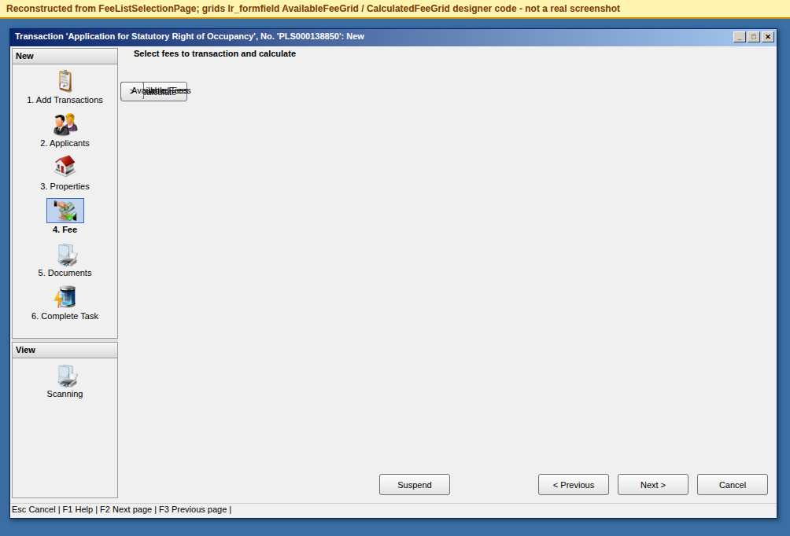

| Control | Type | Caption / label | Position / size | Bound field / data | Event handlers |
|---|---|---|---|---|---|
| pnlRelatedStuff | Panel |  | 0,110 600x334 Dock Fill | tab 3 |  |
| &nbsp;&nbsp;└ tableLayoutPanel1 | TableLayoutPanel |  | Dock Fill |  |  |
| &nbsp;&nbsp;&nbsp;&nbsp;└ pnlAvailableFees | Panel |  | Dock Fill | tab 1 |  |
| &nbsp;&nbsp;&nbsp;&nbsp;&nbsp;&nbsp;└ dbgAvailableFees | GridControl |  | Dock Fill | lr_formfield AvailableFeeGrid; tab 0 |  |
| &nbsp;&nbsp;&nbsp;&nbsp;&nbsp;&nbsp;└ lblAvailableFees | Label | Available Fees | 0,0 345x23 Dock Top | tab 24 |  |
| &nbsp;&nbsp;&nbsp;&nbsp;└ pnlButtons | TableLayoutPanel |  | Anchor None |  |  |
| &nbsp;&nbsp;&nbsp;&nbsp;&nbsp;&nbsp;└ btnSelect | SimpleButton | &gt; | 30x23 | tab 33 | Click-&gt;btnSelect_Click |
| &nbsp;&nbsp;&nbsp;&nbsp;&nbsp;&nbsp;└ btnDeselect | SimpleButton | &lt; | 30x23 | tab 33 | Click-&gt;btnDeselect_Click |
| &nbsp;&nbsp;&nbsp;&nbsp;&nbsp;&nbsp;└ btnDeselectAll | SimpleButton | &lt;&lt; | 30x23 | tab 33 | Click-&gt;btnDeselectAll_Click |
| &nbsp;&nbsp;&nbsp;&nbsp;└ pnlCalculatedFees | Panel |  | Dock Fill | tab 1 |  |
| &nbsp;&nbsp;&nbsp;&nbsp;&nbsp;&nbsp;└ dbgCalculatedFees | GridControl |  | Dock Fill | lr_formfield CalculatedFeeGrid; tab 0 |  |
| &nbsp;&nbsp;&nbsp;&nbsp;&nbsp;&nbsp;└ lblCalculatedFees | Label | Calculated Fees | 0,0 345x23 Dock Top | tab 24 |  |
| &nbsp;&nbsp;&nbsp;&nbsp;└ btnRecalculate | SimpleButton | Recalculate | 85x25 Anchor T+R | tab 33 | Click-&gt;btnRecalculate_Click |
| pnlTransactions | Panel |  | 0,0 459x110 Dock Top hidden | tab 2 |  |
| &nbsp;&nbsp;└ dveTransactions | DataViewerEx |  | 0,18 459x92 Dock Fill | tab 2 |  |
| &nbsp;&nbsp;└ lblTransactions | Label | Batch Content | 0,0 459x18 Dock Top | tab 0 |  |
| gvAvailableFees | GridView |  |  | lr_formfield AvailableFeeGrid | DoubleClick-&gt;btnSelect_Click |
| gvCalculatedFees | GridView |  |  | lr_formfield CalculatedFeeGrid | DoubleClick-&gt;btnRecalculate_Click |

Messages this class can show (MessageBoxService kind: text):

- Warning: "At least one Fee need to be calculated."
- Warning: "Not all fees selected are calculated."
- Show: "&lt;exception message&gt;"

<details><summary>Other resource strings used by FeeListSelectionPage (1)</summary>

- `strFeeListSelectionPage_Prompt` = "Select fees to transaction and calculate"

</details>

#### 3.9.2 DemandNoticePage

- Source: `TAR.Controls.dll/TAR.Controls.WorkerAssess.Pages/DemandNoticePage.cs` (`TAR.Controls.WorkerAssess.Pages`), base `TransactionListBasePage`; design size 600x444; resx `TAR.Controls.WorkerAssess.Pages.DemandNoticePage.resx`.
- Status at PLAGIS: Used (reachable from the PLAGIS configuration). (168 wizards).
- Purpose: "Payment": Payments grid (Add / Edit / Delete) and Calculate Fees grid.
- lr_formfield bindings in code: gvPayments -&gt; PaymentGridName, gvFees -&gt; FeeGridName

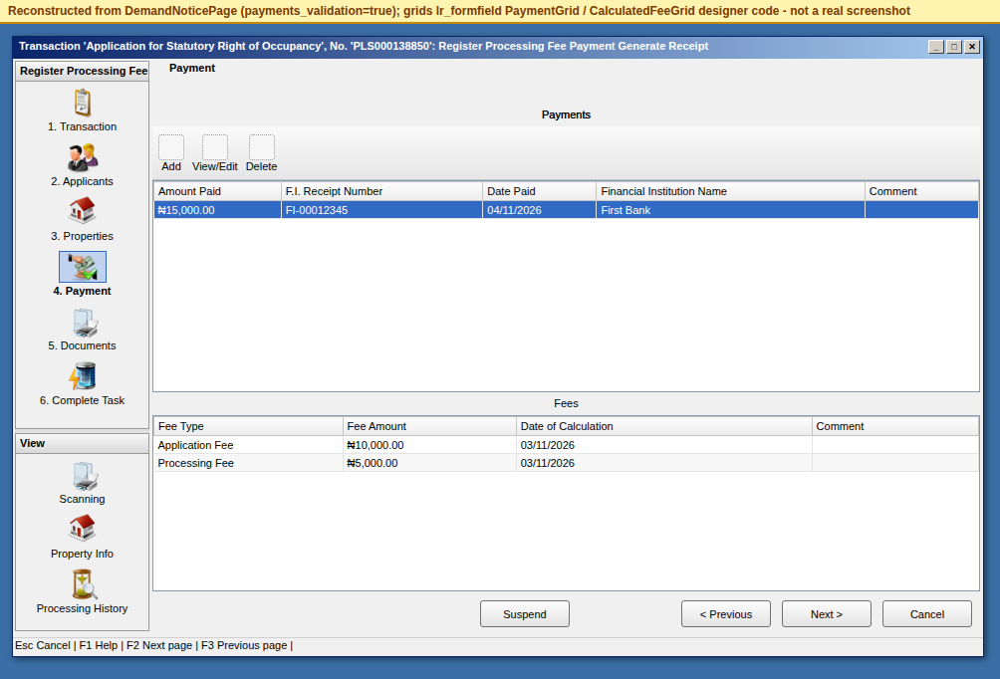

| Control | Type | Caption / label | Position / size | Bound field / data | Event handlers |
|---|---|---|---|---|---|
| pnlPayments | Panel |  | 0,0 600x244 Dock Fill | tab 1 |  |
| &nbsp;&nbsp;└ dbgPayments | GridControl |  | 0,77 Dock Fill Anchor T+B+L+R | lr_formfield PaymentGridName; tab 27 |  |
| &nbsp;&nbsp;└ toolStrip1 | ToolStrip | toolStrip1 | 0,23 600x54 | tab 32 |  |
| &nbsp;&nbsp;&nbsp;&nbsp;└ btnAdd | ToolStripButton | Add | 61x51 | tip "Add payment information" |  |
| &nbsp;&nbsp;&nbsp;&nbsp;└ btnEdit | ToolStripButton | Edit -&gt; runtime: "View/Edit" | 61x51 | tip "Edit/View payment information" |  |
| &nbsp;&nbsp;&nbsp;&nbsp;└ btnDelete | ToolStripButton | Delete | 61x51 | tip "Delete payment information" |  |
| &nbsp;&nbsp;└ lblPayments | Label | Payments | 0,0 600x23 Dock Top | tab 24 |  |
| pnlFees | Panel |  | 0,244 600x200 Dock Bottom | tab 2 |  |
| &nbsp;&nbsp;└ dbgFees | GridControl |  | 0,23 Dock Fill | lr_formfield FeeGridName; tab 15 |  |
| &nbsp;&nbsp;└ lblFees | Label | Calculate Fees -&gt; runtime: "Fees" | 0,0 600x23 Dock Top | tab 1 |  |
| pnlRelatedStuff | Panel |  | 0,110 609x374 Dock Fill | tab 3 |  |
| pnlTransactions | Panel |  | 0,0 459x110 Dock Top hidden | tab 2 |  |
| &nbsp;&nbsp;└ dveTransactions | DataViewerEx |  | 0,18 609x92 Dock Fill | tab 2 |  |
| &nbsp;&nbsp;└ lblTransactions | Label | Batch Content | 0,0 459x18 Dock Top | tab 0 |  |
| pmToolbar | ContextMenu |  |  |  |  |
| miAdd | WMenuItem | F6 |  |  |  |
| miEdit | WMenuItem | F7 |  |  |  |
| miDelete | WMenuItem | F8 |  |  |  |
| gvPayments | GridView |  |  | lr_formfield PaymentGridName | CustomDrawCell-&gt;gvPayments_CustomDrawCell, CustomDrawGroupRow-&gt;gvPayments_CustomDrawGroupRow, CustomRowFilter-&gt;gvPayments_CustomRowFilter, DoubleClick-&gt;gvPayments_DoubleClick |
| gvFees | GridView |  |  | lr_formfield FeeGridName |  |

Messages this class can show (MessageBoxService kind: text):

- Confirm: "Selected payment record will be removed. Continue?"
- Warning: "Please enter at least one Payment for transaction {0} No. {1}."
- Confirm: "All calculated fees have not been paid. Do you want to continue ?"

<details><summary>Other resource strings used by DemandNoticePage (5)</summary>

- `strPayments` = "Payments"
- `strFees` = "Fees"
- `strAdd_Button` = "Add"
- `strViewEdit_Button` = "View/Edit"
- `strDelete_Button` = "Delete"

</details>

#### 3.9.3 DemandNoticeForm

- Source: `TAR.Controls.dll/TAR.Controls.WorkerAssess.Forms/DemandNoticeForm.cs` (`TAR.Controls.WorkerAssess.Forms`), base `DialogForm`; form Text "DemandNoticeForm"; design size 680x550; min 930x600; border Sizable; start CenterScreen; resx `TAR.Controls.WorkerAssess.Forms.DemandNoticeForm.resx`.
- Status at PLAGIS: Used (reachable from the PLAGIS configuration).
- Purpose: "Payment Info": PaymentForm fields, fees to pay (left) and fees covered by this payment (right) with &gt;&gt; &gt; &lt; &lt;&lt; buttons.
- Opened from (code references): `DemandNoticePage.Add_Action`, `DemandNoticePage.Edit_Action`
- lr_formfield bindings in code: layoutControl -&gt; _formName, gvCalculatedFees -&gt; "CalculatedFeeGrid", gvPaidFees -&gt; "CalculatedFeeGrid"

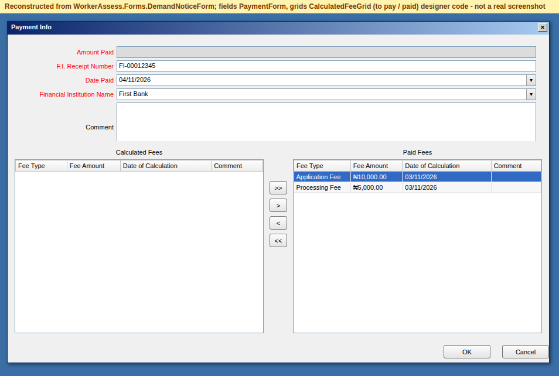

| Control | Type | Caption / label | Position / size | Bound field / data | Event handlers |
|---|---|---|---|---|---|
| layoutControl | LayoutControl | layoutControl1 | 12,12 676x260 Anchor T+L+R | lr_formfield _formName; tab 6 |  |
| tableLayoutPanel1 | TableLayoutPanel |  | Dock Fill |  |  |
| &nbsp;&nbsp;└ pnlCalculatedFees | Panel |  | Dock Fill | tab 1 |  |
| &nbsp;&nbsp;&nbsp;&nbsp;└ dbgCalculatedFees | GridControl |  | Dock Fill | lr_formfield CalculatedFeeGrid; tab 0 |  |
| &nbsp;&nbsp;&nbsp;&nbsp;└ lblCalculatedFees | Label | Calcualted Fees -&gt; runtime: "Calculated Fees" | 0,0 300x23 Dock Top | tab 24 |  |
| &nbsp;&nbsp;└ pnlButton | TableLayoutPanel |  | Anchor None |  |  |
| &nbsp;&nbsp;&nbsp;&nbsp;└ btnSelectAll | SimpleButton | &gt;&gt; | 30x23 | tab 33 | Click-&gt;btnSelectAll_Click |
| &nbsp;&nbsp;&nbsp;&nbsp;└ btnSelect | SimpleButton | &gt; | 30x23 | tab 33 | Click-&gt;btnSelect_Click |
| &nbsp;&nbsp;&nbsp;&nbsp;└ btnDeselect | SimpleButton | &lt; | 30x23 | tab 33 | Click-&gt;btnDeselect_Click |
| &nbsp;&nbsp;&nbsp;&nbsp;└ btnDeselectAll | SimpleButton | &lt;&lt; | 30x23 | tab 33 | Click-&gt;btnDeselectAll_Click |
| &nbsp;&nbsp;└ pnlPaidFees | Panel |  | Dock Fill | tab 1 |  |
| &nbsp;&nbsp;&nbsp;&nbsp;└ dbgPaidFees | GridControl |  | Dock Fill | lr_formfield CalculatedFeeGrid; tab 0 |  |
| &nbsp;&nbsp;&nbsp;&nbsp;└ lblPaidFees | Label | Paid Fees | 0,0 345x23 Dock Top | tab 24 |  |
| btnCancel | SimpleButton | Cancel | 600,520 80x23 Anchor B+R | tab 1 | Click-&gt;btnCancel_Click |
| btnOK | SimpleButton | OK | 500,520 80x23 Anchor B+R | tab 0 | Click-&gt;btnOK_Click |
| layoutControlGroup1 | LayoutControlGroup | layoutControlGroup1 | 0,0 470x160 |  |  |
| gvCalculatedFees | GridView |  |  | lr_formfield CalculatedFeeGrid |  |
| gvPaidFees | GridView |  |  | lr_formfield CalculatedFeeGrid |  |

Messages this class can show (MessageBoxService kind: text):

- Confirm: "‘Date Paid’ cannot be earlier than ‘Date of Calculation’ (Fee). Do you want to continue? If 'Yes', the invalid fees will be removed from the Paid Fees list."
- Warning: "Please select at least one fee for this payment."
- Error: "This combination of F.I. Receipt Number and Financial Institution Name already exists."
- Error: "&lt;exception message&gt;"
- Warning: "‘Date Paid’ cannot be earlier than ‘Date of Calculation’ (Selected Fee)."

<details><summary>Other resource strings used by DemandNoticeForm (3)</summary>

- `strDemandNoticePage_IsPaidDateValid` = "‘Date Paid’ cannot be earlier than ‘Date of Calculation’ (Fee). Do you want to continue? If 'Yes', the invalid fees will be removed from the Paid Fees list."
- `strDemandNoticeForm_Caption` = "Payment Info"
- `strDemandNoticeForm_CalculatedFees` = "Calculated Fees"

</details>

#### 3.9.4 PaymentForm

- Source: `TAR.Controls.dll/TAR.Controls.WorkerAssess.Forms/PaymentForm.cs` (`TAR.Controls.WorkerAssess.Forms`), base `DialogForm`; form Text "Recommendation Note"; design size 527x301; start CenterScreen; resx `TAR.Controls.WorkerAssess.Forms.PaymentForm.resx`.
- Status at PLAGIS: Used (reachable from the PLAGIS configuration).
- Purpose: Payment fields dialog (form from caller).
- Opened from (code references): `PaymentsFeePage.Add_Action`, `PaymentsFeePage.Edit_Action`, `PropertyInfoForm.gvListOfPayments_DoubleClick`
- Form events: HelpRequested -&gt; `ChangeFileNo_HelpRequested`
- lr_formfield bindings in code: layoutControl -&gt; _formName

| Control | Type | Caption / label | Position / size | Bound field / data | Event handlers |
|---|---|---|---|---|---|
| layoutControl | LayoutControl | layoutControl1 | 12,12 497x248 Anchor T+L+R | lr_formfield _formName; tab 6 |  |
| btnCancel | SimpleButton | Cancel | 428,268 80x23 Anchor B+R | tab 1 | Click-&gt;btnCancel_Click |
| btnOK | SimpleButton | OK | 339,268 80x23 Anchor B+R | tab 0 | Click-&gt;btnOK_Click |
| layoutControlGroup1 | LayoutControlGroup | layoutControlGroup1 | 0,0 497x248 |  |  |

Messages this class can show (MessageBoxService kind: text):

- Error: "&lt;exception message&gt;"

<details><summary>Other resource strings used by PaymentForm (1)</summary>

- `strPayment` = "View/Edit Fee Payment"

</details>

#### 3.9.5 OutstandingPage

- Source: `TAR.Controls.dll/TAR.Controls.WorkerAssess.Pages/OutstandingPage.cs` (`TAR.Controls.WorkerAssess.Pages`), base `TransactionListBasePage`; design size 600x444; resx `TAR.Controls.WorkerAssess.Pages.OutstandingPage.resx`.
- Status at PLAGIS: Used (reachable from the PLAGIS configuration). Base of PLAGIS CustomOutstandingPage (12 wizards).
- Purpose: "Outstanding Ground Rent": Outstanding grid (Add/View/Edit/Remove outstanding), Penalty section (built in code when show_penalty_section) and Total.
- lr_formfield bindings in code: gvOutstandingTransactions -&gt; GridOutstandingName, gvPenaltyTransactions -&gt; GridPenaltyName

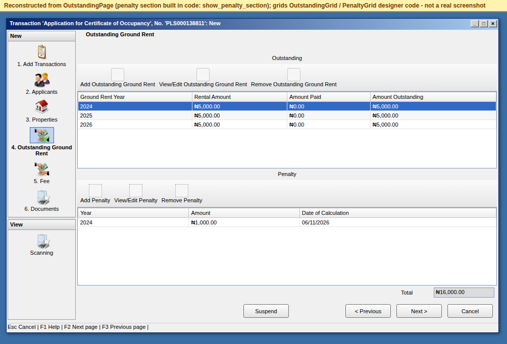

| Control | Type | Caption / label | Position / size | Bound field / data | Event handlers |
|---|---|---|---|---|---|
| pnlOutstanding | Panel |  | 100,0 600x330 Dock Top | tab 1 |  |
| &nbsp;&nbsp;└ dbgOutstandingTransactions | GridControl |  | 0,77 600x150 Dock Fill Anchor T+B+L+R | lr_formfield GridOutstandingName; tab 27 |  |
| &nbsp;&nbsp;└ toolStripOutstanding | ToolStrip | toolStripOutstanding | 0,23 600x54 | tab 32 |  |
| &nbsp;&nbsp;&nbsp;&nbsp;└ btnAddOutstanding | ToolStripButton | Add Outstanding -&gt; runtime: "Add Outstanding Ground Rent" | 83x51 | tip "Add outstanding information" |  |
| &nbsp;&nbsp;&nbsp;&nbsp;└ btnEditOutstanding | ToolStripButton | View/Edit Outstanding -&gt; runtime: "View/Edit Outstanding Ground Rent" | 81x51 | tip "Edit/View outstanding information" |  |
| &nbsp;&nbsp;&nbsp;&nbsp;└ btnDeleteOutstanding | ToolStripButton | Remove outstanding -&gt; runtime: "Remove Outstanding Ground Rent" | 104x51 | tip "Remove outstanding information" |  |
| &nbsp;&nbsp;└ lblOutstanding | Label | Calculate Fees | 0,0 600x23 Dock Top | tab 1 |  |
| pnlPenalty | Panel |  |  |  |  |
| pnlRelatedStuff | Panel |  | 0,110 459x260 Dock Fill | tab 3 |  |
| pnlTransactions | Panel |  | 0,0 459x110 Dock Top hidden | tab 2 |  |
| &nbsp;&nbsp;└ dveTransactions | DataViewerEx |  | 0,18 459x92 Dock Fill | tab 2 |  |
| &nbsp;&nbsp;└ lblTransactions | Label | Batch Content | 0,0 459x18 Dock Top | tab 0 |  |
| pmOutstandingToolbar | ContextMenu |  |  |  |  |
| miAddOutstanding | WMenuItem | F6 |  |  |  |
| miEditOutstanding | WMenuItem | F7 |  |  |  |
| miDeleteOutstanding | WMenuItem | F8 |  |  |  |
| outstandingLabelPart | Label | Outstanding -&gt; runtime: "Outstanding Ground Rent" | 0,0 600x23 Dock Top | tab 24 |  |
| gvOutstandingTransactions | GridView |  |  | lr_formfield GridOutstandingName | CustomRowFilter-&gt;gvPaymentTransactions_CustomRowFilter, DoubleClick-&gt;gvPaymentTransactions_DoubleClick |
| txtTotal | TextEdit |  |  |  |  |
| lblTotal | Label |  |  |  |  |
| dbgPenaltyTransactions | GridControl |  |  |  |  |
| gvPenaltyTransactions | GridView |  |  | lr_formfield GridPenaltyName |  |
| toolStripPenalty | ToolStrip | runtime: "toolStripPenalty" |  |  |  |

Messages this class can show (MessageBoxService kind: text):

- Confirm: "Selected Outstanding Ground Rent record will be removed. Continue?"
- Confirm: "Selected Penalty record will be removed. Continue?"
- Warning: "Ground rent of current year is not entered."
- Warning: "The Ground Rent Year is duplicate. Please input another Ground Rent Year."

<details><summary>Other resource strings used by OutstandingPage (6)</summary>

- `strAddOutstanding` = "Add Outstanding Ground Rent"
- `strEditOutstanding` = "View/Edit Outstanding Ground Rent"
- `strRemoveOutstanding` = "Remove Outstanding Ground Rent"
- `strAddPenalty` = "Add Penalty"
- `strEditPenalty` = "View/Edit Penalty"
- `strRemovePenalty` = "Remove Penalty"

</details>

#### 3.9.6 CustomOutstandingPage

- Source: `TAR.PLAGIS.Controls.dll/TAR.PLAGIS.Controls.WorkerAssess.Pages/CustomOutstandingPage.cs` (`TAR.PLAGIS.Controls.WorkerAssess.Pages`), base `OutstandingPage`; resx `TAR.PLAGIS.Controls.WorkerAssess.Pages.CustomOutstandingPage.resx`.
- Status at PLAGIS: PLAGIS override of `OutstandingPage` (designer only adds/changes the controls listed; behaviour in 05 section 3).
- Purpose: See the base class above.
- lr_formfield bindings in code: gvOutstandingTransactions -&gt; GridOutstandingName, gvPenaltyTransactions -&gt; GridPenaltyName

| Control | Type | Caption / label | Position / size | Bound field / data | Event handlers |
|---|---|---|---|---|---|
| pnlOutstanding | Panel |  | 100,0 600x330 Dock Top | tab 1 |  |
| &nbsp;&nbsp;└ dbgOutstandingTransactions | GridControl |  | 0,77 600x150 Dock Fill Anchor T+B+L+R | lr_formfield GridOutstandingName; tab 27 |  |
| &nbsp;&nbsp;└ toolStripOutstanding | ToolStrip | toolStripOutstanding | 0,23 600x54 | tab 32 |  |
| &nbsp;&nbsp;&nbsp;&nbsp;└ btnAddOutstanding | ToolStripButton | Add Outstanding | 83x51 | tip "Add outstanding information" |  |
| &nbsp;&nbsp;&nbsp;&nbsp;└ btnEditOutstanding | ToolStripButton | View/Edit Outstanding | 81x51 | tip "Edit/View outstanding information" |  |
| &nbsp;&nbsp;&nbsp;&nbsp;└ btnDeleteOutstanding | ToolStripButton | Remove outstanding | 104x51 | tip "Remove outstanding information" |  |
| &nbsp;&nbsp;└ lblOutstanding | Label | Calculate Fees | 0,0 600x23 Dock Top | tab 1 |  |
| pnlPenalty | Panel |  |  |  |  |
| pnlRelatedStuff | Panel |  | 0,110 459x260 Dock Fill | tab 3 |  |
| pnlTransactions | Panel |  | 0,0 459x110 Dock Top hidden | tab 2 |  |
| &nbsp;&nbsp;└ dveTransactions | DataViewerEx |  | 0,18 459x92 Dock Fill | tab 2 |  |
| &nbsp;&nbsp;└ lblTransactions | Label | Batch Content | 0,0 459x18 Dock Top | tab 0 |  |

Messages this class can show (MessageBoxService kind: text):

- Warning: "The Ground Rent Year is duplicate. Please input another Ground Rent Year."
- Warning: "Ground rent of current year is not entered."
- Warning: "{0} : "

#### 3.9.7 OutstandingForm

- Source: `TAR.Controls.dll/TAR.Controls.WorkerAssess.Forms/OutstandingForm.cs` (`TAR.Controls.WorkerAssess.Forms`), base `DialogForm`; design size 500x230; start CenterScreen; resx `TAR.Controls.WorkerAssess.Forms.OutstandingForm.resx`.
- Status at PLAGIS: Used (reachable from the PLAGIS configuration).
- Purpose: One outstanding year: Ground Rent Year, Rental Amount, Amount Paid, Amount Outstanding (RO).
- Opened from (code references): `CustomOutstandingPage.AddOustanding_Action`, `CustomOutstandingPage.EditOutstanding_Action`, `OutstandingPage.AddOustanding_Action`, `OutstandingPage.EditOutstanding_Action`
- lr_formfield bindings in code: layoutControl -&gt; _formName

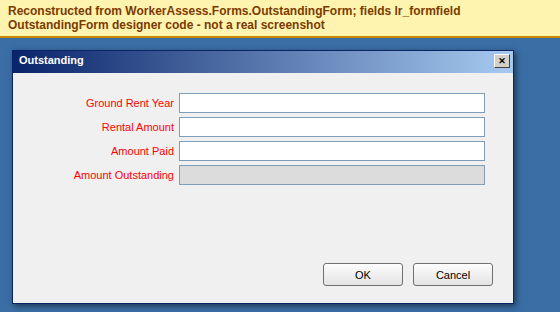

| Control | Type | Caption / label | Position / size | Bound field / data | Event handlers |
|---|---|---|---|---|---|
| layoutControl | LayoutControl | layoutControl1 | 12,12 470x160 Anchor T+L+R | lr_formfield _formName; tab 6 |  |
| btnCancel | SimpleButton | Cancel | 400,190 80x23 Anchor B+R | tab 1 | Click-&gt;btnCancel_Click |
| btnOK | SimpleButton | OK | 310,190 80x23 Anchor B+R | tab 0 | Click-&gt;btnOK_Click |
| layoutControlGroup1 | LayoutControlGroup | layoutControlGroup1 | 0,0 470x160 |  |  |

Messages this class can show (MessageBoxService kind: text):

- Error: "&lt;exception message&gt;"

<details><summary>Other resource strings used by OutstandingForm (1)</summary>

- `strOutstandingOne` = "View/Edit Outstanding Ground Rent"

</details>

#### 3.9.8 FeeCalculationForm

- Source: `TAR.Controls.dll/TAR.Controls.WorkerAssess.Forms/FeeCalculationForm.cs` (`TAR.Controls.WorkerAssess.Forms`), base `DialogForm`; form Text "Calculate Fee"; design size 691x352; start CenterScreen; resx `TAR.Controls.WorkerAssess.Forms.FeeCalculationForm.resx`.
- Status at PLAGIS: Used (reachable from the PLAGIS configuration).
- Purpose: "Calculate Fee": Transaction Parameters group generated from cashier.xsd, Amount + Compute, optional ground-rent group.
- Opened from (code references): `AnnualRentalAmountForm.rentalAmountBtn_Click`, `CustomOutstandingPage.AddOustanding_Action`, `CustomOutstandingPage.EditOutstanding_Action`, `CustomPropertyForm.rentalAmountBtn_Click`, `CustomTransactionWithDocumentsPage.rentalAmountBtn_Click`, `FeeListSelectionPage.btnRecalculate_Click`, `OutstandingPage.AddOustanding_Action`, `OutstandingPage.AddPenalty_Action`, `OutstandingPage.EditOutstanding_Action`, `OutstandingPage.EditPenalty_Action` (+1 more)
- Form events: Load -&gt; `ChangeFileNo_Load`, HelpRequested -&gt; `ChangeFileNo_HelpRequested`
- lr_formfield bindings in code: _cashierEditor -&gt; _cashier

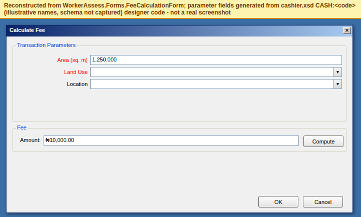

| Control | Type | Caption / label | Position / size | Bound field / data | Event handlers |
|---|---|---|---|---|---|
| grpBank | GroupBox | Parameters of Ground Rent | 12,243 667x67 Anchor T+L+R hidden | tab 9 |  |
| &nbsp;&nbsp;└ layoutControl2 | LayoutControl | layoutControl2 | 3,30 400x210 | tab 2 |  |
| groupBox1 | GroupBox | Fee | 12,177 667x54 Anchor T+L+R | tab 8 |  |
| &nbsp;&nbsp;└ txtAmount | TextEdit | runtime: "Amount:" | 61,20 510x20 | tab 35 | KeyUp-&gt;CurrencyChanged, Enter-&gt;CurrencyEnter |
| &nbsp;&nbsp;└ btnCalc | SimpleButton | Compute | 580,20 80x23 | tab 33 | Click-&gt;btnCalc_Click |
| &nbsp;&nbsp;└ lblTotalGR | Label | Amount: | 7,23 48x13 Anchor B+L+R | tab 32 |  |
| gbCashier | GroupBox | Transaction Parameters | 12,12 667x159 Anchor T+L+R | tab 7 |  |
| btnCancel | SimpleButton | Cancel | 592,319 80x23 Anchor B+R | tab 1 | Click-&gt;btnCancel_Click |
| btnOK | SimpleButton | OK | 503,319 80x23 Anchor B+R | tab 0 | Click-&gt;btnOK_Click |
| layoutControlGroup2 | LayoutControlGroup | layoutControlGroup2 | 0,0 400x210 |  |  |

Messages this class can show (MessageBoxService kind: text):

- Error: "Fee is not configured for this parameter(s). Please calculate the fee manually."
- Error: "Fee should not have value less than zero."
- Warning: "The year is not valid. Please insert a valid year."
- Error: "&lt;exception message&gt;"
- Warning: "'{0}' is a mandatory field. Please specify a value."
- Warning: "Plots Amount"
- Warning: "The 'Plots Amount' value must be greater than 0."
- Warning: "The Year introduced must be between the Date of Commencement and Expire Date."
- Warning: "Calculation is not executed for selected parameters."

<details><summary>Other resource strings used by FeeCalculationForm (2)</summary>

- `strFeeCalculation` = "Fee Calculation"
- `strAmount` = "Amount:"

</details>

#### 3.9.9 FeeStructureExtForm

- Source: `TAR.Controls.dll/TAR.Controls.Core.ConfigurationFee/FeeStructureExtForm.cs` (`TAR.Controls.Core.ConfigurationFee`), base `BaseForm`; form Text "Fee Structure"; design size 885x483; border FixedSingle; start CenterScreen.
- Status at PLAGIS: Used (reachable from the PLAGIS configuration). Permission lrsFeeConfiguration.
- Purpose: Toolbar Fee &gt; Configuration &gt; Fee Structure: list of lr_fee_structure rows with New / Edit / Delete / Close.
- Opened from (code references): `ShellForm.feeStructureToolStripMenuItem_Click`

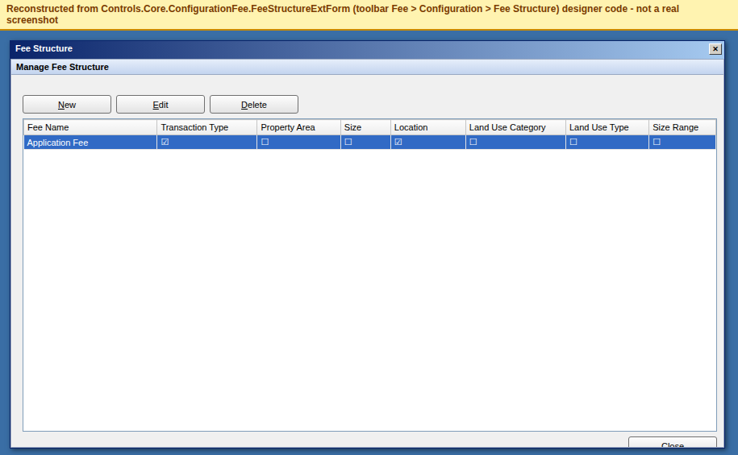

| Control | Type | Caption / label | Position / size | Bound field / data | Event handlers |
|---|---|---|---|---|---|
| groupControlFeeSchedule | GroupControl | Manage Fee Structure | 0,0 885x483 Dock Fill | tab 0 |  |
| &nbsp;&nbsp;└ btnDelete | SimpleButton | &Delete | 244,24 110x23 | tab 10 | Click-&gt;btnDelete_Click |
| &nbsp;&nbsp;└ btnEdit | SimpleButton | &Edit | 128,24 110x23 | tab 9 | Click-&gt;btnEdit_Click |
| &nbsp;&nbsp;└ btnNew | SimpleButton | &New | 12,24 110x23 | tab 8 | Click-&gt;btnNew_Click |
| &nbsp;&nbsp;└ btnClose | SimpleButton | &Close | 763,448 110x23 | tab 7 | Click-&gt;btnClose_Click |
| &nbsp;&nbsp;└ panel1 | FeeStructureGrid |  | 12,53 861x389 | tab 6 |  |
| &nbsp;&nbsp;&nbsp;&nbsp;└ feeStructureGrid1 | FeeStructureGrid |  | 20,3 188x334 | tab 0 |  |

Messages this class can show (MessageBoxService kind: text):

- Show: "You need to select a row."
- Show: "Selected item cannot be edited because has Fee Rate(s) associated.\nIn order to edit it, first delete all Fee Rate(s) associated."
- Show: "&lt;exception message&gt;"
- Show: "Selected Fee Structure cannot be deleted because there are Fee Rate(s) associated with it. In order to delete the selected Fee Structure, first delete all Fee Rate(s) associated with the selected Fee Structure."
- Show: "Are you sure you want to delete the selected Fee Structure?"
- Show: "The selected Fee Structure has been deleted."
- Show: "The selected Fee Structure cannot be deleted."

#### 3.9.10 FeeStructureCriteriaExtForm

- Source: `TAR.Controls.dll/TAR.Controls.Core.ConfigurationFee/FeeStructureCriteriaExtForm.cs` (`TAR.Controls.Core.ConfigurationFee`), base `BaseForm`; form Text "View/Edit Fee Structure"; design size 757x258; border FixedDialog; start CenterScreen.
- Status at PLAGIS: Used (reachable from the PLAGIS configuration).
- Purpose: "View/Edit Fee Structure" criteria flags.
- Opened from (code references): `FeeStructureExtForm.btnEdit_Click`, `FeeStructureExtForm.btnNew_Click`, `FeeStructureGrid.gvFeeStructure_DoubleClick`

| Control | Type | Caption / label | Position / size | Bound field / data | Event handlers |
|---|---|---|---|---|---|
| gbFee | GroupControl | Add/Edit Fee Schedule | 0,0 757x258 Dock Fill | tab 0 |  |
| &nbsp;&nbsp;└ btnCancel | SimpleButton | &Cancel | 617,220 128x28 | tab 6 | Click-&gt;btnCancel_Click |
| &nbsp;&nbsp;└ btnSave | SimpleButton | &Save | 483,220 128x28 | tab 7 | Click-&gt;btnSave_Click |
| &nbsp;&nbsp;└ cbxlandUseCategory | CheckEdit |  | 406,62 195x20 | tab 10 | CheckedChanged-&gt;cbxlandUseCategory_CheckedChanged |
| &nbsp;&nbsp;└ cbxLocation | CheckEdit |  | 126,154 195x20 | tab 9 |  |
| &nbsp;&nbsp;└ cbxlandUseRange | CheckEdit |  | 406,123 215x20 | tab 6 |  |
| &nbsp;&nbsp;└ cbxLandUseType | CheckEdit |  | 406,92 215x20 | tab 5 | CheckedChanged-&gt;cbxLandUseType_CheckedChanged |
| &nbsp;&nbsp;└ cbxPropertySize | CheckEdit |  | 126,123 195x20 | tab 4 |  |
| &nbsp;&nbsp;└ cbxPropertyArea | CheckEdit |  | 126,92 195x20 | tab 3 |  |
| &nbsp;&nbsp;└ cbxTransactionType | CheckEdit |  | 126,62 195x20 | tab 2 |  |
| &nbsp;&nbsp;└ lblFeeName | LabelControl | Fee Name | 64,33 58x16 | tab 1 |  |
| &nbsp;&nbsp;└ cbxFeeName | LookUpEdit |  | 128,30 558x22 | tab 0 |  |
| cbxFeeName.Properties |  |  |  |  |  |
| &nbsp;&nbsp;└ new |  |  |  |  |  |
| &nbsp;&nbsp;└ EditorButton |  |  |  |  |  |
| &nbsp;&nbsp;└ ButtonPredefines |  |  |  |  |  |
| &nbsp;&nbsp;└ 5 |  |  |  |  |  |

Messages this class can show (MessageBoxService kind: text):

- Show: "Fee Name must be selected."
- Show: "Selected Fee already exists, please select a new one. "
- Show: "&lt;exception message&gt;"

#### 3.9.11 FeeStructureGrid

- Source: `TAR.Controls.dll/TAR.Controls.Core.ConfigurationFee/FeeStructureGrid.cs` (`TAR.Controls.Core.ConfigurationFee`), base `UserControl`; design size 879x509.
- Status at PLAGIS: Used (reachable from the PLAGIS configuration).
- Opened from (code references): `FeeStructureExtForm.InitializeComponent`

| Control | Type | Caption / label | Position / size | Bound field / data | Event handlers |
|---|---|---|---|---|---|
| dbgFeeStructure | GridControl |  | 0,0 879x509 Dock Fill | tab 5 |  |
| gvFeeStructure | GridView |  |  |  | DoubleClick-&gt;gvFeeStructure_DoubleClick |
| &nbsp;&nbsp;└ idField | GridColumn | Id |  | field idField |  |
| &nbsp;&nbsp;└ isPropertyLandUseTypeField | GridColumn | Fee Name |  | field isPropertyLandUseTypeField |  |
| &nbsp;&nbsp;└ transactionType | GridColumn | Transaction Type |  |  |  |
| &nbsp;&nbsp;└ propertyArea | GridColumn | Property Area |  |  |  |
| &nbsp;&nbsp;└ size | GridColumn | Size |  |  |  |
| &nbsp;&nbsp;└ measurementType | GridColumn | Measurement Type |  |  |  |
| &nbsp;&nbsp;└ location | GridColumn | Location |  |  |  |
| &nbsp;&nbsp;└ landUseCategory | GridColumn | Land Use Category |  |  |  |
| &nbsp;&nbsp;└ landUseType | GridColumn | Land Use Type |  |  |  |
| &nbsp;&nbsp;└ sizeRange | GridColumn | Size Range |  |  |  |
| &nbsp;&nbsp;└ rangeType | GridColumn | Range Type |  |  |  |
| &nbsp;&nbsp;└ rateType | GridColumn | Rate Type |  |  |  |
| &nbsp;&nbsp;└ rate | GridColumn | Rate |  |  |  |
| gvFeeStructureEvent | GridView |  |  |  |  |

Messages this class can show (MessageBoxService kind: text):

- Show: "Selected item cannot be edited because has Fee Rate(s) associated.\nIn order to edit it, first delete all Fee Rate(s) associated."

#### 3.9.12 FeeRateExtForm

- Source: `TAR.Controls.dll/TAR.Controls.Core.ConfigurationFee/FeeRateExtForm.cs` (`TAR.Controls.Core.ConfigurationFee`), base `BaseForm`; form Text "Fee Rate"; design size 1066x661; border FixedSingle; start CenterScreen.
- Status at PLAGIS: Used (reachable from the PLAGIS configuration).
- Purpose: Toolbar Fee &gt; Configuration &gt; Fee Rate: search criteria + rate grid (New / Edit / Delete / Close).
- Opened from (code references): `ShellForm.feeRateToolStripMenuItem_Click`

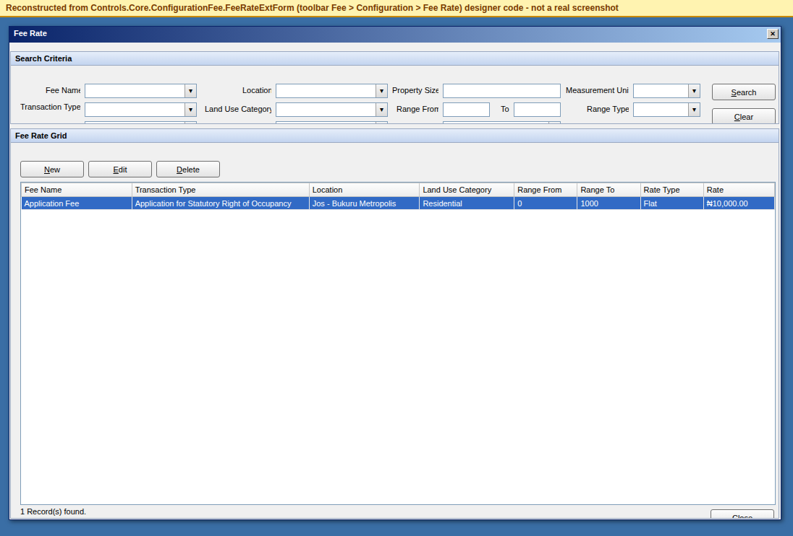

| Control | Type | Caption / label | Position / size | Bound field / data | Event handlers |
|---|---|---|---|---|---|
| gcRateGrid | GroupControl | Fee Rate Grid | 1,119 1063x541 Anchor T+B+L+R | tab 34 |  |
| &nbsp;&nbsp;└ lblRowsFound | Label | 0 Record(s) found. | 11,504 98x13 | tab 38 |  |
| &nbsp;&nbsp;└ btnDelete | SimpleButton | &Delete | 199,24 88x23 | tab 37 | Click-&gt;btnDelete_Click |
| &nbsp;&nbsp;└ btnEdit | SimpleButton | &Edit | 105,24 88x23 | tab 36 | Click-&gt;btnEdit_Click |
| &nbsp;&nbsp;└ btnNew | SimpleButton | &New | 11,24 88x23 | tab 36 | Click-&gt;btnNew_Click |
| &nbsp;&nbsp;└ dbgFeeRate | GridControl |  | 11,53 1044x448 Anchor T+B+L+R | tab 32 |  |
| &nbsp;&nbsp;└ btnClose | SimpleButton | &Close | 965,507 88x23 | tab 31 | Click-&gt;btnClose_Click |
| gbFeeSearchCriteria | GroupControl | Search Criteria | 1,12 1063x101 Anchor T+L+R | tab 2 |  |
| &nbsp;&nbsp;└ labelControl17 | LabelControl | Range From | 531,53 58x13 | tab 35 |  |
| &nbsp;&nbsp;└ btnSearch | SimpleButton | &Search | 967,24 88x23 | tab 34 | Click-&gt;btnSearch_Click |
| &nbsp;&nbsp;└ lblRateType | LabelControl | Rate Type | 539,79 50x13 | tab 33 |  |
| &nbsp;&nbsp;└ btnClear | SimpleButton | &Clear | 967,58 88x23 | tab 31 | Click-&gt;btnClear_Click |
| &nbsp;&nbsp;└ labelControl3 | LabelControl | Range Type | 794,53 58x13 | tab 27 |  |
| &nbsp;&nbsp;└ labelControl2 | LabelControl | To | 675,53 12x13 | tab 26 |  |
| &nbsp;&nbsp;└ txtToRange | TextEdit |  | 693,50 65x20 | tab 25 | Enter-&gt;ResetLastEditValue, KeyUp-&gt;ValidateNumber |
| &nbsp;&nbsp;└ txtFromRange | TextEdit |  | 595,50 65x20 | tab 24 | Enter-&gt;ResetLastEditValue, KeyUp-&gt;ValidateNumber |
| &nbsp;&nbsp;└ labelControl1 | LabelControl | Measurement Unit | 765,27 87x13 | tab 22 |  |
| &nbsp;&nbsp;└ txtPropertySize | TextEdit |  | 595,24 163x20 | tab 20 | Enter-&gt;ResetLastEditValue, KeyUp-&gt;ValidateNumber |
| &nbsp;&nbsp;└ lblLandUseType | LabelControl | Land Use Type | 287,79 71x13 | tab 15 |  |
| &nbsp;&nbsp;└ lblLandUseCategory | LabelControl | Land Use Category | 266,53 92x13 | tab 13 |  |
| &nbsp;&nbsp;└ lblPropertyLocation | LabelControl | Location | 318,27 40x13 | tab 11 |  |
| &nbsp;&nbsp;└ lblPropertySize | LabelControl | Property Size | 525,27 64x13 | tab 9 |  |
| &nbsp;&nbsp;└ lblPropertyArea | LabelControl | Property Area | 26,79 68x13 | tab 7 |  |
| &nbsp;&nbsp;└ labelFeeTransactionType | LabelControl | Transaction Type | 11,50 83x13 | tab 5 |  |
| &nbsp;&nbsp;└ lblFeeName | LabelControl | Fee Name | 46,27 48x13 | tab 3 |  |
| &nbsp;&nbsp;└ cbxFeeName | LookUpEdit |  | 100,24 155x20 | tab 2 |  |
| &nbsp;&nbsp;└ cbxTransactionType | LookUpEdit |  | 100,50 155x20 | tab 4 |  |
| &nbsp;&nbsp;└ cbxPropertyArea | LookUpEdit |  | 100,76 155x20 | tab 6 |  |
| &nbsp;&nbsp;└ cbxMeasurementUnit | LookUpEdit |  | 858,24 93x20 | tab 28 |  |
| &nbsp;&nbsp;└ cbxLocation | LookUpEdit |  | 364,24 155x20 | tab 10 |  |
| &nbsp;&nbsp;└ cbxLandUseCategory | LookUpEdit |  | 364,50 155x20 | tab 12 | EditValueChanged-&gt;cbxLandUseCategory_EditValueChanged |
| &nbsp;&nbsp;└ cbxLandUseType | LookUpEdit |  | 364,76 155x20 | tab 14 |  |
| &nbsp;&nbsp;└ cbxRangeType | LookUpEdit |  | 858,50 93x20 | tab 16 |  |
| &nbsp;&nbsp;└ cbxRateType | LookUpEdit |  | 595,76 163x20 | tab 32 |  |
| gvFeeRate | GridView |  |  |  | DoubleClick-&gt;gvFeeRate_DoubleClick |
| &nbsp;&nbsp;└ idField | GridColumn | Id |  | field idField |  |
| &nbsp;&nbsp;└ isPropertyLandUseTypeField | GridColumn | Fee Name |  | field isPropertyLandUseTypeField |  |
| &nbsp;&nbsp;└ transactionType | GridColumn | Transaction Type |  |  |  |
| &nbsp;&nbsp;└ propertyArea | GridColumn | Property Area |  |  |  |
| &nbsp;&nbsp;└ size | GridColumn | Size |  |  |  |
| &nbsp;&nbsp;└ measurementType | GridColumn | Measurement Type |  |  |  |
| &nbsp;&nbsp;└ location | GridColumn | Location |  |  |  |
| &nbsp;&nbsp;└ landUseCategory | GridColumn | Land Use Category |  |  |  |
| &nbsp;&nbsp;└ landUseType | GridColumn | Land Use Type |  |  |  |
| &nbsp;&nbsp;└ sizeRange | GridColumn | Size Range |  |  |  |
| &nbsp;&nbsp;└ rangeType | GridColumn | Range Type |  |  |  |
| &nbsp;&nbsp;└ rateType | GridColumn | Rate Type |  |  |  |
| &nbsp;&nbsp;└ rate | GridColumn | Rate |  |  |  |
| gvFeeStructureEvent | GridView |  |  |  |  |
| cbxFeeName.Properties |  |  |  |  |  |
| &nbsp;&nbsp;└ new |  |  |  |  |  |
| &nbsp;&nbsp;└ EditorButton |  |  |  |  |  |
| &nbsp;&nbsp;└ ButtonPredefines |  |  |  |  |  |
| &nbsp;&nbsp;└ 5 |  |  |  |  |  |
| cbxTransactionType.Properties |  |  |  |  |  |
| cbxPropertyArea.Properties |  |  |  |  |  |
| cbxMeasurementUnit.Properties |  |  |  |  |  |
| cbxLocation.Properties |  |  |  |  |  |
| cbxLandUseCategory.Properties |  |  |  |  |  |
| cbxLandUseType.Properties |  |  |  |  |  |
| cbxRangeType.Properties |  |  |  |  |  |
| cbxRateType.Properties |  |  |  |  |  |

Messages this class can show (MessageBoxService kind: text):

- Show: "More than 2000 records found. Please narrow your criteria."
- Show: "You need to select a row."
- Show: "Are you sure you want to delete the selected Fee Rate?"
- Show: "The selected Fee Rate has been deleted."
- Show: "The selected Fee Rate cannot be deleted."
- Show: "&lt;exception message&gt;"

#### 3.9.13 FeeRateExt

- Source: `TAR.Controls.dll/TAR.Controls.Core.ConfigurationFee/FeeRateExt.cs` (`TAR.Controls.Core.ConfigurationFee`), base `BaseForm`; form Text "View/Edit Fee Rate"; design size 824x373; border FixedSingle; start CenterScreen.
- Status at PLAGIS: Used (reachable from the PLAGIS configuration).
- Purpose: "View/Edit Fee Rate".
- Opened from (code references): `FeeRateExtForm.EditRate`, `FeeRateExtForm.btnNew_Click`

| Control | Type | Caption / label | Position / size | Bound field / data | Event handlers |
|---|---|---|---|---|---|
| gbFeeRate | GroupControl | Fee Rate | 0,0 824x373 Dock Fill | tab 2 |  |
| &nbsp;&nbsp;└ lblRateType | LabelControl | Rate Type | 513,304 58x16 | tab 33 |  |
| &nbsp;&nbsp;└ btnCancel | SimpleButton | &Cancel | 643,332 128x28 | tab 14 |  |
| &nbsp;&nbsp;└ btnOk | SimpleButton | &Save | 504,332 128x28 | tab 13 | Click-&gt;btnOk_Click |
| &nbsp;&nbsp;└ labelControl3 | LabelControl | Range Type | 504,271 68x16 | tab 27 |  |
| &nbsp;&nbsp;└ labelControl2 | LabelControl | To | 320,272 15x16 | tab 26 |  |
| &nbsp;&nbsp;└ txtToRange | TextEdit |  | 341,268 122x22 disabled | tab 9 | EnabledChanged-&gt;txtToRange_EnabledChanged, Enter-&gt;ResetLastEditValue, KeyUp-&gt;ValidateNumber |
| &nbsp;&nbsp;└ txtFromRange | TextEdit |  | 182,268 122x22 disabled | tab 8 | EnabledChanged-&gt;txtFromRange_EnabledChanged, Enter-&gt;ResetLastEditValue, KeyUp-&gt;ValidateNumber |
| &nbsp;&nbsp;└ labelControl1 | LabelControl | Measurement Unit | 470,142 104x16 | tab 22 |  |
| &nbsp;&nbsp;└ txtRate | TextEdit |  | 182,300 281x22 | tab 11 | Enter-&gt;ResetLastEditValue, KeyUp-&gt;ValidateNumber |
| &nbsp;&nbsp;└ txtPropertySize | TextEdit |  | 182,140 281x22 disabled | tab 3 | EnabledChanged-&gt;txtPropertySize_EnabledChanged, Enter-&gt;ResetLastEditValue, KeyUp-&gt;ValidateNumber |
| &nbsp;&nbsp;└ lblRate | LabelControl | Rate | 148,304 26x16 | tab 19 |  |
| &nbsp;&nbsp;└ lblRangeType | LabelControl | Range From | 110,271 70x16 | tab 17 |  |
| &nbsp;&nbsp;└ lblLandUseType | LabelControl | Land Use Type | 92,240 84x16 | tab 15 |  |
| &nbsp;&nbsp;└ lblLandUseCategory | LabelControl | Land Use Category | 68,208 107x16 | tab 13 |  |
| &nbsp;&nbsp;└ lblPropertyLocation | LabelControl | Location | 128,176 47x16 | tab 11 |  |
| &nbsp;&nbsp;└ lblPropertySize | LabelControl | Property Size | 100,144 76x16 | tab 9 |  |
| &nbsp;&nbsp;└ lblPropertyArea | LabelControl | Property Area | 96,112 79x16 | tab 7 |  |
| &nbsp;&nbsp;└ labelFeeTransactionType | LabelControl | Transaction Type | 78,80 99x16 | tab 5 |  |
| &nbsp;&nbsp;└ lblFeeName | LabelControl | Fee Name | 119,48 58x16 | tab 3 |  |
| &nbsp;&nbsp;└ cbxFeeName | LookUpEdit |  | 182,44 589x22 | tab 0 | EditValueChanged-&gt;cbxFeeName_EditValueChanged |
| &nbsp;&nbsp;└ cbxTransactionType | LookUpEdit |  | 182,76 589x22 disabled | tab 1 | EnabledChanged-&gt;cbxTransactionType_EnabledChanged |
| &nbsp;&nbsp;└ cbxPropertyArea | LookUpEdit |  | 182,108 589x22 disabled | tab 2 | EnabledChanged-&gt;cbxPropertyArea_EnabledChanged |
| &nbsp;&nbsp;└ cbxMeasurementUnit | LookUpEdit |  | 579,140 192x22 disabled | tab 4 | EnabledChanged-&gt;cbxMeasurementUnit_EnabledChanged |
| &nbsp;&nbsp;└ cbxLocation | LookUpEdit |  | 182,172 589x22 disabled | tab 5 | EnabledChanged-&gt;cbxLocation_EnabledChanged |
| &nbsp;&nbsp;└ cbxLandUseCategory | LookUpEdit |  | 182,204 589x22 disabled | tab 6 | EditValueChanged-&gt;cbxLandUseCategory_EditValueChanged, EnabledChanged-&gt;cbxLandUseCategory_EnabledChanged |
| &nbsp;&nbsp;└ cbxLandUseType | LookUpEdit |  | 182,236 589x22 disabled | tab 7 | EnabledChanged-&gt;cbxLandUseType_EnabledChanged |
| &nbsp;&nbsp;└ cbxRangeType | LookUpEdit |  | 579,268 192x22 disabled | tab 10 | EnabledChanged-&gt;cbxRangeType_EnabledChanged |
| &nbsp;&nbsp;└ cbxRateType | LookUpEdit |  | 579,300 192x22 | tab 12 |  |
| cbxFeeName.Properties |  |  |  |  |  |
| &nbsp;&nbsp;└ new |  |  |  |  |  |
| &nbsp;&nbsp;└ EditorButton |  |  |  |  |  |
| &nbsp;&nbsp;└ ButtonPredefines |  |  |  |  |  |
| &nbsp;&nbsp;└ 5 |  |  |  |  |  |
| cbxTransactionType.Properties |  |  |  |  |  |
| cbxPropertyArea.Properties |  |  |  |  |  |
| cbxMeasurementUnit.Properties |  |  |  |  |  |
| cbxLocation.Properties |  |  |  |  |  |
| cbxLandUseCategory.Properties |  |  |  |  |  |
| cbxLandUseType.Properties |  |  |  |  |  |
| cbxRangeType.Properties |  |  |  |  |  |
| cbxRateType.Properties |  |  |  |  |  |

Messages this class can show (MessageBoxService kind: text):

- Show: "You must select a Fee Name."
- Show: "A Fee Rate with the same configuration already exists. Please change Fee Rate configuration."
- Show: "Overlapped range bounds exists in the Fee Rates. Please review Fee Rates and correct accordingly."
- Show: "Range Upper Bound must be higher than Range Lower Bound."
- Show: "All enabled fields are mandatory."

#### 3.9.14 FeeRateForm

- Source: `TAR.Controls.dll/TAR.Controls.Core.ConfigurationFee/FeeRateForm.cs` (`TAR.Controls.Core.ConfigurationFee`), base `BaseForm`; form Text "Fee Rate"; design size 827x412; border FixedSingle; start CenterScreen.
- Status at PLAGIS: Used (reachable from the PLAGIS configuration).
- Purpose: Rate lookup opened from FeeCalculationForm.
- Opened from (code references): `FeeCalculationForm.myButton_Click`

| Control | Type | Caption / label | Position / size | Bound field / data | Event handlers |
|---|---|---|---|---|---|
| gbFeeRate | GroupControl | Fee Rate | 0,0 827x412 Dock Fill | tab 1 |  |
| &nbsp;&nbsp;└ lblRateType | LabelControl | Rate Type | 117,304 58x16 | tab 33 |  |
| &nbsp;&nbsp;└ btnCalculate | SimpleButton | &Retrieve Rate | 643,332 128x28 | tab 12 | Click-&gt;btnCalculate_Click |
| &nbsp;&nbsp;└ btnCancel | SimpleButton | &Cancel | 643,369 128x28 | tab 14 | Click-&gt;btnCancel_Click |
| &nbsp;&nbsp;└ btnOk | SimpleButton | &Ok | 507,369 128x28 | tab 13 | Click-&gt;btnOk_Click |
| &nbsp;&nbsp;└ lblRangeType | LabelControl | Range Type | 504,271 68x16 | tab 27 |  |
| &nbsp;&nbsp;└ labelControl2 | LabelControl | To | 318,272 15x16 hidden | tab 26 |  |
| &nbsp;&nbsp;└ txtToRange | TextEdit |  | 339,268 129x22 hidden | tab 25 | Enter-&gt;ResetLastEditValue, KeyUp-&gt;ValidateNumber |
| &nbsp;&nbsp;└ txtFromRange | TextEdit |  | 182,268 281x22 disabled | tab 8 | EnabledChanged-&gt;txtFromRange_EnabledChanged, Enter-&gt;ResetLastEditValue, KeyUp-&gt;ValidateNumber |
| &nbsp;&nbsp;└ labelControl1 | LabelControl | Measurement Unit | 470,143 104x16 | tab 22 |  |
| &nbsp;&nbsp;└ txtRate | TextEdit |  | 182,332 454x22 disabled | tab 11 | Enter-&gt;ResetLastEditValue, KeyUp-&gt;ValidateNumber |
| &nbsp;&nbsp;└ txtPropertySize | TextEdit |  | 182,140 281x22 disabled | tab 3 | EnabledChanged-&gt;txtPropertySize_EnabledChanged, Enter-&gt;ResetLastEditValue, KeyUp-&gt;ValidateNumber |
| &nbsp;&nbsp;└ lblRate | LabelControl | Rate | 148,332 26x16 | tab 19 |  |
| &nbsp;&nbsp;└ lblArea | LabelControl | Area | 148,272 27x16 | tab 17 |  |
| &nbsp;&nbsp;└ lblLandUseType | LabelControl | Land Use Type | 92,240 84x16 | tab 15 |  |
| &nbsp;&nbsp;└ lblLandUseCategory | LabelControl | Land Use Category | 68,208 107x16 | tab 13 |  |
| &nbsp;&nbsp;└ lblPropertyLocation | LabelControl | Location | 128,176 47x16 | tab 11 |  |
| &nbsp;&nbsp;└ lblPropertySize | LabelControl | Property Size | 100,144 76x16 | tab 9 |  |
| &nbsp;&nbsp;└ lblPropertyArea | LabelControl | Property Area | 96,112 79x16 | tab 7 |  |
| &nbsp;&nbsp;└ labelFeeTransactionType | LabelControl | Transaction Type | 78,80 99x16 | tab 5 |  |
| &nbsp;&nbsp;└ lblFeeName | LabelControl | Fee Name | 119,48 58x16 | tab 3 |  |
| &nbsp;&nbsp;└ cbxFeeName | LookUpEdit |  | 182,44 589x22 | tab 0 |  |
| &nbsp;&nbsp;└ cbxTransactionType | LookUpEdit |  | 182,76 589x22 disabled | tab 1 | EnabledChanged-&gt;cbxTransactionType_EnabledChanged |
| &nbsp;&nbsp;└ cbxPropertyArea | LookUpEdit |  | 182,108 589x22 disabled | tab 2 | EnabledChanged-&gt;cbxPropertyArea_EnabledChanged |
| &nbsp;&nbsp;└ cbxMeasurementUnit | LookUpEdit |  | 579,140 192x22 disabled | tab 4 | EnabledChanged-&gt;cbxMeasurementUnit_EnabledChanged |
| &nbsp;&nbsp;└ cbxLocation | LookUpEdit |  | 182,172 589x22 disabled | tab 5 | EnabledChanged-&gt;cbxLocation_EnabledChanged |
| &nbsp;&nbsp;└ cbxLandUseCategory | LookUpEdit |  | 182,204 589x22 disabled | tab 6 | EditValueChanged-&gt;cbxLandUseCategory_EditValueChanged, EnabledChanged-&gt;cbxLandUseCategory_EnabledChanged |
| &nbsp;&nbsp;└ cbxLandUseType | LookUpEdit |  | 182,236 589x22 disabled | tab 7 | EnabledChanged-&gt;cbxLandUseType_EnabledChanged |
| &nbsp;&nbsp;└ cbxRangeType | LookUpEdit |  | 579,268 192x22 disabled | tab 9 | EnabledChanged-&gt;cbxRangeType_EnabledChanged |
| &nbsp;&nbsp;└ cbxRateType | LookUpEdit |  | 182,300 589x22 disabled | tab 10 | EnabledChanged-&gt;cbxRateType_EnabledChanged |
| cbxFeeName.Properties |  |  |  |  |  |
| &nbsp;&nbsp;└ new |  |  |  |  |  |
| &nbsp;&nbsp;└ EditorButton |  |  |  |  |  |
| &nbsp;&nbsp;└ ButtonPredefines |  |  |  |  |  |
| &nbsp;&nbsp;└ 5 |  |  |  |  |  |
| cbxTransactionType.Properties |  |  |  |  |  |
| cbxPropertyArea.Properties |  |  |  |  |  |
| cbxMeasurementUnit.Properties |  |  |  |  |  |
| cbxLocation.Properties |  |  |  |  |  |
| cbxLandUseCategory.Properties |  |  |  |  |  |
| cbxLandUseType.Properties |  |  |  |  |  |
| cbxRangeType.Properties |  |  |  |  |  |
| cbxRateType.Properties |  |  |  |  |  |

Messages this class can show (MessageBoxService kind: text):

- Show: "All enabled fields are required to calculate."
- Show: "You need to assign a rate."

#### 3.9.15 CalculateFeeForm

- Source: `TAR.Controls.dll/TAR.Controls.WorkerAssess.Forms/CalculateFeeForm.cs` (`TAR.Controls.WorkerAssess.Forms`), base `DialogForm`; form Text "Calculate Fee"; design size 691x352; start CenterScreen; resx `TAR.Controls.WorkerAssess.Forms.CalculateFeeForm.resx`.
- Status at PLAGIS: Used (reachable from the PLAGIS configuration). via PLAGIS CustomCalculateFeeForm.
- Opened from (code references): `CalculateFeePage.Calculate_Action`
- Form events: Load -&gt; `ChangeFileNo_Load`, HelpRequested -&gt; `ChangeFileNo_HelpRequested`
- lr_formfield bindings in code: _cashierEditor -&gt; _cashier

| Control | Type | Caption / label | Position / size | Bound field / data | Event handlers |
|---|---|---|---|---|---|
| grpBank | GroupBox | Parameters of Ground Rent | 12,243 667x67 Anchor T+L+R hidden | tab 9 |  |
| &nbsp;&nbsp;└ layoutControl2 | LayoutControl | layoutControl2 | 3,30 400x210 | tab 2 |  |
| groupBox1 | GroupBox | Fee | 12,177 667x54 Anchor T+L+R | tab 8 |  |
| &nbsp;&nbsp;└ txtAmount | TextEdit | runtime: "Amount:" | 61,20 510x20 | tab 35 | KeyUp-&gt;CurrencyChanged, Enter-&gt;CurrencyEnter |
| &nbsp;&nbsp;└ btnCalc | SimpleButton | Compute | 580,20 80x23 | tab 33 | Click-&gt;btnCalc_Click |
| &nbsp;&nbsp;└ lblTotalGR | Label | Amount: | 7,23 48x13 Anchor B+L+R | tab 32 |  |
| gbCashier | GroupBox | Transaction Parameters | 12,12 667x159 Anchor T+L+R | tab 7 |  |
| btnCancel | SimpleButton | Cancel | 592,319 80x23 Anchor B+R | tab 1 | Click-&gt;btnCancel_Click |
| btnOK | SimpleButton | OK | 503,319 80x23 Anchor B+R | tab 0 | Click-&gt;btnOK_Click |
| layoutControlGroup2 | LayoutControlGroup | layoutControlGroup2 | 0,0 400x210 |  |  |

Messages this class can show (MessageBoxService kind: text):

- Error: "&lt;exception message&gt;"
- Warning: "Calculation is not executed for selected parameters."

<details><summary>Other resource strings used by CalculateFeeForm (3)</summary>

- `strFeeCalculation` = "Fee Calculation"
- `strFee` = "Fee"
- `strAmount` = "Amount:"

</details>

#### 3.9.16 CalculateGroundFeeForm

- Source: `TAR.Controls.dll/TAR.Controls.WorkerAssess.Forms/CalculateGroundFeeForm.cs` (`TAR.Controls.WorkerAssess.Forms`), base `DialogForm`; form Text "Calculate Ground Rent"; design size 691x396; start CenterScreen; resx `TAR.Controls.WorkerAssess.Forms.CalculateGroundFeeForm.resx`.
- Status at PLAGIS: Used (reachable from the PLAGIS configuration).
- Opened from (code references): `CalculateGroundFeePage.Add_Action`, `CalculateGroundFeePage.View_Action`
- Form events: Load -&gt; `ChangeFileNo_Load`, HelpRequested -&gt; `ChangeFileNo_HelpRequested`
- lr_formfield bindings in code: _cashEditor -&gt; _cashier

| Control | Type | Caption / label | Position / size | Bound field / data | Event handlers |
|---|---|---|---|---|---|
| grpBank | GroupBox | Parameters of Ground Rent | 12,259 667x98 Anchor T+L+R hidden | tab 9 |  |
| &nbsp;&nbsp;└ layoutControl2 | LayoutControl | layoutControl2 | 3,30 400x210 | tab 2 |  |
| groupBox1 | GroupBox | Fee | 12,177 667x76 Anchor T+L+R | tab 8 |  |
| &nbsp;&nbsp;└ lblYear | Label | Paid Year: | 6,51 56x13 | tab 37 |  |
| &nbsp;&nbsp;└ txtYear | TextEdit |  | 63,48 84x20 | tab 36 |  |
| &nbsp;&nbsp;└ label1 | Label | Penalty: | 416,26 47x13 | tab 35 |  |
| &nbsp;&nbsp;└ txtPenalty | TextEdit |  | 469,23 84x20 | tab 34 |  |
| &nbsp;&nbsp;└ btnCalc | SimpleButton | Compute | 580,20 80x23 | tab 33 | Click-&gt;btnCalc_Click |
| &nbsp;&nbsp;└ lblTotalGR | Label | Amount: | 14,26 48x13 | tab 32 |  |
| &nbsp;&nbsp;└ txtAmount | TextEdit |  | 63,23 342x20 | tab 31 |  |
| gbCashier | GroupBox | Transaction Parameters | 12,12 667x159 Anchor T+L+R | tab 7 |  |
| btnCancel | SimpleButton | Cancel | 592,363 80x23 Anchor B+R | tab 1 | Click-&gt;btnCancel_Click |
| btnOK | SimpleButton | OK | 485,363 80x23 Anchor B+R | tab 0 | Click-&gt;btnOK_Click |
| layoutControlGroup2 | LayoutControlGroup | layoutControlGroup2 | 0,0 400x210 |  |  |

Messages this class can show (MessageBoxService kind: text):

- Warning: "Please, type paid year."
- Warning: "Ground Rent for this year already calculated and saved."
- Error: "&lt;exception message&gt;"
- Warning: "Calculation is not executed for selected parameters."

<details><summary>Other resource strings used by CalculateGroundFeeForm (1)</summary>

- `strCalculate` = "Calculate"

</details>

#### 3.9.17 CustomCalculateFeeForm

- Source: `TAR.PLAGIS.Controls.dll/TAR.PLAGIS.Controls.WorkerAssess.Forms/CustomCalculateFeeForm.cs` (`TAR.PLAGIS.Controls.WorkerAssess.Forms`), base `CalculateFeeForm`; form Text "CustomPropertyForm".
- Status at PLAGIS: PLAGIS override of `CalculateFeeForm` (designer only adds/changes the controls listed; behaviour in 05 section 3).
- Purpose: See the base class above.
- Opened from (code references): `CalculateFeePage.Calculate_Action`

| Control | Type | Caption / label | Position / size | Bound field / data | Event handlers |
|---|---|---|---|---|---|
| grpBank | GroupBox | Parameters of Ground Rent | 12,243 667x67 Anchor T+L+R hidden | tab 9 |  |
| &nbsp;&nbsp;└ layoutControl2 | LayoutControl | layoutControl2 | 3,30 400x210 | tab 2 |  |
| groupBox1 | GroupBox | Fee | 12,177 667x54 Anchor T+L+R | tab 8 |  |
| &nbsp;&nbsp;└ txtAmount | TextEdit |  | 61,20 510x20 | tab 35 | KeyUp-&gt;CurrencyChanged, Enter-&gt;CurrencyEnter |
| &nbsp;&nbsp;└ btnCalc | SimpleButton | Compute | 580,20 80x23 | tab 33 | Click-&gt;btnCalc_Click |
| &nbsp;&nbsp;└ lblTotalGR | Label | Amount: | 7,23 48x13 Anchor B+L+R | tab 32 |  |
| gbCashier | GroupBox | Transaction Parameters | 12,12 667x159 Anchor T+L+R | tab 7 |  |
| btnCancel | Button | Cancel | 592,319 75x23 Anchor B+R | tab 1 | Click-&gt;btnCancel_Click |
| btnOK | Button | OK | 503,319 75x23 Anchor B+R | tab 0 | Click-&gt;btnOK_Click |

<details><summary>Other resource strings used by CustomCalculateFeeForm (1)</summary>

- `strCalculate` = "Calculate"

</details>

### 3.10 Printing documents

BIRT reports produced by the server and shown in an embedded browser.

#### 3.10.1 PrintDocuments2Page

- Source: `TAR.Controls.dll/TAR.Controls.WorkerAssess.Pages/PrintDocuments2Page.cs` (`TAR.Controls.WorkerAssess.Pages`), base `TransactionListBasePage`; design size 824x534; resx `TAR.Controls.WorkerAssess.Pages.PrintDocuments2Page.resx`.
- Status at PLAGIS: Used (reachable from the PLAGIS configuration). Base of PLAGIS CustomPrintDocuments2Page (65), CustomPrintDocumentsMultiProp2Page (21), CustomPrintSearchPage (1); used directly in 6.
- Purpose: "Documents": report list (# / Document / View button / Printed check box), splitter, preview panel (embedded browser).

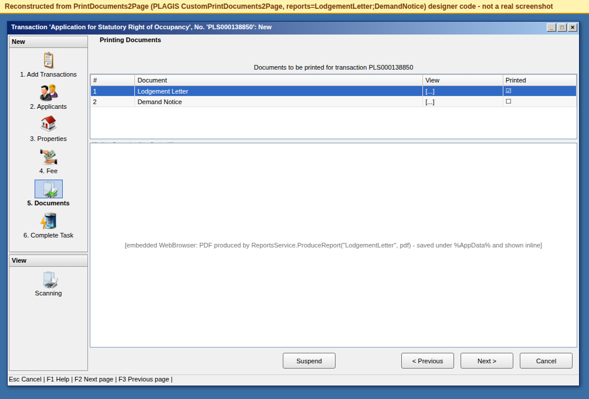

| Control | Type | Caption / label | Position / size | Bound field / data | Event handlers |
|---|---|---|---|---|---|
| pnlRelatedStuff | Panel |  | 0,110 824x399 Dock Fill | tab 3 |  |
| &nbsp;&nbsp;└ pnlPreview | Panel |  | 0,140 824x259 Dock Fill | tab 19 |  |
| &nbsp;&nbsp;└ splitterControl1 | SplitterControl |  | 0,134 824x6 Dock Top | tab 18 |  |
| &nbsp;&nbsp;└ dbgListOfReports | GridControl |  | 0,22 824x112 Dock Top | tab 16 |  |
| &nbsp;&nbsp;└ lblReports | Label | label1 -&gt; runtime: "Reports" | 0,0 824x22 Dock Top | tab 17 |  |
| pnlTransactions | Panel |  | 0,0 459x110 Dock Top hidden | tab 2 |  |
| &nbsp;&nbsp;└ dveTransactions | DataViewerEx |  | 0,18 824x113 Dock Fill | tab 2 |  |
| &nbsp;&nbsp;└ lblTransactions | Label | Batch Content | 0,0 459x18 Dock Top | tab 0 |  |
| gvListOfReports | GridView |  |  |  | CellValueChanging-&gt;gvListOfReports_CellValueChanging |
| &nbsp;&nbsp;└ gcReportNumber | GridColumn | # |  | field number |  |
| &nbsp;&nbsp;└ gcReportTitle | GridColumn | Document -&gt; runtime: "Reports" |  | field reportTitle |  |
| &nbsp;&nbsp;└ gcButton | GridColumn | View |  |  |  |
| &nbsp;&nbsp;└ gcPrinted | GridColumn | Printed |  | field printed |  |
| repositoryItemButtonEdit1 | RepositoryItemButtonEdit |  |  |  |  |
| &nbsp;&nbsp;└ new |  |  |  |  |  |
| &nbsp;&nbsp;└ EditorButton |  |  |  |  |  |
| &nbsp;&nbsp;└ 1 |  |  |  |  |  |
| &nbsp;&nbsp;└ View |  |  |  |  |  |
| &nbsp;&nbsp;└ true |  |  |  |  |  |
| &nbsp;&nbsp;└ false |  |  |  |  |  |
| &nbsp;&nbsp;└ 2 |  |  |  |  |  |
| &nbsp;&nbsp;└ null |  |  |  |  |  |
| &nbsp;&nbsp;└ KeyShortcut |  |  |  |  |  |
| &nbsp;&nbsp;└ 0 |  |  |  |  |  |
| pmToolbar | ContextMenu |  |  |  |  |
| miPrint1 | WMenuItem |  |  |  |  |

Messages this class can show (MessageBoxService kind: text):

- Warning: "Print document '{0}' please"
- Warning: "Generate document and then mark it as printed."
- Warning: "The following document(s) should be scanned :  {0}"

<details><summary>Other resource strings used by PrintDocuments2Page (6)</summary>

- `strPrintDocumentsPage_Caption` = "Documents"
- `strPrintDocumentsPage_Prompt` = "Printing Documents"
- `strPrintDocumentsPage_Reports` = "Reports"
- `strGeneralObjects_View` = "View"
- `strPrintDocumentsPage_Printed` = "Printed"
- `strPrintDocumentsPage_ScanDocument` = "The following document(s) should be scanned :  {0}"

</details>

#### 3.10.2 CustomPrintDocuments2Page

- Source: `TAR.PLAGIS.Controls.dll/TAR.PLAGIS.Controls.WorkerAssess.Pages/CustomPrintDocuments2Page.cs` (`TAR.PLAGIS.Controls.WorkerAssess.Pages`), base `PrintDocuments2Page`.
- Status at PLAGIS: PLAGIS override of `PrintDocuments2Page` (designer only adds/changes the controls listed; behaviour in 05 section 3).
- Purpose: See the base class above.

| Control | Type | Caption / label | Position / size | Bound field / data | Event handlers |
|---|---|---|---|---|---|
| pnlRelatedStuff | Panel |  | 0,110 824x399 Dock Fill | tab 3 |  |
| &nbsp;&nbsp;└ pnlPreview | Panel |  | 0,140 824x259 Dock Fill | tab 19 |  |
| &nbsp;&nbsp;└ splitterControl1 | SplitterControl |  | 0,134 824x6 Dock Top | tab 18 |  |
| &nbsp;&nbsp;└ dbgListOfReports | GridControl |  | 0,22 824x112 Dock Top | tab 16 |  |
| &nbsp;&nbsp;└ lblReports | Label | label1 | 0,0 824x22 Dock Top | tab 17 |  |
| pnlTransactions | Panel |  | 0,0 459x110 Dock Top hidden | tab 2 |  |
| &nbsp;&nbsp;└ dveTransactions | DataViewerEx |  | 0,18 824x113 Dock Fill | tab 2 |  |
| &nbsp;&nbsp;└ lblTransactions | Label | Batch Content | 0,0 459x18 Dock Top | tab 0 |  |

#### 3.10.3 CustomPrintSearchPage

- Source: `TAR.PLAGIS.Controls.dll/TAR.PLAGIS.Controls.WorkerAssess.Pages/CustomPrintSearchPage.cs` (`TAR.PLAGIS.Controls.WorkerAssess.Pages`), base `PrintDocuments2Page`.
- Status at PLAGIS: PLAGIS override of `PrintDocuments2Page` (designer only adds/changes the controls listed; behaviour in 05 section 3).
- Purpose: See the base class above.

| Control | Type | Caption / label | Position / size | Bound field / data | Event handlers |
|---|---|---|---|---|---|
| pnlRelatedStuff | Panel |  | 0,110 824x399 Dock Fill | tab 3 |  |
| &nbsp;&nbsp;└ pnlPreview | Panel |  | 0,140 824x259 Dock Fill | tab 19 |  |
| &nbsp;&nbsp;└ splitterControl1 | SplitterControl |  | 0,134 824x6 Dock Top | tab 18 |  |
| &nbsp;&nbsp;└ dbgListOfReports | GridControl |  | 0,22 824x112 Dock Top | tab 16 |  |
| &nbsp;&nbsp;└ lblReports | Label | label1 | 0,0 824x22 Dock Top | tab 17 |  |
| pnlTransactions | Panel |  | 0,0 459x110 Dock Top hidden | tab 2 |  |
| &nbsp;&nbsp;└ dveTransactions | DataViewerEx |  | 0,18 824x113 Dock Fill | tab 2 |  |
| &nbsp;&nbsp;└ lblTransactions | Label | Batch Content | 0,0 459x18 Dock Top | tab 0 |  |

#### 3.10.4 CustomPrintDocumentsMultiProp2Page

- Source: `TAR.PLAGIS.Controls.dll/TAR.PLAGIS.Controls.WorkerAssess.Pages/CustomPrintDocumentsMultiProp2Page.cs` (`TAR.PLAGIS.Controls.WorkerAssess.Pages`), base `PrintDocuments2Page`; resx `TAR.PLAGIS.Controls.WorkerAssess.Pages.CustomPrintDocumentsMultiProp2Page.resx`.
- Status at PLAGIS: Used (reachable from the PLAGIS configuration).
- Purpose: Same layout, one report per target property.

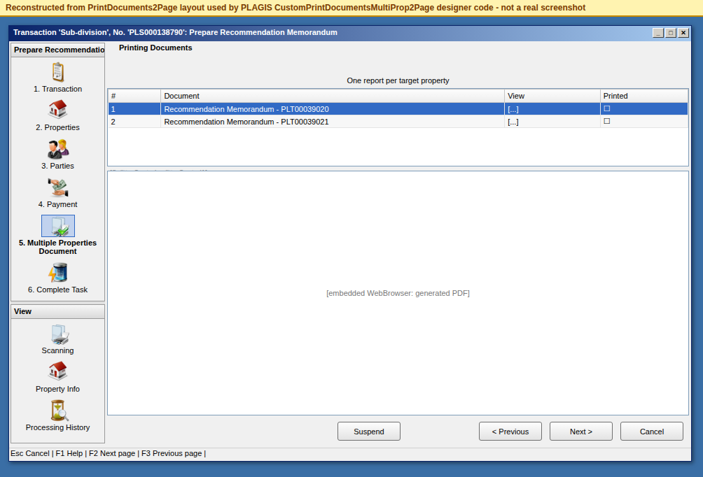

| Control | Type | Caption / label | Position / size | Bound field / data | Event handlers |
|---|---|---|---|---|---|
| pnlRelatedStuff | Panel |  | 0,110 824x399 Dock Fill | tab 3 |  |
| &nbsp;&nbsp;└ pnlPreview | Panel |  | 0,140 824x259 Dock Fill | tab 19 |  |
| &nbsp;&nbsp;└ splitterControl1 | SplitterControl |  | 0,134 824x6 Dock Top | tab 18 |  |
| &nbsp;&nbsp;└ dbgListOfReports | GridControl |  | 0,22 824x112 Dock Top | tab 16 |  |
| &nbsp;&nbsp;└ lblReports | Label | label1 | 0,0 824x22 Dock Top | tab 17 |  |
| pnlTransactions | Panel |  | 0,0 459x110 Dock Top hidden | tab 2 |  |
| &nbsp;&nbsp;└ dveTransactions | DataViewerEx |  | 0,18 824x113 Dock Fill | tab 2 |  |
| &nbsp;&nbsp;└ lblTransactions | Label | Batch Content | 0,0 459x18 Dock Top | tab 0 |  |

Messages this class can show (MessageBoxService kind: text):

- Warning: "&lt;exception message / formatted text: `(IWin32Window)(object)this, stringBuilder.ToString()`&gt;"
- Warning: "Generate document and then mark it as printed."

<details><summary>Other resource strings used by CustomPrintDocumentsMultiProp2Page (1)</summary>

- `strCustomPrintDocumentMultiProp2Page_Caption` = "Multiple Properties Document"

</details>

#### 3.10.5 BrowserPanel

- Source: `TAR.Controls.dll/TAR.Controls.Core/BrowserPanel.cs` (`TAR.Controls.Core`), base `UserControl`; design size 212x207.
- Status at PLAGIS: Used (reachable from the PLAGIS configuration).
- Purpose: Embedded browser panel used inside print pages to show the produced PDF.

| Control | Type | Caption / label | Position / size | Bound field / data | Event handlers |
|---|---|---|---|---|---|
| webBrowser | WebBrowser |  | Dock Fill |  |  |

### 3.11 Complete / assign / reject / postpone / withdraw

The last page of every wizard, the assign-task wizard, and the rejection/postponement/withdrawal reason editor.

#### 3.11.1 CompletePage

- Source: `TAR.Controls.dll/TAR.Controls.Core/CompletePage.cs` (`TAR.Controls.Core`), base `WizardPage`; design size 634x406; resx `TAR.Controls.Core.CompletePage.resx`.
- Status at PLAGIS: Base class only (its controls appear in every subclass).
- Purpose: Hosts SelectTransitionView.
- Opened from (code references): `PostponePage.AfterExecute`, `RejectPage.AfterExecute`

| Control | Type | Caption / label | Position / size | Bound field / data | Event handlers |
|---|---|---|---|---|---|
| selectTransitionView | SelectTransitionView |  | 0,0 634x406 Dock Fill | tab 1 | DoubleClick-&gt;selectTransitionView_DoubleClick, SelectedIndexChanged-&gt;selectTransitionView_SelectedIndexChanged |
| mapper | TransitionMapper |  |  |  |  |
| timer1 | Timer |  |  |  | Tick-&gt;timer1_Tick |

Messages this class can show (MessageBoxService kind: text):

- Confirm: "Are you sure you wish to send current task to '{0}'?"
- Info: "Please select transition to move."
- Info: "&lt;exception message&gt;"

<details><summary>Other resource strings used by CompletePage (5)</summary>

- `strCompletePage_Caption` = "Complete Task"
- `strCompletePage_BtnCaption` = "Complete Task"
- `strCompletePage_BtnHint` = "Complete Task"
- `strCompletePrompt` = "Select the next transition for the transaction from the list below and click the Finish button to continue. Add comments if necessary."
- `errTaskAlreadyCompleted` = "Could not complete task. Task already completed by another user."

</details>

#### 3.11.2 CompleteAssignPage

- Source: `TAR.Controls.dll/TAR.Controls.Core/CompleteAssignPage.cs` (`TAR.Controls.Core`), base `CompletePage`.
- Status at PLAGIS: Used (reachable from the PLAGIS configuration). Last page of every wizard (308).
- Purpose: "Complete Task": transitions list + Available Assignees (runtime split, AssignView without Assign-to-me/comments), Description of Transition, Comments grid (TransactionNoteGrid).

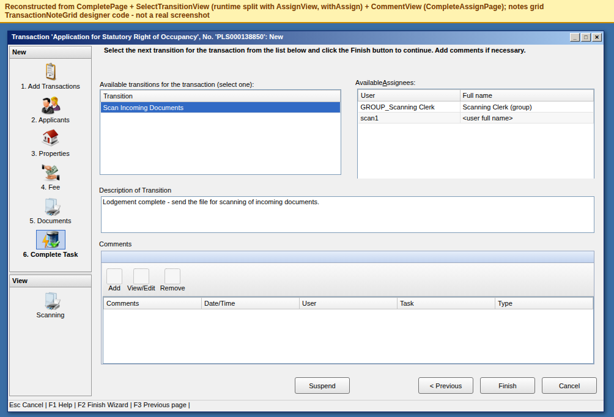

| Control | Type | Caption / label | Position / size | Bound field / data | Event handlers |
|---|---|---|---|---|---|
| selectTransitionView | SelectTransitionView |  | 0,0 634x406 Dock Fill | tab 1 | DoubleClick-&gt;selectTransitionView_DoubleClick, SelectedIndexChanged-&gt;selectTransitionView_SelectedIndexChanged |
| contextMenuStrip1 | ContextMenuStrip |  | 153x48 |  |  |
| &nbsp;&nbsp;└ cToolStripMenuItem | ToolStripMenuItem | Clear Selection | 152x22 |  |  |

#### 3.11.3 SelectTransitionView

- Source: `TAR.Controls.dll/TAR.Controls.Core/SelectTransitionView.cs` (`TAR.Controls.Core`), base `ObjectListView`; design size 501x431; resx `TAR.Controls.Core.SelectTransitionView.resx`.
- Status at PLAGIS: Used (reachable from the PLAGIS configuration).
- Opened from (code references): `CompleteForm.InitializeComponent`, `CompletePage.InitializeComponent`
- Form events: Load -&gt; `SelectTransitionView_Load`

| Control | Type | Caption / label | Position / size | Bound field / data | Event handlers |
|---|---|---|---|---|---|
| lblComments | Label | Comments | 9,270 480x23 Anchor T+L+R | tab 9 |  |
| edTransitionDescription | MemoEdit |  | 12,204 477x63 Anchor T+L+R | tab 8 |  |
| panel1 | Panel |  | 12,298 477x132 Anchor T+B+L+R | tab 7 |  |
| &nbsp;&nbsp;└ commentView | CommentView |  | 0,0 477x132 Dock Fill | tab 0 |  |
| lblTransitionDescription | Label | Description of Transition | 9,178 480x23 Anchor T+L+R | tab 4 |  |
| lblSteps | Label | Possible &Transitions -&gt; runtime: "Available transitions for the transaction (select one):" | 9,2 480x23 Anchor T+L+R | tab 4 |  |
| lvObjects | ListView |  | 12,28 477x147 Anchor T+L+R | tab 3 | DoubleClick-&gt;lvObjects_DoubleClick, SelectedIndexChanged-&gt;lvObjects_SelectedIndexChanged |

<details><summary>Other resource strings used by SelectTransitionView (3)</summary>

- `strPossibleSteps` = "Available transitions for the transaction (select one):"
- `strTransitionDescription` = "Description of Transition"
- `strComments` = "Comments"

</details>

#### 3.11.4 CommentView

- Source: `TAR.Controls.dll/TAR.Controls.Core/CommentView.cs` (`TAR.Controls.Core`), base `UserControl`; design size 480x203; resx `TAR.Controls.Core.CommentView.resx`.
- Status at PLAGIS: Used (reachable from the PLAGIS configuration).
- Purpose: Comments group: toolbar Add / View/Edit / Remove, grid `TransactionNoteGrid`.
- Opened from (code references): `CommentHistoryPanel.InitializeComponent`, `SelectTransitionView.InitializeComponent`
- lr_formfield bindings in code: gvList -&gt; m_FormName

| Control | Type | Caption / label | Position / size | Bound field / data | Event handlers |
|---|---|---|---|---|---|
| groupControl1 | GroupControl |  | 0,0 480x203 Dock Fill | tab 4 |  |
| &nbsp;&nbsp;└ pnlParties | Panel |  | 2,2 476x199 Dock Fill | tab 3 |  |
| &nbsp;&nbsp;&nbsp;&nbsp;└ dbgList | GridControl |  | 0,58 476x141 Dock Fill | lr_formfield m_FormName; tab 7 |  |
| &nbsp;&nbsp;&nbsp;&nbsp;└ tsAttachments | ToolStrip | tsAttachments | 0,0 476x54 | tab 6 |  |
| &nbsp;&nbsp;&nbsp;&nbsp;&nbsp;&nbsp;└ btnAdd | ToolStripButton | Add | 36x51 |  |  |
| &nbsp;&nbsp;&nbsp;&nbsp;&nbsp;&nbsp;└ btnEdit | ToolStripButton | View/Edit | 61x51 |  |  |
| &nbsp;&nbsp;&nbsp;&nbsp;&nbsp;&nbsp;└ btnDelete | ToolStripButton | Remove | 54x51 |  |  |
| pmToolbar | ContextMenu |  |  |  |  |
| miAdd | WMenuItem | New |  |  |  |
| miDelete | WMenuItem | Remove |  |  |  |
| miEdit | WMenuItem | Edit |  |  |  |
| gvList | GridView |  |  | lr_formfield m_FormName | DoubleClick-&gt;gvList_DoubleClick |

Messages this class can show (MessageBoxService kind: text):

- Confirm: "Remove Comment?"

<details><summary>Other resource strings used by CommentView (4)</summary>

- `strCommentView_Add` = "Add"
- `strCommentView_Edit` = "View/Edit"
- `strCommentView_AddToolTip` = "Add Comment"
- `strCommentView_EditToolTip` = "View/Edit Comment"

</details>

#### 3.11.5 EditCommentForm

- Source: `TAR.Controls.dll/TAR.Controls.Core/EditCommentForm.cs` (`TAR.Controls.Core`), base `BaseEditorForm`; form Text "View/Edit Comment"; design size 504x352; min 500x380; border Sizable; resx `TAR.Controls.Core.EditCommentForm.resx`.
- Status at PLAGIS: Used (reachable from the PLAGIS configuration).
- Purpose: "View/Edit Comment".
- Opened from (code references): `CommentView.AddNote`, `CommentView.EditNote`
- lr_formfield bindings in code: layoutControl1 -&gt; m_FormName

| Control | Type | Caption / label | Position / size | Bound field / data | Event handlers |
|---|---|---|---|---|---|
| xtraTabControl1 | XtraTabControl |  | 4,4 499x309 Anchor T+B+L+R | tab 2 |  |
| &nbsp;&nbsp;└ tpMain | XtraTabPage | General Information | 492x302 |  |  |
| &nbsp;&nbsp;&nbsp;&nbsp;└ layoutControl1 | LayoutControl | layoutControl1 | 0,0 492x302 Dock Fill | lr_formfield m_FormName; tab 0 |  |
| &nbsp;&nbsp;└ tpAdditional | XtraTabPage | Additional Information | 492x302 |  |  |
| &nbsp;&nbsp;└ tpAdditional2 | XtraTabPage | Additional Information | 543x301 |  |  |
| btnCancel | SimpleButton | Cancel | 410,319 80x23 Anchor B+R | tab 1 | Click-&gt;btnCancel_Click |
| btnOK | SimpleButton | OK | 326,319 80x23 Anchor B+R | tab 0 | Click-&gt;btnOK_Click |
| layoutControlGroup1 | LayoutControlGroup | layoutControlGroup1 | 0,0 492x302 |  |  |

<details><summary>Other resource strings used by EditCommentForm (2)</summary>

- `strEditCommentForm_Add` = "Add Comment"
- `strEditCommentForm_Edit` = "View/Edit Comment"

</details>

#### 3.11.6 NewEditCommentForm

- Source: `TAR.Controls.dll/TAR.Controls.Core/NewEditCommentForm.cs` (`TAR.Controls.Core`), base `DialogForm`; form Text "Add Comment"; design size 470x286; resx `TAR.Controls.Core.NewEditCommentForm.resx`.
- Status at PLAGIS: Used (reachable from the PLAGIS configuration).
- Purpose: "Add Comment".
- lr_formfield bindings in code: _meta -&gt; "HistoryViewFormEvent"

| Control | Type | Caption / label | Position / size | Bound field / data | Event handlers |
|---|---|---|---|---|---|
| lookUpEdit1 | LookUpEdit |  | 112,61 339x20 | tab 5 |  |
| edComments | MemoEdit |  | 112,87 339x156 Anchor T+B+L+R | tab 4 |  |
| label1 | Label | User | 6,12 100x13 | tab 2 |  |
| edUser | TextEdit |  | 112,9 339x20 Anchor T+L+R | tab 3 |  |
| label4 | Label | Type | 6,64 100x13 | tab 6 |  |
| label3 | Label | Comments | 6,89 100x13 | tab 2 |  |
| edDateTime | TextEdit |  | 112,35 339x20 Anchor T+L+R | tab 3 |  |
| label2 | Label | Date/Time | 6,38 100x13 | tab 2 |  |
| btnCancel | SimpleButton | Cancel | 376,253 80x23 Anchor B+R | tab 1 |  |
| btnOK | SimpleButton | OK | 292,253 80x23 Anchor B+R | tab 0 |  |
| lookUpEdit1.Properties |  |  |  |  |  |
| &nbsp;&nbsp;└ new |  |  |  |  |  |
| &nbsp;&nbsp;└ EditorButton |  |  |  |  |  |
| &nbsp;&nbsp;└ ButtonPredefines |  |  |  |  |  |
| &nbsp;&nbsp;└ 5 |  |  |  |  |  |

<details><summary>Other resource strings used by NewEditCommentForm (5)</summary>

- `strAddCommentForm` = "Add Comment"
- `strUser` = "User"
- `strDateTime` = "Date/Time"
- `strComments` = "Comments"
- `strCommentType` = "Type"

</details>

#### 3.11.7 AssignPage

- Source: `TAR.Controls.dll/TAR.Controls.Core/AssignPage.cs` (`TAR.Controls.Core`), base `WizardPage`; design size 494x379; resx `TAR.Controls.Core.AssignPage.resx`.
- Status at PLAGIS: Used (reachable from the PLAGIS configuration). Edit &gt; Assign... (lrsAssignTask).
- Purpose: Assign Task page: Available Assignees list (users of the task swimlane group + the group), Assign to me, Comments.

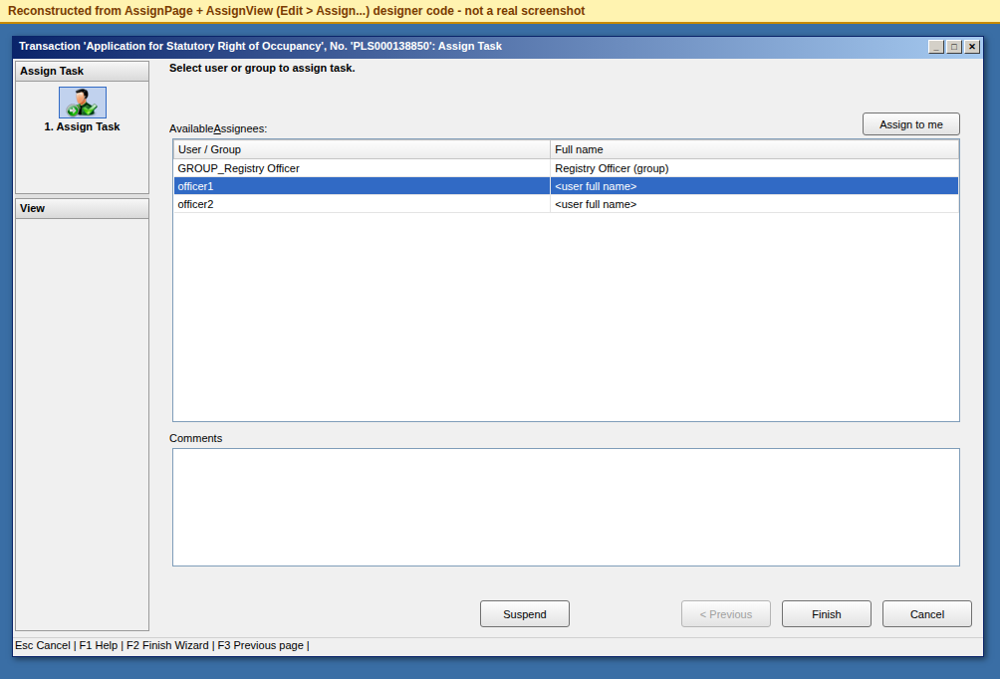

| Control | Type | Caption / label | Position / size | Bound field / data | Event handlers |
|---|---|---|---|---|---|
| pnlBody | Panel |  | 0,0 494x379 Dock Fill | tab 1 |  |
| &nbsp;&nbsp;└ assignView | AssignView |  | 8,8 478x360 Anchor T+B+L+R | tab 1 | DoubleClick-&gt;assignView_DoubleClick, SelectedIndexChanged-&gt;assignView_SelectedIndexChanged |
| mapper | AuthorityMapper |  |  |  |  |

Messages this class can show (MessageBoxService kind: text):

- Info: "Please select an Assignee to assign task."

<details><summary>Other resource strings used by AssignPage (2)</summary>

- `strAssignTask` = "Assign Task"
- `strAssignPrompt` = "Select user or group to assign task."

</details>

#### 3.11.8 AssignTaskPage

- Source: `TAR.Controls.dll/TAR.Controls.Core/AssignTaskPage.cs` (`TAR.Controls.Core`), base `WizardPage`; design size 494x379; resx `TAR.Controls.Core.AssignTaskPage.resx`.
- Status at PLAGIS: Used (reachable from the PLAGIS configuration).

| Control | Type | Caption / label | Position / size | Bound field / data | Event handlers |
|---|---|---|---|---|---|
| pnlBody | Panel |  | 0,0 494x379 Dock Fill | tab 1 |  |
| &nbsp;&nbsp;└ assignView | AssignView |  | 8,8 478x360 Anchor T+B+L+R | tab 1 | DoubleClick-&gt;assignView_DoubleClick |
| mapper | AuthorityMapper |  |  |  |  |

Messages this class can show (MessageBoxService kind: text):

- Info: "Please select an Assignee to assign task."

<details><summary>Other resource strings used by AssignTaskPage (4)</summary>

- `strAssignTask` = "Assign Task"
- `strAssignPrompt` = "Select user or group to assign task."
- `errMissingSwimlane` = "Wrong editor configuration. Swimlane attribute is not defined."
- `errWrongSwimlane` = "Wrong editor configuration. Incorrect swimlane attribute {0}."

</details>

#### 3.11.9 AssignView

- Source: `TAR.Controls.dll/TAR.Controls.Core.Views/AssignView.cs` (`TAR.Controls.Core.Views`), base `ObjectListView`; design size 514x452; resx `TAR.Controls.Core.Views.AssignView.resx`.
- Status at PLAGIS: Used (reachable from the PLAGIS configuration).
- Opened from (code references): `AssignPage.InitializeComponent`, `AssignTaskPage.InitializeComponent`, `SelectTransitionView.Bind2Data`
- Form events: Load -&gt; `AssignView_Load`

| Control | Type | Caption / label | Position / size | Bound field / data | Event handlers |
|---|---|---|---|---|---|
| btnAssignToMe | Button | Assign to me | 404,1 98x23 Anchor T+R | tab 8 | Click-&gt;btnAssignToMe_Click |
| tbComments | TextBox |  | 12,338 490x100 Anchor T+B+L+R | tab 7 |  |
| lblComments | Label | &Comments -&gt; runtime: "Comments" | 9,322 493x13 Anchor T+L+R | tab 6 |  |
| lblUsers | Label | Available &Assignees: | 9,1 493x23 Anchor T+L+R | tab 1 |  |
| lvObjects | ListView |  | 12,27 490x285 Anchor T+L+R | tab 3 | DoubleClick-&gt;lvObjects_DoubleClick, SelectedIndexChanged-&gt;lvObjects_SelectedIndexChanged |

<details><summary>Other resource strings used by AssignView (4)</summary>

- `strName` = "Name"
- `strPossibleAssignees` = "Available &Assignees:"
- `strComments` = "Comments"
- `strAssignToMe` = "Assign to me"

</details>

#### 3.11.10 ObjectListView

- Source: `TAR.Controls.dll/TAR.Controls.Core.Views/ObjectListView.cs` (`TAR.Controls.Core.Views`), base `UserControl`; design size 460x320; resx `TAR.Controls.Core.Views.ObjectListView.resx`.
- Status at PLAGIS: Base class only (its controls appear in every subclass).

| Control | Type | Caption / label | Position / size | Bound field / data | Event handlers |
|---|---|---|---|---|---|
| lvObjects | ListView |  | 12,12 436x296 Anchor T+B+L+R | tab 3 | DoubleClick-&gt;lvObjects_DoubleClick, SelectedIndexChanged-&gt;lvObjects_SelectedIndexChanged |

#### 3.11.11 RejectPage

- Source: `TAR.Controls.dll/TAR.Controls.Core/RejectPage.cs` (`TAR.Controls.Core`), base `WizardPage`; design size 546x403; resx `TAR.Controls.Core.RejectPage.resx`.
- Status at PLAGIS: Used (reachable from the PLAGIS configuration). Prepare Rejection Letter (7 wizards) and Edit &gt; Postpone / Withdraw.
- Purpose: Reasons editor (ListEditorT): Reason (dictionary returned_reason) + In Addition, Add/Update/Remove, grid RejectFormGrid. Postpone mode uses PostponeForm.

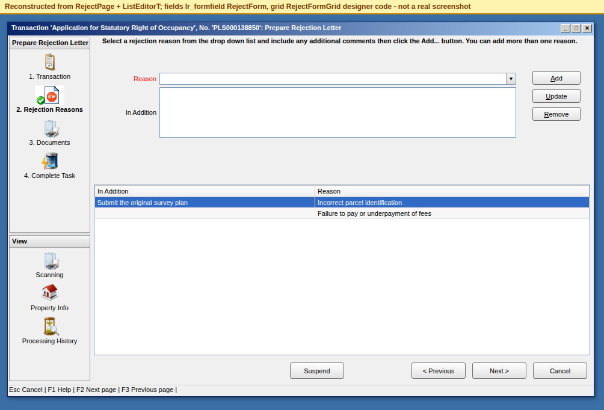

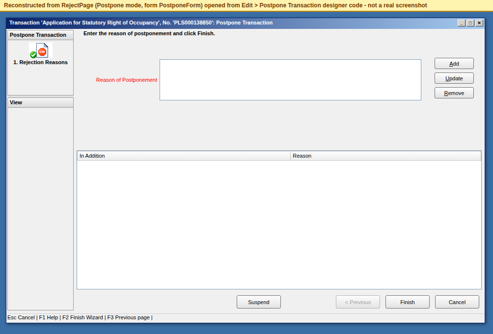

| Control | Type | Caption / label | Position / size | Bound field / data | Event handlers |
|---|---|---|---|---|---|
| pnlBody | TableLayoutPanel |  | 0,0 546x403 Dock Fill | tab 1 |  |

Messages this class can show (MessageBoxService kind: text):

- Warning: "Please add at least one rejection reason to transaction."

<details><summary>Other resource strings used by RejectPage (8)</summary>

- `strRejectPage_Caption` = "Rejection Reasons"
- `strRejectPageNoPrint_Prompt` = "Select a rejection reason from the drop down list and include any additional comments then click the Add... button. You can add more than one reason."
- `strWithdrawPage_Caption` = "Withdraw Transaction"
- `strWithdrawPageNoPrint_Prompt` = "Select withdraw reason from the drop down list and include any additional comments then click the Add... button. You can add more than one reason."
- `strPostponePage_Caption` = "Postpone Transaction"
- `strPostponePageNoPrint_Prompt` = "Select a postpone reason from the drop down list and include any additional comments then click the Add... button. You can add more than one reason."
- `strRejectionLetter` = "Rejection Letter"
- `strPostponeRegistration` = "Postpone Transaction"

</details>

#### 3.11.12 PostponePage

- Source: `TAR.Controls.dll/TAR.Controls.Core/PostponePage.cs` (`TAR.Controls.Core`), base `WizardPage`; design size 497x420; resx `TAR.Controls.Core.PostponePage.resx`.
- Status at PLAGIS: Used (reachable from the PLAGIS configuration).
- Purpose: "Postpone Transaction" page: PostponeForm reason.
- lr_formfield bindings in code: layoutControl1 -&gt; "PostponeForm"

| Control | Type | Caption / label | Position / size | Bound field / data | Event handlers |
|---|---|---|---|---|---|
| layoutControl1 | LayoutControl | layoutControl1 | 0,0 497x241 Dock Top | lr_formfield PostponeForm; tab 1 |  |
| layoutControlGroup1 | LayoutControlGroup | layoutControlGroup1 | 0,0 497x241 |  |  |

<details><summary>Other resource strings used by PostponePage (1)</summary>

- `strPostponePage_Caption` = "Postpone Transaction"

</details>

#### 3.11.13 ListEditorT

- Source: `TAR.Controls.dll/TAR.Controls.Core.Controls/ListEditorT.cs` (`TAR.Controls.Core.Controls`), base `-`; design size 477x375.
- Status at PLAGIS: Used (reachable from the PLAGIS configuration).
- Purpose: Generic list + editor: fields on top (lr_formfield form in a LayoutControl), Add/Update/Remove(/Print) buttons on the right, grid below. Used by RejectPage for rejection/postponement/withdrawal reasons.
- Form events: Enter -&gt; `ListEditorT_Enter`
- lr_formfield bindings in code: layoutControl -&gt; _metaInfo1

| Control | Type | Caption / label | Position / size | Bound field / data | Event handlers |
|---|---|---|---|---|---|
| tableLayoutPanel1 | TableLayoutPanel |  | 12,5 459x189 Anchor T+L+R | tab 6 |  |
| &nbsp;&nbsp;└ pnlEdit | EditPanel |  | 3,3 349x183 Dock Fill | tab 3 |  |
| &nbsp;&nbsp;└ pnlButtons | TableLayoutPanel |  | 358,3 98x183 Dock Fill | tab 1 |  |
| &nbsp;&nbsp;&nbsp;&nbsp;└ btnAdd | Button | &Add -&gt; runtime: "&Add..." | 11,3 80x23 | tab 0 | Click-&gt;btnAdd_Click |
| &nbsp;&nbsp;&nbsp;&nbsp;└ btnEdit | Button | &Update -&gt; runtime: "&Edit..." | 11,33 80x23 | tab 1 | Click-&gt;btnEdit_Click |
| &nbsp;&nbsp;&nbsp;&nbsp;└ btnRemove | Button | &Remove | 11,63 80x23 | tab 2 | Click-&gt;btnRemove_Click |
| &nbsp;&nbsp;&nbsp;&nbsp;└ btnPrint | Button | &Print | 11,93 80x23 | tab 3 | Click-&gt;btnPrint_Click |
| dataViewerEx | DataViewerEx |  | 0,200 477x175 Anchor T+B+L+R | tab 5 | SelectedIndexChanged-&gt;dataViewerEx_SelectedIndexChanged |

<details><summary>Other resource strings used by ListEditorT (4)</summary>

- `strAdd` = "&Add..."
- `strEdit` = "&Edit..."
- `strPrint` = "&Print"
- `strRemove` = "&Remove"

</details>

#### 3.11.14 ListEditorT

- Source: `TAR.Controls.dll/TAR.Controls.Core/ListEditorT.cs` (`TAR.Controls.Core`), base `-`; design size 477x375.
- Status at PLAGIS: Used (reachable from the PLAGIS configuration).
- Purpose: Generic list + editor: fields on top (LayoutControl), Add/Update/Remove/Print buttons right, DataViewerEx grid below. RejectPage hosts it for reasons (RejectForm / PostponeForm / RejectFormGrid).
- Form events: Enter -&gt; `ListEditorT_Enter`
- lr_formfield bindings in code: layoutControl -&gt; _metaInfo1

| Control | Type | Caption / label | Position / size | Bound field / data | Event handlers |
|---|---|---|---|---|---|
| tableLayoutPanel1 | TableLayoutPanel |  | 12,5 459x189 Anchor T+L+R | tab 6 |  |
| &nbsp;&nbsp;└ pnlButtons | TableLayoutPanel |  | 358,3 98x183 Dock Fill | tab 1 |  |
| &nbsp;&nbsp;&nbsp;&nbsp;└ btnAdd | Button | &Add -&gt; runtime: "&Add..." | 11,3 80x23 | tab 0 | Click-&gt;btnAdd_Click |
| &nbsp;&nbsp;&nbsp;&nbsp;└ btnEdit | Button | &Update -&gt; runtime: "&Edit..." | 11,33 80x23 | tab 1 | Click-&gt;btnEdit_Click |
| &nbsp;&nbsp;&nbsp;&nbsp;└ btnRemove | Button | &Remove | 11,63 80x23 | tab 2 | Click-&gt;btnRemove_Click |
| &nbsp;&nbsp;&nbsp;&nbsp;└ btnPrint | Button | &Print | 11,93 80x23 hidden | tab 3 | Click-&gt;btnPrint_Click |
| &nbsp;&nbsp;└ layoutControl | LayoutControl | layoutControl1 | 3,3 349x183 Dock Fill | lr_formfield _metaInfo1; tab 2 |  |
| dataViewerEx | DataViewerEx |  | 0,200 477x175 Anchor T+B+L+R | tab 5 | SelectedIndexChanged-&gt;dataViewerEx_SelectedIndexChanged |
| layoutControlGroup1 | LayoutControlGroup | layoutControlGroup1 | 0,0 349x183 |  |  |

<details><summary>Other resource strings used by ListEditorT (4)</summary>

- `strAdd` = "&Add..."
- `strEdit` = "&Edit..."
- `strPrint` = "&Print"
- `strRemove` = "&Remove"

</details>

#### 3.11.15 EditPanel

- Source: `TAR.Controls.dll/TAR.Controls.Core/EditPanel.cs` (`TAR.Controls.Core`), base `UserControl`; design size 391x222.
- Status at PLAGIS: Used (reachable from the PLAGIS configuration).
- Purpose: TableLayout-based field panel (label column + editor column) used by filters, search dialogs and cashier parameter editors.
- Opened from (code references): `ApplicantView.InitializeComponent`, `CalculateFeeForm.InitializeCashEditor`, `CalculateGroundFeeForm.InitializeCashEditor`, `FeeCalculationForm.InitializeCashEditor`, `ListEditor.InitializeComponent`, `ListEditorT.InitializeComponent`, `PropertiesDockableWindow.InitializeComponent`, `RegistryPaymentPage.InitializeComponent`, `SearchApplicantView.InitializeComponent`, `TaskFilterView.InitializeComponent` (+2 more)

| Control | Type | Caption / label | Position / size | Bound field / data | Event handlers |
|---|---|---|---|---|---|
| tableLayoutPanel | TableLayoutPanel |  | 0,0 391x222 Dock Fill | tab 0 |  |

#### 3.11.16 ExtendedEditPanel

- Source: `TAR.Controls.dll/TAR.Controls.Core/ExtendedEditPanel.cs` (`TAR.Controls.Core`), base `UserControl`; design size 391x222.
- Status at PLAGIS: Used (reachable from the PLAGIS configuration).

| Control | Type | Caption / label | Position / size | Bound field / data | Event handlers |
|---|---|---|---|---|---|
| collapsibleControl | CollapsibleControl |  | 0,0 391x222 Anchor T+B+L+R | tab 0 |  |

#### 3.11.17 CollapsibleControl

- Source: `TAR.Controls.dll/TAR.Controls.Core/CollapsibleControl.cs` (`TAR.Controls.Core`), base `UserControl`; design size 359x178.
- Status at PLAGIS: Used (reachable from the PLAGIS configuration).
- Opened from (code references): `ExtendedEditPanel.InitializeComponent`

| Control | Type | Caption / label | Position / size | Bound field / data | Event handlers |
|---|---|---|---|---|---|
| flowLayoutPanel | FlowLayoutPanel |  | 0,0 359x178 Anchor T+B+L+R | tab 1 |  |

#### 3.11.18 ListHeader

- Source: `TAR.Controls.dll/TAR.Controls.Core/ListHeader.cs` (`TAR.Controls.Core`), base `UserControl`; design size 194x18; resx `TAR.Controls.Core.ListHeader.resx`.
- Status at PLAGIS: Used (reachable from the PLAGIS configuration).
- Opened from (code references): `CollapsibleControl.AddSection`

| Control | Type | Caption / label | Position / size | Bound field / data | Event handlers |
|---|---|---|---|---|---|
| pictureBox1 | PictureBox |  | 9,4 10x9 | tab 2 | Click-&gt;pictureBox1_Click |

#### 3.11.19 CompleteForm

- Source: `TAR.Controls.dll/TAR.Controls.Core/CompleteForm.cs` (`TAR.Controls.Core`), base `IndexerWizardPage`; design size 694x572; resx `TAR.Controls.Core.CompleteForm.resx`.
- Status at PLAGIS: Used (reachable from the PLAGIS configuration).
- Purpose: Complete step of the generic wizard (bare complete worker).
- Opened from (code references): `RejectForm.Complete`

| Control | Type | Caption / label | Position / size | Bound field / data | Event handlers |
|---|---|---|---|---|---|
| pnlHeader | Panel |  | 0,0 694x56 Dock Top | tab 0 |  |
| &nbsp;&nbsp;└ lblHeaderLine | Label |  | 0,54 694x2 Dock Bottom | tab 2 |  |
| &nbsp;&nbsp;└ pbHeaderImage | PictureBox |  | 0,0 694x56 Dock Fill | tab 1 | Paint-&gt;pbHeaderImage_Paint |
| &nbsp;&nbsp;└ lblPrompt | Label | Select next step. Enter comments if necessary. | 16,9 416x40 | tab 0 |  |
| pnlBody | Panel |  | 0,56 694x516 Dock Fill | tab 1 |  |
| &nbsp;&nbsp;└ selectTransitionView | SelectTransitionView |  | 4,4 688x463 Anchor T+B+L+R | tab 0 | DoubleClick-&gt;selectTransitionView_DoubleClick, SelectedIndexChanged-&gt;selectTransitionView_SelectedIndexChanged |
| pnlFooter | Panel |  | 0,526 694x46 Dock Bottom | tab 4 |  |
| &nbsp;&nbsp;└ lblFooterLine | Label |  | 0,0 694x2 Dock Top | tab 0 |  |
| &nbsp;&nbsp;└ btnCancel | Button | Cancel | 607,14 75x23 Anchor B+R | tab 3 | Click-&gt;btnCancel_Click |
| &nbsp;&nbsp;└ btnBack | Button | &lt; &Back | 447,14 75x23 Anchor B+R | tab 1 | Click-&gt;btnBack_Click |
| &nbsp;&nbsp;└ btnNext | Button | &Next &gt; | 527,14 75x23 Anchor B+R | tab 2 | Click-&gt;btnNext_Click |
| mapper | TransitionMapper |  |  |  |  |

Messages this class can show (MessageBoxService kind: text):

- Confirm: "Are you sure you wish to send current task to '{0}'?"
- Info: "&lt;exception message&gt;"

<details><summary>Other resource strings used by CompleteForm (2)</summary>

- `errTaskAlreadyCompleted` = "Could not complete task. Task already completed by another user."
- `strRejectRegistration` = "Reject Transaction"

</details>

### 3.12 Search dialogs

Stand-alone search dialogs opened from pages (Search buttons). The SEAR search page is in 3.4.

#### 3.12.1 TransactionSearchForm

- Source: `TAR.Controls.dll/TAR.Controls.WorkerAssess.Forms/TransactionSearchForm.cs` (`TAR.Controls.WorkerAssess.Forms`), base `DialogForm`; design size 794x572; resx `TAR.Controls.WorkerAssess.Forms.TransactionSearchForm.resx`.
- Status at PLAGIS: Used (reachable from the PLAGIS configuration).
- Purpose: Search registered transactions (TransactionSearchForm criteria, TransactionSearchGrid); used by Data Correction and related-transaction selection.
- Opened from (code references): `TransactionCorrectionPage.SearchTransactions_ButtonClick`
- lr_formfield bindings in code: panel2 -&gt; _selectedTransaction, gvListOfTransactions -&gt; "TransactionSearchGrid"

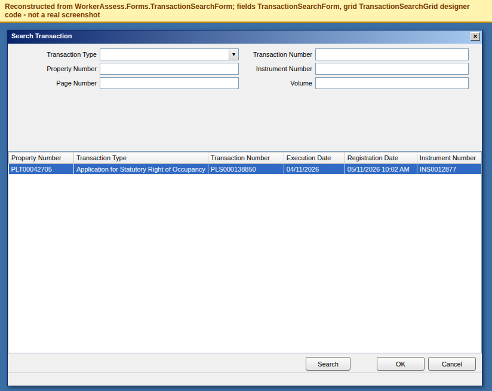

| Control | Type | Caption / label | Position / size | Bound field / data | Event handlers |
|---|---|---|---|---|---|
| btnSearch | SimpleButton | Search | 499,524 75x23 Anchor B+R | tab 26 | Click-&gt;btnSearch_Click |
| statusStrip1 | StatusStrip | statusStrip1 | 0,550 794x22 | tab 27 |  |
| &nbsp;&nbsp;└ statuslabel | ToolStripStatusLabel |  | 0x17 |  |  |
| panel1 | Panel |  | 0,0 794x518 Dock Top | tab 25 |  |
| &nbsp;&nbsp;└ dbgListOfTransactions | GridControl |  | 0,271 794x247 Dock Fill | lr_formfield TransactionSearchGrid; tab 25 | DoubleClick-&gt;dbgListOfTransactions_DoubleClick |
| &nbsp;&nbsp;└ panel2 | Panel |  | 0,0 794x180 Dock Top | lr_formfield _selectedTransaction; tab 26 |  |
| btnCancel | SimpleButton | Cancel | 704,524 80x23 Anchor B+R | tab 1 |  |
| btnOK | SimpleButton | OK | 618,524 80x23 Anchor B+R | tab 0 |  |
| gvListOfTransactions | GridView |  |  | lr_formfield TransactionSearchGrid | FocusedRowChanged-&gt;gvListOfTransactions_FocusedRowChanged |

Messages this class can show (MessageBoxService kind: text):

- Warning: "&lt;exception message&gt;"

<details><summary>Other resource strings used by TransactionSearchForm (3)</summary>

- `strTransactionSearchForm_Caption` = "Search Transaction"
- `strGereralObjects_Search` = "Search"
- `strSearchResultStatus` = "{0} record(s) found."

</details>

#### 3.12.2 ApplicantSearchForm

- Source: `TAR.Controls.dll/TAR.Controls.WorkerAssess.Forms/ApplicantSearchForm.cs` (`TAR.Controls.WorkerAssess.Forms`), base `DialogForm`; design size 794x572; resx `TAR.Controls.WorkerAssess.Forms.ApplicantSearchForm.resx`.
- Status at PLAGIS: Used (reachable from the PLAGIS configuration).
- Purpose: Search existing applicants: criteria `SearchIndApplicantForm` or `SearchCorpApplicantForm`, Search button, grid `SearchApplicantGrid`; OK picks the row.
- Opened from (code references): `MultiApplicantsPage.SearchApplicant`
- lr_formfield bindings in code: gvListOfApplicants -&gt; "SearchApplicantGrid", _meta -&gt; "SearchCorpApplicantForm", "SearchIndApplicantForm", "SearchApplicantGrid", panel2 -&gt; _searchIndApplicantFormMetaInfo

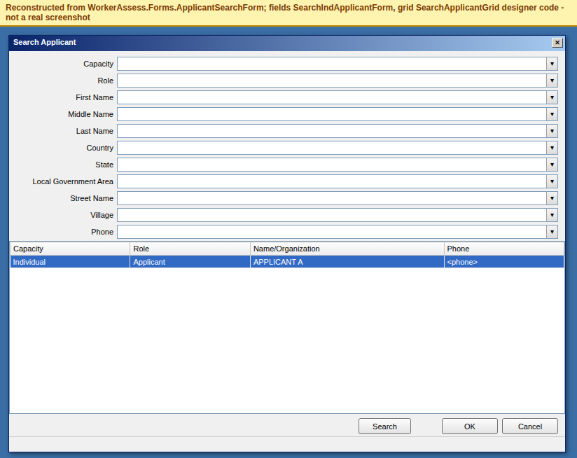

| Control | Type | Caption / label | Position / size | Bound field / data | Event handlers |
|---|---|---|---|---|---|
| btnSearch | SimpleButton | Search | 499,524 75x23 Anchor B+R | tab 26 | Click-&gt;btnSearch_Click |
| statusStrip1 | StatusStrip | statusStrip1 | 0,550 794x22 | tab 27 |  |
| &nbsp;&nbsp;└ statuslabel | ToolStripStatusLabel |  | 0x17 |  |  |
| panel1 | Panel |  | 0,0 794x518 Dock Top | tab 25 |  |
| &nbsp;&nbsp;└ dbgListOfApplicants | GridControl |  | 0,271 794x247 Dock Fill | lr_formfield SearchApplicantGrid; tab 25 |  |
| &nbsp;&nbsp;└ panel2 | Panel |  | 0,0 794x271 Dock Top | lr_formfield _searchIndApplicantFormMetaInfo; tab 26 |  |
| btnCancel | SimpleButton | Cancel | 704,524 80x23 Anchor B+R | tab 1 |  |
| btnOK | SimpleButton | OK | 618,524 80x23 Anchor B+R | tab 0 |  |
| gvListOfApplicants | GridView |  |  | lr_formfield SearchApplicantGrid | FocusedRowChanged-&gt;gvListOfApplicants_FocusedRowChanged, DoubleClick-&gt;gvListOfApplicants_DoubleClick |

<details><summary>Other resource strings used by ApplicantSearchForm (3)</summary>

- `strApplicantSearchForm_Caption` = "Search Applicant"
- `strGereralObjects_Search` = "Search"
- `strSearchResultStatus` = "{0} record(s) found."

</details>

#### 3.12.3 PartySearchForm

- Source: `TAR.Controls.dll/TAR.Controls.WorkerAssess.Forms/PartySearchForm.cs` (`TAR.Controls.WorkerAssess.Forms`), base `DialogForm`; design size 794x572; resx `TAR.Controls.WorkerAssess.Forms.PartySearchForm.resx`.
- Status at PLAGIS: Used (reachable from the PLAGIS configuration).
- Purpose: Search parties: `PartiesSearchForm` criteria, grid `PartiesSearchGrid`.
- Opened from (code references): `DataCorrectionRrrPage.SearchParty`, `PartiesPage.SearchParty`
- lr_formfield bindings in code: panel2 -&gt; Party, gvListOfParties -&gt; "PartiesSearchGrid"

| Control | Type | Caption / label | Position / size | Bound field / data | Event handlers |
|---|---|---|---|---|---|
| btnSearch | SimpleButton | Search | 499,524 75x23 Anchor B+R | tab 26 | Click-&gt;btnSearch_Click |
| statusStrip1 | StatusStrip | statusStrip1 | 0,550 794x22 | tab 27 |  |
| &nbsp;&nbsp;└ statuslabel | ToolStripStatusLabel |  | 0x17 |  |  |
| panel1 | Panel |  | 0,0 794x518 Dock Top | tab 25 |  |
| &nbsp;&nbsp;└ dbgListOfParties | GridControl |  | 0,271 794x247 Dock Fill | lr_formfield PartiesSearchGrid; tab 25 |  |
| &nbsp;&nbsp;└ panel2 | Panel |  | 0,0 794x271 Dock Top | lr_formfield Party; tab 26 |  |
| btnCancel | SimpleButton | Cancel | 704,524 80x23 Anchor B+R | tab 1 |  |
| btnOK | SimpleButton | OK | 618,524 80x23 Anchor B+R | tab 0 |  |
| gvListOfParties | GridView |  |  | lr_formfield PartiesSearchGrid | FocusedRowChanged-&gt;gvListOfParties_FocusedRowChanged |
| &nbsp;&nbsp;└ gridColumn4 | GridColumn | Last Name |  | field Unit |  |
| &nbsp;&nbsp;└ gridColumn5 | GridColumn | First Name |  | field Number |  |
| &nbsp;&nbsp;└ gridColumn6 | GridColumn | Address |  | field Name |  |

Messages this class can show (MessageBoxService kind: text):

- Warning: "&lt;exception message&gt;"

<details><summary>Other resource strings used by PartySearchForm (3)</summary>

- `strPartySearchForm_Caption` = "Search Party"
- `strGereralObjects_Search` = "Search"
- `strSearchResultStatus` = "{0} record(s) found."

</details>

#### 3.12.4 CustomPartySearchForm

- Source: `TAR.PLAGIS.Controls.dll/TAR.PLAGIS.Controls.WorkerAssess.Forms/CustomPartySearchForm.cs` (`TAR.PLAGIS.Controls.WorkerAssess.Forms`), base `PartySearchForm`; form Text "CustomPartySearchForm".
- Status at PLAGIS: PLAGIS override of `PartySearchForm` (designer only adds/changes the controls listed; behaviour in 05 section 3).
- Purpose: See the base class above.

| Control | Type | Caption / label | Position / size | Bound field / data | Event handlers |
|---|---|---|---|---|---|
| btnSearch | SimpleButton | Search | 499,524 75x23 Anchor B+R | tab 26 | Click-&gt;btnSearch_Click |
| statusStrip1 | StatusStrip | statusStrip1 | 0,550 794x22 | tab 27 |  |
| &nbsp;&nbsp;└ statuslabel | ToolStripStatusLabel |  | 0x17 |  |  |
| panel1 | Panel |  | 0,0 794x518 Dock Top | tab 25 |  |
| &nbsp;&nbsp;└ dbgListOfParties | GridControl |  | 0,271 794x247 Dock Fill | tab 25 |  |
| &nbsp;&nbsp;└ panel2 | Panel |  | 0,0 794x271 Dock Top | tab 26 |  |
| btnCancel | Button | Cancel | 704,524 75x23 Anchor B+R | tab 1 |  |
| btnOK | Button | OK | 618,524 75x23 Anchor B+R | tab 0 |  |

#### 3.12.5 PartyContactSearchForm

- Source: `TAR.Controls.dll/TAR.Controls.WorkerAssess.Forms/PartyContactSearchForm.cs` (`TAR.Controls.WorkerAssess.Forms`), base `DialogForm`; design size 794x572; resx `TAR.Controls.WorkerAssess.Forms.PartyContactSearchForm.resx`.
- Status at PLAGIS: Used (reachable from the PLAGIS configuration).
- Purpose: Search representatives (PartyContactsSearchForm / Grid).
- Opened from (code references): `PartyContacts2Panel.Search_Action`
- lr_formfield bindings in code: panel2 -&gt; Individual, gvListOfParties -&gt; "PartyContactsSearchGrid"

| Control | Type | Caption / label | Position / size | Bound field / data | Event handlers |
|---|---|---|---|---|---|
| btnSearch | SimpleButton | Search | 499,524 75x23 Anchor B+R | tab 26 | Click-&gt;btnSearch_Click |
| statusStrip1 | StatusStrip | statusStrip1 | 0,550 794x22 | tab 27 |  |
| &nbsp;&nbsp;└ statuslabel | ToolStripStatusLabel |  | 0x17 |  |  |
| panel1 | Panel |  | 0,0 794x518 Dock Top | tab 25 |  |
| &nbsp;&nbsp;└ dbgListOfParties | GridControl |  | 0,271 794x247 Dock Fill | lr_formfield PartyContactsSearchGrid; tab 25 |  |
| &nbsp;&nbsp;└ panel2 | Panel |  | 0,0 794x271 Dock Top | lr_formfield Individual; tab 26 |  |
| btnCancel | SimpleButton | Cancel | 704,524 80x23 Anchor B+R | tab 1 |  |
| btnOK | SimpleButton | OK | 618,524 80x23 Anchor B+R | tab 0 |  |
| gvListOfParties | GridView |  |  | lr_formfield PartyContactsSearchGrid | FocusedRowChanged-&gt;gvListOfParties_FocusedRowChanged, DoubleClick-&gt;gvListOfParties_DoubleClick |
| &nbsp;&nbsp;└ gridColumn4 | GridColumn | Last Name |  | field Unit |  |
| &nbsp;&nbsp;└ gridColumn5 | GridColumn | First Name |  | field Number |  |
| &nbsp;&nbsp;└ gridColumn6 | GridColumn | Address |  | field Name |  |

Messages this class can show (MessageBoxService kind: text):

- Warning: "&lt;exception message&gt;"

<details><summary>Other resource strings used by PartyContactSearchForm (3)</summary>

- `strPartyContactSearchForm_Caption` = "Search Representative"
- `strGereralObjects_Search` = "Search"
- `strSearchResultStatus` = "{0} record(s) found."

</details>

#### 3.12.6 PropertySearchForm

- Source: `TAR.Controls.dll/TAR.Controls.WorkerAssess.Forms/PropertySearchForm.cs` (`TAR.Controls.WorkerAssess.Forms`), base `DialogForm`; design size 784x561; border Sizable; resx `TAR.Controls.WorkerAssess.Forms.PropertySearchForm.resx`.
- Status at PLAGIS: Used (reachable from the PLAGIS configuration).
- Purpose: Search registered properties: `PropertySearchForm` criteria, grid `PropertyGrid`, OK adds the selected property.
- Opened from (code references): `PropertiesPage.Search_Action`, `RrrPage.SearchPropertyAction`, `TransactionLayoutControl.SearchPropertyClicked`
- Form events: Load -&gt; `LoadPropertySearchForm`
- lr_formfield bindings in code: panel2 -&gt; _selectedProperty, gvListOfProperties -&gt; "PropertyGrid"


| Control | Type | Caption / label | Position / size | Bound field / data | Event handlers |
|---|---|---|---|---|---|
| statusStrip1 | StatusStrip | statusStrip1 | 0,539 784x22 | tab 28 |  |
| &nbsp;&nbsp;└ statuslabel | ToolStripStatusLabel |  | 0x17 |  |  |
| btnSearch | SimpleButton | Search | 450,510 75x23 Anchor B+R | tab 27 | Click-&gt;btnSearch_Click |
| panel1 | Panel |  | 2,0 781x505 Anchor T+B+L+R | tab 26 |  |
| &nbsp;&nbsp;└ dbgListOfProperties | GridControl |  | 0,300 781x205 Dock Fill | lr_formfield PropertyGrid; tab 25 | DoubleClick-&gt;dbgListOfProperties_DoubleClick |
| &nbsp;&nbsp;└ panel2 | Panel |  | 0,0 781x300 Dock Top | lr_formfield _selectedProperty; tab 26 |  |
| btnCancel | SimpleButton | Cancel | 690,510 80x23 Anchor B+R | tab 1 |  |
| btnOK | SimpleButton | OK | 605,510 80x23 Anchor B+R | tab 0 |  |
| gvListOfProperties | GridView |  |  | lr_formfield PropertyGrid | SelectionChanged-&gt;gvListOfProperties_SelectionChanged, FocusedRowChanged-&gt;gvListOfProperties_FocusedRowChanged |
| &nbsp;&nbsp;└ gridColumn4 | GridColumn | Last Name |  | field Unit |  |
| &nbsp;&nbsp;└ gridColumn5 | GridColumn | First Name |  | field Number |  |
| &nbsp;&nbsp;└ gridColumn6 | GridColumn | Address |  | field Name |  |

Messages this class can show (MessageBoxService kind: text):

- Warning: "&lt;exception message / formatted text: `null, propertySearchDialog._presenter.GetBlockingTransactionWarningMessage(blockingTransac`&gt;"

<details><summary>Other resource strings used by PropertySearchForm (2)</summary>

- `strPropertySearchForm_Caption` = "Search Property"
- `strSearchResultStatus` = "{0} record(s) found."

</details>

#### 3.12.7 PropertySearchFormINSC

- Source: `TAR.Controls.dll/TAR.Controls.WorkerAssess.Forms/PropertySearchFormINSC.cs` (`TAR.Controls.WorkerAssess.Forms`), base `DialogForm`; design size 805x348; border Sizable; resx `TAR.Controls.WorkerAssess.Forms.PropertySearchFormINSC.resx`.
- Status at PLAGIS: Used (reachable from the PLAGIS configuration).
- Purpose: Property search variant for INSC backlog indexing.
- Opened from (code references): `TransactionDeedPage.OnComplete`
- Form events: Load -&gt; `PropertySearchForm_Load`
- lr_formfield bindings in code: gvListOfProperties -&gt; "PropertyGrid"

| Control | Type | Caption / label | Position / size | Bound field / data | Event handlers |
|---|---|---|---|---|---|
| panel1 | Panel |  | 2,0 802x309 Anchor T+B+L+R | tab 26 |  |
| &nbsp;&nbsp;└ dbgListOfProperties | GridControl |  | 0,0 802x309 Dock Fill | lr_formfield PropertyGrid; tab 25 | Click-&gt;dbgListOfProperties_Click, DoubleClick-&gt;dbgListOfProperties_DoubleClick |
| btnCancel | SimpleButton | Cancel | 711,315 80x23 Anchor B+R | tab 1 |  |
| btnOK | SimpleButton | OK | 627,315 80x23 Anchor B+R | tab 0 | Click-&gt;btnOK_Click |
| gvListOfProperties | GridView |  |  | lr_formfield PropertyGrid | SelectionChanged-&gt;gvListOfProperties_SelectionChanged, FocusedRowChanged-&gt;gvListOfProperties_FocusedRowChanged |
| &nbsp;&nbsp;└ gridColumn4 | GridColumn | Last Name |  | field Unit |  |
| &nbsp;&nbsp;└ gridColumn5 | GridColumn | First Name |  | field Number |  |
| &nbsp;&nbsp;└ gridColumn6 | GridColumn | Address |  | field Name |  |

Messages this class can show (MessageBoxService kind: text):

- Warning: "&lt;exception message&gt;"

<details><summary>Other resource strings used by PropertySearchFormINSC (1)</summary>

- `strPropertySearchFormINSC_Caption` = "Select Property"

</details>

### 3.13 History and comments


#### 3.13.1 HistoryForm

- Source: `TAR.Controls.dll/TAR.Controls.Core/HistoryForm.cs` (`TAR.Controls.Core`), base `BaseForm`; form Text "History"; design size 642x466; start CenterParent; resx `TAR.Controls.Core.HistoryForm.resx`.
- Status at PLAGIS: Used (reachable from the PLAGIS configuration).
- Purpose: "History" (View &gt; History F4, toolbar History, wizard View &gt; Processing History): HistoryView tab with task grid (HistoryViewForm) and task events (HistoryViewFormEvent).
- Opened from (code references): `AssessWorker.ShowHistory`, `DeliveryWorker.ViewHistory`, `ListOfInstruments.ViewHistory`, `ShellForm.miViewHistory_Click`
- Form events: Activated -&gt; `HistoryForm_Activated`, Load -&gt; `HistoryForm_Load`


| Control | Type | Caption / label | Position / size | Bound field / data | Event handlers |
|---|---|---|---|---|---|
| btnOK | Button | &OK -&gt; runtime: "OK" | 545,431 90x23 Anchor B+R | tab 1 |  |
| historyPanel1 | HistoryView |  | 10,4 624x416 Anchor T+B+L+R | tab 0 |  |

<details><summary>Other resource strings used by HistoryForm (2)</summary>

- `strHistory` = "Processing History"
- `strOK` = "OK"

</details>

#### 3.13.2 HistoryView

- Source: `TAR.Controls.dll/TAR.Controls.Core.Views/HistoryView.cs` (`TAR.Controls.Core.Views`), base `UserControl`; design size 502x356; resx `TAR.Controls.Core.Views.HistoryView.resx`.
- Status at PLAGIS: Used (reachable from the PLAGIS configuration).
- Opened from (code references): `HistoryExtView.gvListOfTasks_CustomColumnDisplayText`, `HistoryExtView.gvListOfTasks_CustomSummaryCalculate`, `HistoryForm.InitializeComponent`
- lr_formfield bindings in code: _meta -&gt; "HistoryViewForm", "HistoryViewFormEvent", gvTask -&gt; metaInfoParent, gridView -&gt; metaInfo

| Control | Type | Caption / label | Position / size | Bound field / data | Event handlers |
|---|---|---|---|---|---|
| xtraTabControl1 | XtraTabControl |  | 0,0 502x356 Dock Fill | tab 5 |  |
| &nbsp;&nbsp;└ xtraTabPage1 | XtraTabPage | History | 495x327 |  |  |
| &nbsp;&nbsp;&nbsp;&nbsp;└ dbgTask | GridControl |  | 0,0 495x327 Dock Fill | lr_formfield metaInfoParent; tab 4 |  |
| gvTaskEvent | GridView |  |  |  |  |
| gvTask | GridView |  |  | lr_formfield metaInfoParent | MasterRowGetRelationName-&gt;gvListOfTasks_MasterRowGetRelationName, CustomColumnDisplayText-&gt;gvListOfTasks_CustomColumnDisplayText, MasterRowGetLevelDefaultView-&gt;gvListOfTasks_MasterRowGetLevelDefaultView, MasterRowGetChildList-&gt;gvListOfTasks_MasterRowGetChildList, MasterRowEmpty-&gt;gvListOfTasks_MasterRowEmpty, CustomSummaryCalculate-&gt;gvListOfTasks_CustomSummaryCalculate, MasterRowGetRelationCount-&gt;gvListOfTasks_MasterRowGetRelationCount |

<details><summary>Other resource strings used by HistoryView (5)</summary>

- `strHistoryTab` = "History"
- `strTotalFormat` = "Total: {0}"
- `strDayShort` = "d"
- `strHourShort` = "h"
- `strMinuteShort` = "m"

</details>

#### 3.13.3 HistoryExtForm

- Source: `TAR.Controls.dll/TAR.Controls.Core/HistoryExtForm.cs` (`TAR.Controls.Core`), base `BaseForm`; form Text "History"; design size 642x466; start CenterParent; resx `TAR.Controls.Core.HistoryExtForm.resx`.
- Status at PLAGIS: Used (reachable from the PLAGIS configuration).
- Form events: Activated -&gt; `HistoryExtForm_Activated`, Load -&gt; `HistoryForm_Load`

| Control | Type | Caption / label | Position / size | Bound field / data | Event handlers |
|---|---|---|---|---|---|
| btnOK | Button | &OK -&gt; runtime: "OK" | 559,431 75x23 Anchor B+R | tab 1 |  |
| historyPanel1 | HistoryExtView |  | 10,4 624x416 Anchor T+B+L+R | tab 0 |  |

<details><summary>Other resource strings used by HistoryExtForm (2)</summary>

- `strHistory` = "Processing History"
- `strOK` = "OK"

</details>

#### 3.13.4 HistoryExtView

- Source: `TAR.Controls.dll/TAR.Controls.Core/HistoryExtView.cs` (`TAR.Controls.Core`), base `UserControl`; design size 502x356; resx `TAR.Controls.Core.HistoryExtView.resx`.
- Status at PLAGIS: Used (reachable from the PLAGIS configuration).
- Opened from (code references): `HistoryExtForm.InitializeComponent`
- Form events: Load -&gt; `HistoryView_Load`
- lr_formfield bindings in code: _meta -&gt; "HistoryViewForm", "HistoryViewFormEvent", gvTask -&gt; metaInfoParent, gvRelatedTransaction -&gt; "RelatedTransactionHistoryForm", gridView -&gt; metaInfo

| Control | Type | Caption / label | Position / size | Bound field / data | Event handlers |
|---|---|---|---|---|---|
| xtraTabControl1 | XtraTabControl |  | 0,0 502x356 Dock Fill | tab 5 |  |
| &nbsp;&nbsp;└ xtraTabPage1 | XtraTabPage | History | 495x327 |  |  |
| &nbsp;&nbsp;&nbsp;&nbsp;└ dbgTask | GridControl |  | 0,0 495x327 Dock Fill | lr_formfield metaInfoParent; tab 4 |  |
| &nbsp;&nbsp;└ xtraTabPage2 | XtraTabPage | Related Transactions | 495x327 |  |  |
| &nbsp;&nbsp;&nbsp;&nbsp;└ splitContainer1 | SplitContainer |  | 0,0 495x327 Dock Fill | tab 0 |  |
| &nbsp;&nbsp;&nbsp;&nbsp;&nbsp;&nbsp;└ splitContainer1.Panel2 | SplitterPanel |  |  |  |  |
| &nbsp;&nbsp;&nbsp;&nbsp;&nbsp;&nbsp;└ splitContainer1.Panel1 | SplitterPanel |  |  |  |  |
| dbgRelatedTransaction | GridControl |  | 0,39 495x126 Dock Fill | lr_formfield RelatedTransactionHistoryForm; tab 9 |  |
| gvRelatedTransaction | GridView |  |  | lr_formfield RelatedTransactionHistoryForm | FocusedRowChanged-&gt;gvRelatedTransaction_FocusedRowChanged, MouseDown-&gt;gvRelatedTransaction_MouseDown |
| panel1 | Panel |  | 0,0 495x39 Dock Top | tab 0 |  |
| &nbsp;&nbsp;└ layoutControl1 | LayoutControl | layoutControl1 | 0,0 495x39 Dock Fill | tab 0 |  |
| &nbsp;&nbsp;&nbsp;&nbsp;└ cbeRelationship | ComboBoxEdit |  | 395,12 94x20 | tab 4 | SelectedIndexChanged-&gt;cbeRelationship_SelectedIndexChanged |
| layoutControlGroup1 | LayoutControlGroup | layoutControlGroup1 | 0,0 495x39 |  |  |
| &nbsp;&nbsp;└ emptySpaceItem1 | EmptySpaceItem | emptySpaceItem1 | 0,0 327x25 |  |  |
| &nbsp;&nbsp;└ layoutControlItem1 | LayoutControlItem | Relationship | 327,0 160x25 |  |  |
| gridControl1 | GridControl |  | 0,0 495x158 Dock Fill | tab 5 |  |
| gvTaskRelatedEvent | GridView |  |  |  |  |
| gvTaskRelated | GridView |  |  |  | MasterRowGetRelationName-&gt;gvTaskRelated_MasterRowGetRelationName, CustomColumnDisplayText-&gt;gvListOfTasks_CustomColumnDisplayText, MasterRowGetLevelDefaultView-&gt;gvTaskRelated_MasterRowGetLevelDefaultView, MasterRowGetChildList-&gt;gvTaskRelated_MasterRowGetChildList, MasterRowEmpty-&gt;gvTaskRelated_MasterRowEmpty, CustomSummaryCalculate-&gt;gvListOfTasks_CustomSummaryCalculate, MasterRowGetRelationCount-&gt;gvTaskRelated_MasterRowGetRelationCount |
| gvTaskEvent | GridView |  |  |  |  |
| gvTask | GridView |  |  | lr_formfield metaInfoParent | MasterRowGetRelationName-&gt;gvListOfTasks_MasterRowGetRelationName, CustomColumnDisplayText-&gt;gvListOfTasks_CustomColumnDisplayText, MasterRowGetLevelDefaultView-&gt;gvListOfTasks_MasterRowGetLevelDefaultView, MasterRowGetChildList-&gt;gvListOfTasks_MasterRowGetChildList, MasterRowEmpty-&gt;gvListOfTasks_MasterRowEmpty, CustomSummaryCalculate-&gt;gvListOfTasks_CustomSummaryCalculate, MasterRowGetRelationCount-&gt;gvListOfTasks_MasterRowGetRelationCount |
| splitContainer1#1 |  |  |  |  |  |
| splitContainer1#2 |  |  |  |  |  |
| cbeRelationship.Properties |  |  |  |  |  |
| &nbsp;&nbsp;└ new |  |  |  |  |  |
| &nbsp;&nbsp;└ EditorButton |  |  |  |  |  |
| &nbsp;&nbsp;└ componentResourceManager |  |  |  |  |  |
| &nbsp;&nbsp;└ GetObject |  |  |  |  |  |
| &nbsp;&nbsp;└ Properties |  |  |  |  |  |
| &nbsp;&nbsp;└ Buttons |  |  |  |  |  |
| &nbsp;&nbsp;└ GetString |  |  |  |  |  |
| &nbsp;&nbsp;└ Items |  |  |  |  |  |
| &nbsp;&nbsp;└ Items1 |  |  |  |  |  |

<details><summary>Other resource strings used by HistoryExtView (6)</summary>

- `strTotalFormat` = "Total: {0}"
- `strRelationshipChild` = "Child"
- `strHistoryTab` = "History"
- `strRelatedTransactionTab` = "Related Transactions"
- `strRelationship` = "Relationship"
- `strRelationshipParent` = "Parent"

</details>

#### 3.13.5 CommentHistoryPanel

- Source: `TAR.Controls.dll/TAR.Controls.Core/CommentHistoryPanel.cs` (`TAR.Controls.Core`), base `UserControl`; design size 423x321.
- Status at PLAGIS: Used (reachable from the PLAGIS configuration).

| Control | Type | Caption / label | Position / size | Bound field / data | Event handlers |
|---|---|---|---|---|---|
| commentView | CommentView |  | 0,0 423x321 Dock Fill | tab 0 |  |

<details><summary>Other resource strings used by CommentHistoryPanel (1)</summary>

- `strHistoryCommentTab` = "Comments"

</details>

### 3.14 Map

Both map windows host `Services.MapWorker.MapWorkerControl`, an embedded Internet Explorer pointing at the Cadastre GISViewer (see 05 section 2.11 and 07).

#### 3.14.1 MapForm

- Source: `TAR.Controls.dll/TAR.Controls.Core/MapForm.cs` (`TAR.Controls.Core`), base `BaseForm`; form Text "Map"; design size 684x412; min 400x200; start CenterScreen; resx `TAR.Controls.Core.MapForm.resx`.
- Status at PLAGIS: Used (reachable from the PLAGIS configuration). View &gt; View Map (F6), toolbar Map; permission lrsMapAccess and IntegrationWithMC=1.
- Purpose: Free map window.
- Opened from (code references): `PropertiesPage.Map_Action`, `ShellForm.miViewMap_Click`
- Form events: Activated -&gt; `MapForm_Activated`, FormClosing -&gt; `MapForm_FormClosing`


| Control | Type | Caption / label | Position / size | Bound field / data | Event handlers |
|---|---|---|---|---|---|
| mapWorkerControl | MapWorkerControl |  | 0,0 684x390 Dock Fill | tab 0 | Navigated-&gt;mapWorkerControl_Navigated, Navigating-&gt;mapWorkerControl_Navigating, ConnectObjectsCompleted-&gt;mapWorkerControl_ConnectObjectsCompleted |
| statusStrip1 | StatusStrip | statusStrip1 | 0,390 684x22 | tab 2 |  |
| &nbsp;&nbsp;└ tsStatusLabel | ToolStripStatusLabel | runtime: "Ready" | 0x17 |  |  |

Messages this class can show (MessageBoxService kind: text):

- Info: "&lt;exception message&gt;"
- Confirm: "Editing session is not closed. All unsaved changes will be lost. Continue?"

<details><summary>Other resource strings used by MapForm (3)</summary>

- `strMapForm_Caption` = "Map"
- `strMapForm_Ready` = "Ready"
- `strMapForm_Connecting` = "Connecting..."

</details>

#### 3.14.2 MapForm

- Source: `TAR.Controls.dll/TAR.Controls.WorkerAssess.Forms/MapForm.cs` (`TAR.Controls.WorkerAssess.Forms`), base `Form`; form Text " Map"; design size 798x478; start CenterParent; resx `TAR.Controls.WorkerAssess.Forms.MapForm.resx`.
- Status at PLAGIS: Used (reachable from the PLAGIS configuration).
- Purpose: Property link map (Properties page Map button): OK links the selected cadastre parcel to the property, Close cancels.
- Opened from (code references): `PropertiesPage.Map_Action`, `ShellForm.miViewMap_Click`


| Control | Type | Caption / label | Position / size | Bound field / data | Event handlers |
|---|---|---|---|---|---|
| pnlMap | Panel |  | 3,3 789x433 Anchor T+B+L+R | tab 10 |  |
| &nbsp;&nbsp;└ mapWorkerControl1 | MapWorkerControl |  | 0,0 785x429 Dock Fill | tab 1 |  |
| btnOK | SimpleButton | OK | 626,442 75x23 Anchor B+R | tab 9 | Click-&gt;btnOK_Click |
| btnClose | SimpleButton | Close | 717,443 75x23 Anchor B+R | tab 8 | Click-&gt;btnClose_Click |

Messages this class can show (MessageBoxService kind: text):

- Warning: "&lt;exception message / formatted text: `(IWin32Window)(object)this, text2`&gt;"
- Warning: "error:"
- Show: "Aumentum Registry"
- Show: "There are {0} GIS objects not linked. Are you sure you want to close window?"

<details><summary>Other resource strings used by MapForm (11)</summary>

- `strMap` = "Map"
- `strMapNameParamEmpty` = "Map name parameter is empty. Please, check 'GISLinkageConfig' key into 'MC Integration' section of Aumentum Registry Administrator."
- `strMapLayerParamEmpty` = "Map layer parameter is empty. Please, check 'GISLinkageConfig' key into 'MC Integration' section of Aumentum Registry Administrator."
- `strMapSDEaramEmpty` = "Map SDE layer parameter is empty. Please, check 'GISLinkageConfig' key into 'MC Integration' section of Aumentum Registry Administrator."
- `strCantLoadStringMC` = "MC Portal connection string is emprty. Please, check 'GISLinkageConfig' key into 'MC Integration' section of Aumentum Registry configuration."
- `strCantLoadSearchMCLink` = "Search field(s) parameter is emprty. Please, check 'GISSearchFields' key into 'MC Integration' section of Aumentum Registry Administrator."
- `strCantLoadRetrievedMCLink` = "Retrived field(s) parameter is emprty. Please, check 'GISRetrievedFields' key into 'MC Integration' section of Aumentum Registry Administrator."
- `strCantLoadSearchMC` = "Search field(s) parameter for JRJ is emprty. Please, check 'GISSearchFieldsJRJ' key into 'MC Integration' section of Aumentum Registry Administrator."
- `strCantLoadRetrievedMC` = "Retrived field(s) parameter for JRJ is emprty. Please, check 'GISUpdatedFieldsJRJ' key into 'MC Integration' section of Aumentum Registry Administrator."
- `strCantLoadMCParams` = "Can't load MC integration parameters. Please check them into Aumentum Registry Administrator."
- `strURLMC` = "URL to MC Portal connection is empty. Please check 'GISServer' parameter into Aumentum Registry Administrator."

</details>

#### 3.14.3 MapWorkerControl

- Source: `TAR.Services.dll/TAR.Services.MapWorker/MapWorkerControl.cs` (`TAR.Services.MapWorker`), base `UserControl`; design size 300x300.
- Status at PLAGIS: Used (reachable from the PLAGIS configuration).
- Purpose: IE WebBrowser host with the doAction JavaScript bridge.
- Opened from (code references): `MapForm.InitializeComponent`
- Form events: SizeChanged -&gt; `MapWorkerControl_SizeChanged`

| Control | Type | Caption / label | Position / size | Bound field / data | Event handlers |
|---|---|---|---|---|---|
| webBrowserProgressBar | ProgressBar |  | 50,279 200x15 Anchor B hidden | tab 1 |  |
| webBrowser | WebBrowser |  | 0,0 300x300 Dock Fill | tab 0 |  |

### 3.15 Administration-type tools

Options, password, signature enrolment (switched off at PLAGIS: SupportSignature=False).

#### 3.15.1 OptionsForm

- Source: `TAR.Controls.dll/TAR.Controls.Core/OptionsForm.cs` (`TAR.Controls.Core`), base `DialogForm`; form Text "Options"; design size 655x432; resx `TAR.Controls.Core.OptionsForm.resx`.
- Status at PLAGIS: Used (reachable from the PLAGIS configuration).
- Purpose: Tools &gt; Options: tree of option pages (left), option panel (right).
- Opened from (code references): `ShellForm.miToolsOptions_Click`


| Control | Type | Caption / label | Position / size | Bound field / data | Event handlers |
|---|---|---|---|---|---|
| splitContainer1 | SplitContainer |  | 12,12 624x381 Anchor T+B+L+R | tab 2 |  |
| &nbsp;&nbsp;└ splitContainer1.Panel2 | SplitterPanel |  |  |  |  |
| &nbsp;&nbsp;└ splitContainer1.Panel1 | SplitterPanel |  |  |  |  |
| btnCancel | SimpleButton | Cancel | 561,399 80x23 Anchor B+R | tab 1 |  |
| btnOK | SimpleButton | OK | 477,399 80x23 Anchor B+R | tab 0 | Click-&gt;AcceptEvent |
| optionsTreeView | TreeView |  | 0,0 207x381 Dock Fill | tab 0 | BeforeCollapse-&gt;ShowClosedFolderIcon, BeforeExpand-&gt;ShowOpenFolderIcon, BeforeSelect-&gt;BeforeSelectNode, AfterSelect-&gt;SelectNode, Click-&gt;HandleClick, MouseDown-&gt;TreeMouseDown |
| lblBottomSeparator | Label |  | 0,379 413x2 Dock Bottom | tab 2 |  |
| optionControlPanel | Panel |  | 1,32 410x345 Anchor T+B+L+R | tab 1 |  |
| optionsPanelLabel | GradientHeaderPanel |  | 1,0 410x28 Anchor T+L+R | tab 0 |  |
| splitContainer1#1 |  |  |  |  |  |
| splitContainer1#2 |  |  |  |  |  |

<details><summary>Other resource strings used by OptionsForm (1)</summary>

- `OptionsForm_Caption` = "Options"

</details>

#### 3.15.2 AbstractOptionPanel

- Source: `TAR.Controls.dll/TAR.Controls.Core/AbstractOptionPanel.cs` (`TAR.Controls.Core`), base `UserControl`; design size 360x150.
- Status at PLAGIS: Base class only (its controls appear in every subclass).

| Control | Type | Caption / label | Position / size | Bound field / data | Event handlers |
|---|---|---|---|---|---|
| contextMenuGroup | ContextMenuStrip |  | 61x4 |  |  |
| contextMenuPanel | ContextMenuStrip |  | 61x4 |  |  |

#### 3.15.3 SubscriptionOptionPanel

- Source: `TAR.RegistryDesktop.exe/TAR.RegistryDesktop/SubscriptionOptionPanel.cs` (`TAR.RegistryDesktop`), base `AbstractOptionPanel`; design size 426x313; resx `TAR.RegistryDesktop.SubscriptionOptionPanel.resx`.
- Status at PLAGIS: Used (reachable from the PLAGIS configuration).
- Purpose: Notification subscriptions (event types from dictionary event_type), Select All / Unselect All, Receive by email.
- Opened from (code references): `OptionAddInTreeNode.BuildChildItems`
- Form events: Load -&gt; `SubscriptionOptionPanel_Load`

| Control | Type | Caption / label | Position / size | Bound field / data | Event handlers |
|---|---|---|---|---|---|
| label1 | Label | Select notification options you require, these will appear in the Notification Window -&gt; runtime: "Select notification options you require, these will appear in the Notification Window." | 3,9 395x13 | tab 5 |  |
| lvSubscribtion | ListView |  | 2,49 422x164 Anchor T+L+R | tab 2 |  |
| &nbsp;&nbsp;└ columnHeader1 | ColumnHeader |  |  |  |  |
| btnSelectAll | Button | &Select All | 2,219 75x23 | tab 3 | Click-&gt;btnSelectAll_Click |
| btnDeselectAll | Button | &Unselect All | 83,219 75x23 | tab 4 | Click-&gt;btnDeselectAll_Click |
| chbNotifyByEmail | CheckBox | Receive by email | 29,290 107x17 | tab 7 |  |
| label2 | Label | If the following option will be enabled, you will receive notification by email. | 3,260 356x13 | tab 6 |  |

<details><summary>Other resource strings used by SubscriptionOptionPanel (5)</summary>

- `strSubscriptionPromt` = "Select notification options you require, these will appear in the Notification Window."
- `strSelectAll` = "&Select All"
- `strUnSelectAll` = "&Unselect All"
- `strNotifyByEmailPromt` = "If the following option will be enabled, you will receive notification by email."
- `strReceiveByEmail` = "Receive by email"

</details>

#### 3.15.4 ChangePasswordForm

- Source: `TAR.RegistryDesktop.exe/TAR.RegistryDesktop/ChangePasswordForm.cs` (`TAR.RegistryDesktop`), base `DialogForm`; form Text "Change Password"; design size 415x159; resx `TAR.RegistryDesktop.ChangePasswordForm.resx`.
- Status at PLAGIS: Used (reachable from the PLAGIS configuration). Hidden when config/RestrictChangePswd=1.
- Purpose: Old / New / Confirm New Password.
- Opened from (code references): `ShellForm.miToolsChangePassword_Click`
- Form events: Load -&gt; `ChangePasswordForm_Load`


| Control | Type | Caption / label | Position / size | Bound field / data | Event handlers |
|---|---|---|---|---|---|
| tbNewPassword1 | TextBox |  | 191,61 215x21 | tab 5 |  |
| tbOldPassword | TextBox |  | 191,29 215x21 | tab 3 |  |
| tbNewPassword2 | TextBox |  | 191,93 215x21 | tab 7 |  |
| lblOldPassword | Label | &Old Password | 12,32 148x13 Anchor T+B+R | tab 2 |  |
| lblNewPassword1 | Label | &New Password | 12,64 148x13 Anchor T+B+R | tab 4 |  |
| lblNewPassword2 | Label | &Confirm New Password | 12,96 148x13 Anchor T+B+R | tab 6 |  |
| btnCancel | SimpleButton | Cancel | 321,126 75x23 Anchor B+R | tab 1 |  |
| btnOK | SimpleButton | OK | 237,126 75x23 Anchor B+R | tab 0 | Click-&gt;btnOK_Click |

Messages this class can show (MessageBoxService kind: text):

- Warning: "The passwords you typed do not match. Type the new password in both text boxes."
- Warning: "Password must be between {0} and {1} characters in length."
- Warning: "It seems you enter incorrect old password."
- Info: "Your password was successfully changed."
- Warning: "&lt;exception message / formatted text: `(IWin32Window)(object)this, ex2.Message`&gt;"

<details><summary>Other resource strings used by ChangePasswordForm (4)</summary>

- `strChangePasswordForm` = "Change Password"
- `strOldPassword` = "&Old Password"
- `strNewPassword` = "&New Password"
- `strConfirmPassword` = "&Confirm New Password"

</details>

### 3.16 Present but not used at PLAGIS (listed for completeness)

Product classes with designer code that no PLAGIS WorkflowConfig or reachable code path opens (05 section 2.13). Their control tables are kept so a later phase can revive them, but the new build does not need them.

#### 3.16.1 AboutForm

- Source: `LRS.Common.dll/LRS.Common/AboutForm.cs` (`LRS.Common`), base `Form`; form Text "About"; design size 557x449; border FixedSingle; start CenterScreen; resx `LRS.Common.AboutForm.resx`.
- Opened from (code references): `ShellForm.miHelpAbout_Click`
- Form events: Load -&gt; `AboutForm_Load`, HelpRequested -&gt; `AboutForm_HelpRequested`

| Control | Type | Caption / label | Position / size | Bound field / data | Event handlers |
|---|---|---|---|---|---|
| lblLeadtools | Label | Portions of this product were created using LEADTOOLS ©1991-2009, LEAD Technologies, Inc.  ALL RIGHTS RESERVED.  Portions of this product are licensed under US patent 5,327,254 and foreign counterparts. | 82,40 473x44 | tab 8 |  |
| tabControl1 | TabControl |  | 15,114 530x253 | tab 7 |  |
| &nbsp;&nbsp;└ tabPage1 | TabPage | Information | 4,22 522x227 | tab 0 |  |
| &nbsp;&nbsp;&nbsp;&nbsp;└ _infoGrid | PropertyGrid |  | 3,3 516x221 Dock Fill | tab 0 |  |
| &nbsp;&nbsp;└ tabPage2 | TabPage | Loaded Assemblies | 4,22 522x227 | tab 1 |  |
| &nbsp;&nbsp;&nbsp;&nbsp;└ _assemblyListView | ListView |  | 3,3 516x221 Dock Fill | tab 0 |  |
| &nbsp;&nbsp;&nbsp;&nbsp;&nbsp;&nbsp;└ cheader1 | ColumnHeader | Name |  |  |  |
| &nbsp;&nbsp;&nbsp;&nbsp;&nbsp;&nbsp;└ cheader2 | ColumnHeader | Version |  |  |  |
| &nbsp;&nbsp;&nbsp;&nbsp;&nbsp;&nbsp;└ cheader3 | ColumnHeader | Location |  |  |  |
| pictureBox1 | PictureBox |  | 15,14 60x60 | tab 6 |  |
| linkLabel1 | LinkLabel | On the Web: http://www.landsystems.com | 12,370 209x13 | tab 5 | LinkClicked-&gt;linkLabel1_LinkClicked |
| lblCopyRight | Label | Copyright © 1996-2009 International Land Systems (ILS), Inc. All rights reserved. -&gt; runtime: "Copyright © 1996-2009 International Land Systems (ILS), Inc. All rights reserved." | 81,12 385x29 | tab 4 |  |
| lblSystemInfo | Label | ILS LRS Indexer (SIICAR-Nicaragua) system information: | 82,86 395x29 | tab 3 |  |
| lblWarning | Label | Warning: This software program is protected by copyright law and international treaties. Unauthorized reproduction or distribution of this program, or any portion of it may result in severe civil or criminal penalties, and will be prosecuted to the fullest extent of the law. | 12,383 449x55 | tab 1 |  |
| btnOk | Button | OK | 467,415 75x23 | tab 0 |  |

Messages this class can show (MessageBoxService kind: text):

- Show: "The website could not be opened."

<details><summary>Other resource strings used by AboutForm (10)</summary>

- `strAboutSystemInformation` = "{0}{1} system information:"
- `strAbout` = "About"
- `strOK` = "OK"
- `strCopyRight` = "Copyright © 1996-2009 International Land Systems (ILS), Inc. All rights reserved."
- `strLicenseWarning` = "Warning: This software program is protected by copyright law and international treaties. Unauthorized reproduction or distribution of this program, or any portion of it may result in severe civil or c"
- `strInformation` = "Information"
- `strLoadedAssemblies` = "Loaded Assemblies"
- `strName` = "Name"
- `strVersion` = "Version"
- `strLocation` = "Location"

</details>

#### 3.16.2 AbstractOptionPanel

- Source: `LRS.Common.dll/LRS.Common/AbstractOptionPanel.cs` (`LRS.Common`), base `UserControl`; design size 360x150.

| Control | Type | Caption / label | Position / size | Bound field / data | Event handlers |
|---|---|---|---|---|---|
| contextMenuGroup | ContextMenuStrip |  | 61x4 |  |  |
| contextMenuPanel | ContextMenuStrip |  | 61x4 |  |  |

#### 3.16.3 ApplicantPage

- Source: `TAR.Controls.dll/TAR.Controls.WorkerAssess.Pages/ApplicantPage.cs` (`TAR.Controls.WorkerAssess.Pages`), base `WizardPage`; resx `TAR.Controls.WorkerAssess.Pages.ApplicantPage.resx`.
- Status at PLAGIS: Not used at PLAGIS (no WorkflowConfig reference / no reachable caller).

| Control | Type | Caption / label | Position / size | Bound field / data | Event handlers |
|---|---|---|---|---|---|
| tabControl | XtraTabControl |  |  |  | Selecting-&gt;tabControl_Selecting |
| &nbsp;&nbsp;└ tabApplicant | XtraTabPage | runtime: "Applicant" |  |  |  |
| &nbsp;&nbsp;&nbsp;&nbsp;└ applicantView | ApplicantView |  |  |  |  |
| &nbsp;&nbsp;└ tabSearch | XtraTabPage | runtime: "Search" |  |  |  |
| &nbsp;&nbsp;&nbsp;&nbsp;└ searchApplicantView | SearchApplicantView |  |  |  |  |
| resources |  |  |  |  |  |

<details><summary>Other resource strings used by ApplicantPage (4)</summary>

- `strApplicant` = "Applicant"
- `strApplicantPromt` = "Enter applicant information. You can use search to select an agent who is already registered in the system."
- `strSearchTab` = "Search"
- `strTransactionCaption` = "Transaction '{0}', No. '{1}'"

</details>

#### 3.16.4 ApplicantView

- Source: `TAR.Controls.dll/TAR.Controls.WorkerAssess/ApplicantView.cs` (`TAR.Controls.WorkerAssess`), base `UserControl`; design size 507x332.
- Status at PLAGIS: Not used at PLAGIS (no WorkflowConfig reference / no reachable caller).
- Opened from (code references): `ApplicantPage.InitializeApplicantView`, `DeliveredPage.InitializeComponent`, `PageApplicationVerify.InitializeComponent`
- lr_formfield bindings in code: pnlType -&gt; _isDocumentRecipient ? "DeliveryPartyForm" : "ApplicantPartyForm", pnlFilter -&gt; _isDocumentRecipient ? "DeliveryCorporationPartyForm" : text

| Control | Type | Caption / label | Position / size | Bound field / data | Event handlers |
|---|---|---|---|---|---|
| pnlFilter | EditPanel |  | 0,57 507x275 Dock Fill | lr_formfield _isDocumentRecipient ? "DeliveryCorporationPartyForm" : text; tab 2 |  |
| layoutControl2 | LayoutControl | layoutControl2 | 0,57 507x275 Dock Fill | tab 1 |  |
| layoutControl1 | LayoutControl | layoutControl1 | 0,0 507x57 Dock Top | tab 0 |  |
| &nbsp;&nbsp;└ pnlType | EditPanel |  | 2,7 502x43 | lr_formfield _isDocumentRecipient ? "DeliveryPartyForm" : "ApplicantPartyForm; tab 3 |  |
| layoutControlGroup1 | LayoutControlGroup | layoutControlGroup1 | 0,0 507x57 |  |  |
| &nbsp;&nbsp;└ layoutControlItem1 | LayoutControlItem | layoutControlItem1 | 0,0 506x47 |  |  |
| layoutControlGroup2 | LayoutControlGroup | layoutControlGroup2 | 0,0 507x275 |  |  |

#### 3.16.5 BaseEditor

- Source: `LRS.Common.dll/LRS.Common/BaseEditor.cs` (`LRS.Common`), base `BaseForm`; form Text "BaseEditor"; design size 464x359; border FixedDialog; start CenterParent; resx `LRS.Common.BaseEditor.resx`.
- Form events: HelpRequested -&gt; `BaseEditor_HelpRequested`

| Control | Type | Caption / label | Position / size | Bound field / data | Event handlers |
|---|---|---|---|---|---|
| btnCancel | Button | Cancel | 358,322 100x25 Anchor B+R | tab 3 | Click-&gt;btnCancel_Click |
| btnOK | Button | OK | 246,322 100x25 Anchor B+R | tab 2 | Click-&gt;btnOK_Click |
| EditorControl | BaseEditorControl |  | 0,0 464x310 Anchor T+L+R | tab 0 |  |

#### 3.16.6 BaseEditor

- Source: `TAR.Controls.dll/TAR.Controls.Core/BaseEditor.cs` (`TAR.Controls.Core`), base `BaseForm`; form Text "BaseEditor"; design size 464x359; border FixedDialog; start CenterParent; resx `TAR.Controls.Core.BaseEditor.resx`.
- Status at PLAGIS: Not used at PLAGIS (no WorkflowConfig reference / no reachable caller).
- Form events: HelpRequested -&gt; `BaseEditor_HelpRequested`

| Control | Type | Caption / label | Position / size | Bound field / data | Event handlers |
|---|---|---|---|---|---|
| btnCancel | Button | Cancel | 358,322 100x25 Anchor B+R | tab 3 | Click-&gt;btnCancel_Click |
| btnOK | Button | OK | 246,322 100x25 Anchor B+R | tab 2 | Click-&gt;btnOK_Click |
| EditorControl | BaseEditorControl |  | 0,0 464x310 Anchor T+L+R | tab 0 |  |

#### 3.16.7 BaseEditorControl

- Source: `LRS.Common.dll/LRS.Common/BaseEditorControl.cs` (`LRS.Common`), base `UserControl`; design size 348x201; resx `LRS.Common.BaseEditorControl.resx`.
- Opened from (code references): `BaseEditor.InitializeComponent`

| Control | Type | Caption / label | Position / size | Bound field / data | Event handlers |
|---|---|---|---|---|---|
| tcEditor | TabControl |  | 0,0 348x201 Dock Fill | tab 0 | VisibleChanged-&gt;tcEditor_VisibleChanged, SelectedIndexChanged-&gt;tcEditor_SelectedIndexChanged |
| &nbsp;&nbsp;└ tpCommonAttributes | TabPage | Principal Details | 4,22 340x175 | tab 0 |  |
| &nbsp;&nbsp;&nbsp;&nbsp;└ pnlCommonAttributes | Panel |  | 3,3 334x169 Dock Fill | tab 0 |  |
| &nbsp;&nbsp;└ tpExtendedAttributes | TabPage | Supplementary Details | 4,22 340x175 | tab 1 |  |
| &nbsp;&nbsp;&nbsp;&nbsp;└ pnlExtendedAttributes | Panel |  | 3,3 334x169 Dock Fill | tab 0 |  |

#### 3.16.8 BaseEditorControl

- Source: `TAR.Controls.dll/TAR.Controls.Core/BaseEditorControl.cs` (`TAR.Controls.Core`), base `UserControl`; design size 348x201; resx `TAR.Controls.Core.BaseEditorControl.resx`.
- Status at PLAGIS: Not used at PLAGIS (no WorkflowConfig reference / no reachable caller).
- Opened from (code references): `BaseEditor.InitializeComponent`

| Control | Type | Caption / label | Position / size | Bound field / data | Event handlers |
|---|---|---|---|---|---|
| tcEditor | TabControlWithoutHeaders |  | 0,0 348x201 Dock Fill | tab 0 | SelectedIndexChanged-&gt;tcEditor_SelectedIndexChanged |
| &nbsp;&nbsp;└ tpCommonAttributes | TabPage | Principal Details | 4,22 340x175 | tab 0 |  |
| &nbsp;&nbsp;&nbsp;&nbsp;└ pnlCommonAttributes | Panel |  | 3,3 334x169 Dock Fill | tab 0 |  |
| &nbsp;&nbsp;&nbsp;&nbsp;&nbsp;&nbsp;└ lcCommonAttributes | LayoutControl | layoutControl1 | 0,0 334x169 Dock Fill | tab 0 |  |
| &nbsp;&nbsp;└ tpExtendedAttributes | TabPage | Supplementary Details | 4,22 340x175 | tab 1 |  |
| &nbsp;&nbsp;&nbsp;&nbsp;└ pnlExtendedAttributes | Panel |  | 3,3 334x169 Dock Fill | tab 0 |  |
| layoutControlGroup1 | LayoutControlGroup | layoutControlGroup1 | 0,0 334x169 |  |  |

<details><summary>Other resource strings used by BaseEditorControl (2)</summary>

- `strBaseEditControl_Main` = "Principal Details"
- `strBaseEditControl_Additional` = "Supplementary Details"

</details>

#### 3.16.9 BaseForm

- Source: `LRS.Common.dll/LRS.Common/BaseForm.cs` (`LRS.Common`), base `Form`; form Text "BaseForm"; design size 562x459; resx `LRS.Common.BaseForm.resx`.
- Form events: HelpRequested -&gt; `BaseForm_HelpRequested`

#### 3.16.10 BlockingTransactionPage

- Source: `TAR.Controls.dll/TAR.Controls.WorkerAssess.Pages/BlockingTransactionPage.cs` (`TAR.Controls.WorkerAssess.Pages`), base `TransactionListBasePage`; design size 609x484; resx `TAR.Controls.WorkerAssess.Pages.BlockingTransactionPage.resx`.
- Status at PLAGIS: Not used at PLAGIS (no WorkflowConfig reference / no reachable caller).
- Opened from (code references): `BlockingTransactionPagePresenter.GetBlockingTransactions`
- lr_formfield bindings in code: gvListOfRequiredTransactions -&gt; base.EntityGUIDescriptorName, gvListOfBlockingTransactions -&gt; base.EntityGUIDescriptorName

| Control | Type | Caption / label | Position / size | Bound field / data | Event handlers |
|---|---|---|---|---|---|
| pnlRelatedStuff | Panel |  | 0,110 609x374 Dock Fill | tab 3 |  |
| &nbsp;&nbsp;└ pnlRelated | Panel |  | 0,174 609x200 Dock Bottom | tab 2 |  |
| &nbsp;&nbsp;&nbsp;&nbsp;└ dbgListOfRequiredTransactions | GridControl |  | 0,18 609x182 Dock Fill | lr_formfield base.EntityGUIDescriptorName; tab 15 |  |
| &nbsp;&nbsp;&nbsp;&nbsp;└ lblRequiredTransaction | Label | Required Transactions | 0,0 609x18 Dock Top | tab 13 |  |
| &nbsp;&nbsp;└ pnlRegisteredTransactions | Panel |  | 0,0 609x374 Dock Fill | tab 1 |  |
| &nbsp;&nbsp;&nbsp;&nbsp;└ dbgListOfBlockingTransactions | GridControl |  | 0,18 609x356 Dock Fill | lr_formfield base.EntityGUIDescriptorName; tab 16 |  |
| &nbsp;&nbsp;&nbsp;&nbsp;└ lblBlockingTransaction | Label | Blocking Transactions | 0,0 609x18 Dock Top | tab 13 |  |
| pnlTransactions | Panel |  | 0,0 459x110 Dock Top hidden | tab 2 |  |
| &nbsp;&nbsp;└ dveTransactions | DataViewerEx |  | 0,18 609x92 Dock Fill | tab 2 |  |
| &nbsp;&nbsp;└ lblTransactions | Label | Batch Content | 0,0 459x18 Dock Top | tab 0 |  |
| gvListOfBlockingTransactions | GridView |  |  | lr_formfield base.EntityGUIDescriptorName |  |
| gvListOfRequiredTransactions | GridView |  |  | lr_formfield base.EntityGUIDescriptorName |  |

Messages this class can show (MessageBoxService kind: text):

- Warning: "&lt;exception message / formatted text: `null, _presenter.GetRequiredTransactionMessage(base.CurrentTransaction.transactionType.rel`&gt;"
- Warning: "Cannot process this transaction. It is blocked for initiation against this property by the transaction(s) in the 'Blocking Transactions' list."
- Warning: "This transaction can be initiated. Please click "Next" button to continue the process."

<details><summary>Other resource strings used by BlockingTransactionPage (3)</summary>

- `strGeneralObjects_BlockingRequiredTransaction` = "Blocking/Required Transactions"
- `strBlockingTransactionPage_Prompt` = "Blocking/Required Transactions to initiate this transaction"
- `strGeneralObjects_RequiredTransaction` = "Required Transactions"

</details>

#### 3.16.11 BrowserForm

- Source: `LRS.Common.dll/LRS.Common/BrowserForm.cs` (`LRS.Common`), base `Form`; form Text "Report"; design size 788x408; start CenterParent; resx `LRS.Common.BrowserForm.resx`.
- Opened from (code references): `CalculateFeePage.Print_Action`, `CalculateGroundFeePage.Print_Action`, `FinishPage.PrintDeliveryReport`, `PagePropReportPrinting.LandRegisterReport`, `PaymentPage.PrintReport`, `RejectForm.OnPrintReport`, `RejectPage.OnPrintReport`, `ShellForm.miViewWfDiagram_Click`
- Form events: FormClosing -&gt; `BrowserForm_FormClosing`, Load -&gt; `BrowserForm_Load`

| Control | Type | Caption / label | Position / size | Bound field / data | Event handlers |
|---|---|---|---|---|---|
| statusStrip1 | StatusStrip | statusStrip1 | 0,386 788x22 | tab 1 |  |
| webBrowser | WebBrowser |  | 0,0 788x383 Anchor T+B+L+R | tab 0 |  |

#### 3.16.12 CalculateFeePage

- Source: `TAR.Controls.dll/TAR.Controls.WorkerAssess.Pages/CalculateFeePage.cs` (`TAR.Controls.WorkerAssess.Pages`), base `WizardPage`; design size 600x444; resx `TAR.Controls.WorkerAssess.Pages.CalculateFeePage.resx`.
- Status at PLAGIS: Not used at PLAGIS (no WorkflowConfig reference / no reachable caller).
- lr_formfield bindings in code: gvPaymentTransactions -&gt; "CalculatedPaymentGrid"

| Control | Type | Caption / label | Position / size | Bound field / data | Event handlers |
|---|---|---|---|---|---|
| lblTotal | Label | Total: | 348,424 95x17 Anchor B+R | tab 31 |  |
| txtTotal | TextEdit |  | 446,421 151x20 Anchor B+R | tab 29 |  |
| dbgPaymentTransactions | GridControl |  | 0,73 600x316 Anchor T+B+L+R | lr_formfield CalculatedPaymentGrid; tab 27 |  |
| toolBar1 | ToolStrip |  | 0,23 600x39 | tab 25 |  |
| &nbsp;&nbsp;└ btnCalc | ToolStripButton | runtime: "View/Edit Fee" | 36x36 |  |  |
| &nbsp;&nbsp;└ btnPrint | ToolStripButton |  | 23x36 hidden |  |  |
| txtTotalGR | TextEdit |  | 446,395 151x20 Anchor B+R | tab 28 |  |
| label1 | Label | Fee Calculation | 0,0 600x23 Dock Top | tab 24 |  |
| lblTotalGR | Label | Total Ground Rent: | 345,398 98x13 Anchor B+R | tab 30 |  |
| pmToolbar | ContextMenu |  |  |  |  |
| miCalc | WMenuItem | F7 |  |  |  |
| miPrint | WMenuItem | F8 |  |  |  |
| lblParts | Label | Calculate Fees | 0,0 600x23 Dock Top | tab 1 |  |
| gvPaymentTransactions | GridView |  |  | lr_formfield CalculatedPaymentGrid | CustomDrawCell-&gt;gvPaymentTransactions_CustomDrawCell, CustomDrawGroupRow-&gt;gvPaymentTransactions_CustomDrawGroupRow, CustomRowFilter-&gt;gvPaymentTransactions_CustomRowFilter, DoubleClick-&gt;gvPaymentTransactions_DoubleClick |

Messages this class can show (MessageBoxService kind: text):

- Warning: "The 'Fee Amount' value must be greater than 0."

<details><summary>Other resource strings used by CalculateFeePage (4)</summary>

- `strPrint` = "&Print"
- `strEditFee` = "View/Edit Fee"
- `strFeeDemand` = "Fee Demand"
- `strGroundRent` = "Ground Rent"

</details>

#### 3.16.13 CalculateGroundFeePage

- Source: `TAR.Controls.dll/TAR.Controls.WorkerAssess.Pages/CalculateGroundFeePage.cs` (`TAR.Controls.WorkerAssess.Pages`), base `WizardPage`; design size 600x444; resx `TAR.Controls.WorkerAssess.Pages.CalculateGroundFeePage.resx`.
- Status at PLAGIS: Not used at PLAGIS (no WorkflowConfig reference / no reachable caller).
- lr_formfield bindings in code: gvPaymentTransactions -&gt; "CalculatedGroundRentGrid"

| Control | Type | Caption / label | Position / size | Bound field / data | Event handlers |
|---|---|---|---|---|---|
| lblTotal | Label | Total: | 348,424 95x17 Anchor B+R | tab 31 |  |
| txtTotal | TextEdit |  | 446,421 151x20 Anchor B+R | tab 29 |  |
| dbgPaymentTransactions | GridControl |  | 0,73 600x316 Anchor T+B+L+R | lr_formfield CalculatedGroundRentGrid; tab 27 |  |
| toolBar1 | ToolBar |  | 0,23 600x44 | tab 25 |  |
| &nbsp;&nbsp;└ btnCalc | ToolBarButton |  | hidden |  |  |
| &nbsp;&nbsp;└ btnPrint | ToolBarButton |  | hidden |  |  |
| &nbsp;&nbsp;└ btnAddGR | ToolBarButton |  |  |  |  |
| &nbsp;&nbsp;└ btnView | ToolBarButton |  |  |  |  |
| &nbsp;&nbsp;└ btnRemove | ToolBarButton |  |  |  |  |
| txtTotalGR | TextEdit |  | 446,395 151x20 Anchor B+R | tab 28 |  |
| label1 | Label | Ground Rent -&gt; runtime: "Ground Rent Calculation" | 0,0 600x23 Dock Top | tab 24 |  |
| lblTotalGR | Label | Total Ground Rent: | 345,398 98x13 Anchor B+R | tab 30 |  |
| pmToolbar | ContextMenu |  |  |  | Popup-&gt;pmToolbar_Popup |
| miCalc | WMenuItem | F7 | hidden |  |  |
| miPrint | WMenuItem | F8 | hidden |  |  |
| miAdd | WMenuItem | F4 |  |  |  |
| miRemove | WMenuItem | F6 |  |  |  |
| lblParts | Label | Calculate Fees | 0,0 600x23 Dock Top | tab 1 |  |
| gvPaymentTransactions | GridView |  |  | lr_formfield CalculatedGroundRentGrid | CustomDrawGroupRow-&gt;gvPaymentTransactions_CustomDrawGroupRow, CustomRowFilter-&gt;gvPaymentTransactions_CustomRowFilter, CustomDrawCell-&gt;gvPaymentTransactions_CustomDrawCell, DoubleClick-&gt;gvPaymentTransactions_DoubleClick |
| miView | WMenuItem | F5 |  |  |  |

Messages this class can show (MessageBoxService kind: text):

- Confirm: "Selected payment record will be removed. Continue?"

<details><summary>Other resource strings used by CalculateGroundFeePage (8)</summary>

- `strGroundRentCalc` = "Ground Rent Calculation"
- `strGroundRent` = "Ground Rent"
- `strCalculate` = "Calculate"
- `strPrint` = "&Print"
- `strAdd` = "&Add..."
- `strGeneralObjects_View` = "View"
- `strRemove` = "&Remove"
- `strFeeDemand` = "Fee Demand"

</details>

#### 3.16.14 CollapsibleControl

- Source: `LRS.Common.dll/LRS.Common.Controls/CollapsibleControl.cs` (`LRS.Common.Controls`), base `UserControl`; design size 359x178.
- Opened from (code references): `ExtendedEditPanel.InitializeComponent`

| Control | Type | Caption / label | Position / size | Bound field / data | Event handlers |
|---|---|---|---|---|---|
| flowLayoutPanel | FlowLayoutPanel |  | 0,0 359x178 Anchor T+B+L+R | tab 1 |  |

#### 3.16.15 ContactInfoPanel

- Source: `TAR.Controls.dll/TAR.Controls.WorkerDrafter/ContactInfoPanel.cs` (`TAR.Controls.WorkerDrafter`), base `UserControl`; design size 670x242.
- Opened from (code references): `PartyContactsPanel.PartyContactsPanel`

| Control | Type | Caption / label | Position / size | Bound field / data | Event handlers |
|---|---|---|---|---|---|
| layoutControl1 | LayoutControl | layoutControl1 | 0,0 670x242 Dock Fill | tab 0 |  |
| layoutControlItem13 | LayoutControlItem | Tax Id Type | 0,28 325x28 |  |  |
| layoutControlItem15 | LayoutControlItem | Tax Id Number | 0,28 325x56 |  |  |
| layoutControlItem14 | LayoutControlItem | Driver Licence No | 0,224 205x28 |  |  |
| layoutControlItem27 | LayoutControlItem | State | 0,224 325x28 |  |  |
| layoutControlGroup1 | LayoutControlGroup | layoutControlGroup1 | 0,0 670x242 |  |  |

#### 3.16.16 CustomApplicantPage

- Source: `TAR.PLAGIS.Controls.dll/TAR.PLAGIS.Controls.WorkerAssess.Pages/CustomApplicantPage.cs` (`TAR.PLAGIS.Controls.WorkerAssess.Pages`), base `ApplicantPage`.
- Status at PLAGIS: Not used at PLAGIS (no WorkflowConfig reference / no reachable caller).

| Control | Type | Caption / label | Position / size | Bound field / data | Event handlers |
|---|---|---|---|---|---|
| tabControl | XtraTabControl |  |  |  | Selecting-&gt;tabControl_Selecting |
| &nbsp;&nbsp;└ tabApplicant | XtraTabPage |  |  |  |  |
| &nbsp;&nbsp;&nbsp;&nbsp;└ applicantView | ApplicantView |  |  |  |  |
| &nbsp;&nbsp;└ tabSearch | XtraTabPage |  |  |  |  |
| &nbsp;&nbsp;&nbsp;&nbsp;└ searchApplicantView | SearchApplicantView |  |  |  |  |

#### 3.16.17 CustomCalculateFeePage

- Source: `TAR.PLAGIS.Controls.dll/TAR.PLAGIS.Controls.WorkerAssess.Pages/CustomCalculateFeePage.cs` (`TAR.PLAGIS.Controls.WorkerAssess.Pages`), base `CalculateFeePage`.
- Status at PLAGIS: Not used at PLAGIS (no WorkflowConfig reference / no reachable caller).

| Control | Type | Caption / label | Position / size | Bound field / data | Event handlers |
|---|---|---|---|---|---|
| lblTotal | Label | Total: | 348,424 95x17 Anchor B+R | tab 31 |  |
| txtTotal | TextEdit |  | 446,421 151x20 Anchor B+R | tab 29 |  |
| dbgPaymentTransactions | GridControl |  | 0,73 600x316 Anchor T+B+L+R | tab 27 |  |
| toolBar1 | ToolStrip |  | 0,23 600x39 | tab 25 |  |
| &nbsp;&nbsp;└ btnCalc | ToolStripButton |  | 36x36 |  |  |
| &nbsp;&nbsp;└ btnPrint | ToolStripButton |  | 23x36 hidden |  |  |
| txtTotalGR | TextEdit |  | 446,395 151x20 Anchor B+R | tab 28 |  |
| label1 | Label | Fee Calculation | 0,0 600x23 Dock Top | tab 24 |  |
| lblTotalGR | Label | Total Ground Rent: | 345,398 98x13 Anchor B+R | tab 30 |  |

<details><summary>Other resource strings used by CustomCalculateFeePage (1)</summary>

- `strCalculate` = "Calculate"

</details>

#### 3.16.18 CustomMultiplePropertiesPage

- Source: `TAR.PLAGIS.Controls.dll/TAR.PLAGIS.Controls.WorkerAssess.Pages/CustomMultiplePropertiesPage.cs` (`TAR.PLAGIS.Controls.WorkerAssess.Pages`), base `PropertiesPage`.
- Status at PLAGIS: Not used at PLAGIS (no WorkflowConfig reference / no reachable caller).

| Control | Type | Caption / label | Position / size | Bound field / data | Event handlers |
|---|---|---|---|---|---|
| pnlRelatedStuff | Panel |  | 0,110 459x260 Dock Fill | tab 3 |  |
| &nbsp;&nbsp;└ pnlSourcePropertyParts | Panel |  | 0,0 600x244 Dock Fill | tab 1 |  |
| &nbsp;&nbsp;&nbsp;&nbsp;└ dbgListOfSourcePropertyParts | GridControl |  | 0,77 600x167 Dock Fill Anchor T+B+L+R | tab 23 |  |
| &nbsp;&nbsp;&nbsp;&nbsp;└ tsSourcePropertyParts | ToolStrip | Tool Strip for Source Property Parts | 0,23 600x54 | tab 24 |  |
| &nbsp;&nbsp;&nbsp;&nbsp;&nbsp;&nbsp;└ btnAddSource2Target | ToolStripButton | Add to Target Property | 35x35 |  |  |
| &nbsp;&nbsp;&nbsp;&nbsp;&nbsp;&nbsp;└ btnViewSourceProperty | ToolStripButton | View Property | 35x35 |  |  |
| &nbsp;&nbsp;&nbsp;&nbsp;&nbsp;&nbsp;└ btnMapSourceProperty | ToolStripButton | Map | 35x35 hidden |  |  |
| &nbsp;&nbsp;&nbsp;&nbsp;└ lblSourcePropertyParts | Label | Source Property Details | 0,0 600x23 Dock Top | tab 1 |  |
| &nbsp;&nbsp;└ pnlTargetPropertyParts | Panel |  | 0,245 600x250 Dock Bottom | tab 2 |  |
| &nbsp;&nbsp;&nbsp;&nbsp;└ dbgListOfTargetPropertyParts | GridControl |  | 0,77 600x123 Dock Fill | tab 23 |  |
| &nbsp;&nbsp;&nbsp;&nbsp;└ tsTargetPropertyParts | ToolStrip | Tool Strip for Target Property Parts | 0,23 600x54 | tab 24 |  |
| &nbsp;&nbsp;&nbsp;&nbsp;&nbsp;&nbsp;└ btnNew | ToolStripButton | New | 35x35 |  |  |
| &nbsp;&nbsp;&nbsp;&nbsp;&nbsp;&nbsp;└ btnEdit | ToolStripButton | View/Edit | 61x35 |  |  |
| &nbsp;&nbsp;&nbsp;&nbsp;&nbsp;&nbsp;└ btnDelete | ToolStripButton | Delete | 44x35 |  |  |
| &nbsp;&nbsp;&nbsp;&nbsp;&nbsp;&nbsp;└ separatorViewOwners | ToolStripSeparator |  | 6x38 |  |  |
| &nbsp;&nbsp;&nbsp;&nbsp;&nbsp;&nbsp;└ btnViewOwners | ToolStripButton | Owners | 51x35 |  |  |
| &nbsp;&nbsp;&nbsp;&nbsp;&nbsp;&nbsp;└ separatorMap | ToolStripSeparator |  | 6x38 |  |  |
| &nbsp;&nbsp;&nbsp;&nbsp;&nbsp;&nbsp;└ btnMap | ToolStripButton | Map | 35x35 |  |  |
| &nbsp;&nbsp;&nbsp;&nbsp;&nbsp;&nbsp;└ separatorSearch | ToolStripSeparator |  | 6x38 |  |  |
| &nbsp;&nbsp;&nbsp;&nbsp;&nbsp;&nbsp;└ btnSearch | ToolStripButton | Search | 46x35 |  |  |
| &nbsp;&nbsp;&nbsp;&nbsp;└ lblTargetPropertyParts | Label | Target Property Details | 0,0 600x23 Dock Top | tab 1 |  |
| pnlTransactions | Panel |  | 0,0 459x110 Dock Top hidden | tab 2 |  |
| &nbsp;&nbsp;└ dveTransactions | DataViewerEx |  | 0,18 459x92 Dock Fill | tab 2 |  |
| &nbsp;&nbsp;└ lblTransactions | Label | Batch Content | 0,0 459x18 Dock Top | tab 0 |  |

#### 3.16.19 CustomRelatedTransactionPage

- Source: `TAR.PLAGIS.Controls.dll/TAR.PLAGIS.Controls.WorkerAssess.Pages/CustomRelatedTransactionPage.cs` (`TAR.PLAGIS.Controls.WorkerAssess.Pages`), base `RelatedTransactionPage`.
- Status at PLAGIS: Not used at PLAGIS (no WorkflowConfig reference / no reachable caller).

| Control | Type | Caption / label | Position / size | Bound field / data | Event handlers |
|---|---|---|---|---|---|
| pnlRelatedStuff | Panel |  | 0,110 609x374 Dock Fill | tab 3 |  |
| &nbsp;&nbsp;└ splitter1 | Splitter |  | 0,210 609x3 Dock Bottom | tab 3 |  |
| &nbsp;&nbsp;└ pnlRegisteredTransactions | Panel |  | 0,0 609x213 Dock Fill | tab 0 |  |
| &nbsp;&nbsp;&nbsp;&nbsp;└ dbgListOfRegisteredTransactions | GridControl |  | 0,62 609x151 Dock Fill | tab 16 |  |
| &nbsp;&nbsp;&nbsp;&nbsp;└ tbDocuments | ToolBar |  | 0,18 609x44 | tab 14 |  |
| &nbsp;&nbsp;&nbsp;&nbsp;&nbsp;&nbsp;└ btnAddPast | ToolBarButton | Add Past Transaction |  | tip "Add Past Transaction" |  |
| &nbsp;&nbsp;&nbsp;&nbsp;&nbsp;&nbsp;└ btnEditPast | ToolBarButton | View/Edit Past Transaction |  | tip "View/Edit Past Transaction" |  |
| &nbsp;&nbsp;&nbsp;&nbsp;&nbsp;&nbsp;└ btnDeletePast | ToolBarButton | Delete Past Transaction |  | tip "Delete Past Transaction" |  |
| &nbsp;&nbsp;&nbsp;&nbsp;&nbsp;&nbsp;└ btnSeparator | ToolBarButton |  |  |  |  |
| &nbsp;&nbsp;&nbsp;&nbsp;&nbsp;&nbsp;└ btnNew | ToolBarButton | New |  |  |  |
| &nbsp;&nbsp;&nbsp;&nbsp;&nbsp;&nbsp;└ btnDelete | ToolBarButton | Delete |  |  |  |
| &nbsp;&nbsp;&nbsp;&nbsp;&nbsp;&nbsp;└ btnChange | ToolBarButton |  | hidden | tip "Change File No." |  |
| &nbsp;&nbsp;&nbsp;&nbsp;└ label2 | Label | Registered Transactions | 0,0 609x18 Dock Top | tab 13 |  |
| &nbsp;&nbsp;└ pnlRelated | Panel |  | 0,213 609x161 Dock Bottom | tab 0 |  |
| &nbsp;&nbsp;&nbsp;&nbsp;└ dbgListOfRelatedTransactions | GridControl |  | 0,18 609x143 Dock Fill | tab 15 |  |
| &nbsp;&nbsp;&nbsp;&nbsp;└ label1 | Label | Related Transaction | 0,0 609x18 Dock Top | tab 13 |  |
| pnlTransactions | Panel |  | 0,0 459x110 Dock Top hidden | tab 2 |  |
| &nbsp;&nbsp;└ dveTransactions | DataViewerEx |  | 0,18 609x92 Dock Fill | tab 2 |  |
| &nbsp;&nbsp;└ lblTransactions | Label | Batch Content | 0,0 459x18 Dock Top | tab 0 |  |

#### 3.16.20 DeliveredPage

- Source: `TAR.Controls.dll/TAR.Controls.WorkerDelivery/DeliveredPage.cs` (`TAR.Controls.WorkerDelivery`), base `WizardPage`; design size 586x427; resx `TAR.Controls.WorkerDelivery.DeliveredPage.resx`.

| Control | Type | Caption / label | Position / size | Bound field / data | Event handlers |
|---|---|---|---|---|---|
| applicantView | ApplicantView |  | 0,3 488x421 Anchor T+L+R | tab 10 |  |
| btnClearAll | Button | Clear &All -&gt; runtime: "&Clear All" | 494,8 75x24 Anchor T+R | tab 9 | Click-&gt;btnClearAll_Click |

<details><summary>Other resource strings used by DeliveredPage (3)</summary>

- `strDeliveredTo` = "Delivered To"
- `strDeliveredToPrompt` = "Enter the details of the person to whom the documents are being delivered."
- `strUnselectAll` = "&Clear All"

</details>

#### 3.16.21 DialogForm

- Source: `LRS.Common.dll/LRS.Common/DialogForm.cs` (`LRS.Common`), base `BaseForm`; form Text "DialogForm"; design size 424x391; border FixedDialog; start CenterParent; resx `LRS.Common.DialogForm.resx`.
- Form events: Load -&gt; `DialogForm_Load`

| Control | Type | Caption / label | Position / size | Bound field / data | Event handlers |
|---|---|---|---|---|---|
| btnCancel | Button | Cancel | 330,358 75x23 Anchor B+R | tab 1 |  |
| btnOK | Button | OK | 246,358 75x23 Anchor B+R | tab 0 |  |

<details><summary>Other resource strings used by DialogForm (2)</summary>

- `strOK` = "OK"
- `strCancel` = "Cancel"

</details>

#### 3.16.22 FinishPage

- Source: `TAR.Controls.dll/TAR.Controls.WorkerDelivery/FinishPage.cs` (`TAR.Controls.WorkerDelivery`), base `WizardPage`; design size 591x370; resx `TAR.Controls.WorkerDelivery.FinishPage.resx`.
- lr_formfield bindings in code: _meta -&gt; "SimpleTransactionGrid"

| Control | Type | Caption / label | Position / size | Bound field / data | Event handlers |
|---|---|---|---|---|---|
| tableLayoutPanel2 | TableLayoutPanel |  | 4,4 584x363 Anchor T+B+L+R | tab 11 |  |
| &nbsp;&nbsp;└ tableLayoutPanel1 | TableLayoutPanel |  | 481,3 100x357 Dock Fill | tab 10 |  |
| &nbsp;&nbsp;&nbsp;&nbsp;└ btnPrint | Button | &Print | 16,3 77x23 Anchor T+R | tab 6 | Click-&gt;btnPrint_Click |
| &nbsp;&nbsp;&nbsp;&nbsp;└ btnPreview | Button | Print Previe&w | 16,33 77x23 Anchor T+R hidden | tab 7 | Click-&gt;btnPreview_Click |
| &nbsp;&nbsp;└ dataViewerEx | DataViewerEx |  | 3,3 472x357 Dock Fill | tab 5 |  |

Messages this class can show (MessageBoxService kind: text):

- Confirm: "Are you sure you want to continue without printing the receipt?"

<details><summary>Other resource strings used by FinishPage (5)</summary>

- `strDeliveryFinish` = "Delivery Transactions"
- `strDeliveryFinishPromt` = "To print a delivery receipt for the selected transaction click the Print button. Click Finish to continue."
- `strPrintCaption` = "&Print"
- `strPreviewCaption` = "Print Previe&w"
- `strDeliveryReceipt` = "Delivery Receipt"

</details>

#### 3.16.23 Header

- Source: `ILS.UI2.dll/ILS.UI/Header.cs` (`ILS.UI`), base `Control`.
- Opened from (code references): `ExplorerBarInfo.UseClassicTheme`

#### 3.16.24 HeaderPanel

- Source: `ILS.UI2.dll/ILS.UI/HeaderPanel.cs` (`ILS.UI`), base `UserControl`.

#### 3.16.25 InputForm

- Source: `LRS.Common.dll/LRS.Common/InputForm.cs` (`LRS.Common`), base `DialogForm`; design size 381x217; resx `LRS.Common.InputForm.resx`.
- Opened from (code references): `TransactionListPage.ButtonSetFee_Click`
- Form events: Load -&gt; `InputForm_Load`, Shown -&gt; `InputForm_Shown`

| Control | Type | Caption / label | Position / size | Bound field / data | Event handlers |
|---|---|---|---|---|---|
| txtComment | TextBox |  | 12,91 350x78 | tab 5 |  |
| lblComment | Label | Comments | 9,75 57x13 | tab 4 |  |
| txtValue | TextBox |  | 12,41 350x20 | tab 3 |  |
| lblMessage | Label | Value | 9,25 33x13 | tab 0 |  |
| btnCancel | Button | Cancel | 287,184 75x23 Anchor B+R | tab 1 | Click-&gt;btnCancel_Click |
| btnOK | Button | OK | 203,184 75x23 Anchor B+R | tab 0 | Click-&gt;btnOK_Click |

#### 3.16.26 ListHeader

- Source: `LRS.Common.dll/LRS.Common.Controls/ListHeader.cs` (`LRS.Common.Controls`), base `UserControl`; design size 194x18; resx `LRS.Common.Controls.ListHeader.resx`.
- Opened from (code references): `CollapsibleControl.AddSection`

| Control | Type | Caption / label | Position / size | Bound field / data | Event handlers |
|---|---|---|---|---|---|
| pictureBox1 | PictureBox |  | 9,4 10x9 | tab 2 | Click-&gt;pictureBox1_Click |

#### 3.16.27 ListOfInstruments

- Source: `TAR.Controls.dll/TAR.Controls.WorkerDrafter/ListOfInstruments.cs` (`TAR.Controls.WorkerDrafter`), base `BaseList`; design size 489x263; resx `TAR.Controls.WorkerDrafter.ListOfInstruments.resx`.
- Opened from (code references): `DrafterWorker.EditObject`
- Form events: FormClosing -&gt; `ListOfInstruments_FormClosing`
- lr_formfield bindings in code: gvList -&gt; "BatchInstrumGrid"

| Control | Type | Caption / label | Position / size | Bound field / data | Event handlers |
|---|---|---|---|---|---|
| tbMain | ToolBar |  | 0,0 489x42 | tab 7 |  |
| &nbsp;&nbsp;└ btnNew | ToolBarButton |  |  | tip "New" |  |
| &nbsp;&nbsp;└ btnDelete | ToolBarButton |  |  | tip "Delete" |  |
| &nbsp;&nbsp;└ btnEdit | ToolBarButton |  |  | tip "Edit" |  |
| sbMain | StatusBar | None   None   None   None    | 0,247 489x16 hidden | tab 6 |  |
| dbgList | GridControl |  | 0,42 513x240 Dock Fill | lr_formfield BatchInstrumGrid; tab 8 |  |

Messages this class can show (MessageBoxService kind: text):

- Error: "&lt;exception message / formatted text: `(IWin32Window)(object)listOfInstruments, ex3.Message`&gt;"
- Confirm: "Do you want to save the changes you have made so you continue later?"
- Error: " Cannot save registration data."
- Confirm: "Retry saving?"
- Error: "&lt;exception message&gt;"

<details><summary>Other resource strings used by ListOfInstruments (3)</summary>

- `frmListOfInstruments_Caption` = "Batch Content"
- `strGeneralObjects_View` = "View"
- `strScannedDocuments` = "Scanning"

</details>

#### 3.16.28 LoginForm

- Source: `LRS.Common.dll/LRS.Common/LoginForm.cs` (`LRS.Common`), base `DialogForm`; form Text "Login"; design size 354x271; resx `LRS.Common.LoginForm.resx`.
- Opened from (code references): `ShellContext.Authenticate`
- Form events: Load -&gt; `LoginForm_Load`, Shown -&gt; `LoginForm_VisibleChanged`

| Control | Type | Caption / label | Position / size | Bound field / data | Event handlers |
|---|---|---|---|---|---|
| lblProjectName | Label |  | 0,86 354x26 | tab 8 |  |
| pbHeaderImage | PictureBox |  | 0,0 354x113 Dock Top | tab 7 |  |
| cbServer | ComboBox | localhost | 133,134 211x21 | tab 1 |  |
| tbPassword | TextBox | &lt;redacted designer default&gt; | 133,196 211x20 | tab 3 |  |
| tbUserName | TextBox | &lt;redacted designer default&gt; | 133,165 211x20 | tab 2 |  |
| lblPassword | Label | &Password: | 71,196 56x13 | tab 6 |  |
| lblServer | Label | &Server: | 86,134 41x13 | tab 4 |  |
| lblUserName | Label | &User Name: | 64,165 63x13 | tab 5 |  |
| btnCancel | Button | Cancel | 269,238 75x23 Anchor B+R | tab 1 |  |
| btnOK | Button | OK | 180,238 75x23 Anchor B+R | tab 0 |  |

<details><summary>Other resource strings used by LoginForm (3)</summary>

- `strServer` = "&Server:"
- `strUserName` = "&User Name:"
- `strPassword` = "&Password:"

</details>

#### 3.16.29 NewForm

- Source: `TAR.RegistryDesktop.exe/TAR.RegistryDesktop/NewForm.cs` (`TAR.RegistryDesktop`), base `DialogForm`; form Text "Select Registy"; design size 379x233; resx `TAR.RegistryDesktop.NewForm.resx`.
- Status at PLAGIS: Not used at PLAGIS (only when SupportRegistry=True).
- Purpose: Registry picker shown before File &gt; New when the client supports several registries.
- Form events: Load -&gt; `NewForm_Load`, VisibleChanged -&gt; `NewForm_Load`

| Control | Type | Caption / label | Position / size | Bound field / data | Event handlers |
|---|---|---|---|---|---|
| lvRegistries | ListView |  | 12,12 355x172 | tab 2 |  |
| btnCancel | SimpleButton | Cancel | 294,200 75x23 Anchor B+R | tab 1 |  |
| btnOK | SimpleButton | OK | 205,200 75x23 Anchor B+R | tab 0 |  |

<details><summary>Other resource strings used by NewForm (1)</summary>

- `strSelectRegistryForm` = "Select Registy"

</details>

#### 3.16.30 NotesPage

- Source: `TAR.Controls.dll/TAR.Controls.WorkerAssess.Pages/NotesPage.cs` (`TAR.Controls.WorkerAssess.Pages`), base `TransactionListBasePage`; design size 600x444; resx `TAR.Controls.WorkerAssess.Pages.NotesPage.resx`.
- Status at PLAGIS: Not used at PLAGIS (no WorkflowConfig reference / no reachable caller).
- lr_formfield bindings in code: gvListOfPropertyParts -&gt; "PropertyGrid"

| Control | Type | Caption / label | Position / size | Bound field / data | Event handlers |
|---|---|---|---|---|---|
| pnlRelatedStuff | Panel |  | 0,110 600x334 Dock Fill | tab 3 |  |
| &nbsp;&nbsp;└ dbgListOfPropertyParts | GridControl |  | 0,81 600x253 Dock Fill | lr_formfield PropertyGrid; tab 23 |  |
| &nbsp;&nbsp;└ tbProperties | ToolBar |  | 0,23 600x58 | tab 6 |  |
| &nbsp;&nbsp;&nbsp;&nbsp;└ btnNew | ToolBarButton | New -&gt; runtime: "Add Property" |  |  |  |
| &nbsp;&nbsp;&nbsp;&nbsp;└ btnEdit | ToolBarButton | View/Edit -&gt; runtime: "View/Edit Property" |  |  |  |
| &nbsp;&nbsp;&nbsp;&nbsp;└ btnDelete | ToolBarButton | Delete -&gt; runtime: "Delete Property" |  |  |  |
| &nbsp;&nbsp;└ lblParts | Label | Recomendation Notes -&gt; runtime: "Recommendation Notes" | 0,0 600x23 Dock Top | tab 1 |  |
| pnlTransactions | Panel |  | 0,0 459x110 Dock Top hidden | tab 2 |  |
| &nbsp;&nbsp;└ dveTransactions | DataViewerEx |  | 0,18 600x92 Dock Fill | tab 2 |  |
| &nbsp;&nbsp;└ lblTransactions | Label | Batch Content | 0,0 459x18 Dock Top | tab 0 |  |
| miViewOwnersSeparator | MenuItem | -- |  |  |  |
| miMapSeparator | MenuItem | -- |  |  |  |
| pmToolbar | ContextMenu |  |  |  |  |
| miNew | WMenuItem | F7 |  |  |  |
| miEdit | WMenuItem | F9 |  |  |  |
| miDelete | WMenuItem | F8 |  |  |  |
| miViewOwners | WMenuItem | F9 |  |  |  |
| miMap | WMenuItem | View Map |  |  |  |
| menuItem1 | MenuItem | -- |  |  |  |
| miSearch | WMenuItem | Search |  |  |  |
| gvListOfPropertyParts | GridView |  |  | lr_formfield PropertyGrid | DoubleClick-&gt;gvListOfPropertyParts_DoubleClick |

Messages this class can show (MessageBoxService kind: text):

- Warning: "Please enter at least one property for transaction {0} No. {1}."
- Warning: "Not all mandatory fields are filled in.  Please fill in all fields marked in red."
- Confirm: "Selected property will be deleted. Continue?"

<details><summary>Other resource strings used by NotesPage (7)</summary>

- `strNotes` = "Notes"
- `strPropertiesPage_Prompt` = "Add properties to transaction"
- `strRecNotes` = "Recommendation Notes"
- `strPropertiesPage_Add` = "Add Property"
- `strPropertiesPage_Delete` = "Delete Property"
- `strPropertiesPage_Edit` = "View/Edit Property"
- `frmPagePropertyInfo_ValidatError` = "Not all mandatory fields are filled in.  Please fill in all fields marked in red."

</details>

#### 3.16.31 OptionsForm

- Source: `LRS.Common.dll/LRS.Common/OptionsForm.cs` (`LRS.Common`), base `DialogForm`; form Text "Options"; design size 655x385; resx `LRS.Common.OptionsForm.resx`.
- Opened from (code references): `ShellForm.miToolsOptions_Click`

| Control | Type | Caption / label | Position / size | Bound field / data | Event handlers |
|---|---|---|---|---|---|
| splitContainer1 | SplitContainer |  | 12,12 624x334 Anchor T+B+L+R | tab 2 |  |
| &nbsp;&nbsp;└ splitContainer1.Panel2 | SplitterPanel |  |  |  |  |
| &nbsp;&nbsp;└ splitContainer1.Panel1 | SplitterPanel |  |  |  |  |
| btnCancel | Button | Cancel | 561,352 75x23 Anchor B+R | tab 1 |  |
| btnOK | Button | OK | 477,352 75x23 Anchor B+R | tab 0 | Click-&gt;AcceptEvent |
| optionsTreeView | TreeView |  | 0,0 207x334 Dock Fill | tab 0 | BeforeExpand-&gt;ShowOpenFolderIcon, BeforeCollapse-&gt;ShowClosedFolderIcon, AfterSelect-&gt;SelectNode, BeforeSelect-&gt;BeforeSelectNode, MouseDown-&gt;TreeMouseDown, Click-&gt;HandleClick |
| lblBottomSeparator | Label |  | 0,332 413x2 Dock Bottom | tab 2 |  |
| optionControlPanel | Panel |  | 1,32 410x298 Anchor T+B+L+R | tab 1 |  |
| optionsPanelLabel | GradientHeaderPanel |  | 1,0 410x28 Anchor T+L+R | tab 0 |  |
| splitContainer1#1 |  |  |  |  |  |
| splitContainer1#2 |  |  |  |  |  |

#### 3.16.32 PageApplicationVerify

- Source: `TAR.Controls.dll/TAR.Controls.WorkerAssess.Pages/PageApplicationVerify.cs` (`TAR.Controls.WorkerAssess.Pages`), base `WizardPage`; design size 482x406; resx `TAR.Controls.WorkerAssess.Pages.PageApplicationVerify.resx`.
- Status at PLAGIS: Not used at PLAGIS (no WorkflowConfig reference / no reachable caller).

| Control | Type | Caption / label | Position / size | Bound field / data | Event handlers |
|---|---|---|---|---|---|
| pnlAttributes | ApplicantView |  | 3,26 476x365 Anchor T+B+L+R | tab 1 |  |

<details><summary>Other resource strings used by PageApplicationVerify (2)</summary>

- `strApplicant` = "Applicant"
- `strApplicantPromt` = "Enter applicant information. You can use search to select an agent who is already registered in the system."

</details>

#### 3.16.33 PageCoTMemo

- Source: `TAR.Controls.dll/TAR.Controls.WorkerAssess.Pages/PageCoTMemo.cs` (`TAR.Controls.WorkerAssess.Pages`), base `TransactionListBasePage`; design size 465x488; resx `TAR.Controls.WorkerAssess.Pages.PageCoTMemo.resx`.
- Status at PLAGIS: Not used at PLAGIS (no WorkflowConfig reference / no reachable caller).

| Control | Type | Caption / label | Position / size | Bound field / data | Event handlers |
|---|---|---|---|---|---|
| pnlMemo2 | Panel |  | 0,295 465x193 Dock Fill | tab 3 |  |
| &nbsp;&nbsp;└ meMemo2 | MemoEdit |  | 0,20 465x173 Dock Fill | tab 3 |  |
| &nbsp;&nbsp;└ lblMemoTitle2 | Label | label1 -&gt; runtime: "Drafting Memo" | 0,0 465x20 Dock Top | tab 2 |  |
| splitter1 | Splitter |  | 0,292 465x3 Dock Top | tab 2 |  |
| pnlMemo1 | Panel |  | 0,70 465x222 Dock Top hidden | tab 1 |  |
| &nbsp;&nbsp;└ meMemo | MemoEdit |  | 0,0 465x222 Dock Fill | tab 1 |  |
| pnlTop | Panel |  | 0,0 465x70 Dock Top hidden | tab 5 |  |
| &nbsp;&nbsp;└ lblMemoTitle | Label | label1 | 0,0 465x20 Dock Top | tab 10 |  |
| &nbsp;&nbsp;└ tbCTProprietos | ToolBar |  | 0,26 465x44 Dock Bottom | tab 9 |  |
| &nbsp;&nbsp;&nbsp;&nbsp;└ btnPrintCT | ToolBarButton |  | hidden |  |  |
| &nbsp;&nbsp;&nbsp;&nbsp;└ btnPrintCard | ToolBarButton |  | hidden |  |  |
| &nbsp;&nbsp;&nbsp;&nbsp;└ btnViewPages | ToolBarButton |  |  |  |  |
| pnlRelatedStuff | Panel |  | 0,110 459x260 Dock Fill | tab 3 |  |
| pnlTransactions | Panel |  | 0,0 459x110 Dock Top hidden | tab 2 |  |
| &nbsp;&nbsp;└ dveTransactions | DataViewerEx |  | 0,18 459x92 Dock Fill | tab 2 |  |
| &nbsp;&nbsp;└ lblTransactions | Label | Batch Content | 0,0 459x18 Dock Top | tab 0 |  |
| pmToolbar | ContextMenu |  |  |  |  |
| miPrintCT | WMenuItem | F4 | hidden |  |  |
| miPrintCard | WMenuItem | F5 | hidden |  |  |
| miViewPages | WMenuItem | F6 |  |  |  |

<details><summary>Other resource strings used by PageCoTMemo (4)</summary>

- `strDraftMemo` = "Drafting Memo"
- `strDraftMemoPrompt` = "Use the simple text editor below to add a memo to the Certificate of Title. Click Next to continue."
- `strGeneralObjects_Scanning` = "Documents"
- `strScannedDocuments` = "Scanning"

</details>

#### 3.16.34 PagePropReportPrinting

- Source: `TAR.Controls.dll/TAR.Controls.WorkerAssess.Pages/PagePropReportPrinting.cs` (`TAR.Controls.WorkerAssess.Pages`), base `TransactionListBasePage`; design size 581x326; resx `TAR.Controls.WorkerAssess.Pages.PagePropReportPrinting.resx`.
- Status at PLAGIS: Not used at PLAGIS (no WorkflowConfig reference / no reachable caller).
- lr_formfield bindings in code: gvListOfNewProperties -&gt; "PropertyGrid"

| Control | Type | Caption / label | Position / size | Bound field / data | Event handlers |
|---|---|---|---|---|---|
| pnlNewProperties | Panel |  | 0,50 581x276 Dock Fill | tab 27 |  |
| &nbsp;&nbsp;└ dbgListOfNewProperties | GridControl |  | 0,0 581x276 Dock Fill | lr_formfield PropertyGrid; tab 24 |  |
| pnlTop | Panel |  | 0,0 581x50 Dock Top | tab 4 |  |
| &nbsp;&nbsp;└ tbCTProprietos | ToolBar |  | 0,0 581x44 | tab 9 |  |
| &nbsp;&nbsp;&nbsp;&nbsp;└ btnPrintCT | ToolBarButton |  |  |  |  |
| &nbsp;&nbsp;&nbsp;&nbsp;└ btnPrintCard | ToolBarButton |  |  |  |  |
| pnlRelatedStuff | Panel |  | 0,110 459x260 Dock Fill | tab 3 |  |
| pnlTransactions | Panel |  | 0,0 459x110 Dock Top hidden | tab 2 |  |
| &nbsp;&nbsp;└ dveTransactions | DataViewerEx |  | 0,18 459x92 Dock Fill | tab 2 |  |
| &nbsp;&nbsp;└ lblTransactions | Label | Batch Content | 0,0 459x18 Dock Top | tab 0 |  |
| pmToolbar | ContextMenu |  |  |  |  |
| miPrintCT | WMenuItem | F4 |  |  |  |
| miPrintCard | WMenuItem | F5 |  |  |  |
| gvListOfNewProperties | GridView |  |  | lr_formfield PropertyGrid | FocusedRowChanged-&gt;gvListOfNewProperties_FocusedRowChanged |

<details><summary>Other resource strings used by PagePropReportPrinting (4)</summary>

- `strGeneralObjects_NewCTPrint` = "Print CoT"
- `strPrintLandRegister` = "Print Aumentum Registry"
- `strPreparePrintLandRegister` = "Prepare and Print Aumentum Registry Report"
- `strCaptionReport` = "Report"

</details>

#### 3.16.35 PartyContactsPanel

- Source: `TAR.Controls.dll/TAR.Controls.WorkerDrafter/PartyContactsPanel.cs` (`TAR.Controls.WorkerDrafter`), base `UserControl`; design size 670x450; resx `TAR.Controls.WorkerDrafter.PartyContactsPanel.resx`.
- Opened from (code references): `PartyForm.InitInterface`
- Form events: Enter -&gt; `PartyContactsPanel_Enter`
- lr_formfield bindings in code: m_ContactInfoPanel -&gt; "PartyContactForm", gvListOfContacts -&gt; "PartyContactsGrid"

| Control | Type | Caption / label | Position / size | Bound field / data | Event handlers |
|---|---|---|---|---|---|
| pnlAttributes | Panel |  | 0,226 670x224 Dock Fill | tab 0 |  |
| pnlTop | Panel |  | 0,0 670x226 Dock Top | tab 0 |  |
| &nbsp;&nbsp;└ dbgListOfContacts | GridControl |  | 0,58 670x168 Dock Fill | lr_formfield PartyContactsGrid; tab 8 |  |
| &nbsp;&nbsp;└ tbNames | ToolBar |  | 0,0 670x58 | tab 7 |  |
| &nbsp;&nbsp;&nbsp;&nbsp;└ btnNew | ToolBarButton | New -&gt; runtime: "Add" |  |  |  |
| &nbsp;&nbsp;&nbsp;&nbsp;└ btnSave | ToolBarButton | Save |  |  |  |
| &nbsp;&nbsp;&nbsp;&nbsp;└ btnDelete | ToolBarButton | Delete |  |  |  |
| gvListOfContacts | GridView |  |  | lr_formfield PartyContactsGrid | DoubleClick-&gt;gvListOfContacts_DoubleClick |
| pmToolbar | ContextMenu |  |  |  |  |
| miAdd | WMenuItem |   |  |  |  |
| miSave | WMenuItem |   |  |  |  |
| miDelete | WMenuItem |   |  |  |  |

Messages this class can show (MessageBoxService kind: text):

- Confirm: "You have unsaved information in the Contacts screen. Do you want to save it?"
- Confirm: "You have unsaved information in the Contacts screen. Do you want to discard the changes?"
- Confirm: "The selected contact will be deleted. Continue?"

<details><summary>Other resource strings used by PartyContactsPanel (6)</summary>

- `strAddContact` = "Add Contact"
- `strGeneralObjects_Add` = "Add"
- `strDeleteContact` = "Delete Contact"
- `strGeneralObjects_Delete` = "Delete"
- `strSaveContact` = "Save Contact"
- `strGeneralObjects_Save` = "Save"

</details>

#### 3.16.36 PartyForm

- Source: `TAR.Controls.dll/TAR.Controls.WorkerDrafter/PartyForm.cs` (`TAR.Controls.WorkerDrafter`), base `BaseEditorForm`; form Text "View/Edit Party"; design size 734x756; min 700x600; border Sizable; resx `TAR.Controls.WorkerDrafter.PartyForm.resx`.
- Opened from (code references): `AddOwnersForm.gvListOfParties_DoubleClick`, `DataCorrectionRrrPage.EditParty`, `DataCorrectionRrrPage.NewParty`, `DataCorrectionRrrPage.SearchParty`, `PartiesPage.AddParty`, `PartiesPage.AsApplicant`, `PartiesPage.EditParty`, `PartiesPage.SearchParty`, `PartySearchForm.gvListOfParties_DoubleClick`, `PropertyInfoForm.gvListOfParties_DoubleClick` (+3 more)
- lr_formfield bindings in code: layoutControl1 -&gt; metaInfo, layoutControl2 -&gt; _corporationStateForeignFormname, layoutControl3 -&gt; _commentFormName, layoutControl4 -&gt; typeof(SpatialUnit)

| Control | Type | Caption / label | Position / size | Bound field / data | Event handlers |
|---|---|---|---|---|---|
| xtraTabControl1 | XtraTabControl |  | 0,0 734x705 Anchor T+B+L+R | tab 2 |  |
| &nbsp;&nbsp;└ tpMain | XtraTabPage | General Information | 727x676 |  |  |
| &nbsp;&nbsp;&nbsp;&nbsp;└ layoutControl2 | LayoutControl | layoutControl2 | 0,44 727x632 Dock Fill | lr_formfield _corporationStateForeignFormname; tab 1 |  |
| &nbsp;&nbsp;&nbsp;&nbsp;└ layoutControl1 | LayoutControl | layoutControl1 | 0,0 727x44 Dock Top | lr_formfield metaInfo; tab 0 |  |
| &nbsp;&nbsp;└ tpAdditional | XtraTabPage | Additional Information -&gt; runtime: "Contacts" | 727x676 |  |  |
| &nbsp;&nbsp;└ tpAdditional2 | XtraTabPage | Additional Information | 543x301 |  |  |
| btnCancel | SimpleButton | Cancel | 633,721 80x23 Anchor B+R | tab 1 | Click-&gt;btnCancel_Click |
| btnOK | SimpleButton | OK | 549,721 80x23 Anchor B+R | tab 0 | Click-&gt;btnOK_Click |
| layoutControlGroup1 | LayoutControlGroup | layoutControlGroup1 | 0,0 727x44 |  |  |
| layoutControlGroup2 | LayoutControlGroup | layoutControlGroup2 | 0,0 727x632 |  |  |

Messages this class can show (MessageBoxService kind: text):

- Info: "Party must have exactly one contact."
- Info: "Cannot increase the share. Party '{0}' can sell the share no more than {1}."

<details><summary>Other resource strings used by PartyForm (3)</summary>

- `strViewEditParty` = "View/Edit Party"
- `strPartyGeneralTab` = "General Information"
- `strPartyAdditionalTab` = "Contacts"

</details>

#### 3.16.37 PaymentPage

- Source: `TAR.Controls.dll/TAR.Controls.WorkerAssess.Pages/PaymentPage.cs` (`TAR.Controls.WorkerAssess.Pages`), base `WizardPage`; design size 600x492; resx `TAR.Controls.WorkerAssess.Pages.PaymentPage.resx`.
- Status at PLAGIS: Not used at PLAGIS (no WorkflowConfig reference / no reachable caller).
- lr_formfield bindings in code: _meta -&gt; "SimpleTransactionGrid"

| Control | Type | Caption / label | Position / size | Bound field / data | Event handlers |
|---|---|---|---|---|---|
| pnlBody | Panel |  | 0,0 600x492 Dock Fill | tab 1 |  |
| &nbsp;&nbsp;└ dataViewerEx | DataViewerEx |  | 0,39 600x453 Dock Fill | tab 11 | Load-&gt;dataViewerEx_Load |
| &nbsp;&nbsp;└ toolStrip1 | ToolStrip | Print Document: | 0,0 600x39 | tab 15 |  |
| &nbsp;&nbsp;&nbsp;&nbsp;└ toolStripLabel2 | ToolStripLabel |       | 22x36 |  |  |
| &nbsp;&nbsp;&nbsp;&nbsp;└ toolStripLabel1 | ToolStripLabel | Print Document: | 84x22 |  |  |
| &nbsp;&nbsp;&nbsp;&nbsp;└ toolStripComboBox1 | ToolStripComboBox |  | 250x39 |  |  |
| &nbsp;&nbsp;&nbsp;&nbsp;&nbsp;&nbsp;└ componentResourceManager |  |  |  |  |  |
| &nbsp;&nbsp;&nbsp;&nbsp;&nbsp;&nbsp;└ GetString |  |  |  |  |  |
| &nbsp;&nbsp;&nbsp;&nbsp;&nbsp;&nbsp;└ Items |  |  |  |  |  |
| &nbsp;&nbsp;&nbsp;&nbsp;&nbsp;&nbsp;└ Items1 |  |  |  |  |  |
| &nbsp;&nbsp;&nbsp;&nbsp;└ toolStripButton1 | ToolStripButton | toolStripButton1 | 36x36 | tip "Print selected document" | Click-&gt;toolStripButton1_Click |

Messages this class can show (MessageBoxService kind: text):

- Confirm: "Was printing successful?"

<details><summary>Other resource strings used by PaymentPage (3)</summary>

- `strPayment1` = "Confirmation of Lodgment"
- `strPaymentPromt1` = "Print a Confirmation of Lodgment receipt for the selected transaction."
- `strPrintDocuments` = "Print Document:"

</details>

#### 3.16.38 PaymentsFeePage

- Source: `TAR.Controls.dll/TAR.Controls.WorkerAssess.Pages/PaymentsFeePage.cs` (`TAR.Controls.WorkerAssess.Pages`), base `WizardPage`; design size 600x444; resx `TAR.Controls.WorkerAssess.Pages.PaymentsFeePage.resx`.
- Status at PLAGIS: Not used at PLAGIS (no WorkflowConfig reference / no reachable caller).
- lr_formfield bindings in code: gvPaymentTransactions -&gt; GridName

| Control | Type | Caption / label | Position / size | Bound field / data | Event handlers |
|---|---|---|---|---|---|
| toolStrip1 | ToolStrip | toolStrip1 | 0,23 600x54 | tab 32 |  |
| &nbsp;&nbsp;└ btnCalc | ToolStripButton | runtime: "Calculate" | 23x51 hidden |  |  |
| &nbsp;&nbsp;└ btnPrint | ToolStripButton | runtime: "&Print" | 23x51 hidden |  |  |
| &nbsp;&nbsp;└ btnAdd | ToolStripButton | Add Payment | 83x51 | tip "Add payment information" |  |
| &nbsp;&nbsp;└ btnEdit | ToolStripButton | View/Edit Payment | 81x51 | tip "Edit/View payment information" |  |
| &nbsp;&nbsp;└ btnRemove | ToolStripButton | Remove Payment | 104x51 | tip "Remove payment information" |  |
| lblTotal | Label | Total: | 348,424 95x17 Anchor B+R | tab 31 |  |
| txtTotal | TextEdit |  | 446,421 151x20 Anchor B+R | tab 29 |  |
| dbgPaymentTransactions | GridControl |  | 0,75 600x340 Anchor T+B+L+R | lr_formfield GridName; tab 27 |  |
| label1 | Label | Payments | 0,0 600x23 Dock Top | tab 24 |  |
| pmToolbar | ContextMenu |  |  |  |  |
| miCalc | WMenuItem | F7 | hidden |  |  |
| miPrint | WMenuItem | F8 | hidden |  |  |
| miAdd | WMenuItem | F6 |  |  |  |
| miEdit | WMenuItem | F7 |  |  |  |
| miRemove | WMenuItem | F8 |  |  |  |
| lblParts | Label | Calculate Fees | 0,0 600x23 Dock Top | tab 1 |  |
| gvPaymentTransactions | GridView |  |  | lr_formfield GridName | CustomDrawCell-&gt;gvPaymentTransactions_CustomDrawCell, CustomDrawGroupRow-&gt;gvPaymentTransactions_CustomDrawGroupRow, CustomRowFilter-&gt;gvPaymentTransactions_CustomRowFilter, DoubleClick-&gt;gvPaymentTransactions_DoubleClick |

Messages this class can show (MessageBoxService kind: text):

- Confirm: "Selected payment record will be removed. Continue?"
- Confirm: "Payment was not entered. Do you want to continue?"
- Warning: "Please enter at least one Payment for transaction {0} No. {1}."

<details><summary>Other resource strings used by PaymentsFeePage (6)</summary>

- `strPayments` = "Payments"
- `strCalculate` = "Calculate"
- `strPrint` = "&Print"
- `strAddPayment` = "Add Payment"
- `strEditPayment` = "View/Edit Payment"
- `strRemovePayment` = "Remove Payment"

</details>

#### 3.16.39 PrintDocumentsFee

- Source: `TAR.Controls.dll/TAR.Controls.WorkerAssess.Pages/PrintDocumentsFee.cs` (`TAR.Controls.WorkerAssess.Pages`), base `TransactionListBasePage`; design size 769x385; resx `TAR.Controls.WorkerAssess.Pages.PrintDocumentsFee.resx`.
- Status at PLAGIS: Not used at PLAGIS (no WorkflowConfig reference / no reachable caller).

| Control | Type | Caption / label | Position / size | Bound field / data | Event handlers |
|---|---|---|---|---|---|
| pnlRelatedStuff | Panel |  | 0,110 769x275 Dock Fill | tab 3 |  |
| &nbsp;&nbsp;└ pnlPreview | Panel |  | 0,64 769x211 Dock Fill | tab 4 |  |
| &nbsp;&nbsp;└ pnlTop | Panel |  | 0,0 769x64 Dock Top | tab 3 |  |
| &nbsp;&nbsp;&nbsp;&nbsp;└ label1 | Label | Select &Document | 3,16 120x23 | tab 0 |  |
| &nbsp;&nbsp;&nbsp;&nbsp;└ btnPreview | Button | &Preview | 640,6 58x52 | tab 2 |  |
| &nbsp;&nbsp;&nbsp;&nbsp;└ tbPrint | ToolBar |  | 720,3 40x58 hidden | tab 1 |  |
| &nbsp;&nbsp;&nbsp;&nbsp;&nbsp;&nbsp;└ btnPrint1 | ToolBarButton | Print |  |  |  |
| &nbsp;&nbsp;&nbsp;&nbsp;&nbsp;&nbsp;└ btnPrint2 | ToolBarButton |  |  |  |  |
| &nbsp;&nbsp;&nbsp;&nbsp;&nbsp;&nbsp;└ btnPrint3 | ToolBarButton |  |  |  |  |
| &nbsp;&nbsp;&nbsp;&nbsp;&nbsp;&nbsp;└ btnPrint4 | ToolBarButton |  |  |  |  |
| &nbsp;&nbsp;&nbsp;&nbsp;└ cbReports | ComboBoxEdit |  | 129,13 500x20 | tab 1 | SelectedIndexChanged-&gt;cbReports_SelectedIndexChanged |
| pnlTransactions | Panel |  | 0,0 459x110 Dock Top hidden | tab 2 |  |
| &nbsp;&nbsp;└ dveTransactions | DataViewerEx |  | 0,18 769x92 Dock Fill | tab 2 |  |
| &nbsp;&nbsp;└ lblTransactions | Label | Batch Content | 0,0 459x18 Dock Top | tab 0 |  |
| pmToolbar | ContextMenu |  |  |  |  |
| miPrint1 | WMenuItem |  |  |  |  |
| cbReports.Properties |  |  |  |  |  |
| &nbsp;&nbsp;└ new |  |  |  |  |  |
| &nbsp;&nbsp;└ EditorButton |  |  |  |  |  |
| &nbsp;&nbsp;└ ButtonPredefines |  |  |  |  |  |
| &nbsp;&nbsp;└ 5 |  |  |  |  |  |

Messages this class can show (MessageBoxService kind: text):

- Confirm: "Was printing successful?"

<details><summary>Other resource strings used by PrintDocumentsFee (4)</summary>

- `strPrintDocumentsPage_Caption` = "Documents"
- `strPrintDocumentsPage_Prompt` = "Printing Documents"
- `strPrintDocumentsPage_SelectDocument` = "Select &Document"
- `strPrintDocumentsPage_Preview` = "&Preview"

</details>

#### 3.16.40 PrintDocumentsPage

- Source: `TAR.Controls.dll/TAR.Controls.WorkerAssess.Pages/PrintDocumentsPage.cs` (`TAR.Controls.WorkerAssess.Pages`), base `TransactionListBasePage`; design size 769x385; resx `TAR.Controls.WorkerAssess.Pages.PrintDocumentsPage.resx`.
- Status at PLAGIS: Not used at PLAGIS (no WorkflowConfig reference / no reachable caller).

| Control | Type | Caption / label | Position / size | Bound field / data | Event handlers |
|---|---|---|---|---|---|
| pnlRelatedStuff | Panel |  | 0,110 769x275 Dock Fill | tab 3 |  |
| &nbsp;&nbsp;└ pnlPreview | Panel |  | 0,64 769x211 Dock Fill | tab 4 |  |
| &nbsp;&nbsp;└ pnlTop | Panel |  | 0,0 769x64 Dock Top | tab 3 |  |
| &nbsp;&nbsp;&nbsp;&nbsp;└ label1 | Label | Select &Document | 3,16 120x23 | tab 0 |  |
| &nbsp;&nbsp;&nbsp;&nbsp;└ btnPreview | Button | &Preview | 640,6 58x52 | tab 2 |  |
| &nbsp;&nbsp;&nbsp;&nbsp;└ tbPrint | ToolBar |  | 720,3 40x58 hidden | tab 1 |  |
| &nbsp;&nbsp;&nbsp;&nbsp;&nbsp;&nbsp;└ btnPrint1 | ToolBarButton | Print |  |  |  |
| &nbsp;&nbsp;&nbsp;&nbsp;&nbsp;&nbsp;└ btnPrint2 | ToolBarButton |  |  |  |  |
| &nbsp;&nbsp;&nbsp;&nbsp;&nbsp;&nbsp;└ btnPrint3 | ToolBarButton |  |  |  |  |
| &nbsp;&nbsp;&nbsp;&nbsp;&nbsp;&nbsp;└ btnPrint4 | ToolBarButton |  |  |  |  |
| &nbsp;&nbsp;&nbsp;&nbsp;└ cbReports | ComboBoxEdit |  | 129,13 500x20 | tab 1 | SelectedIndexChanged-&gt;cbReports_SelectedIndexChanged |
| pnlTransactions | Panel |  | 0,0 459x110 Dock Top hidden | tab 2 |  |
| &nbsp;&nbsp;└ dveTransactions | DataViewerEx |  | 0,18 769x92 Dock Fill | tab 2 |  |
| &nbsp;&nbsp;└ lblTransactions | Label | Batch Content | 0,0 459x18 Dock Top | tab 0 |  |
| pmToolbar | ContextMenu |  |  |  |  |
| miPrint1 | WMenuItem |  |  |  |  |
| cbReports.Properties |  |  |  |  |  |
| &nbsp;&nbsp;└ new |  |  |  |  |  |
| &nbsp;&nbsp;└ EditorButton |  |  |  |  |  |
| &nbsp;&nbsp;└ ButtonPredefines |  |  |  |  |  |
| &nbsp;&nbsp;└ 5 |  |  |  |  |  |

Messages this class can show (MessageBoxService kind: text):

- Confirm: "Was printing successful?"

<details><summary>Other resource strings used by PrintDocumentsPage (4)</summary>

- `strPrintDocumentsPage_Caption` = "Documents"
- `strPrintDocumentsPage_Prompt` = "Printing Documents"
- `strPrintDocumentsPage_SelectDocument` = "Select &Document"
- `strPrintDocumentsPage_Preview` = "&Preview"

</details>

#### 3.16.41 ProcessDefinitionView

- Source: `TAR.Controls.dll/TAR.Controls.Core.Views/ProcessDefinitionView.cs` (`TAR.Controls.Core.Views`), base `ObjectListView`; design size 460x333; resx `TAR.Controls.Core.Views.ProcessDefinitionView.resx`.
- Status at PLAGIS: Not used at PLAGIS (no WorkflowConfig reference / no reachable caller).

| Control | Type | Caption / label | Position / size | Bound field / data | Event handlers |
|---|---|---|---|---|---|
| lblProcessDefinitionDescription | Label |  | 12,304 436x23 Anchor B+L+R | tab 4 |  |
| lvObjects | ListView |  | 12,12 436x290 Anchor T+B+L+R | tab 3 | DoubleClick-&gt;lvObjects_DoubleClick, SelectedIndexChanged-&gt;lvObjects_SelectedIndexChanged |

<details><summary>Other resource strings used by ProcessDefinitionView (1)</summary>

- `strWorkflow` = "Workflow"

</details>

#### 3.16.42 ProgressDialog

- Source: `LRS.Common.dll/LRS.Common.Dialogs/ProgressDialog.cs` (`LRS.Common.Dialogs`), base `Form`; form Text "ProgressDialog"; design size 336x114; border FixedDialog; start CenterParent; resx `LRS.Common.Dialogs.ProgressDialog.resx`.
- Opened from (code references): `AssessWorker.DoSaveBatch`

| Control | Type | Caption / label | Position / size | Bound field / data | Event handlers |
|---|---|---|---|---|---|
| pictureBox | PictureBox |  | 12,2 272x60 | tab 3 |  |
| cancelButton | Button | Cancel | 253,85 75x23 Anchor B+R disabled | tab 2 |  |
| progressBar | ProgressBar |  | 12,85 235x22 Anchor B+L+R | tab 1 |  |
| taskLabel | Label | Please wait... | 9,66 70x13 Anchor B+L | tab 0 |  |

#### 3.16.43 PropertyForm

- Source: `TAR.Controls.dll/TAR.Controls.WorkerDrafter/PropertyForm.cs` (`TAR.Controls.WorkerDrafter`), base `BaseEditorForm`; form Text "View/Edit Property"; design size 737x415; border Sizable; resx `TAR.Controls.WorkerDrafter.PropertyForm.resx`.
- Opened from (code references): `CustomSearchPropertyPresenter.ViewPropertyDetails`, `DataCorrectionRrrPage.ViewPropertyAction`, `NotesPage.EditProperty`, `NotesPage.NewProperty`, `PropertiesPage.EditProperty`, `PropertiesPage.NewProperty`, `PropertiesPage.ViewSourceProperty_Action`, `PropertyInfoForm.gvListOfPropertyParts_DoubleClick`, `PropertySearchForm.dbgListOfProperties_DoubleClick`, `PropertySearchFormINSC.dbgListOfProperties_DoubleClick` (+2 more)
- lr_formfield bindings in code: layoutControl1 -&gt; _formName, layoutControl2 -&gt; m_GUIDescriptopUnit, layoutControl3 -&gt; typeof(SpatialUnit), layoutControl4 -&gt; _siteAnalysisFormName

| Control | Type | Caption / label | Position / size | Bound field / data | Event handlers |
|---|---|---|---|---|---|
| xtraTabControl1 | XtraTabControl |  | 0,0 737x377 Anchor T+B+L+R | tab 2 |  |
| &nbsp;&nbsp;└ tpAdditional2 | XtraTabPage | Additional2 | 730x348 |  |  |
| &nbsp;&nbsp;└ tpMain | XtraTabPage | General Information | 730x348 |  |  |
| &nbsp;&nbsp;&nbsp;&nbsp;└ layoutControl2 | LayoutControl | layoutControl2 | 0,76 730x272 Dock Fill | lr_formfield m_GUIDescriptopUnit; tab 1 |  |
| &nbsp;&nbsp;&nbsp;&nbsp;└ layoutControl1 | LayoutControl | layoutControl1 | 0,0 730x76 Dock Top | lr_formfield _formName; tab 0 |  |
| &nbsp;&nbsp;└ tpAdditional | XtraTabPage | Additional Information | 730x348 |  |  |
| btnCancel | SimpleButton | Cancel | 643,382 80x23 Anchor B+R | tab 1 | Click-&gt;btnCancel_Click |
| btnOK | SimpleButton | OK | 559,382 80x23 Anchor B+R | tab 0 | Click-&gt;btnOK_Click |
| layoutControlGroup1 | LayoutControlGroup | layoutControlGroup1 | 0,0 730x76 |  |  |
| layoutControlGroup2 | LayoutControlGroup | layoutControlGroup2 | 0,0 730x272 |  |  |

<details><summary>Other resource strings used by PropertyForm (2)</summary>

- `strPropertyForm` = "View/Edit Property"
- `strPropertyGeneralTab` = "General Information"

</details>

#### 3.16.44 PropertyInfoForm

- Source: `TAR.Controls.dll/TAR.Controls.WorkerDrafter/PropertyInfoForm.cs` (`TAR.Controls.WorkerDrafter`), base `DialogForm`; form Text "Property Info"; design size 741x596; border Sizable; resx `TAR.Controls.WorkerDrafter.PropertyInfoForm.resx`.
- Opened from (code references): `AssessWorker.ShowPropertyInfo`, `ListOfInstruments.ShowPropertyInfo`
- Form events: VisibleChanged -&gt; `PropertyInfoForm_VisibleChanged`, KeyDown -&gt; `PropertyInfoForm2_KeyDown`
- lr_formfield bindings in code: gvListOfTransactions -&gt; "PropertyTransactionsGrid", gvListOfPropertyParts -&gt; "PropertyGrid", gvListOfSupportDocs -&gt; "SupportedDocGrid", gvListOfParties -&gt; "PartiesGrid", gvListOfOwners -&gt; "PartiesGrid", gvListOfPayments -&gt; "PaymentGrid"

| Control | Type | Caption / label | Position / size | Bound field / data | Event handlers |
|---|---|---|---|---|---|
| pcMain | PanelControl |  | 4,4 733x551 Anchor T+B+L+R | tab 7 |  |
| &nbsp;&nbsp;└ tcDocumentsParties | XtraTabControl |  | 2,401 729x148 Dock Fill | tab 4 |  |
| &nbsp;&nbsp;&nbsp;&nbsp;└ tpParties | XtraTabPage | Parties | 722x119 |  |  |
| &nbsp;&nbsp;&nbsp;&nbsp;&nbsp;&nbsp;└ dbgListOfParties | GridControl |  | 0,0 722x119 Dock Fill | lr_formfield PartiesGrid; tab 22 |  |
| &nbsp;&nbsp;&nbsp;&nbsp;└ tpDocuments | XtraTabPage | Documents | 722x119 |  |  |
| &nbsp;&nbsp;&nbsp;&nbsp;&nbsp;&nbsp;└ dbgListOfSupportDocs | GridControl |  | 0,0 722x119 Dock Fill | lr_formfield SupportedDocGrid; tab 0 |  |
| &nbsp;&nbsp;└ splitterControl3 | SplitterControl |  | 2,395 729x6 Dock Top | tab 9 |  |
| &nbsp;&nbsp;└ gcTransactions | GroupControl | Transactions -&gt; runtime: "Registered Transactions" | 2,251 729x144 Dock Top | tab 5 |  |
| &nbsp;&nbsp;&nbsp;&nbsp;└ dbgListOfTransactions | GridControl |  | 2,22 725x120 Dock Fill | lr_formfield PropertyTransactionsGrid; tab 0 |  |
| &nbsp;&nbsp;└ splitterControl2 | SplitterControl |  | 2,245 729x6 Dock Top | tab 7 |  |
| &nbsp;&nbsp;└ gcOwners | GroupControl | Properties -&gt; runtime: "Current Owners" | 2,116 729x129 Dock Top | tab 8 |  |
| &nbsp;&nbsp;&nbsp;&nbsp;└ dbgListOfOwners | GridControl |  | 2,22 725x105 Dock Fill | lr_formfield PartiesGrid; tab 0 |  |
| &nbsp;&nbsp;└ splitterControl1 | SplitterControl |  | 2,110 729x6 Dock Top | tab 4 |  |
| &nbsp;&nbsp;└ gcProperties | GroupControl | Properties | 2,2 729x108 Dock Top | tab 1 |  |
| &nbsp;&nbsp;&nbsp;&nbsp;└ dbgListOfPropertyParts | GridControl |  | 2,22 725x84 Dock Fill | lr_formfield PropertyGrid; tab 0 |  |
| btnCancel | SimpleButton | Cancel -&gt; runtime: "Close" | 647,563 80x23 Anchor B+R | tab 1 |  |
| btnOK | SimpleButton | OK | 563,563 80x23 Anchor B+R | tab 0 |  |
| gvListOfParties | GridView |  |  | lr_formfield PartiesGrid | DoubleClick-&gt;gvListOfParties_DoubleClick |
| gvListOfSupportDocs | GridView |  |  | lr_formfield SupportedDocGrid | DoubleClick-&gt;gvListOfSupportDocs_DoubleClick |
| gvListOfTransactions | GridView |  |  | lr_formfield PropertyTransactionsGrid | DoubleClick-&gt;gvListOfTransactions_DoubleClick |
| gvListOfOwners | GridView |  |  | lr_formfield PartiesGrid | DoubleClick-&gt;gvListOfParties_DoubleClick |
| gvListOfPropertyParts | GridView |  |  | lr_formfield PropertyGrid | FocusedRowChanged-&gt;gvListOfPropertyParts_FocusedRowChanged, DoubleClick-&gt;gvListOfPropertyParts_DoubleClick |

Messages this class can show (MessageBoxService kind: text):

- Info: "This transaction has not been associated with any property so far."

<details><summary>Other resource strings used by PropertyInfoForm (10)</summary>

- `strGeneralObjects_PropertyInfo` = "Property Info"
- `strPropertiesPage_Caption` = "Properties"
- `strPartiesTransferPage_Owners` = "Current Owners"
- `strGeneralObjects_RegisteredTransactions` = "Registered Transactions"
- `strGeneralObjects_Parties` = "Parties"
- `strPrintDocumentsPage_Caption` = "Documents"
- `strClose` = "Close"
- `strPartiesPage_Caption` = "Parties"
- `strGeneralObjects_Transactions` = "Transactions"
- `strScannedDocuments` = "Scanning"

</details>

#### 3.16.45 RecommendationNoteForm

- Source: `TAR.Controls.dll/TAR.Controls.WorkerAssess.Forms/RecommendationNoteForm.cs` (`TAR.Controls.WorkerAssess.Forms`), base `DialogForm`; form Text "Recommendation Note"; design size 778x370; start CenterScreen; resx `TAR.Controls.WorkerAssess.Forms.RecommendationNoteForm.resx`.
- Status at PLAGIS: Not used at PLAGIS (no WorkflowConfig reference / no reachable caller).
- Opened from (code references): `RecommendationNotesPage.Add_Action`, `RecommendationNotesPage.Edit_Action`
- Form events: HelpRequested -&gt; `ChangeFileNo_HelpRequested`
- lr_formfield bindings in code: layoutControl -&gt; _formName

| Control | Type | Caption / label | Position / size | Bound field / data | Event handlers |
|---|---|---|---|---|---|
| layoutControl | LayoutControl | layoutControl1 | 12,12 748x303 Anchor T+L+R | lr_formfield _formName; tab 6 |  |
| btnCancel | SimpleButton | Cancel | 679,337 80x23 Anchor B+R | tab 1 | Click-&gt;btnCancel_Click |
| btnOK | SimpleButton | OK | 590,337 80x23 Anchor B+R | tab 0 | Click-&gt;btnOK_Click |
| layoutControlGroup1 | LayoutControlGroup | layoutControlGroup1 | 0,0 748x303 |  |  |

Messages this class can show (MessageBoxService kind: text):

- Error: "&lt;exception message&gt;"

<details><summary>Other resource strings used by RecommendationNoteForm (1)</summary>

- `strAddNote` = "Add Decision/Note"

</details>

#### 3.16.46 RecommendationNotesPage

- Source: `TAR.Controls.dll/TAR.Controls.WorkerAssess.Pages/RecommendationNotesPage.cs` (`TAR.Controls.WorkerAssess.Pages`), base `WizardPage`; design size 600x444; resx `TAR.Controls.WorkerAssess.Pages.RecommendationNotesPage.resx`.
- Status at PLAGIS: Not used at PLAGIS (no WorkflowConfig reference / no reachable caller).
- lr_formfield bindings in code: gvNotes -&gt; "RecommendationGrid"

| Control | Type | Caption / label | Position / size | Bound field / data | Event handlers |
|---|---|---|---|---|---|
| dbgNotes | GridControl |  | 0,77 600x367 Dock Fill | lr_formfield RecommendationGrid; tab 29 |  |
| toolStrip2 | ToolStrip | toolStrip2 | 0,23 600x54 | tab 28 |  |
| &nbsp;&nbsp;└ btnAdd | ToolStripButton | Add | 36x51 | tip "Add" |  |
| &nbsp;&nbsp;└ btnEdit | ToolStripButton | Edit | 36x51 |  |  |
| &nbsp;&nbsp;└ btnDelete | ToolStripButton | Delete | 44x51 |  |  |
| label1 | Label | Decisions and Notes | 0,0 600x23 Dock Top | tab 24 |  |
| pmToolbar | ContextMenu |  |  |  |  |
| miAdd | WMenuItem | F4 |  |  |  |
| miEdit | WMenuItem | F5 |  |  |  |
| miDelete | WMenuItem | F6 |  |  |  |
| lblParts | Label | Calculate Fees -&gt; runtime: "Property Details" | 0,0 600x23 Dock Top | tab 1 |  |
| toolStrip1 | ToolStrip |  |  |  |  |
| gvNotes | GridView |  |  | lr_formfield RecommendationGrid |  |

Messages this class can show (MessageBoxService kind: text):

- Info: "Please add at least one decision/note."
- Confirm: "Selected recommendation note will be deleted. Continue?"
- Warning: "Cannot delete decision note from previous stages."

<details><summary>Other resource strings used by RecommendationNotesPage (5)</summary>

- `strDecisionNotes` = "Decisions and Notes"
- `strPropertiesPage_Details` = "Property Details"
- `strGeneralObjects_Add` = "Add"
- `strGeneralObjects_Edit` = "Edit"
- `strGeneralObjects_Delete` = "Delete"

</details>

#### 3.16.47 RegistryPaymentPage

- Source: `TAR.Controls.dll/TAR.Controls.WorkerAssess.Pages/RegistryPaymentPage.cs` (`TAR.Controls.WorkerAssess.Pages`), base `WizardPage`; design size 482x406; resx `TAR.Controls.WorkerAssess.Pages.RegistryPaymentPage.resx`.
- Status at PLAGIS: Not used at PLAGIS (no WorkflowConfig reference / no reachable caller).
- lr_formfield bindings in code: pnlAttributes -&gt; "PaymentForm"

| Control | Type | Caption / label | Position / size | Bound field / data | Event handlers |
|---|---|---|---|---|---|
| pnlAttributes | EditPanel |  | 3,33 476x357 Anchor T+B+L+R | lr_formfield PaymentForm; tab 4 |  |

<details><summary>Other resource strings used by RegistryPaymentPage (1)</summary>

- `strRegisterFee` = "Register Fee Payment"

</details>

#### 3.16.48 RejectForm

- Source: `TAR.Controls.dll/TAR.Controls.Core/RejectForm.cs` (`TAR.Controls.Core`), base `IndexerWizardPage`; design size 574x455; resx `TAR.Controls.Core.RejectForm.resx`.
- Status at PLAGIS: Not used at PLAGIS (no WorkflowConfig reference / no reachable caller).
- Purpose: Generic-wizard reject step (product).

| Control | Type | Caption / label | Position / size | Bound field / data | Event handlers |
|---|---|---|---|---|---|
| pnlHeader | Panel |  | 0,0 574x56 Dock Top | tab 0 |  |
| &nbsp;&nbsp;└ lblHeaderLine | Label |  | 0,54 574x2 Dock Bottom | tab 2 |  |
| &nbsp;&nbsp;└ pbHeaderImage | PictureBox |  | 0,0 574x56 Dock Fill | tab 1 | Paint-&gt;pbHeaderImage_Paint |
| &nbsp;&nbsp;└ lblPrompt | Label | Enter reason for termination of registration. | 16,9 416x40 | tab 0 |  |
| pnlBody | Panel |  | 0,56 574x399 Dock Fill | tab 1 |  |
| pnlFooter | Panel |  | 0,409 574x46 Dock Bottom | tab 4 |  |
| &nbsp;&nbsp;└ lblFooterLine | Label |  | 0,0 574x2 Dock Top | tab 0 |  |
| &nbsp;&nbsp;└ btnCancel | Button | Cancel | 487,14 75x23 Anchor B+R | tab 3 | Click-&gt;btnCancel_Click |
| &nbsp;&nbsp;└ btnBack | Button | &lt; Back | 327,14 75x23 Anchor B+R | tab 1 | Click-&gt;btnBack_Click |
| &nbsp;&nbsp;└ btnNext | Button | Next &gt; | 407,14 75x23 Anchor B+R | tab 2 | Click-&gt;btnNext_Click |
| base |  |  |  |  |  |

#### 3.16.49 RelatedTransactionPage

- Source: `TAR.Controls.dll/TAR.Controls.WorkerAssess.Pages/RelatedTransactionPage.cs` (`TAR.Controls.WorkerAssess.Pages`), base `TransactionListBasePage`; design size 609x484; resx `TAR.Controls.WorkerAssess.Pages.RelatedTransactionPage.resx`.
- Status at PLAGIS: Not used at PLAGIS (no WorkflowConfig reference / no reachable caller).
- Purpose: Related transactions (PLAGIS subclass exists but no config uses it).
- lr_formfield bindings in code: gvListOfRelatedTransactions -&gt; entityGUIDescriptorName, gvListOfRegisteredTransactions -&gt; entityGUIDescriptorName

| Control | Type | Caption / label | Position / size | Bound field / data | Event handlers |
|---|---|---|---|---|---|
| pnlRelatedStuff | Panel |  | 0,110 609x374 Dock Fill | tab 3 |  |
| &nbsp;&nbsp;└ splitter1 | Splitter |  | 0,210 609x3 Dock Bottom | tab 3 |  |
| &nbsp;&nbsp;└ pnlRegisteredTransactions | Panel |  | 0,0 609x213 Dock Fill | tab 0 |  |
| &nbsp;&nbsp;&nbsp;&nbsp;└ dbgListOfRegisteredTransactions | GridControl |  | 0,62 609x151 Dock Fill | lr_formfield entityGUIDescriptorName; tab 16 |  |
| &nbsp;&nbsp;&nbsp;&nbsp;└ tbDocuments | ToolBar |  | 0,18 609x44 | tab 14 |  |
| &nbsp;&nbsp;&nbsp;&nbsp;&nbsp;&nbsp;└ btnAddPast | ToolBarButton | Add Past Transaction |  | tip "Add Past Transaction" |  |
| &nbsp;&nbsp;&nbsp;&nbsp;&nbsp;&nbsp;└ btnEditPast | ToolBarButton | View/Edit Past Transaction |  | tip "View/Edit Past Transaction" |  |
| &nbsp;&nbsp;&nbsp;&nbsp;&nbsp;&nbsp;└ btnDeletePast | ToolBarButton | Delete Past Transaction |  | tip "Delete Past Transaction" |  |
| &nbsp;&nbsp;&nbsp;&nbsp;&nbsp;&nbsp;└ btnSeparator | ToolBarButton |  |  |  |  |
| &nbsp;&nbsp;&nbsp;&nbsp;&nbsp;&nbsp;└ btnNew | ToolBarButton | New -&gt; runtime: "Add Related" |  |  |  |
| &nbsp;&nbsp;&nbsp;&nbsp;&nbsp;&nbsp;└ btnDelete | ToolBarButton | Delete -&gt; runtime: "Delete Related" |  |  |  |
| &nbsp;&nbsp;&nbsp;&nbsp;&nbsp;&nbsp;└ btnChange | ToolBarButton |  | hidden | tip "Change File No." |  |
| &nbsp;&nbsp;&nbsp;&nbsp;└ label2 | Label | Registered Transactions | 0,0 609x18 Dock Top | tab 13 |  |
| &nbsp;&nbsp;└ pnlRelated | Panel |  | 0,213 609x161 Dock Bottom | tab 0 |  |
| &nbsp;&nbsp;&nbsp;&nbsp;└ dbgListOfRelatedTransactions | GridControl |  | 0,18 609x143 Dock Fill | lr_formfield entityGUIDescriptorName; tab 15 |  |
| &nbsp;&nbsp;&nbsp;&nbsp;└ label1 | Label | Related Transaction | 0,0 609x18 Dock Top | tab 13 |  |
| pnlTransactions | Panel |  | 0,0 459x110 Dock Top hidden | tab 2 |  |
| &nbsp;&nbsp;└ dveTransactions | DataViewerEx |  | 0,18 609x92 Dock Fill | tab 2 |  |
| &nbsp;&nbsp;└ lblTransactions | Label | Batch Content | 0,0 459x18 Dock Top | tab 0 |  |
| pmToolbar | ContextMenu |  |  |  |  |
| miAddPast | WMenuItem |   |  |  |  |
| miEditPast | WMenuItem |   |  |  |  |
| miDeletePast | WMenuItem |   |  |  |  |
| miNew | WMenuItem |  |  |  | Click-&gt;miNew_Click |
| miDelete | WMenuItem |   |  |  |  |
| miChange | WMenuItem |   -&gt; runtime: "Change File No." |  |  |  |
| gvListOfRelatedTransactions | GridView |  |  | lr_formfield entityGUIDescriptorName |  |
| gvListOfRegisteredTransactions | GridView |  |  | lr_formfield entityGUIDescriptorName |  |

Messages this class can show (MessageBoxService kind: text):

- Warning: "This transaction requires related transaction. Please add related transaction from the "Registered Transactions" list."
- Confirm: "Selected property will be deleted. Continue?"
- Info: "Selected transaction already marked as related for another transaction."
- Confirm: "Selected related transaction will be removed. Continue?"
- Info: "Cannot change File No. because this File was registered already."

<details><summary>Other resource strings used by RelatedTransactionPage (11)</summary>

- `strGeneralObjects_RelatedTransaction` = "Related Transaction"
- `strRelatedTransactionPage_Prompt` = "Select and add related transaction"
- `strRelatedTransactionPage_AddPast_Hint` = "Add Past Transaction"
- `strRelatedTransactionPage_EditPast_Hint` = "View/Edit Past Transaction"
- `strRelatedTransactionPage_DeletePast_Hint` = "Delete Past Transaction"
- `strTitleAndPast` = "Title and Past Transactions"
- `strTitleTrans` = "Title Transactions"
- `strReviewTitleAndPast` = "Review Title and Past Transactions"
- `strRelatedTransactionPage_Add` = "Add Related"
- `strRelatedTransactionPage_Delete` = "Delete Related"
- `strChangeFileNo` = "Change File No."

</details>

#### 3.16.50 RrrPageWithSourceParties

- Source: `TAR.Controls.dll/TAR.Controls.WorkerAssess.Pages/RrrPageWithSourceParties.cs` (`TAR.Controls.WorkerAssess.Pages`), base `RrrPage`.
- Status at PLAGIS: Not used at PLAGIS (no WorkflowConfig reference / no reachable caller).
- lr_formfield bindings in code: gvListOfSourcePartyParts -&gt; "PartiesRrrPageGrid"

| Control | Type | Caption / label | Position / size | Bound field / data | Event handlers |
|---|---|---|---|---|---|
| pnlRelatedStuff | Panel |  | 0,110 849x615 Dock Fill | tab 3 |  |
| &nbsp;&nbsp;└ tableLayoutPanel1 | TableLayoutPanel |  | 0,0 849x615 Dock Fill | tab 0 |  |
| &nbsp;&nbsp;&nbsp;&nbsp;└ grpBxRRR | GroupBox | Target Property's Rights, Restriction, Responsibility Details  | 3,491 843x121 Dock Fill | tab 2 |  |
| &nbsp;&nbsp;&nbsp;&nbsp;&nbsp;&nbsp;└ layoutControl1 | LayoutControl | layoutControl1 | 3,16 837x102 Dock Fill | tab 0 |  |
| &nbsp;&nbsp;&nbsp;&nbsp;└ grpBxTargetParty | GroupBox | Party | 3,186 843x299 Dock Fill | tab 1 |  |
| &nbsp;&nbsp;&nbsp;&nbsp;&nbsp;&nbsp;└ tabParties | TabControl |  | 3,16 837x280 Dock Fill | tab 0 |  |
| &nbsp;&nbsp;&nbsp;&nbsp;&nbsp;&nbsp;&nbsp;&nbsp;└ tabTargetParties | TabPage | Target | 4,22 829x254 | tab 0 |  |
| &nbsp;&nbsp;&nbsp;&nbsp;&nbsp;&nbsp;&nbsp;&nbsp;&nbsp;&nbsp;└ pnlTargetPartyParts | Panel |  | 3,3 823x248 Dock Fill | tab 4 |  |
| &nbsp;&nbsp;&nbsp;&nbsp;&nbsp;&nbsp;&nbsp;&nbsp;&nbsp;&nbsp;&nbsp;&nbsp;└ dbgListOfTargetPartyParts | GridControl |  | 0,0 823x248 Dock Fill | tab 23 |  |
| &nbsp;&nbsp;&nbsp;&nbsp;&nbsp;&nbsp;&nbsp;&nbsp;&nbsp;&nbsp;&nbsp;&nbsp;└ toolStripTargetPartyParts | ToolStrip | Tool Strip for Target Property Parts | 0,0 823x25 hidden | tab 24 |  |
| &nbsp;&nbsp;&nbsp;&nbsp;&nbsp;&nbsp;&nbsp;&nbsp;&nbsp;&nbsp;&nbsp;&nbsp;&nbsp;&nbsp;└ btnPartyNew | ToolStripButton | New | 35x22 disabled |  |  |
| &nbsp;&nbsp;&nbsp;&nbsp;&nbsp;&nbsp;&nbsp;&nbsp;&nbsp;&nbsp;&nbsp;&nbsp;&nbsp;&nbsp;└ btnPartyEdit | ToolStripButton | View/Edit | 61x22 |  |  |
| &nbsp;&nbsp;&nbsp;&nbsp;&nbsp;&nbsp;&nbsp;&nbsp;&nbsp;&nbsp;&nbsp;&nbsp;&nbsp;&nbsp;└ btnPartyDelete | ToolStripButton | Delete | 44x22 disabled |  |  |
| &nbsp;&nbsp;&nbsp;&nbsp;&nbsp;&nbsp;&nbsp;&nbsp;&nbsp;&nbsp;&nbsp;&nbsp;&nbsp;&nbsp;└ toolStripSeparator1 | ToolStripSeparator |  | 6x25 |  |  |
| &nbsp;&nbsp;&nbsp;&nbsp;&nbsp;&nbsp;&nbsp;&nbsp;&nbsp;&nbsp;&nbsp;&nbsp;&nbsp;&nbsp;└ btnPartySearch | ToolStripButton | Search | 46x22 disabled |  |  |
| &nbsp;&nbsp;&nbsp;&nbsp;&nbsp;&nbsp;&nbsp;&nbsp;└ tabSourceParties | TabPage | Source | 4,22 439x78 | tab 1 |  |
| &nbsp;&nbsp;&nbsp;&nbsp;&nbsp;&nbsp;&nbsp;&nbsp;&nbsp;&nbsp;└ pnlSourcePartyParts | Panel |  | 3,3 433x72 Dock Fill | tab 5 |  |
| &nbsp;&nbsp;&nbsp;&nbsp;&nbsp;&nbsp;&nbsp;&nbsp;&nbsp;&nbsp;&nbsp;&nbsp;└ dbgListOfSourcePartyParts | GridControl |  | 0,0 433x72 Dock Fill | lr_formfield PartiesRrrPageGrid; tab 23 |  |
| &nbsp;&nbsp;&nbsp;&nbsp;&nbsp;&nbsp;&nbsp;&nbsp;&nbsp;&nbsp;&nbsp;&nbsp;└ toolStripSourcePartyParts | ToolStrip | Tool Strip for Target Property Parts | 0,0 433x25 hidden | tab 24 |  |
| &nbsp;&nbsp;&nbsp;&nbsp;&nbsp;&nbsp;&nbsp;&nbsp;&nbsp;&nbsp;&nbsp;&nbsp;&nbsp;&nbsp;└ btnPartySrcNew | ToolStripButton | New | 35x22 disabled |  |  |
| &nbsp;&nbsp;&nbsp;&nbsp;&nbsp;&nbsp;&nbsp;&nbsp;&nbsp;&nbsp;&nbsp;&nbsp;&nbsp;&nbsp;└ btnPartySrcEdit | ToolStripButton | View/Edit | 61x22 |  |  |
| &nbsp;&nbsp;&nbsp;&nbsp;&nbsp;&nbsp;&nbsp;&nbsp;&nbsp;&nbsp;&nbsp;&nbsp;&nbsp;&nbsp;└ btnPartySrcDelete | ToolStripButton | Delete | 44x22 disabled |  |  |
| &nbsp;&nbsp;&nbsp;&nbsp;&nbsp;&nbsp;&nbsp;&nbsp;&nbsp;&nbsp;&nbsp;&nbsp;&nbsp;&nbsp;└ toolStripSeparator2 | ToolStripSeparator |  | 6x25 |  |  |
| &nbsp;&nbsp;&nbsp;&nbsp;&nbsp;&nbsp;&nbsp;&nbsp;&nbsp;&nbsp;&nbsp;&nbsp;&nbsp;&nbsp;└ btnPartySrcSearch | ToolStripButton | Search | 46x22 disabled |  |  |
| &nbsp;&nbsp;&nbsp;&nbsp;└ grpBxTargetProperty | GroupBox | Target Property  | 3,3 843x177 Dock Fill | tab 0 |  |
| &nbsp;&nbsp;&nbsp;&nbsp;&nbsp;&nbsp;└ pnlTargetPropertyParts | Panel |  | 3,16 837x158 Dock Fill | tab 3 |  |
| &nbsp;&nbsp;&nbsp;&nbsp;&nbsp;&nbsp;&nbsp;&nbsp;└ dbgListOfTargetPropertyParts | GridControl |  | 0,25 837x133 Dock Fill | tab 23 |  |
| &nbsp;&nbsp;&nbsp;&nbsp;&nbsp;&nbsp;&nbsp;&nbsp;└ tsTargetPropertyParts | ToolStrip | Tool Strip for Target Property Parts | 0,0 837x25 | tab 24 |  |
| &nbsp;&nbsp;&nbsp;&nbsp;&nbsp;&nbsp;&nbsp;&nbsp;&nbsp;&nbsp;└ btnPropertyNew | ToolStripButton | New | 35x22 disabled |  |  |
| &nbsp;&nbsp;&nbsp;&nbsp;&nbsp;&nbsp;&nbsp;&nbsp;&nbsp;&nbsp;└ btnPropertyEdit | ToolStripButton | View/Edit | 61x22 |  |  |
| &nbsp;&nbsp;&nbsp;&nbsp;&nbsp;&nbsp;&nbsp;&nbsp;&nbsp;&nbsp;└ btnPropertyDelete | ToolStripButton | Delete | 44x22 disabled |  |  |
| &nbsp;&nbsp;&nbsp;&nbsp;&nbsp;&nbsp;&nbsp;&nbsp;&nbsp;&nbsp;└ separatorViewOwners | ToolStripSeparator |  | 6x25 |  |  |
| &nbsp;&nbsp;&nbsp;&nbsp;&nbsp;&nbsp;&nbsp;&nbsp;&nbsp;&nbsp;└ btnPropertySearch | ToolStripButton | Search | 46x22 disabled |  |  |
| pnlTransactions | Panel |  | 0,0 849x110 Dock Top hidden | tab 2 |  |
| &nbsp;&nbsp;└ dveTransactions | DataViewerEx |  | 0,18 849x92 Dock Fill | tab 2 |  |
| &nbsp;&nbsp;└ lblTransactions | Label | Batch Content | 0,0 459x18 Dock Top | tab 0 |  |

Messages this class can show (MessageBoxService kind: text):

- Error: "Property No. '{0}' does not have any source parties. Please add source parties."

#### 3.16.51 RunnerStub

- Source: `TAR.Controls.dll/TAR.Controls.WorkerScanning/RunnerStub.cs` (`TAR.Controls.WorkerScanning`), base `Form`; form Text "Aumentum Registry Standalone Scaning"; design size 661x419.
- Status at PLAGIS: Not used at PLAGIS (no WorkflowConfig reference / no reachable caller).
- Purpose: Stand-alone scanning test harness.
- Form events: FormClosing -&gt; `RunnerStub_FormClosing`

| Control | Type | Caption / label | Position / size | Bound field / data | Event handlers |
|---|---|---|---|---|---|
| scanningClientPanel1 | ScanningClientPanel |  | 0,0 661x419 Dock Fill | tab 0 | Load-&gt;scanningClientPanel1_Load |
| &nbsp;&nbsp;└ val | DockContainer |  | 461,0 200x419 Dock Right | tab 4 |  |
| &nbsp;&nbsp;&nbsp;&nbsp;└ batchContentDockableWindow1 | BatchContentDockableWindow | batchContentDockableWindow1 | 4,18 196x153 | tab 0 |  |
| &nbsp;&nbsp;&nbsp;&nbsp;└ batchContentDockableWindow2 | BatchContentDockableWindow | batchContentDockableWindow2 | 4,217 196x178 | tab 1 |  |
| sandDockManager1 | SandDockManager |  |  |  |  |

#### 3.16.52 SearchApplicantView

- Source: `TAR.Controls.dll/TAR.Controls.WorkerAssess/SearchApplicantView.cs` (`TAR.Controls.WorkerAssess`), base `UserControl`; design size 456x423; resx `TAR.Controls.WorkerAssess.SearchApplicantView.resx`.
- Status at PLAGIS: Not used at PLAGIS (no WorkflowConfig reference / no reachable caller).
- Opened from (code references): `ApplicantPage.InitializeComponent`
- Form events: Load -&gt; `SearchApplicantView_Load`
- lr_formfield bindings in code: _meta -&gt; "SearchCorpApplicantForm", "SearchIndApplicantForm", "SearchApplicantGrid", pnlFilter -&gt; _searchIndApplicantFormMetaInfo

| Control | Type | Caption / label | Position / size | Bound field / data | Event handlers |
|---|---|---|---|---|---|
| tableLayoutPanel3 | TableLayoutPanel |  | 4,4 449x416 Anchor T+B+L+R | tab 8 |  |
| &nbsp;&nbsp;└ statusStrip1 | StatusStrip | statusStrip1 | 8,395 431x21 Anchor T+L+R | tab 5 |  |
| &nbsp;&nbsp;&nbsp;&nbsp;└ statuslabel | ToolStripStatusLabel |  | 0x16 |  |  |
| &nbsp;&nbsp;└ dataViewerEx | DataViewerEx |  | 3,240 443x152 Anchor T+B+L+R | tab 5 | DoubleClick-&gt;dataViewerEx_DoubleClick |
| &nbsp;&nbsp;└ tableLayoutPanel2 | TableLayoutPanel |  | 3,3 443x231 Dock Fill | tab 7 |  |
| &nbsp;&nbsp;&nbsp;&nbsp;└ tableLayoutPanel1 | TableLayoutPanel |  | 342,3 98x225 Dock Fill | tab 6 |  |
| &nbsp;&nbsp;&nbsp;&nbsp;&nbsp;&nbsp;└ btnSearch | Button | &Search | 11,3 80x23 Anchor T+R | tab 2 | Click-&gt;btnSearch_Click |
| &nbsp;&nbsp;&nbsp;&nbsp;&nbsp;&nbsp;└ btnClear | Button | &Clear | 11,33 80x23 Anchor T+R | tab 3 | Click-&gt;btnClear_Click |
| &nbsp;&nbsp;&nbsp;&nbsp;&nbsp;&nbsp;└ btnImport | Button | &Import | 11,63 80x23 Anchor T+R | tab 4 | Click-&gt;btnImport_Click |
| &nbsp;&nbsp;&nbsp;&nbsp;└ pnlFilter | EditPanel |  | 3,3 333x225 Dock Fill | lr_formfield _searchIndApplicantFormMetaInfo; tab 1 |  |

<details><summary>Other resource strings used by SearchApplicantView (4)</summary>

- `strSearchResultStatus` = "{0} record(s) found."
- `strClear` = "&Clear"
- `strSearch` = "&Search"
- `strImport` = "&Import"

</details>

#### 3.16.53 SelectPage

- Source: `TAR.Controls.dll/TAR.Controls.WorkerDelivery/SelectPage.cs` (`TAR.Controls.WorkerDelivery`), base `WizardPage`; design size 591x370; resx `TAR.Controls.WorkerDelivery.SelectPage.resx`.
- lr_formfield bindings in code: _meta -&gt; "SimpleTransactionGrid"

| Control | Type | Caption / label | Position / size | Bound field / data | Event handlers |
|---|---|---|---|---|---|
| tableLayoutPanel2 | TableLayoutPanel |  | 4,4 584x363 Anchor T+B+L+R | tab 10 |  |
| &nbsp;&nbsp;└ dataViewerEx | DataViewerEx |  | 3,3 474x357 Dock Fill | tab 6 | SelectedIndexChanged-&gt;dataViewerEx_SelectedIndexChanged |
| &nbsp;&nbsp;└ tableLayoutPanel1 | TableLayoutPanel |  | 483,3 98x357 Dock Fill | tab 9 |  |
| &nbsp;&nbsp;&nbsp;&nbsp;└ btnSelectAll | Button | Select &All | 11,3 80x23 Anchor T+R | tab 7 | Click-&gt;btnSelectAll_Click |
| &nbsp;&nbsp;&nbsp;&nbsp;└ btnDeselectAll | Button | &Unselect All -&gt; runtime: "&Clear All" | 11,33 80x23 Anchor T+R | tab 8 | Click-&gt;btnDeselectAll_Click |

Messages this class can show (MessageBoxService kind: text):

- Info: "Select transactions to deliver."

<details><summary>Other resource strings used by SelectPage (3)</summary>

- `strDeliverySelect` = "Select Transactions"
- `strSelectAll` = "Select &All"
- `strUnselectAll` = "&Clear All"

</details>

#### 3.16.54 SignatureFinishForm

- Source: `TAR.Controls.dll/TAR.Controls.Signature/SignatureFinishForm.cs` (`TAR.Controls.Signature`), base `SignatureWizardPage`; design size 494x355.
- Status at PLAGIS: Not used (SupportSignature=False).

| Control | Type | Caption / label | Position / size | Bound field / data | Event handlers |
|---|---|---|---|---|---|
| pnlBody | Panel |  | 0,56 494x299 Dock Fill | tab 1 |  |
| &nbsp;&nbsp;└ tbCompleteDescription | TextBox | runtime: "The signature will be registered in the Aumentum Registry. Please insert smart card into card reader." | 71,65 373x135 | tab 3 |  |
| &nbsp;&nbsp;└ lblWizardCompleted | Label | You have successfully completed the steps needed to register signature. | 68,34 348x13 | tab 1 |  |
| &nbsp;&nbsp;└ lblFinishToComplete | Label | To enrol signature and close this wizard, click Finish. | 68,216 257x13 | tab 0 |  |
| pnlHeader | Panel |  | 0,0 494x56 Dock Top | tab 0 |  |
| &nbsp;&nbsp;└ lblHeaderLine | Label |  | 0,54 494x2 Dock Bottom | tab 2 |  |
| &nbsp;&nbsp;└ pbHeaderImage | PictureBox |  | 0,0 494x56 Dock Fill | tab 1 | Paint-&gt;pbHeaderImage_Paint |
| &nbsp;&nbsp;└ lblPrompt | Label | Completing Signature Enrolment Wizard | 16,9 424x40 hidden | tab 0 |  |
| pnlFooter | Panel |  | 0,309 494x46 Dock Bottom | tab 4 |  |
| &nbsp;&nbsp;└ lblFooterLine | Label |  | 0,0 494x2 Dock Top | tab 0 |  |
| &nbsp;&nbsp;└ btnCancel | Button | Cancel | 407,14 75x23 Anchor B+R | tab 3 | Click-&gt;btnCancel_Click |
| &nbsp;&nbsp;└ btnBack | Button | &lt; &Back | 247,14 75x23 Anchor B+R | tab 1 | Click-&gt;btnBack_Click |
| &nbsp;&nbsp;└ btnNext | Button | &Next &gt; | 327,14 75x23 Anchor B+R | tab 2 | Click-&gt;btnNext_Click |

Messages this class can show (MessageBoxService kind: text):

- Info: "Signature registration successfully completed."
- Info: "Signature renewal successfully completed."
- Info: "Signature revocation successfully completed."
- Warning: "&lt;exception message&gt;"

<details><summary>Other resource strings used by SignatureFinishForm (8)</summary>

- `strCompletingEnrolmentWizardPromt` = "Completing Signature Enrolment Wizard"
- `strCompleteRegisterDescription` = "The signature will be registered in the Aumentum Registry. Please insert smart card into card reader."
- `strStepsCompleted` = "You have successfully completed the steps needed to {0} signature."
- `strRegister` = "register"
- `strClickFinishToComplete` = "To {0} signature and close this wizard,  click Finish."
- `strCompleteRenewDescription` = "The signature will be updated in the Aumentum Registry. Please insert smart card into card reader."
- `strCompleteRevokeDescription` = "The signature will be revoked from the Aumentum Registry."
- `strRevoke` = "revoke"

</details>

#### 3.16.55 SignatureImportForm

- Source: `TAR.Controls.dll/TAR.Controls.Signature/SignatureImportForm.cs` (`TAR.Controls.Signature`), base `SignatureWizardPage`; design size 494x355.
- Status at PLAGIS: Not used (SupportSignature=False).

| Control | Type | Caption / label | Position / size | Bound field / data | Event handlers |
|---|---|---|---|---|---|
| pnlBody | Panel |  | 0,56 494x299 Dock Fill | tab 1 |  |
| &nbsp;&nbsp;└ lblImportDescription | Label | Press Import button to load signature from file. The signature image should have size of something like 300x150 pixels. -&gt; runtime: "Press Import button to load signature from file. The signature image should have size of something like 300x150 pixels." | 79,15 396x44 | tab 2 |  |
| &nbsp;&nbsp;└ btnImport | Button | Import -&gt; runtime: "&Import" | 400,62 75x23 | tab 1 | Click-&gt;button1_Click |
| &nbsp;&nbsp;└ pbSignature | PictureBox |  | 82,62 310x150 | tab 0 |  |
| pnlHeader | Panel |  | 0,0 494x56 Dock Top | tab 0 |  |
| &nbsp;&nbsp;└ lblHeaderLine | Label |  | 0,54 494x2 Dock Bottom | tab 2 |  |
| &nbsp;&nbsp;└ pbHeaderImage | PictureBox |  | 0,0 494x56 Dock Fill | tab 1 | Paint-&gt;pbHeaderImage_Paint |
| &nbsp;&nbsp;└ lblPrompt | Label | Import signature | 16,9 424x40 hidden | tab 0 |  |
| pnlFooter | Panel |  | 0,309 494x46 Dock Bottom | tab 4 |  |
| &nbsp;&nbsp;└ lblFooterLine | Label |  | 0,0 494x2 Dock Top | tab 0 |  |
| &nbsp;&nbsp;└ btnCancel | Button | Cancel | 407,14 75x23 Anchor B+R | tab 3 | Click-&gt;btnCancel_Click |
| &nbsp;&nbsp;└ btnBack | Button | &lt; &Back | 247,14 75x23 Anchor B+R | tab 1 | Click-&gt;btnBack_Click |
| &nbsp;&nbsp;└ btnNext | Button | &Next &gt; | 327,14 75x23 Anchor B+R | tab 2 | Click-&gt;btnNext_Click |

Messages this class can show (MessageBoxService kind: text):

- Info: "&lt;exception message&gt;"
- Warning: "Can not read signature from file. The file may have incorrect format."

<details><summary>Other resource strings used by SignatureImportForm (3)</summary>

- `strImportSignatureWizardPromt` = "Import signature"
- `strImportSignatureWizardInfo` = "Press Import button to load signature from file. The signature image should have size of something like 300x150 pixels."
- `strImport` = "&Import"

</details>

#### 3.16.56 SignatureOperationForm

- Source: `TAR.Controls.dll/TAR.Controls.Signature/SignatureOperationForm.cs` (`TAR.Controls.Signature`), base `SignatureWizardPage`; design size 494x355.
- Status at PLAGIS: Not used (SupportSignature=False).

| Control | Type | Caption / label | Position / size | Bound field / data | Event handlers |
|---|---|---|---|---|---|
| pnlBody | Panel |  | 0,56 494x299 Dock Fill | tab 1 |  |
| &nbsp;&nbsp;└ groupBox1 | GroupBox | Available operations:  -&gt; runtime: "Available operations:" | 19,25 456x210 | tab 0 |  |
| &nbsp;&nbsp;&nbsp;&nbsp;└ lblRevokeDescription | Label | Select this option if you want to remove signature from the system. This option available if you already have registered signature in the system. -&gt; runtime: "Select this option if you want to remove signature from the system. This option available if you already have registered signature in the system." | 74,162 358x26 | tab 5 |  |
| &nbsp;&nbsp;&nbsp;&nbsp;└ lblRenewDescription | Label | Select this option if you want to update your registered signature. This option available if you already have registered signature in the system. -&gt; runtime: "Select this option if you want to update your registered signature. This option available if you already have registered signature in the system." | 74,112 358x26 | tab 4 |  |
| &nbsp;&nbsp;&nbsp;&nbsp;└ lblRegisterDescription | Label | Select this option if you want to register your signature in the system. This option available if you do not have registered signature in the system. -&gt; runtime: "Select this option if you want to register your signature in the system. This option available if you do not have registered signature in the system." | 74,62 354x26 | tab 3 |  |
| &nbsp;&nbsp;&nbsp;&nbsp;└ rbRevokeSignature | RadioButton | Revoke signature | 40,142 109x17 | tab 2 | CheckedChanged-&gt;rbNewSignature_CheckedChanged |
| &nbsp;&nbsp;&nbsp;&nbsp;└ rbUpdateSignature | RadioButton | Renew signature | 40,92 105x17 | tab 1 | CheckedChanged-&gt;rbNewSignature_CheckedChanged |
| &nbsp;&nbsp;&nbsp;&nbsp;└ rbNewSignature | RadioButton | Register new signature | 40,42 133x17 | tab 0 | CheckedChanged-&gt;rbNewSignature_CheckedChanged |
| pnlHeader | Panel |  | 0,0 494x56 Dock Top | tab 0 |  |
| &nbsp;&nbsp;└ lblHeaderLine | Label |  | 0,54 494x2 Dock Bottom | tab 2 |  |
| &nbsp;&nbsp;└ pbHeaderImage | PictureBox |  | 0,0 494x56 Dock Fill | tab 1 | Paint-&gt;pbHeaderImage_Paint |
| &nbsp;&nbsp;└ lblPrompt | Label | Select Operation | 16,9 424x40 hidden | tab 0 |  |
| pnlFooter | Panel |  | 0,309 494x46 Dock Bottom | tab 4 |  |
| &nbsp;&nbsp;└ lblFooterLine | Label |  | 0,0 494x2 Dock Top | tab 0 |  |
| &nbsp;&nbsp;└ btnCancel | Button | Cancel | 407,14 75x23 Anchor B+R | tab 3 | Click-&gt;btnCancel_Click |
| &nbsp;&nbsp;└ btnBack | Button | &lt; &Back | 247,14 75x23 Anchor B+R | tab 1 | Click-&gt;btnBack_Click |
| &nbsp;&nbsp;└ btnNext | Button | &Next &gt; | 327,14 75x23 Anchor B+R | tab 2 | Click-&gt;btnNext_Click |

Messages this class can show (MessageBoxService kind: text):

- Info: "&lt;exception message&gt;"

<details><summary>Other resource strings used by SignatureOperationForm (8)</summary>

- `strSelectOperationWizardPromt` = "Select Operation"
- `strAvailableOperations` = "Available operations:"
- `strNewSignature` = "Register new signature"
- `strRegisterDescription` = "Select this option if you want to register your signature in the system. This option available if you do not have registered signature in the system."
- `strRenewSignature` = "Renew signature"
- `strRenewDescription` = "Select this option if you want to update your registered signature. This option available if you already have registered signature in the system."
- `strRevokeSignature` = "Revoke signature"
- `strRevokeDescription` = "Select this option if you want to remove signature from the system. This option available if you already have registered signature in the system."

</details>

#### 3.16.57 SignatureWizardPage

- Source: `TAR.Controls.dll/TAR.Controls.Signature/SignatureWizardPage.cs` (`TAR.Controls.Signature`), base `StepBase`; design size 494x355; resx `TAR.Controls.Signature.SignatureWizardPage.resx`.
- Status at PLAGIS: Not used (SupportSignature=False).
- Form events: Load -&gt; `SignatureWizardPage_Load`

| Control | Type | Caption / label | Position / size | Bound field / data | Event handlers |
|---|---|---|---|---|---|
| pnlBody | Panel |  | 0,56 494x299 Dock Fill | tab 1 |  |
| pnlHeader | Panel |  | 0,0 494x56 Dock Top | tab 0 |  |
| &nbsp;&nbsp;└ lblHeaderLine | Label |  | 0,54 494x2 Dock Bottom | tab 2 |  |
| &nbsp;&nbsp;└ pbHeaderImage | PictureBox |  | 0,0 494x56 Dock Fill | tab 1 | Paint-&gt;pbHeaderImage_Paint |
| &nbsp;&nbsp;└ lblPrompt | Label | Make step actions, please. | 16,9 424x40 hidden | tab 0 |  |
| pnlFooter | Panel |  | 0,309 494x46 Dock Bottom | tab 4 |  |
| &nbsp;&nbsp;└ lblFooterLine | Label |  | 0,0 494x2 Dock Top | tab 0 |  |
| &nbsp;&nbsp;└ btnCancel | Button | Cancel | 407,14 75x23 Anchor B+R | tab 3 | Click-&gt;btnCancel_Click |
| &nbsp;&nbsp;└ btnBack | Button | &lt; &Back | 247,14 75x23 Anchor B+R | tab 1 | Click-&gt;btnBack_Click |
| &nbsp;&nbsp;└ btnNext | Button | &Next &gt; | 327,14 75x23 Anchor B+R | tab 2 | Click-&gt;btnNext_Click |

#### 3.16.58 SplashForm

- Source: `LRS.Common.dll/LRS.Common/SplashForm.cs` (`LRS.Common`), base `Form`; form Text "ILS LRS Indexer"; design size 450x278; border None; start CenterScreen; resx `LRS.Common.SplashForm.resx`.
- Opened from (code references): `ShellContext.ShellContext`
- Form events: Shown -&gt; `SplashForm_Shown`, Activated -&gt; `SplashForm_Activated`

| Control | Type | Caption / label | Position / size | Bound field / data | Event handlers |
|---|---|---|---|---|---|
| lblProjectName | Label |  | 94,54 0x13 hidden | tab 0 |  |

#### 3.16.59 TotalFeePage

- Source: `TAR.Controls.dll/TAR.Controls.WorkerAssess.Pages/TotalFeePage.cs` (`TAR.Controls.WorkerAssess.Pages`), base `WizardPage`; design size 482x406; resx `TAR.Controls.WorkerAssess.Pages.TotalFeePage.resx`.
- Status at PLAGIS: Not used at PLAGIS (no WorkflowConfig reference / no reachable caller).
- lr_formfield bindings in code: pnlAttributes -&gt; "PaymentTransactionForm"

| Control | Type | Caption / label | Position / size | Bound field / data | Event handlers |
|---|---|---|---|---|---|
| pnlAttributes | EditPanel |  | 3,33 476x357 Anchor T+B+L+R | lr_formfield PaymentTransactionForm; tab 4 |  |

<details><summary>Other resource strings used by TotalFeePage (1)</summary>

- `strPaymentAdvice` = "Payment Advice"

</details>

#### 3.16.60 TransactionDeedPage

- Source: `TAR.Controls.dll/TAR.Controls.WorkerAssess.Pages/TransactionDeedPage.cs` (`TAR.Controls.WorkerAssess.Pages`), base `TransactionListBasePage`; design size 645x561; resx `TAR.Controls.WorkerAssess.Pages.TransactionDeedPage.resx`.
- Status at PLAGIS: Not used at PLAGIS (no WorkflowConfig reference / no reachable caller).
- lr_formfield bindings in code: gvListOfSupportDocs -&gt; m_DocumentGridGUIDescriptor, lcTransactionAttributes -&gt; gUIElement

| Control | Type | Caption / label | Position / size | Bound field / data | Event handlers |
|---|---|---|---|---|---|
| pnlRelatedStuff | Panel |  | 0,110 645x451 Dock Fill | tab 3 |  |
| &nbsp;&nbsp;└ splitter1 | Splitter |  | 0,330 645x3 Dock Top | tab 2 |  |
| &nbsp;&nbsp;└ pnlDocuments | Panel |  | 0,330 645x121 Dock Fill | tab 1 |  |
| &nbsp;&nbsp;&nbsp;&nbsp;└ dbgListOfSupportDocs | GridControl |  | 0,74 645x47 Dock Fill | lr_formfield m_DocumentGridGUIDescriptor; tab 14 |  |
| &nbsp;&nbsp;&nbsp;&nbsp;└ tsDocuments | ToolStrip | tsDocuments | 0,16 645x54 | tab 13 |  |
| &nbsp;&nbsp;&nbsp;&nbsp;&nbsp;&nbsp;└ btnNew | ToolStripButton | New -&gt; runtime: "Add Document" | 36x51 |  |  |
| &nbsp;&nbsp;&nbsp;&nbsp;&nbsp;&nbsp;└ btnEdit | ToolStripButton | View/Edit -&gt; runtime: "View/Edit Document" | 61x51 |  |  |
| &nbsp;&nbsp;&nbsp;&nbsp;&nbsp;&nbsp;└ btnDelete | ToolStripButton | Delete -&gt; runtime: "Delete Document" | 44x51 |  |  |
| &nbsp;&nbsp;&nbsp;&nbsp;&nbsp;&nbsp;└ btnViewPages | ToolStripButton | Attachments -&gt; runtime: "Scanning" | 79x51 |  |  |
| &nbsp;&nbsp;&nbsp;&nbsp;&nbsp;&nbsp;└ btnViewReg | ToolStripButton | Registered -&gt; runtime: "Registered Documents in LWA" | 66x51 |  |  |
| &nbsp;&nbsp;&nbsp;&nbsp;└ label1 | Label | Documents | 0,0 645x16 Dock Top | tab 12 |  |
| &nbsp;&nbsp;└ pnlTransactionAttributes | Panel |  | 0,0 645x330 Dock Top | tab 0 |  |
| &nbsp;&nbsp;&nbsp;&nbsp;└ lcTransactionAttributes | LayoutControl | layoutControl1 | 0,0 645x330 Dock Fill | lr_formfield gUIElement; tab 0 |  |
| pnlTransactions | Panel |  | 0,0 459x110 Dock Top hidden | tab 2 |  |
| &nbsp;&nbsp;└ dveTransactions | DataViewerEx |  | 0,18 645x92 Dock Fill | tab 2 |  |
| &nbsp;&nbsp;└ lblTransactions | Label | Batch Content | 0,0 459x18 Dock Top | tab 0 |  |
| layoutControlGroup1 | LayoutControlGroup | layoutControlGroup1 | 0,0 645x330 |  |  |
| pmToolbar | ContextMenu |  |  |  |  |
| miNew | WMenuItem |  |  |  |  |
| miEdit | WMenuItem |   |  |  |  |
| miDelete | WMenuItem |   |  |  |  |
| miViewPages | WMenuItem |   |  |  |  |
| miRegDocs | WMenuItem |  |  |  |  |
| gvListOfSupportDocs | GridView |  |  | lr_formfield m_DocumentGridGUIDescriptor | FocusedRowChanged-&gt;gvListOfSupportDocs_FocusedRowChanged, DoubleClick-&gt;gvListOfSupportDocs_DoubleClick |

Messages this class can show (MessageBoxService kind: text):

- Warning: "Cannot change Old File No. It is already exists in pending transaction {0}."
- Warning: "Cannot change Old File No. Transaction with Old File No '{0}' already registered."
- Confirm: "Selected document will be deleted. Continue?"
- Show: "&lt;exception message&gt;"
- Show: "&lt;exception message / formatted text: `ex2.Message`&gt;"
- Warning: ""Deed No. '{0}'" already exists in the system."
- Warning: ""Serial No. '{0}'" already exists in the system for Deed Type '{1}'"
- Warning: ""Next Previous Deed" field must be empty for Initial Deed."
- Warning: ""Next Previous Deed" field must not be empty."
- Warning: ""Deed No. {0} cannot be the same as NextPrevious Deed. {1}.""
- Warning: "Only one "Next Previous Deed" must be entered"
- Warning: "Cannot register transaction with this "Next Previous Deed '{0}'" as it was already linked with Deed '{1}'"
- Warning: ""Cannot register transaction with related Deed '{0}'. The pending transaction against the related Deed must be finished first.""
- Confirm: ""Next Previous Deed" entered is not available in the system. Current Deed will not be linked to "Next Previous Deed". New property record will be created."
- Confirm: ""Next Previous Deed" entered is not available in the system. Current Deed will not be linked to "Next Previous Deed""
- Confirm: "deed_case02"
- Warning: ""Next Previous Deed" field must have list of more than one deed seperated by ",""
- Warning: "Cannot register transaction with this "Next Previous Deed {0}" as it was already linked with Deed {1}"
- Warning: "Cannot register transaction with related Deed(s) {0}. The pending transaction(s) against the related Deed(s) must be finished first."
- Confirm: ""Next Previous Deed(s) {0}" is(are) not available in the system. Current Deed will not be linked to"Next Previous Deed(s) {1}""

<details><summary>Other resource strings used by TransactionDeedPage (7)</summary>

- `strTransactionDeedPage_Prompt` = "Check the Deed Details and the Supporting Documents and click Next to continue."
- `strPrintDocumentsPage_Caption` = "Documents"
- `strTransactionWithDocumentsPage_AddDoc` = "Add Document"
- `strTransactionWithDocumentsPage_EditDoc` = "View/Edit Document"
- `strTransactionWithDocumentsPage_DeleteDoc` = "Delete Document"
- `strScannedDocuments` = "Scanning"
- `strRegisteredDocuments` = "Registered Documents in LWA"

</details>

---

## 4. How metadata-driven pages render `lr_formfield` rows

Almost every field on every page and dialog is created at run time. Sources: `Core.BindingFactory2.CreateAndBindEditorsInternal`,
`CreateGridColumnsAndBind2`, `ModifyEditors`, `ModifyEditors_1`, `Core.Binding.LayoutControlBindingContainer`, `TableLayoutBindingContainer`,
`ControlBindingContainer`; rows from `DomainModelService` HQL `from FormField where form_name=? order by id` (`DataModel.DomainModelServiceAgent`).
Field lists per form: 05 Appendix A. Which control hosts which form: table 4.4.

### 4.1 Field (editor) rendering

| Rule | Detail |
|---|---|
| Order | `lr_formfield.Id` ascending (the export order). There is no explicit sort column. |
| Hidden fields | a `visible=false` property skips the row (no such column in the PLAGIS export, so every row is shown). |
| Label | text = `caption`; right-aligned (`ContentAlignment.MiddleRight`); in a LayoutControl the caption cell is 210 px wide, 5 px gap to the editor; in a TableLayout panel (filters, searches, cashier parameters) the label is auto-sized in column 0 and the editor in column 2. |
| Required marker | `mandatory=1` -> label fore colour **red** (no asterisk). Enforced on Next / OK by `CheckPageDBFields` (mandatory + `validation_rule`). |
| Editor by `xsd_type` | `xsd:string` -> TextEdit (MaxLength = `data_length`); with `mru=1` -> MRU combo (last 20 values kept in the Windows registry per `Class.attribute`); with `multiline=1` -> MemoEdit 84 px high, label top-aligned. `xsd:int/long/integer` -> TextEdit max 9 chars, or SpinEdit when min/max are given. `xsd:double/decimal` -> TextEdit, max 14 chars, display format `0.00..` from `attribute_precision`. `xsd:date/dateTime` -> date edit with drop-down calendar, display/edit mask from `format` (e.g. `dd/MM/yyyy`, `dd/MM/yyyy hh:mm tt`). `xsd:boolean` -> check box (18x21, no caption). `lrs:Dictionary` / `lrs:TransactionMetaData` / `lrs:Authority` / `lrs:Party` / `lrs:LAUnit` ... -> LookUpEdit (drop-down list showing `label`, up to 10 rows, incremental search), list filtered by `condition_rule`; a string/int/bool field with a `category` is also a LookUpEdit over that dictionary. Hierarchy fields (State -> LGA, land-use category -> type, layout) get custom cascading editors (`HierarchyEditorHelper`). |
| Masks / formats | `format` like `c2`, `n3`, `#`, `$..` -> numeric mask used also as display format; `\d{1,2}` style -> regular-expression mask (`UseMasksInGUI`, default true); `format@otherField` -> mask chosen by the value of another lookup. `c2` and `n3` fields re-format on key-up (`CurrencyChanged`). |
| Read-only | `readonly_for` = `all` or a list of transaction codes containing the current code -> editor read-only with **Gainsboro** (#DCDCDC) background. A page opened with the `:RO` suffix in WorkflowConfig makes every editor read-only. Page attributes `set_enable_fields` / `set_mandatory_fields` override per stage (05 section 2). |
| Enabled | `enabled_for` (`all` or codes) -> otherwise the editor is disabled and its value cleared to the "null" dictionary item. |
| Groups | `group_name` starts a new captioned group box (LayoutControlGroup); a name starting with `_` gives a group without visible caption. |
| Position | `ins_position`: `r` = put this field to the right of the previous one (two fields on one row), `e`/`re`/`s` = add an empty space item after it, `b` = new row then empty space, `a` = append; when a field with the same attribute already exists in the designer layout it is inserted next to it. |
| Tool tip | `description` becomes the editor tool tip (when `ShowDescriptionTooltip`). |
| Validation | `validation_rule` (e.g. `GE 0`, date comparisons) checked on leaving the editor; `external` calls `BusinessLogicAgent.ValidatePersonIDExternal`. Failures use the MessageBoxService (Warning). |
| Language | `language` / `monolingual` used only when bilingual UI is on (off at PLAGIS). |
| Tab order | creation order (= Id order). |
| Absolute (non-layout) containers | label at x=2, 184x14; editor at x=200, width = container width - 210, height 21; rows 20 px apart starting at y=20 (30 in a GroupControl). |

### 4.2 Grid (column) rendering

| Rule | Detail |
|---|---|
| Columns | one per row of the grid form, in Id order, caption = `caption`, `FieldName` = `attribute_name`. |
| Width | measured caption width + 16 px, minimum 75 px; grids do not auto-fit (horizontal scroll bar). Users can resize/reorder; the shell queue layout is persisted per user. |
| Alignment | numbers right-aligned; dictionary codes in numeric columns shown as dictionary labels (`<category>_<value>` lookup). |
| Dates | UI-culture date format; empty dates (ticks 0) shown blank. |
| Booleans with a yes/no dictionary | shown as the dictionary labels via `BooleanFormatter`. |
| Selection | single-row focus with blue highlight; queue grid allows multi-select; double-click = the page's Edit/View action. |
| Column menu | group-by, filter and footer items removed. |

### 4.3 Worked example (screen 16)

`TransactionWithDocFRGForm` (15 rows) on the Review Submission page: all rows have `readonly_for=all` so every editor is grey;
the four "Related ..." rows are `mandatory=1` so their captions are red; `registrationDate` has `ins_position=r` so it sits to the right of
Execution Date; `comments` is `multiline=1` so it is an 84-px memo; `transactionType` is `lrs:TransactionMetaData` so it is a drop-down.


### 4.4 Which control renders which form (from the code)

The following `CreateGridColumnsAndBind2` / `CreateAndBindEditors` / `GetMetaInfo` calls are the complete list found in Controls, PLAGIS.Controls and RegistryDesktop (form names in quotes are fixed; others come from WorkflowConfig editor names or page attributes such as `mainForm`, `plotForm`, `rrrForm`, `transaction_dialog_form`):

| Class | Kind | Control | lr_formfield form (or variable) |
|---|---|---|---|
| `Core.BindingFactory2Helper` | editors | `-` | meta |
| `Core.BindingFactory2` | editors | `-` | GUIElement |
| `Core.BindingFactory2` | editors | `-` | meta |
| `Core.BindingFactory2` | editors | `-` | metaInfo |
| `Core.BindingFactory2` | grid | `-` | ? |
| `Core.BindingFactory2` | grid | `gridView` | metaInfo |
| `Core.BindingFactoryExt` | editors | `-` | metaInfo |
| `Core.CommentView` | grid | `gvList` | m_FormName |
| `Core.EditCommentForm` | editors | `layoutControl1` | m_FormName |
| `Core.HistoryExtView` | grid | `gridView` | metaInfo |
| `Core.HistoryExtView` | grid | `gvRelatedTransaction` | "RelatedTransactionHistoryForm" |
| `Core.HistoryExtView` | grid | `gvTask` | metaInfoParent |
| `Core.HistoryExtView` | metainfo | `-` | "HistoryViewForm" |
| `Core.HistoryExtView` | metainfo | `-` | "HistoryViewFormEvent" |
| `Core.ListEditorT` | editors | `layoutControl` | _metaInfo1 |
| `Core.NewEditCommentForm` | metainfo | `-` | "HistoryViewFormEvent" |
| `Core.PostponePage` | editors | `layoutControl1` | "PostponeForm" |
| `Forms.AddOwnersForm` | grid | `gvListOfParties` | "PartiesGrid" |
| `Forms.AnnualRentalAmountForm` | editors | `layoutControl` | "GroundRentReviewAttributeForm" |
| `Forms.ApplicantForm` | editors | `layoutControl1` | _formName |
| `Forms.ApplicantForm` | editors | `layoutControl2` | _corporationFormName |
| `Forms.ApplicantForm` | editors | `layoutControl2` | _corporationStateFormName |
| `Forms.ApplicantForm` | editors | `layoutControl2` | _individualFormName |
| `Forms.ApplicantSearchForm` | editors | `panel2` | _searchCorpApplicantFormMetaInfo |
| `Forms.ApplicantSearchForm` | editors | `panel2` | _searchIndApplicantFormMetaInfo |
| `Forms.ApplicantSearchForm` | grid | `gvListOfApplicants` | "SearchApplicantGrid" |
| `Forms.ApplicantSearchForm` | metainfo | `-` | "SearchApplicantGrid" |
| `Forms.ApplicantSearchForm` | metainfo | `-` | "SearchCorpApplicantForm" |
| `Forms.ApplicantSearchForm` | metainfo | `-` | "SearchIndApplicantForm" |
| `Forms.BatchContentForm` | grid | `gvList` | "SimpleTransactionGrid" |
| `Forms.CalculateFeeForm` | editors | `_cashierEditor.tableLayoutPanel` | _cashier |
| `Forms.CalculateFeeForm` | metainfo | `-` | "CASH:" + cashierTransactionCode |
| `Forms.CalculateGroundFeeForm` | editors | `_cashEditor.tableLayoutPanel` | _cashier |
| `Forms.CalculateGroundFeeForm` | metainfo | `-` | "CASH:" + cashierTransactionCode |
| `Forms.CustomPropertyForm` | editors | `layoutControl2` | _plotFormName |
| `Forms.CustomPropertyForm` | editors | `layoutControl2` | _unitFormName |
| `Forms.DemandNoticeForm` | editors | `layoutControl` | _formName |
| `Forms.DemandNoticeForm` | grid | `gvCalculatedFees` | "CalculatedFeeGrid" |
| `Forms.DemandNoticeForm` | grid | `gvPaidFees` | "CalculatedFeeGrid" |
| `Forms.DocumentForm` | editors | `layoutControl1` | _formName |
| `Forms.DocumentForm` | editors | `layoutControl2` | typeof(SourceDocument) |
| `Forms.FeeCalculationForm` | editors | `_cashierEditor.tableLayoutPanel` | _cashier |
| `Forms.FeeCalculationForm` | metainfo | `-` | "CASH:" + cashierTransactionCode |
| `Forms.OutstandingForm` | editors | `layoutControl` | _formName |
| `Forms.PartyContactForm` | editors | `layoutControl` | _GUIDescriptor |
| `Forms.PartyContactSearchForm` | editors | `panel2` | "PartyContactsSearchForm" |
| `Forms.PartyContactSearchForm` | grid | `gvListOfParties` | "PartyContactsSearchGrid" |
| `Forms.PartyContactSearchForm` | metainfo | `panel2` | "PartyContactsSearchForm" |
| `Forms.PartyForm` | editors | `layoutControl1` | metaInfo |
| `Forms.PartyForm` | editors | `layoutControl2` | _corporationFormName |
| `Forms.PartyForm` | editors | `layoutControl2` | _corporationMunicipalityFormName |
| `Forms.PartyForm` | editors | `layoutControl2` | _corporationStateForeignFormname |
| `Forms.PartyForm` | editors | `layoutControl2` | _corporationStateFormName |
| `Forms.PartyForm` | editors | `layoutControl2` | _individualFormName |
| `Forms.PartyForm` | editors | `layoutControl3` | _commentFormName |
| `Forms.PartyForm` | editors | `layoutControl4` | typeof(SpatialUnit) |
| `Forms.PartySearchForm` | editors | `panel2` | "PartiesSearchForm" |
| `Forms.PartySearchForm` | grid | `gvListOfParties` | "PartiesSearchGrid" |
| `Forms.PartySearchForm` | metainfo | `panel2` | "PartiesSearchForm" |
| `Forms.PaymentForm` | editors | `layoutControl` | _formName |
| `Forms.PropertyForm` | editors | `layoutControl1` | _formName |
| `Forms.PropertyForm` | editors | `layoutControl3` | typeof(SpatialUnit) |
| `Forms.PropertyForm` | editors | `layoutControl4` | _siteAnalysisFormName |
| `Forms.PropertyInfoForm` | grid | `gvListOfOwners` | "PartiesGrid" |
| `Forms.PropertyInfoForm` | grid | `gvListOfParties` | "PartiesGrid" |
| `Forms.PropertyInfoForm` | grid | `gvListOfPayments` | "PaymentGrid" |
| `Forms.PropertyInfoForm` | grid | `gvListOfPropertyParts` | "PropertyGrid" |
| `Forms.PropertyInfoForm` | grid | `gvListOfSupportDocs` | "SupportedDocGrid" |
| `Forms.PropertyInfoForm` | grid | `gvListOfTransactions` | "PropertyTransactionsGrid" |
| `Forms.PropertySearchFormINSC` | grid | `gvListOfProperties` | "PropertyGrid" |
| `Forms.PropertySearchForm` | editors | `panel2` | "PropertySearchForm" |
| `Forms.PropertySearchForm` | grid | `gvListOfProperties` | "PropertyGrid" |
| `Forms.PropertySearchForm` | metainfo | `panel2` | "PropertySearchForm" |
| `Forms.RecommendationNoteForm` | editors | `layoutControl` | _formName |
| `Forms.RelatedTransactionInfoForm` | grid | `gvListOfParties` | "PartiesGrid" |
| `Forms.RelatedTransactionInfoForm` | grid | `gvListOfSupportDocs` | "SupportedDocGrid" |
| `Forms.RelatedTransactionInfoForm` | grid | `gvListOfTransactions` | "RelatedTransactionGrid" |
| `Forms.SurveyPlanForm` | editors | `layoutControl1` | "SurveyPlanForm" |
| `Forms.TransactionForm` | editors | `-` | CurrentTransaction |
| `Forms.TransactionForm` | editors | `CashEditor.tableLayoutPanel` | _metaInfoCashier |
| `Forms.TransactionForm` | metainfo | `-` | "CASH:" + cashierTransactionCode |
| `Forms.TransactionInfoForm` | editors | `layoutControl` | _formName |
| `Forms.TransactionSearchForm` | editors | `panel2` | "TransactionSearchForm" |
| `Forms.TransactionSearchForm` | grid | `gvListOfTransactions` | "TransactionSearchGrid" |
| `Forms.TransactionSearchForm` | metainfo | `panel2` | "TransactionSearchForm" |
| `Pages.BlockingTransactionPage` | grid | `gvListOfBlockingTransactions` | base.EntityGUIDescriptorName |
| `Pages.BlockingTransactionPage` | grid | `gvListOfRequiredTransactions` | base.EntityGUIDescriptorName |
| `Pages.CalculateFeePage` | grid | `gvPaymentTransactions` | "CalculatedPaymentGrid" |
| `Pages.CalculateGroundFeePage` | grid | `gvPaymentTransactions` | "CalculatedGroundRentGrid" |
| `Pages.CustomOutstandingPage` | grid | `gvOutstandingTransactions` | GridOutstandingName |
| `Pages.CustomOutstandingPage` | grid | `gvPenaltyTransactions` | GridPenaltyName |
| `Pages.CustomSearchPropertyPage` | grid | `gvPropertiesFound` | text |
| `Pages.DataCorrectionRrrPage` | grid | `gvListOfSourcePartyParts` | "PartiesGrid" |
| `Pages.DataCorrectionRrrPage` | grid | `gvListOfTargetPartyParts` | "PartiesRrrPageGrid" |
| `Pages.DemandNoticePage` | grid | `gvFees` | FeeGridName |
| `Pages.DemandNoticePage` | grid | `gvPayments` | PaymentGridName |
| `Pages.FeeListSelectionPage` | grid | `gvAvailableFees` | "AvailableFeeGrid" |
| `Pages.FeeListSelectionPage` | grid | `gvCalculatedFees` | "CalculatedFeeGrid" |
| `Pages.GroundRentReviewPage` | grid | `gvGroundrentReview` | "GroundRentReviewAttributeForm" |
| `Pages.MultiApplicantsPage` | grid | `gvListOfApplicants` | "PartiesGrid" |
| `Pages.NotesPage` | grid | `gvListOfPropertyParts` | "PropertyGrid" |
| `Pages.OutstandingPage` | grid | `gvOutstandingTransactions` | GridOutstandingName |
| `Pages.OutstandingPage` | grid | `gvPenaltyTransactions` | GridPenaltyName |
| `Pages.PagePropReportPrinting` | grid | `gvListOfNewProperties` | "PropertyGrid" |
| `Pages.PartiesPage` | grid | `gvListOfParties` | GridName |
| `Pages.PastPartiesPage` | grid | `gvListOfParties` | GridName |
| `Pages.PastPartiesPage` | metainfo | `-` | "TransactionListGrid" |
| `Pages.PastTransactionPage` | editors | `layoutControl` | attributeValue |
| `Pages.PastTransactionPage` | grid | `gvList` | text |
| `Pages.PaymentPage` | metainfo | `-` | "SimpleTransactionGrid" |
| `Pages.PaymentsFeePage` | grid | `gvPaymentTransactions` | GridName |
| `Pages.PropertiesPage` | grid | `gvListOfSourcePropertyParts` | base.EntityGUIDescriptorName |
| `Pages.PropertiesPage` | grid | `gvListOfTargetPropertyParts` | base.EntityGUIDescriptorName |
| `Pages.RecommendationNotesPage` | grid | `gvNotes` | "RecommendationGrid" |
| `Pages.RegisterInstrumentPage` | editors | `lcRegisterInstrumentAttributes` | "RegisterInstrumentForm" |
| `Pages.RegisterPlanNumberPage` | editors | `layoutControlPlanNumber` | base.EntityGUIDescriptorName |
| `Pages.RegistryPaymentPage` | editors | `pnlAttributes.tableLayoutPanel` | "PaymentForm" |
| `Pages.RelatedTransactionPage` | grid | `gvListOfRegisteredTransactions` | entityGUIDescriptorName |
| `Pages.RelatedTransactionPage` | grid | `gvListOfRelatedTransactions` | entityGUIDescriptorName |
| `Pages.RrrPageWithSourceParties` | grid | `gvListOfSourcePartyParts` | "PartiesRrrPageGrid" |
| `Pages.RrrPage` | editors | `layoutControl1` | "RRRAttributeForm" |
| `Pages.RrrPage` | editors | `layoutControl1` | attributeValue2 |
| `Pages.RrrPage` | grid | `gvListOfTargetPartyParts` | "PartiesGrid" |
| `Pages.RrrPage` | grid | `gvListOfTargetPartyParts` | "PartiesRrrPageGrid" |
| `Pages.RrrPage` | grid | `gvListOfTargetPropertyParts` | "PropertyGrid" |
| `Pages.SurveyPlanPage` | grid | `gvListOfSurveyPlanParts` | _formName |
| `Pages.TotalFeePage` | editors | `pnlAttributes.tableLayoutPanel` | "PaymentTransactionForm" |
| `Pages.TransactionCorrectionPage` | editors | `lcTransactionAttributes` | entityGUIDescriptorName |
| `Pages.TransactionCorrectionPage` | editors | `lcTransactionExtAttributes` | GetAttributeValue<string>("secondary_form") |
| `Pages.TransactionCorrectionPage` | editors | `lcTransactionExtAttributes` | attributeValue |
| `Pages.TransactionCorrectionPage` | grid | `gvListOfSupportDocs` | _formName |
| `Pages.TransactionDeedPage` | editors | `lcTransactionAttributes` | gUIElement |
| `Pages.TransactionDeedPage` | grid | `gvListOfSupportDocs` | m_DocumentGridGUIDescriptor |
| `Pages.TransactionWithDocumentsPage` | editors | `lcTransactionAttributes` | gUIElement |
| `Pages.TransactionWithDocumentsPage` | editors | `lcTransactionExtAttributes` | typeof(Transaction) |
| `Pages.TransactionWithDocumentsPage` | grid | `gvListOfSupportDocs` | _formName |
| `RegistryDesktop.TaskFilterView` | metainfo | `-` | "TaskFilterForm" |
| `Views.HistoryView` | grid | `gridView` | metaInfo |
| `Views.HistoryView` | grid | `gvTask` | metaInfoParent |
| `Views.HistoryView` | metainfo | `-` | "HistoryViewForm" |
| `Views.HistoryView` | metainfo | `-` | "HistoryViewFormEvent" |
| `Views.PropertiesPagePresenter` | grid | `-` | ? |
| `WorkerAssess.ApplicantView` | editors | `pnlFilter.tableLayoutPanel` | _isDocumentRecipient ? "DeliveryCorporationPartyForm" : text |
| `WorkerAssess.ApplicantView` | editors | `pnlFilter.tableLayoutPanel` | _isDocumentRecipient ? "DeliveryIndividualPartyForm" : "ApplicantIndividualForm" |
| `WorkerAssess.ApplicantView` | editors | `pnlType.tableLayoutPanel` | _isDocumentRecipient ? "DeliveryPartyForm" : "ApplicantPartyForm" |
| `WorkerAssess.CustomApplicantView` | editors | `pnlFilter.tableLayoutPanel` | "ApplicantIndividualForm" |
| `WorkerAssess.CustomApplicantView` | editors | `pnlFilter.tableLayoutPanel` | gUIElement |
| `WorkerAssess.CustomApplicantView` | editors | `pnlType.tableLayoutPanel` | "ApplicantPartyForm" |
| `WorkerAssess.DocumentListView` | metainfo | `-` | "SupportedDocGrid" |
| `WorkerAssess.PartyContacts2Panel` | grid | `gvListOfContacts` | PartyContactGrid |
| `WorkerAssess.PartyContactsPanel` | editors | `m_ContactInfoPanel.layoutControl1` | "PartyContactForm" |
| `WorkerAssess.PartyContactsPanel` | grid | `gvListOfContacts` | "PartyContactsGrid" |
| `WorkerAssess.SearchApplicantView` | editors | `pnlFilter.tableLayoutPanel` | _searchCorpApplicantFormMetaInfo |
| `WorkerAssess.SearchApplicantView` | editors | `pnlFilter.tableLayoutPanel` | _searchIndApplicantFormMetaInfo |
| `WorkerAssess.SearchApplicantView` | metainfo | `-` | "SearchApplicantGrid" |
| `WorkerAssess.SearchApplicantView` | metainfo | `-` | "SearchCorpApplicantForm" |
| `WorkerAssess.SearchApplicantView` | metainfo | `-` | "SearchIndApplicantForm" |
| `WorkerAssess.TransactionLayoutControl` | editors | `-` | ? |
| `WorkerAssess.TransactionLayoutControl` | editors | `-` | _transaction |
| `WorkerAssess.TransactionLayoutControl` | editors | `this` | meta |
| `WorkerAssess.TransactionListBasePage` | metainfo | `-` | "TransactionListGrid" |
| `WorkerDelivery.FinishPage` | metainfo | `-` | "SimpleTransactionGrid" |
| `WorkerDelivery.SelectPage` | metainfo | `-` | "SimpleTransactionGrid" |
| `WorkerDrafter.ListOfInstruments` | grid | `gvList` | "BatchInstrumGrid" |
| `WorkerDrafter.PartyContactsPanel` | editors | `m_ContactInfoPanel.layoutControl1` | "PartyContactForm" |
| `WorkerDrafter.PartyContactsPanel` | grid | `gvListOfContacts` | "PartyContactsGrid" |
| `WorkerDrafter.PartyForm` | editors | `layoutControl1` | m_GUIDescriptorName |
| `WorkerDrafter.PartyForm` | editors | `layoutControl2` | "CorporationForm" |
| `WorkerDrafter.PartyForm` | editors | `layoutControl2` | gUIElement |
| `WorkerDrafter.PropertyForm` | editors | `layoutControl1` | m_GUIDescriptopMain |
| `WorkerDrafter.PropertyForm` | editors | `layoutControl2` | m_GUIDescriptopPlot |
| `WorkerDrafter.PropertyForm` | editors | `layoutControl2` | m_GUIDescriptopUnit |
| `WorkerDrafter.PropertyInfoForm` | grid | `gvListOfOwners` | "PartiesGrid" |
| `WorkerDrafter.PropertyInfoForm` | grid | `gvListOfParties` | "PartiesGrid" |
| `WorkerDrafter.PropertyInfoForm` | grid | `gvListOfPropertyParts` | "PropertyGrid" |
| `WorkerDrafter.PropertyInfoForm` | grid | `gvListOfSupportDocs` | "SupportedDocGrid" |
| `WorkerDrafter.PropertyInfoForm` | grid | `gvListOfTransactions` | "PropertyTransactionsGrid" |
| `WorkerScanning.ScanViewControl` | metainfo | `-` | "SupportedDocGrid" |

---

## 5. Wizard page-type gallery

The 24 page types referenced by the captured WorkflowConfig files (count = number of `<wizard>` elements that include the page; parsed for this document, so the totals differ slightly from 05 Appendix B which counts stage lists). Every page sits in the wizard frame (screen 10): stage name header, numbered steps with 48x32 icons, bold prompt, page area, Suspend / < Previous / Next > / Cancel, key-hint line.

| # | Page type | Step caption (button) | Prompt line | Wizards | Example stage(s) | Screen |
|---|---|---|---|---|---|---|
| 1 | `CompleteAssignPage` | Complete Task | Select the next transition for the transaction from the list below and click the Finish button to continue. Ad | 294 | New (APCO); ScanIncomingDocuments (APCO); AwaitingFeePayment (APCO) |  |
| 2 | `CustomTransactionWithDocumentsPage` | Transaction | Check the Transaction Details and the Supporting Documents and click Next to continue. | 279 | ScanIncomingDocuments (APCO); AwaitingFeePayment (APCO); RegisterFeePaymentAndGenerateReceipt (APCO) |  |
| 3 | `CustomPropertiesPage` | Properties | Add properties to transaction | 191 | New (APCO); RegisterFeePaymentAndGenerateReceipt (APCO); ReviewSubmission (APCO) |  |
| 4 | `DemandNoticePage` | Payment | Payment | 154 | RegisterFeePaymentAndGenerateReceipt (APCO); ReviewSubmission (APCO); GenerateCofO (APCO) |  |
| 5 | `CustomPartiesPage` | Parties | Add parties to transaction | 104 | ReviewSubmission (APCO); GenerateCofO (APCO); ReviewCofO (APCO) |  |
| 6 | `CustomMultiApplicantsPage` | Applicants | Add/Edit Applicant | 85 | New (APCO); RegisterFeePaymentAndGenerateReceipt (APCO); ReviewSubmission (APCO) |  |
| 7 | `CustomPrintDocuments2Page` | Documents | Printing Documents | 65 | New (APCO); RegisterFeePaymentAndGenerateReceipt (APCO); GenerateCofO (APCO) |  |
| 8 | `CustomPrintDocumentsMultiProp2Page` | Multiple Properties Document | Printing Documents | 20 | PrepareRecommendationMemorandum (SUBD,PSUR,CHNT); PrepareRecommendationMemorandum (CEMP,COMP,LOCE); PrepareRecommendationMemorandum (RLEA,RSUB) |  |
| 9 | `FeeListSelectionPage` | Fee | Select fees to transaction and calculate | 19 | New (APCO); New (APSL,APRO,CONT); New (REGR) |  |
| 10 | `RrrPage` | RRR | Link target party to target property and capture rights registration details | 19 | ReviewSubmission (APCO); GenerateCofO (APCO); PrepareLandForm5 (APSL,APRO,CONT) |  |
| 11 | `CustomTransactionListPage` | Add Transactions | Add transactions and arrange them in order. | 15 | New (APCO); New (INSC); IndexData (INSC) |  |
| 12 | `OutstandingPage` | Outstanding Ground Rent |  | 10 | New (APCO); IndexData (INSC); NewIndexData (INSC) |  |
| 13 | `RegisterInstrumentPage` | Register Instrument | Check the Transaction Details and the Supporting Documents and click Next to continue. | 10 | RegisterCofO (APCO); RegisterCofO (APSL,APRO,CONT); RegisterCofO (APRF) |  |
| 14 | `SurveyPlanPage` | Survey Plan | Add survey plan to transaction | 8 | New (SPC); RegisterFeePaymentAndGenerateReceipt (SPC); SGReviewSubmittedSurveyPlanChecking (SPC) |  |
| 15 | `RejectPage` | Rejection Reasons | Select a rejection reason from the drop down list and include any additional comments then click the Add... bu | 7 | PrepareRejectionLetter (APCO); PrepareRejectionLetter (APSL,APRO,CONT); PrepareRejectionLetter (REGR) |  |
| 16 | `GroundRentReviewPage` | Ground Rent Review |  | 6 | New (GRR); ReviewMemorandum (GRR); ReviewAndSignMemorandum (GRR) |  |
| 17 | `PrintDocuments2Page` | Documents | Printing Documents | 6 | New (SEAR); New (CETC); RegisterFeePaymentAndGenerateReceipt (SEAR) |  |
| 18 | `CustomSearchPropertyPage` | Search Properties | This page is used to search for properties registered in the Aumentum Registry system. | 5 | New (SEAR); New (CETC); RegisterFeePaymentAndGenerateReceipt (SEAR) |  |
| 19 | `CustomPastTransactionPage` | Title Transactions(Input Past Transactions) | Title Transactions(Input Past Transactions) | 4 | IndexData (INSC); NewIndexData (INSC); ReviewDataINSC (INSC) |  |
| 20 | `TransactionCorrectionPage` | Correction Transaction | Check the Transaction Details and the Supporting Documents and click Next to continue. | 4 | New (DCT); New (DCT); ScanCorrectedDocuments (DCT) |  |
| 21 | `DataCorrectionRrrPage` | RRR | Link target party to target property and capture rights registration details | 3 | New (DCT); New (DCT); ReviewCorrection (DCT) |  |
| 22 | `CustomOutstandingPage` | Outstanding Ground Rent |  | 2 | New (SEAR); New (ABWG,APCA,APCM) |  |
| 23 | `CustomPrintSearchPage` | Documents | Printing Documents | 1 | GenerateSearchLetter (SEAR) |  |
| 24 | `RegisterPlanNumberPage` | Register Plan Number | Register Plan Number | 1 | RegisterSurveyPlan (SPC) |  |

Edge cases the screens do not show:

- Read-only pages (`:RO`) look the same with every editor grey and toolbar buttons disabled.
- When a stage has only one page (`wsSinglePage`) the Next button reads "Finish" and Previous is disabled.
- Pages configured with `docEnabled`, `searchvisible=0`, `mapvisible=0`, `addbuttondisabled=1`, `deletebuttondisabled=1` hide or disable the matching toolbar buttons (05 Appendix B lists each attribute per wizard).

---

## 6. UI style guide of the existing application

Use this to keep the new UI familiar to officers; it records what the old client does, not a recommendation to copy its weaknesses.

### 6.1 Look

| Element | Existing app | Source |
|---|---|---|
| Base fonts | WinForms default Microsoft Sans Serif 8.25 pt (`AutoScaleDimensions 6,13`) for standard controls; DevExpress editors/grids default Tahoma 8.25 pt; options header Tahoma 14.25 bold; message-box text Microsoft Sans Serif 9 pt; project banner on the login dialog Microsoft Sans Serif 9.75 bold, white on **Teal** | resx Font entries (`LoginForm.lblProjectName.Font`, `OptionsForm.optionsPanelLabel`, `CustomMessageForm.textBoxMessage`) |
| Window colour | system Control grey; DevExpress default skin (no skin assembly captured) | `WizardBase : XtraForm`, `BaseForm : XtraForm` |
| Mandatory field | red caption | `BindingFactory2` |
| Read-only field | Gainsboro background | `BindingFactory2.ModifyEditors_1` |
| Queue rows | alternating row colours: KnownColor 87 (Lavender) and 164 (White), focused row = system Highlight / HighlightText, grid lines ActiveBorder / InactiveBorder (inferred mapping of the KnownColor numbers stored in the resx) | `ShellForm.resx gridViewTask.Appearance.*` |
| Queue highlighting | postponed (suspended) process rows in **Maroon** text; any `*dueDate` cell red background if overdue, yellow if due within 2 days | `ShellForm.gridViewTask_CustomDrawCell` |
| Section titles inside pages | centred plain label bar 18-23 px high above each grid ("Applicants", "Target Property Details", "Documents", "Payments", "Calculate Fees") | page designers |
| Page toolbars | 54-px ToolStrips with 32x32 icons and text under the icon (New / View/Edit / Delete / Search ...), plus a matching right-click menu | page designers |
| Dialog buttons | OK / Cancel 75x23 bottom-right (Cancel rightmost); wizard buttons 90x27 | `DialogForm`, `WizardBase` |
| Group frames | DevExpress GroupControl (blue caption bar) in info dialogs; classic GroupBox elsewhere; LayoutControl groups for metadata forms | designers |
| Message boxes | custom form: white upper area with the Windows system icon (Error / Question / Warning / Information) and text, buttons &OK &Yes &No &Cancel &Abort &Retry &Ignore, title "Aumentum Registry Workstation" | `Common.Services.CustomMessageForm`, `MessageBoxService` |
| Icons | shell toolbar PNG 32x32 (`ShellForm.tsbNew/tsbEdit/tsbRefresh/tsbHistory/tsbTask/tsbMap/tbsConfigurationFee.Image`), wizard step icons 48x32 per page type (`<Page>.pbButtonNormal/pbButtonSelected.Image`), View-bar icons `images.scanning_32_48.png`, `images.property_info_32_48.png`, `images.history_48.png`, `images.rejections_32_48.png`; scanning ribbon ImageCollection names such as `scanner32.png`, `files_add_32.png`, `crop_32.png`, `rotate_32.png`, `door_close_32.png` | resx / `ScanForm.imageCollectionLarge.SetKeyName` |

### 6.2 Behaviour conventions

| Convention | Existing app |
|---|---|
| Work list | one queue of open tasks (not cases); double-click or F2 opens; F5 refreshes; scope All / Mine / My groups; filter dock with Apply / Reset / Clear. |
| Wizard | every task is a wizard: steps listed on the left (clickable only backwards), Next validates the current page, Finish only on the Complete Task page of the last transaction, Suspend = save and leave, Cancel/Esc = discard with confirmation. Step captions are numbered "1. Transaction". |
| Read-only review | review stages show the same pages with `:RO`, so officers recognise the same layout everywhere. |
| Complete task | choose a transition (one line per outgoing transition), optionally pick an assignee for the next task, type a comment, Finish. Optional confirm (`config/confirm_complete_task`). |
| Lists inside pages | grid + toolbar New / View/Edit / Delete, double-click = View/Edit, dialog with OK/Cancel. |
| Dialog tabs | View/Edit dialogs have "Main" and "Additional" (extension data / site analysis / contacts) tabs. |
| Reports | generated on click in the Documents page, shown inline in an embedded browser; "Printed" ticked by the user (not possible before generating). |
| Numbers | instrument / page / volume / plan / receipt numbers appear only after pressing the page button (Register Instrument, Register Plan Number) and are given back if the wizard is cancelled. |
| Dates | `dd/MM/yyyy`, date-times `dd/MM/yyyy hh:mm tt`; currency `c2` with the Naira sign from the Windows culture. |
| Keyboard | F1 help, F2 open/next, F3 details/previous, F4 history, F5 refresh, F6 map, Esc cancel, Ctrl+Shift+F filter, Ctrl+Shift+N notifications, Alt+F4 exit; mnemonics (&) on all buttons and menu items. |
| Persistence | window sizes/positions, dock layout, grid column layouts, last servers and user name, MRU field values, filter - all per Windows user in the registry. |

---

## 7. Cashier

No designer code for a Cashier UI exists in the decompiled assemblies: the captured "Aumentum Registry Cashier" folder holds only a `Web.config` and four helper DLLs (05 section 7). Everything an officer sees about money in the Workstation is listed in 3.9 (Fee page, Payment page, Payment Info dialog, Calculate Fee dialog, Outstanding Ground Rent, Fee Structure / Fee Rate tools). The Cashier web screens are listed under Gaps.

---

## 8. Gaps / still to capture (per screen)

Only real screenshots or a screen recording on a PLAGIS workstation can confirm the following.

| Screen | What to confirm |
|---|---|
| All | Actual DevExpress skin/theme and Windows version (classic grey vs Windows 7/10 visual styles); real fonts after DPI scaling; whether officers maximise the wizard (most pages are designed for 974x533 but the RRR page is designed for 849x725). |
| 01 Login | Header bitmap and whether the Language / Crypto Server rows leave a gap when hidden; the server list actually typed (expected `10.10.10.5:8080`). |
| 02-07 Shell | Real dock layout per user (filter width, notification height), the column order/widths officers saved, which queue scope they use, the real group/type lists under New (depends on jBPM authorisations per user), the colours of the queue rows (KnownColor mapping inferred), whether due-date columns exist in the queue (none in `ShellFormQueue`). |
| 07 New | Group names and order (from `lr_transaction_metadata.group_name`/`sort_order`, rendered alphabetically here). |
| 10-32 Wizard pages | Real toolbar icons (ImageList streams not decoded), splitter positions, which View buttons appear per stage, real prompt wording for pages whose prompt is set in code from labels, the Outstanding page penalty section (built in code, layout invented), the Complete Task split (built in code), whether `Set Fee...` ever shows. |
| 15 Complete Task | Transition names and assignee lists per stage come from jBPM at run time; need recordings per workflow. |
| 19 / 32 RRR | Real field layout of the RRR group (LayoutControl best-fit), how the Target/Source tabs look with many parties. |
| 21-22 Reject / Postpone / Withdraw | Withdraw mode screen (same RejectPage, WithdrawalLetter) and whether a letter is printed (`drafter/PrintOnReject`). |
| 33 Scanning | Ribbon icons and the real TWAIN/WIA dialogs of the scanner model used at PLAGIS; thumbnail view vs tree view; image viewer toolbars. |
| 34-35 Map | GISViewer page content inside the embedded browser (served by Cadastre; this repo already reimplements it - see 07). |
| 36 History | Column formats, event sub-rows. |
| 38 Options | Actual tree items (option add-ins). |
| 40-50 Dialogs | Real heights after `BestFit` / `AdjustGUIHeight`, tab captions "Main"/"Additional" (set in base resx, not decoded for every dialog), cascading editor behaviour. |
| 47 Payment Info | The bottom layout (TableLayoutPanel without design positions in the capture - drawn here as two grids with arrow buttons). |
| 54-56 Fee tools | Real fee-structure grid columns (built in code), cashier parameter names (`cashier.xsd` not captured; screen 56 uses illustrative names). |
| Help | `WorkstationHelp.htm` and every `#_Toc...` help topic. |
| Cashier | Every Cashier screen (web app code not captured). |
| Message boxes | Exact title bar text (Application.ProductName of the PLAGIS exe is "Aumentum Registry Workstation", assumed). |

Also not captured: the 26 per-transaction `WorkflowConfig\SubsequentRegistration\*.config` files (a combined file was used), DevExpress/SandDock/LeadTools assemblies (rendering details of those controls are inferred), and user-level registry settings.
