# 12 — The existing web UIs on 10.10.10.5, screen by screen

Scope: the **visual and interaction layer** of the two browser applications on the Registry server:

* **Registry Web Access** (`/lrswa`, Spring MVC + an ExtJS 3.3 single-page client), and
* the **server admin web UI** (`/lrs/faces/...`, Alfresco 3.4 Explorer (JSF) customised by ILS, with ExtJS panels talking to `*WebBean` classes over DWR).

The feature list, server architecture, security and deep-link contract are already in
[06-web-access-and-server.md](06-web-access-and-server.md) (§2.4 admin features, §3 Web Access). This document does not repeat
them; it adds, for every screen: layout, fields, columns, buttons, URL / hash route, the request the client sends,
and a picture. The form/field metadata itself (every `lr_formfield` row) is in
[05-workstation.md Appendix A](05-workstation.md#appendix-a---lr_formfield-every-form-and-field); the tables are in
[02-database.md](02-database.md).

Requirement gathering only. Nothing was run against .5 for this document.

## 0. Sources, conventions and the status of the pictures

| Abbrev. | Path / meaning |
|---|---|
| `$R` | `tools/aumentum-inventory` (git-ignored captures) |
| `$APP` | `$R/lrs-export/registry/app/LRSAS/server/default` (copy of `C:\LRSAS\server\default`) |
| `$LWAJS` | `$R/lrs-capture/lrswa-web/lrswa/` — **the real Web Access client code** captured from .5: `js/{tabs,forms,grids,map,reports,extensions,extJSutils,imgviewer,utils}.js`, `styles/main.css`, `extjs/` (ExtJS 3.3 + ux plug-ins), `images/` |
| `MSG` | `$APP/deploy/lrswa.war/WEB-INF/classes/lrs/messages/messages.properties` (215 keys) |
| `WF` | `$APP/deploy/lrswa.war/WEB-INF/classes/lrs/forms/messages/wf.properties` (+ `wf_en_US`) |
| `WC` | `$APP/deploy/lrs.war/WEB-INF/classes/alfresco/extension/webclient.properties` (ILS admin bundle, 1,055 lines) |
| `FF` | `$R/lrs-export/registry/data/lr_formfield.psv.gz` (1,725 rows, 170 forms) |
| `$J` | session scratchpad `in/*.jar`, inspected with `unzip -l` and `javap -p -constants -c` only (`lrs-web-admin.jar`, `ils-web-common.jar`, `lwa-domain.jar`, `lwa-hibernate-model.jar`) |
| `$D` | session scratchpad `dec/net/**` (decompiled .NET Desktop) |

**Pictures.** Every PNG in `screens/web/` is a **reconstructed mock-up**, not a screenshot. Each carries the banner
"Reconstructed from &lt;source&gt; - not a real screenshot". Labels, fields, columns, buttons and messages come from the
sources named in the banner; **layout, spacing, colours and the exact tab placement are inferred** (ExtJS 3 "blue"
theme approximated). The lead is capturing **real screenshots** into `screens/real/web/`; where a real screenshot exists
it wins over the mock-up. The Web Access mock-ups (01–22) were made before the real client JavaScript was captured;
where the JS shows something different, the text below follows the JS and says so.

### Real screenshots (captured 2026-11-06 from 10.10.10.5, read-only, as `admin`)

These were taken in headless Chrome during a read-only visit. Field values are blurred. They show the real layout and supersede the mock-ups of the same screen.

| Screen | Real screenshot | Notes |
|---|---|---|
| Login (`login.do`) | 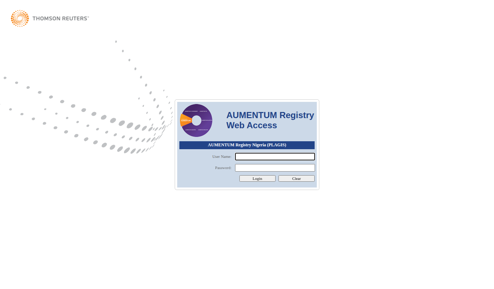 | Title "AUMENTUM Registry Web Access", banner "AUMENTUM Registry Nigeria (PLAGIS)", Spring Security form `j_spring_security_check` |
| Search – Transaction (`welcome.do#tab-search`) | 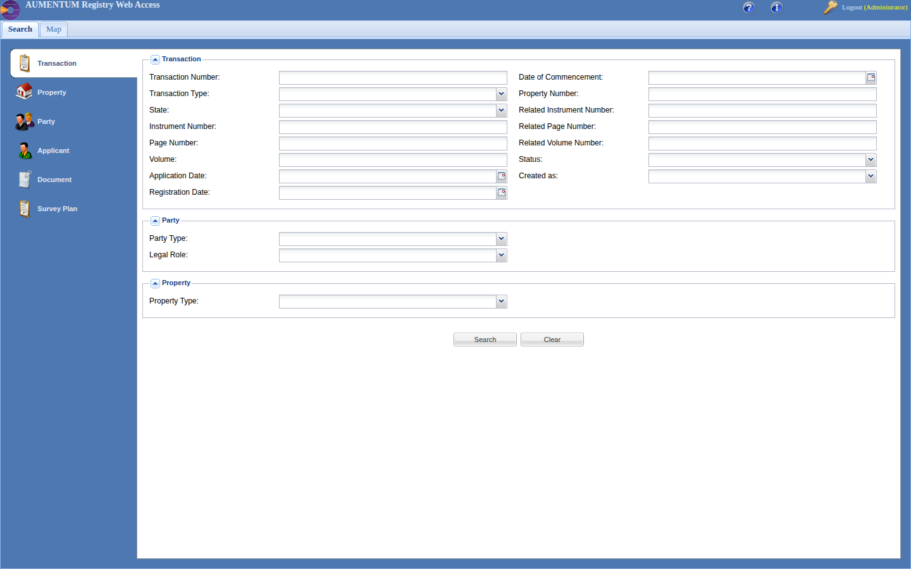 | Left group tabs: Transaction, Property, Party, Applicant, Document, Survey Plan. Collapsible fieldsets: Transaction / Party / Property. Buttons Search, Clear. Top tabs Search, Map; result and detail tabs open beside them |
| Search – Property | 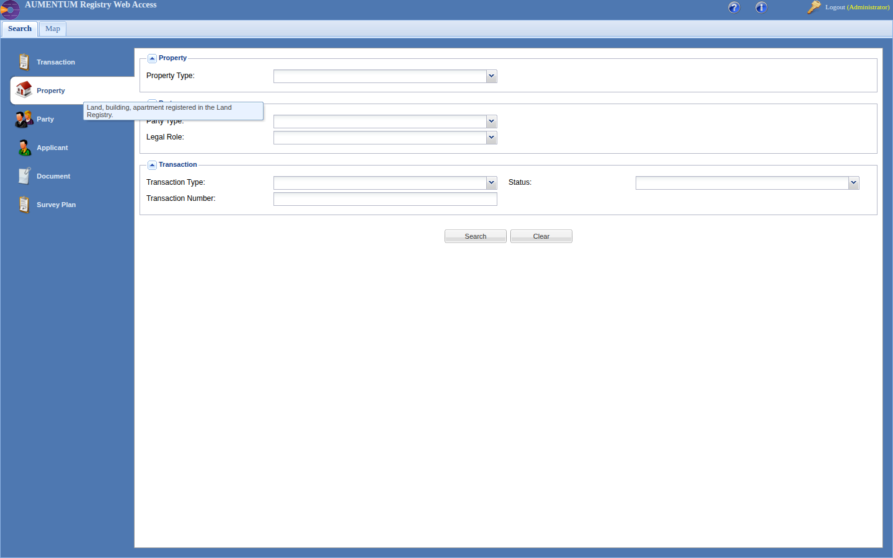 | Fieldsets Property / Party / Transaction; tooltip "Land, building, apartment registered in the Land Registry." |
| Search – Party | 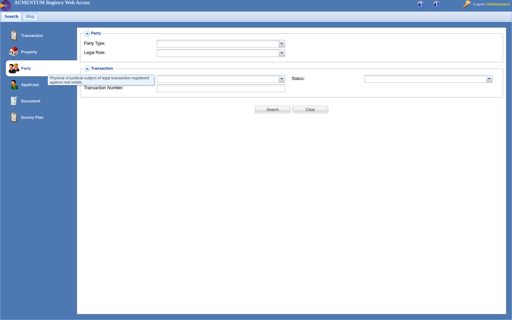 | Party Type, Legal Role + Transaction criteria |
| Search – Applicant | 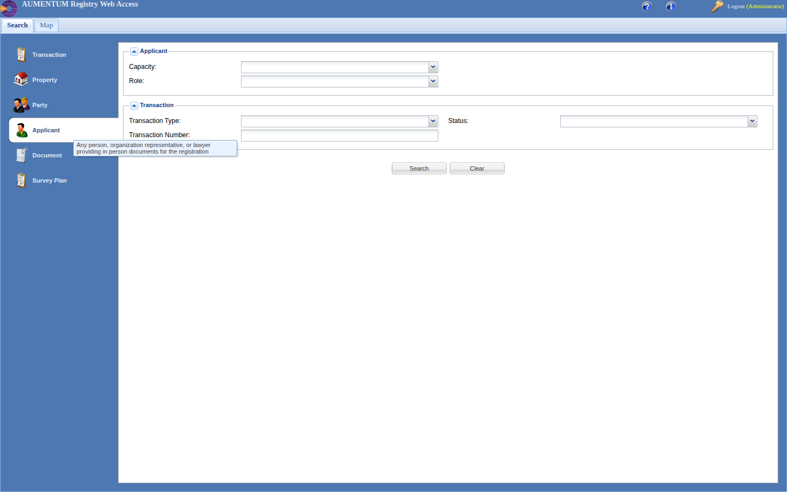 | Capacity, Role + Transaction criteria |
| Search – Document | 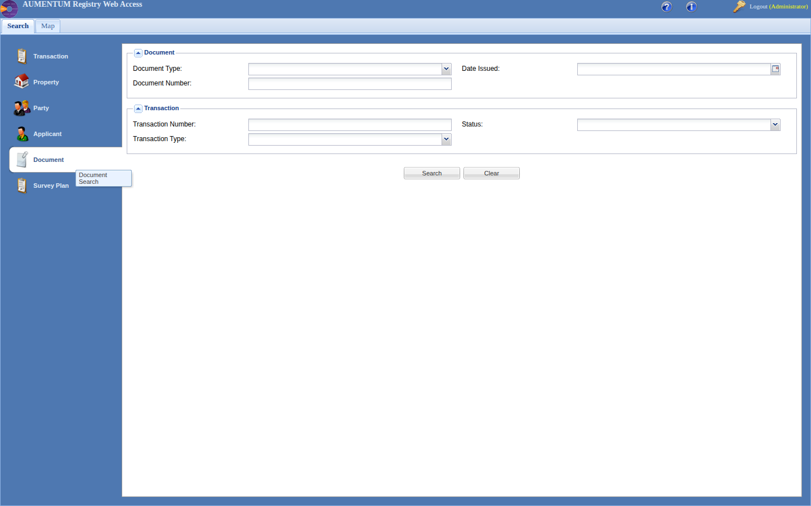 | Document Type, Document Number, Date Issued + Transaction criteria |
| Search – Survey Plan | 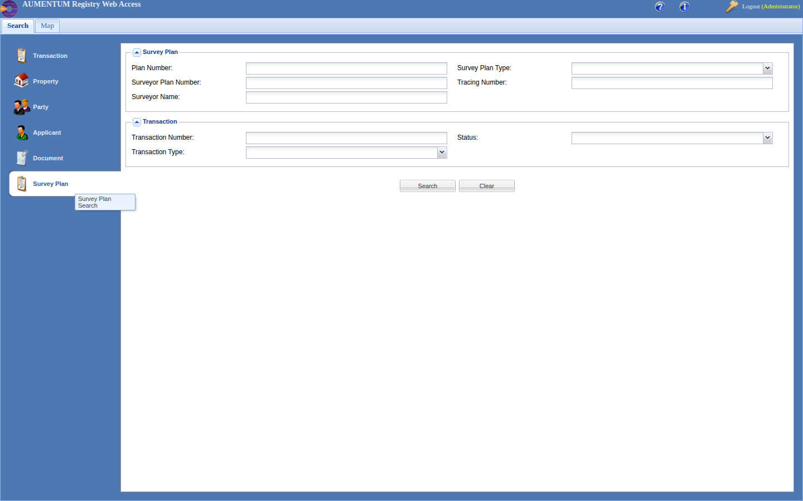 | Plan Number, Surveyor Plan Number, Surveyor Name, Survey Plan Type, Tracing Number + Transaction criteria |
| Map tab (`map.do`) | 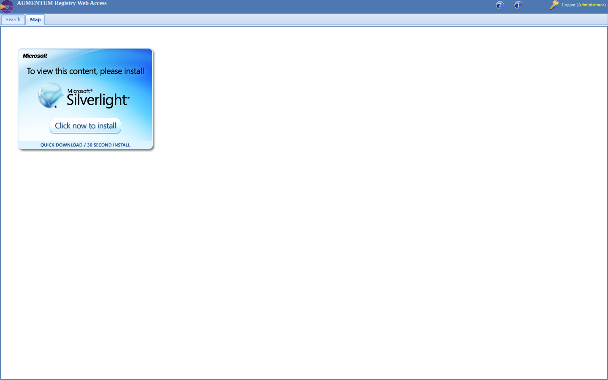 | Needs the **Silverlight** plug-in, so it works only in IE11 on the PCs. The replica must replace it (the new Cadastre map) |
| Search results (`#result:Transaction:…`) | 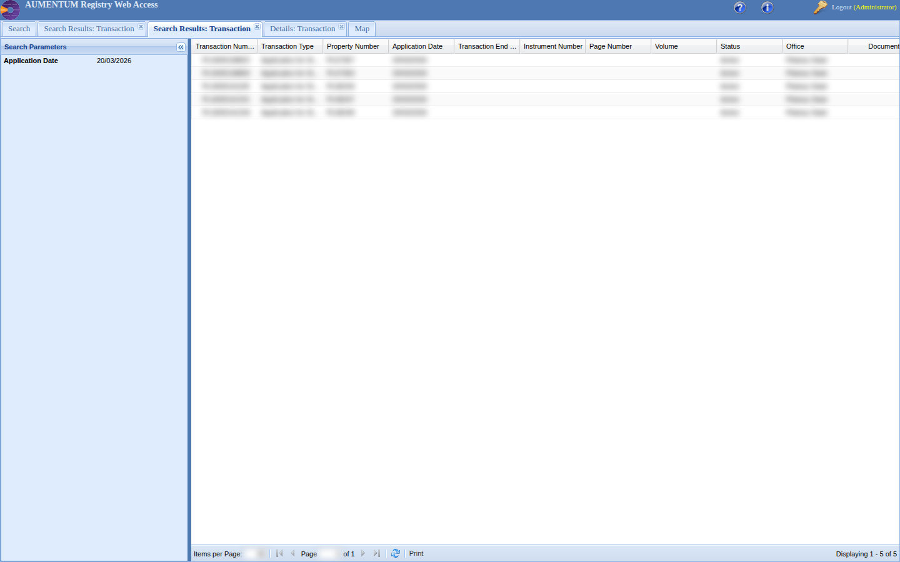 | Left panel "Search Parameters" (collapsible), grid columns: Transaction Number, Transaction Type, Property Number, Application Date, Transaction End Date, Instrument Number, Page Number, Volume, Status, Office, Documents. Paging bar: Items per Page, Page n of m, refresh, **Print**, "Displaying 1 - 5 of 5" |
| Transaction details – General (`#detail:Transaction:<id>`) | 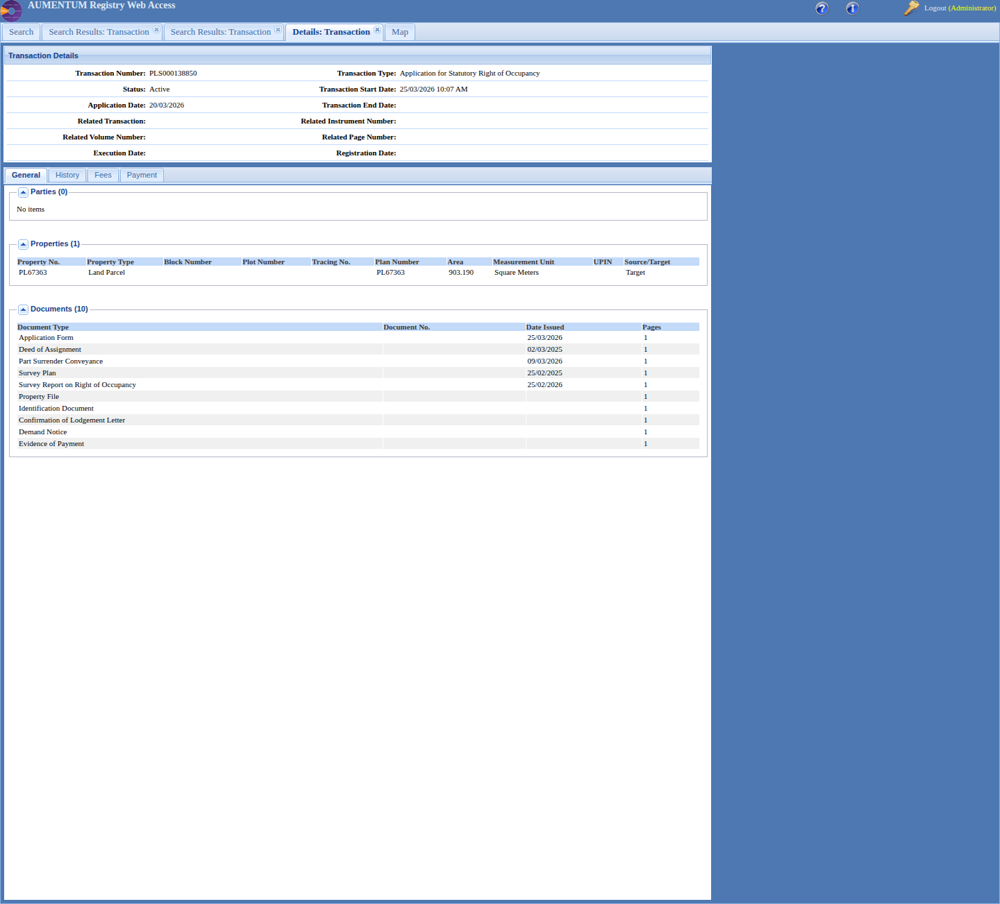 | Header "Transaction Details": Transaction Number, Transaction Type, Status, Transaction Start Date, Application Date, Transaction End Date, Related Transaction, Related Instrument Number, Related Volume Number, Related Page Number, Execution Date, Registration Date. Tabs **General / History / Fees / Payment**. General has collapsible sections: Parties (n), Properties (n): Property No., Property Type, Block Number, Plot Number, Tracing No., Plan Number, Area, Measurement Unit, UPIN, Source/Target; Documents (n): Document Type, Document No., Date Issued, Pages |
| Transaction details – History | 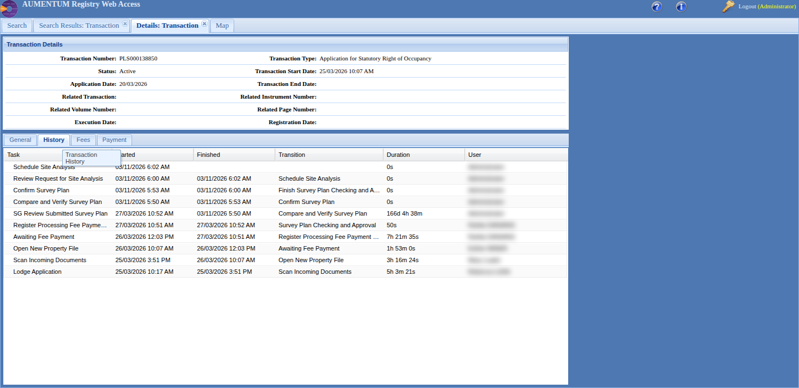 | Grid Task, Started, Finished, Transition, Duration, User (blurred), newest first: this is `lr_process_history`. The trial file shows the real First Registration route (see 04 §2.0) |
| Transaction details – Fees | 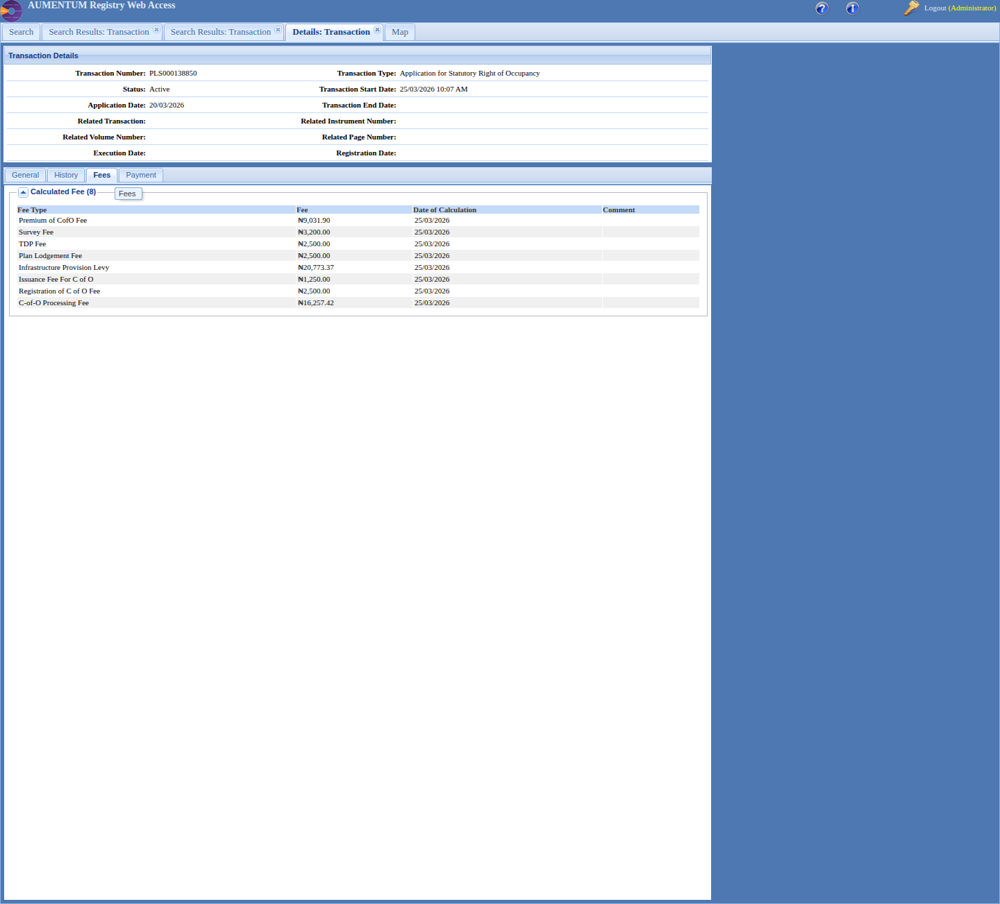 | "Calculated Fee (n)": Fee Type, Fee (₦), Date of Calculation, Comment. Trial file: 8 fees (Premium of CofO, Survey, TDP, Plan Lodgement, Infrastructure Provision Levy, Issuance Fee for C of O, Registration of C of O, C-of-O Processing) |
| Transaction details – Payment | 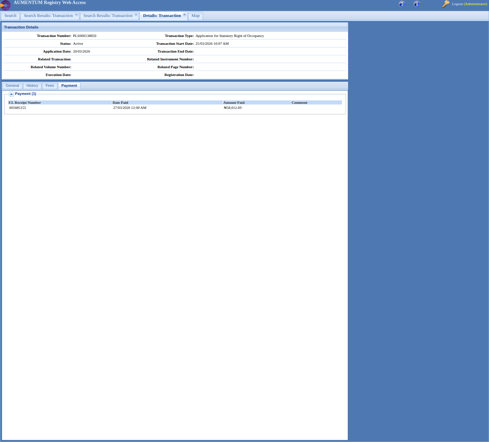 | "Payment (n)": F.I. Receipt Number, Date Paid, Amount Paid, Comment |
| About box (info icon) | 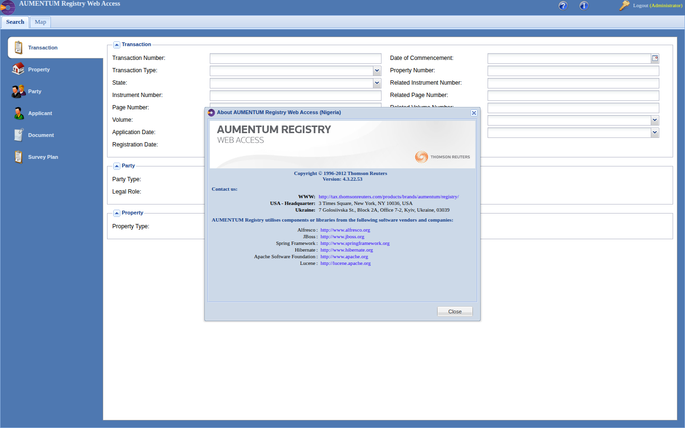 | "About AUMENTUM Registry Web Access (Nigeria)", version 4.3.22.53 |

Requests seen on the wire:
- Sign-in: `POST j_spring_security_check` (`j_username`, `j_password`).
- Combo boxes load `GET dictionary.do?v=4.3.22.53&category=<category>`.
- The reports tab loads `GET get.do?h=rpt&category=Content|Fee|Staff|Tracking`.
- Search posts `POST search.do?entityType=Transaction` with these fields: `start`, `limit=25`, `TransactionNumber`, `TransactionType`, `Region`, `Recordingno`, `Folio`, `Volume`, `ApplicationDate`, `RegistrationDate`, `StartDate`, `SourcePropertyIDs`, `RelatedInstrNumber`, `RelatedPageNumber`, `RelatedVolume`, `TransactionStatus`, `TransactionSource`, `Party.PartyType`, `Party.PartyRoleType`, `SpatialUnit.SpatialUnitType`. Wildcards use `*`.
- A single hit opens the detail. The page then calls `POST transaction.do` (`containerId=detail:Transaction:<id>-container-panel`, `id`, `entityType`, `ticket`) and `GET data.do?entityType=Transaction&id=<id>`. Transaction ids are `10` + 12 digits, e.g. PLS000138850 → `10000000138850`.

The detail pages of linked properties, parties and documents and the document viewer are not captured yet: the transaction detail shows them as plain tables with no links, so they have to be reached through their own search tabs (§5). Use exact numbers only, never wildcard searches: they are slow on the 755 GB live database.

HTML sources of the mock-ups: session scratchpad `web12/{lib,lwa,adm}.py` (generator) and `web12/html/*.html`.

Confidence used in the inventory (§3): **high** = seen in code or a label bundle tied to that screen; **medium** = elements
seen, assembly onto one screen inferred; **low** = only a label or a guess.

---

## 1. Registry Web Access (`/lrswa`)

### 1.1 Technology, as shown by the real client code

| Item | Value | Evidence |
|---|---|---|
| UI toolkit | **ExtJS 3.3** (`extjs/ext-base.js`, `ext-all-debug.js`, `ux/gridsummary/ext-patch-3.3.0.js`) with ux plug-ins `GroupTabPanel`, `GroupTab`, `Ext.ux.tot2ivn.VrTabPanel` (vertical tabs), `RowExpander`, `GroupSummary`, `GridSummary`, `MultiGrouping*`, `PagingMemoryProxy`, `TabCloseMenu`, `GridPrinter` | `$LWAJS/extjs/**` |
| Page model | one HTML page (`welcome.do`) holding an ExtJS `TabPanel` id **`main-pnl`**; everything else is AJAX + `Ext.History` hash tokens | `$LWAJS/js/tabs.js`, `extJSutils.js` |
| Server | Spring MVC `*.do` controllers (classes not captured) returning JSON or HTML fragments with scripts | `web.xml`; URLs in JS (§1.3) |
| Global JS state injected by the page (not captured) | `FormConfig[]` (one entry per search object), `msg[]` (localised strings, read with `_msg(key)`), `AppSettings`, `alfrescoTicket`, `locale`, `mapURL`, `isEmbedded`, `ILS.version`, label variables `dashboard_tab_results`, `dashboard_tab_details`, `msgSearchParams`, `msgAnyRecord`, `msgEmptyResult`, `msgFormEmpty`, `msgF1CannotBeLessThanF2`, `msgNoConnectToServer`, `msgLoading`, `msgPrint`, `msgProductName`, `btnSearchText`, `btnClearText` | referenced but not defined in `$LWAJS/js/*` → they come from the `welcome.do` JSP (inferred) |
| Locale | Spring `CookieLocaleResolver` (cookie `org.springframework.web.servlet.i18n.CookieLocaleResolver.LOCALE=en_US`); Arabic (`ar_*`) switches dictionary display to `labelLang`; Persian date handling present (`IsPersian`) | `$R/lrs-capture/state.json` (cookie names only), `extJSutils.js` `LrsDictionaryCombo`, `tabs.js` |
| Client defaults (overridden by `lr_setting webaccess`, inferred) | `AppSettings = {NumberOfRecordsInSearchResultsList: 20, EnableSearchByBlankFields: 0, DoubleClick: false, MaxResultTabs: 2, MaxDetailTabs: 2}` — PLAGIS `lr_setting` sets 25 records and blank search allowed | `extJSutils.js` l.1–7, `$R/lrs-export/registry/data/lr_setting.psv.gz` |
| Styling | `styles/main.css`: icon classes per search object (`icon-transaction`, `icon-instrInProcess`, `icon-property`, `icon-party`, `icon-person`, `icon-applicant`, `icon-document`, `icon-supDoc`, `icon-outDoc`, `icon-ct`, `icon-file`, `icon-survey`, `icon-regbook`, `icon-staff`, `icon-launit-small`, `icon-interest-small`, plus product leftovers `icon-appraiser*`, `icon-dpda`, `icon-ekkr`), `mainTabPanelTab`, `panelTitle`, `mainSubTitle`, `x-row-bold`, `x-row-gray`; images `LRSLogo.png`, `new_logo.png`, `login.png`, `bg.png`, `loaderBlue.gif`, `icons/{transaction,property,party,applicant,doc}.png` | `$LWAJS/styles/main.css`, `$LWAJS/images/` |

### 1.2 Endpoints the client calls (the replica's Web Access back-end contract)

| URL (relative to `/lrswa/`) | Method / params | Returns | Called from |
|---|---|---|---|
| `welcome.do` | GET `?locale=&user=&ticket=` (SSO from the Desktop) | the shell page (JSP, not captured) | Desktop, session-expired redirects (`document.location.replace('welcome.do')`) |
| `search.do?entityType=<Type>` | GET/POST store params: all search-form fields by `name`, `start`, `limit`, `sort`, `dir`, `nocache`; special case: a form value with id `Upin` is replaced by the single param **`Parcel.Upin`** | JSON `{rows:[...], rowCount:n}` (`root:'rows'`, `totalProperty:'rowCount'`, `remoteSort:true`); on error JSON `{msg:"..."}`, `msg == 'Session has expired.'` → back to `welcome.do` | `grids.js CreateSearchStore`, `tabs.js searchToTab` |
| `detail.do` (or `fc.detail` per search object) | POST `containerId, id[, id2], entityType, ticket` | **HTML fragment with scripts**, rendered into the detail tab (`autoLoad … scripts:true`) | `tabs.js detailToTab` |
| `details/<template>.do?v=<version>` | GET | an HTML/XTemplate body template for a lazily shown detail sub-panel (`ILS.TemplatePanel`) | `extensions.js` |
| `get.do` | generic data handler: `q`, `h` (handler), `id`, `string`, `qf=1`, `form`, `formOnly`, `fromExclude`, `qp=1`, `prefix`, `renPrefix`; `h=rpt&category=` (report list); `h=alf&action=login` → `{endpoint, ticket}` and `h=alf&action=logout&ticket=` | JSON | `extensions.js ILS.generateGetRequest`, `ILS.execTicketedRequest`, `reports.js` |
| `dictionary.do?v=<version>` | GET `category=<lr_dictionary.category>[&code=<parent code>]` | `{rows:[{id, code, label, descr, labelLang, descrLang}]}` — combo **value = `id`**, display = `label` | `extJSutils.js LrsDictionaryCombo`, `linkCombos` (parent/child combos, e.g. State → LGA) |
| `locales.do` | GET | `{rows:[{code,name}]}` | language combo (hidden at PLAGIS) |
| `map.do` | GET `mapCfg=<config>` | HTML fragment hosting the Silverlight map control `mapSilverlightControl` | `map.js showEntityOnMap` |
| `documentPage.do?uuid=<alfresco node uuid>` | GET | page image of a scanned document | `imgviewer.js` / `utils.js getURLById` |
| `partyContacts.do` | POST `id=<partyId>, containerId` | HTML fragment in a modal window "Party Contacts" (750×300, Close) | `extJSutils.js showPartyContactsWindow` |
| `produceReport.do` | POST form `reportName`, `param.<name>`… (target `_blank`) | the generated report (pdf) | `reports.js` Generate |
| **`/lrs/n/webapi/jsp/dashboard/webapi/reports`** (on the **lrs** server, endpoint from `get.do?h=alf`) | GET `operation=get-report-params, reportName, ticket` | JSON array of parameter definitions `{name, displayName, dataType ('Date Time', …), value}` | `reports.js` via `ILS.execTicketedRequest` (login → call → logout) |

Replica note: these are the only server calls the captured JS makes; a replacement back end that answers them with the
same JSON shapes could serve the original client unchanged (useful as a stepping stone), but `welcome.do`'s JSP
(FormConfig, labels, settings) and the `detail.do` fragments are **not captured** and would have to be re-created.

### 1.3 Shell, tabs and the hash-route grammar (from `tabs.js`, `extJSutils.js`)

* `main-pnl` holds, in this order: the **Search** tab (index 0; contains `search-tab-panel`, a **GroupTabPanel** with one
  vertical group `searchTabPanelItem<code>` per `FormConfig` entry), then up to `MaxResultTabs` **result tabs**, then up
  to `MaxDetailTabs` **detail tabs**, and the **map tab** `tab-map`. Older result/detail tabs are removed when the limit
  is passed. Result/detail tabs are closable.
* Tab titles: `dashboard_tab_results + ': ' + fc.title` and `dashboard_tab_details + ': ' + fc.title`.
* Navigation is driven by **`Ext.History` tokens** (the URL fragment). `tokenDelimiter = ':'`, `doQueryIdName = 'doQuery'`.

| Token (after `#`) | Meaning | Handler |
|---|---|---|
| *(empty)* | activate the Search tab | `historyChangeHandler` |
| `tab-search`, `tab-map`, any component id | activate that tab | same |
| `result:<Type>:<query>` | run the search for object type `<Type>` with `<query>` = `field=value&field=value…` (values `encodeURIComponent`, `%` turned into `*`; empty values dropped); `doQuery=1` forces re-execution even if the tab exists. Extra `:` inside the query are re-joined. | `searchToTab(type, q)` |
| `detail:<Type>:<id>[:<id2>]` | open the detail tab of entity `<id>` (optional second key) | `detailToTab` |
| `map:<Type>:<id>` | activate `tab-map` and show the entity on the map (`loadMap` → `<GISViewer>/IProxy.html#<type>:<id>` through the hidden iframe `innerFrameProxy`) | `historyChangeHandler` |

Examples used by the Desktop (06 §3.2): `#detail:Transaction:{id}` and
`#result:SourceDocument:Transaction.TransactionNumber=PLS000138850` — i.e. `<Type>` is the `FormConfig.type`
(entity class name) and the query keys are **property paths** (`Transaction.TransactionNumber`). Search-form field
names are capitalised property names (map callback does `lrsPropName.capitalize()`), e.g. `Upin`.

**Embedded mode** (`isEmbedded`): the same tokens drive single-panel versions (`searchToPanel`, `detailToPanel`) —
used when Web Access is shown inside another application (e.g. the GISViewer "Show in LWA" action) (inferred).

**Search execution rules** (`forms.js prepareSearchForm`, `tabs.js searchToTab`):

1. Enter (key 10/13) clicks **Search**; **Clear** resets the form.
2. If the object has `fieldsToFill` (list of field names) the client checks that **any** (or **all**, if
   `fieldsToFillAll`) are filled and are **not wildcards** (`*` or `%`) — else shows `fieldsToFillMessage`
   (e.g. WF `fieldsToFillMessage` "Please enter at least one attribute to conduct search." / guest
   `guestFieldsToFillMessage`).
3. If `AppSettings.EnableSearchByBlankFields` is 0, at least one text/composite field must be filled (`msgFormEmpty`).
   PLAGIS has 1 (blank searches allowed).
4. Date pairs named `…From` / `…To`: To may not be before From (`f1_cannot_be_less_than_f2` "\"%s\" cannot be less than \"%s\".").
5. Dates are sent as `m/d/Y` (Gregorian) whatever the display format.
6. The result tab shows the grid (centre) and a collapsible **"Search Parameters"** panel (west, 300 px, background
   `#deecfd`) listing label/value pairs of the criteria used (combo text, not ids), or "Any record".
7. **Zero hits** → warning `msg.empty_result` "No matching records found" and back to `tab-search`.
   **Exactly one hit on the first page → the detail tab opens directly.**
8. A row click (or double-click if `AppSettings.DoubleClick`) opens `detail:<Type>:<row id>`.
9. Optional `fc.defaultSort` is applied ascending.

**Paging toolbar** (`Ext.ux.PagingToolbar` in `extJSutils.js`): First / Previous / page box / Next / Last, **"Items per Page:"**
number box (1–100), Refresh, **Print** (prints the grid via `Ext.ux.GridPrinter`), "displayInfo" text (ExtJS default
"Displaying {0} - {1} of {2}" unless overridden; MSG has `found_xxx_items` "Found {0} items" and `page_1_of_2` "Page %s of %s").

**Messages** use `Ext.Msg.show` titled `msgProductName` (OK button, warning/error/info icons); a full-page `loading`
div ("Loading...") is shown by `ShowProgress()`.

### 1.4 Navigation map (Web Access)

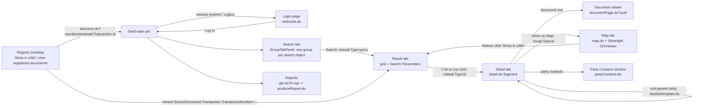

### 1.5 Screens

Each screen: picture, route, content, actions, evidence. Field lists are the `lr_formfield` rows in `Id` order
(display order is assumed to follow `Id`; there is no order column). "RO" = `readonly_for = all`.

#### 1.5.1 Login, session expiry, guest

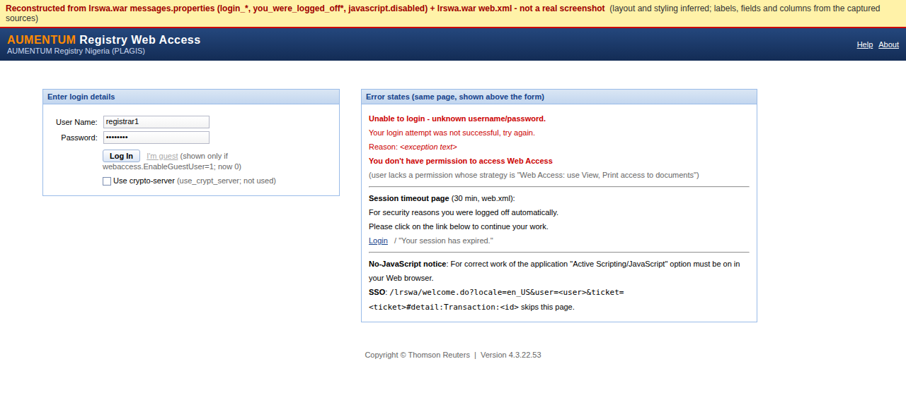

| Item | Detail | Evidence |
|---|---|---|
| Route | `/lrswa/` → `index.jsp` → `welcome.do`; unauthenticated users get the login form (Spring Security; login URL name not captured) | `lrswa.war/WEB-INF/web.xml` |
| Fields | User Name (`user`), Password (`password`, label "****"), optional "Use crypto-server" (`use_crypt_server`) | MSG |
| Buttons / links | **Log In** (`login_as_user`), **"I'm guest"** (`login_as_guest`, only if `webaccess.EnableGuestUser=1`; PLAGIS 0) | MSG, `lr_setting` |
| Header | "Enter login details" (`login_details`), logo `AUMENTUM Registry  Web Access` / "AUMENTUM Registry Nigeria (PLAGIS)" | MSG |
| Errors | "Unable to login - unknown username/password." (`login_error`); "Your login attempt was not successful, try again." + "Reason:" (`login_error_1`, `login_error_reason`); "You don't have permission to access Web Access" (`login_no_permission`) | MSG |
| Session end | "For security reasons you were logged off automatically." / "Please click on the link below to continue your work." / "Your session has expired."; AJAX calls get `{msg:'Session has expired.'}` and redirect to `welcome.do` | MSG, `grids.js`, `tabs.js` |
| SSO | `welcome.do?locale=…&user=…&ticket=…#…` skips the form (06 §3.2) | `$D/.../ShellForm.cs` |
| No JS | "For correct work of the application "Active Scripting/JavaScript" option must be on in your Web browser." | MSG `javascript.disabled` |
| Guest search | form `TransactionGuestLWA`: Transaction Type* (`lrs:TransactionMetaData`), Transaction Number* — message "Invalid search criteria. Please specify Type and Number of Transaction." (WF; `wf_en_US` variant "…Transaction Number or Transaction.") and MSG `guest_search_message` "…either {0} or {1} must be specified!" | FF, WF, MSG — shown in picture 21 |

#### 1.5.2 Shell and the Search tab (search-object chooser)

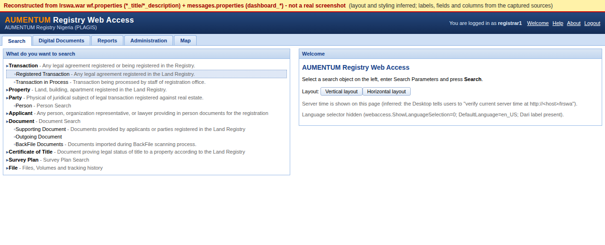

* Header: logo, "You are logged in as" (`login_logged_as`) + user, links Welcome, Help (help folder `en-US`), About, Logout
  (`logoff.text`). Language combo hidden (`ShowLanguageSelection=0`).
* Search tab (`dashboard_tab_searches` "Search", sub-title `dashboard_tab_searches_details` "What do you want to search"):
  a **vertical GroupTabPanel**, one group per `FormConfig` entry with its icon (`icon-*` classes), title and description
  from WF. Selecting a group shows that object's search form (the mock-up draws this as a tree on the left; the real
  widget is a vertical group-tab strip — see the real screenshot when available).
* Search objects (WF titles/descriptions; icon classes from `main.css`):

| Search object | WF title / description | Icon class | Search form (FF, inferred unless stated) | Result grid (FF) |
|---|---|---|---|---|
| Transaction → Registered Transaction / Transaction in Process | "Any legal agreement registered or being registered in the Registry." / "…registered in the Land Registry." / "Transaction being processed by staff of registration office." | `icon-transaction`, `icon-instrInProcess` | **`TransactionFormSearchLWA`** (high: the only `*SearchLWA` form) | `TransactionGridLWA` or `TransactionGridWithPropertySourceTargetLWA` |
| Property | "Land, building, apartment registered in the Land Registry." | `icon-property` | `PropertySearchForm` | `PropertyGridWithSourcePropertyLWA` (or `PropertyGrid`) |
| Party / Person | "Physical of juridical subject…" / "Person Search" | `icon-party`, `icon-person` | `PartiesSearchForm` / `PartyContactsSearchForm` | `PartiesSearchGrid` / `PartyContactsSearchGrid` |
| Applicant | "Any person, organization representative, or lawyer providing in person documents for the registration" | `icon-applicant` | `SearchIndApplicantForm` / `SearchCorpApplicantForm` | **`SearchApplicantGridLWA`** |
| Document → Supporting / Outgoing / BackFile | "Document Search"; "Documents provided by applicants or parties…"; "Documents imported during BackFile scanning process." | `icon-document`, `icon-supDoc`, `icon-outDoc` | not in FF (inferred: built in JSP) | `SupportedDocGrid` (inferred) |
| Certificate of Title | "Document proving legal status of title to a property according to the Land Registry" | `icon-ct` | not in FF | — |
| Survey Plan | "Survey Plan Search" | `icon-survey` | `SurveyPlanForm` (inferred) | **`SurveyPlanGridLWA`** |
| File | "Files, Volumes and tracking history" | `icon-file` | not in FF | — |
| Property Registration Book, Staff | (labels `property_regbook`, icons `icon-regbook`, `icon-staff`) | | not in FF | — |

The exact list and order of objects enabled at PLAGIS is in `FormConfig` (JSP, **not captured**).

#### 1.5.3 Transaction search and result grid

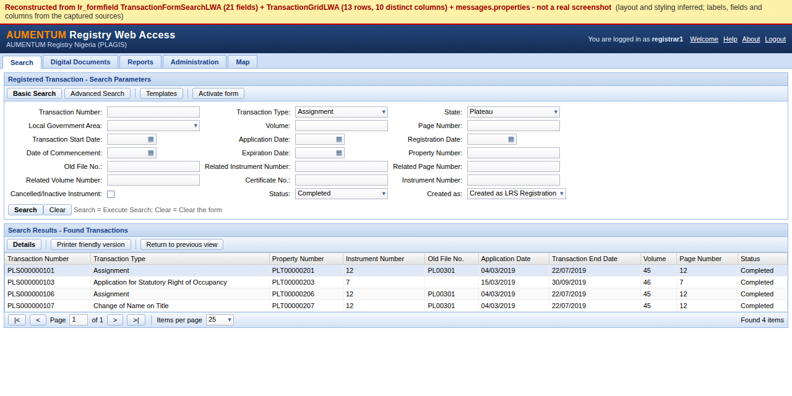

Route: `#result:Transaction:<query>` (type string assumed `Transaction`; for "in process" a second FormConfig type, name
not captured). Request: `search.do?entityType=Transaction`.

Search form **`TransactionFormSearchLWA`** (21 fields):

| # | Label | Attribute | Type / dictionary | Notes |
|---|---|---|---|---|
| 1 | Transaction Number | transactionNumber | text | |
| 2 | Transaction Type | transactionType | `lrs:TransactionMetaData` (`lr_transaction_metadata`, 42 codes) | |
| 3 | State | region | dict `region` (37) | parent of LGA (`linkCombos`) |
| 4 | Local Government Area | localGovernmentArea | dict `local_government_area` | child combo (inferred) |
| 5 | Volume | volume | text(20) | |
| 6 | Page Number | folio | text(20) | |
| 7 | Transaction Start Date | createDate | date-time `dd/MM/yyyy hh:mm tt` | |
| 8 | Application Date | applicationDate | date | |
| 9 | Registration Date | registrationDate | date-time | rule `LE today` |
| 10 | Date of Commencement | startDate | date | `LE today` |
| 11 | Expiration Date | expirationDate | date | |
| 12 | Property Number | sourcePropertyIDs | text(250) | |
| 13 | Old File No. | oldPropertyId | text(50) | |
| 14 | Related Instrument Number | relatedInstrNumber | text(50) | |
| 15 | Related Page Number | relatedPageNumber | text(50) | `enabled_for` APSL,APRO,CONT |
| 16 | Related Volume Number | relatedVolume | text(50) | `enabled_for` APSL,APRO,CONT |
| 17 | Certificate No. | certNos | text(255) | |
| 18 | Instrument Number | recordingno | text(30) | |
| 19 | Cancelled/Inactive Instrument | isInactive | checkbox | |
| 20 | Status | transactionStatus | dict `transaction_status` (Active, Completed, Postponed, Rejected, Suspended, Withdrawn) | |
| 21 | Created as | transactionSource | dict `record_source` (Created as LRS Registration, Created as Past, …) | |

Result grid **`TransactionGridLWA`** (13 rows; `applicationDate` appears 3× and `recordingno` 2× — the distinct
columns are): Transaction Number, Transaction Type, Property Number, Instrument Number, Old File No., Application Date,
Transaction End Date, Volume, Page Number, Status. Variant **`TransactionGridWithPropertySourceTargetLWA`** adds
**Source/Target** (computed, `data_length 0`) — used inside a property's transaction list (inferred).
Lists probably drop codes in `config.HideNormalTransactionCode` / `HidePastTransactionCode` (inferred).

Actions: Search, Clear, row click → detail, paging toolbar (Items per Page, Print), close tab.

#### 1.5.4 Advanced search (low confidence)

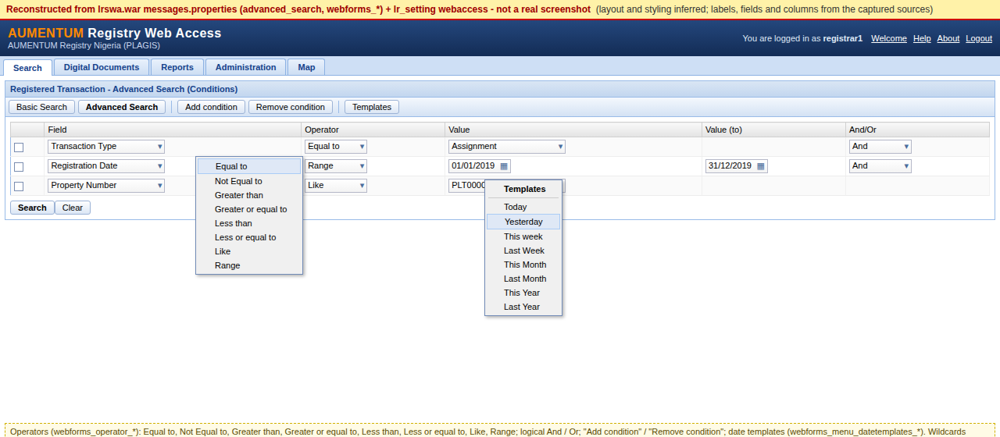

MSG contains a full condition-builder vocabulary — `basic_search`, `advanced_search`, `webforms_menu_conditions`,
`webforms_menu_addcondition` / `removecondition`, operators (`webforms_operator_eq|ne|more|more_or_eq|less|less_or_eq|like|range`,
`logical_and|or`), date templates (`webforms_menu_datetemplates_today … lastyear`) and `webforms_menu_templates` —
**but none of the captured JS files implements it**. It may live in the JSP or be a product feature unused at PLAGIS.
Treat the mock-up as a label inventory only; confirm with a real screenshot.

#### 1.5.5 Transaction detail

Route `#detail:Transaction:<lr_transaction.id>` → POST `detail.do` `{containerId, id, entityType:'Transaction', ticket}`.
The server returns an HTML fragment whose scripts build an ExtJS panel; sub-panels are `ILS.TemplatePanel`s whose
bodies are fetched lazily from `details/<template>.do` when first shown, and grids are local `PagingMemoryProxy` grids
(`prepareLocalGrid`, `getGridPanel`) loaded from the JSON embedded in the fragment. **Template names and the order of
sections are not captured**; the sections below are WF labels grouped by meaning.

Pictures 05–11 (one per section group):

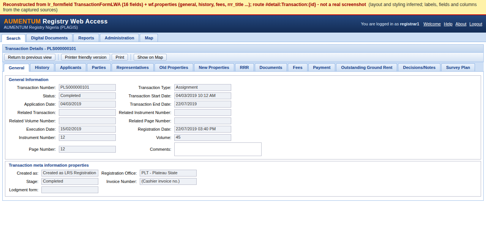

| Section (WF label) | Content | Source |
|---|---|---|
| General / General Information | form **`TransactionFormLWA`** (16, read-only): Transaction Number, Transaction Type, Status, Transaction Start Date (createDate, date-time), Application Date, Transaction End Date (completeDate), Related Transaction, Related Instrument Number, Related Volume Number, Related Page Number, Execution Date (signDate, `LE today`), Registration Date (date-time, `LE today`), Instrument Number (recordingno), Volume, Page Number (folio), Comments (multiline, 800) | FF |
| Transaction meta information properties | Created as (`transaction_source`), Registration Office (`regoffice`), Stage/Task, Invoice Number, Lodgment form | WF |

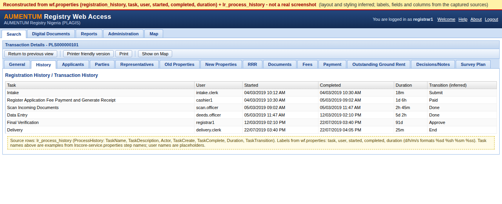

| Section | Content | Source |
|---|---|---|
| History / Transaction History / Registration History | grid: Task, User, Started, Completed, Duration (`%sd %sh %sm %ss`) — from `lr_process_history` (`ProcessHistory`: TaskName/TaskDescription, Actor, TaskCreate, TaskComplete, Duration, TaskTransition). The Desktop equivalent is `HistoryViewForm` (Started, Finished, Duration, Task, Transition, User) | WF, `hbm/ProcessHistory.hbm.xml`, FF |

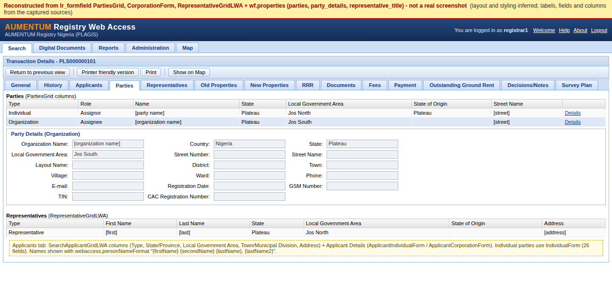

| Section | Content | Source |
|---|---|---|
| Applicants / Applicant Details | `SearchApplicantGridLWA` columns (Type, State/Province, Local Government Area, Town/Municipal Division, Address) + `ApplicantIndividualForm` (27) / `ApplicantCorporationForm` (18) | FF |
| Parties / Party Details | `PartiesGrid` (Type, Role, Name, State, LGA, State of Origin, Street Name) + `IndividualForm` (26) / `CorporationForm` (17); "Party Contacts" window via `partyContacts.do` | FF, `extJSutils.js` |
| Representatives / Representative Details | **`RepresentativeGridLWA`** (7): Type, First Name, Last Name, State, Local Government Area, State of Origin, Address | FF |
| Name format | `webaccess.personNameFormat` `{firstName} {secondName} {lastName}, {lastName2}`; renderers `fullNameValueRenderer`, `addressValueRenderer` | `lr_setting`, `extJSutils.js` |

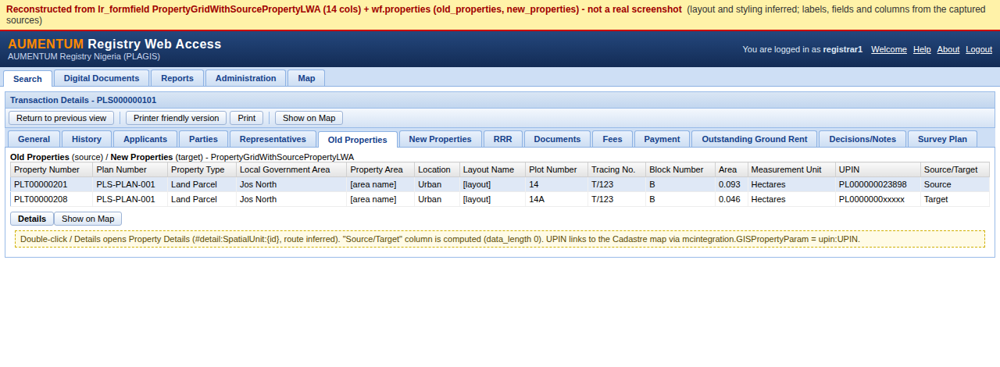

| Section | Content | Source |
|---|---|---|
| Old Properties / New Properties | **`PropertyGridWithSourcePropertyLWA`** (14): Property Number (uid), Plan Number, Property Type, Local Government Area, Property Area, Location, Layout Name, Plot Number, Tracing No., Block Number, Area (n3), Measurement Unit, **UPIN**, Source/Target. Row → `#detail:<property type>:<id>`; Show on Map | FF, `map.js` |

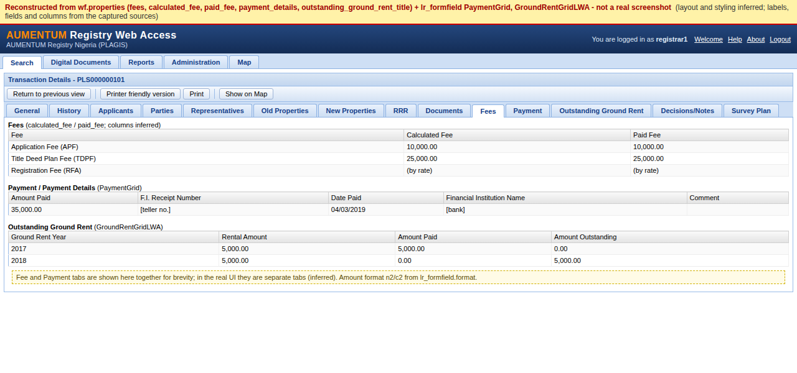

| Section | Content | Source |
|---|---|---|
| Fees | Calculated Fee, Paid Fee (columns inferred) | WF |
| Payment / Payment Details | `PaymentGrid` (5): Amount Paid (c2), F.I. Receipt Number, Date Paid, Financial Institution Name, Comment | FF (grid used by the Desktop; LWA use inferred) |
| Outstanding Ground Rent | **`GroundRentGridLWA`** (4): Ground Rent Year, Rental Amount (n2), Amount Paid (n2), Amount Outstanding (n2) | FF |
| Decisions/Notes | `TransactionNoteGrid` (Comments, Date/Time, User, Task, Type) (inferred) | WF, FF |

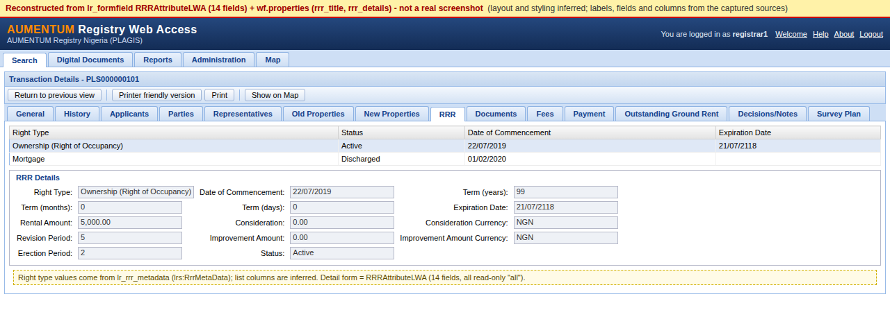

| Section | Content | Source |
|---|---|---|
| RRR / RRR Details | **`RRRAttributeLWA`** (14, RO): Right Type (`lrs:RrrMetaData`), Date of Commencement, Term (years) (`\d{1,2}`), Term (months) (`LE 11`), Term (days) (`LE 31`), Expiration Date, Rental Amount (c2), Consideration (n2), Consideration Currency, Revision Period, Improvement Amount, Improvement Amount Currency, Erection Period, Status | FF |
| Survey Plan / Survey Details | `SurveyPlanForm` fields (PLAGIS `lr_survey_plan` = 0 rows) | FF |

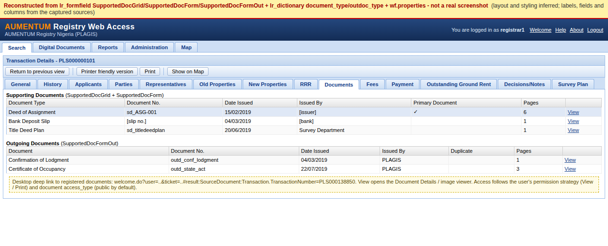

| Section | Content | Source |
|---|---|---|
| Documents → Supporting Documents | `SupportedDocGrid` (Document Type, Document No., Date Issued, Issued By) + `SupportedDocForm` (Document Type `document_type`, Document Number, Date Issued, Primary Document, Issued By `issued_by`, Property File Page, Description) | FF |
| Documents → Outgoing Documents | `SupportedDocFormOut` (Document `outdoc_type`, Document No., Date Issued, Issued By, Primary Document, Duplicate, Description) | FF |
| Primary Document, Pages (`page_count`), Archived | flags/labels | WF, MSG |

Detail toolbar actions (MSG): "Return to previous view" (`dashboard_tab_search_navigation`), "Printer friendly version"
(`dashboard_print_form`), Print, "Show on Map" (`show_on_map`) for objects with a `gis` config.

#### 1.5.6 Property search and detail

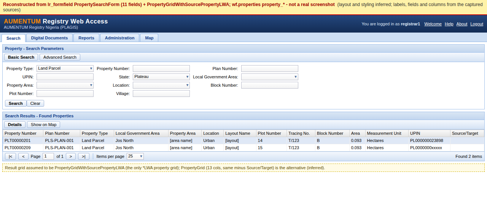

`PropertySearchForm` (11): Property Type (`spatial_unit_type` — only "Land Parcel" at PLAGIS), Property Number (uid),
Plan Number, UPIN, State, Local Government Area, Property Area (`property_area`, 1,118 terms), Location (`location`),
Block Number, Plot Number, Village (address.cell). A UPIN criterion is sent as `Parcel.Upin` (`tabs.js`).
Result grid as §1.5.5 Old/New Properties.

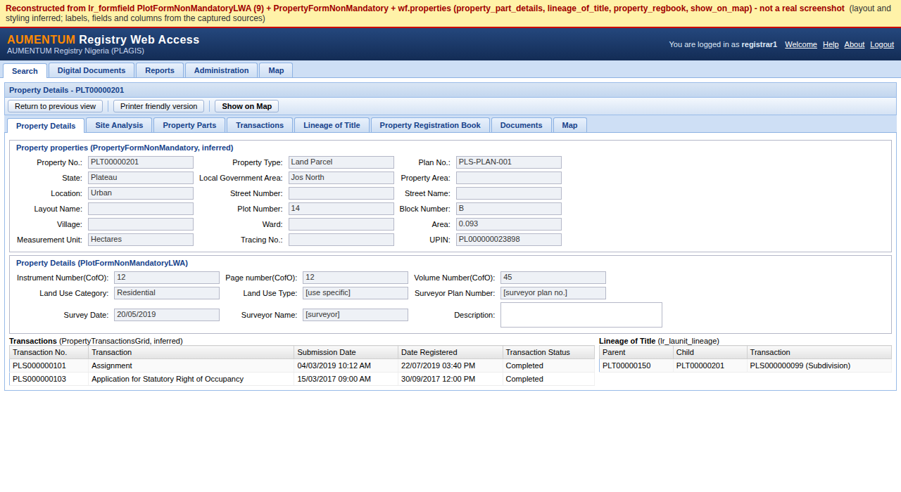

| Section (WF) | Content | Source |
|---|---|---|
| Property properties | `PropertyFormNonMandatory` (18, inferred for LWA): Property No., Property Type, Plan No., State, LGA, Property Area, Location, Street Number/Name, Layout Name, Plot Number, Block Number, Village, Ward, Area, Measurement Unit, Tracing No., UPIN | FF |
| Property Details | **`PlotFormNonMandatoryLWA`** (9): Instrument Number(CofO), Page number(CofO), Volume Number(CofO), Land Use Category (`actual_use_type`), Land Use Type (`use_specific`), Surveyor Plan Number, Survey Date, Surveyor Name, Description | FF |
| Site Analysis | **`SiteAnaFormNonMandatoryLWA`** (54) — picture 14 | FF |
| Property Parts / Part Name | `property_parts`, `proppartname` | WF |
| Transactions | `PropertyTransactionsGrid` (Transaction No., Transaction, Submission Date, Date Registered, Transaction Status) (inferred) | FF |
| Lineage of Title (Parent / Child) | `lr_launit_lineage` | WF |
| Property Registration Book (Book Number) | `regbookNumber` | WF |
| System PIN / System Property Number | labels | WF |
| Show on Map | `#map:<type>:<id>` → map tab, zoom by `GISPropertyParam = upin:UPIN` | `map.js`, `lr_setting` |

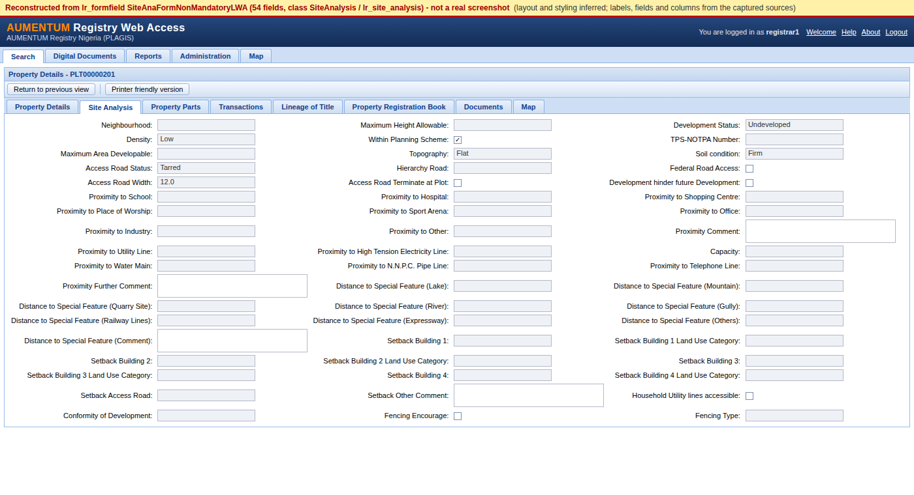

Site Analysis fields (54, in order): Neighbourhood; Maximum Height Allowable (dict); Development Status (dict); Density
(dict); Within Planning Scheme (bool); TPS-NOTPA Number; Maximum Area Developable; Topography (dict); Soil condition (dict);
Access Road Status (dict); Hierarchy Road; Federal Road Access (bool); Access Road Width; Access Road Terminate at Plot
(bool); Development hinder future Development (bool); Proximity to School / Hospital / Shopping Centre / Place of Worship /
Sport Arena / Office / Industry / Other; Proximity Comment; Proximity to Utility Line / High Tension Electricity Line;
Capacity; Proximity to Water Main / N.N.P.C. Pipe Line / Telephone Line; Proximity Further Comment; Distance to Special
Feature (Lake / Mountain / Quarry Site / River / Gully / Railway Lines / Expressway / Others / Comment); Setback Building
1–4 with Land Use Category each (dict `actual_use_type`); Setback Access Road; Setback Other Comment; Household Utility
lines accessible (bool); Conformity of Development; Fencing Encourage (bool); Fencing Type (`fencing_type`).

#### 1.5.7 Party, Person and Applicant search

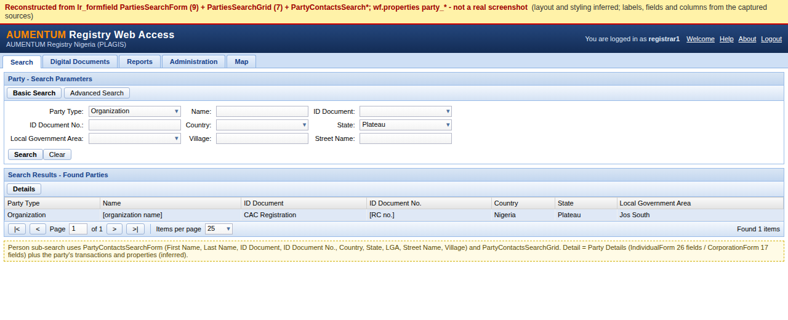

* `PartiesSearchForm` (9): Party Type (`party_type`: Individual, Organization, Governor, Data Processing Unit,
  Representative, MLSTP), Name, ID Document (`id_document_type`), ID Document No., Country, State, LGA, Village, Street
  Name. Grid `PartiesSearchGrid` (7): Party Type, Name, ID Document, ID Document No., Country, State, LGA.
* Person: `PartyContactsSearchForm` (First Name, Last Name, ID Document, ID Document No., Country, State, LGA, Street
  Name, Village) → `PartyContactsSearchGrid` (7).

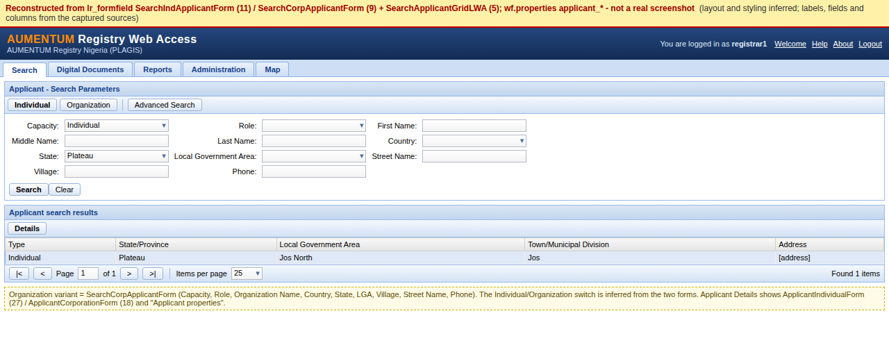

* Applicant: `SearchIndApplicantForm` (11: Capacity, Role (`applicant_role_type`), First/Middle/Last Name, Country,
  State, LGA, Street Name, Village, Phone) or `SearchCorpApplicantForm` (9: Capacity, Role, Organization Name, Country,
  State, LGA, Village, Street Name, Phone) → **`SearchApplicantGridLWA`** (Type, State/Province, LGA, Town/Municipal
  Division, Address). Applicant detail adds "Applicant properties".

#### 1.5.8 Document search, deep link and viewer

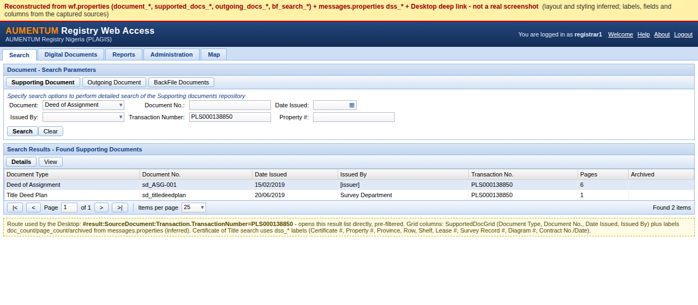

* Sub-objects Supporting / Outgoing / BackFile documents with hints "Specify search options to perform detailed search of
  the Supporting documents repository" etc. (WF). Result titles "Found Supporting Documents", "Found Outgoing Documents".
* **Deep link** `#result:SourceDocument:Transaction.TransactionNumber=<PLS…>` (Desktop) — runs this search pre-filtered.
* Certificate-of-Title style document types carry `dss_*` labels (MSG): Certificate Of Title, Lease Agreement, Sketch
  Plan, Survey Diagram, Green Contract, Property File; fields Property #, Property ID, Contract No., Contract Date,
  Lease #, Certificate #, Survey Record #, Diagram #, Sketch Plan, Province, Row, Shelf, Pages.

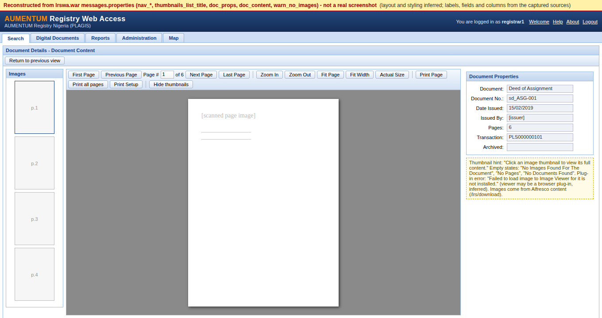

* Page images: `documentPage.do?uuid=<node uuid>` (`imgviewer.js`). Toolbar labels (MSG `nav_*`): First/Previous/Next/Last
  Page, Page #, Zoom In/Out, Fit Page, Fit Width, Actual Size, Print Page, Print all pages, Print Setup, Show/Hide
  thumbnails; "Click an image thumbnail to view its full content."; empty "No Images Found For The Document", "No Pages",
  "No Documents Found"; "Failed to load image to Image Viewer for it is not installed." (a plug-in viewer may exist; the
  captured `imgviewer.js` only builds URLs). Document Properties / Document Content (MSG `doc_props`, `doc_content`).

#### 1.5.9 Survey plan search

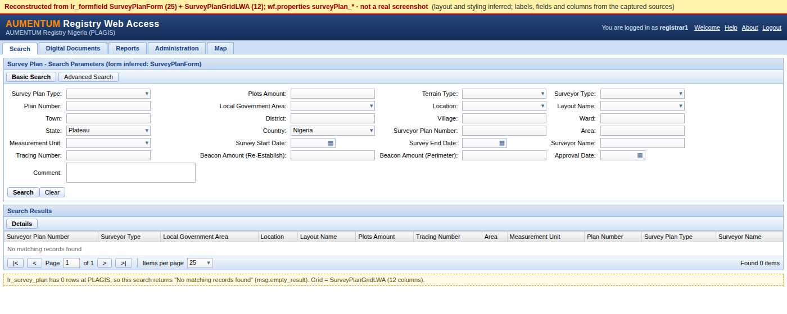

`SurveyPlanForm` (25: Survey Plan Type, Plots Amount, Terrain Type, Surveyor Type, Plan Number, LGA, Location, Layout
Name, Town, District, Village, Ward, State, Country, Surveyor Plan Number, Area, Measurement Unit, Survey Start/End Date
(cross-checked), Surveyor Name, Tracing Number, Beacon Amount (Re-Establish), Beacon Amount (Perimeter), Approval Date,
Comment) → **`SurveyPlanGridLWA`** (12). `lr_survey_plan` has 0 rows, so this returns "No matching records found".

#### 1.5.10 Map tab

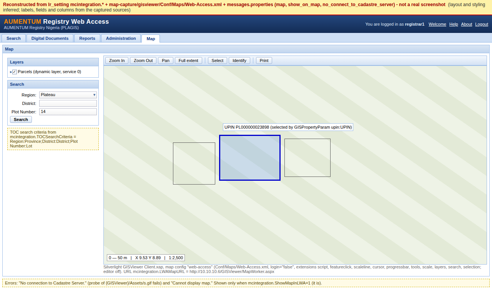

From `map.js` and `lr_setting`:

* Tab `tab-map` loads `map.do?mapCfg=<cfg>` which hosts Silverlight control **`mapSilverlightControl`**
  (GISViewer `Client.xap`); init string `searchItemsPerPage=20,user=,conf=Conf/web-access.xml` (`?mapcfg=` template);
  `mcintegration.LWAMapURL = http://10.10.10.6/GISViewer/MapWorker.aspx`; map config `Conf/Maps/Web-Access.xml`
  (`login="false"`, layer "Parcels", tools/scale/layers/search/selection; editor off).
* `onMapReady`: for each `FormConfig.gis` = `{layer, searchType, params:[{lrs, map}]}` it registers
  `RegisterLayerCallbackAction` (icon `LRS_16.png`, action label "Show in LWA" → `searchFromMapCallback` builds
  `#result:<Type>:<Lrs field>=<map value>&doQuery=1`) and `RegisterLayerAction` (zoom). PLAGIS mapping:
  `GISPropertyParam = upin:UPIN`, `LWASearchSpatialUnit = Plateau_State_Parcels;upin:UPIN`.
* "Show on Map" from a detail: `initEntityMapParams` stores the entity's mapped attributes; `showEntityOnMap` loads the map
  if needed and calls `DoLayerAction(zoomActionUuid, {Attributes:[{Name:'UPIN', Value:…}]})`.
* Left "TOC search" criteria come from `mcintegration.TOCSearchCriteria = Region:Province;District:District;Plot Number:Lot`.
* Errors: "No connection to Cadastre Server.", "Cannot display map." (MSG). Replacement: see 07 §3.4.

#### 1.5.11 Reports tab

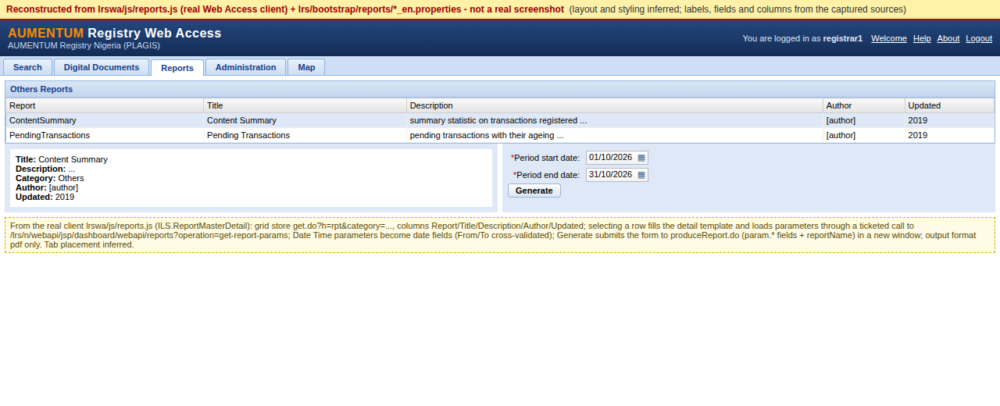

From `reports.js` (`ILS.ReportMasterDetail`, xtype `rptmasterdetail`, one panel per category titled "&lt;category&gt; Reports"):

| Part | Content |
|---|---|
| Grid | store `get.do?h=rpt&category=<cat>` fields reportName, reportCategory, reportTitle, reportDesc, reportAuthor, deployedDate; columns **Report, Title, Description, Author, Updated** (sortable) |
| Detail (south-left) | template "Title / Description / Category / Author / Updated"; initial text "Please select a report to see additional details" |
| Parameters (south-right, form label width 200) | on row select: ticketed GET `/lrs/n/webapi/jsp/dashboard/webapi/reports?operation=get-report-params&reportName=` → fields: `Date Time` → date field (default today, From/To validated), other types text/combos; names prefixed `param.`; hidden `reportName` |
| Button | **Generate** → form POST to `produceReport.do` in a new window (`_blank`); output format list has only `pdf` |
| Reports available | the 8 standard reports (§2.5) plus whatever categories exist in the report store (06 §2.5) |

#### 1.5.12 About, printer-friendly view, message boxes

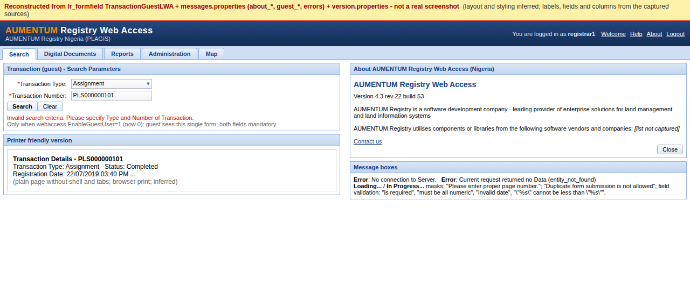

About dialog "About AUMENTUM Registry Web Access (Nigeria)" (MSG `about_*`), Version (`version.properties` 4.3 rev 22
build 53), "Contact us". Messages: "No connection to Server.", "Current request returned no Data", "Loading...",
"In Progress...", "Please enter proper page number.", "Duplicate form submission is not allowed", validation suffixes
"is required", "must be all numeric", "invalid date", "is already in use".
Other main tabs named in MSG — **Digital Documents** (`dashboard_tab_dig_docs`) and **Administration**
(`dashboard_tab_administration`) — have no code in the captured JS; their content is unknown.

---

## 2. Server admin web UI (`/lrs/faces/...`)

### 2.1 Technology and protocol

| Item | Value | Evidence |
|---|---|---|
| Frame | Alfresco 3.4 Explorer JSF (MyFaces + Facelets `*.xhtml`), start page `/lrs/faces/jsp/dashboard/dashboard.jsp`, error page `/jsp/error.jsp`, faces configs `faces-config-{app,beans,navigation,common,repo,wcm,custom}.xml` (not captured) | `$APP/deploy/lrs.war/WEB-INF/web.xml` |
| Admin gate | `AdminAuthenticationFilter` on `/faces/jsp/admin/*`, `/categories/*`, `/groups/*`, `/users/users.jsp`, `/users/delete-user.jsp`, `/admin/system-info.jsp` | web.xml |
| Panels | ExtJS-style panels/grids calling **DWR** (`/lrs/dwr/*`) methods on Spring beans `*WebBean` (`com.ils.lrs.web.bean`) | `$J/lrs-web-admin.jar` |
| Data protocol (high) | every list method takes a `Map` with **`start`, `limit`, `sort`, `dir`** (+ `search`, `searchFields`) and returns JSON `{rows:[…], total:n}` (+ `dataType`, `idName`); writes go through `doAction(session, params, action)` with actions `create` / `update` / `delete` / bean-specific names, answering `{success:true}`, `{success:true,msg:"…",entityId:…}` or `{success:false,msg:"…"}` — the **ExtJS JsonStore / form-submit protocol** | `AbstractWebBean` constants `KEY_DATA_ROWS="rows"`, `KEY_DATA_SIZE="total"`, `DEFAULT_SUCCESS`, `DEFAULT_ERROR`; `AbstractModelBean` `QPARAM_PAGE_START="start"`, `QPARAM_PAGE_SIZE="limit"`, `QPARAM_SORT_COL="sort"`, `QPARAM_SORT_DIR="dir"`; date formats `dd/MM/yyyy`, `MM/dd/yyyy` |
| Generic validation | `is_not_filled`, `must_be_integer`, `must_be_double`, `title_exist`, unique checks (`unique`, `notNull` from `setValidateProps`) | `AbstractWebBean` strings |
| Help | `/jsp/help/en-US/WebAdministratorHelp.htm` | WC `help_index_page` |
| Branding | "AUMENTUM Registry Administrator", "AUMENTUM Registry Nigeria (PLAGIS)", "Copyright © 1996-2012 Thomson Reuters" | WC |

DWR URLs are `/lrs/dwr/call/plaincall/<beanName>.<method>.dwr` (DWR convention; bean names set by Spring, not
captured — inferred).

### 2.2 Navigation map (admin)

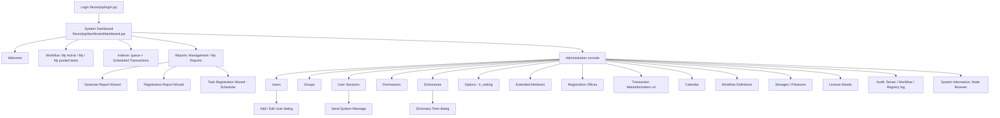

### 2.3 Pages

#### 2.3.1 Login / logged out / error

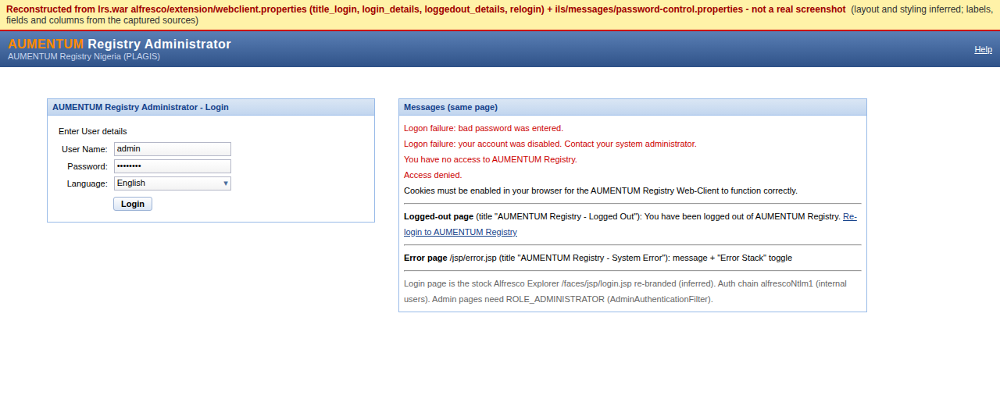

Stock Alfresco Explorer login re-branded (title `title_login` "AUMENTUM Registry Administrator - Login", `login_details`
"Enter User details"; fields User Name, Password, Language (stock); button Login). Messages: password-control
(`err.auth.invalid.password.entered` "Logon failure: bad password was entered.", `err.auth.account.was.disabled`),
`no_access` "You have no access to AUMENTUM Registry.", `error_access_denied`, `no_cookies`. Logged-out page
(`title_relogin`, `loggedout_details`, link `relogin`). Error page title `title_error` with "Error Stack". Confidence medium.

#### 2.3.2 Welcome dashboard

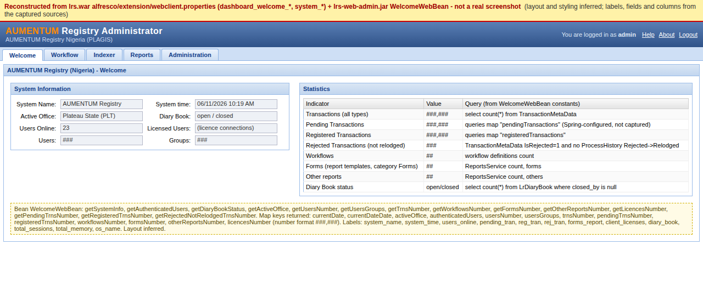

`WelcomeWebBean` (all getters listed in 06 §2.4) — values returned as a map: `currentDate`, `currentDateDate`,
`activeOffice`, `authenticatedUsers`, `usersNumber`, `usersGroups`, `trnsNumber`, `pendingTrnsNumber`,
`registeredTrnsNumber`, `workflowsNumber`, `formsNumber`, `otherReportsNumber`, `licencesNumber` (format `###,###`).
Queries in constants: transactions = `select count(*) from TransactionMetaData` (sic — counts metadata rows, inferred
bug or alias); rejected-not-relodged = `TransactionMetaData IsRejected=1` without a `ProcessHistory` row
`TaskName like 'Rejected' and TaskTransition like 'Relodged'`; diary book = `LrDiaryBook where closed_by is null`
→ `open`/`closed`; SMTP options read from `Setting` category `smtp`. Pending/registered queries are injected by Spring
(`setQueries`, not captured). Labels: `system_name`, `system_time`, `users_online`, `pending_tran`, `reg_tran`,
`rej_tran`, `forms_report`, `client_licenses`, `diary_book`, `total_sessions`, `total_memory`, `os_name`.

#### 2.3.3 Workflow dashboard

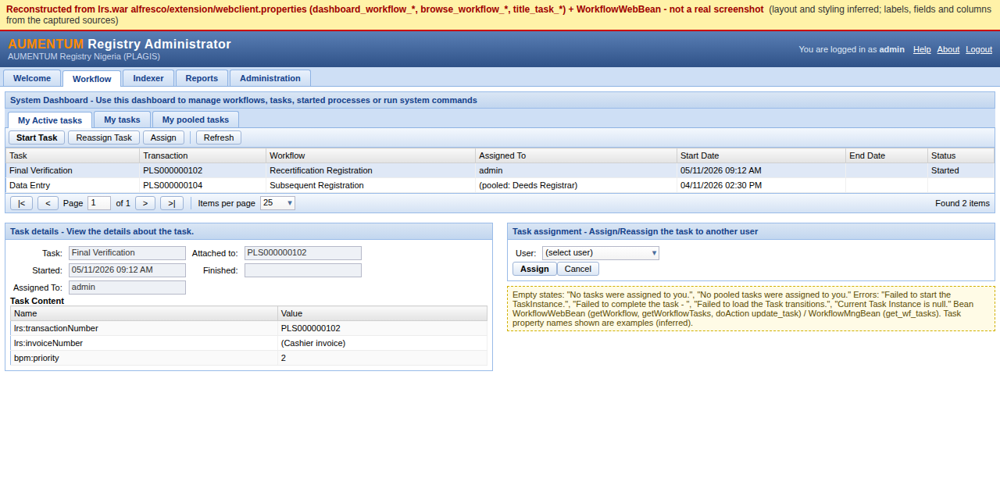

Title "System Dashboard" / "Use this dashboard to manage workflows, tasks, started processes or run system commands".
Tabs **My Active tasks**, **My tasks**, **My pooled tasks**; columns from labels (Task, Start Date, End Date, Assigned To,
Status Started/Completed); buttons **Start Task**, **Reassign Task**, **Assign** ("Assign/Reassign the task to another
user", dialog "Task assignment"); Task details ("View the details about the task.", "Task Content", "Attached to").
Bean `WorkflowWebBean.getWorkflowTasks`, `doAction('update_task')`. Empty lists: "No tasks were assigned to you." /
"No pooled tasks were assigned to you."

#### 2.3.4 Indexer dashboard

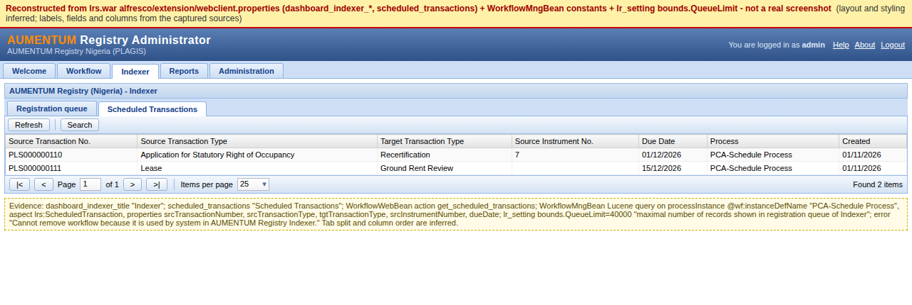

"AUMENTUM Registry (Nigeria) - Indexer": the registration queue (limit `bounds.QueueLimit = 40000`) and **Scheduled
Transactions** (`get_scheduled_transactions`: process instances of **"PCA-Schedule Process"** with aspect
`lrs:ScheduledTransaction`, not completed; properties `srcTransactionNumber`, `srcTransactionType`,
`tgtTransactionType`, `srcInstrumentNumber`, `dueDate`). Columns and tab split inferred. Confidence low–medium.

#### 2.3.5 Reports (Management, My Reports, wizards)

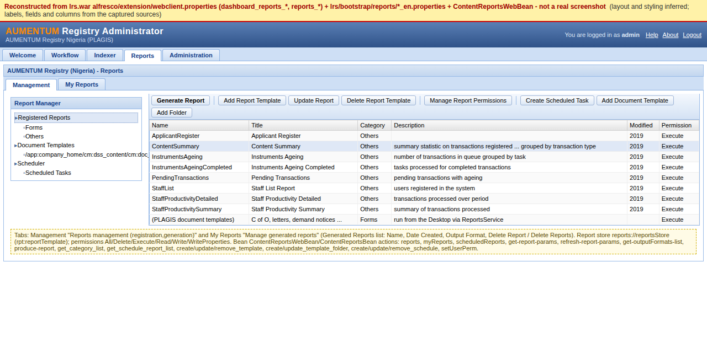

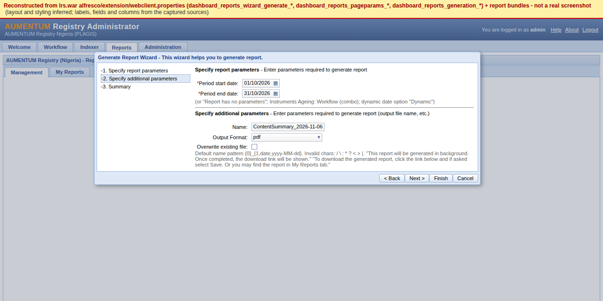

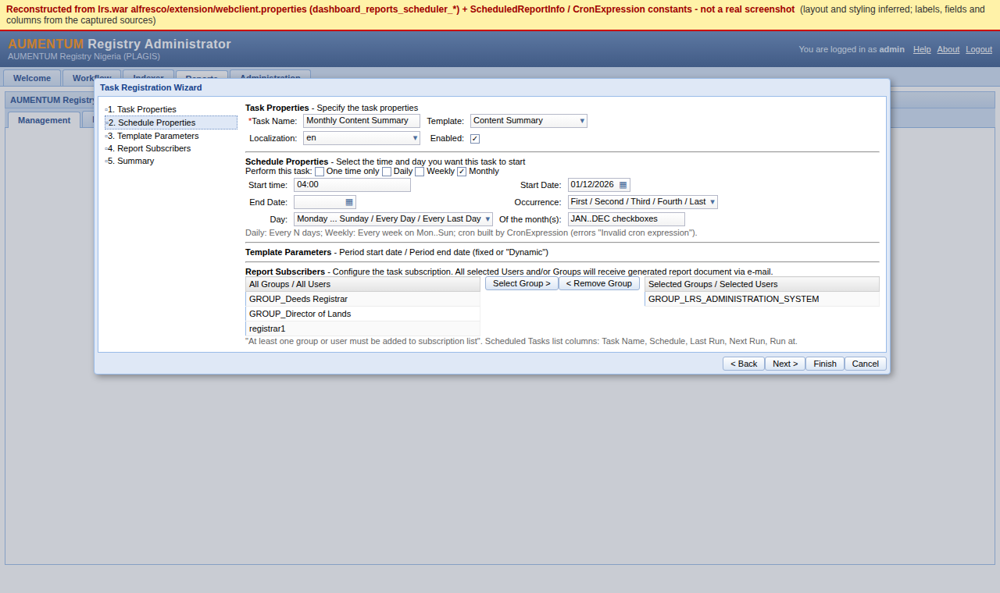

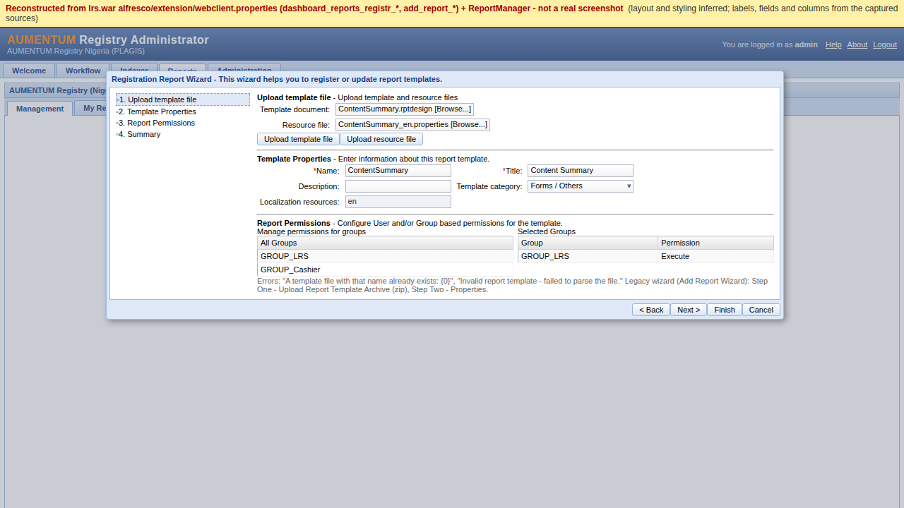

| Page | Steps / fields | Evidence |
|---|---|---|
| Management tab | Report Manager tree: Registered Reports (categories **Forms**, **Others**), Document Templates (`/app:company_home/cm:dss_content/cm:doc_templates`; Add Document Template, Add Folder, Rename Folder, Delete), Scheduler (Scheduled Tasks: Task Name, Schedule, Last Run, Next Run, Run at; Create Scheduled Task, Update/Delete Scheduled Task); report list (name, title, category, description, author, created/modified, permission) | WC `dashboard_reports_*`, `ContentReportsBean` strings |
| My Reports tab | generated reports (Generated Reports; Delete Report / Delete Reports "Are you sure you want to delete {0} reports?") | WC |
| Generate Report Wizard | 1 **Specify report parameters** (from report definition; "Report has no parameters"; date params may be "Dynamic") → 2 **Specify additional parameters**: output name (default `{0}_{1,date,yyyy-MM-dd}`; forbidden `/ \ : * ? < > |`), Output Format (`get-outputFormats-list`), Overwrite existing file → 3 summary with download link; background generation notice | WC, `ContentReportsWebBean` |
| Registration Report Wizard | Upload template file (Template document `.rptdesign`, Resource file `.properties`) → Template Properties (name, title, description, Template category Forms/Others, Localization resources) → **Report Permissions** (All Groups / All Users → Selected Groups / Selected Users with permission) → summary. Older "Add Report Wizard" (zip archive) also labelled | WC, `ReportManager` (permissions All/Delete/Execute/Read/Write/WriteProperties) |
| Task Registration Wizard (scheduler) | Task Properties (Task Name, template, localization, enabled) → **Schedule Properties** ("Perform this task": One time only / Daily (every N days) / Weekly (Every week on Mon…Sun) / Monthly (First…Fourth/Last, day, Every Day / Every Last Day, months JAN…DEC), Start time, Start Date, End Date) → Template Parameters → **Report Subscribers** (users/groups who receive the document by e-mail; at least one required) → summary | WC, `ScheduledReportInfo` getters (`schedulerMode`, `startHours`, `startMinites`, `week1…7`, `months`, `dayOccurrence`, `weekOccurrence`, …), `CronExpression` |

#### 2.3.6 Administration console

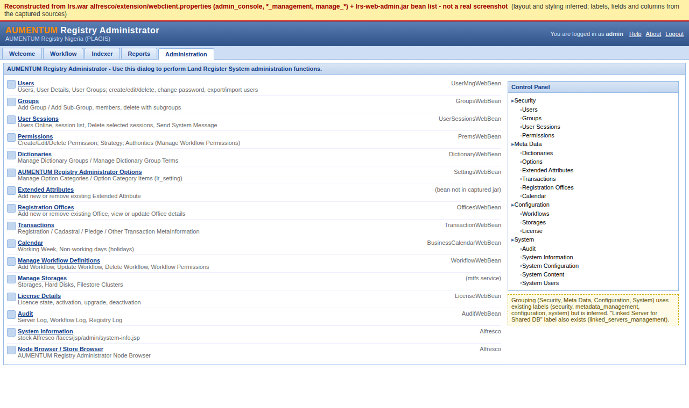

"AUMENTUM Registry Administrator" / "Use this dialog to perform Land Register System administration functions." —
one link per function (list in the picture). The grouping into Security / Meta Data / Configuration / System uses existing
labels but is inferred. `linked_servers_management` "Linked Server for Shared DB" label exists without a bean.

#### 2.3.7 Users and the user dialog

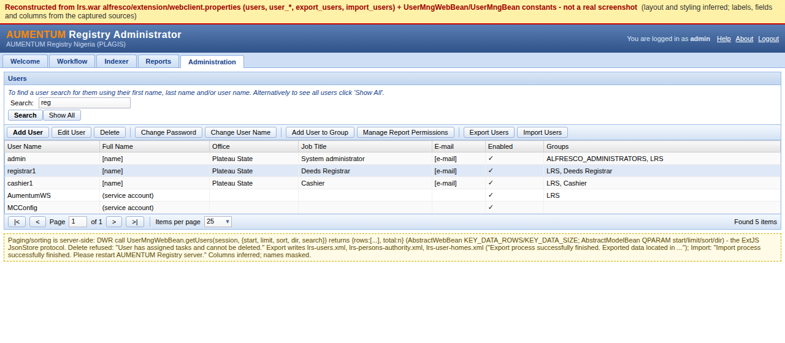

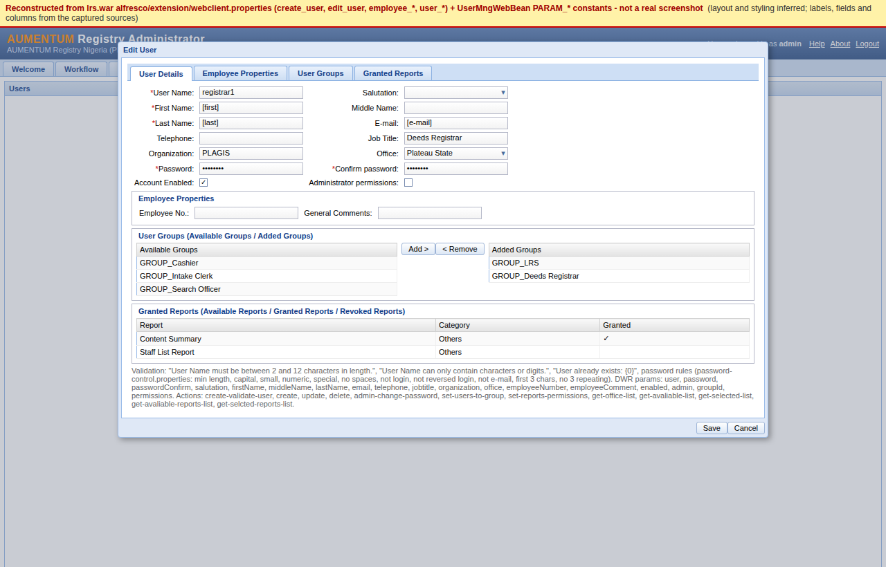

| Element | Detail |
|---|---|
| List | search hint (stock `user_search_info`), Search / Show All; server-paged grid (`getUsers`) |
| Toolbar | Add User (`create_user`), Edit User, Delete (refused: `error_user_has_tasks`), Change Password (`admin-change-password`; own password `ACTION_CHANGE_PASSWORD`), Change User Name (`ACTION_CHANGE_USERNAME`), Add User to Group, Manage Report Permissions, **Export Users** / **Import Users** (files `lrs-users.xml`, `lrs-persons-authority.xml`, `lrs-user-homes.xml`; import requires server restart) |
| Dialog fields (DWR param names) | `user`* (2–12 chars, letters/digits), `salutation`, `firstName`*, `middleName`, `lastName`*, `email`, `telephone`, `jobtitle`, `organization`, `office` (combo `get-office-list` from `RegistryOffice`), `password`* / `passwordConfirm`* (rules in `password-control.properties`; `error_password_match`), `enabled` (Account Enabled), `admin` (Administrator permissions → `GROUP_ALFRESCO_ADMINISTRATORS`), employee aspect `employeeNumber` (Employee No.), `employeeComment` (General Comments); groups (`groupId`, Available/Added Groups via `get-avaliable-list` / `get-selected-list` / `set-users-to-group`); report permissions (`permissions`, `get-avaliable-reports-list` / `get-selcted-reports-list` / `set-reports-permissions`, "Granted Reports", "Revoked Reports") |
| Hidden authorities | `GROUP_ALFRESCO_ADMINISTRATORS`, `GROUP_EMAIL_CONTRIBUTORS`, `GROUP_EVERYONE`, `ROLE_ADMINISTRATOR`; `GROUP_LRS_ADMINISTRATION_SECURITY` controls who may manage users (inferred from `UserMngBean` strings) |

#### 2.3.8 User Sessions

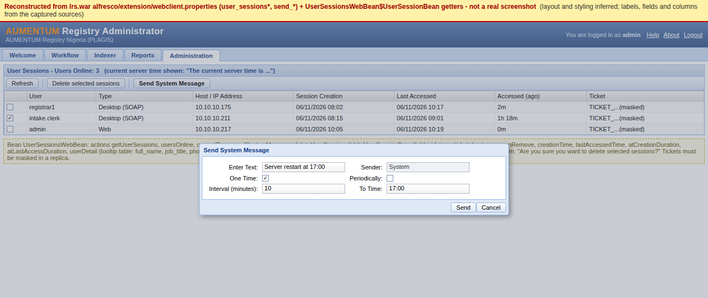

Grid of `UserSessionBean`: id, type, ticket, host, user, canRemove, creationTime, lastAccessedTime, atCreationDuration,
atLastAccessDuration, userDetail (tooltip table full name, job title, phone, e-mail, office). "Users Online" counter,
"The current server time is …". Actions **Delete selected sessions** (confirm) and **Send System Message**
(Enter Text, One Time / Periodically, Interval (minutes), To Time; sender "System"; delivered over MessagingService/JMS to
connected clients). A replica must not display tickets.

#### 2.3.9 Groups

Tree of groups; Add Group / Add Sub-Group, Edit, Delete / Delete with Subgroups (`rb-del`), members (Available /
Selected Groups and Users), search. Params `groupId`, `name`, `descr`, `parentGroup`, `groupToDel`. Errors
`groups_err_exists`, `error_group_is_used_in_wf`, warning `delete_group_warning`.

#### 2.3.10 Permissions

Permission records (Alfresco nodes of type `{http://www.landsystems.com/permission/model/1.0}permission` in a
`permissionStore`): name ("Permission Goal"), title, **Strategy** (Straight / View Access / Print Access / **Web Access**),
Authorities with ACL marks (Read, Write, Full Access, View, Print; + / - / Not Applied). Actions create/update/delete,
`get-avaliable-list`, `get-selected-list`. The Web Access strategy gates the `/lrswa` login (06 §2.7).

#### 2.3.11 Dictionaries

Left: Dictionary Groups (`select distinct Category, min(GeneralTerm)` from `lr_dictionary`), search / Show All, Add
Dictionary Group. Right: "Dictionary Terms of Group: &lt;category&gt;" grid (Code, Label, Description, Sort Order, Hidden,
Arabic name) with Add / Edit / Delete Dictionary Term. Term dialog: Dictionary Term Code*, Dictionary Term Name*,
Description, Name(Arabic), Description(Arabic), Sort Order, Hidden. Deletion blocked if referenced (`error_exist_dictterm`;
the bean also checks `TransactionMetaData`, `RrrMetaData`, `LrTransMetaInfo` for codes). Also serves
`get_dictionary_combo_list` for other pages.

#### 2.3.12 Options (settings)

"AUMENTUM Registry Administrator Options": Option Categories (13 at PLAGIS: bounds, businesscalendar, config,
deedregistrar_default, defaults, drafter, gisintegration, governor_default, header_default, mcintegration, multicadastre,
scan, webaccess) → Option Items (Name, Value, Description) with Add / Edit / Delete Setting Item. Typed editing: some
names render as dictionary combos (`accessType`→`access_type`, `transactionStatus`, `transactionSource`→`record_source`,
`partyType`, `partyRoleType`, `personIdType`, `spatialUnitType`, `areaUnitType` …→ `area_measurement_unit`,
`plotType`→`land_type`), `intBoolean`/`integer` settings validated. **This is where Web Access is configured.**

#### 2.3.13 Registration Offices

Grid + dialog over `lr_registry_office`: Office Name*, Office Code*, Office Digital Code* (3-digit sequential per type,
recommended values), Office Type (registration / cadastral), Address, Postal Code, Registrar (head name; Head Type
Registrar / Commissioner of Lands), Phone, Fax, E-mail, Web Site, Central, Active, Search Limit, Queue Limit, Comments.

#### 2.3.14 Transaction MetaInformation

Four lists (Registration / Cadastral / Pledge / Other transactions) over `lr_transaction_metadata`; dialog fields map to
its columns (code, label/name, descr, group_code/group_name, workflow, normal/lapsed/max duration, right_type, meta_type,
action_type, source/target party type, related/blocking transaction codes, non_withdrawable_tasks, cashier_transaction_code,
cashier_code_based_on_source, mandatory_docs_codes, complete/reject report codes, report_templates,
related/blocked_by/discharge/modify active RRRs, create_new_rrrs, retrieve source/target parties, stamp_duty,
mandatory_scan_outgoing_document_codes, sort_order, hidden). Warning before editing. Details of each column: 02-database.md.

#### 2.3.15 Business calendar

Working Week (Mon–Sun, type working/weekend, periods in 24 h like `9:00-12:00 & 12:30-18:00`; Edit Working Day) and
Non-working days (Add/Edit/Delete Holiday wizard: Name, Start Date, End Date). Table `lr_business_calendar` (7 working
days + 1 holiday from 2015 — holidays are not maintained).

#### 2.3.16 Workflow definitions

List of jBPM process definitions; Add Workflow wizard (upload process archive zip → properties), Update Workflow,
Update Workflow Stage Metadata, Delete (blocked if used / used by the Indexer), Workflow Permissions, Tasks (stage names),
Add/Remove Workflow Aspect wizard. Store `workflow://rootStore`.

#### 2.3.17 Audit

Tabs **Server Log** (Select Server Log File, search; items date, type, sender, message, Error Stack), **Workflow Log**
(`lr_process_history` / `LrWorkflowLog` by transaction number), **Registry Log** (security log: user, action).

#### 2.3.18 License and storages

License Details (Product, Edition, Licence Id, Type, State, Expiration, Licensed Users, activation/deactivation keys —
redacted; Register / Upgrade / Deactivate / Send email to ILS). Storages: filestore clusters and filestores (Cluster Name,
Computer, Share Path, Capacity, Free Space, Free Threshold, Status Started/Stopped/Suspended/Off mode), legacy hard-disk
pages. Neither is needed in a replica.

#### 2.3.19 Extended attributes and system information

Extended Attributes (Extended Code, Parent Class, Child Class, Class Name, Attribute Name; bean not captured) and the stock
Alfresco System Information page (Current User, HTTP application/session/request state, headers, System Properties) plus
Node Browser / Store Browser.

### 2.4 Fee structures and form-field configuration are not web pages

* No `*Fee*WebBean`, no fee labels in WC, no fee page in `web.xml`: **fee structures and rates are maintained in the
  Workstation** (`Core/ConfigurationFee/FeeStructureExtForm`, `FeeRateExtForm`; permission `lrsFeeConfiguration`;
  group `GROUP_LRS_FEE_CONFIGURATION`) — see 05-workstation.md §2.9. Tables `lr_fee_structure` (55: fee_name +
  flags is_transaction_type, is_property_area, is_property_size, is_property_location,
  is_property_land_use_type_category, is_property_land_use_type, is_size_range) and `lr_fee_rate` (29,003).
* No bean edits `lr_formfield`: form/field configuration is done with **Aumentum Registry Designer 4.3.53** (installed on
  .5, not captured) or SQL (inferred).

### 2.5 Standard reports: parameter forms and outputs

| Report | Parameters | Output columns / content (from `lrs/bootstrap/reports/*_en.properties`) |
|---|---|---|
| Applicant Register | none stated (inferred: period) | Name, ID Document, Address, Country, Phone; Total, Total all; "No transactions were found for specified parameters" |
| Content Summary | Period start date, Period end date | Transaction Type, Count; Total; "No transactions were registered for the specified period." |
| Instruments Ageing | Workflow | Task, Total Count, Duration Min/Max/Average, ageing 1-5 / 6-10 / 11-20 / >20 days; chart "Number of transactions by tasks" |
| Instruments Ageing Completed | Period start date, Period end date | same as above |
| Pending Transactions | none stated | Type, Transaction No., Applicant, Creation Date, Current Stage, Transaction Duration (d/h/m); Total for &lt;type&gt;, Total |
| Staff List Report | none | Login, Name, E-Mail, Organization, Group; Total By &lt;group&gt;, Total |
| Staff Productivity Detailed | Period start date, Period end date | per User / Process: Transaction No., Task, Applicant, Date, Duration |
| Staff Productivity Summary | Period start date, Period end date | per User / Process / Task: Transaction Type, Count |

Every report prints "Date and time of this report:", "Reporting period:" where relevant, footer "AUMENTUM Registry 4.3".

---

## 3. Page inventory

| # | Screen | URL / route | Source evidence | Confidence | Picture |
|---|---|---|---|---|---|
| W1 | Web Access login / errors / session expiry | `/lrswa/welcome.do` | MSG, web.xml, grids.js | high (content), medium (layout) | 01 |
| W2 | SSO entry from Desktop | `welcome.do?locale&user&ticket#…` | `$D` ShellForm, HistoryExtView, Transaction*Page | high | — |
| W3 | Shell + Search tab (group tabs per object) | `#` / `#tab-search` | tabs.js, extJSutils.js, WF, main.css | high (structure), medium (object list) | 02 |
| W4 | Transaction search + results | `#result:Transaction:<q>`; `search.do?entityType=Transaction` | FF `TransactionFormSearchLWA`, `TransactionGridLWA`, tabs.js | high | 03 |
| W5 | Advanced search (condition builder) | — | MSG only | low | 04 |
| W6 | Transaction detail: General | `#detail:Transaction:<id>`; `detail.do` | FF `TransactionFormLWA`, WF, tabs.js | high (fields), medium (layout) | 05 |
| W7 | Transaction detail: History | detail sub-panel | WF, `ProcessHistory` hbm | medium | 06 |
| W8 | Transaction detail: Applicants / Parties / Representatives | detail sub-panels; `partyContacts.do` | FF `RepresentativeGridLWA`, `SearchApplicantGridLWA`, `PartiesGrid`, extJSutils.js | medium | 07 |
| W9 | Transaction detail: Old/New Properties | detail sub-panel | FF `PropertyGridWithSourcePropertyLWA` | high | 08 |
| W10 | Transaction detail: Fees / Payment / Ground rent / Notes | detail sub-panels | WF, FF `GroundRentGridLWA`, `PaymentGrid` | medium | 09 |
| W11 | Transaction detail: RRR / Survey | detail sub-panel | FF `RRRAttributeLWA` | high (fields) | 10 |
| W12 | Transaction detail: Documents | detail sub-panel | FF `SupportedDoc*`, WF | medium | 11 |
| W13 | Property search + results | `#result:<PropertyType>:<q>` (`Parcel.Upin`) | FF `PropertySearchForm`, tabs.js | medium | 12 |
| W14 | Property detail (details, plot, transactions, lineage, regbook) | `#detail:<PropertyType>:<id>` | FF `PlotFormNonMandatoryLWA`, WF | medium | 13 |
| W15 | Property site analysis | detail sub-panel | FF `SiteAnaFormNonMandatoryLWA` | high (fields) | 14 |
| W16 | Party / Person search + detail | `#result:Party:<q>`, `#detail:Party:<id>` | FF `PartiesSearch*`, `PartyContactsSearch*` | medium | 15 |
| W17 | Applicant search + detail | `#result:Applicant:<q>` | FF `SearchInd/CorpApplicantForm`, `SearchApplicantGridLWA` | medium | 16 |
| W18 | Document search (supporting / outgoing / backfile) | `#result:SourceDocument:<q>` | WF, MSG `dss_*`, Desktop deep link | high (route), medium (fields) | 17 |
| W19 | Document viewer | `documentPage.do?uuid=` | imgviewer.js, MSG `nav_*` | medium | 18 |
| W20 | Survey plan search | `#result:SurveyPlan:<q>` | FF `SurveyPlanForm`, `SurveyPlanGridLWA` | medium | 19 |
| W21 | Certificate of Title / File / Registration Book / Staff search | — | WF, main.css icons | low | — |
| W22 | Map tab | `#map:<Type>:<id>`; `map.do?mapCfg=` | map.js, lr_setting, Web-Access.xml | high | 20 |
| W23 | Reports tab | `get.do?h=rpt`, `produceReport.do`, `/lrs/n/webapi/…/reports` | reports.js, extensions.js | high (behaviour), medium (placement) | 22 |
| W24 | Guest search, About, printer-friendly, message boxes | — | FF `TransactionGuestLWA`, MSG | medium | 21 |
| W25 | Digital Documents tab, Administration tab | — | MSG labels only | low | — |
| A1 | Admin login / logged out / error | `/lrs/faces/jsp/login.jsp` (stock, inferred), `/jsp/error.jsp` | WC, web.xml, password-control | medium | 30 |
| A2 | Welcome dashboard | `/lrs/faces/jsp/dashboard/dashboard.jsp` | WelcomeWebBean, WC | high (data), medium (layout) | 31 |
| A3 | Workflow dashboard (tasks, reassign) | dashboard tab | WorkflowWebBean, WC | medium | 32 |
| A4 | Indexer dashboard | dashboard tab | WC, WorkflowMngBean, lr_setting | low–medium | 33 |
| A5 | Reports management / My Reports | dashboard tab | ContentReportsWebBean, WC | medium | 34 |
| A6 | Generate Report wizard | dialog | WC, ContentReportsWebBean | medium | 35 |
| A7 | Scheduler (Task Registration) wizard | dialog | WC, ScheduledReportInfo, CronExpression | medium | 36 |
| A8 | Report Registration wizard + permissions | dialog | WC, ReportManager | medium | 37 |
| A9 | Administration console | dashboard tab | WC, bean list | medium | 38 |
| A10 | Users list, export/import | `/lrs/faces/jsp/users/users.jsp` (admin-gated) | UserMngWebBean, WC | high (fields/actions) | 39 |
| A11 | Add/Edit User dialog | dialog | UserMngWebBean PARAM_* | high | 40 |
| A12 | User Sessions + system message | — | UserSessionsWebBean | high (fields) | 41 |
| A13 | Groups | `/lrs/faces/jsp/groups/*` | GroupsWebBean | medium | 42 |
| A14 | Permissions | — | PremsWebBean, PermsMngBean | medium | 43 |
| A15 | Dictionaries + term dialog | — | DictionaryWebBean/Bean | high (fields) | 44, 45 |
| A16 | Options (settings) | — | SettingsWebBean/Bean | high | 46 |
| A17 | Registration Offices | — | OfficesWebBean, lr_registry_office | high | 47 |
| A18 | Transaction MetaInformation (4 kinds) | — | TransactionWebBean, lr_transaction_metadata | high (fields) | 48 |
| A19 | Business calendar | — | BusinessCalendarWebBean | high | 49 |
| A20 | Workflow definitions (+ aspects) | — | WorkflowWebBean, WC | medium | 50 |
| A21 | Audit (3 logs) | — | AuditWebBean/AuditBean | medium | 51 |
| A22 | License details; Storages/filestores | — | LicenseWebBean, licensing / mtfs bundles | medium | 52 |
| A23 | Extended attributes; System info; Node browser | `/lrs/faces/jsp/admin/system-info.jsp` | WC, stock Alfresco bundle | low (ext. attrs), high (system info stock) | 53 |
| A24 | Standard report outputs | BIRT via ReportsService | report bundles | high (labels) | 54 |
| A25 | Fee structure / rates | **Workstation**, not web | 05 §2.9 | high (absence in web) | — |
| A26 | Form-field configuration | **Designer** / SQL, not web | no bean | medium | — |

---

## 4. Notes for the replica

1. **Keep the hash grammar** (`result:`, `detail:`, `map:`, `:` delimiter, `field=value&…`, `doQuery=1`) — it is used by
   the Desktop and by the GISViewer "Show in LWA" action, not only internally.
2. Search objects, forms and grids are data (`FormConfig` built from `lr_formfield` `*LWA` and shared forms, plus WF
   titles) — render them from the database the same way.
3. Combo values are **dictionary ids** (not codes) in the old client; the replica's URLs should accept codes and ids.
4. Single-hit searches jump to the detail; result/detail tabs are capped at 2 each.
5. The admin UI's list/write protocol (`start/limit/sort/dir` → `{rows,total}`; `doAction` → `{success,msg}`) is a good
   shape for the replica's admin API.
6. Fee configuration needs a new web page in the replica (today Workstation-only).

---

## 5. Gaps / still to capture (what only real screenshots or more files can confirm)

| Gap | Why | Exactly what to fetch (read-only, from .5) |
|---|---|---|
| Real screenshots of every Web Access and admin screen | layout, tab order, which search objects are enabled, colours, icons | being captured by the lead into `screens/real/web/` — cover: login, Search tab (each object), one result tab, Transaction detail (every sub-panel), Property detail (each sub-panel), map tab, Reports tab, Digital Documents and Administration tabs, admin dashboard tabs, each Administration function and each wizard step |
| The `welcome.do` JSP and the `FormConfig` it emits | defines the search objects, their forms/grids, `fieldsToFill`, `detail` URLs, `gis` mapping, labels | `C:\LRSAS\server\default\deploy\lrswa.war\*.jsp`, `WEB-INF\jsp\**`, or simply **save the HTML source of `welcome.do` after login** (View Source) |
| `detail.do` fragments and `details/*.do` templates | the real section order and fields of every detail view | `lrswa.war\WEB-INF\jsp\details\**` (or the responses of `detail.do` for one Transaction, one Property, one Party, one Document) |
| Advanced search / condition builder | labels exist, code not in captured JS | the JS file defining it (search `webforms_operator` under `lrswa.war\**\*.js` / `*.jsp`) |
| Digital Documents and Administration tabs of Web Access | content unknown | screenshot + the JSP/JS behind them |
| `LrsWebClient-servlet.xml`, `applicationContext-security.xml` | complete `*.do` list (`search`, `detail`, `get`, `dictionary`, `locales`, `map`, `documentPage`, `partyContacts`, `produceReport` are known), login URL, guest handling, permission check | `lrswa.war\WEB-INF\*.xml` |
| lrswa controller classes | server behaviour of each `*.do` (HQL, limits, hidden transaction codes) | `lrswa.war\WEB-INF\classes\com\**` (inspect with javap only) |
| Admin JSP/XHTML pages and faces navigation | real page paths (only `dashboard.jsp`, `users/users.jsp`, `groups/*`, `admin/system-info.jsp` known), layout | `lrs.war\jsp\**`, `lrs.war\**\*.xhtml`, `WEB-INF\faces-config-*.xml`, `WEB-INF\web-application-context.xml` (DWR bean names) |
| `/lrs/n/webapi/jsp/dashboard/webapi/reports` | report parameter API used by both UIs | the JSP under `lrs.war\jsp\dashboard\webapi\` |
| Extended Attributes bean | not in captured jars | remaining `lrs.war\WEB-INF\lib\*.jar` |
| Image viewer plug-in | "not installed" message suggests an ActiveX/plug-in | screenshot of a document page in Web Access; the JSP of the viewer |
| Report `.rptdesign` files | exact parameter lists/queries of the 8 standard reports and PLAGIS documents | export from the Alfresco report store (WebDAV `/lrs/webdav/`, read-only) |
