# 14 — Exact Registry workflows (from Aumentum's own jBPM definitions)

This document is generated from the live workflow definitions of LRS43, exported read-only on 2026-11-06 by `tools/aumentum-inventory/export-registry-workflow.sh`. The export covers `JBPM_PROCESSDEFINITION`, `NODE`, `TRANSITION`, `TASK` and `SWIMLANE`, plus the stored `processdefinition.xml` of every version. It also includes counts from `lr_process_history` (976,928 rows, no user names).

It **supersedes the inferred stage order in 04**; 04 stays the reference for pages, rules, fees and documents per stage. The raw files are in `tools/aumentum-inventory/lrs-export/registry/jbpm/` (git-ignored).

How to read each process:
- **Stage table:** stages in route order from the start. For each stage:
  - the jBPM task name, which links to the desktop WorkflowConfig and to `lr_process_history.task_name`;
  - the **role** (swimlane: an Alfresco group whose members get the task);
  - every way out, as transition → next stage, with any server action it runs;
  - **Times used:** how often each way out was really taken, from history;
  - **Avg time:** the average time a file spends in the stage;
  - **Open now:** files currently waiting in the stage.
- **Server actions:** `SetBatchStatusHandler` sets `lr_batch.application_status` and `lr_transaction.transaction_status` (dictionary codes). `CompleteBatchHandler` completes the transaction; this is where the RRR is created or changed and the status becomes completed.
- **Withdraw, postpone and continue** are not transitions in the graph. They are desktop menu actions available at every stage except the type's `non_withdrawable_tasks` (04 §5). In history, Withdraw shows as a transition named "Withdraw" with no next stage.
- **Version:** the newest version is shown; new files start on it. Files lodged earlier keep running on the version they started on. Differences are listed per process.

## The full journey to a C of O, with sub-processes expanded (First Registration: APRO, APSL, CONT, RAOL, REGR)

This is the main route that 8,000+ files have actually followed to a registered C of O. The counts in brackets are files that took that step, from `lr_process_history`.

| # | Stage | Role (Alfresco group) | Unit (PLAGIS view) |
|---|---|---|---|
| 1 | Lodge Application (14,134) | Intake Clerk | Registry front desk |
| 2 | Scan Incoming Documents | Scanning Officer | Registry |
| 3 | Open New Property File | Lands Officer | Lands |
| 4 | Awaiting Fee Payment | Cashier | Cashier |
| 5 | Register Processing Fee Payment and Generate Receipt (13,469 go on) | Cashier | Cashier |
| 6 | ⤷ **Survey Plan Checking and Approval** – SG Review Submitted Survey Plan | Surveyor General | Survey |
| 7 | ⤷ Compare and Verify Survey Plan | Map Compilation Officer | Survey (charting) |
| 8 | ⤷ Confirm Survey Plan | Surveyor General | Survey |
| 9 | ⤷ **Raise Site Analysis Report** – Review Request for Site Analysis | Director of Town Planning | Town Planning |
| 10 | ⤷ Schedule Site Analysis | Town Planning Coordinator | Town Planning |
| 11 | ⤷ Inspect Property | Inspection Officer | Town Planning |
| 12 | ⤷ Prepare Site Analysis Report | Inspection Officer | Town Planning |
| 13 | ⤷ Review Site Analysis Report | Town Planning Coordinator | Town Planning |
| 14 | ⤷ Review Report and Approve | Director of Town Planning | Town Planning |
| 15 | Review Submission (11,642) | Lands Officer | Lands |
| 16 | Prepare Land Form 5 (the R of O recommendation) | Lands Officer | Lands |
| 17 | Review Land Form 5 (1,376 sent back to "Redo") | RofO & CofO Reviewer | Lands |
| 18 | Approve Land Form 5 (10,860) | **Commissioner** | Commissioner's office |
| 19 | Review Signed Land Form 5 | RofO & CofO Reviewer | Lands |
| 20 | Prepare R of O Acceptance of Terms & Conditions of Grant | Lands Officer | Lands |
| 21 | Awaiting Acceptance of Statutory R of O in Principle (10,700 accepted) | Lands Officer | Lands / applicant |
| 22 | Register CofO Fees Payment and Generate Receipt | Cashier | Cashier |
| 23 | ⤷ **Raise Title Deed Plan** – Receive, Review Documents and Assign Task | Surveyor General | Survey |
| 24 | ⤷ Prepare Title Deed Plan in Aumentum Cadastre — **Cadastre job; the UPIN is linked here** | Data Entry (VDES) | Digitising |
| 25 | ⤷ Review Title Deed Plan (SQCO) (4,887 sent back to "ReDo") | Survey Quality Control Officer | SQCO |
| 26 | ⤷ Review Title Deed Plan (SG) | Surveyor General | Survey |
| 27 | ⤷ Approve Title Deed Plan | Surveyor General | Survey |
| 28 | ⤷ Scan Title Deed Plan | Scanning Officer | Registry |
| 29 | Generate Certificate of Occupancy (9,090) | Deeds Registrar | Deeds Registry |
| 30 | Review Certificate of Occupancy (696 sent back to "Redo") | RofO & CofO Reviewer | Lands |
| 31 | Approve Certificate of Occupancy (8,038) | **Governor** | Governor's office |
| 32 | Review Signed Certificate of Occupancy | RofO & CofO Reviewer | Lands |
| 33 | Register Right of Occupancy (C of O registered; server `CompleteBatchHandler` at the end) | Deeds Registrar | Deeds Registry |
| 34 | Delivery of Documents (cannot be withdrawn from here on) | Delivery Clerk | Registry |
| 35 | Scan Outgoing Documents → **transaction completed** (5,978) | Scanning Officer | Registry |

Where things leave this route:
- **Rejection** is possible at Open New Property File, Review Submission, Review Land Form 5 and Awaiting Acceptance, and inside the three sub-processes. It goes Prepare Rejection Letter → Delivery of Documents → Scan Outgoing → end (rejected).
- **Withdraw** is possible from any stage up to Register C of O.
- **Part payment** sends the file back to Awaiting Fee Payment.

**APCO** (C of O for an existing R of O) is the same from Review Submission onward, without Survey Plan Checking, Site Analysis and Land Form 5: lodge → scan → fee → Review Submission → Raise Title Deed Plan → Generate/Review/Approve (Governor)/Review Signed → Register C of O → Delivery → Scan Outgoing.

The "Unit" column maps each role to a PLAGIS unit (my reading; please confirm). Charting & reporting (docs/charting-and-reporting.docx) is not a separate Aumentum stage. It happens around steps 6–8, Survey Plan Checking and Approval: Compare and Verify Survey Plan is done by the Map Compilation Officer.

## Summary of processes

| Process | Latest version (id) | Older versions (id) | Transaction types using it | Stages | Roles |
|---|---|---|---|---|---|
| Application for Certificate of Occupancy | v4 (58) | v1 (19), v2 (31), v3 (43) | APCO | 13 | 8 |
| Data Correction | v2 (62) | v1 (47) | DCT | 3 | 3 |
| First Registration | v4 (56) | v1 (17), v2 (29), v3 (41) | APSL, APRO, CONT, RAOL, REGR | 22 | 11 |
| Ground Rent Payment | v4 (55) | v1 (16), v2 (28), v3 (40) | GRPM | 3 | 3 |
| Ground Rent Review | v2 (63) | v1 (48) | GRR | 9 | 5 |
| Indexing and Scanning | v4 (53) | v1 (14), v2 (26), v3 (38) | INSC | 7 | 4 |
| Raise Site Analysis Report | v4 (52) | v1 (13), v2 (25), v3 (37) | — (sub-process) | 6 | 3 |
| Raise Title Deed Plan | v4 (50) | v1 (11), v2 (23), v3 (35) | — (sub-process) | 6 | 4 |
| Recertification Registration | v4 (54) | v1 (15), v2 (27), v3 (39) | APRF | 13 | 9 |
| Replacement Of Title | v4 (60) | v1 (21), v2 (33), v3 (45) | REPT | 13 | 9 |
| Search | v4 (59) | v1 (20), v2 (32), v3 (44) | SEAR, CETC | 10 | 7 |
| Set Right Of Occupancy As Expired | v4 (61) | v1 (22), v2 (34), v3 (46) | SROE | 1 | 1 |
| Subsequent Registration | v4 (57) | v1 (18), v2 (30), v3 (42) | ASSI, ABWG, CEMP, CHNT, CHPC, DEVO, EXTT, LEAS, LOCE, MERT, MORT, PSUR, RLEA, RMOR, RSUB, SUBD, SUBL, SURO, UPMO, RROC, COMP, RCOO, APCM, APCA, PWOA, RPOA | 25 | 14 |
| Survey Plan Checking | v2 (64) | v1 (49) | SPC | 14 | 8 |
| Survey Plan Checking and Approval | v4 (51) | v1 (12), v2 (24), v3 (36) | — (sub-process) | 3 | 2 |

## Application for Certificate of Occupancy

**Transaction types:** `APCO` Application for Certificate of Occupancy

**Roles (swimlanes):** Intake Clerk, Delivery Clerk, Scanning Officer, Governor, RofO & CofO Reviewer, Rejection Letter Creator, Deeds Registrar, Cashier

**Main route** (most-used way out at every step; sub-processes shown in their own section):

1. Lodge Application — *Intake Clerk*
2. Scan Incoming Documents — *Scanning Officer*
3. Awaiting Fee Payment — *Cashier*
4. Register Processing Fee Payment and Generate Receipt — *Cashier*
5. Review Submission — *Deeds Registrar*
6. Raise Title Deed Plan (sub-process **Raise Title Deed Plan**)
7. Generate Certificate of Occupancy — *Deeds Registrar*
8. Review Certificate of Occupancy — *RofO & CofO Reviewer*
9. Approve Certificate of Occupancy — *Governor*
10. Review Signed Certificate of Occupancy — *RofO & CofO Reviewer*
11. Register Certificate of Occupancy — *Deeds Registrar*
12. Delivery of Documents — *Delivery Clerk*
13. Scan Outgoing Documents — *Scanning Officer*
14. End Application for Certificate of Occupancy

| # | Stage | Task | Role | Ways out → next stage (times used) | Server actions | Avg time | Open now |
|---|---|---|---|---|---|---|---|
| 1 | Lodge Application | `LodgmentApplication` | Intake Clerk | Scan Incoming Documents **(2,682)** Withdraw (125) | on 'Scan Incoming Documents': SetBatchStatusHandler (batchStatus=application_lodged, transactionStatus=transaction_lodged) | 36.4 d | 583 |
| 2 | Scan Incoming Documents | `ScanIncomingDocuments` | Scanning Officer | Awaiting Fee Payment **(2,556)** Withdraw (106) |  | 3.6 d | 20 |
| 3 | Awaiting Fee Payment | `AwaitingFeePayment` | Cashier | Register Processing Fee Payment and Generate Receipt **(2,576)** Withdraw (16) |  | 1.2 d | 17 |
| 4 | Register Processing Fee Payment and Generate Receipt | `RegisterFeePaymentAndGenerateReceipt` | Cashier | Awaiting Fee Payment (*Payment Not Made in Full*) **(49)** Review Submission **(2,495)** Withdraw (24) |  | 13.3 h | 8 |
| 5 | Review Submission | `ReviewSubmission` | Deeds Registrar | Reject Transaction → Prepare Rejection Letter (*Rejection*) **(2)** Raise Title Deed Plan **(2,331)** Withdraw (20) | on 'Reject Transaction': SetBatchStatusHandler (batchStatus=application_rejected, transactionStatus=transaction_rejected); script | 10.1 d | 145 |
| 6 | Raise Title Deed Plan *sub-process: Raise Title Deed Plan* |  |  | Is Raise Title Deed Plan Rejected |  |  |  |
| 7 | Is Raise Title Deed Plan Rejected *decision* |  |  | Reject Transaction → Prepare Rejection Letter [if `#{contextInstance.variables['isRejected'] == 'true'}`] Generate Certificate of Occupancy |  |  |  |
| 8 | Generate Certificate of Occupancy | `GenerateCofO` | Deeds Registrar | Review Certificate of Occupancy **(2,216)** Withdraw (9) |  | 10.3 d | 36 |
| 9 | Review Certificate of Occupancy | `ReviewCofO` | RofO & CofO Reviewer | Generate Certificate of Occupancy (*Redo Generate Certificate of Occupancy*) **(201)** Approve Certificate of Occupancy **(1,984)** Reject Transaction → Prepare Rejection Letter **(1)** | on 'Reject Transaction': SetBatchStatusHandler (batchStatus=application_rejected, transactionStatus=transaction_rejected); script | 10.1 d | 31 |
| 10 | Approve Certificate of Occupancy | `ApproveCofO` | Governor | Review Signed Certificate of Occupancy **(1,979)** Withdraw (5) |  | 3.5 d |  |
| 11 | Review Signed Certificate of Occupancy | `ReviewSignedCofO` | RofO & CofO Reviewer | Register Right of Occupancy → Register Certificate of Occupancy **(1,979)** |  | 2.8 h |  |
| 12 | Register Certificate of Occupancy | `RegisterCofO` | Deeds Registrar | Delivery of Documents **(1,979)** |  | 22.6 h |  |
| 13 | Delivery of Documents | `DeliveryOfDocuments` | Delivery Clerk | Scan Outgoing Documents **(1,978)** |  | 2.6 d | 1 |
| 14 | Scan Outgoing Documents | `ScanOutgoingDocuments` | Scanning Officer | Finish Transaction → EndDecision **(1,762)** Withdraw (3) |  | 38.3 d | 213 |
| 15 | EndDecision *decision* |  |  | Transaction is completed → End Application for Certificate of Occupancy (*A transaction will be completed.*) Transaction is rejected → End Application for Certificate of Occupancy [if `#{contextInstance.variables['isRejected'] == 'true'}`] | on 'Transaction is completed': CompleteBatchHandler |  |  |
| 16 | End Application for Certificate of Occupancy *end* |  |  |  |  |  |  |
| 17 | Prepare Rejection Letter | `PrepareRejectionLetter` | Rejection Letter Creator | Delivery of Documents Withdraw (3) |  | 0.0 h |  |

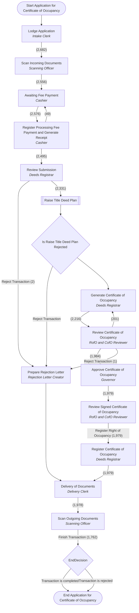

**Version history:**
- v1 → v2: 0 transitions added, 0 removed
- v2 → v3: 0 transitions added, 0 removed
- v3 → v4: 0 transitions added, 0 removed

## Data Correction

**Transaction types:** `DCT` Data Correction

**Roles (swimlanes):** Correction Officer, Scanning Officer, Correction Review Officer

**Main route** (most-used way out at every step; sub-processes shown in their own section):

1. New — *Correction Officer*
2. Review Correction — *Correction Review Officer*
3. Scan Corrected Documents — *Scanning Officer*

| # | Stage | Task | Role | Ways out → next stage (times used) | Server actions | Avg time | Open now |
|---|---|---|---|---|---|---|---|
| 1 | New | `New` | Correction Officer | Review Correction Scan Corrected Documents Withdraw (1) |  | 0.0 h | 1 |
| 2 | Review Correction | `ReviewCorrection` | Correction Review Officer | Scan Corrected Documents Finish Data Correction → End Data Correction | on 'Finish Data Correction': CompleteBatchHandler |  |  |
| 3 | Scan Corrected Documents | `ScanCorrectedDocuments` | Scanning Officer | Review Correction |  |  |  |
| 4 | End Data Correction *end* |  |  |  |  |  |  |

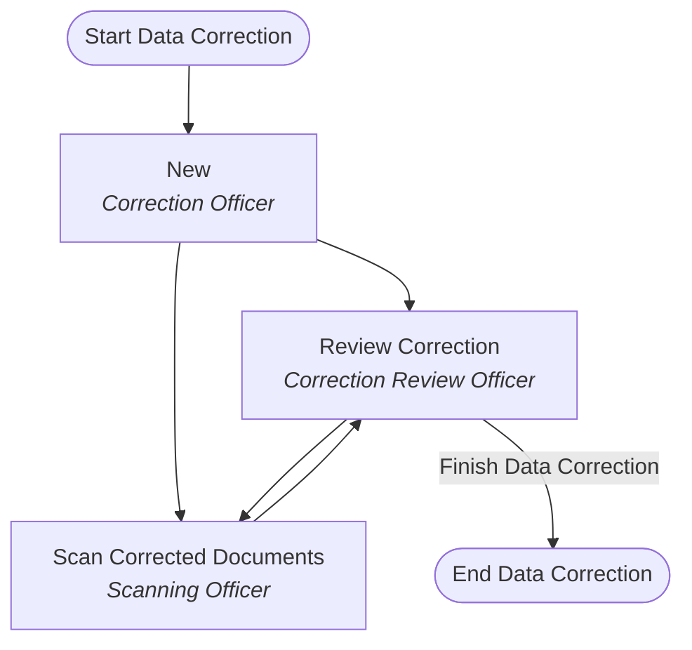

**Version history:**
- v1 → v2: 0 transitions added, 0 removed

## First Registration

**Transaction types:** `APSL` Application for State Land; `APRO` Application for Statutory Right of Occupancy; `CONT` Conversion of Titles; `RAOL` Re-Allocation of Land; `REGR` Re-Grant

**Cannot be withdrawn at:** DeliveryOfDocuments, RegisterCofO, ScanOutgoingDocuments

**Roles (swimlanes):** Intake Clerk, Delivery Clerk, Scanning Officer, Governor, Commissioner, Permanent Secretary, RofO & CofO Reviewer, Rejection Letter Creator, Lands Officer, Deeds Registrar, Cashier

**Main route** (most-used way out at every step; sub-processes shown in their own section):

1. Lodge Application — *Intake Clerk*
2. Scan Incoming Documents — *Scanning Officer*
3. Open New Property File — *Lands Officer*
4. Awaiting Fee Payment — *Cashier*
5. Register Processing Fee Payment and Generate Receipt — *Cashier*
6. Survey Plan Checking and Approval (sub-process **Survey Plan Checking and Approval**)
7. Raise Site Analysis Report (sub-process **Raise Site Analysis Report**)
8. Review Submission — *Lands Officer*
9. Prepare Land Form 5 — *Lands Officer*
10. Review Land Form 5 — *RofO & CofO Reviewer*
11. Approve Land Form 5 — *Commissioner*
12. Review Signed Land Form 5 — *RofO & CofO Reviewer*
13. Prepare Right of Occupancy Acceptance of Terms & Condition of Grant — *Lands Officer*
14. Awaiting Acceptance of Statutory Right of Occupancy in Principle — *Lands Officer*
15. Register CofO Fees Payment and Generate Receipt — *Cashier*
16. Raise Title Deed Plan (sub-process **Raise Title Deed Plan**)
17. Generate Certificate of Occupancy — *Deeds Registrar*
18. Review Certificate of Occupancy — *RofO & CofO Reviewer*
19. Approve Certificate of Occupancy — *Governor*
20. Review Signed Certificate of Occupancy — *RofO & CofO Reviewer*
21. Register Right of Occupancy — *Deeds Registrar*
22. Delivery of Documents — *Delivery Clerk*
23. Scan Outgoing Documents — *Scanning Officer*
24. End First Registration

| # | Stage | Task | Role | Ways out → next stage (times used) | Server actions | Avg time | Open now |
|---|---|---|---|---|---|---|---|
| 1 | Lodge Application | `LodgmentApplication` | Intake Clerk | Scan Incoming Documents **(14,134)** Withdraw (554) | on 'Scan Incoming Documents': SetBatchStatusHandler (batchStatus=application_lodged, transactionStatus=transaction_lodged) | 21.5 d | 1210 |
| 2 | Scan Incoming Documents | `ScanIncomingDocuments` | Scanning Officer | Open New Property File **(13,943)** Awaiting Fee Payment (*Re-grant Transaction*) **(66)** Withdraw (25) |  | 1.6 d | 133 |
| 3 | Open New Property File | `OpenNewPropertyFile` | Lands Officer | Awaiting Fee Payment **(13,845)** Reject Transaction → Prepare Rejection Letter **(3)** Withdraw (26) | on 'Reject Transaction': SetBatchStatusHandler (batchStatus=application_rejected, transactionStatus=transaction_rejected); script | 1.6 d | 83 |
| 4 | Awaiting Fee Payment | `AwaitingFeePayment` | Cashier | Register Processing Fee Payment and Generate Receipt **(13,826)** Withdraw (29) |  | 4.3 d | 79 |
| 5 | Register Processing Fee Payment and Generate Receipt | `RegisterProcessingFeePaymentGenerateReceipt` | Cashier | Awaiting Fee Payment (*Payment Not Made in Full*) **(3)** Survey Plan Checking and Approval (*Survey Plan Checking and Approval. Note: The manual assignment is not available for this transition. This transaction will be automatically assigned to the default group.*) **(13,469)** Raise Site Analysis Report (*Raise Site Analysis Report. Note: The manual assignment is not available for this transition. This transaction will be automatically assigned to the default group.*) **(276)** Withdraw (42) |  | 16.7 h | 38 |
| 6 | Survey Plan Checking and Approval *sub-process: Survey Plan Checking and Approval* |  |  | Is Survey Plan Checking Rejected → IsSurveyPlanCheckingRejected |  |  |  |
| 7 | IsSurveyPlanCheckingRejected *decision* |  |  | Raise Site Analysis Report Reject Transaction → Prepare Rejection Letter [if `#{contextInstance.variables['isRejected'] == 'true'}`] |  |  |  |
| 8 | Raise Site Analysis Report *sub-process: Raise Site Analysis Report* |  |  | Is Raise Site Analysis Report Rejected → IsRaiseSiteAnalysisReportRejected |  |  |  |
| 9 | IsRaiseSiteAnalysisReportRejected *decision* |  |  | Review Submission Reject Transaction → Prepare Rejection Letter [if `#{contextInstance.variables['isRejected'] == 'true'}`] |  |  |  |
| 10 | Review Submission | `ReviewSubmission` | Lands Officer | Reject Transaction → Prepare Rejection Letter (*Rejection*) **(1)** Prepare Land Form 5 **(11,642)** | on 'Reject Transaction': SetBatchStatusHandler (batchStatus=application_rejected, transactionStatus=transaction_rejected); script | 4.3 d | 129 |
| 11 | Prepare Land Form 5 | `PrepareLandForm5` | Lands Officer | Review Land Form 5 **(12,925)** Withdraw (2) |  | 19.3 h | 92 |
| 12 | Review Land Form 5 | `ReviewLandForm5` | RofO & CofO Reviewer | Redo Generation of Land Form 5 → Prepare Land Form 5 **(1,376)** Reject Transaction → Prepare Rejection Letter (*Rejection*) **(1)** Approve Land Form 5 **(10,875)** Withdraw (5) | on 'Reject Transaction': SetBatchStatusHandler (batchStatus=application_rejected, transactionStatus=transaction_rejected); script | 11.7 d | 700 |
| 13 | Approve Land Form 5 | `ApproveLandForm5` | Commissioner | Review Signed Land Form 5 **(10,860)** Withdraw (1) |  | 1.4 d | 13 |
| 14 | Review Signed Land Form 5 | `ReviewSignedLandForm5` | RofO & CofO Reviewer | Prepare Right of Occupancy Acceptance of Terms & Condition of Grant **(10,852)** Withdraw (1) |  | 10.3 h | 8 |
| 15 | Prepare Right of Occupancy Acceptance of Terms & Condition of Grant | `PrepareRightOccupancyAcceptanceTermsConditionGrant` | Lands Officer | Awaiting Acceptance of Statutory Right of Occupancy in Principle **(10,793)** Withdraw (2) |  | 1.1 d | 56 |
| 16 | Awaiting Acceptance of Statutory Right of Occupancy in Principle | `AwaitingAcceptanceStatutoryRightOccupancyPrinciple` | Lands Officer | Reject Transaction → Prepare Rejection Letter (*Rejection*) **(2)** Register CofO Fees Payment and Generate Receipt **(10,700)** Withdraw (1) | on 'Reject Transaction': SetBatchStatusHandler (batchStatus=application_rejected, transactionStatus=transaction_rejected); script | 2.4 d | 91 |
| 17 | Register CofO Fees Payment and Generate Receipt | `RegisterCofOFeesPaymentGenerateReceipt` | Cashier | Raise Title Deed Plan (*Raise Title Deed Plan. Note: The manual assignment is not available for this transition. This transaction will be automatically assigned to the default group.*) **(9,747)** Awaiting CofO Fees Payment **(5)** Withdraw (4) |  | 25.1 d | 990 |
| 18 | Raise Title Deed Plan *sub-process: Raise Title Deed Plan* |  |  | Is Raise Title Deed Plan Rejected |  |  |  |
| 19 | Is Raise Title Deed Plan Rejected *decision* |  |  | Reject Transaction → Prepare Rejection Letter (*Rejection*) [if `#{contextInstance.variables['isRejected'] == 'true'}`] Generate Certificate of Occupancy |  |  |  |
| 20 | Generate Certificate of Occupancy | `GenerateCofO` | Deeds Registrar | Review Certificate of Occupancy **(9,090)** Withdraw (5) |  | 12.7 d | 278 |
| 21 | Review Certificate of Occupancy | `ReviewCofO` | RofO & CofO Reviewer | Redo Generate Certificate of Occupancy → Generate Certificate of Occupancy **(696)** Approve Certificate of Occupancy **(8,043)** |  | 14.7 d | 353 |
| 22 | Approve Certificate of Occupancy | `ApproveCofO` | Governor | Review Signed Certificate of Occupancy **(8,038)** Withdraw (3) |  | 14.7 h | 2 |
| 23 | Review Signed Certificate of Occupancy | `ReviewSignedCofO` | RofO & CofO Reviewer | Register Right of Occupancy **(8,038)** |  | 2.6 h |  |
| 24 | Register Right of Occupancy | `RegisterCofO` | Deeds Registrar | Delivery of Documents **(8,036)** |  | 18.5 h | 1 |
| 25 | Delivery of Documents | `DeliveryOfDocuments` | Delivery Clerk | Scan Outgoing Documents **(8,012)** |  | 3.1 d | 27 |
| 26 | Scan Outgoing Documents | `ScanOutgoingDocuments` | Scanning Officer | Finish Transaction → EndDecision **(5,978)** |  | 28.3 d | 2034 |
| 27 | EndDecision *decision* |  |  | Transaction is completed → End First Registration (*A transaction will be completed.*) Transaction is rejected → End First Registration [if `#{contextInstance.variables['isRejected'] == 'true'}`] | on 'Transaction is completed': CompleteBatchHandler |  |  |
| 28 | End First Registration *end* |  |  |  |  |  |  |
| 29 | Prepare Rejection Letter | `PrepareRejectionLetter` | Rejection Letter Creator | Delivery of Documents **(2)** Withdraw (11) |  | 7.1 d | 1 |
| 30 | Awaiting CofO Fees Payment | `AwaitingCofOFeesPayment` | Cashier | Register CofO Fees Payment and Generate Receipt **(5)** |  | 23.0 h |  |

```mermaid
flowchart TD
  n0(["Start First Registration"])
  n1["Lodge Application<br/><i>Intake Clerk</i>"]
  n2["Scan Incoming Documents<br/><i>Scanning Officer</i>"]
  n3["Open New Property File<br/><i>Lands Officer</i>"]
  n4["Awaiting Fee Payment<br/><i>Cashier</i>"]
  n5["Register Processing Fee Payment and Generate Receipt<br/><i>Cashier</i>"]
  n6[["Survey Plan Checking and Approval"]]
  n7{"IsSurveyPlanCheckingRejected"}
  n8[["Raise Site Analysis Report"]]
  n9{"IsRaiseSiteAnalysisReportRejected"}
  n10["Review Submission<br/><i>Lands Officer</i>"]
  n11["Prepare Land Form 5<br/><i>Lands Officer</i>"]
  n12["Review Land Form 5<br/><i>RofO and CofO Reviewer</i>"]
  n13["Approve Land Form 5<br/><i>Commissioner</i>"]
  n14["Review Signed Land Form 5<br/><i>RofO and CofO Reviewer</i>"]
  n15["Prepare Right of Occupancy Acceptance of Terms and Condition of Grant<br/><i>Lands Officer</i>"]
  n16["Awaiting Acceptance of Statutory Right of Occupancy in Principle<br/><i>Lands Officer</i>"]
  n17["Register CofO Fees Payment and Generate Receipt<br/><i>Cashier</i>"]
  n18[["Raise Title Deed Plan"]]
  n19{"Is Raise Title Deed Plan Rejected"}
  n20["Generate Certificate of Occupancy<br/><i>Deeds Registrar</i>"]
  n21["Review Certificate of Occupancy<br/><i>RofO and CofO Reviewer</i>"]
  n22["Approve Certificate of Occupancy<br/><i>Governor</i>"]
  n23["Review Signed Certificate of Occupancy<br/><i>RofO and CofO Reviewer</i>"]
  n24["Register Right of Occupancy<br/><i>Deeds Registrar</i>"]
  n25["Delivery of Documents<br/><i>Delivery Clerk</i>"]
  n26["Scan Outgoing Documents<br/><i>Scanning Officer</i>"]
  n27{"EndDecision"}
  n28(["End First Registration"])
  n29["Prepare Rejection Letter<br/><i>Rejection Letter Creator</i>"]
  n30["Awaiting CofO Fees Payment<br/><i>Cashier</i>"]
  n0 --> n1
  n1 -->|" (14,134)"| n2
  n2 -->|" (13,943)"| n3
  n2 -->|" (66)"| n4
  n3 -->|" (13,845)"| n4
  n3 -->|"Reject Transaction (3)"| n29
  n4 -->|" (13,826)"| n5
  n5 -->|" (3)"| n4
  n5 -->|" (13,469)"| n6
  n5 -->|" (276)"| n8
  n6 -->|"Is Survey Plan Checking Rejected"| n7
  n7 --> n8
  n7 -->|"Reject Transaction"| n29
  n8 -->|"Is Raise Site Analysis Report Rejected"| n9
  n9 --> n10
  n9 -->|"Reject Transaction"| n29
  n10 -->|"Reject Transaction (1)"| n29
  n10 -->|" (11,642)"| n11
  n11 -->|" (12,925)"| n12
  n12 -->|"Redo Generation of Land Form 5 (1,376)"| n11
  n12 -->|"Reject Transaction (1)"| n29
  n12 -->|" (10,875)"| n13
  n13 -->|" (10,860)"| n14
  n14 -->|" (10,852)"| n15
  n15 -->|" (10,793)"| n16
  n16 -->|"Reject Transaction (2)"| n29
  n16 -->|" (10,700)"| n17
  n17 -->|" (9,747)"| n18
  n17 -->|" (5)"| n30
  n18 --> n19
  n19 -->|"Reject Transaction"| n29
  n19 --> n20
  n20 -->|" (9,090)"| n21
  n21 -->|"Redo Generate Certificate of Occupancy (696)"| n20
  n21 -->|" (8,043)"| n22
  n22 -->|" (8,038)"| n23
  n23 -->|" (8,038)"| n24
  n24 -->|" (8,036)"| n25
  n25 -->|" (8,012)"| n26
  n26 -->|"Finish Transaction (5,978)"| n27
  n27 -->|"Transaction is completed"| n28
  n27 -->|"Transaction is rejected"| n28
  n29 -->|" (2)"| n25
  n30 -->|" (5)"| n17
```

**Version history:**
- v1 → v2: 0 transitions added, 0 removed
- v2 → v3: 0 transitions added, 0 removed
- v3 → v4: 1 transitions added, 1 removed

## Ground Rent Payment

**Transaction types:** `GRPM` Ground Rent Payment

**Roles (swimlanes):** Scanning Officer, Intake Clerk, Cashier

**Main route** (most-used way out at every step; sub-processes shown in their own section):

1. Lodge Application — *Intake Clerk*
2. Awaiting Fee Payment Registration and Receipt Generation — *Cashier*
3. Scan Outgoing Documents — *Scanning Officer*
4. End Ground Rent Payment

| # | Stage | Task | Role | Ways out → next stage (times used) | Server actions | Avg time | Open now |
|---|---|---|---|---|---|---|---|
| 1 | Lodge Application | `LodgmentApplication` | Intake Clerk | Awaiting Fee Payment Registration and Receipt Generation (*Process the payment of fees and generate receipts*) **(3,754)** Withdraw (1,156) |  | 12.4 d | 9554 |
| 2 | Awaiting Fee Payment Registration and Receipt Generation | `AwaitingFeePaymentRegReceiptGen` | Cashier | Scan Outgoing Documents (*Scan documents submitted and generated by the system*) **(3,224)** Withdraw (94) |  | 7.3 d | 437 |
| 3 | Scan Outgoing Documents | `ScanOutgoingDocuments` | Scanning Officer | Finish Transaction → End Ground Rent Payment **(2,732)** Withdraw (70) | on 'Finish Transaction': CompleteBatchHandler | 5.7 d | 435 |
| 4 | End Ground Rent Payment *end* |  |  |  |  |  |  |

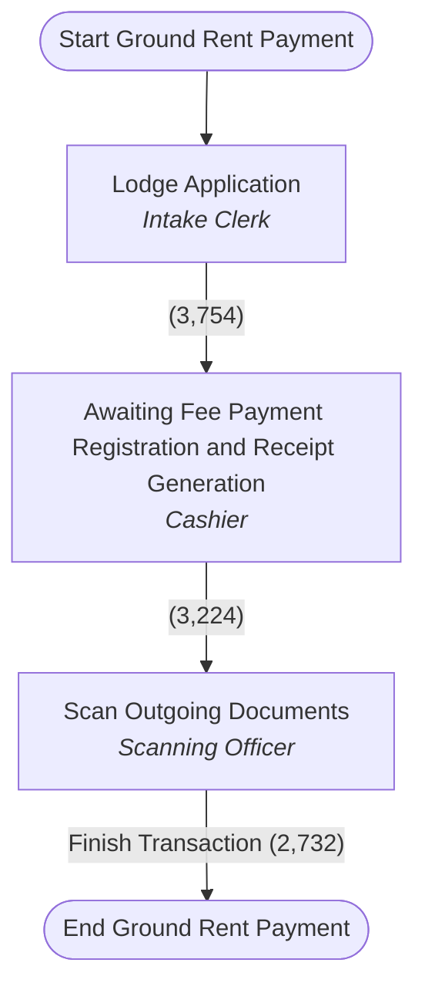

**Version history:**
- v1 → v2: 0 transitions added, 0 removed
- v2 → v3: 0 transitions added, 0 removed
- v3 → v4: 0 transitions added, 0 removed

## Ground Rent Review

**Transaction types:** `GRR` Ground Rent Review

**Roles (swimlanes):** Rent Officer, Delivery Clerk, Scanning Officer, Recommendation Reviewer, Commissioner

**Main route** (most-used way out at every step; sub-processes shown in their own section):

1. Lodge Ground Rent Review Memorandum — *Rent Officer*
2. Scan Incoming Documents — *Scanning Officer*
3. Review Ground Rent Review Memorandum — *Recommendation Reviewer*
4. Review and Sign Ground Rent Review Memorandum — *Commissioner*
5. Review Signed Ground Rent Review Memorandum — *Recommendation Reviewer*
6. Apply New Ground Rental Amount — *Rent Officer*
7. Delivery of Documents — *Delivery Clerk*
8. Scan Outgoing Documents — *Scanning Officer*
9. End Ground Rent Review

| # | Stage | Task | Role | Ways out → next stage (times used) | Server actions | Avg time | Open now |
|---|---|---|---|---|---|---|---|
| 1 | Lodge Ground Rent Review Memorandum | `LodgeMemorandum` | Rent Officer | Scan Incoming Documents (*Scan submitted document.*) **(1)** Withdraw (10) |  | 0.0 h | 1 |
| 2 | Scan Incoming Documents | `ScanIncomingDocuments` | Scanning Officer | Review Ground Rent Review Memorandum (*Reviews the Ground Rent Review Recommendation Memorandum.*) Withdraw (1) |  | 0.0 h |  |
| 3 | Review Ground Rent Review Memorandum | `ReviewMemorandum` | Recommendation Reviewer | Review and Sign Ground Rent Review Memorandum (*Commissioner reviews, approve and sign the Ground Rent Review Recommendation Memorandum.*) Redo Prepare Ground Rent Review Memorandum (*Re preparation of the Ground Rent Review Recommendation Memorandum.*) |  |  |  |
| 4 | Review and Sign Ground Rent Review Memorandum | `ReviewAndSignMemorandum` | Commissioner | Review Signed Ground Rent Review Memorandum (*Review the signed Ground Rent Review Recommendation Memorandum.*) Redo Prepare Ground Rent Review Memorandum (*Re preparation of the Ground Rent Review Recommendation Memorandum.*) |  |  |  |
| 5 | Review Signed Ground Rent Review Memorandum | `ReviewSignedMemorandum` | Recommendation Reviewer | Apply New Ground Rental Amount (*Commits the new ground rent amount.*) |  |  |  |
| 6 | Apply New Ground Rental Amount | `ApplyNewGroundRentalAmount` | Rent Officer | Delivery of Documents (*Prepare delivery letter.*) |  |  |  |
| 7 | Delivery of Documents | `DeliveryOfDocuments` | Delivery Clerk | Scan Outgoing Documents (*Scan outgoing documents and end transaction.*) |  |  |  |
| 8 | Scan Outgoing Documents | `ScanOutgoingDocuments` | Scanning Officer | Finish Transaction → End Ground Rent Review (*Finish Transaction.*) | on 'Finish Transaction': CompleteBatchHandler |  |  |
| 9 | End Ground Rent Review *end* |  |  |  |  |  |  |
| 10 | Redo Prepare Ground Rent Review Memorandum | `RedoPrepareMemorandum` | Rent Officer | Redo Scan Incoming Documents → Scan Incoming Documents (*Redo Scan submitted document.*) |  |  |  |

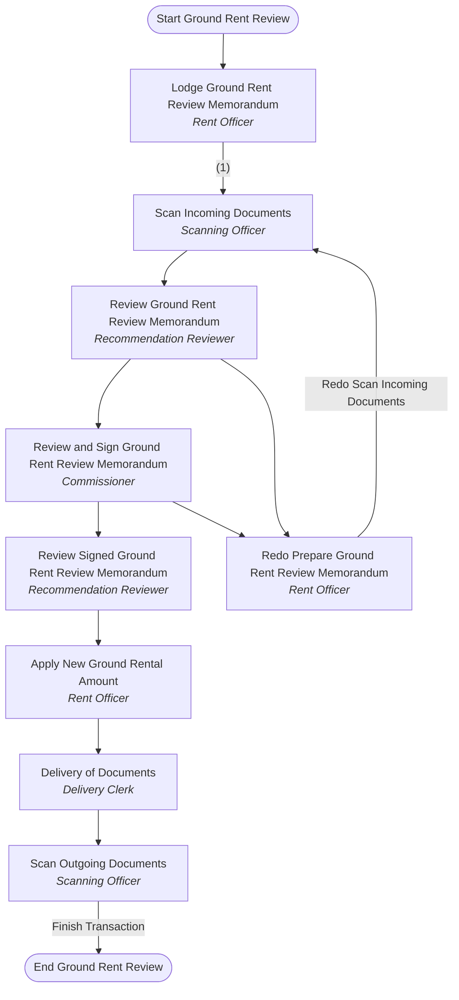

**Version history:**
- v1 → v2: 0 transitions added, 0 removed

## Indexing and Scanning

**Transaction types:** `INSC` Indexing and Scanning

**Roles (swimlanes):** Records Clerk, Scanning Clerk, QA Clerk, Registration Officer

**Main route** (most-used way out at every step; sub-processes shown in their own section):

1. Intake — *Records Clerk*
2. Index Data — *Records Clerk*
3. Scan Past Transaction Documents — *Scanning Clerk*
4. Review Indexing and Scanning — *QA Clerk*
5. Check Property File and Link Property with Spatial Parcel — *QA Clerk*
6. Final Review Indexing and Scanning — *Registration Officer*
7. End Indexing and Scanning

| # | Stage | Task | Role | Ways out → next stage (times used) | Server actions | Avg time | Open now |
|---|---|---|---|---|---|---|---|
| 1 | Intake | `LodgmentApplication` | Records Clerk | Index Data (*An information will be captured about the past transaction which includes active instruments only, party(ies) for each respective past transaction and document details for each of the instruments to be scanned (such as document number, date, issuance authority, etc.).*) **(27,315)** Withdraw (38) |  | 1.1 d | 270 |
| 2 | Index Data | `NewIndexData` | Records Clerk | Scan Past Transaction Documents (*The documents will be put in the proper order, then the documents will be scanned.*) **(79,087)** Withdraw (160) |  | 1.7 d | 1304 |
| 3 | Scan Past Transaction Documents | `ScanPropertyFile` | Scanning Clerk | Review Indexing and Scanning (*Review the scanned transaction documents and indexed data*) **(133,661)** Withdraw (39) |  | 3.2 d | 4624 |
| 4 | Review Indexing and Scanning | `ReviewDataINSC` | QA Clerk | Check Property and Link Property with Spatial Parcel → Check Property File and Link Property with Spatial Parcel (*Review and link of property. Create a property, if it does not exist in Aumentum Cadastre.*) **(70,029)** ReDo Scan of Documents → Scan Past Transaction Documents (*Some documents should be re-scanned.*) **(5,318)** ReDo Index Data → Index Data (*Some corrections of data are requested.*) **(48,394)** Create Parcel In Aumentum Cadastre (*Create a task in Aumentum Cadastre so that a Cadastre technical staff can create the parcel.*) **(34)** Withdraw (18) |  | 7.9 d | 9881 |
| 5 | Check Property File and Link Property with Spatial Parcel | `PropertyFileVerification` | QA Clerk | Final Review Indexing and Scanning (*Registration Officer will review the results of the indexing/scanning and integration processes, the history of the transaction and specifically, the comments made by the users of the system in the course of the transaction.*) **(52,688)** Withdraw (5) |  | 87.9 d | 17916 |
| 6 | Final Review Indexing and Scanning | `BLFinalReview` | Registration Officer | ReDo Index Data → Index Data (*Some corrections of data are requested.*) **(4,832)** Finish Transaction → End Indexing and Scanning (*A transaction will be completed.*) **(36,995)** ReDo Scan of Documents → Scan Past Transaction Documents (*Some documents should be re-scanned.*) **(4,059)** Check Property and Link Property with Spatial Parcel → Check Property File and Link Property with Spatial Parcel (*Review and link of property. Create a property, if it does not exist in Aumentum Cadastre.*) **(582)** Withdraw (1) | on 'Finish Transaction': CompleteBatchHandler | 2.0 d | 6231 |
| 7 | End Indexing and Scanning *end* |  |  |  |  |  |  |
| 8 | Create Parcel In Aumentum Cadastre | `CreateParcel` | QA Clerk | Review Indexing and Scanning (*Review the scanned transaction documents and indexed data*) **(7)** Withdraw (3) |  | 8.2 d | 24 |

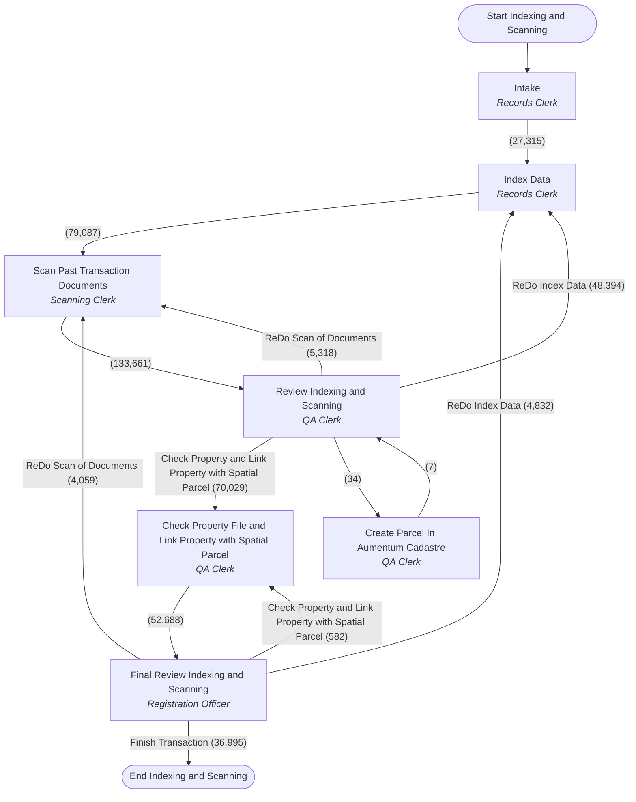

**Version history:**
- v1 → v2: 0 transitions added, 0 removed
- v2 → v3: 0 transitions added, 0 removed
- v3 → v4: 0 transitions added, 0 removed

## Raise Site Analysis Report

**Called as a sub-process by:** First Registration, Subsequent Registration

**Roles (swimlanes):** Director of Town Planning, Town Planning Coordinator, Inspection Officer

**Main route** (most-used way out at every step; sub-processes shown in their own section):

1. Review Request for Site Analysis — *Director of Town Planning*
2. Schedule Site Analysis — *Town Planning Coordinator*
3. Inspect Property — *Inspection Officer*
4. Prepare Site Analysis Report — *Inspection Officer*
5. Review Site Analysis Report — *Town Planning Coordinator*
6. Review Report and Approve — *Director of Town Planning*
7. End Raise Site Analysis Report

| # | Stage | Task | Role | Ways out → next stage (times used) | Server actions | Avg time | Open now |
|---|---|---|---|---|---|---|---|
| 1 | Review Request for Site Analysis | `ReviewRequestForSiteAnalysis` | Director of Town Planning | Schedule Site Analysis **(10,293)** Review Report and Approve **(1,520)** Reject Transaction → End Raise Site Analysis Report (*Prepare Rejection Letter. Note: The manual assignment is not available for this transition. This transaction will be automatically assigned to the default group.*) **(4)** Withdraw (6) | on 'Reject Transaction': SetBatchStatusHandler (batchStatus=application_rejected, transactionStatus=transaction_rejected); script | 5.1 d | 50 |
| 2 | Schedule Site Analysis | `ScheduleSiteAnalysis` | Town Planning Coordinator | Inspect Property (*Visit site and carry out site analysis*) **(10,773)** Withdraw (1) |  | 3.0 d | 11 |
| 3 | Inspect Property | `InspectProperty` | Inspection Officer | Prepare Site Analysis Report (*Generate and print the Site Analysis Report*) **(10,765)** Withdraw (2) |  | 13.2 h | 5 |
| 4 | Prepare Site Analysis Report | `PrepareSiteAnalysisReport` | Inspection Officer | Review Site Analysis Report (*Review the site analysis report*) **(10,760)** Withdraw (1) |  | 8.6 h | 5 |
| 5 | Review Site Analysis Report | `ReviewSiteAnalysisReport` | Town Planning Coordinator | Reschedule Site Analysis → Schedule Site Analysis (*Review the request for site analysis*) **(243)** Review Report and Approve **(10,505)** |  | 2.1 d | 14 |
| 6 | Review Report and Approve | `ReviewReportAndApprove` | Director of Town Planning | Finish Raise Site Analysis Report → End Raise Site Analysis Report (*Finish Raise Site Analysis Report. Note: The manual assignment is not available for this transition. This transaction will be automatically assigned to the default group.*) **(11,773)** Reschedule Site Analysis → Schedule Site Analysis (*Review the request for site analysis*) **(249)** Reject Transaction → End Raise Site Analysis Report (*Prepare Rejection Letter. Note: The manual assignment is not available for this transition. This transaction will be automatically assigned to the default group.*) | on 'Reject Transaction': SetBatchStatusHandler (batchStatus=application_rejected, transactionStatus=transaction_rejected); script | 1.0 d | 2 |
| 7 | End Raise Site Analysis Report *end* |  |  |  |  |  |  |

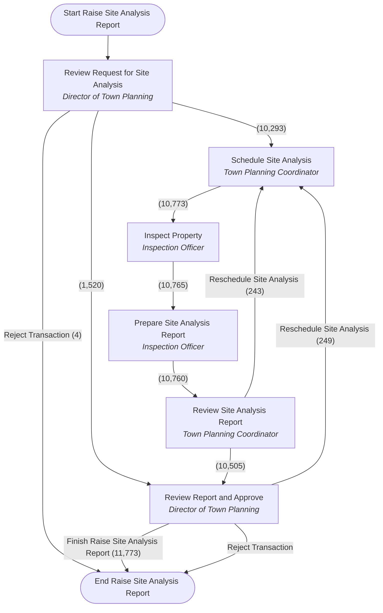

**Version history:**
- v1 → v2: 0 transitions added, 0 removed
- v2 → v3: stages added: Review Report and Approve; stages removed: Review Site Analysis Report and Approve; 6 transitions added, 4 removed
- v3 → v4: 2 transitions added, 2 removed

## Raise Title Deed Plan

**Called as a sub-process by:** Application for Certificate of Occupancy, First Registration, Recertification Registration, Replacement Of Title, Subsequent Registration

**Roles (swimlanes):** Surveyor General, Data Entry (VDES), Survey Quality Control Officer, Scanning Officer

**Main route** (most-used way out at every step; sub-processes shown in their own section):

1. Receive, Review Documents and Assign Task — *Surveyor General*
2. Prepare Title Deed Plan in Aumentum Cadastre — *Data Entry (VDES)*
3. Review Title Deed Plan (SQCO) — *Survey Quality Control Officer*
4. Review Title Deed Plan (SG) — *Surveyor General*
5. Approve Title Deed Plan — *Surveyor General*
6. Scan Title Deed Plan — *Scanning Officer*
7. End Raise Title Deed Plan

| # | Stage | Task | Role | Ways out → next stage (times used) | Server actions | Avg time | Open now |
|---|---|---|---|---|---|---|---|
| 1 | Receive, Review Documents and Assign Task | `ReceiveReviewDocumentsAndAssignTask` | Surveyor General | Prepare Title Deed Plan in Aumentum Cadastre (*Complete Aumentum Cadastre job "Prepare Title Deed Plan in Aumentum Cadastre"*) **(12,049)** Reject Transaction → End Raise Title Deed Plan (*Prepare Rejection Letter. Note: The manual assignment is not available for this transition. This transaction will be automatically assigned to the default group.*) **(1)** Scan Title Deed Plan (*Scan title deed plan*) **(180)** Withdraw (32) | on 'Reject Transaction': SetBatchStatusHandler (batchStatus=application_rejected, transactionStatus=transaction_rejected); script | 10.0 d | 431 |
| 2 | Prepare Title Deed Plan in Aumentum Cadastre | `PrepareTitleDeedPlan` | Data Entry (VDES) | Review Title Deed Plan (SQCO) (*Review the generated title deed plan*) **(16,154)** Withdraw (15) |  | 16.4 d | 805 |
| 3 | Review Title Deed Plan (SQCO) | `ReviewTitleDeedPlanSQCO` | Survey Quality Control Officer | ReDo Prepare Title Deed Plan → Prepare Title Deed Plan in Aumentum Cadastre (*Complete Aumentum Cadastre job "Prepare Title Deed Plan in Aumentum Cadastre"*) **(4,887)** Review Title Deed Plan (SG) (*Review the generated title deed plan*) **(11,596)** Withdraw (5) |  | 4.0 d | 78 |
| 4 | Review Title Deed Plan (SG) | `ReviewTitleDeedPlanSG` | Surveyor General | Approve Title Deed Plan **(11,055)** Redo Review Title Deed Plan (SQCO) → Review Title Deed Plan (SQCO) (*Review the generated title deed plan*) **(405)** Withdraw (1) |  | 22.6 h | 145 |
| 5 | Approve Title Deed Plan | `ApproveTitleDeedPlan` | Surveyor General | Scan Title Deed Plan (*Scan title deed plan*) **(11,035)** |  | 1.9 h | 20 |
| 6 | Scan Title Deed Plan | `ScanTitleDeedPlan` | Scanning Officer | Finish Raise Title Deed Plan → End Raise Title Deed Plan (*Finish Raise Title Deed Plan. Note: The manual assignment is not available for this transition. This transaction will be automatically assigned to the default group.*) **(11,209)** Withdraw (3) |  | 14.8 h | 4 |
| 7 | End Raise Title Deed Plan *end* |  |  |  |  |  |  |

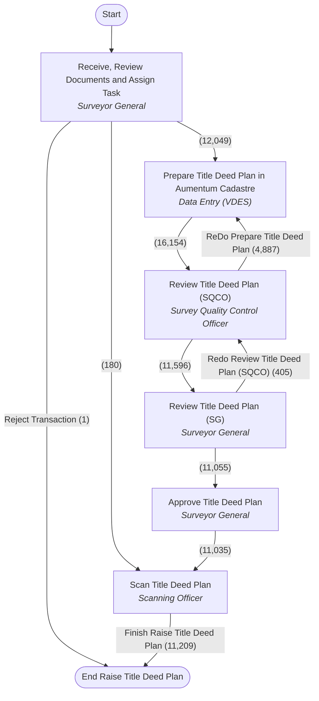

**Version history:**
- v1 → v2: 0 transitions added, 0 removed
- v2 → v3: 0 transitions added, 0 removed
- v3 → v4: 0 transitions added, 0 removed

## Recertification Registration

**Transaction types:** `APRF` Recertification

**Cannot be withdrawn at:** DeliveryOfDocuments, RegisterCofO, ScanOutgoingDocuments

**Roles (swimlanes):** Intake Clerk, Scanning Officer, Cashier, Lands Officer, Deeds Registrar, RofO & CofO Reviewer, Governor, Rejection Letter Creator, Delivery Clerk

**Main route** (most-used way out at every step; sub-processes shown in their own section):

1. Lodge Application — *Intake Clerk*
2. Scan Incoming Documents — *Scanning Officer*
3. Awaiting Fee Payment — *Cashier*
4. Register Processing Fee Payment and Generate Receipt — *Cashier*
5. Review Submission — *Lands Officer*
6. Raise Title Deed Plan (sub-process **Raise Title Deed Plan**)
7. Generate Certificate of Occupancy — *Deeds Registrar*
8. Review Certificate of Occupancy — *RofO & CofO Reviewer*
9. Approve Certificate of Occupancy — *Governor*
10. Review Signed Certificate of Occupancy — *RofO & CofO Reviewer*
11. Register Certificate of Occupancy — *Deeds Registrar*
12. Delivery of Documents — *Delivery Clerk*
13. Scan Outgoing Documents — *Scanning Officer*
14. End Recertification Registration

| # | Stage | Task | Role | Ways out → next stage (times used) | Server actions | Avg time | Open now |
|---|---|---|---|---|---|---|---|
| 1 | Lodge Application | `LodgmentApplication` | Intake Clerk | Scan Incoming Documents **(226)** Withdraw (15) | on 'Scan Incoming Documents': SetBatchStatusHandler (batchStatus=application_lodged, transactionStatus=transaction_lodged) | 18.9 d | 23 |
| 2 | Scan Incoming Documents | `ScanIncomingDocuments` | Scanning Officer | Awaiting Fee Payment (*Push transaction forward in order to process the payment of the required fees.*) **(222)** Withdraw (4) |  | 12.2 h |  |
| 3 | Awaiting Fee Payment | `AwaitingFeePayment` | Cashier | Register Processing Fee Payment and Generate Receipt (*Process the payment of fees and generate receipts.*) **(226)** Withdraw (2) |  | 1.4 d | 1 |
| 4 | Register Processing Fee Payment and Generate Receipt | `RegisterFeePaymentAndGenerateReceipt` | Cashier | Awaiting Fee Payment (*Push transaction forward in order to process the payment of the required fees.*) **(7)** Review Submission (*Review submitted documents.*) **(215)** Withdraw (3) |  | 1.3 d | 1 |
| 5 | Review Submission | `ReviewSubmission` | Lands Officer | Raise Title Deed Plan (*Raise Title Deed Plan Process. Note: The manual assignment is not available for this transition. This transaction will be automatically assigned to the default group.*) **(196)** Reject Transaction → Prepare Rejection Letter (*Prepare Rejection Letter.*) Withdraw (9) | on 'Reject Transaction': SetBatchStatusHandler (batchStatus=application_rejected, transactionStatus=transaction_rejected); script | 14.3 d | 10 |
| 6 | Raise Title Deed Plan *sub-process: Raise Title Deed Plan* |  |  | Is Transaction Rejected Decision → IsTransactionRejectedDecision |  |  |  |
| 7 | IsTransactionRejectedDecision *decision* |  |  | Generate Certificate of Occupancy Reject Transaction → Prepare Rejection Letter (*Prepare Rejection Letter.*) [if `#{contextInstance.variables['isRejected'] == 'true'}`] |  |  |  |
| 8 | Generate Certificate of Occupancy | `GenerateCofO` | Deeds Registrar | Review Certificate of Occupancy (*Review the generated Certificate of Occupancy.*) **(190)** Withdraw (3) |  | 12.5 d | 6 |
| 9 | Review Certificate of Occupancy | `ReviewCofO` | RofO & CofO Reviewer | Redo Generate Certificate of Occupancy → Generate Certificate of Occupancy (*Prepare and generate the Certificate of Occupancy.*) **(37)** Approve Certificate of Occupancy (*Approve and sign Certificate of Occupancy.*) **(153)** Reject Transaction → Prepare Rejection Letter (*Prepare Rejection Letter.*) | on 'Reject Transaction': SetBatchStatusHandler (batchStatus=application_rejected, transactionStatus=transaction_rejected); script | 12.0 d | 2 |
| 10 | Approve Certificate of Occupancy | `ApproveCofO` | Governor | Review Signed Certificate of Occupancy (*Receive and review the approved and signed Certificate of Occupancy from the Governor.*) **(152)** Withdraw (1) |  | 2.8 d |  |
| 11 | Review Signed Certificate of Occupancy | `ReviewSignedCofO` | RofO & CofO Reviewer | Register Certificate of Occupancy (*Register the Certificate of Occupancy approved and signed by the Governor.*) **(152)** |  | 1.9 h |  |
| 12 | Register Certificate of Occupancy | `RegisterCofO` | Deeds Registrar | Delivery of Documents (*Prepare delivery letter.*) **(152)** |  | 13.5 h |  |
| 13 | Delivery of Documents | `DeliveryOfDocuments` | Delivery Clerk | Scan Outgoing Documents (*Scan outgoing documents and end transaction.*) **(151)** |  | 1.5 d | 1 |
| 14 | Scan Outgoing Documents | `ScanOutgoingDocuments` | Scanning Officer | Finish Transaction → EndDecision **(125)** |  | 33.6 d | 26 |
| 15 | EndDecision *decision* |  |  | Transaction is rejected → End Recertification Registration [if `#{contextInstance.variables['isRejected'] == 'true'}`] Transaction is completed → End Recertification Registration (*A transaction will be completed.*) | on 'Transaction is completed': CompleteBatchHandler |  |  |
| 16 | End Recertification Registration *end* |  |  |  |  |  |  |
| 17 | Prepare Rejection Letter | `PrepareRejectionLetter` | Rejection Letter Creator | Delivery of Documents (*Prepare delivery letter.*) |  |  |  |

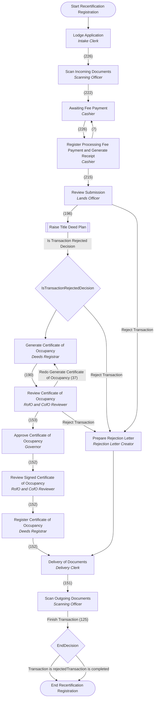

**Version history:**
- v1 → v2: 0 transitions added, 0 removed
- v2 → v3: 0 transitions added, 0 removed
- v3 → v4: 1 transitions added, 1 removed

## Replacement Of Title

**Transaction types:** `REPT` Replacement of Title

**Cannot be withdrawn at:** DeliveryOfDocuments, RegisterCofO, ScanOutgoingDocuments

**Roles (swimlanes):** Delivery Clerk, Scanning Officer, Intake Clerk, Governor, RofO & CofO Reviewer, Rejection Letter Creator, Lands Officer, Deeds Registrar, Cashier

**Main route** (most-used way out at every step; sub-processes shown in their own section):

1. Lodge Application — *Intake Clerk*
2. Scan Incoming Documents — *Scanning Officer*
3. Awaiting Fee Payment — *Cashier*
4. Register Processing Fee Payment and Generate Receipt — *Cashier*
5. Review Submission — *Lands Officer*
6. Raise Title Deed Plan (sub-process **Raise Title Deed Plan**)
7. Generate Certificate of Occupancy — *Deeds Registrar*
8. Review Certificate of Occupancy — *RofO & CofO Reviewer*
9. Approve Certificate of Occupancy — *Governor*
10. Review Signed Certificate of Occupancy — *RofO & CofO Reviewer*
11. Register Certificate of Occupancy — *Deeds Registrar*
12. Delivery of Documents — *Delivery Clerk*
13. Scan Outgoing Documents — *Scanning Officer*
14. End Replacement of Title

| # | Stage | Task | Role | Ways out → next stage (times used) | Server actions | Avg time | Open now |
|---|---|---|---|---|---|---|---|
| 1 | Lodge Application | `LodgmentApplication` | Intake Clerk | Scan Incoming Documents (*Scan submitted document*) **(66)** Withdraw (4) | on 'Scan Incoming Documents': SetBatchStatusHandler (batchStatus=application_lodged, transactionStatus=transaction_lodged) | 14.9 h | 3 |
| 2 | Scan Incoming Documents | `ScanIncomingDocuments` | Scanning Officer | Awaiting Fee Payment (*Pushes transaction forward in order to process the payment of the required fees.*) **(66)** |  | 4.6 h |  |
| 3 | Awaiting Fee Payment | `AwaitingFeePayment` | Cashier | Register Processing Fee Payment and Generate Receipt (*Process the payment of fees and generate receipts*) **(65)** Withdraw (1) |  | 5.3 h |  |
| 4 | Register Processing Fee Payment and Generate Receipt | `RegisterFeePaymentAndGenerateReceipt` | Cashier | Awaiting Fee Payment (*Pushes transaction forward in order to process the payment of the required fees.*) Review Submission (*Review submitted documents*) **(65)** |  | 1.9 d |  |
| 5 | Review Submission | `ReviewSubmission` | Lands Officer | Reject Transaction → Prepare Rejection Letter (*Prepare Rejection Letter.*) Raise Title Deed Plan (*Raise Title Deed Plan Process. Note: The manual assignment is not available for this transition. This transaction will be automatically assigned to the default group.*) **(64)** Withdraw (1) | on 'Reject Transaction': SetBatchStatusHandler (batchStatus=application_rejected, transactionStatus=transaction_rejected); script | 0.1 h |  |
| 6 | Raise Title Deed Plan *sub-process: Raise Title Deed Plan* |  |  | Is Transaction Rejected Decision → IsTransactionRejectedDecision |  |  |  |
| 7 | IsTransactionRejectedDecision *decision* |  |  | Reject Transaction → Prepare Rejection Letter (*Prepare Rejection Letter.*) [if `#{contextInstance.variables['isRejected'] == 'true'}`] Generate Certificate of Occupancy (*Prepare and generate the Certificate of Occupancy.*) |  |  |  |
| 8 | Generate Certificate of Occupancy | `GenerateCofO` | Deeds Registrar | Review Certificate of Occupancy (*Review the generated Certificate of Occupancy*) **(68)** Withdraw (2) |  | 6.8 d | 3 |
| 9 | Review Certificate of Occupancy | `ReviewCofO` | RofO & CofO Reviewer | Redo Generate Certificate of Occupancy → Generate Certificate of Occupancy (*Prepare and generate the Certificate of Occupancy.*) **(11)** Reject Transaction → Prepare Rejection Letter (*Prepare rejection letter*) Approve Certificate of Occupancy (*Approve and sign Certificate of Occupancy.*) **(53)** | on 'Reject Transaction': SetBatchStatusHandler (batchStatus=application_rejected, transactionStatus=transaction_rejected); script | 8.8 d | 4 |
| 10 | Approve Certificate of Occupancy | `ApproveCofO` | Governor | Review Signed Certificate of Occupancy (*Receive and review the approved and signed Certificate of Occupancy from the Governor.*) **(52)** |  | 1.0 h | 1 |
| 11 | Review Signed Certificate of Occupancy | `ReviewSignedCofO` | RofO & CofO Reviewer | Register Certificate of Occupancy (*Register the Certificate of Occupancy approved and signed by the Governor*) **(52)** |  | 1.9 h |  |
| 12 | Register Certificate of Occupancy | `RegisterCofO` | Deeds Registrar | Delivery of Documents (*Prepare delivery letter*) **(52)** |  | 22.6 h |  |
| 13 | Delivery of Documents | `DeliveryOfDocuments` | Delivery Clerk | Scan Outgoing Documents (*Scan outgoing documents and end transaction*) **(52)** |  | 1.1 d |  |
| 14 | Scan Outgoing Documents | `ScanOutgoingDocuments` | Scanning Officer | Finish Transaction → EndDecision **(33)** |  | 21.8 d | 19 |
| 15 | EndDecision *decision* |  |  | Transaction is completed → End Replacement of Title (*A transaction will be completed.*) Transaction is rejected → End Replacement of Title [if `#{contextInstance.variables['isRejected'] == 'true'}`] | on 'Transaction is completed': CompleteBatchHandler |  |  |
| 16 | End Replacement of Title *end* |  |  |  |  |  |  |
| 17 | Prepare Rejection Letter | `PrepareRejectionLetter` | Rejection Letter Creator | Delivery of Documents (*Prepare delivery letter*) |  |  |  |

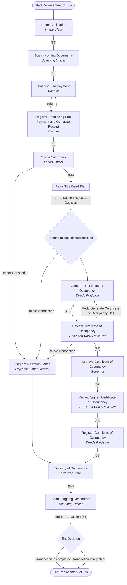

**Version history:**
- v1 → v2: 0 transitions added, 0 removed
- v2 → v3: 0 transitions added, 0 removed
- v3 → v4: 1 transitions added, 1 removed

## Search

**Transaction types:** `SEAR` Search; `CETC` Certified True Copies

**Roles (swimlanes):** Delivery Clerk, Customer Service Clerk, Intake Clerk, Scanning Officer, Search Officer, Deeds Registrar, Cashier

**Main route** (most-used way out at every step; sub-processes shown in their own section):

1. Lodge Application — *Intake Clerk*
2. Scan Incoming Documents — *Scanning Officer*
3. Awaiting Fee Payment — *Cashier*
4. Register Processing Fee Payment and Generate Receipt — *Cashier*
5. Generate Search Letter — *Search Officer*
6. Delivery of Documents — *Delivery Clerk*
7. Scan Outgoing Documents — *Scanning Officer*
8. End Search

| # | Stage | Task | Role | Ways out → next stage (times used) | Server actions | Avg time | Open now |
|---|---|---|---|---|---|---|---|
| 1 | Lodge Application | `LodgmentApplication` | Intake Clerk | Scan Incoming Documents (*Scan submitted document*) **(423)** Withdraw (142) | on 'Scan Incoming Documents': SetBatchStatusHandler | 4.3 d | 493 |
| 2 | Scan Incoming Documents | `ScanIncomingDocuments` | Scanning Officer | Awaiting Fee Payment (*Pushes transaction forward in order to process the payment of the required fees.*) **(385)** Withdraw (5) |  | 2.1 d | 33 |
| 3 | Awaiting Fee Payment | `AwaitingFeePayment` | Cashier | Register Processing Fee Payment and Generate Receipt (*Process the payment of fees and generate receipts*) **(364)** Withdraw (5) |  | 1.9 d | 21 |
| 4 | Register Processing Fee Payment and Generate Receipt | `RegisterFeePaymentAndGenerateReceipt` | Cashier | Awaiting Fee Payment (*Pushes transaction forward in order to process the payment of the required fees.*) **(5)** Generate Search Letter (*Prepare and generate the Search Letter*) **(171)** Retrieve Property File (*Retrieve requested Property File*) **(162)** Withdraw (9) |  | 2.6 d | 17 |
| 5 | Generate Search Letter | `GenerateSearchLetter` | Search Officer | Delivery of Documents (*Prepare delivery letter*) **(110)** Withdraw (6) |  | 1.7 d | 55 |
| 6 | Delivery of Documents | `DeliveryOfDocuments` | Delivery Clerk | Scan Outgoing Documents (*Scan outgoing documents and end transaction*) **(93)** Withdraw (2) |  | 4.0 d | 22 |
| 7 | Scan Outgoing Documents | `ScanOutgoingDocuments` | Scanning Officer | Finish Transaction → End Search **(142)** Withdraw (2) | on 'Finish Transaction': CompleteBatchHandler | 6.1 d | 12 |
| 8 | End Search *end* |  |  |  |  |  |  |
| 9 | Retrieve Property File | `RetrievePropertyFile` | Search Officer | Dispatch Property File for Applicant Review (*Dispatch the property file to the applicant for he/she to physically review the file.*) **(63)** Certify Documents (*Certify the document requested by the applicant*) **(8)** Withdraw (15) |  | 23.6 h | 76 |
| 10 | Dispatch Property File for Applicant Review | `DispatchPropertyFileApplicantReview` | Customer Service Clerk | Scan Outgoing Documents (*Scan outgoing documents and end transaction*) **(63)** |  | 11.9 h |  |
| 11 | Certify Documents | `CertifyDocuments` | Deeds Registrar | Delivery of Documents (*Prepare delivery letter*) **(7)** |  | 0.0 h | 1 |

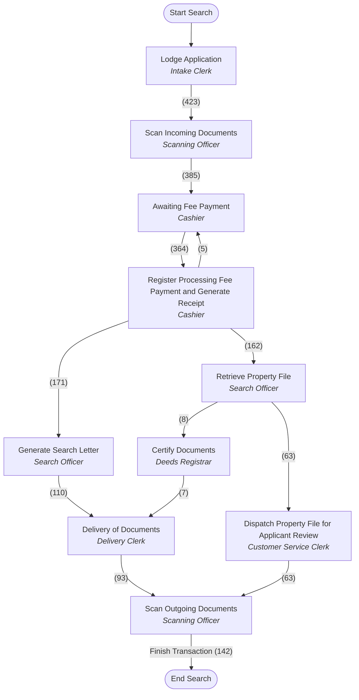

**Version history:**
- v1 → v2: 0 transitions added, 0 removed
- v2 → v3: stages added: Dispatch Property File for Applicant Review; stages removed: Dispatch Property File to Applicant Review; 2 transitions added, 2 removed
- v3 → v4: 0 transitions added, 0 removed

## Set Right Of Occupancy As Expired

**Transaction types:** `SROE` Set Right Of Occupancy As Expired

**Roles (swimlanes):** Deeds Registrar

**Main route** (most-used way out at every step; sub-processes shown in their own section):

1. Set Right Of Occupancy As Expired — *Deeds Registrar*
2. End

| # | Stage | Task | Role | Ways out → next stage (times used) | Server actions | Avg time | Open now |
|---|---|---|---|---|---|---|---|
| 1 | Set Right Of Occupancy As Expired | `LodgmentApplication` | Deeds Registrar | Finish Transaction → End | on 'Finish Transaction': CompleteBatchHandler |  |  |
| 2 | End *end* |  |  |  |  |  |  |

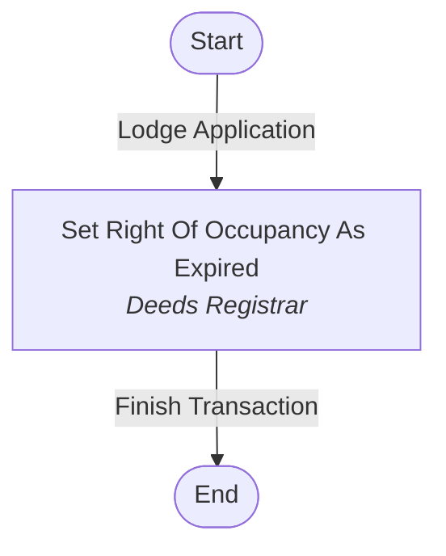

**Version history:**
- v1 → v2: 0 transitions added, 0 removed
- v2 → v3: 0 transitions added, 0 removed
- v3 → v4: 0 transitions added, 0 removed

## Subsequent Registration

**Transaction types:** `ASSI` Assignment; `ABWG` Assignment By Way of Gift; `CEMP` Caveat Emptor; `CHNT` Change of Name on Title; `CHPC` Change of Purpose Clause; `DEVO` Devolution; `EXTT` Extension of Title; `LEAS` Lease; `LOCE` Lifting of Caveat Emptor; `MERT` Merger of Titles; `MORT` Mortgage; `PSUR` Part Surrender; `RLEA` Release (Lease); `RMOR` Release (Mortgage); `RSUB` Release (Sublease); `SUBD` Subdivision; `SUBL` Sublease; `SURO` Surrender of Right of Occupancy; `UPMO` Upstamping of Existing Mortgage; `RROC` Revocation of Right of Occupancy; `COMP` Complaint; `RCOO` Revocation of Certificate of Occupancy; `APCM` Application for Consent (Mortgage); `APCA` Application for Consent (Assignment); `PWOA` Power of Attorney; `RPOA` Revocation of Power of Attorney

**Cannot be withdrawn at:** DeliveryOfDocuments, RegisterInstrument, ScanOutgoingDocuments

**Roles (swimlanes):** Scanning Officer, Intake Clerk, Cashier, Recommendation Reviewer, Governor, Commissioner, Lands Officer, Recommendation Creator, RofO & CofO Reviewer, Rejection Letter Creator, Valuation Report Reviewer, Deeds Registrar, Delivery Clerk, Estate Officer

**Main route** (most-used way out at every step; sub-processes shown in their own section):

1. Lodge Application — *Intake Clerk*
2. Awaiting Fee Payment — *Cashier*
3. Register Processing Fee Payment and Generate Receipt — *Cashier*
4. Scan Incoming Documents — *Scanning Officer*
5. Review Submission — *Lands Officer*
6. Prepare Recommendation Memorandum — *Recommendation Creator*
7. Review Recommendation — *Recommendation Reviewer*
8. Approve Recommendation (Commissioner) — *Commissioner*
9. Review Signed Recommendation — *Recommendation Reviewer*
10. Delivery of Documents — *Delivery Clerk*
11. Scan Outgoing Documents — *Scanning Officer*
12. End Subsequent Registration

| # | Stage | Task | Role | Ways out → next stage (times used) | Server actions | Avg time | Open now |
|---|---|---|---|---|---|---|---|
| 1 | Lodge Application | `LodgmentApplication` | Intake Clerk | Scan Incoming Documents (*Scan submitted document.*) Awaiting Fee Payment (*Pushes transaction forward in order to process the payment of the required fees.*) **(1,580)** Withdraw (120) |  | 12.0 d | 495 |
| 2 | Awaiting Fee Payment | `AwaitingFeePayment` | Cashier | Register Processing Fee Payment and Generate Receipt (*Process the payment of fees and generate receipts.*) **(1,550)** Withdraw (18) |  | 2.2 d | 39 |
| 3 | Register Processing Fee Payment and Generate Receipt | `RegisterFeePaymentAndGenerateReceipt` | Cashier | Awaiting Fee Payment (*Pushes transaction forward in order to process the payment of the required fees.*) **(26)** Scan Incoming Documents (*Scan submitted document.*) **(1,488)** Withdraw (13) |  | 14.3 h | 23 |
| 4 | Scan Incoming Documents | `ScanIncomingDocuments` | Scanning Officer | Review Submission (*Review submitted documents.*) **(1,228)** Withdraw (60) |  | 9.2 d | 200 |
| 5 | Review Submission | `ReviewSubmission` | Lands Officer | Open New Property File and Assign Property Number (*Open new property file and have system assign a new property number.*) **(1)** Prepare Recommendation Memorandum (*Lands Officer prepares the Recommendation Memorandum.*) **(855)** Investigate Complaint (*Investigate complaint and prepare report.*) Reject Transaction → Prepare Rejection Letter (*Prepare Rejection Letter.*) **(2)** Raise Site Analysis Report (*Raise Site Analysis Report. Note: The manual assignment is not available for this transition. This transaction will be automatically assigned to the default group.*) **(22)** Survey Plan Checking and Approval (*Survey Plan Checking and Approval. Note: The manual assignment is not available for this transition. This transaction will be automatically assigned to the default group.*) **(26)** Prepare Valuation Report (*Prepare valuation report and update valuation amount for the property.*) **(19)** Register Instrument (*Register Instrument.*) **(12)** Generate Final Demand Notice (*Generate demand notice for payment of fee relating to assessment of property.*) **(12)** Raise Title Deed Plan (*Raise Title Deed Plan. Note: The manual assignment is not available for this transition. This transaction will be automatically assigned to the default group.*) **(214)** Withdraw (37) | on 'Reject Transaction': SetBatchStatusHandler (batchStatus=application_rejected, transactionStatus=transaction_rejected); script | 3.7 d | 96 |
| 6 | Prepare Recommendation Memorandum | `PrepareRecommendationMemorandum` | Recommendation Creator | Review Recommendation (*Reviews the Recommendation Memorandum.*) **(529)** Withdraw (86) |  | 11.9 d | 253 |
| 7 | Review Recommendation | `ReviewRecommendation` | Recommendation Reviewer | Prepare Recommendation Memorandum (*Lands Officer prepares the Recommendation Memorandum.*) **(12)** Approve Recommendation (Governor) (*Reviews the Recommendation Memorandum and approve the transaction.*) **(13)** Approve Recommendation (Commissioner) (*Reviews the Recommendation Memorandum and approve the transaction.*) **(422)** Reject Transaction → Prepare Rejection Letter (*Prepare Rejection Letter.*) Withdraw (29) | on 'Reject Transaction': SetBatchStatusHandler (batchStatus=application_rejected, transactionStatus=transaction_rejected); script | 6.9 d | 53 |
| 8 | Approve Recommendation (Commissioner) | `ApproveRecommendation(Commissioner)` | Commissioner | Review Signed Recommendation (*Reviews the Recommendation Memorandum and approve the transaction.*) **(410)** Withdraw (5) |  | 21.7 h | 7 |
| 9 | Review Signed Recommendation | `ReviewSignedRecommendation` | Recommendation Reviewer | Register Instrument (*Register Instrument.*) **(3)** Raise Title Deed Plan (*Raise Title Deed Plan. Note: The manual assignment is not available for this transition. This transaction will be automatically assigned to the default group.*) **(95)** Delivery of Documents **(314)** Withdraw (8) |  | 8.3 h | 2 |
| 10 | Delivery of Documents | `DeliveryOfDocuments` | Delivery Clerk | Scan Outgoing Documents (*Scan outgoing documents and end transaction.*) **(555)** |  | 19.7 h | 2 |
| 11 | Scan Outgoing Documents | `ScanOutgoingDocuments` | Scanning Officer | Finish Transaction → EndDecision **(506)** |  | 13.9 d | 49 |
| 12 | EndDecision *decision* |  |  | Transaction is rejected → End Subsequent Registration [if `#{contextInstance.variables['isRejected'] == 'true'}`] Transaction is completed → End Subsequent Registration (*A transaction will be completed.*) | on 'Transaction is completed': CompleteBatchHandler |  |  |
| 13 | End Subsequent Registration *end* |  |  |  |  |  |  |
| 14 | Open New Property File and Assign Property Number | `OpenNewPropertyFileandAssignPropertyNumber` | Lands Officer | Prepare Recommendation Memorandum (*Lands Officer prepares the Recommendation Memorandum.*) **(1)** |  | 0.0 h |  |
| 15 | Investigate Complaint | `InvestigateComplaint` | Lands Officer | Prepare Recommendation Memorandum (*Lands Officer prepares the Recommendation Memorandum.*) Reject Transaction → Prepare Rejection Letter (*Prepare Rejection Letter.*) | on 'Reject Transaction': SetBatchStatusHandler (batchStatus=application_rejected, transactionStatus=transaction_rejected); script |  |  |
| 16 | Prepare Rejection Letter | `PrepareRejectionLetter` | Rejection Letter Creator | Delivery of Documents (*Prepare delivery letter.*) Withdraw (2) |  | 0.0 h |  |
| 17 | Raise Site Analysis Report *sub-process: Raise Site Analysis Report* |  |  | Is Transaction Rejected Decision → IsTransactionRejectedDecision |  |  |  |
| 18 | Survey Plan Checking and Approval *sub-process: Survey Plan Checking and Approval* |  |  | Is Transaction Rejected Decision → IsTransactionRejectedDecision |  |  |  |
| 19 | Prepare Valuation Report | `PrepareValuationReport` | Estate Officer | Review Valuation Report (*Review valuation report.*) **(20)** |  | 0.3 h | 1 |
| 20 | Register Instrument | `RegisterInstrument` | Deeds Registrar | Delivery of Documents (*Prepare delivery letter.*) **(243)** |  | 11.9 h | 3 |
| 21 | Generate Final Demand Notice | `GenerateFinalDemandNotice` | Cashier | Awaiting Assessed Fee Payment (*Pushes transaction forward in order to process the payment of the required assessed fees.*) **(9)** Withdraw (2) |  | 18.4 h | 1 |
| 22 | Raise Title Deed Plan *sub-process: Raise Title Deed Plan* |  |  | Is Title Deed Plan Rejected Decision → IsTitleDeedPlanRejectedDecision |  |  |  |
| 23 | Approve Recommendation (Governor) | `ApproveRecommendation(Governor)` | Governor | Review Signed Recommendation (*Reviews the Recommendation Memorandum and approve the transaction.*) **(12)** Withdraw (1) |  | 23.7 d |  |
| 24 | IsTransactionRejectedDecision *decision* |  |  | Reject Transaction → Prepare Rejection Letter (*Prepare Rejection Letter.*) [if `#{contextInstance.variables['isRejected'] == 'true'}`] Review Submission (*Review submitted documents.*) |  |  |  |
| 25 | Review Valuation Report | `ReviewValuationReport` | Valuation Report Reviewer | Prepare Valuation Report (*Prepare valuation report and update valuation amount for the property.*) **(2)** Review Submission (*Review submitted documents.*) **(18)** |  | 0.0 h |  |
| 26 | Awaiting Assessed Fee Payment | `AwaitingAssessedFeePayment` | Cashier | Register Assessed Fee Payment and Generate Receipt (*Process the payment of the assessed fees and generate receipts.*) **(9)** |  | 1.9 d |  |
| 27 | IsTitleDeedPlanRejectedDecision *decision* |  |  | Reject Transaction → Prepare Rejection Letter (*Prepare Rejection Letter.*) [if `#{contextInstance.variables['isRejected'] == 'true'}`] Generate Certificate of Occupancy (*Generate Certificate of Occupancy.*) |  |  |  |
| 28 | Register Assessed Fee Payment and Generate Receipt | `RegisterAssessedFeePaymentandGenerateReceipt` | Cashier | Awaiting Assessed Fee Payment (*Pushes transaction forward in order to process the payment of the required assessed fees.*) Review Submission (*Review submitted documents.*) **(9)** |  | 1.1 h |  |
| 29 | Generate Certificate of Occupancy | `GenerateCofO` | Deeds Registrar | Review Certificate of Occupancy (*Review Certificate of Occupancy.*) **(261)** Withdraw (4) |  | 9.6 d | 3 |
| 30 | Review Certificate of Occupancy | `ReviewCofO` | RofO & CofO Reviewer | Reject Transaction → Prepare Rejection Letter (*Prepare Rejection Letter.*) Approve Certificate of Occupancy (*Approve Certificate of Occupancy.*) **(233)** Withdraw (12) | on 'Reject Transaction': SetBatchStatusHandler (batchStatus=application_rejected, transactionStatus=transaction_rejected); script | 12.1 d | 16 |
| 31 | Approve Certificate of Occupancy | `ApproveCofO` | Governor | Review Signed Certificate of Occupancy (*Review Signed Certificate of Occupancy.*) **(232)** Withdraw (1) |  | 20.0 h |  |
| 32 | Review Signed Certificate of Occupancy | `ReviewSignedCofO` | RofO & CofO Reviewer | Register Instrument (*Register Instrument.*) **(231)** Withdraw (1) |  | 2.6 h |  |

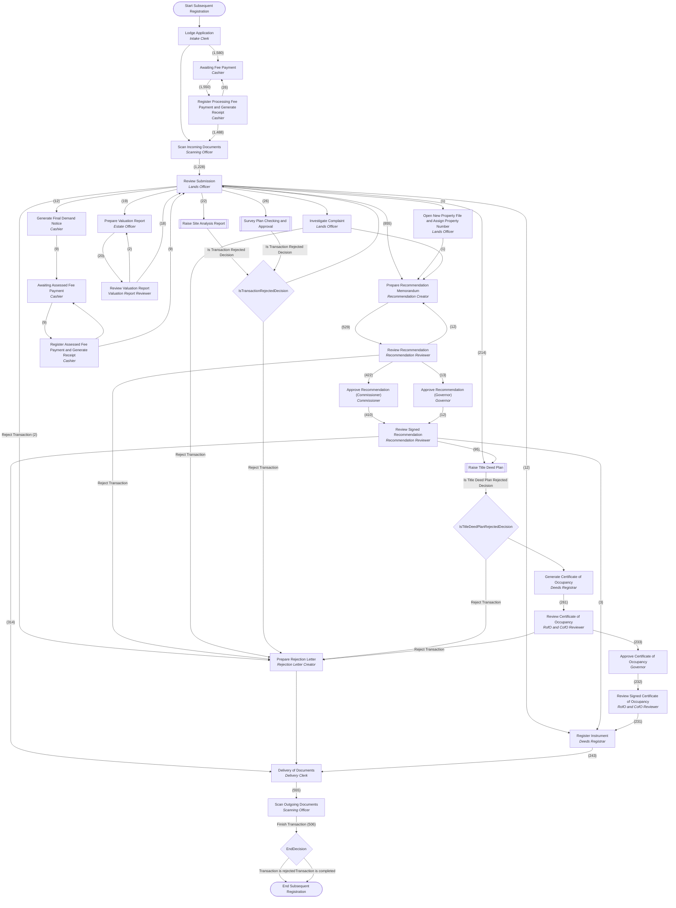

**Version history:**
- v1 → v2: 0 transitions added, 0 removed
- v2 → v3: 0 transitions added, 0 removed
- v3 → v4: 1 transitions added, 0 removed

## Survey Plan Checking

**Transaction types:** `SPC` Survey Plan Checking

**Cannot be withdrawn at:** DeliveryOfDocuments, RegisterSurveyPlan, ScanOutgoingDocuments

**Roles (swimlanes):** Scanning Officer, Intake Clerk, Cashier, Surveyor General, Survey Quality Control Officer, Data Entry (VDES), Data Entry (Charting and Reporting), Delivery Clerk

**Main route** (most-used way out at every step; sub-processes shown in their own section):

1. Lodge Application — *Intake Clerk*
2. Awaiting Fee Payment — *Cashier*
3. Register Processing Fee Payment and Generate Receipt — *Cashier*
4. Scan Incoming Documents — *Scanning Officer*
5. SG Review Submitted Survey Plan — *Surveyor General*
6. Run Traverse and Computations — *Survey Quality Control Officer*
7. Plot Survey Plan in Aumentum Cadastre — *Data Entry (VDES)*
8. Charting and Reporting — *Data Entry (Charting and Reporting)*
9. Review and Approve Survey Plan — *Surveyor General*
10. Awaiting Rectification and Resubmission by Surveyor — *Intake Clerk*

| # | Stage | Task | Role | Ways out → next stage (times used) | Server actions | Avg time | Open now |
|---|---|---|---|---|---|---|---|
| 1 | Lodge Application | `LodgmentApplication` | Intake Clerk | Awaiting Fee Payment (*Pushes transaction forward in order to process the payment of the required fees.*) Withdraw (5) |  | 0.0 h | 5 |
| 2 | Awaiting Fee Payment | `AwaitingFeePayment` | Cashier | Register Processing Fee Payment and Generate Receipt (*Process the payment of fees and generate receipts*) |  |  |  |
| 3 | Register Processing Fee Payment and Generate Receipt | `RegisterFeePaymentAndGenerateReceipt` | Cashier | Awaiting Fee Payment (*Pushes transaction forward in order to process the payment of the required fees.*) Scan Incoming Documents (*Scan submitted document.*) |  |  |  |
| 4 | Scan Incoming Documents | `ScanIncomingDocuments` | Scanning Officer | SG Review Submitted Survey Plan (*Review survey plan sent for approval*) |  |  |  |
| 5 | SG Review Submitted Survey Plan | `SGReviewSubmittedSurveyPlanChecking` | Surveyor General | Run Traverse and Computations (*Use the survey plan field's notes to run the parcel(s) traverse and computations.*) Reject Survey Plan → Prepare Rejection Letter (*Prepare Rejection Letter.*) Awaiting Rectification and Resubmission by Surveyor (*Receives the re-submitted document(s) from the Surveyor.*) | on 'Reject Survey Plan': SetBatchStatusHandler; script |  |  |
| 6 | Run Traverse and Computations | `RunTraverseComputationsSurveyPlanChecking` | Survey Quality Control Officer | Plot Survey Plan in Aumentum Cadastre (*Push registry transaction to next stage once the Aumentum Cadastre job "Plot Survey Plan in Aumentum Cadastre" is completed.*) SG Review Submitted Survey Plan (*Issue identified that requires SG intervention*) |  |  |  |
| 7 | Plot Survey Plan in Aumentum Cadastre | `PlotSurveyPlanlInCadastre` | Data Entry (VDES) | Redo Traverse and Computations → Run Traverse and Computations (*Use the survey plan field's notes to run the parcel(s) traverse and computations*) Charting and Reporting (*The Township or NTM coordinates that were submitted by the SQCO are manually plotted (charted) on the existing physical map sheets.*) |  |  |  |
| 8 | Charting and Reporting | `ChartingAndReportingSurveyPlanChecking` | Data Entry (Charting and Reporting) | Review and Approve Survey Plan (*Review the survey plan reports after Vectorization and Charting and Reporting process.*) |  |  |  |
| 9 | Review and Approve Survey Plan | `ReviewApproveSurveyPlanChecking` | Surveyor General | Redo Traverse and Computations → Run Traverse and Computations (*Use the survey plan field's notes to run the parcel(s) traverse and computations*) Reject Survey Plan → Prepare Rejection Letter (*Prepare Rejection Letter.*) Awaiting Rectification and Resubmission by Surveyor (*Receives the re-submitted document(s) from the Surveyor.*) Register Survey Plan (*Generates a new survey plan number for the submitted survey plan and affix the generated plan number along with signature and date of approval on the approved survey plan.*) | on 'Reject Survey Plan': SetBatchStatusHandler; script |  |  |
| 10 | Awaiting Rectification and Resubmission by Surveyor | `AwaitingRectificationAndResubmission` | Intake Clerk | Scan Incoming Documents (*Scan submitted document.*) |  |  |  |
| 11 | Prepare Rejection Letter | `PrepareRejectionLetter` | Rejection Letter Creator | Delivery of Documents (*Prepare delivery letter.*) |  |  |  |
| 12 | Register Survey Plan | `RegisterSurveyPlan` | Surveyor General | Delivery of Documents (*Prepare delivery letter.*) |  |  |  |
| 13 | Delivery of Documents | `DeliveryOfDocuments` | Delivery Clerk | Scan Outgoing Documents (*Scan outgoing documents and end transaction.*) |  |  |  |
| 14 | Scan Outgoing Documents | `ScanOutgoingDocuments` | Scanning Officer | Finish Transaction → EndDecision |  |  |  |
| 15 | EndDecision *decision* |  |  | Transaction is completed → End Survey Plan Checking (*A transaction will be completed.*) Transaction is rejected → End Survey Plan Checking [if `#{contextInstance.variables['isRejected'] == 'true'}`] | on 'Transaction is completed': CompleteBatchHandler |  |  |
| 16 | End Survey Plan Checking *end* |  |  |  |  |  |  |

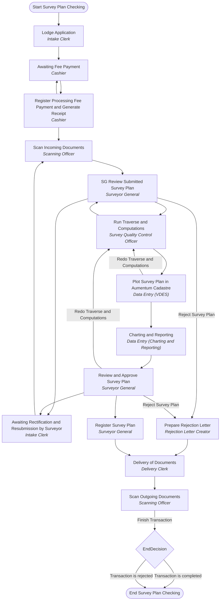

**Version history:**
- v1 → v2: 0 transitions added, 0 removed

## Survey Plan Checking and Approval

**Called as a sub-process by:** First Registration, Subsequent Registration

**Roles (swimlanes):** Surveyor General, Map Compilation Officer

**Main route** (most-used way out at every step; sub-processes shown in their own section):

1. SG Review Submitted Survey Plan — *Surveyor General*
2. Compare and Verify Survey Plan — *Map Compilation Officer*
3. Confirm Survey Plan — *Surveyor General*
4. End Survey Plan Checking and Approval

| # | Stage | Task | Role | Ways out → next stage (times used) | Server actions | Avg time | Open now |
|---|---|---|---|---|---|---|---|
| 1 | SG Review Submitted Survey Plan | `SGReviewSubmittedSurveyPlan` | Surveyor General | Compare and Verify Survey Plan **(11,643)** Withdraw (28) |  | 39.6 d | 1849 |
| 2 | Compare and Verify Survey Plan | `CompareAndVerifySurveyPlan` | Map Compilation Officer | Confirm Survey Plan **(11,602)** Withdraw (2) |  | 3.4 d | 39 |
| 3 | Confirm Survey Plan | `ConfirmSurveyPlan` | Surveyor General | Finish Survey Plan Checking and Approval → End Survey Plan Checking and Approval (*Finish Survey Plan Checking and Approval. Note: The manual assignment is not available for this transition. This transaction will be automatically assigned to the default group.*) **(11,594)** Reject Transaction → End Survey Plan Checking and Approval (*Prepare Rejection Letter. Note: The manual assignment is not available for this transition. This transaction will be automatically assigned to the default group.*) **(2)** Withdraw (1) | on 'Reject Transaction': SetBatchStatusHandler (batchStatus=application_rejected, transactionStatus=transaction_rejected); script | 13.4 h | 5 |
| 4 | End Survey Plan Checking and Approval *end* |  |  |  |  |  |  |

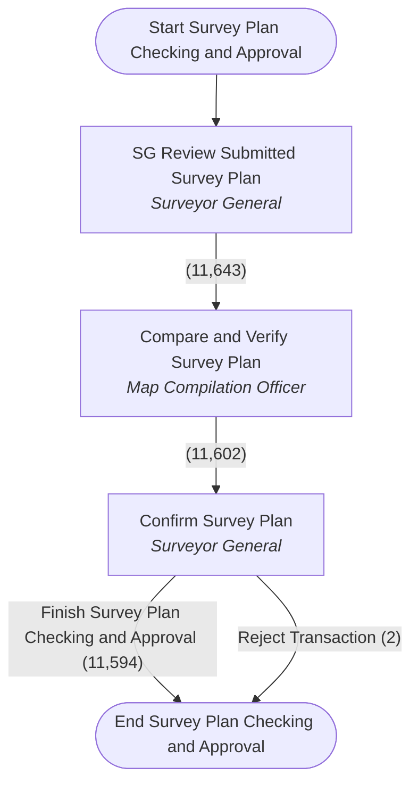

**Version history:**
- v1 → v2: 0 transitions added, 0 removed
- v2 → v3: stages added: Compare and Verify Survey Plan, Confirm Survey Plan; stages removed: Charting and Reporting, Plot Parcel in Aumentum Cadastre, Review and Approve Survey Plan, Run Traverse and Computations; 4 transitions added, 8 removed
- v3 → v4: 0 transitions added, 0 removed

