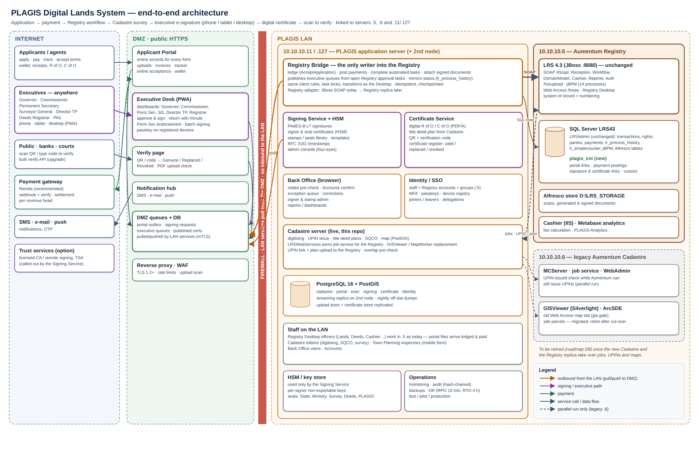

# 01 — Digital Lands System: end-to-end architecture

**Aim.** The whole PLAGIS lands process becomes digital, from application to a verified certificate in the owner's hands:
- the applicant applies and pays online;
- officers work digitally in the Registry and the Cadastre;
- the Commissioner, Permanent Secretary and Governor review and **e-sign** from phone, tablet or desktop, including from home;
- administrators apply e-signatures and official **stamps**;
- the applicant receives a **digital certificate** that anyone can **scan to verify**.

**Servers it links:**
- **10.10.10.5:** Aumentum Registry (LRS43).
- **10.10.10.6:** Aumentum Cadastre / MCServer / GISViewer (legacy).
- **10.10.10.127 / 10.10.10.11:** the new Cadastre server and PostgreSQL. This server also hosts the new services.

This is design only; nothing is built.

## 1. Building blocks

| # | System | Users | Where it runs | Status |
|---|---|---|---|---|
| A | **Applicant Portal**: apply, pay, track, accept terms, download and verify certificates | public, agents, lawyers | DMZ (public HTTPS) | designed: `../registration_Portal/` |
| B | **Payment gateway** (Remita recommended) + Accounts confirmation | applicants, Accounts | Internet + back office | designed: `../registration_Portal/01` §4 |
| C | **Back Office**: intake pre-check, payment confirmation, exceptions, correction requests, document publishing | Registry, Accounts, Lands | LAN (browser) | designed: `../registration_Portal/` |
| D | **Executive Desk**: dashboard and e-signing for Commissioner, Permanent Secretary, Governor; also Surveyor General, Director of Town Planning, Deeds Registrar | executives and their PAs | DMZ (PWA on phone, tablet, desktop) | **new, see 03** |
| E | **Signing Service**: signing keys, signatures, stamps, timestamps, signature audit | used by D, C and the Registry hand-off | LAN (keys in an HSM / secure key store) | **new, see 04** |
| F | **Certificate & Verification Service**: generates the final digital R of O / C of O / letters, QR codes, the public verify page and the certificate wallet | applicants, banks, courts, the public | generation on LAN; verify page in DMZ | **new, see 05** |
| G | **Registry Bridge**: the only writer into the Registry, via its own services. Lodges, posts payments, completes automated tasks, attaches signed documents, mirrors status | services | LAN, on .11 | designed: `../registration_Portal/03` |
| H | **Aumentum Registry**: workflow, records, numbering (unchanged; later the Registry replica) | officers (Registry Desktop) | **.5** | existing: `../aumentum_Registry/` |
| I | **New Cadastre**: digitising, UPIN, job service for the Registry, title deed plans, map, GISViewer replacement | survey, digitising, SQCO | **.11 / .127** | live (this repo) |
| J | **Legacy Aumentum Cadastre**: MCServer, GISViewer (Silverlight map tiles, gis.gate), job service and UPIN check during parallel run | survey (legacy) | **.6** | existing, to be retired |
| K | **Identity & Access**: one sign-in for staff (Registry accounts and groups), MFA, device registration, roles | all staff | LAN + DMZ | **new, see 07** |
| L | **Notification hub**: SMS, e-mail and in-app push | everyone | DMZ | designed |
| M | **Reporting & dashboards**: KPIs, time in stage, backlogs per desk, revenue (alongside Metabase "PLAGIS Analytics") | management | LAN | upgrade |

## 2. Network zones and servers

| Zone | Contains | Reachable from |
|---|---|---|
| **Internet** | applicants, executives at home, gateway, SMS/e-mail, timestamp authority (optional) | — |
| **DMZ** (reverse proxy, WAF, TLS 1.2+ only) | Applicant Portal, Executive Desk front end + API, public Verify page, Notification hub | Internet (443 only) |
| **LAN application tier: .11 / .127** (the PLAGIS server) | Registry Bridge, Signing Service, Certificate Service, Back Office, Identity service, new Cadastre server, PostgreSQL (portal, executive, signing, certificate schemas) | DMZ → **no direct inbound**; the LAN services pull from the DMZ queues (outbound HTTPS) |
| **LAN records tier: .5** | Aumentum Registry (JBoss), SQL Server LRS43 (+ `plagis_ext`), Alfresco store `D:\LRS_STORAGE` | LAN application tier only |
| **LAN legacy: .6** | Aumentum Cadastre MCServer, GISViewer, LRSWebServices (legacy), ArcGIS | LAN only; being retired |
| **Key protection** | HSM (network HSM or USB HSM on the signing host) or a qualified remote-signing provider | Signing Service only |

**One rule over everything:** nothing on the Internet can open a connection into the LAN. The DMZ holds the queues; the LAN services fetch work from them and push results back. An executive signing from home therefore never touches .5, .6 or .11 directly.

## 3. Data ownership: one owner at a time

| Data | Owner (master) | Others hold |
|---|---|---|
| Application before lodgement, applicant account, invoices, gateway payments | Portal (PostgreSQL `portal`) | — |
| Transaction, parties, properties, rights, workflow stage, numbers (PLS, PL, PLT, INV, RCT, instrument/volume/page) | **Registry .5** (LRS43 `LRSAdmin`) | mirrors in portal and executive dashboards |
| Parcels, geometry, UPIN, beacons, title deed plans | **Cadastre .11** (PostgreSQL `cadastre`); `.6` during the parallel run | Registry holds the UPIN link (`lr_spatial_unit.upin`) |
| Signatures, stamps, signing certificates, signing audit | **Signing Service** (PostgreSQL `signing` + HSM) | signed PDFs attached in the Registry |
| Issued digital certificates, QR payloads, verification log, revocations | **Certificate Service** (PostgreSQL `certificate`) | copy attached in the Registry (`sd_Co_title`, `sd_landfoem_7`) |
| Links between all of these (portal ref ↔ transaction ↔ signature ↔ certificate) | `plagis_ext` in LRS43 | — |

`LRSAdmin` on .5 is never altered by any of the new systems. They read it, and write only through the Registry's own services (`../aumentum_Registry/01` rules).

## 4. End-to-end flow (summary)

The detailed stage table is in [02-end-to-end-digital-workflow.md](02-end-to-end-digital-workflow.md).

```mermaid
flowchart LR
  A[Applicant applies online<br/>Portal] --> P[Pays via gateway<br/>Accounts confirm<br/>e-receipt]
  P --> L[Bridge lodges in Registry .5<br/>PLS no.]
  L --> F[Lands opens file<br/>PL no.]
  F --> S[Survey checking<br/>Cadastre .11 / .6]
  S --> T[Town Planning site analysis<br/>mobile inspection]
  T --> R[Lands: Land Form 5<br/>recommendation]
  R --> PS{{Perm Sec endorses<br/>Executive Desk}}
  PS --> C{{Commissioner e-signs<br/>Executive Desk}}
  C --> AC[Applicant accepts terms online<br/>pays C of O fees]
  AC --> TD[Raise Title Deed Plan<br/>Cadastre: digitise, UPIN, SQCO<br/>SG e-signs TDP]
  TD --> G[Deeds: generate C of O<br/>Registrar stamp]
  G --> GV{{Governor e-signs C of O<br/>Executive Desk}}
  GV --> RG[Deeds Registrar registers<br/>instrument / volume / page]
  RG --> DC[Certificate Service issues<br/>signed digital C of O + QR]
  DC --> W[Applicant downloads<br/>anyone can scan to verify]
```

## 5. Integration contracts (who calls whom)

| From → To | How | What |
|---|---|---|
| Portal ↔ Bridge | Bridge pulls the Portal outbox (HTTPS, mutual TLS) | lodge, post payment, accept terms, attach documents; the Bridge pushes status |
| Executive Desk ↔ Bridge | Bridge pulls the signing outbox; pushes the executive queue | tasks waiting at an executive stage, the documents to sign, decisions and signed documents |
| Executive Desk → Signing Service | via the LAN pull queue (the Desk never calls the LAN) | "sign this document hash for user X", authorised by the user's passkey / OTP |
| Bridge → Registry .5 | SOAP `/lrs/api` with WS-Security (`src/lrs.rs`) | `AcceptApplication`, `completeTask`, `lock/unlock`, `/lrs/upload` + IncomingDocument, `generateNumber`, reads |
| Bridge → LRS43 (read) | SQL read (history, status, mirrors) | `lr_process_history`, `lr_transaction`, `lr_payment*`, documents |
| Registry .5 → Cadastre .11 | `LRSWebServices.asmx` (job service), served by `src/routes/mcservice.rs` | create, approve or reject digitising jobs (Raise Title Deed Plan) |
| Cadastre .11 → Registry .5 | SOAP (`lrs.rs`): UPIN link, plan image upload `sd_titledeedPlan` | as today |
| Cadastre .11 → .6 | job-service UPIN check, `gis.gate` passthrough (`src/routes/gisviewer.rs`) | during the parallel run only |
| Certificate Service → Registry .5 | via the Bridge: attach the final signed certificate as an outgoing document | `sd_Co_title`, `sd_landfoem_7`, letters |
| Certificate Service → Portal | publish to the applicant's wallet | PDF + QR |
| Public → Verify page | HTTPS GET of the QR URL | certificate status, number, owner initials, parcel, issue date, signature validity |
| All services → Identity service | OIDC sign-in | staff identity, groups (from Registry / Alfresco groups), MFA |

## 6. Technology (one stack, existing infrastructure)

| Concern | Choice |
|---|---|
| Services | Rust + Axum, the same as `cadastre-server`: one codebase per service, reusing `lrs.rs`, `registry_sync.rs` and `mcservice.rs` |
| Front ends | One web app with role-based views (Portal, Back Office, Executive Desk), installable as a **PWA** on phones and tablets, responsive on desktop |
| Databases | PostgreSQL 16 on the PLAGIS server (schemas `portal`, `exec`, `signing`, `certificate`, `identity`); SQL Server LRS43 (`plagis_ext`) on .5 |
| Documents | PDF/A generated server-side; signatures as **PAdES** (PDF Advanced Electronic Signatures) with timestamps |
| Keys | HSM (PKCS#11), or a remote signing provider. Keys never leave it; phones never hold keys |
| Messaging between zones | queue tables in the DMZ database, pulled by LAN services; HTTPS with mutual TLS |
| Maps | the new Cadastre map (PostGIS) for officers and the Executive Desk parcel view |

## 7. Documents in this folder

| File | Content |
|---|---|
| [01-end-to-end-architecture.md](01-end-to-end-architecture.md) | this file |
| [02-end-to-end-digital-workflow.md](02-end-to-end-digital-workflow.md) | every stage from application to certificate: who, where, what is signed or stamped, and which paper disappears |
| [03-executive-signing-app.md](03-executive-signing-app.md) | Executive Desk: Commissioner, Permanent Secretary, Governor (and SG, Director TP, Registrar) dashboards, signing from phone, tablet and desktop |
| [04-e-signature-stamps-pki.md](04-e-signature-stamps-pki.md) | e-signatures, official stamps, keys, signature levels, admin management, legal basis |
| [05-digital-certificates-and-verification.md](05-digital-certificates-and-verification.md) | digital R of O / C of O, QR codes, scan to verify, wallet, revocation, printed copies |
| [06-server-integration.md](06-server-integration.md) | exactly how .5, .6 and .11/.127 are linked, and what each provides |
| [07-security-identity-deployment.md](07-security-identity-deployment.md) | identity, MFA, remote access from home, device rules, hosting, backups, monitoring |
| [08-roadmap.md](08-roadmap.md) | build phases from today to a fully digital lands system |
