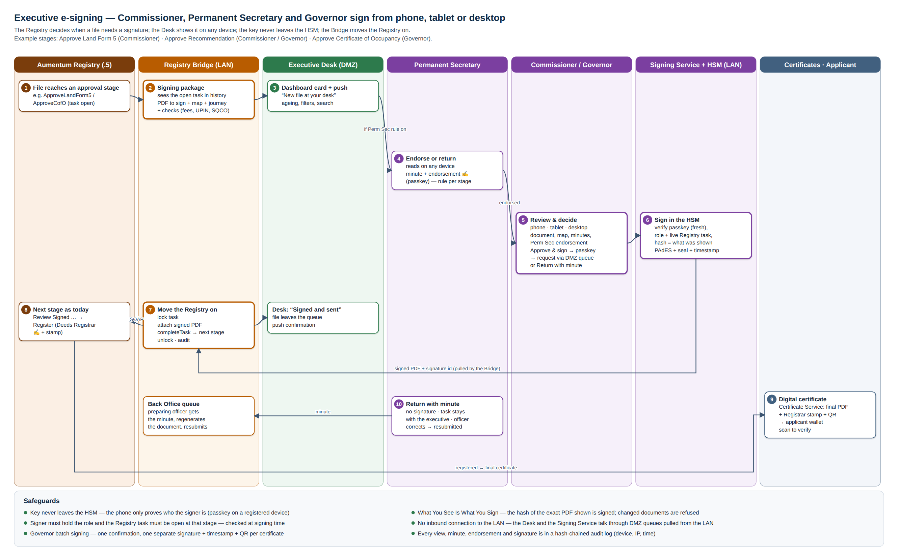
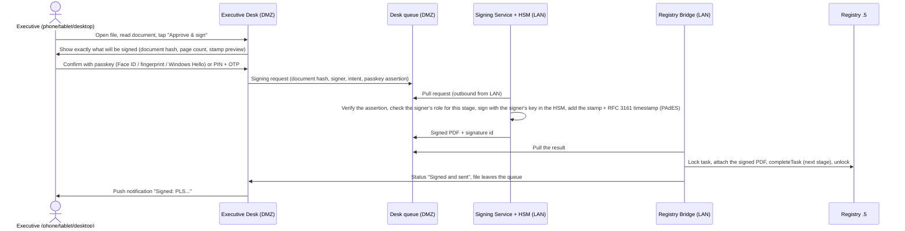

# 03 — Executive Desk: review and e-sign from phone, tablet or desktop

The Executive Desk is one app for the senior officers whose signature moves a file:
- the **Commissioner**, **Permanent Secretary** and **Governor**;
- the **Surveyor General**, **Director of Town Planning** and **Deeds Registrar**;
- their **personal assistants** (PAs), who prepare but cannot sign.

It works from the office, from home or while travelling, on a phone, tablet or desktop. Files arrive on the dashboard automatically when they reach the officer's stage in the Registry. A signature applied here moves the file forward in the Registry (`02` §4).

## 1. Form factor

- **One Progressive Web App (PWA):**
  - installable on iPhone, Android, iPad and Android tablets, Windows and Mac;
  - opens in any modern browser;
  - push notifications;
  - no app-store dependency. A store-packaged wrapper can be added later if PLAGIS prefers.
- **Layouts:**
  - **phone:** card list → document → sign;
  - **tablet:** list + document side by side, with pen or finger annotation;
  - **desktop:** three panes (queue, document, details and history).
- **Hosted in the DMZ**, so it is reachable from home with no VPN. It never connects into the LAN; the LAN services pull from it (`01` §2).

## 2. Who sees what

| Role | Queues (from the Registry stages, `02` §3) | Can sign | Can endorse / minute | Special views |
|---|---|---|---|---|
| **Governor** | Approve Certificate of Occupancy (all processes); Approve Recommendation (Governor) | ✔ C of O, Governor memos | ✔ minute | **Governor view** (§5): batch signing, state-wide summary |
| **Commissioner** | Approve Land Form 5; Approve Recommendation (Commissioner); Review and Sign Ground Rent Review Memorandum | ✔ | ✔ | Perm Sec endorsement shown on each file; "send to Governor" covering memo |
| **Permanent Secretary** | endorsement queue: every file heading to the Commissioner (rule per stage) | ✔ endorsement signature | ✔ | **Perm Sec view** (§6): ministry-wide pipeline, files waiting at each desk, delegation |
| Surveyor General | SG Review Submitted Survey Plan; Confirm Survey Plan; Receive/Review/Approve Title Deed Plan | ✔ survey confirmation, TDP | ✔ | parcel map + survey plan side by side |
| Director of Town Planning | Review Request for Site Analysis; Review Report and Approve | ✔ SAR | ✔ | inspection photos and GPS |
| Deeds Registrar | Register C of O / Instrument; Certify Documents | ✔ registration endorsement, CTC | ✔ | register entries |
| Personal assistant (per executive) | the principal's queues | ✘ never signs | prepares: sorts, adds notes, flags urgent, prepares batches | — |

Roles come from the staff identity (Registry / Alfresco groups: Commissioner, Governor, Permanent Secretary, Surveyor General, …; `07`).

## 3. Dashboard

**Home: "My desk"**
- **Counters:** awaiting my signature, endorsed by Perm Sec and ready, returned and resubmitted, urgent, signed today / this week.
- **Queue list**, one card per file:
  - transaction (PLS…), property (PL…), type (e.g. Application for Statutory R of O), applicant (name), location and LGA, area, land use;
  - fees paid ✔;
  - time at my desk, with ageing colour: green < 2 days, amber 2–7, red > 7;
  - flags: urgent, VIP, court matter, returned before.
- **Filters:** type, LGA, age, endorsed / not endorsed, amount band.
- **Search** by PLS, PL, UPIN or name.

**File view** (the same on every device, adapted to the screen):

| Section | Content | Source |
|---|---|---|
| Document to sign | the generated PDF (Land Form 5, memo, C of O draft), zoomable, page thumbnails | Registry / Certificate Service |
| Summary | applicant, property, land use, area, term, rent, premium, fees paid | Registry |
| Map | the parcel on the Cadastre map, neighbouring parcels, overlap check result, satellite base | Cadastre .11 |
| Supporting documents | survey plan, site analysis report, ID, deeds, receipts | Registry documents |
| Journey | every stage so far, who, when, minutes and comments (the Web Access "History" equivalent) | `lr_process_history` |
| Checks | fees fully paid, no blocking transaction, UPIN linked, SQCO passed, Perm Sec endorsement | Bridge |
| Minutes | add a minute (text or voice-to-text); the previous minutes thread | Executive Desk |

**Actions:**

| Action | Effect |
|---|---|
| **Approve & sign** | e-signature + stamp (`04`), then the Registry task completes (`02` §4) |
| **Return with minute** | no signature; the minute goes to the preparing officer; the file stays at my stage until resubmitted (`02` §5) |
| **Endorse** (Perm Sec) | endorsement signature + minute; the file appears as "Endorsed" to the Commissioner |
| **Forward for advice** | ask the Perm Sec / Director / Legal for advice; a minute thread; the file stays with me |
| **Batch sign** | select several files of the same type, then **one signing ceremony** applies a separate signature to each document (§5) |
| **Delegate** (time-bound) | the Perm Sec or Commissioner delegates signing for named stages to an acting officer for set dates, if the law allows, with the delegation shown on the signed document |

## 4. The signing ceremony (any device)

- **What You See Is What You Sign:** the hash of the exact PDF the executive viewed is what gets signed. If the document changed since it was shown, the signing is refused.
- **The key never leaves the HSM.** The device only proves who the executive is (passkey or OTP). Losing a phone does not expose the key; the device is revoked in the Identity service.
- **Offline:** the queue and documents can be read offline on a registered device (encrypted cache). Signing needs a connection, and actions taken offline are queued and confirmed on reconnect.
- **Speed target:** less than 5 s from "Approve & sign" to "Signed". The Registry update follows within the next Bridge cycle (≤ 30 s).

## 5. Governor view

- **Purpose:** C of O approvals at volume. 8,038 First Registration C of Os have passed "Approve Certificate of Occupancy", plus the APCO, recertification and replacement ones.
- **Batch signing:**
  - The PA or Commissioner prepares a **batch** (e.g. "20 C of Os – Jos North").
  - The Governor reviews the batch summary: a table of owners, locations, areas, land use, premium paid. They can open any certificate and **untick** any item.
  - **One confirmation** (passkey) signs every selected certificate **individually**. Each gets its own signature, timestamp and QR.
  - Unticked items stay in the queue with an optional minute.
- **Summary dashboard:** certificates signed this month, pending, by LGA and land use; revenue linked to the batch (premium, fees).
- **Seal:** the State seal appears on every certificate the Governor signs (`04` §3).

## 6. Permanent Secretary view

- **Endorsement queue:** files on their way to the Commissioner (rule per stage, `02` §2).
- **Ministry pipeline:**
  - files at every desk (Lands, Survey, SQCO, Town Planning, Deeds, Commissioner, Governor);
  - ageing per desk and bottlenecks (today 1,849 files wait at "SG Review Submitted Survey Plan", average 39.6 days);
  - SLA breaches;
  - drill-down to the file (read-only).
- **Delegations:** set and see acting arrangements.
- **Reports:** throughput per month, approvals, returns, average time to approval, revenue.

## 7. Notifications

| Event | To | Channel |
|---|---|---|
| New file at my desk (daily digest; immediate if urgent) | executive, PA | push + e-mail |
| File endorsed by Perm Sec | Commissioner | push |
| Resubmitted after my minute | executive | push |
| Batch ready | Governor | push + SMS |
| SLA reminder (> 7 days) | executive, PA, Perm Sec | digest |
| Signature completed / failed | executive | in-app |

## 8. Security specific to the Desk

Full detail is in `07`.

- Sign-in: staff account + **passkey (FIDO2/WebAuthn)** on the registered device, or password + TOTP as a fallback.
- **Device registration** by ICT, at most 3 devices per executive; remote revoke.
- Session timeout 15 min idle on mobile; re-authentication for every signing (passkey).
- No document download outside the app on mobile (view-only), and a watermark with the viewer's name on screen.
- Every view, minute, signature and refusal is written to an **immutable audit log** with the device, IP and time.
