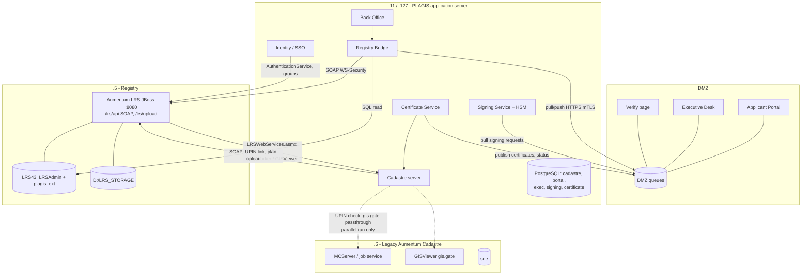

# 06 — How the servers are linked: .5, .6 and .11/.127

Sources: `../aumentum_Registry/07-integrations.md`, `../registry-integration.md`, the memory of the 2026-11 cut-over work, and this repo's `src/` (`lrs.rs`, `registry_sync.rs`, `routes/registry.rs`, `routes/mcservice.rs`, `routes/gisviewer.rs`).

## 1. The three servers today

| Server | Runs | Role in the digital lands system | Future |
|---|---|---|---|
| **10.10.10.5** (REGISTRY) | Aumentum Registry LRS 4.3 (JBoss 4.2.3 :8080), SQL Server 2012 **LRS43** (755 GB), Alfresco store `D:\LRS_STORAGE`, Cashier (IIS), Metabase "PLAGIS Analytics" | **System of record** for transactions, rights, parties, numbers and the workflow. Everything new writes to it **only through its own services**, via the Bridge | Stays the database host. The JBoss application is later replaced by the Registry replica (`../aumentum_Registry/09`) on the same LRS43 |
| **10.10.10.6** (PRODUCTIONMC) | Aumentum Cadastre: MCServer / DSS, ArcGIS / ArcSDE (`sde` database), GISViewer (Silverlight `Client.xap`, `gis.gate`, `MapWorker.aspx`), `ApplicationServerAdmin/WebServices/LRSWebServices.asmx` (job service), WebAdmin | **Legacy cadastre during the parallel run**: <ul><li>source of the parcels already migrated;</li><li>UPIN-issued check (the new editor asks it before issuing a UPIN);</li><li>map tiles for the old Registry Web Access map tab (Silverlight)</li></ul> | **Retired** once the new Cadastre owns jobs, UPINs and maps and the Registry no longer points at it. The Registry settings were already switched to .11 on 2026-11-04; originals are in `LRSAdmin.lr_setting_backup_trial` |
| **10.10.10.127 / 10.10.10.11** (PLAGIS server, Ubuntu 24.04) | new **cadastre-server** (systemd, `10.10.10.11:8080`), PostgreSQL 16 + PostGIS (`cadastre`), microk8s, httpd | **Application host for all new services**: <ul><li>Cadastre (digitising, UPIN, job service for the Registry, GISViewer replacement, map)</li><li>Registry Bridge, Signing Service, Certificate Service, Back Office, Identity</li><li>PostgreSQL schemas `portal`, `exec`, `signing`, `certificate`, `identity`</li></ul> | Main application server; a second node for resilience (`07` §5) |
| **DMZ host** (new, or a DMZ VLAN on existing hardware) | reverse proxy + WAF; Applicant Portal, Executive Desk front end/API, Verify page, Notification hub; DMZ queue database | the only thing reachable from the Internet | — |

## 2. Link map

## 3. Interfaces per server

### 3.1 .5 Registry

| Interface | Used by | Purpose | Existing code |
|---|---|---|---|
| `POST /lrs/api/AuthenticationService` (startSession), WS-Security UsernameToken; clock taken from the HTTP `Date` header | Bridge, Identity, Cadastre | sign-in, ticket | `src/lrs.rs` |
| `ReceptionService.AcceptApplication`, `WorkflowWebService` (start, getTaskTransitions, completeTask, assign), `AuthoringService.lock/unlock` | Bridge | lodge, move stages, attach signed documents | to build (Bridge) |
| `PUT /lrs/upload/{guid}.pdf?ticket=` + IncomingDocument / outgoing document | Bridge, Cadastre | attach uploads, signed documents, title deed plans | `routes/registry.rs` (plan upload) |
| `DomainModelService.loadObjects` (HQL), `generateNumber` | Bridge, Cadastre | reads, numbers (INV, RCT, …) | `src/lrs.rs` |
| `CashierService.CalculateFee` | Bridge | fee quotes | to build |
| SQL read of LRS43 (`lr_process_history`, `lr_transaction`, `lr_payment*`, documents) | Bridge mirror | status, numbers, documents | `src/registry_sync.rs` pattern |
| `AccessControlService.getParentAuthorities`, `AdministrationService` | Identity | staff groups (Commissioner, Governor, Surveyor General, …), user admin | `routes/sysadmin` (Users & Units) |
| SQL write **only** to `plagis_ext` | Bridge | links, ledgers | to build |

### 3.2 .6 Legacy Aumentum Cadastre (parallel run only)

| Interface | Used by | Purpose | When it stops |
|---|---|---|---|
| `LRSWebServices.asmx` Authenticate / UPIN check | Cadastre server (`CADASTRE_AUMENTUM_JOBSERVICE_URL`, outbound from .11 via `CADASTRE_OUTBOUND_ADDR`) | make sure no UPIN is issued twice while Aumentum can still issue them | when Aumentum Cadastre editing is switched off |
| `GISViewer/*` (gis.gate, Client.xap) | Cadastre server passthrough (`CADASTRE_GISVIEWER_UPSTREAM`), old Registry Web Access map tab | map in the old Web Access | when Web Access is replaced (Registry replica R2) or gis.gate is served from PostGIS |
| `sde` database | migration only | parcels, points, lineage (already imported) | after the final delta import at cut-over |

### 3.3 .11 / .127 PLAGIS application server

| Service | Exposes | Consumers |
|---|---|---|
| Cadastre server (`:8080` on .11) | `LRSWebServices.asmx` (job service for the Registry), `GISViewer/MapWorker.aspx`, `CadastralWebService.asmx`, REST `/api/v1/*` (parcels, UPIN, precheck, registry queues), map tiles | Registry (.5), Registry Desktop map, Executive Desk map, Back Office |
| Registry Bridge | internal API for the Back Office; DMZ queue client | Portal, Executive Desk (through the queues), Certificate Service |
| Signing Service | internal API; DMZ queue client | Executive Desk (through the queue), Back Office, Certificate Service |
| Certificate Service | internal API; DMZ publishing | Bridge, Portal wallet, Verify page |
| Identity / SSO (OIDC) | sign-in for staff apps | Back Office, Executive Desk, Cadastre editor |

## 4. Ports and firewall rules (summary)

| From | To | Port | Note |
|---|---|---|---|
| Internet | DMZ proxy | 443 | only |
| .11 | DMZ queue API | 443 (mTLS) | outbound from the LAN; **no DMZ → LAN rule** |
| .11 | .5 | 8080 (LRS SOAP), 1433 (SQL; TLS 1.0 today) | existing |
| .5 | .11 | 8080 | Registry → job service / MapWorker (existing since 2026-11-04) |
| .11 | .6 | 80 | legacy job service, gis.gate (until retired) |
| Registry Desktops | .5 | 8080 | existing |
| Staff browsers (LAN) | .11 | 443 | Back Office, Cadastre editor |
| .11 | HSM | vendor port | Signing Service only |
| .11 | gateway, SMS, e-mail, TSA | 443 out | through the proxy |

## 5. Risks to manage

1. **LRS43 speaks TLS 1.0 only (SQL Server 2012).** Patch it (TLS 1.2 update) or keep the SQL link on the LAN only. It is never exposed.
2. **The Registry clock is about 19 minutes fast.** Every SOAP call takes its time from the server `Date` header (already handled in `lrs.rs`).
3. **The reverse-DNS check on Aumentum's job service.** Outbound calls from .11 must come from 10.10.10.11 (`CADASTRE_OUTBOUND_ADDR`, already deployed).
4. **Single application server.** All new services sit on .11/.127. Add a second node and a tested backup before go-live (`07`).
5. **Backups.** The last full LRS43 backup was 2026-10-06, and the Cashier database's was 2017. This must be fixed before any automation writes to the Registry.
