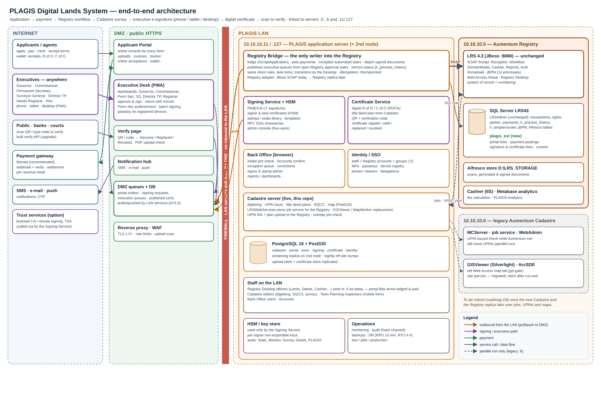

# PLAGIS Digital Lands System: full architecture, start to finish

The whole lands process becomes digital:
- application and payment online;
- lodgement into the Aumentum Registry automatically;
- survey, digitising and title deed plans in the new Cadastre;
- **Commissioner, Permanent Secretary and Governor review and e-sign** from phone, tablet or desktop, even from home;
- e-signatures and official stamps for administrators;
- a **digital certificate that anyone can scan to verify**.

It links the three servers: **10.10.10.5** (Registry), **10.10.10.6** (legacy Aumentum Cadastre) and **10.10.10.11 / .127** (new Cadastre and application server). This is design only; nothing is built yet.

| # | Document | What it covers |
|---|---|---|
| 01 | [End-to-end architecture](01-end-to-end-architecture.md) | building blocks, zones, servers, data ownership, integration contracts, technology |
| 02 | [End-to-end digital workflow](02-end-to-end-digital-workflow.md) | every stage from application to certificate: who, which system, what is signed or stamped, paper removed; Perm Sec endorsement; approval queues across all processes; returns |
| 03 | [Executive Desk (signing app)](03-executive-signing-app.md) | Commissioner, Permanent Secretary and Governor dashboards (plus SG, Director TP, Registrar); phone, tablet, desktop; batch signing; delegation; notifications |
| 04 | [E-signatures, stamps, keys](04-e-signature-stamps-pki.md) | signature levels, signers, seals and stamps admin, HSM / PKI options, legal basis to confirm, Signing Service |
| 05 | [Digital certificates and verification](05-digital-certificates-and-verification.md) | digital R of O / C of O, QR, public verify page, wallet, printed copies, revocation and replacement |
| 06 | [Server integration](06-server-integration.md) | exactly how .5, .6 and .11/.127 are linked; interfaces, ports, risks |
| 07 | [Security, identity, deployment](07-security-identity-deployment.md) | staff SSO, passkeys, remote access from home, NDPA 2023, resilience, environments |
| 08 | [Roadmap](08-roadmap.md) | stages D0–D9, from decisions to a fully digital system |

**Diagrams** (PNG + editable SVG) in `images/`:
- `digital-lands-architecture`: the whole system across Internet, DMZ, LAN and the three servers;
- `executive-e-signing-flow`: how a file reaches the Commissioner / Governor and is signed on any device;
- `lodgement-sync-flow`: automatic lodgement from the portal.

**Builds on:**
- `../aumentum_Registry/`: the Registry, its workflows (14) and database (02);
- `../registration_Portal/`: the applicant portal, form mapping and lodgement sync;
- this repo's Cadastre server.
