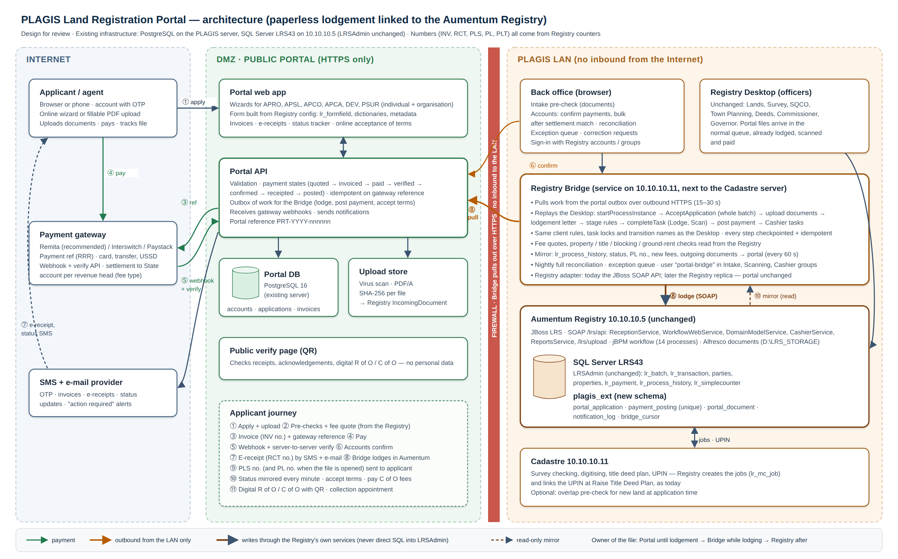
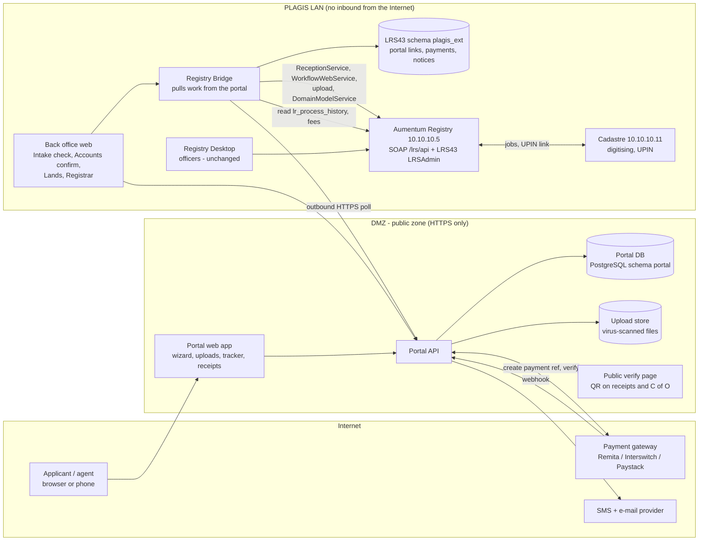
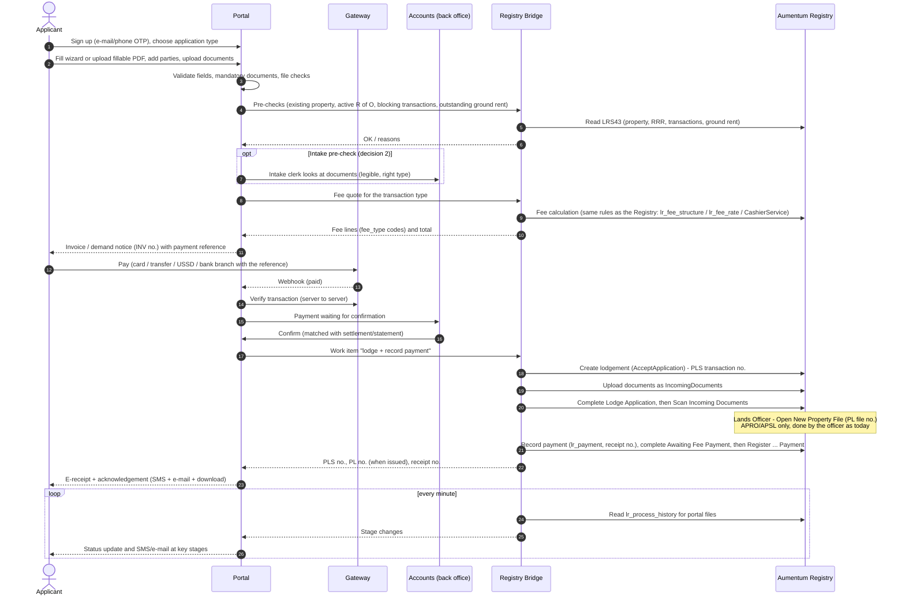
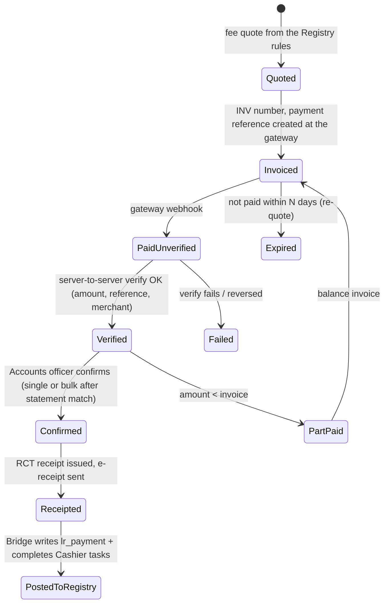

# PLAGIS Land Registration Portal — architecture and workflow

**Goal.** Take the paper out of land registration. An applicant applies online and uploads the documents. They pay through a payment gateway. Accounts confirm the payment, and the e-receipt goes straight to the applicant. The application is then lodged in the Aumentum Registry (.5) automatically, so the PLS transaction number, the PL file number and every later Aumentum stage follow as they do today.

**Constraints.**
- Use the existing database infrastructure: SQL Server **LRS43** (schema `LRSAdmin` unchanged) on .5, and the PostgreSQL already on the PLAGIS server (.11/.127).
- Keep the Aumentum workflow exactly as it is (see `../aumentum_Registry/14-workflows-exact.md`).
- Nothing in `LRSAdmin` is altered. New data lives in its own schemas.

This is requirements and design only; nothing is built.

Related documents:
- [02-form-to-registry-mapping.md](02-form-to-registry-mapping.md): every form field mapped to the Registry.
- `../aumentum_Registry/`: the Registry itself, including the database (02), APIs (03), workflows (04 and 14) and integrations (07).

---

## 1. What changes, and what does not

| Today (paper) | With the portal |
|---|---|
| Applicant buys or downloads a form, fills it by hand and queues at the PLAGIS office | Applicant fills an **online wizard**, or uploads the fillable PDF, from any device. Drafts are saved |
| Photocopies of ID, TIN, survey report and deeds are handed in | Documents are **uploaded** (PDF/JPG), checked and stored once. In Aumentum they are already attached as IncomingDocuments |
| Intake clerk keys the form into the Registry Desktop (Lodge Application) | The **Registry Bridge lodges it automatically** from the validated online data. No re-typing |
| Scanning officer scans the incoming documents | **Not needed.** The documents were born digital; the Bridge attaches them and completes "Scan Incoming Documents" |
| Demand notice is printed; applicant goes to the bank; a teller slip is brought back; the cashier keys the receipt | **Online invoice** (demand notice, INV number). Payment goes through the **gateway**. **Accounts confirm** in the back office. An **e-receipt** (RCT number) is emailed and SMSed. The Bridge completes "Awaiting Fee Payment" and "Register … Payment and Generate Receipt" |
| Applicant phones or visits to ask "where is my file?" | **Status tracker** in the portal, plus SMS/e-mail at every stage change, read from `lr_process_history` |
| Acceptance of the terms of grant is signed on paper at the office | Applicant **accepts online**: reads the terms, confirms with an OTP, then pays the C of O fees online |
| Land Form 5, the R of O and the C of O are printed, signed in ink and scanned back | **Phase 2 (paperless back office):** they are generated as PDFs, approved in the system and digitally signed by the Commissioner and the Governor, and published to the applicant. The "Scan Outgoing Documents" stage becomes automatic |
| The C of O is collected in person | A **digital C of O with a QR verification code** is available in the portal. Collecting the original is by appointment, if the law still requires a paper original (§12, decision 5) |

**What does not change:**
- Every Aumentum stage, role, rule, fee and number.
- The officers' work after lodgement is unchanged. They keep using the Registry Desktop: Lands, Survey, SQCO, Town Planning, Deeds and the approvals.
- The Cadastre link (Raise Title Deed Plan → digitising → UPIN) stays as it is.

---

## 2. Architecture

Editable version: [images/portal-architecture.svg](images/portal-architecture.svg).

### 2.1 Components

| Component | Where | Does | Technology (suggested) |
|---|---|---|---|
| **Portal web app** | DMZ | Applicant accounts and sign-in (e-mail/phone + OTP). The application wizard for every form, with fillable-PDF upload and data extraction. Document upload, invoices and payment, receipts, the status tracker, online acceptance of terms, document downloads (acknowledgement, demand notices, receipts, letters, digital R of O / C of O) | Same stack as the new Registry (D8), e.g. Rust/Axum + a web front end |
| **Portal API** | DMZ | All portal logic. It keeps the **outbox of work for the Bridge** and receives gateway webhooks | — |
| **Portal DB** | PostgreSQL on the existing PLAGIS server, schema `portal` | Applicants, drafts, applications, uploads, invoices, payments, notifications, audit | Existing PostgreSQL 16 |
| **Upload store** | Disk on the same server | Applicant files after virus scan and PDF normalisation | ClamAV + PDF conversion |
| **Back office** | LAN (browser) | Intake pre-check, **Accounts payment confirmation**, reconciliation, exceptions, notices, and in phase 2 approvals and e-signature | Same app as the portal, internal views |
| **Registry Bridge** | LAN, next to the Cadastre server (10.10.10.11) | The only component that talks to the Registry: <ul><li>lodges applications;</li><li>attaches documents;</li><li>records payments;</li><li>completes the front-desk and cashier tasks;</li><li>reads fees and stage history;</li><li>pushes status back to the portal.</li></ul> It **pulls** from the portal, so nothing on the Internet can reach the LAN | A service like `cadastre-server`; reuses `src/lrs.rs` (WS-Security, clock rule) and the `registry_sync` pattern |
| **plagis_ext** | New schema in LRS43 | Link tables between portal references and Registry ids, the payment-confirmation ledger, the notification log. `LRSAdmin` is never altered (`../aumentum_Registry/01` D2) | SQL Server 2012 |
| **Aumentum Registry** | .5, unchanged | Workflow engine, numbering, fees, documents and the officers' Desktop | — |
| **Payment gateway** | Internet | Payment references, card/bank/USSD payment, webhooks, a verify API, settlement to the State account | Recommended: **Remita**, as Treasury Single Account practice for State revenue; behind an adapter so another provider can be added |
| **SMS / e-mail** | Internet | Notifications. SMTP on .5 is not configured today (`../aumentum_Registry/07`), so the portal sends them | Any SMS aggregator + SMTP relay |

### 2.2 Why a Bridge, and why it pulls

- **LRS43 is not exposed to the Internet.** It speaks TLS 1.0 only, and SQL Server 2012 is end-of-life.
- **The Bridge writes through the Registry's own services**, exactly as the Registry Desktop does: `ReceptionService.AcceptApplication`, `WorkflowWebService` complete-task, `PUT /lrs/upload` + IncomingDocument, `DomainModelService` reads (`../aumentum_Registry/03` §4, §6; `05` §2). So the counters (`lr_simplecounter`), the jBPM process, the Alfresco queue nodes and the history stay correct, and officers see the file in their Desktop queue as normal. Writing `LRSAdmin` tables with SQL is **not allowed**: it would leave the workflow and queue inconsistent (`../aumentum_Registry/10`).
- **When the Registry replica is built** (`../aumentum_Registry/09`), only the Bridge's Registry adapter changes. The portal is not touched.
- **The Bridge polls the portal over outbound HTTPS** every 15–30 s. The firewall then needs no inbound rule into the LAN; gateway webhooks land in the DMZ only.

### 2.3 Accounts and integration users in the Registry

- One Registry user, `portal-bridge`, is added to the Alfresco groups that own the automated tasks:
  - Intake Clerk (Lodge Application)
  - Scanning Officer (Scan Incoming Documents, Scan Outgoing)
  - Cashier (Awaiting Fee Payment, Register … Payment and Generate Receipt, for each process)

  Every action it takes is recorded under that name in `lr_process_history`. In the back office it is shown together with the officer who confirmed the payment.
- Officers keep their own accounts. Accounts staff confirm payments in the back office, and the Bridge acts on their confirmation. Their name is written to the `plagis_ext` ledger and to the payment comment in the Registry.

---

## 3. End-to-end workflow

### 3.1 Portal journey (all application types)

### 3.2 Order of events, and why payment comes before lodgement

Aumentum's own order is: Lodge → Scan → (Open New Property File) → Awaiting Fee Payment → Register Payment. The portal **collects and confirms payment first**, then lodges and immediately walks the Registry through the front-desk and cashier tasks with the data and payment it already holds. In the Registry the file looks exactly as if it had been lodged at the counter and paid the same day:
- the history rows are written in the normal order;
- the fees are the Registry's own calculation;
- the receipt sits in `lr_payment`.

**One exception: First Registration (APRO, APSL, CONT, RAOL, REGR).** Here "Open New Property File" (Lands Officer) sits **between** Scan and Awaiting Fee Payment. The Bridge stops after Scan Incoming Documents, and the Lands Officer opens the file in the Desktop; this is where the PL property-file number is issued. As soon as that task is complete, the Bridge records the already-confirmed payment and completes the two Cashier tasks within the next poll.

The applicant gets their **receipt immediately after Accounts confirm**. They get their **PL file number** when the Lands Officer opens the file. The target for that is the same day, and the back office shows a queue of portal files waiting for it.

### 3.3 Payment points by application (from `lr_transaction_metadata.cashier_transaction_code` and the workflow definitions)

| Form(s) | Transaction | Aumentum process | Payment points → Cashier stages the Bridge completes | Fee types in the Registry metadata |
|---|---|---|---|---|
| APRO1, APRO2 | APRO, Application for Statutory R of O | First Registration | **(1) Processing:** Awaiting Fee Payment → Register Processing Fee Payment and Generate Receipt. **(2) C of O fees:** Register CofO Fees Payment and Generate Receipt, after the applicant accepts the terms online | APFF, PCOFO, IPL, COPF, IFCO, RCOF, TDPF, SVF, BPAF, PLF, LAF (+ ground rent / penalty if outstanding) |
| APSL1, APSL2 | APSL, Application for State Land | First Registration | as APRO | ALF, APFF, PCOFO, IPL, COPF, IFCO, RCOF, TDPF, GR |
| APCO1 | APCO, Application for C of O | Application for Certificate of Occupancy | (1) Awaiting Fee Payment → Register Processing Fee Payment and Generate Receipt | APFF, PCOFO, IPL, COPF, IFCO, RCOF, TDPF, SVF |
| APCA1, APCA2 | APCA, Application for Consent to Assign | Subsequent Registration | (1) Awaiting Fee Payment → Register Processing Fee Payment and Generate Receipt | APFF, PFROFO, GR, GRP |
| DEV01 | DEVO, Devolution | Subsequent Registration | (1) as above | APF, TDPF, PFD, PCOFO, IFCO |
| PSUR1, PSUR2 | PSUR, Part Surrender | Subsequent Registration | (1) as above | APF, PFPS, TDPF, PCOFO, IFCO, SVF, PLF, PSF |

- The trial file PLS000138850 shows PLAGIS currently calculates **all** fee lines (8, including C of O fees) at lodgement and takes **one payment** (`../aumentum_Registry/screens/real/web/33-…`, `34-…`). The portal supports **one or several invoices per application**; PLAGIS decides which (§12, decision 3).
- **Part payment:** Aumentum's "Payment Not Made in Full" transition loops back to Awaiting Fee Payment. The portal does the same: the invoice stays open with a balance, and the Bridge only completes the Cashier task when the full amount is confirmed.
- **Ground rent:** outstanding ground rent and the 5 % penalty, required on APCA/PSUR/DEVO and others, are read by the Bridge from `lr_ground_rent` at quote time. They are added as `feetype_groundrent_C_GR` / `feetype_groundrentpenalty_C_GRP` lines.

### 3.4 After lodgement: what the applicant does, and what stays with officers

Using First Registration as the example; the stages are from `../aumentum_Registry/14-workflows-exact.md`:

| # | Aumentum stage | Done by | Portal / paper change | Applicant sees |
|---|---|---|---|---|
| 1 | Lodge Application | **Bridge** | automatic | "Application lodged – PLS…" + acknowledgement |
| 2 | Scan Incoming Documents | **Bridge** | automatic, documents already attached | — |
| 3 | Open New Property File | Lands Officer (Desktop) | e-file; queue of portal files | "File opened – PL…" |
| 4–5 | Awaiting Fee Payment, Register Processing Fee Payment and Generate Receipt | **Bridge** after Accounts confirm | online payment | Receipt (already sent) |
| 6–8 | Survey Plan Checking and Approval | Surveyor General, Map Compilation | digital survey plan from the upload; charting (`../charting-and-reporting.docx`) | "Survey checking" |
| 9–14 | Raise Site Analysis Report | Town Planning | site inspection (mobile inspection form is an upgrade) | "Site inspection scheduled / done" |
| 15–19 | Review Submission, Land Form 5 prepare / review / **Commissioner approves** / review signed | Lands, Commissioner | phase 2: e-approval and digital signature | "Recommendation approved" |
| 20 | Prepare R of O Acceptance of Terms & Conditions of Grant | Lands Officer | the letter is generated and **published to the portal** | "Terms of grant ready – please accept" |
| 21 | Awaiting Acceptance of Statutory R of O in Principle | **Applicant online** → Bridge completes the task | accept terms in the portal with an OTP; the signed acceptance PDF is attached as `sd_rightOcc_accept` | Accept button + C of O fee invoice |
| 22 | Register CofO Fees Payment and Generate Receipt | **Bridge** after Accounts confirm | online payment | Receipt |
| 23–28 | Raise Title Deed Plan (SG, digitising/UPIN, SQCO, SG approve, scan) | Survey, Cadastre | Scan Title Deed Plan is automatic: the plan image already comes from the Cadastre (`sd_titledeedPlan`) | "Title deed plan" |
| 29–32 | Generate C of O, review, **Governor approves**, review signed | Deeds Registrar, Governor | phase 2: digital signature | "C of O approved" |
| 33 | Register Right of Occupancy | Deeds Registrar | — | "C of O registered" |
| 34 | Delivery of Documents | Delivery Clerk → phase 2 automatic | digital C of O + QR, collection appointment for the original | Download + appointment |
| 35 | Scan Outgoing Documents | Scanning Officer → phase 2 **Bridge** | automatic: documents are already PDFs | "Completed" |

**Rejections and withdrawals** keep happening in the Registry. The Bridge sees them in history (the transition "Reject Transaction" / "Withdraw" and status 27/29), and the portal shows the reason and the rejection letter (`sd_reject_letter`). Refund handling is §12, decision 7.

### 3.5 Public status map (history → tracker)

The Bridge maps `lr_process_history.task_name` to a small set of public statuses, so applicants never see internal names. The table below is the starting map; the full list per process is built from `14-workflows-exact.md`.

| Public status | Aumentum tasks |
|---|---|
| Submitted / awaiting payment | (portal only) |
| Payment received, awaiting confirmation | (portal only) |
| Lodged | LodgmentApplication, ScanIncomingDocuments |
| File opened | OpenNewPropertyFile |
| Under review | ReviewSubmission, PrepareLandForm5, ReviewLandForm5, Prepare/Review Recommendation … |
| Survey checking | Survey Plan Checking and Approval tasks |
| Site inspection | Raise Site Analysis Report tasks |
| Awaiting approval | ApproveLandForm5 (Commissioner), Approve Recommendation, ApproveCofO (Governor) |
| Action required by you | AwaitingAcceptanceStatutoryRightOccupancyPrinciple, an outstanding invoice |
| Title deed plan | Raise Title Deed Plan tasks |
| Certificate being prepared | GenerateCofO, ReviewCofO, ReviewSignedCofO, RegisterCofO |
| Ready / completed | DeliveryOfDocuments, ScanOutgoingDocuments, process end |
| Rejected / withdrawn | Reject transitions, status 27/29 |

---

## 4. Payments in detail

### 4.1 States

### 4.2 Rules

- **Idempotent.** A webhook may arrive twice, and the Bridge may retry. Every step is keyed by the gateway reference and the invoice id. A payment is posted to the Registry **once**, enforced by a unique key in the `plagis_ext.payment_posting` table.
- **Verify, never trust the webhook alone.** The portal calls the gateway's verify API and checks the amount, currency, merchant / service type and reference before the payment is shown to Accounts.
- **Accounts confirmation** is a back-office queue: payment, invoice, applicant, amount, gateway reference, settlement date. Accounts can confirm one at a time, or in bulk after matching the gateway settlement report or the TSA/bank statement. Only **Confirmed** payments produce a receipt and touch the Registry. This meets the requirement that "accounts can confirm on the registry". The confirmer's name and the time are written to `plagis_ext` and into the Registry payment comment.
- **Numbers:**
  - The **invoice / demand notice** uses the Registry's `demandnotice_number` counter (`INV%09d`).
  - The **e-receipt** uses the Registry's `receipt_number` counter (`RCT…`). Both come from `lr_simplecounter` through the Registry's own number service, never a private sequence (`../aumentum_Registry/02` §9.1).
  - The gateway reference (e.g. a Remita RRR) is stored as the **F.I. receipt number** that the Registry shows today ("F.I. Receipt Number" on the Payment tab).
- **Revenue heads:** each fee line keeps its Registry `fee_type` code. The gateway split / service types are configured per fee type, so settlement reports reconcile per revenue head.
- **Reconciliation report (daily):** gateway settlement vs confirmed vs posted to the Registry. Any difference is listed for Accounts.
- **Refunds and reversals:** only by Accounts in the back office, with a reason. The Registry is not changed automatically; a reversal after posting needs a Registry correction by the Cashier (decision 7).

---

## 5. Numbers and identifiers

| Number | Example | Issued by | When |
|---|---|---|---|
| Portal reference | `PRT-2026-000123` | Portal | when the application is created (draft) |
| Invoice / demand notice | `INV000123456` | Registry counter, via the Bridge | at invoice |
| Gateway reference | Remita RRR | Gateway | at invoice |
| Receipt | `RCT…` | Registry counter, via the Bridge | at Accounts confirmation |
| Transaction number | `PLS000138850` | Registry (`transaction_number`) | at lodgement (Bridge) |
| Property / file number | `PL67363` | Registry, Lands Officer, Open New Property File | First Registration only; existing for APCO/APCA/PSUR/DEVO (the applicant enters it) |
| Spatial unit | `PLT00042705` | Registry | with the property |
| UPIN | `PL000000023898` | Cadastre (commit) → linked at Raise Title Deed Plan | survey/digitising stage |
| C of O / instrument | `INS…`, page, volume | Registry | Register C of O |

---

## 6. Data model

### 6.1 Portal DB (PostgreSQL, schema `portal`)

| Table | Key columns |
|---|---|
| `applicant_account` | id, email, phone, password hash, verified flags, NIN/TIN (optional verification), created |
| `application` | id, portal_ref, account_id, form_code (APRO1…), transaction_code (APRO…), status, data (JSON per form schema), submitted_at, lodged_pls, pl_number |
| `application_party` | application_id, role (applicant, representative, assignor, assignee, executor, title owner, third party), party_type (individual/organisation), JSON details |
| `application_property` | application_id, property_no (existing) or block/plot/area/unit/location/land use |
| `upload` | id, application_id, doc_code (`sd_…`), file path, sha256, pages, scan status, uploaded_at |
| `invoice` / `invoice_line` | invoice no., application, fee_type code, amount, due date, status |
| `payment` | gateway, reference, amount, status, webhook payload, verified_at, confirmed_by, confirmed_at, receipt_no |
| `status_event` | application, public status, task name, time (from the Bridge) |
| `notification` | channel, to, template, sent_at, result |
| `outbox` | work items for the Bridge (lodge, post payment, accept terms, attach document), with attempts and results |
| `audit` | who, what, when, IP |

### 6.2 LRS43 schema `plagis_ext` (new; `LRSAdmin` untouched)

| Table | Purpose |
|---|---|
| `portal_application` | portal_ref ↔ `lr_transaction.id` / `transaction_number` / `lr_batch.id`, form code, lodged_at |
| `payment_posting` | gateway reference (unique), invoice no., receipt no., `lr_payment.id`, amount, confirmed_by, posted_at. Guarantees one posting per payment |
| `portal_document` | upload sha256 ↔ `lr_source_document.id` (IncomingDocument) |
| `notification_log` | what was sent per transaction, for officers to see in a report |
| `bridge_cursor` | last `lr_process_history.id` read |

---

## 7. Forms → online wizard

Each paper form becomes one wizard with the same sections, in the same order, so officers and applicants recognise it. The field-by-field mapping is in [02-form-to-registry-mapping.md](02-form-to-registry-mapping.md).

| Form | Wizard steps |
|---|---|
| APRO1 / APSL1 / APCO1 (individual) | 1. Applicant (title, names, DOB, gender, place of birth, occupation, nationality, state of origin, LGA, home town, ID type + number, TIN) · 2. Contact (address, city, state, country, phone, e-mail, preferred channel) · 3. Representative (optional; with POA particulars, relationship) · 4. Third parties to notify · 5. Property (block, plot, area + unit, location/description, value of improvement, time for erection, land use and purpose) · 6. Other R of O / C of O held · 7. Documents · 8. Declaration (tick + OTP as the signature) · 9. Fees and payment |
| APRO2 / APSL2 (organisation) | as above, with step 1 = organisation (name, RC number, date and country of registration, TIN, website) + contact person (designation, names) |
| APCA1 / APCA2 | 1. Property no. (looked up in the Registry: owner, address, active R of O) · 2. Applicant (is the applicant the assignor?) · 3. Assignor(s) = title owners (pre-filled from the Registry) · 4. Assignee(s) · 5. Third parties · 6. Reason, consideration (figures; words generated) · 7. Documents · 8. Declaration · 9. Fees and payment |
| DEV01 | 1. Applicant (is the applicant the executor/administrator?) · 2. Property no. and title name (looked up) · 3. Executors/administrators · 4. Documents (letter of administration / grant of probate, court affidavit, publication, …) · 5. Declaration · 6. Fees |
| PSUR1 / PSUR2 | 1. Property no. (looked up) · 2. Applicant / organisation · 3. Title owner · 4. Reason, valuable consideration, original reference coordinate, original size, land use, purpose · 5. Composite plan and documents · 6. Declaration · 7. Fees |

**Fillable PDF route:** the applicant uploads the filled PDF. The portal reads the form fields, which needs the PDFs to have named fields (decision 6). It then pre-fills the wizard, shows the validation results field by field, and the applicant completes the documents and payment online. This matches the "Fillable Document Format" option already printed on the forms.

**Multiple owners:** the forms refer to PSF1 / PSF2 (additional party forms). These become an "Add another owner" step, so no extra form is needed.

---

## 8. Validation before payment (no one pays for an application that will be refused)

| Check | Source | Forms |
|---|---|---|
| Mandatory fields, formats (dates, phone, e-mail, TIN, ID numbers) | portal | all |
| Mandatory documents present, readable, right type, size and pages | portal + optional intake pre-check | all |
| Property number exists, is active and not archived | `lr_launit` / `lr_spatial_unit` (Bridge read) | APCO, APCA, PSUR, DEVO |
| Applicant / assignor is the current title holder (active RRR) | `lr_rrr` + parties | APCA, PSUR |
| No blocking transaction open on the property | `lr_transaction_metadata.blocking_transaction_code` + open `lr_transaction`s | all on an existing property |
| No caveat / encumbrance that blocks the type | `blocked_by_active_rrrs` | APCA, PSUR |
| Outstanding ground rent → added to the invoice | `lr_ground_rent` | APCA, PSUR, DEVO and others |
| Parcel already allocated? (for new land) | Cadastre overlap check (`/precheck`, already built) | APRO, APSL (advisory, when coordinates are given) |

---

## 9. Documents

- **Upload rules:** PDF, JPG or PNG, up to 10 MB a file; one PDF per document type. Each file is virus-scanned and converted to PDF/A. Its SHA-256 is recorded.
- **Into the Registry:** at lodgement the Bridge uploads each file with `PUT /lrs/upload/{guid}.pdf?ticket=` and adds it as an `IncomingDocument`. It carries the Registry `document_type` code (mapping in 02 §4), the date issued and the page count. This is exactly what the Cadastre already does for the title deed plan. Officers see the documents in the Desktop and in Web Access ("Documents (n)").
- **Out of the Registry:** the Bridge watches for new outgoing documents on portal files and publishes the applicant-facing ones to the portal: acknowledgement, demand notice, receipt, R of O acceptance terms, R of O / Land Form 7, C of O, rejection letter.
- **Verification:** every document the portal issues (receipt, acknowledgement, digital C of O) carries a QR code pointing to the public verify page. The page shows only the number, type, date and status, never personal data.

---

## 10. Notifications

| Event | SMS | E-mail | Portal |
|---|---|---|---|
| Account created / OTP | ✓ | ✓ | |
| Application submitted, invoice issued (amount, reference, how to pay) | ✓ | ✓ + PDF | ✓ |
| Payment received (awaiting confirmation) | | ✓ | ✓ |
| Payment confirmed: e-receipt | ✓ | ✓ + PDF | ✓ |
| Lodged: PLS number, acknowledgement | ✓ | ✓ + PDF | ✓ |
| File opened: PL number | ✓ | ✓ | ✓ |
| Each public status change (3.5) | key ones only | ✓ | ✓ |
| Action required (accept terms, pay C of O fees, missing document) | ✓ | ✓ | ✓ |
| Approved / registered / ready | ✓ | ✓ + PDF | ✓ |
| Rejected / withdrawn (reason) | ✓ | ✓ + letter | ✓ |
| Third parties named on the form | at completion | at completion | |

---

## 11. Security, privacy and operations

- **Network:** the portal is in a DMZ with HTTPS only. The LAN accepts no inbound traffic from the Internet; the Bridge pulls. The Registry and LRS43 stay on the LAN.
- **Applicant identity:** e-mail + phone OTP, with optional NIN (NIMC) and TIN (JTB/PSIRS) verification as an upgrade. Organisations are verified by RC number (CAC) as an upgrade.
- **Back office:** sign-in with the Registry accounts (as the Cadastre does). Roles come from the Alfresco groups: Accounts = Cashier group; Intake = Intake Clerk group.
- **Data protection** (Nigeria Data Protection Act 2023): a consent notice on the forms (the existing "public knowledge" warning stays), minimal data, encryption at rest for uploads, retention rules, an access log and a breach procedure.
- **Audit:** every action in the portal and back office is logged. Every Bridge action carries the portal reference in the Registry comments.
- **Backups:** portal DB and uploads nightly. LRS43 backup is an existing gap (last full backup 2026-10-06) — ICT action.
- **Monitoring:**
  - Bridge health and the outbox backlog;
  - gateway webhook failures;
  - reconciliation differences;
  - a red banner in the back office when the Registry does not answer, the same pattern as the Cadastre's Aumentum warning.

---

## 12. Decisions for PLAGIS

| # | Decision | Recommendation |
|---|---|---|
| 1 | Payment gateway | Remita (TSA / State revenue practice), behind an adapter; get the merchant and service-type IDs per revenue head from the State Ministry of Finance / PSIRS |
| 2 | Human intake pre-check before invoicing? | Yes for First Registration (documents decide everything); no for APCO/APCA/DEVO/PSUR, where automatic checks suffice |
| 3 | One payment or several (processing now, C of O fees after acceptance)? | Follow the Registry workflow: two payment points for First Registration, one for the others. PLAGIS currently takes one; confirm |
| 4 | Who confirms payments, and how fast? | Accounts (Cashier group), same day; bulk confirmation after the daily settlement match |
| 5 | Legal status of e-signature, e-acceptance and a digital C of O | Phase 1 keeps the signed paper original for R of O/C of O, with a digital copy + QR. Phase 2 moves to digital signatures once the Ministry of Justice / Governor's office approves |
| 6 | Fillable PDFs | Re-issue the forms as fillable PDFs with named fields (the current files are flat PDF/DOC), or offer the online wizard only |
| 7 | Refunds for rejected/withdrawn applications | Written policy; refunds handled by Accounts outside the Registry |
| 8 | Hosting of the public portal | DMZ on the existing PLAGIS server with the State domain and certificate, or a State cloud; the Bridge stays on the LAN either way |
| 9 | Forms for the other transaction types (ASSI, MORT, CHPC, EXTT, APRF, SEAR, …) | Collect them; each becomes a wizard in phase 4 |

---

## 13. Build phases

| Phase | Delivers | Done when |
|---|---|---|
| **P0 Decisions and gateway contract** | §12 answered; gateway merchant account and service types; SMS/e-mail provider; fillable PDF decision | Signed off |
| **P1 Bridge (read)** | Bridge service on the LAN with Registry sign-in (reusing `lrs.rs`): <ul><li>property/RRR/ground-rent look-ups</li><li>fee quote identical to the Registry (tested on 30 historic files)</li><li>`lr_process_history` watcher</li><li>`plagis_ext` schema</li></ul> | Quotes match the Registry to the kobo; the status feed is live |
| **P2 Portal core** | Accounts and OTP; wizards for APRO1/2, APSL1/2, APCO1; uploads; validation; invoices; tracker (read-only) | Applicants can submit and see a quote |
| **P3 Payments** | Gateway integration, webhooks + verify, Accounts confirmation queue, e-receipts, reconciliation report | End-to-end on the gateway sandbox; Accounts sign off |
| **P4 Lodgement into the Registry** | Bridge writes: <ul><li>`AcceptApplication`</li><li>document upload</li><li>completes Lodge and Scan</li><li>posts payments</li><li>completes the Cashier tasks</li><li>Open New Property File queue for Lands</li></ul> First on a test Registry or a copy, then a pilot with the trial file pattern | 20 pilot files lodged from the portal look identical in the Desktop and Web Access to counter-lodged files |
| **P5 Applicant actions and outgoing documents** | Online acceptance of terms (completes AwaitingAcceptance…), C of O fee invoice, publishing outgoing documents, QR verify page, notifications at every status | A First Registration file runs from portal to registered C of O with no paper from the applicant |
| **P6 Remaining forms** | APCA1/2, DEV01, PSUR1/2, then the other transaction types as their forms arrive | Each type piloted |
| **P7 Paperless back office** | <ul><li>e-approval and digital signature for Land Form 5, R of O and C of O</li><li>automatic Scan Outgoing / Delivery</li><li>a mobile site-inspection form for Town Planning</li><li>charting & reporting digital form</li></ul> | Officers no longer print and scan |

The Bridge is written against an adapter. When the Registry replica (`../aumentum_Registry/09`, R-phases) replaces the JBoss server, P4 and later move to the replica with no change to the portal.
