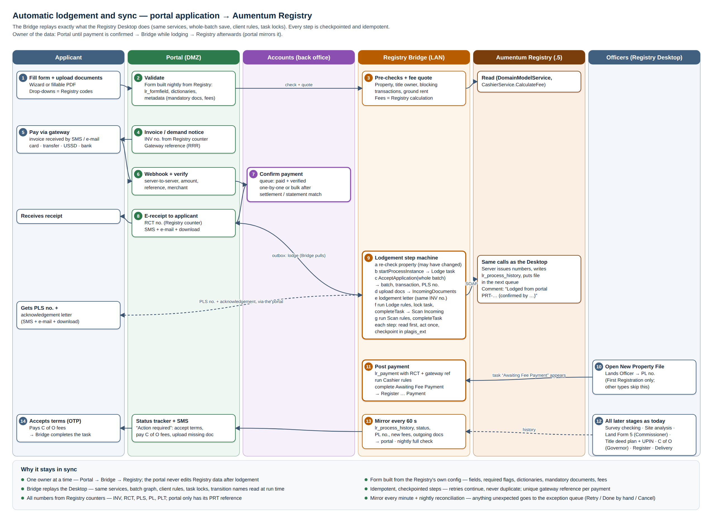
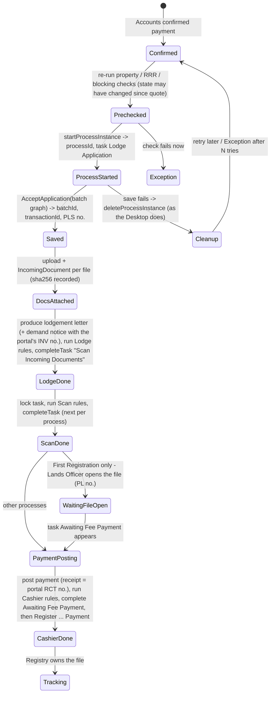

# Automatic lodgement: review and sync design

How a portal application becomes a Registry lodgement that is **identical to one keyed at the counter**, and how the portal and the Registry stay in step for the life of the file. This builds on:
- [01](01-portal-architecture-and-workflow.md) (architecture);
- [02](02-form-to-registry-mapping.md) (field mapping);
- `../aumentum_Registry/03` §6 and `05` §2.3, which describe what the Desktop actually does.

## 1. Review: what Aumentum does at lodgement today

Source: the decompiled Registry Desktop (`../aumentum_Registry/05` §0, §2.3, §2.10) and the API catalogue (`03` §6).

| Step | What the Desktop does | Service call | What it creates |
|---|---|---|---|
| L1 | The clerk chooses "New transaction". The Desktop lists the workflows this user may start | `AccessControlService.getACLs` (`Manager` on process definitions) | — |
| L2 | **Starts the workflow before anything is saved** | `WorkflowWebService.startProcessInstance(definitionId, [transactionCode])` | jBPM process + the "Lodge Application" task, mirrored in Alfresco (`wf:taskRef`, `lrs:Lodgment`) |
| L3 | **Add Transactions** page: type, tenure, certificate no., file no. (existing property). Runs the property checks `checkNotPending`, `checkTransactionMetadata`, `checkLinkCadastre` and `checkRegisterAlready`, plus the RRR checks | `DomainModelService.loadObject` (HQL) | in memory |
| L4 | Default fee lines from `cashier_transaction_code`. **Demand-notice number** from the server counter (INV…) | `DomainModelService.generateNumber("demandnotice_number")` | number consumed from `lr_simplecounter` |
| L5 | **Applicants** page: search for an existing applicant, or add an individual / organisation | HQL search; dialog forms from `lr_formfield` | in memory |
| L6 | **Properties** page: new property (First Registration) gets a `suid_number` (PLT…); existing ones are found by number | `generateNumber("suid_number")`, HQL | in memory |
| L7 | **Fee** page: calculate every fee line; Next is blocked until all are calculated | `CashierService.CalculateFee` | fee lines (`PaymentTransaction`) |
| L8 | **Save**: the whole batch graph in one call | `ReceptionService.AcceptApplication(processUuid, Batch)` | `lr_batch`, `lr_transaction` (+ `_ext`), parties, persons, addresses, spatial units, LA units, fee lines, `lr_process_history`; **PLS transaction number** |
| L9 | **Documents** page: produce the lodgement letter and demand notice | `ReportsService.produceReport` → attached as `sd_lodgement_letter`, `sd_demandnotice` | outgoing documents |
| L10 | **Complete Task**: runs the stage's client rules (`rules=` on CompleteAssignPage), saves again, completes with the transition "Scan Incoming Documents", and may assign the next task | `AcceptApplication`; `WorkflowWebService.completeTask(task, transition, comment)`; `assignTask` | history row, next task in the Scanning Officer queue |
| S1–S2 | **Scan Incoming Documents**: the scanning officer scans pages, which are uploaded and indexed; then Complete | `PUT /lrs/upload/{guid}?ticket=`; `RepositoryService.update` (scan nodes) / IncomingDocument; `completeTask` → "Open New Property File" (First Registration) or "Awaiting Fee Payment" | IncomingDocuments + scans |
| F1 | **Open New Property File** (First Registration only): Lands Officer; the **PL property-file number** is issued | `generateNumber("property_number")`, `AcceptApplication`, `completeTask` | `lr_launit.unit_uid` = `lr_spatial_unit.refnum` = PL… |
| C1 | **Awaiting Fee Payment**: a wait state. Today it is advanced when the payment is registered (`CashierMessageListener` / the cashier) | rule `UpdateSimpleCounterValue:receipt_number` | receipt counter |
| C2 | **Register Processing Fee Payment and Generate Receipt**: payment recorded, receipt printed. Rules `payments must validate` and `CheckUnpaidFee` choose the next step; unpaid sends the file back to Awaiting Fee Payment | `AcceptApplication` (payments), `produceReport` (FeePaymentVerificationReceipt → `sd_payment_receipt`), `completeTask` → sub-process | `lr_payment`, `lr_payment_transaction` |

**Three facts drive the whole sync design:**
1. **The client is the rule engine.** Validation, numbering and the stage rules run in the Desktop, not the server. If the Bridge only "saved data", the Registry would accept it but skip the rules, and the file would be subtly different. So the Bridge must **replay the Desktop's sequence and rules**, step by step.
2. **Everything is one batch graph saved whole.** The Bridge builds the same graph and saves it with the same call, so the server does its own numbering, history and queue work exactly as for a counter lodgement.
3. **The workflow comes first.** The process is started before the save; if lodgement fails half-way, the Desktop deletes the process. The Bridge must do the same: start, save, and on failure clean up.

Editable version: [images/lodgement-sync-flow.svg](images/lodgement-sync-flow.svg).

## 2. Design principle: one owner at a time

| Phase of the file | Owner (source of truth) | The other side |
|---|---|---|
| Draft → submitted → invoiced → paid → confirmed | **Portal** | The Registry knows nothing yet. Numbers already taken: INV, RCT |
| Lodgement in progress | **Bridge** (step machine, §4) | The portal shows "Lodging…" and is read-only |
| From lodgement onward | **Registry** | The portal is a **mirror**. It never edits Registry data; the applicant asks for changes (§6.3) |

Because exactly one side may change the data at any time, the two can never diverge.

## 3. Making the form and the Registry the same thing

The application form is **generated from the Registry's own configuration**, so the form cannot collect something the Registry would refuse, or miss something it needs.

| Registry source (read nightly by the Bridge, versioned in the portal) | Becomes in the portal form |
|---|---|
| `lr_formfield` rows of the lodgement forms (`TransactionForm`, `ApplicantIndividualForm`, `ApplicantCorporationForm`, `PropertyFormForLodgment`, …) | field list, labels, **required flags**, max lengths, masks, read-only rules |
| `lr_dictionary` (salutation, id_document_type, gender, country, region / region_lga / property_area, location, actual_use_type / use_specific, area unit, document_type, fee_type) | drop-downs. The portal stores the **dictionary id and code**, so the Bridge passes the ids straight through |
| `lr_transaction_metadata` (per transaction code): `mandatory_docs_codes`, `cashier_transaction_code`, `blocking_transaction_code`, `blocked_by_active_rrrs`, `related_transaction_code`, source/target party roles, `non_withdrawable_tasks` | required uploads, fee lines, pre-checks, which party blocks the wizard shows |
| Fee rules (`lr_fee_structure`, `lr_fee_rate`, Cashier `CalculateFee`) | the quote, calculated by the **Registry**, not by the portal |
| The PLAGIS paper form layout | page order and section headings, so the wizard matches the paper form; the filled form is re-printed as a PDF (`sd_application_form`) |

**Form definition = Registry config + PLAGIS layout + the mapping in 02.**
- Each submitted application stores the **form-definition version** it was filled against.
- If the Registry configuration changes, for example a field becomes required, new drafts pick it up the next day.
- Drafts already paid are lodged with the definition they were paid under. Only if that now fails a Registry check are they sent to the exception queue (§7).

**Pre-fill for existing properties (APCO, APCA, PSUR, DEVO):** the applicant types the PL number. The Bridge returns the title owners, address, area, land use, active rights, open transactions and ground-rent arrears. The form shows these read-only, and the Bridge sends **references to the existing Registry parties and property**, never re-typed copies. This avoids duplicate parties, which is the main source of drift.

**Applicant matching (new applicants):** before creating a party, the Bridge searches existing Registry applicants by ID number + TIN + name, as `ApplicantSearchForm` does. On an exact match it re-uses the existing party; otherwise it creates a new one. A probable match goes to the intake pre-check for an officer to decide.

## 4. The lodgement step machine (Bridge)

Every portal application has one lodgement record in `plagis_ext.portal_application`, with a **state** and the ids produced at each step. Every step:
1. **Reads the Registry first**, to see whether the step was already done;
2. acts only if it wasn't;
3. records the result.

So a crash, timeout or retry at any point continues correctly and never lodges twice.

| Step | Idempotency: how the Bridge knows it is already done | Stored |
|---|---|---|
| ProcessStarted | `plagis_ext` holds `process_id`. If missing, the Bridge also searches the Registry for a lodgment whose transaction comment carries the portal ref | `process_id`, task ref |
| Saved | the batch exists for that process (`lrs:Lodgment` of the process → `lr_batch.id`) | `batch_id`, `transaction_id`, `transaction_number` |
| DocsAttached | `plagis_ext.portal_document` holds sha256 → `lr_source_document.id` for every upload | doc ids |
| LodgeDone / ScanDone | `lr_process_history` already has the completed task for that process | history ids |
| PaymentPosting | `plagis_ext.payment_posting` is unique on the gateway reference, and `lr_payment` holds the receipt number | `lr_payment.id` |
| CashierDone | history shows "Register … Payment" completed | — |

**Portal reference in the Registry:**
- The portal ref (`PRT-2026-000123`) is written into the transaction comment / `lr_transaction_ext.extended_comments`.
- The comment of every task the Bridge completes reads "Lodged from portal PRT-… (payment confirmed by <accounts officer>)".
- Officers can therefore see the source, and a Registry-side search finds the file even if `plagis_ext` were lost.

**Locking:** before completing a task, the Bridge **locks it** with `AuthoringService.lock`, as the Desktop does, so an officer cannot open it at the same moment. It releases the lock straight after. If an officer already holds the lock, the Bridge waits and retries; it never takes the lock away.

**Rules parity:** the stage rules the Desktop runs are read from `WorkflowConfig/*.config` (`rules=` on CompleteAssignPage) for that stage and transaction code. The Bridge runs **the same named rules**, implemented once from the decompiled `Rules` / `CustomRules` code (`../aumentum_Registry/05` §4.2). The rules the automated stages need are:
- `UpdateSimpleCounterValue:receipt_number`
- `payments must validate`
- `CheckUnpaidFee`
- demand-notice numbering
- `CheckUnlinkedParcels` (warning only)

Any rule the Bridge does not implement **stops the step and raises an exception** (§7). It is never skipped.

**Transitions are read, not hard-coded:** the Bridge asks `getTaskTransitions` for the open task and picks the transition by its configured name, for example "Scan Incoming Documents". A new workflow version therefore cannot send a file down the wrong branch unnoticed: an unknown name stops the step.

**Numbers stay consistent:**

| Number | Taken | Where it is used |
|---|---|---|
| INV | at invoice, from the Registry counter via `generateNumber("demandnotice_number")` | put on the fee lines of the batch at lodgement, so the Registry's demand notice carries the **same** INV the applicant paid against |
| RCT | at confirmation, from the Registry counter | posted as the payment's receipt number |
| Gateway reference | from the gateway | stored as the F.I. receipt number |
| PLS | issued by the Registry at save | — |
| PL | issued by the Registry when the Lands Officer opens the file | — |
| PLT | issued by the Registry for a new spatial unit | — |

Nothing is numbered in the portal except its own PRT reference.

## 5. Keeping the portal in step after lodgement (Registry → portal)

| What | How the Bridge sees it | Frequency |
|---|---|---|
| Stage moves | new `lr_process_history` rows (`id` > cursor) for portal transactions. This is the same mechanism the Cadastre server already uses (`registry_sync.rs`) | every 60 s |
| PL number issued | `lr_launit.unit_uid` appears on the transaction's property | every 60 s |
| Status changes | `lr_transaction.transaction_status`: 24 active, 25 completed, 26 postponed, 27 rejected, 29 withdrawn | every 60 s |
| New fee lines / amount changed by an officer | `lr_payment_transaction` lines without a matching portal payment → new **balance invoice** in the portal | every 60 s |
| Outgoing documents | new `sd_*` outgoing documents (letters, acceptance form, R of O, C of O, rejection) → published to the applicant | every 60 s |
| Officer corrections to applicant or property data | Registry values are shown in the portal (the mirror). The applicant's original submission stays as the filed PDF | nightly full refresh + on view |
| **Full reconciliation** | every portal file is compared with the Registry: status, stage, payments, documents. Differences go to a back-office report | nightly |

## 6. Two-way actions after lodgement

### 6.1 Applicant actions that complete Registry tasks

| Applicant does in the portal | Bridge does in the Registry | Guard |
|---|---|---|
| Accepts the terms of grant (OTP) | attaches the signed acceptance (`sd_rightOcc_accept`), completes `AwaitingAcceptanceStatutoryRightOccupancyPrinciple` with transition "Register CofO Fees Payment and Generate Receipt" | only when that task is open for this transaction |
| Pays the C of O fees, then Accounts confirm | posts the payment, completes "Register CofO Fees Payment and Generate Receipt" | as 4.x, unique gateway reference |
| Pays a balance invoice | posts the payment, completes Awaiting Fee Payment → Register … | as above |

### 6.2 Officer asks the applicant for something (missing document, query)

Aumentum has no channel to the applicant, so:
1. The officer **postpones** the file in the Desktop with a reason, exactly as today (status 26, reason in `lr_rejection`).
2. The Bridge sees the postponement, and the portal shows **"Action required"** with the reason. The applicant gets SMS and e-mail.
3. The applicant uploads the document. The Bridge attaches it as an IncomingDocument and notifies the officer through the back-office queue.
4. The officer checks it and uses **Continue** in the Desktop.

### 6.3 Applicant asks for a correction after lodgement

The applicant cannot edit lodged data. The portal offers "Request a correction":
1. The request goes to the back-office queue of the officer holding the task. The Bridge reads the current task owner.
2. The officer makes the change in the Desktop.
3. The change flows back to the portal through the mirror (§5).

The Registry stays the only place where data changes.

### 6.4 Withdrawal by the applicant

1. The applicant requests withdrawal in the portal.
2. The request goes to an officer, who withdraws the file in the Desktop. This runs Aumentum's own rules: the Cadastre job is rejected and withdrawal is refused at non-withdrawable stages.
3. The Bridge mirrors the result.

The Bridge never withdraws on its own.

## 7. When something goes wrong

| Failure | Behaviour |
|---|---|
| Registry not answering (JBoss down, network, clock skew) | The outbox waits and retries with back-off. A red banner shows in the back office (same pattern as the Cadastre's Aumentum warning). Applicants see "Lodging – this can take a few hours" after 15 min |
| Pre-check fails at lodgement time (property now blocked, title changed since the quote) | → **Exception queue** for an officer: lodge by hand, or tell the applicant (refund policy, 01 §12.7). Nothing is half-created |
| Save fails after the process started | `deleteProcessInstance` (Desktop behaviour), then retry. After 3 failures → exception queue |
| Officer holds the task lock | wait and retry; never take the lock |
| Unknown transition / unknown rule (workflow or config changed) | stop the step → exception queue with the details. Bridge configuration is updated before retrying |
| Duplicate webhook / duplicate confirmation | ignored: unique gateway reference |
| Fees in the Registry differ from the amount paid (rates changed between quote and lodgement) | lodge with the Registry's fees. The difference becomes a **balance invoice** (underpaid; Aumentum loops to Awaiting Fee Payment) or a refund case (overpaid). Quotes are valid for N days to limit this |
| Bridge database lost | rebuild `plagis_ext` from the Registry, by finding portal refs in transaction comments |

Every exception queue item shows the portal ref, the step, the Registry ids so far, the error, and **Retry / Mark done by hand / Cancel** buttons.

## 8. Proving it is in sync before go-live

1. **Test Registry.** There is no test copy of the full Registry today (only the database copy `LRS43_COPY`). Set up a test instance: a restored LRS43 backup plus a copy of `C:\LRSAS` on a test machine. **The Bridge must be proven there, not on the live system.** This is the first task of P4 and needs PLAGIS ICT.
2. **Shadow lodgements.** For each form, lodge the same application twice on the test Registry: once by a clerk in the Desktop, once by the Bridge. A diff report compares every row created:
   - `lr_batch`, `lr_transaction(_ext)`
   - parties, persons, addresses
   - spatial and LA units
   - fee lines, payments
   - documents
   - `lr_process_history`
   - jBPM task state, queue nodes

   It must show **no differences** except ids, times and user names.
3. **Desktop check.** The officers open both files in the Desktop and Web Access. They must look the same, and all later stages must work (Open New Property File, the survey sub-process, and so on).
4. **Pilot on live:** 10–20 real applications on one form (APCO1 is simplest: existing property, one payment point). Daily reconciliation report must be clean for 2 weeks.
5. Then First Registration (APRO/APSL with the Open New Property File hand-off), then APCA / PSUR / DEVO.

## 9. Summary: why it stays in sync

1. **One owner at a time.** The portal owns the file until lodgement; the Registry owns it after.
2. **The form is built from the Registry's own configuration.** Fields, required flags, dictionaries, mandatory documents and fees all come from the Registry.
3. **The Bridge replays the Desktop.** It uses the same service calls, the same batch graph, the same client rules and the same task locks, so the Registry cannot tell a portal lodgement from a counter lodgement, apart from the comment naming the portal ref.
4. **Every step is idempotent and checkpointed.** Retries continue rather than repeat.
5. **All numbers come from the Registry's counters,** including the INV and RCT the applicant sees first.
6. **Continuous mirror plus nightly reconciliation,** with an exception queue for anything that needs a person.
